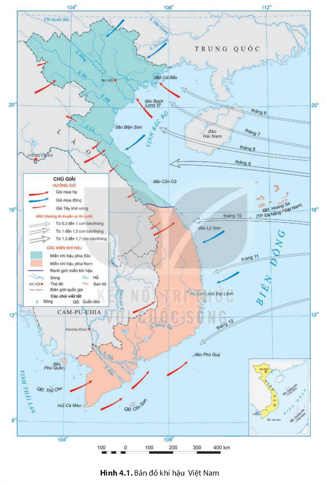
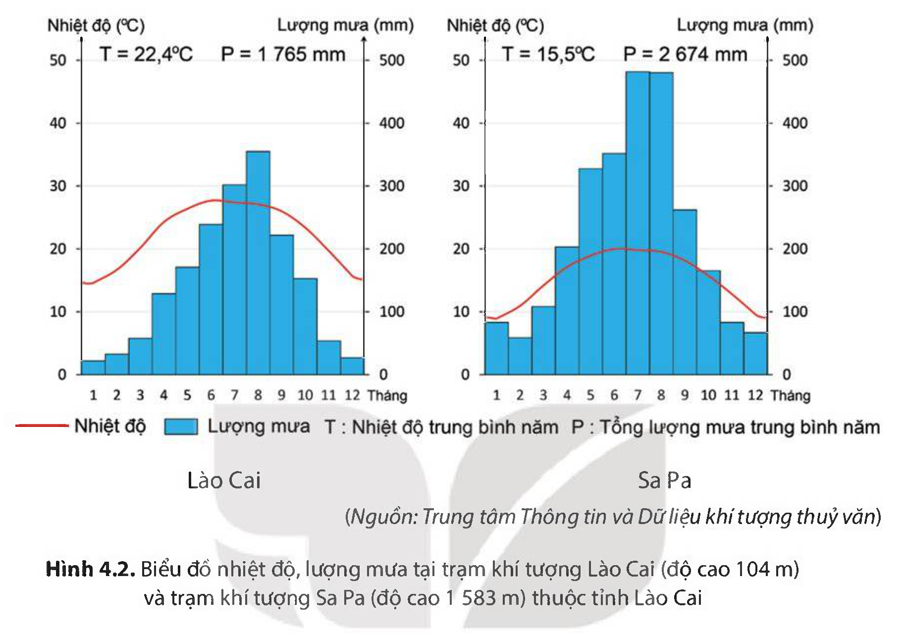

<!-- pdf:115 -->

# BÀI 4: KHÍ HẬU VIỆT NAM

## 🎯 Học xong bài này, em sẽ:

- Trình bày được đặc điểm khí hậu nhiệt đới ẩm gió mùa của Việt Nam.
- Chứng minh được sự phân hoá đa dạng của khí hậu Việt Nam.

## 🔴 Mở đầu

Khí hậu Việt Nam mang tính chất nhiệt đới ẩm gió mùa và có sự phân hoá đa dạng. Các tính chất đó được biểu hiện như thế nào? Hãy liên hệ với khí hậu ở địa phương em.

## 1. Khí hậu nhiệt đới ẩm gió mùa

### a) Tính chất nhiệt đới

Tính nhiệt đới của khí hậu Việt Nam được thể hiện qua:

<!-- term: Tính chất nhiệt đới của khí hậu Việt Nam -->
- Nhiệt độ không khí trung bình năm trên cả nước đều lớn hơn 20°C (trừ vùng núi cao) và tăng dần từ bắc vào nam.

<!-- term: Tính chất nhiệt đới của khí hậu Việt Nam -->
- Số giờ nắng đạt từ 1 400 – 3 000 giờ/năm, cán cân bức xạ từ 70 – 100 kcal/cm²/năm.

Bảng 4.1. NHIỆT ĐỘ KHÔNG KHÍ TRUNG BÌNH THÁNG, NĂM TẠI TRẠM KHÍ TƯỢNG LẠNG SƠN VÀ CÀ MAU (°C)

| TRẠM | 1 | 2 | 3 | 4 | 5 | 6 | 7 | 8 | 9 | 10 | 11 | 12 | TB năm |
| --- | :---: | :---: | :---: | :---: | :---: | :---: | :---: | :---: | :---: | :---: | :---: | :---: | :---: |
| Lạng Sơn Độ cao 259 m Vĩ độ: 21°50'B | 13,4 | 15,4 | 18,3 | 22,6 | 25,7 | 27,2 | 27,2 | 26,7 | 25,4 | 22,5 | 18,8 | 14,7 | 21,5 |
| Cà Mau Độ cao 0,9 m Vĩ độ: 9°11'B | 26,2 | 26,6 | 27,9 | 29,0 | 28,8 | 28,0 | 27,6 | 27,6 | 27,4 | 27,3 | 27,3 | 26,6 | 27,5 |
<!-- ocr-ok: đã đối chiếu ảnh trang gốc PDF 115 (trang in 113), bảng số liệu 12 tháng bị OCR ghép vạch cột với chữ số -->

*(Nguồn: Trung tâm Thông tin và Dữ liệu khí tượng thuỷ văn)*

<!-- pdf:116 -->

> ❓ Dựa vào thông tin mục a, bảng 4.1, hãy trình bày tính chất nhiệt đới của khí hậu Việt Nam.

### b) Tính chất ẩm

<!-- term: Tính chất ẩm của khí hậu Việt Nam -->
Nước ta có độ ẩm không khí cao, trung bình trên 80%; lượng mưa lớn, trung bình dao động từ 1 500 – 2 000 mm/năm.

Bảng 4.2. LƯỢNG MƯA VÀ ĐỘ ẨM KHÔNG KHÍ TRUNG BÌNH THÁNG TẠI TRẠM KHÍ TƯỢNG HÀ ĐÔNG (HÀ NỘI)

| Tháng | 1 | 2 | 3 | 4 | 5 | 6 | 7 | 8 | 9 | 10 | 11 | 12 |
| --- | :---: | :---: | :---: | :---: | :---: | :---: | :---: | :---: | :---: | :---: | :---: | :---: |
| Lượng mưa (mm) | 28,4 | 21,5 | 48,4 | 79,3 | 187,0 | 220,8 | 275,6 | 318,6 | 226,7 | 181,4 | 84,9 | 51,6 |
| Độ ẩm (%) | 82,4 | 84,6 | 86,0 | 87,0 | 84,5 | 81,1 | 81,9 | 85,3 | 85,4 | 81,8 | 81,1 | 79,7 |
<!-- ocr-ok: đã đối chiếu ảnh trang gốc PDF 116 (trang in 114), bảng số liệu 12 tháng bị OCR ghép vạch cột với chữ số và dấu phẩy -->

*(Nguồn: Trung tâm Thông tin và Dữ liệu khí tượng thuỷ văn)*

> ❓ Dựa vào thông tin mục b và bảng 4.2, hãy nêu tính chất ẩm của khí hậu nước ta.

### c) Tính chất gió mùa

Việt Nam nằm trong phạm vi hoạt động của Tín phong bán cầu Bắc. Mặt khác, nước ta còn chịu ảnh hưởng mạnh mẽ của các khối khí hoạt động theo mùa:

<!-- term: Gió mùa đông ở Việt Nam -->
- Gió mùa đông (từ tháng 11 đến tháng 4 năm sau): Miền Bắc chịu ảnh hưởng của khối khí lạnh từ phía Bắc di chuyển xuống nước ta tạo nên một mùa đông lạnh (nửa đầu mùa đông có thời tiết lạnh, khô; nửa cuối mùa đông có thời tiết lạnh, ẩm). Từ phía nam dãy Bạch Mã trở vào, Tín phong bán cầu Bắc có hướng đông bắc chiếm ưu thế gây mưa cho vùng biển Nam Trung Bộ; còn ở Tây Nguyên và Nam Bộ thời tiết nóng, khô.

<!-- term: Gió mùa hạ ở Việt Nam -->
- Gió mùa hạ (từ tháng 5 đến tháng 10): Chủ yếu có hướng tây nam. Vào đầu mùa hạ, gió Tây Nam thổi từ Bắc Ấn Độ Dương gây mưa lớn cho đồng bằng Nam Bộ và Tây Nguyên. Khi vượt qua dãy Trường Sơn và các dãy núi chạy dọc biên giới Việt – Lào, tính chất của gió thay đổi do hiệu ứng phơn khiến phía đông dãy Trường Sơn và phía nam khu vực Tây Bắc có thời tiết khô nóng (gió Tây khô nóng). Vào giữa và cuối mùa hạ, gió mùa Tây Nam xuất phát từ bán cầu Nam di chuyển lên, kết hợp với ảnh hưởng của dải hội tụ nhiệt đới tạo nên thời tiết nóng ẩm, mưa nhiều phổ biến trên cả nước. Hiện tượng thời tiết cực đoan trong mùa này là bão kèm theo mưa lớn.

<!-- pdf:117 -->

*Hình 4.1. Bản đồ khí hậu Việt Nam*

> ❓ Dựa vào thông tin mục c và hình 4.1, hãy trình bày đặc điểm gió mùa của khí hậu Việt Nam.

<!-- pdf:118 -->

## 2. Sự phân hoá đa dạng của khí hậu Việt Nam

### a) Phân hoá theo chiều bắc – nam

Khí hậu trên phần đất liền của Việt Nam có thể chia thành hai miền:

<!-- term: Miền khí hậu phía Bắc -->
- Miền khí hậu phía Bắc, từ dãy Bạch Mã trở ra. Nhiệt độ không khí trung bình năm trên 20°C. Mùa đông do ảnh hưởng của gió mùa Đông Bắc nên có 2 đến 3 tháng lạnh với nhiệt độ trung bình tháng dưới 18°C, nửa đầu mùa đông tương đối khô và nửa cuối mùa đông ẩm ướt. Mùa hạ nóng, ẩm và mưa nhiều.

<!-- term: Miền khí hậu phía Nam -->
- Miền khí hậu phía Nam, từ dãy Bạch Mã trở vào. Nhiệt độ không khí trung bình năm trên 25°C và không có tháng nào dưới 20°C, biên độ nhiệt độ trung bình năm nhỏ hơn 9°C; khí hậu phân hoá thành hai mùa rõ rệt: mùa mưa và mùa khô.

> 💡 **Em có biết?**
>
> Một số tiêu chí so sánh hai miền khí hậu:
>
> | Miền khí hậu | Phía Bắc | Phía Nam |
> | --- | :---: | :---: |
> | Biên độ nhiệt độ trung bình năm | ≥ 9°C | < 9°C |
> | Lượng bức xạ tổng cộng trung bình năm | ≤ 140 kcal/cm²/năm | > 140 kcal/cm²/năm |
> | Số giờ nắng trung bình năm | ≤ 2 000 giờ | > 2 000 giờ |

### b) Phân hoá theo chiều đông – tây

Theo chiều đông – tây, khí hậu nước ta có sự phân hoá giữa vùng biển và đất liền, giữa vùng đồng bằng ở phía đông và vùng núi ở phía tây.

- Vùng biển có khí hậu ôn hoà hơn trong đất liền.
- Vùng đồng bằng ven biển có khí hậu nhiệt đới ẩm gió mùa.
- Vùng đồi núi phía tây khí hậu phân hoá phức tạp do tác động của gió mùa và hướng của các dãy núi.

### c) Phân hoá theo độ cao

Khí hậu Việt Nam có sự phân hoá theo độ cao. Từ thấp lên cao, nước ta có ba đai khí hậu.

<!-- term: Đai khí hậu nhiệt đới gió mùa -->
- Ở dưới thấp (miền Bắc đến độ cao 600 – 700 m, miền Nam đến độ cao 900 – 1 000 m) có khí hậu nhiệt đới gió mùa. Mùa hạ nóng, nhiệt độ trung bình các tháng mùa hạ đều trên 25°C. Độ ẩm và lượng mưa thay đổi tuỳ nơi.

<!-- term: Đai khí hậu cận nhiệt đới gió mùa trên núi -->
- Lên cao hơn (đến dưới 2 600 m) có khí hậu cận nhiệt đới gió mùa trên núi. Nhiệt độ trung bình các tháng đều dưới 25°C, lượng mưa và độ ẩm tăng lên.

<!-- pdf:119 -->

<!-- term: Đai khí hậu ôn đới gió mùa trên núi -->
- Từ độ cao 2 600 m trở lên có khí hậu ôn đới gió mùa trên núi, tất cả các tháng có nhiệt độ trung bình dưới 15°C.

*Hình 4.2. Biểu đồ nhiệt độ, lượng mưa tại trạm khí tượng Lào Cai (độ cao 104 m) và trạm khí tượng Sa Pa (độ cao 1 583 m) thuộc tỉnh Lào Cai*

> ❓ Dựa vào thông tin mục 2 và hình 4.2, hãy:
> 1. Nhận xét nhiệt độ, lượng mưa ở hai trạm khí tượng Lào Cai và Sa Pa. Từ đó nêu sự phân hoá khí hậu theo độ cao.
> 2. Chứng minh sự phân hoá đa dạng của khí hậu Việt Nam.

## ✏️ Luyện tập – Vận dụng

- Dựa vào bảng 4.1, hãy nhận xét sự khác nhau về chế độ nhiệt (nhiệt độ trung bình năm; nhiệt độ trung bình tháng nóng nhất, lạnh nhất; biên độ nhiệt độ năm) giữa Lạng Sơn và Cà Mau.
- Tìm hiểu và cho biết đặc điểm khí hậu ở địa phương em.

## 📷 Danh sách hình trong bài

| Mã hình | Trang PDF | Trang sách | Chú thích |
| --- | :---: | :---: | --- |
| H8-lich_su_va_dia_ly-dl-b04-01 | 117 | 115 | Hình 4.1. Bản đồ khí hậu Việt Nam |
| H8-lich_su_va_dia_ly-dl-b04-02 | 119 | 117 | Hình 4.2. Biểu đồ nhiệt độ, lượng mưa tại trạm khí tượng Lào Cai (độ cao 104 m) và trạm khí tượng Sa Pa (độ cao 1 583 m) thuộc tỉnh Lào Cai |
