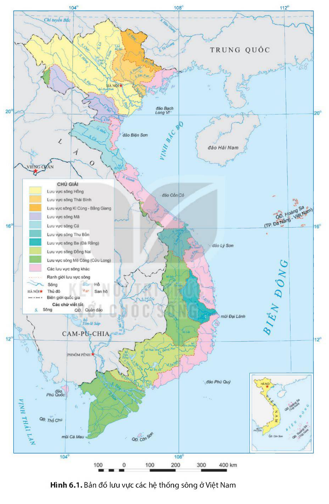
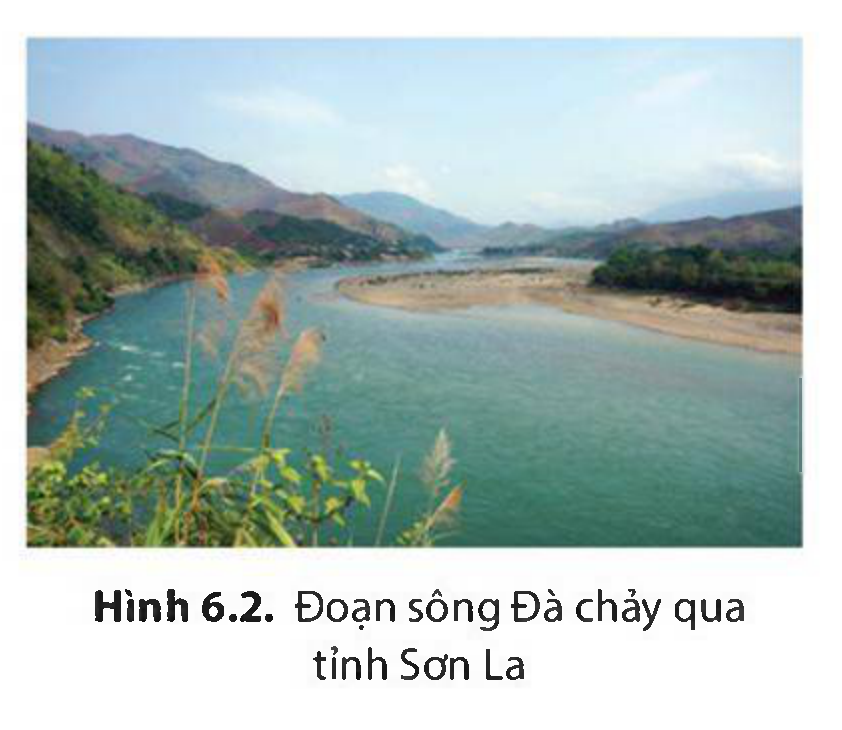
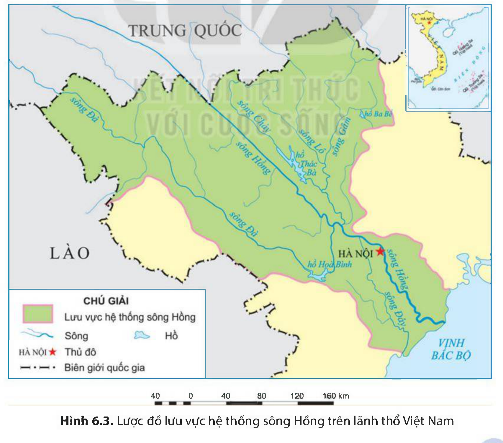
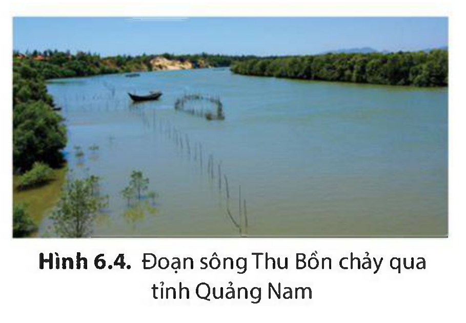
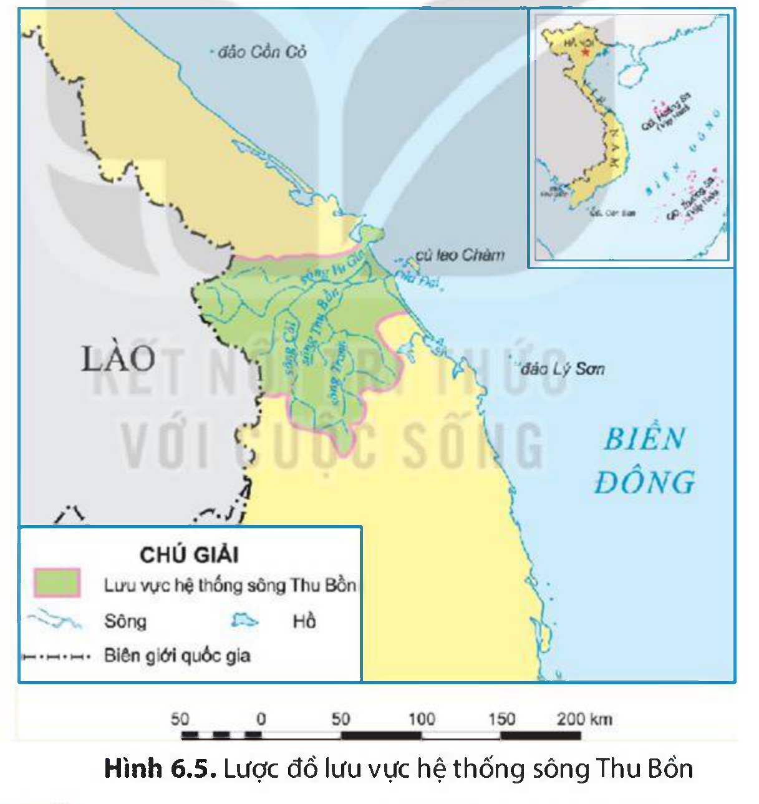
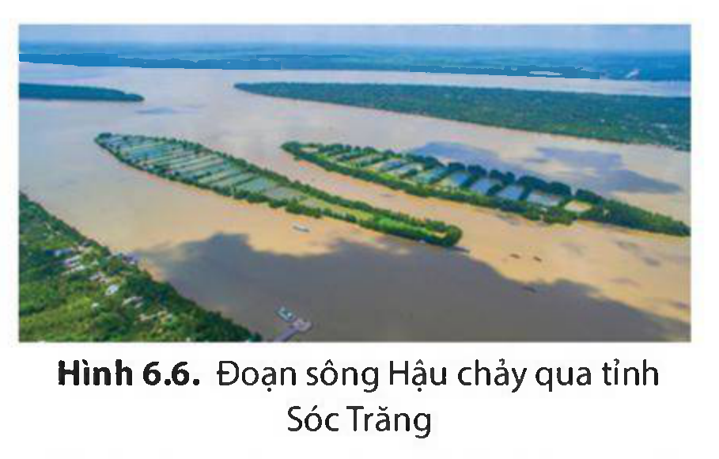
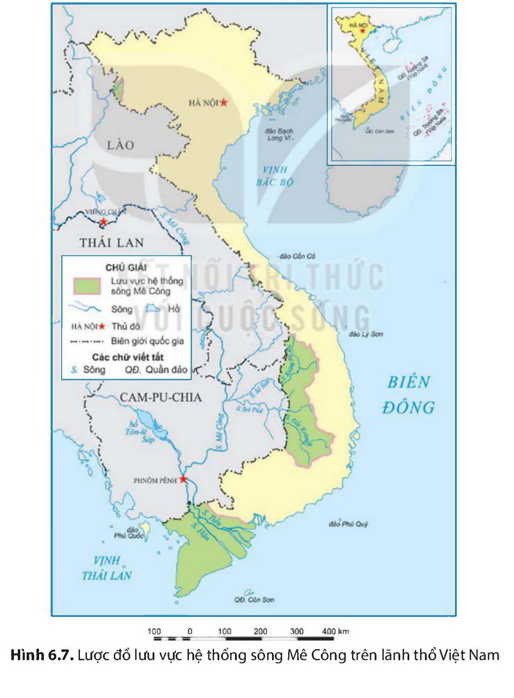
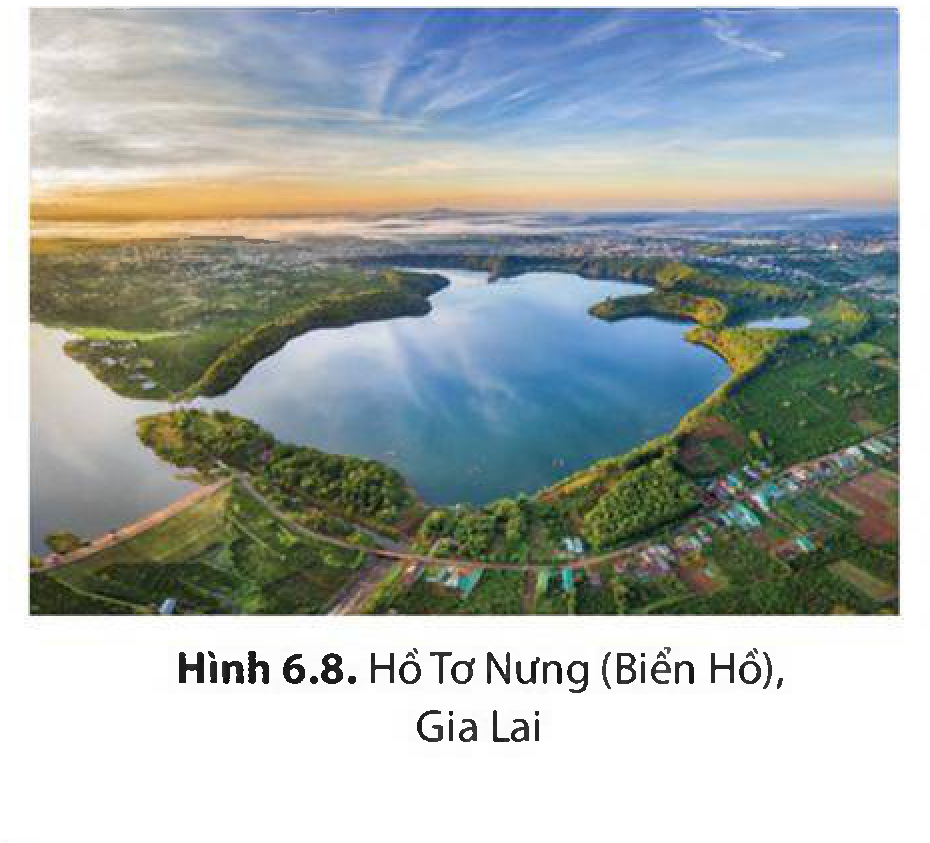
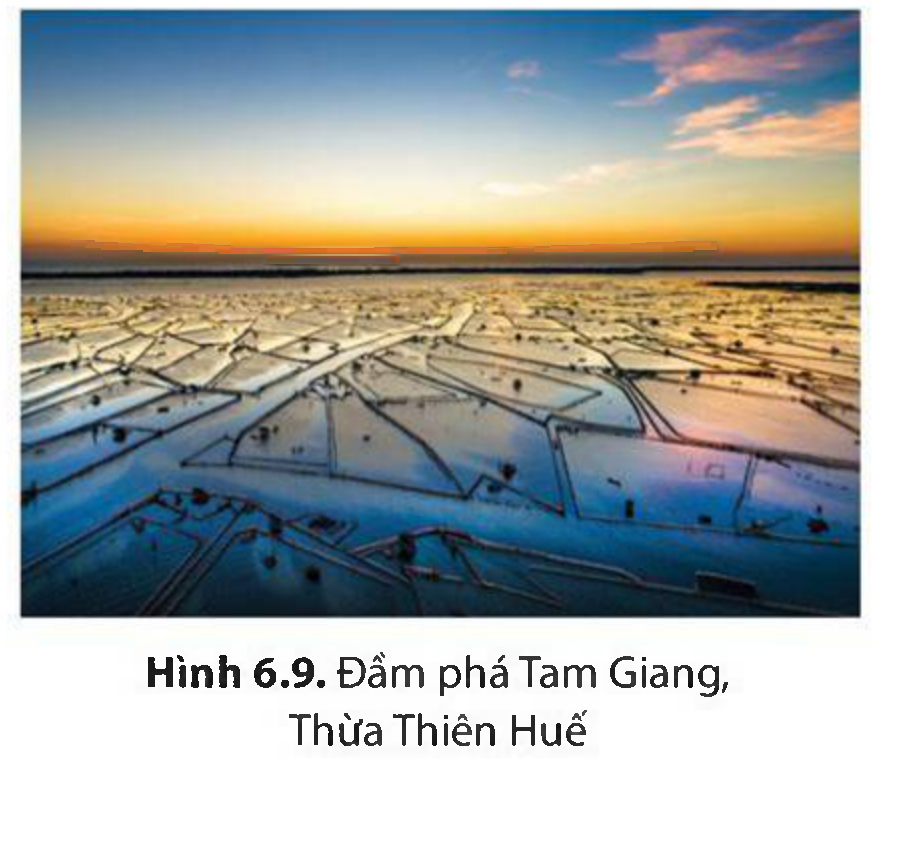

<!-- pdf:121 -->

# BÀI 6: THUỶ VĂN VIỆT NAM

## 🎯 Học xong bài này, em sẽ:

- Xác định được trên bản đồ lưu vực của các hệ thống sông lớn.
- Phân tích được đặc điểm mạng lưới sông và chế độ nước sông của một số hệ thống sông lớn.
- Phân tích được vai trò của hồ, đầm và nước ngầm đối với sản xuất và sinh hoạt.

## 🔴 Mở đầu

Nước ta có hệ thống sông, hồ, đầm, nước ngầm phong phú với nguồn nước dồi dào. Đây là tài nguyên có ý nghĩa quan trọng đối với đời sống và sản xuất. Hãy kể tên một số sông, hồ, đầm ở nước ta mà em biết.

## 1. Sông ngòi

### a) Đặc điểm chung

<!-- term: Sông ngòi Việt Nam -->
- Nước ta có mạng lưới sông ngòi dày đặc, phân bố rộng khắp trên cả nước. Nước ta có 2 360 con sông có chiều dài trên 10 km. Sông ở nước ta chủ yếu là sông nhỏ.

<!-- term: Sông ngòi Việt Nam -->
- Sông ngòi nước ta phần lớn chảy theo hai hướng chính là tây bắc – đông nam và vòng cung, một số sông chảy theo hướng tây – đông,...

<!-- term: Sông ngòi Việt Nam -->
- Chế độ dòng chảy của sông ngòi nước ta phân hai mùa rất rõ rệt: mùa lũ và mùa cạn, do ảnh hưởng của khí hậu nhiệt đới gió mùa. Trung bình lượng nước trong mùa lũ chiếm tới 70 – 80% tổng lượng nước cả năm.

<!-- term: Sông ngòi Việt Nam -->
- Sông ngòi nước ta có nhiều nước (hơn 800 tỉ m³/năm) và lượng phù sa khá lớn (tổng lượng phù sa khoảng 200 triệu tấn/năm).

> ❓ Đọc thông tin mục a và quan sát hình 6.1, hãy:
> 1. Xác định phạm vi lưu vực của ba hệ thống sông: Hồng, Thu Bồn, Mê Công ở lãnh thổ Việt Nam trên bản đồ.
> 2. Trình bày đặc điểm mạng lưới sông ngòi nước ta.

<!-- pdf:122 -->

*Hình 6.1. Bản đồ lưu vực các hệ thống sông ở Việt Nam*

<!-- pdf:123 -->

### b) Một số hệ thống sông lớn

\* *Hệ thống sông Hồng*

- Đặc điểm mạng lưới sông:

<!-- term: Hệ thống sông Hồng -->
Tiêu biểu cho sông ngòi Bắc Bộ là hệ thống sông Hồng. Đây là hệ thống sông lớn thứ hai ở nước ta sau hệ thống sông Mê Công.

<!-- term: Hệ thống sông Hồng -->
Hệ thống sông Hồng trên lãnh thổ Việt Nam dài 556 km, có hai phụ lưu chính là sông Đà và sông Lô. Tất cả các phụ lưu lớn hợp với dòng chính sông Hồng tạo thành một mạng lưới sông hình nan quạt, hội tụ tại Việt Trì (Phú Thọ).

*Hình 6.2. Đoạn sông Đà chảy qua tỉnh Sơn La*

- Chế độ nước sông:

<!-- term: Hệ thống sông Hồng -->
Chế độ nước của hệ thống sông Hồng có hai mùa: mùa lũ bắt đầu từ tháng 6 và kết thúc vào tháng 10 phù hợp với mùa mưa, lượng nước mùa lũ chiếm khoảng 75% tổng lượng nước cả năm; mùa cạn bắt đầu từ tháng 11 và kết thúc vào tháng 5 năm sau, lượng nước mùa cạn chỉ chiếm khoảng 25% tổng lượng nước cả năm.

Do mạng lưới sông có dạng nan quạt, nên khi mưa lớn, nước tập trung nhanh, dễ gây lũ lụt.

*Hình 6.3. Lược đồ lưu vực hệ thống sông Hồng trên lãnh thổ Việt Nam*

<!-- pdf:124 -->

\* *Hệ thống sông Thu Bồn*

- Đặc điểm mạng lưới sông:

<!-- term: Hệ thống sông Thu Bồn -->
Hệ thống sông Thu Bồn có tổng chiều dài 205 km, với 78 phụ lưu chiều dài trên 10 km. Các sông, suối trong hệ thống sông thường ngắn và dốc, phân thành nhiều lưu vực nhỏ độc lập. Mạng lưới sông có dạng nan quạt.

*Hình 6.4. Đoạn sông Thu Bồn chảy qua tỉnh Quảng Nam*

- Chế độ nước sông:

<!-- term: Hệ thống sông Thu Bồn -->
Chế độ nước của hệ thống sông Thu Bồn chia làm hai mùa rõ rệt. Mùa lũ diễn ra từ tháng 9 đến tháng 12 phù hợp với mùa mưa thu đông và mùa bão, lượng nước mùa lũ chiếm khoảng 65% tổng lượng nước cả năm. Mùa cạn kéo dài từ tháng 1 đến tháng 8, chiếm khoảng 35% tổng lượng nước cả năm.

Do đặc điểm của địa hình, khí hậu và mạng lưới sông, lũ tại hệ thống sông Thu Bồn lên rất nhanh và đột ngột, nhất là khi gặp bão và mưa lớn.

*Hình 6.5. Lược đồ lưu vực hệ thống sông Thu Bồn*

> 💡 **Em có biết?**
>
> Trước đây, sông Mê Công đổ ra Biển Đông qua chín cửa sông là các cửa: Tiểu, Đại, Ba Lai, Hàm Luông, Cổ Chiên, Cung Hầu, Định An, Bát Xắc, Tranh Đề. Hiện nay, do quá trình bồi lấp phù sa nên cửa sông Bát Xắc không còn.
<!-- ocr-ok: đã đối chiếu ảnh trang gốc PDF 124 (trang in 122), hộp Em có biết? ở cột trái bị OCR trộn dòng với cột phải -->

\* *Hệ thống sông Mê Công*

- Đặc điểm mạng lưới sông:

<!-- term: Hệ thống sông Mê Công -->
Mê Công là một trong những hệ thống sông lớn trên thế giới, chảy qua 6 quốc gia. Trong phần lưu vực trên lãnh thổ Việt Nam, sông có chiều dài hơn 230 km. Sông Mê Công có nhiều phụ lưu, riêng ở Việt Nam có 286 phụ lưu, lớn nhất là sông Srê Pốk. Mạng lưới sông có hình lông chim. Hai chi lưu lớn ở Việt Nam là sông Tiền và sông Hậu, được chia ra thành nhiều sông nhỏ cùng hệ thống kênh rạch chằng chịt.
<!-- ocr-ok: đã đối chiếu ảnh trang gốc PDF 124–125 (trang in 122–123), đoạn đầu ở cột phải trang 124 bị OCR trộn dòng với hộp Em có biết? bên trái -->

<!-- pdf:125 -->

*Hình 6.6. Đoạn sông Hậu chảy qua tỉnh Sóc Trăng*

- Chế độ nước sông:

<!-- term: Hệ thống sông Mê Công -->
Chế độ nước của hệ thống sông Mê Công có hai mùa: mùa lũ kéo dài từ tháng 7 đến tháng 11, lượng nước mùa lũ chiếm khoảng 80% tổng lượng nước cả năm; mùa cạn từ tháng 12 đến tháng 6 năm sau, lượng nước mùa cạn chỉ chiếm khoảng 20% tổng lượng nước cả năm. Nhờ mạng lưới sông dạng lông chim và được điều tiết bởi hồ Tôn-lê Sáp (Cam-pu-chia) nên vào mùa lũ nước lên và xuống chậm.

*Hình 6.7. Lược đồ lưu vực hệ thống sông Mê Công trên lãnh thổ Việt Nam*

<!-- pdf:126 -->

> ❓ Dựa vào thông tin và hình 6.3, 6.5, 6.7 trong mục b, hãy phân tích đặc điểm mạng lưới và chế độ nước của một trong ba hệ thống sông.

## 2. Hồ, đầm

<!-- term: Hồ, đầm ở Việt Nam -->
Do có lượng mưa lớn và nhiều vùng trũng có khả năng chứa nước nên Việt Nam có nhiều hồ, đầm tự nhiên. Ngoài ra, nước ta còn có nhiều hồ nhân tạo (hồ thuỷ lợi, hồ thuỷ điện, hồ điều hoà,...). Hồ, đầm có vai trò quan trọng đối với sản xuất và sinh hoạt ở nước ta.

- Đối với sản xuất:

  + Nông nghiệp: Các hồ, đầm nước ngọt là nguồn cung cấp nước cho trồng trọt và chăn nuôi. Hồ, đầm là mặt nước tự nhiên để nuôi trồng, đánh bắt thuỷ sản nước ngọt, nước lợ và nước mặn như đầm phá Tam Giang (Thừa Thiên Huế), đầm Thị Nại (Bình Định), hồ thuỷ điện Hoà Bình,...

  + Công nghiệp: Các hồ thuỷ điện (Hoà Bình, Sơn La, Ialy,...) là nơi trữ nước cho nhà máy thuỷ điện. Hồ cung cấp nước cho các ngành công nghiệp như: chế biến lương thực – thực phẩm, khai khoáng,...

  + Dịch vụ: Một số hồ, đầm thông với các sông, biển có giá trị về giao thông. Nhiều hồ, đầm có cảnh quan đẹp, hệ sinh thái với tính đa dạng sinh học cao, khí hậu trong lành được khai thác để phát triển du lịch, như hồ Tơ Nưng (Gia Lai), hồ Ba Bể (Bắc Kạn),...
<!-- ocr-ok: đã đối chiếu ảnh trang gốc PDF 126 (trang in 124), cột chữ phải bị OCR trộn dòng với hộp Em có biết? bên trái -->

- Đối với sinh hoạt:

  + Phục vụ nhu cầu nước trong sinh hoạt, là nguồn dự trữ nước ngọt lớn.
<!-- ocr-ok: đã đối chiếu ảnh trang gốc PDF 126 (trang in 124), cột chữ phải bị OCR trộn dòng với hộp Em có biết? bên trái -->

  + Đóng vai trò đảm bảo an ninh nguồn nước, nhất là ở các khu vực có mùa khô sâu sắc.
<!-- ocr-ok: đã đối chiếu ảnh trang gốc PDF 126 (trang in 124), cột chữ phải bị OCR trộn dòng với hộp Em có biết? bên trái -->

> 💡 **Em có biết?**
>
> Hồ Ba Bể (Bắc Kạn) nằm trên độ cao 145 m so với mực nước biển, là hồ tự nhiên lớn nhất nước ta. Hồ có vai trò quan trọng về đa dạng sinh học và giúp điều tiết dòng chảy cho sông Năng. Đây cũng là địa điểm du lịch nổi tiếng thu hút nhiều khách du lịch trong và ngoài nước.
<!-- ocr-ok: đã đối chiếu ảnh trang gốc PDF 126 (trang in 124), hộp Em có biết? ở cột trái bị OCR trộn dòng với cột phải -->

*Hình 6.8. Hồ Tơ Nưng (Biển Hồ), Gia Lai*
<!-- ocr-ok: đã đối chiếu ảnh trang gốc PDF 126 (trang in 124), chú thích hai ảnh ngang hàng Hình 6.8 và Hình 6.9 bị OCR trộn dòng -->

*Hình 6.9. Đầm phá Tam Giang, Thừa Thiên Huế*
<!-- ocr-ok: đã đối chiếu ảnh trang gốc PDF 126 (trang in 124), chú thích hai ảnh ngang hàng Hình 6.8 và Hình 6.9 bị OCR trộn dòng -->

<!-- pdf:127 -->

> ❓ Dựa vào thông tin và hình 6.8, 6.9 trong mục 2, hãy phân tích vai trò của hồ, đầm đối với sản xuất và sinh hoạt ở nước ta.

## 3. Nước ngầm

<!-- term: Nước ngầm ở Việt Nam -->
Nước ta có nguồn nước ngầm khá phong phú, phân bố khắp cả nước. Nước ngầm có vai trò quan trọng đối với sản xuất và sinh hoạt của con người.

- Đối với sản xuất:

  + Nông nghiệp: Nước ngầm cung cấp nước cho sản xuất nông nghiệp (trồng trọt, chăn nuôi, nuôi trồng thuỷ sản,...) đặc biệt với các vùng khan hiếm nước mặt như Tây Nguyên, duyên hải Nam Trung Bộ.

  + Công nghiệp: Nước ngầm được sử dụng trong nhiều ngành công nghiệp như: chế biến lương thực – thực phẩm, sản xuất giấy,...

  + Dịch vụ: Một số nguồn nước nóng, nước khoáng được khai thác để chữa bệnh và phát triển du lịch nghỉ dưỡng.

- Đối với sinh hoạt: Nước ngầm là nguồn nước quan trọng phục vụ cho sinh hoạt của người dân ở nước ta.

> ❓ Dựa vào thông tin mục 3, hãy phân tích vai trò của nước ngầm đối với sản xuất và sinh hoạt ở nước ta.

## ✏️ Luyện tập – Vận dụng

- 1. Cho biết thời gian mùa lũ, mùa cạn của ba hệ thống sông: Hồng, Thu Bồn, Mê Công, theo bảng mẫu dưới đây vào vở:

| Chế độ nước \ Hệ thống sông | Hồng | Thu Bồn | Mê Công |
| --- | :---: | :---: | :---: |
| Thời gian mùa lũ | ? | ? | ? |
| Thời gian mùa cạn | ? | ? | ? |
<!-- ocr-ok: đã đối chiếu ảnh trang gốc PDF 127 (trang in 125), dấu hỏi chấm trong bảng mẫu bị OCR đọc nhầm thành số 2 -->

  2. Xác định vị trí của một số sông, hồ của nước ta trên bản đồ hình 6.1.
- Tìm hiểu về vai trò của một dòng sông hoặc hồ ở nước ta đối với sinh hoạt và sản xuất.

## 📷 Danh sách hình trong bài

| Mã hình | Trang PDF | Trang sách | Chú thích |
| --- | :---: | :---: | --- |
| H8-lich_su_va_dia_ly-dl-b06-01 | 122 | 120 | Hình 6.1. Bản đồ lưu vực các hệ thống sông ở Việt Nam |
| H8-lich_su_va_dia_ly-dl-b06-02 | 123 | 121 | Hình 6.2. Đoạn sông Đà chảy qua tỉnh Sơn La |
| H8-lich_su_va_dia_ly-dl-b06-03 | 123 | 121 | Hình 6.3. Lược đồ lưu vực hệ thống sông Hồng trên lãnh thổ Việt Nam |
| H8-lich_su_va_dia_ly-dl-b06-04 | 124 | 122 | Hình 6.4. Đoạn sông Thu Bồn chảy qua tỉnh Quảng Nam |
| H8-lich_su_va_dia_ly-dl-b06-05 | 124 | 122 | Hình 6.5. Lược đồ lưu vực hệ thống sông Thu Bồn |
| H8-lich_su_va_dia_ly-dl-b06-06 | 125 | 123 | Hình 6.6. Đoạn sông Hậu chảy qua tỉnh Sóc Trăng |
| H8-lich_su_va_dia_ly-dl-b06-07 | 125 | 123 | Hình 6.7. Lược đồ lưu vực hệ thống sông Mê Công trên lãnh thổ Việt Nam |
| H8-lich_su_va_dia_ly-dl-b06-08 | 126 | 124 | Hình 6.8. Hồ Tơ Nưng (Biển Hồ), Gia Lai |
| H8-lich_su_va_dia_ly-dl-b06-09 | 126 | 124 | Hình 6.9. Đầm phá Tam Giang, Thừa Thiên Huế |
