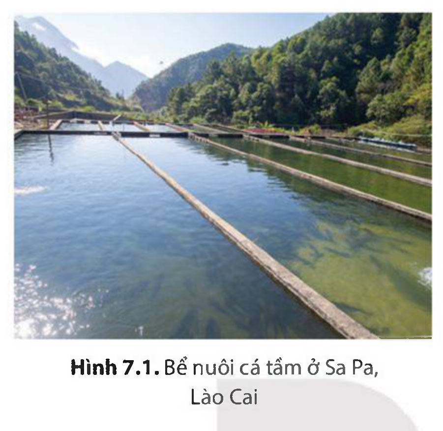
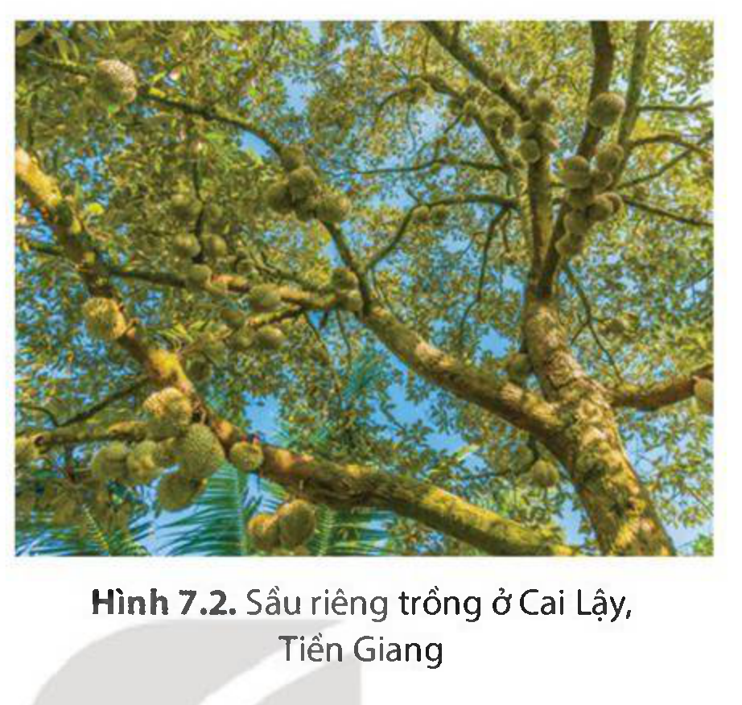
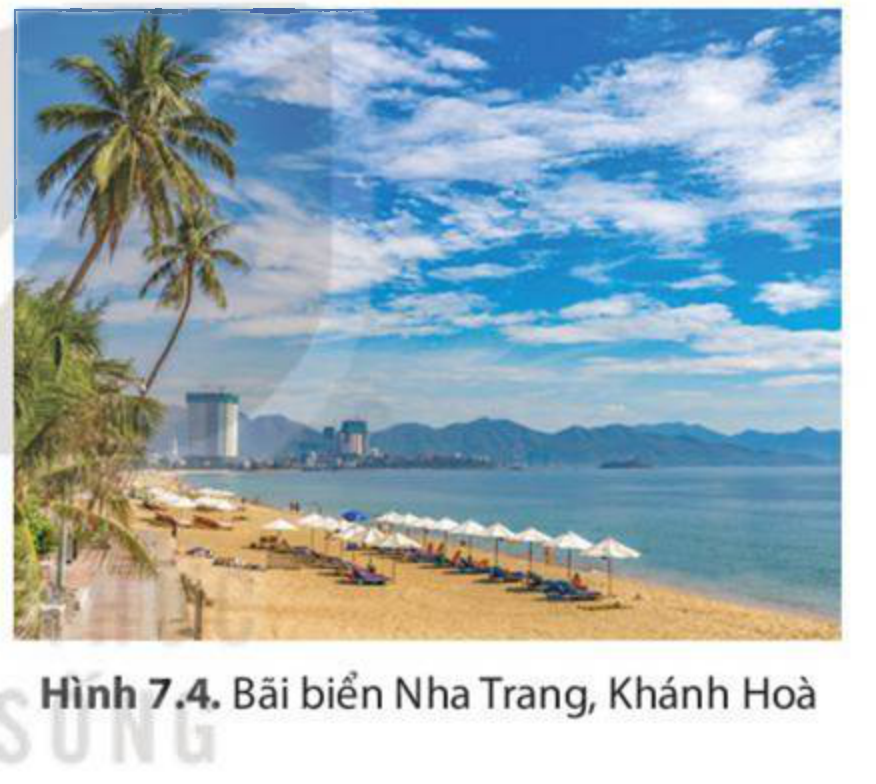
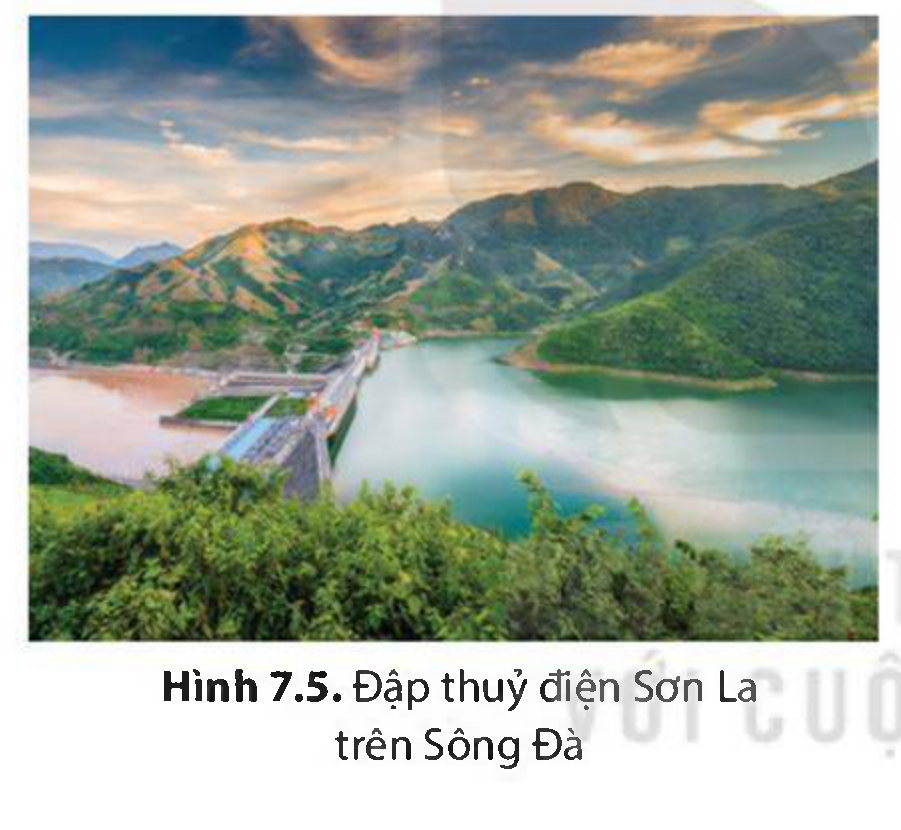
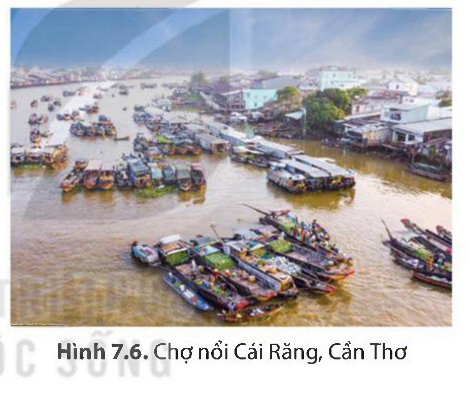

<!-- pdf:128 -->

# BÀI 7: VAI TRÒ CỦA TÀI NGUYÊN KHÍ HẬU VÀ TÀI NGUYÊN NƯỚC ĐỐI VỚI SỰ PHÁT TRIỂN KINH TẾ – XÃ HỘI CỦA NƯỚC TA

## 🎯 Học xong bài này, em sẽ:

- Phân tích được ảnh hưởng của khí hậu đối với sản xuất nông nghiệp.
- Phân tích được vai trò của khí hậu đối với sự phát triển du lịch ở một số điểm du lịch nổi tiếng của nước ta.
- Lấy ví dụ chứng minh được tầm quan trọng của việc sử dụng tổng hợp tài nguyên nước ở một lưu vực sông.

## 🔴 Mở đầu

Khí hậu và nguồn nước là những yếu tố có ảnh hưởng lớn tới hoạt động sản xuất và sinh hoạt của con người. Hãy lấy ví dụ về ảnh hưởng của khí hậu và nguồn nước đối với hoạt động sản xuất ở nước ta.

## 1. Ảnh hưởng của khí hậu đối với sản xuất nông nghiệp

<!-- term: Ảnh hưởng của khí hậu đối với sản xuất nông nghiệp ở Việt Nam -->
Tính chất nhiệt đới của khí hậu nước ta đã góp phần tạo nên một nền nông nghiệp nhiệt đới với nhiều sản phẩm nông nghiệp có giá trị kinh tế cao. Khí hậu nhiệt đới ẩm, với lượng nhiệt, ẩm dồi dào là điều kiện thuận lợi để cây trồng, vật nuôi phát triển, cho phép sản xuất nông nghiệp được tiến hành quanh năm, tăng vụ, tăng năng suất.
<!-- ocr-ok: đã đối chiếu ảnh trang gốc PDF 128 (trang in 126), cột chữ phải bị OCR trộn dòng với hộp Em có biết? bên trái -->

<!-- term: Ảnh hưởng của khí hậu đối với sản xuất nông nghiệp ở Việt Nam -->
Sự phân hoá khí hậu tạo nên sự khác biệt về mùa vụ giữa các vùng và sự đa dạng sản phẩm nông nghiệp trên cả nước.
<!-- ocr-ok: đã đối chiếu ảnh trang gốc PDF 128 (trang in 126), cột chữ phải bị OCR trộn dòng với hộp Em có biết? bên trái -->

> 💡 **Em có biết?**
>
> Miền khí hậu phía Bắc có khí hậu nhiệt đới gió mùa với một mùa đông lạnh và các vùng núi cao mát mẻ quanh năm thuận lợi phát triển các sản phẩm nông nghiệp cận nhiệt và ôn đới như: chè, rau ưa lạnh (su su, su hào, bắp cải, súp lơ, cà rốt,...), cây ăn quả cận nhiệt đới (lê, mận, hồng,...), cá nước lạnh (cá hồi, cá tầm).
>
> Miền khí hậu phía Nam nóng quanh năm với một mùa mưa và một mùa khô thuận lợi phát triển các cây lương thực, cây công nghiệp, cây ăn quả nhiệt đới, như: lúa, cà phê, cao su, chôm chôm, sầu riêng,...
<!-- ocr-ok: đã đối chiếu ảnh trang gốc PDF 128 (trang in 126), hộp Em có biết? ở cột trái bị OCR trộn dòng với cột phải -->

<!-- pdf:129 -->

Do chịu tác động của gió mùa và sự phân hoá khí hậu theo đai cao nên ngoài các cây trồng, vật nuôi nhiệt đới, nước ta còn phát triển các cây trồng, vật nuôi cận nhiệt và ôn đới.

*Hình 7.1. Bể nuôi cá tầm ở Sa Pa, Lào Cai*
<!-- ocr-ok: đã đối chiếu ảnh trang gốc PDF 129 (trang in 127), chú thích hai ảnh ngang hàng Hình 7.1 và Hình 7.2 bị OCR trộn dòng -->

*Hình 7.2. Sầu riêng trồng ở Cai Lậy, Tiền Giang*
<!-- ocr-ok: đã đối chiếu ảnh trang gốc PDF 129 (trang in 127), chú thích hai ảnh ngang hàng Hình 7.1 và Hình 7.2 bị OCR trộn dòng -->

Tuy nhiên, khí hậu nước ta cũng gây ra nhiều khó khăn cho sản xuất nông nghiệp. Nước ta có nhiều thiên tai như bão, lũ, hạn hán, sương muối, rét đậm, rét hại,... làm thiệt hại cho sản xuất nông nghiệp. Môi trường nóng ẩm là điều kiện thuận lợi để sâu, bệnh phát triển, ảnh hưởng đến sản lượng và chất lượng của nông sản.

> ❓ Dựa vào thông tin và các hình 7.1, 7.2 trong mục 1, hãy phân tích ảnh hưởng của khí hậu đối với sản xuất nông nghiệp.

## 2. Ảnh hưởng của khí hậu đối với hoạt động du lịch

<!-- term: Ảnh hưởng của khí hậu đối với hoạt động du lịch ở Việt Nam -->
Khí hậu có vai trò quan trọng đối với phát triển du lịch. Điều kiện khí hậu có ảnh hưởng đến một số loại hình du lịch như: du lịch biển, du lịch nghỉ dưỡng, du lịch khám phá tự nhiên,... Khí hậu nhiệt đới ẩm gió mùa, có sự phân hoá theo mùa và theo đai cao ở nước ta đã tác động trực tiếp đến sự hình thành các điểm du lịch, loại hình du lịch, mùa vụ du lịch,... Tuy nhiên, các hiện tượng thời tiết như mưa lớn, bão,... là trở ngại đối với hoạt động du lịch ngoài trời.

- Ở khu vực đồi núi, sự phân hoá của khí hậu theo độ cao tạo điều kiện phát triển các loại hình du lịch như nghỉ dưỡng, tham quan, khám phá,... Các vùng núi cao có khí hậu mát mẻ quanh năm, không khí trong lành là cơ sở để tạo nên các điểm du lịch, như: Sa Pa (Lào Cai), Tam Đảo (Vĩnh Phúc), Bà Nà (Đà Nẵng), Đà Lạt (Lâm Đồng),...

<!-- pdf:130 -->

- Sự phân hoá của khí hậu giữa miền Bắc và miền Nam ảnh hưởng đến mùa vụ du lịch của hai miền. Các hoạt động du lịch biển ở một số địa điểm như Sầm Sơn (Thanh Hoá), Cửa Lò (Nghệ An), Lăng Cô (Thừa Thiên Huế),... hầu như chỉ diễn ra vào mùa hạ; còn ở Nha Trang (Khánh Hoà), Mũi Né (Bình Thuận), Phú Quốc (Kiên Giang),... có thể diễn ra quanh năm.

> 💡 **Em có biết?**
>
> Thị xã Sa Pa (Lào Cai) ở độ cao trung bình khoảng 1 600 m so với mực nước biển, có nhiệt độ không khí trung bình năm là 15,5°C, không khí trong lành mát mẻ quanh năm thích hợp cho hoạt động nghỉ dưỡng. Vào mùa đông, đôi khi có tuyết rơi và băng giá thu hút khách du lịch đến tham quan, trải nghiệm.
>
> Thành phố Nha Trang (Khánh Hoà) là một điểm du lịch biển nổi tiếng của nước ta. Nha Trang có khí hậu nhiệt đới gió mùa, nóng quanh năm, nhiệt độ không khí trung bình năm khoảng 27°C. Điều kiện khí hậu tạo thuận lợi cho các hoạt động du lịch biển diễn ra gần như quanh năm ở Nha Trang.

*Hình 7.3. Một góc thị xã Sa Pa, Lào Cai*
<!-- ocr-ok: đã đối chiếu ảnh trang gốc PDF 130 (trang in 128), chú thích hai ảnh ngang hàng Hình 7.3 và Hình 7.4 bị OCR ghép dòng -->

*Hình 7.4. Bãi biển Nha Trang, Khánh Hoà*
<!-- ocr-ok: đã đối chiếu ảnh trang gốc PDF 130 (trang in 128), chú thích hai ảnh ngang hàng Hình 7.3 và Hình 7.4 bị OCR ghép dòng -->

> ❓ Dựa vào thông tin mục 2, các hình 7.3, 7.4 và hiểu biết cá nhân, hãy lấy ví dụ để phân tích vai trò của khí hậu đối với sự phát triển du lịch ở một số điểm du lịch nổi tiếng ở nước ta.

## 3. Tầm quan trọng của việc sử dụng tổng hợp tài nguyên nước ở một lưu vực sông

Nguồn nước sông được sử dụng vào nhiều mục đích: giao thông, du lịch, sinh hoạt, tưới tiêu, đánh bắt và nuôi trồng thuỷ sản, thuỷ điện,... Việc sử dụng tổng hợp tài nguyên nước ở một lưu vực sông có vai trò quan trọng đối với sản xuất và sinh hoạt của người dân. Ở nước ta, nguồn nước của một số lưu vực sông chưa được sử dụng hiệu quả cho nhiều mục đích dẫn đến lãng phí và ô nhiễm nguồn nước.

<!-- term: Sử dụng tổng hợp tài nguyên nước sông -->
Sử dụng tổng hợp tài nguyên nước sông sẽ mang lại hiệu quả kinh tế cao, đáp ứng được nhu cầu sử dụng nước của các ngành kinh tế, hạn chế lãng phí nước và bảo vệ tài nguyên nước, bảo vệ các hệ sinh thái ở lưu vực sông; đồng thời góp phần phòng chống thiên tai (bão, lũ) trong bối cảnh biến đổi khí hậu.

<!-- pdf:131 -->

> 💡 **Em có biết?**
>
> Ở lưu vực sông Hồng có các hồ chứa nước được xây dựng với nhiều mục đích: phát triển thuỷ điện, giao thông đường thuỷ, du lịch, cung cấp nước cho sản xuất (trồng trọt, nuôi trồng và đánh bắt thuỷ sản,...) và sinh hoạt,... Các hồ chứa nước này góp phần quan trọng vào việc sử dụng tổng hợp tài nguyên nước ở lưu vực sông Hồng, đồng thời bảo vệ tài nguyên nước trước nguy cơ suy giảm về chất lượng và số lượng.
>
> Ở lưu vực sông Cửu Long (sông Mê Công) có tình trạng thiếu nước ngọt cho sản xuất và sinh hoạt vào mùa khô; cùng với tác động của biến đổi khí hậu, mực nước biển dâng càng khiến xâm nhập mặn, hạn hán diễn ra trầm trọng hơn. Để khắc phục tình trạng đó, cần đẩy mạnh việc sử dụng tổng hợp tài nguyên nước ở lưu vực sông Cửu Long thông qua biện pháp cải tạo, mở rộng hệ thống kênh rạch vừa góp phần đảm bảo nước cho sinh hoạt và sản xuất (trồng trọt, nuôi trồng thuỷ sản,...), vừa phòng chống thiên tai (lũ lụt, hạn hán, xâm nhập mặn). Trong quá trình sử dụng tổng hợp tài nguyên nước ở lưu vực sông Cửu Long cần chú ý đến vấn đề bảo vệ chất lượng nguồn nước.

*Hình 7.5. Đập thuỷ điện Sơn La trên Sông Đà*

*Hình 7.6. Chợ nổi Cái Răng, Cần Thơ*
<!-- ocr-ok: đã đối chiếu ảnh trang gốc PDF 131 (trang in 129), chú thích Hình 7.6 ở cột phải bị OCR bỏ sót -->

> ❓ Dựa vào thông tin mục 3, hãy lấy ví dụ chứng minh được tầm quan trọng của việc sử dụng tổng hợp tài nguyên nước ở một lưu vực sông.

## ✏️ Luyện tập – Vận dụng

- Sự phân hoá khí hậu ở nước ta có ảnh hưởng như thế nào đến hoạt động du lịch.
- Tìm hiểu việc sử dụng tổng hợp tài nguyên nước ở một lưu vực sông của nước ta.

## 📷 Danh sách hình trong bài

| Mã hình | Trang PDF | Trang sách | Chú thích |
| --- | :---: | :---: | --- |
| H8-lich_su_va_dia_ly-dl-b07-01 | 129 | 127 | Hình 7.1. Bể nuôi cá tầm ở Sa Pa, Lào Cai |
| H8-lich_su_va_dia_ly-dl-b07-02 | 129 | 127 | Hình 7.2. Sầu riêng trồng ở Cai Lậy, Tiền Giang |
| H8-lich_su_va_dia_ly-dl-b07-03 | 130 | 128 | Hình 7.3. Một góc thị xã Sa Pa, Lào Cai |
| H8-lich_su_va_dia_ly-dl-b07-04 | 130 | 128 | Hình 7.4. Bãi biển Nha Trang, Khánh Hoà |
| H8-lich_su_va_dia_ly-dl-b07-05 | 131 | 129 | Hình 7.5. Đập thuỷ điện Sơn La trên Sông Đà |
| H8-lich_su_va_dia_ly-dl-b07-06 | 131 | 129 | Hình 7.6. Chợ nổi Cái Răng, Cần Thơ |
