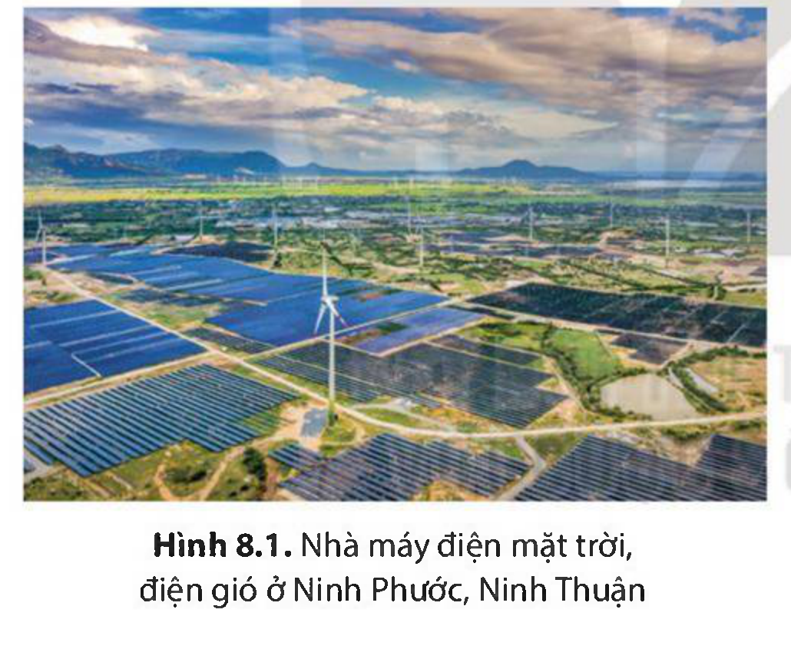
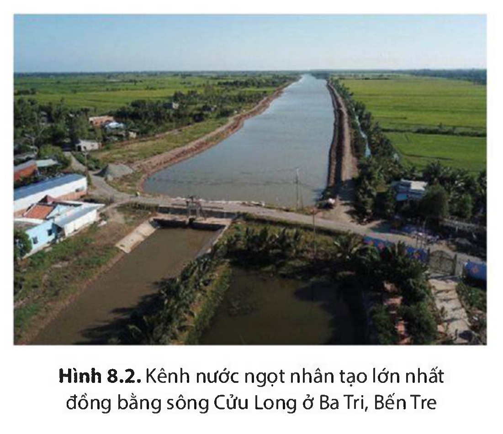

<!-- pdf:132 -->

# BÀI 8: TÁC ĐỘNG CỦA BIẾN ĐỔI KHÍ HẬU ĐỐI VỚI KHÍ HẬU VÀ THUỶ VĂN VIỆT NAM

## 🎯 Học xong bài này, em sẽ:

- Phân tích được tác động của biến đổi khí hậu đối với khí hậu và thuỷ văn Việt Nam.
- Tìm ví dụ về giải pháp ứng phó với biến đổi khí hậu.

## 🔴 Mở đầu

Việt Nam là quốc gia chịu nhiều tác động của biến đổi khí hậu. Biến đổi khí hậu có tác động trực tiếp đến khí hậu, thuỷ văn, từ đó tác động đến đời sống và các hoạt động sản xuất. Theo em, các yếu tố nào của khí hậu, thuỷ văn chịu tác động của biến đổi khí hậu?

## 1. Tác động của biến đổi khí hậu đối với khí hậu

Biến đổi khí hậu đã và đang tác động tới khí hậu, làm thay đổi các yếu tố khí hậu ở nước ta.

<!-- term: Tác động của biến đổi khí hậu đối với khí hậu Việt Nam -->
- Biến đổi về nhiệt độ: Nhiệt độ trung bình năm có xu thế tăng trên phạm vi cả nước, với mức tăng trung bình toàn Việt Nam là 0,89°C trong thời kì từ 1958 đến 2018.

BẢNG 8.1. NHIỆT ĐỘ TRUNG BÌNH NĂM THEO CÁC GIAI ĐOẠN CỦA MỘT SỐ TRẠM KHÍ TƯỢNG (°C)

| Trạm \ Giai đoạn | 1958 – 1960 | 1961 – 1970 | 1971 – 1980 | 1981 – 1990 | 1991 – 2000 | 2001 – 2010 | 2011 – 2018 |
| --- | :---: | :---: | :---: | :---: | :---: | :---: | :---: |
| Láng (Hà Nội) | 23,6 | 23,5 | 23,4 | 23,6 | 24,1 | 24,5 | 24,7 |
| Đà Nẵng (Đà Nẵng) | 25,9 | 26,0 | 25,7 | 25,7 | 25,8 | 26,0 | 26,3 |
| Tân Sơn Hoà (Thành phố Hồ Chí Minh) | 27,3 | 27,2 | 27,2 | 27,4 | 27,6 | 28,1 | 28,5 |
<!-- ocr-ok: đã đối chiếu ảnh trang gốc PDF 132 (trang in 130), bảng số liệu nhiệt độ bị OCR đọc nhầm chữ số và dấu phẩy -->

*(Nguồn: Trung tâm Thông tin và Dữ liệu khí tượng thuỷ văn)*

<!-- pdf:133 -->

<!-- term: Tác động của biến đổi khí hậu đối với khí hậu Việt Nam -->
- Biến đổi về lượng mưa: tính trung bình trên phạm vi cả nước tổng lượng mưa năm có sự biến động trong thời kì từ 1958 đến 2018.

BẢNG 8.2. TỔNG LƯỢNG MƯA TRUNG BÌNH NĂM THEO CÁC GIAI ĐOẠN CỦA MỘT SỐ TRẠM KHÍ TƯỢNG (mm)

| Trạm \ Giai đoạn | 1958 – 1960 | 1961 – 1970 | 1971 – 1980 | 1981 – 1990 | 1991 – 2000 | 2001 – 2010 | 2011 – 2018 |
| --- | :---: | :---: | :---: | :---: | :---: | :---: | :---: |
| Láng (Hà Nội) | 1 465,5 | 1 557,0 | 1 787,5 | 1 696,8 | 1 590,0 | 1 662,7 | 1 743,9 |
| Đà Nẵng (Đà Nẵng) | 1 706,7 | 2 094,8 | 2 096,9 | 1 967,6 | 2 481,0 | 2 318,0 | 2 404,8 |
| Tân Sơn Hoà (Thành phố Hồ Chí Minh) | 1 653,7 | 1 805,0 | 1 829,2 | 1 746,1 | 1 951,8 | 1 821,5 | 2 152,6 |
<!-- ocr-ok: đã đối chiếu ảnh trang gốc PDF 133 (trang in 131), bảng số liệu lượng mưa bị OCR đọc thiếu chữ số thập phân -->

*(Nguồn: Trung tâm Thông tin và Dữ liệu khí tượng thuỷ văn)*

<!-- term: Tác động của biến đổi khí hậu đối với khí hậu Việt Nam -->
- Gia tăng các hiện tượng thời tiết cực đoan như: mưa lớn, bão, rét đậm, rét hại,... Số ngày nắng nóng có xu thế tăng trên phạm vi cả nước; số ngày rét đậm, rét hại có biến động mạnh qua các năm; số cơn bão mạnh có xu thế tăng lên; mùa mưa có nhiều trận mưa lớn, thời gian kéo dài xảy ra ở nhiều vùng nước ta gây lũ quét, ngập lụt. Nhìn chung, biến đổi khí hậu đã khiến thời tiết trở nên khắc nghiệt hơn.

> ❓ Đọc thông tin mục 1 và bảng 8.1, 8.2, hãy phân tích tác động của biến đổi khí hậu đối với khí hậu nước ta.

## 2. Tác động của biến đổi khí hậu đối với thuỷ văn

Biến đổi khí hậu có tác động lớn đến thuỷ văn nước ta, đặc biệt tới lưu lượng nước và chế độ nước sông.

<!-- term: Tác động của biến đổi khí hậu đối với thuỷ văn Việt Nam -->
- Do tổng lượng mưa trung bình năm có sự biến động làm lưu lượng nước sông cũng biến động theo.

<!-- term: Tác động của biến đổi khí hậu đối với thuỷ văn Việt Nam -->
- Sự chênh lệch lưu lượng nước giữa mùa lũ và mùa cạn gia tăng. Vào mùa lũ do số ngày mưa lớn gia tăng nên tình trạng lũ quét ở miền núi và ngập lụt ở đồng bằng ngày càng trầm trọng hơn. Vào mùa cạn, ở một số lưu vực sông (sông Kỳ Cùng, sông Ba, sông Thu Bồn, sông Đồng Nai,...) lưu lượng nước có xu thế giảm, làm tăng nguy cơ thiếu nước cho sinh hoạt và sản xuất vào mùa khô ở các địa phương trong lưu vực.

> ❓ Dựa vào thông tin mục 2, hãy phân tích tác động của biến đổi khí hậu đối với thuỷ văn nước ta.

<!-- pdf:134 -->

## 3. Giải pháp ứng phó với biến đổi khí hậu

> 💡 **Em có biết?**
>
> **Ứng phó với biến đổi khí hậu** là các hoạt động của con người nhằm thích ứng với biến đổi khí hậu và giảm nhẹ các tác nhân gây ra biến đổi khí hậu.
>
> **Giảm nhẹ biến đổi khí hậu** là các hoạt động nhằm giảm mức độ hoặc cường độ phát thải khí nhà kính.
>
> **Thích ứng với biến đổi khí hậu** là sự điều chỉnh các hệ thống tự nhiên và con người để phù hợp với môi trường mới hoặc môi trường bị thay đổi, để ứng phó với tác động thực tại hoặc tương lai của khí hậu, do đó làm giảm tác hại hoặc tận dụng những mặt có lợi.

Biến đổi khí hậu tác động mạnh mẽ đến đời sống và sản xuất, đe doạ sự phát triển bền vững. Để ứng phó với biến đổi khí hậu cần thực hiện đồng bộ các giải pháp giảm nhẹ và thích ứng với biến đổi khí hậu.

- Một số giải pháp có thể thực hiện để góp phần giảm nhẹ biến đổi khí hậu như:
  + Sử dụng tiết kiệm năng lượng: sử dụng các thiết bị điện tiêu hao ít năng lượng, tạo thói quen tắt thiết bị điện khi không sử dụng, sử dụng phương tiện giao thông công cộng, đi xe đạp,...
  + Sử dụng các nguồn năng lượng tái tạo: năng lượng mặt trời, gió, sức nước,...
  + Sử dụng tiết kiệm và bảo vệ tài nguyên nước.
  + Bảo vệ rừng, trồng và bảo vệ cây xanh tạo môi trường trong lành.
  + Giảm thiểu và xử lí rác thải, chất thải: phân loại rác, bỏ rác đúng nơi quy định,...

*Hình 8.1. Nhà máy điện mặt trời, điện gió ở Ninh Phước, Ninh Thuận*

- Một số giải pháp để thích ứng với biến đổi khí hậu:
  + Trong sản xuất nông nghiệp: thay đổi cơ cấu mùa vụ, cây trồng, vật nuôi; nghiên cứu các giống cây trồng, vật nuôi thích ứng với bối cảnh biến đổi khí hậu; nâng cấp hệ thống thuỷ lợi để tiêu nước vào mùa mưa, cung cấp nước vào mùa khô, hạn chế tác động của xâm nhập mặn,...
  + Trong công nghiệp: ứng dụng các thành tựu của khoa học công nghệ vào quy trình sản xuất để vừa tiết kiệm nguyên liệu, nhiên liệu, vừa tạo ra sản phẩm có chất lượng tốt,...

<!-- pdf:135 -->

  + Trong dịch vụ: cải tạo, tu bổ và nâng cấp hệ thống cơ sở hạ tầng giao thông; nghiên cứu tạo ra các loại hình, sản phẩm du lịch phù hợp với biến đổi khí hậu ở địa phương,...
  + Với mỗi cá nhân cần tìm hiểu kiến thức về biến đổi khí hậu, hình thành ý thức thích ứng với biến đổi khí hậu, rèn luyện các kĩ năng ứng phó với thiên tai (bơi lội, phòng điện giật khi mưa lũ,...), tích cực tham gia vào các phong trào hoạt động thích ứng với biến đổi khí hậu của cộng đồng và địa phương,...

*Hình 8.2. Kênh nước ngọt nhân tạo lớn nhất đồng bằng sông Cửu Long ở Ba Tri, Bến Tre*

> ❓ Đọc thông tin mục 3 và kết hợp hiểu biết cá nhân, hãy lấy ví dụ cụ thể một số giải pháp ứng phó với biến đổi khí hậu.

## ✏️ Luyện tập – Vận dụng

- Vẽ sơ đồ thể hiện tác động của biến đổi khí hậu đến khí hậu và thuỷ văn Việt Nam.
- Hãy nêu một số hành động cụ thể em có thể làm để ứng phó với biến đổi khí hậu.

## 📷 Danh sách hình trong bài

| Mã hình | Trang PDF | Trang sách | Chú thích |
| --- | :---: | :---: | --- |
| H8-lich_su_va_dia_ly-dl-b08-01 | 134 | 132 | Hình 8.1. Nhà máy điện mặt trời, điện gió ở Ninh Phước, Ninh Thuận |
| H8-lich_su_va_dia_ly-dl-b08-02 | 135 | 133 | Hình 8.2. Kênh nước ngọt nhân tạo lớn nhất đồng bằng sông Cửu Long ở Ba Tri, Bến Tre |
