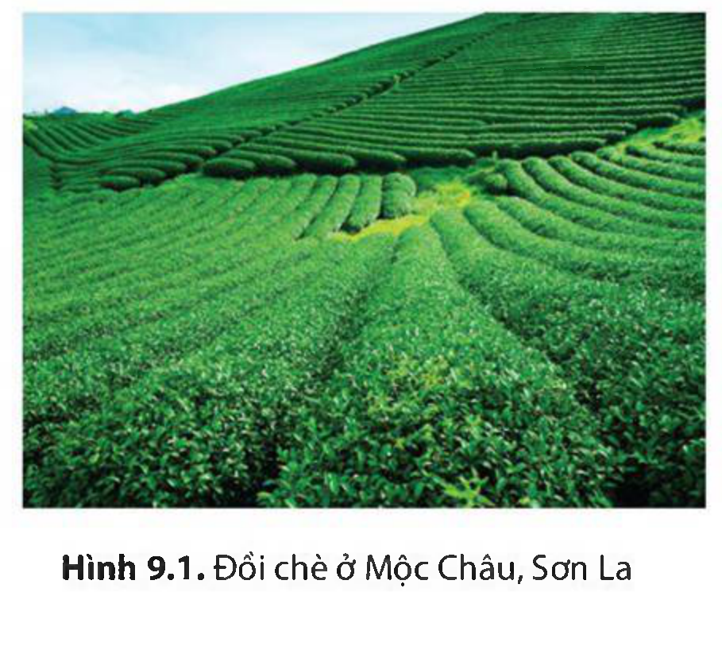
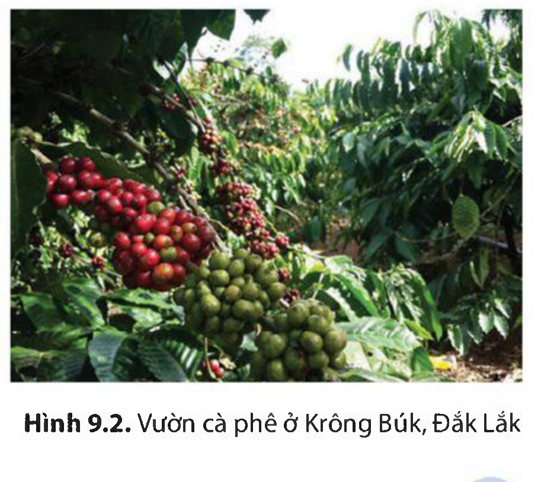
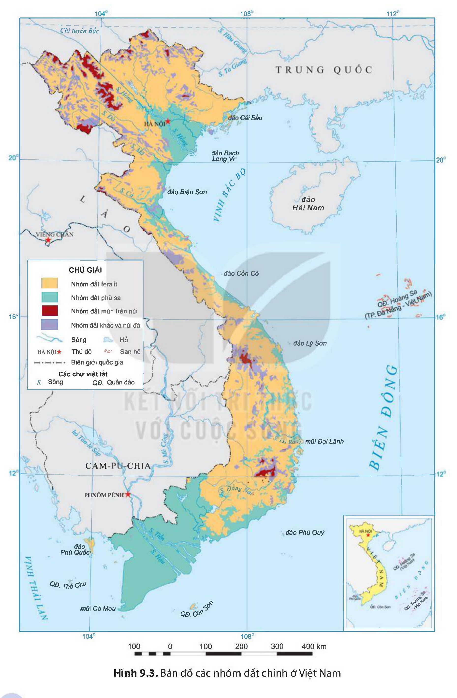
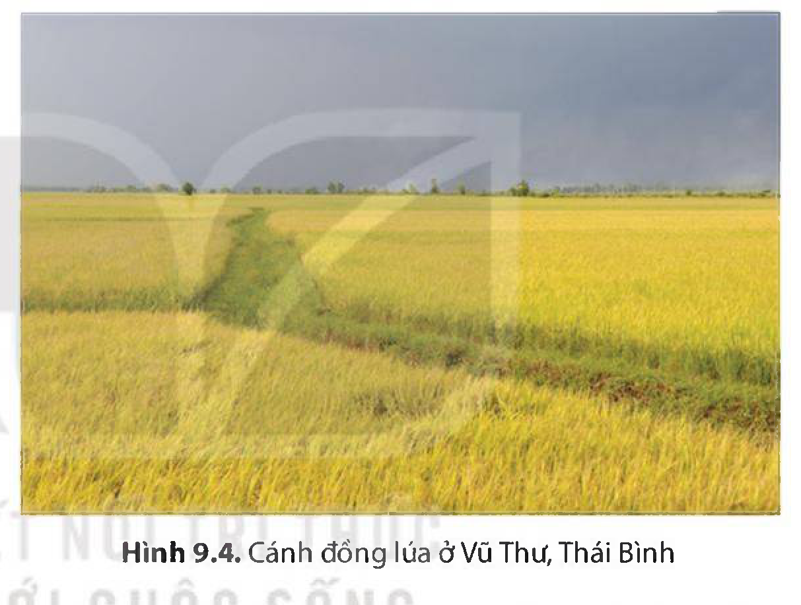
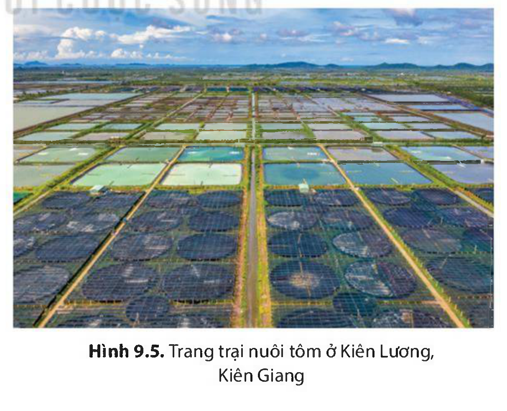
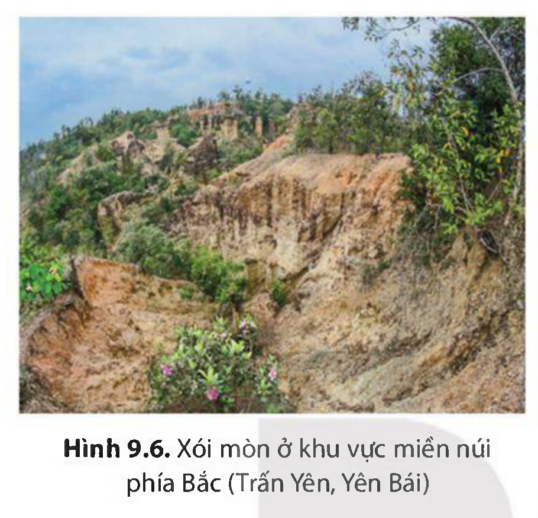
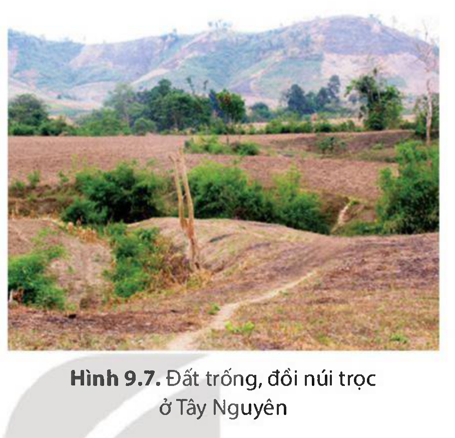

<!-- pdf:136 -->

# BÀI 9: THỔ NHƯỠNG VIỆT NAM

## 🎯 Học xong bài này, em sẽ:

- Chứng minh được tính chất nhiệt đới gió mùa của lớp phủ thổ nhưỡng.
- Trình bày được đặc điểm phân bố của ba nhóm đất chính.
- Phân tích được đặc điểm của đất feralit và giá trị sử dụng đất feralit trong sản xuất nông, lâm nghiệp.
- Phân tích được đặc điểm của đất phù sa và giá trị sử dụng đất phù sa trong sản xuất nông nghiệp, thuỷ sản.
- Chứng minh được tính cấp thiết của vấn đề chống thoái hoá đất.

## 🔴 Mở đầu

Khí hậu nhiệt đới gió mùa đã tác động mạnh mẽ đến quá trình hình thành và đặc điểm thổ nhưỡng Việt Nam. Bên cạnh đó, sự đa dạng của các nhân tố hình thành đất đã khiến cho nước ta có nhiều nhóm đất khác nhau. Các nhóm đất có tính chất riêng biệt và phù hợp với các hoạt động sản xuất nông nghiệp, lâm nghiệp, thuỷ sản nhất định.

Dựa vào hiểu biết của bản thân, hãy kể tên một số loại đất ở nước ta mà em biết.

## 1. Tính chất nhiệt đới gió mùa của lớp phủ thổ nhưỡng

> 💡 **Em có biết?**
>
> Sự phân hoá đa dạng của khí hậu dẫn đến sự phong phú của lớp phủ thực vật tự nhiên; mỗi kiểu thảm thực vật tự nhiên có ảnh hưởng khác nhau đến quá trình hình thành đất và tính chất của đất, góp phần tạo nên sự đa dạng của các loại đất ở Việt Nam.

- Tính chất nóng ẩm của khí hậu nước ta khiến quá trình phong hoá đá mẹ diễn ra mạnh mẽ đã tạo nên một lớp phủ thổ nhưỡng dày.

- **Quá trình feralit** là quá trình hình thành đất đặc trưng ở nước ta. Khí hậu nhiệt đới gió mùa với lượng mưa lớn và mưa tập trung theo mùa làm cho quá trình rửa trôi các chất badơ dễ hoà tan xảy ra mạnh, dẫn đến tích luỹ các ôxít sắt và ôxít nhôm, hình thành các loại đất feralit điển hình cho thổ nhưỡng Việt Nam.

<!-- pdf:137 -->

Một số nơi ở trung du và miền núi có sự phân hoá thành hai mùa mưa – khô sâu sắc đã làm tăng cường quá trình tích luỹ ôxít sắt, ôxít nhôm tạo thành các tầng kết von hoặc đá ong.

- Lượng mưa lớn lại tập trung chủ yếu vào 4 – 5 tháng mùa mưa làm gia tăng hiện tượng xói mòn, rửa trôi ở vùng đồi núi. Đất bị xói mòn, rửa trôi sẽ theo các dòng chảy ra sông ngòi và bồi tụ ở vùng đồng bằng hình thành đất phù sa.

> ❓ Đọc thông tin mục 1, hãy chứng minh tính chất nhiệt đới gió mùa của lớp phủ thổ nhưỡng nước ta.

## 2. Ba nhóm đất chính

### a) Nhóm đất feralit

<!-- term: Nhóm đất feralit -->
- Phân bố: Nhóm đất feralit chiếm diện tích lớn nhất ở nước ta (hơn 65% diện tích đất tự nhiên), phân bố ở các tỉnh trung du và miền núi, từ độ cao khoảng 1 600 – 1 700 m trở xuống. Đất feralit hình thành trên các đá mẹ khác nhau. Trong đó, đất feralit hình thành trên đá vôi phân bố chủ yếu ở Tây Bắc, Đông Bắc và Bắc Trung Bộ; đất feralit hình thành trên đá badan phân bố tập trung ở Tây Nguyên và Đông Nam Bộ.

<!-- term: Nhóm đất feralit -->
- Đặc điểm: Đất feralit có chứa nhiều ôxít sắt và ôxít nhôm, tạo nên màu đỏ vàng. Đặc tính của đất feralit là lớp vỏ phong hoá dày, đất thoáng khí, dễ thoát nước, đất chua, nghèo các chất badơ và mùn. Trong nhóm đất feralit có loại đất feralit hình thành trên đá badan và đá vôi có độ phì cao nhất.

- Giá trị sử dụng:

  + Trong lâm nghiệp: Đất feralit thích hợp để phát triển rừng sản xuất với các loại cây như thông, bạch đàn, xà cừ, keo,... và nhiều loại cây gỗ lớn khác, cung cấp nguyên liệu cho công nghiệp chế biến gỗ.

  + Trong nông nghiệp: Đất feralit được khai thác và sử dụng chủ yếu để trồng các loại cây công nghiệp lâu năm như chè, cà phê, cao su, hồ tiêu,... cây dược liệu như quế, hồi, sâm,... Ngoài ra, đất feralit cũng thích hợp để trồng các loại cây ăn quả như bưởi, cam, vải, xoài, nhãn, sầu riêng, chôm chôm,...

*Hình 9.1. Đồi chè ở Mộc Châu, Sơn La*

*Hình 9.2. Vườn cà phê ở Krông Búk, Đắk Lắk*

<!-- pdf:138 -->

*Hình 9.3. Bản đồ các nhóm đất chính ở Việt Nam*

<!-- pdf:139 -->

### b) Nhóm đất phù sa

<!-- term: Nhóm đất phù sa -->
- Phân bố: Nhóm đất phù sa chiếm khoảng 24% diện tích đất tự nhiên, phân bố chủ yếu ở đồng bằng sông Hồng, đồng bằng sông Cửu Long và các đồng bằng duyên hải miền Trung.

<!-- term: Nhóm đất phù sa -->
- Đặc điểm: Đất phù sa được hình thành do sản phẩm bồi đắp của phù sa các hệ thống sông và phù sa biển. Nhìn chung, đất phù sa có độ phì cao, rất giàu chất dinh dưỡng.

<!-- term: Đất phù sa ở đồng bằng sông Hồng -->
  + Đất phù sa ở đồng bằng sông Hồng ít chua, tơi xốp, giàu chất dinh dưỡng. Đất phù sa sông Hồng có thể chia thành hai loại chính là đất ngoài đê (hay đất bãi bồi) được bồi phù sa hằng năm và đất trong đê không được bồi phù sa hằng năm.

<!-- term: Đất phù sa ở đồng bằng sông Cửu Long -->
  + Đất phù sa ở đồng bằng sông Cửu Long được chia thành ba loại chính là: đất phù sa ngọt có độ phì cao, phân bố thành một dải dọc sông Tiền và sông Hậu; đất phèn phân bố tập trung ở Đồng Tháp Mười, Tứ giác Long Xuyên và vùng trung tâm bán đảo Cà Mau; đất mặn phân bố thành một dải ven biển.

  + Đất phù sa ở dải đồng bằng ven biển miền Trung có độ phì thấp hơn, nhiều cát, ít phù sa sông do biển đóng vai trò chủ yếu trong quá trình hình thành.

*Hình 9.4. Cánh đồng lúa ở Vũ Thư, Thái Bình*
<!-- ocr-ok: đã đối chiếu ảnh trang gốc PDF 139 (trang in 137), chú thích Hình 9.4 nằm đè lên watermark nền nên OCR bỏ sót -->

- Giá trị sử dụng:

  + Trong nông nghiệp: Đây là nhóm đất phù hợp cho sản xuất cây lương thực (lúa, ngô,...), cây công nghiệp hàng năm (dâu tằm, thuốc lá, bông, đậu tương,...) và cây ăn quả.

*Hình 9.5. Trang trại nuôi tôm ở Kiên Lương, Kiên Giang*

<!-- pdf:140 -->

  + Trong thuỷ sản: Đất phù sa ở các vùng cửa sông ven biển có nhiều lợi thế để phát triển ngành thuỷ sản. Vùng đất phèn, đất mặn tạo điều kiện thuận lợi cho việc đánh bắt thuỷ sản như tôm, cua, cá. Ở các rừng ngập mặn ven biển, các bãi triều ngập nước và ở cửa sông lớn thuận lợi cho nuôi trồng nhiều loại thuỷ sản nước lợ và nước mặn khác nhau, nhiều nhất là cá và tôm.

### c) Nhóm đất mùn trên núi

<!-- term: Nhóm đất mùn trên núi -->
Đất mùn trên núi phân bố rải rác ở các vùng núi có độ cao từ khoảng 1 600 – 1 700 m trở lên. Đất mùn trên núi được hình thành trong điều kiện khí hậu cận nhiệt đới và ôn đới núi cao, nhiệt độ thấp khiến quá trình phong hoá, phân giải các chất hữu cơ diễn ra chậm nên đất giàu mùn; địa hình cao, độ dốc lớn nên tầng đất mỏng.

> ❓ Đọc thông tin mục 2 và quan sát hình 9.3, hãy:
>
> 1. Trình bày đặc điểm phân bố của ba nhóm đất chính ở nước ta.
>
> 2. Phân tích đặc điểm và giá trị sử dụng của nhóm đất feralit trong sản xuất nông, lâm nghiệp.
>
> 3. Phân tích đặc điểm và giá trị sử dụng của nhóm đất phù sa trong sản xuất nông nghiệp, thuỷ sản.

## 3. Tính cấp thiết của vấn đề chống thoái hoá đất

<!-- term: Thoái hoá đất ở Việt Nam -->
Thoái hoá đất dẫn đến độ phì của đất giảm khiến năng suất cây trồng bị ảnh hưởng, thậm chí nhiều nơi đất bị thoái hoá nặng không thể sử dụng cho trồng trọt. Vì vậy, việc ngăn chặn sự thoái hoá đất, nâng cao chất lượng đất có ý nghĩa vô cùng quan trọng trong việc đảm bảo tài nguyên đất cho sản xuất nông, lâm nghiệp.

<!-- term: Thoái hoá đất ở Việt Nam -->
- Diện tích đất bị thoái hoá ở Việt Nam khoảng 10 triệu ha, chiếm khoảng 30% diện tích cả nước. Một số biểu hiện của thoái hóa đất ở Việt Nam:

<!-- term: Thoái hoá đất ở Việt Nam -->
  + Nhiều diện tích đất ở trung du và miền núi bị rửa trôi, xói mòn, bạc màu, trở nên khô cằn, nghèo dinh dưỡng; nguy cơ hoang mạc hoá có thể xảy ra ở khu vực duyên hải Nam Trung Bộ.

<!-- term: Thoái hoá đất ở Việt Nam -->
  + Đất ở nhiều vùng cửa sông, ven biển bị suy thoái do nhiễm mặn, nhiễm phèn, ngập úng. Diện tích đất phèn, đất mặn có xu hướng ngày càng tăng.

- Thoái hoá đất ở nước ta do cả nguyên nhân tự nhiên và tác động của con người.

<!-- pdf:141 -->

  + Nguyên nhân tự nhiên: Nước ta có 3/4 diện tích đất ở vùng đồi núi, có độ dốc cao; lượng mưa lớn và tập trung theo mùa là nguyên nhân gây xói mòn, rửa trôi đất. Biến đổi khí hậu làm gia tăng tình trạng hạn hán, ngập lụt; nước biển dâng dẫn đến đất ở nhiều nơi bị thoái hoá do nhiễm phèn, nhiễm mặn, ngập úng.

*Hình 9.6. Xói mòn ở khu vực miền núi phía Bắc (Trấn Yên, Yên Bái)*

*Hình 9.7. Đất trống, đồi núi trọc ở Tây Nguyên*

  + Do con người:

  Nạn phá rừng để lấy gỗ, đốt rừng làm nương rẫy gây nên sự xói mòn và rửa trôi lớp đất mặt làm cho đất ngày càng trở nên bạc màu.

  Sử dụng đất để sản xuất nông nghiệp nhưng chưa quan tâm đến việc cải tạo đất, cùng với việc lạm dụng các chất hoá học trong sản xuất đã làm cho đất bị ô nhiễm, dẫn đến thoái hoá.

<!-- term: Biện pháp chống thoái hoá đất -->
- Để giảm thiểu tình trạng thoái hoá đất và bảo vệ môi trường đất có thể thực hiện một số biện pháp:

<!-- term: Biện pháp chống thoái hoá đất -->
  + Bảo vệ rừng và trồng rừng: bảo vệ rừng phòng hộ đầu nguồn, ven biển; trồng cây phủ xanh đất trống, đồi núi trọc để hạn chế quá trình xói mòn đất.

<!-- term: Biện pháp chống thoái hoá đất -->
  + Củng cố và hoàn thiện các hệ thống đê ven biển, hệ thống công trình thuỷ lợi để duy trì nước ngọt thường xuyên, hạn chế tối đa tình trạng khô hạn, mặn hoá, phèn hoá.

<!-- term: Biện pháp chống thoái hoá đất -->
  + Bổ sung các chất hữu cơ cho đất. Đất thoái hoá sẽ bị mất dần chất dinh dưỡng, nên việc bón phân hữu cơ cho đất giúp cung cấp chất dinh dưỡng, bổ sung các vi sinh vật cho đất và làm tăng độ phì nhiêu của đất.

<!-- pdf:142 -->

> ❓ Đọc thông tin mục 3, hãy:
>
> 1. Chứng minh tính cấp thiết của vấn đề chống thoái hoá đất.
>
> 2. Nêu một số giải pháp được sử dụng để chống thoái hoá đất.

## ✏️ Luyện tập – Vận dụng

- Hoàn thành bảng theo mẫu sau vào vở:

GIÁ TRỊ SỬ DỤNG CỦA ĐẤT FERALIT VÀ ĐẤT PHÙ SA Ở NƯỚC TA

| Nhóm đất | Giá trị sử dụng |
| --- | :---: |
| Đất feralit | ? |
| Đất phù sa | ? |

- Tìm hiểu về tài nguyên đất ở địa phương (tỉnh/thành phố) nơi em sinh sống và viết một báo cáo ngắn về một trong hai nội dung dưới đây:

  *Nội dung 1:* Nhóm đất chủ yếu ở địa phương và giá trị sử dụng.

  *Nội dung 2:* Hiện tượng thoái hoá đất ở địa phương và biện pháp cải tạo.

## 📷 Danh sách hình trong bài

| Mã hình | Trang PDF | Trang sách | Chú thích |
| --- | :---: | :---: | --- |
| H8-lich_su_va_dia_ly-dl-b09-01 | 137 | 135 | Hình 9.1. Đồi chè ở Mộc Châu, Sơn La |
| H8-lich_su_va_dia_ly-dl-b09-02 | 137 | 135 | Hình 9.2. Vườn cà phê ở Krông Búk, Đắk Lắk |
| H8-lich_su_va_dia_ly-dl-b09-03 | 138 | 136 | Hình 9.3. Bản đồ các nhóm đất chính ở Việt Nam |
| H8-lich_su_va_dia_ly-dl-b09-04 | 139 | 137 | Hình 9.4. Cánh đồng lúa ở Vũ Thư, Thái Bình |
| H8-lich_su_va_dia_ly-dl-b09-05 | 139 | 137 | Hình 9.5. Trang trại nuôi tôm ở Kiên Lương, Kiên Giang |
| H8-lich_su_va_dia_ly-dl-b09-06 | 141 | 139 | Hình 9.6. Xói mòn ở khu vực miền núi phía Bắc (Trấn Yên, Yên Bái) |
| H8-lich_su_va_dia_ly-dl-b09-07 | 141 | 139 | Hình 9.7. Đất trống, đồi núi trọc ở Tây Nguyên |
