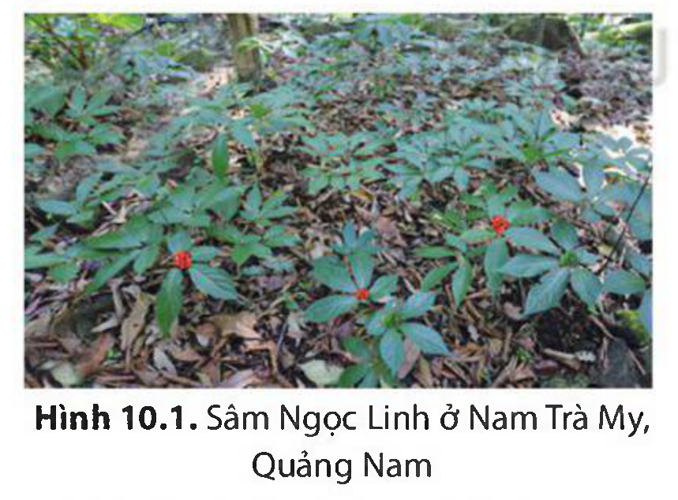
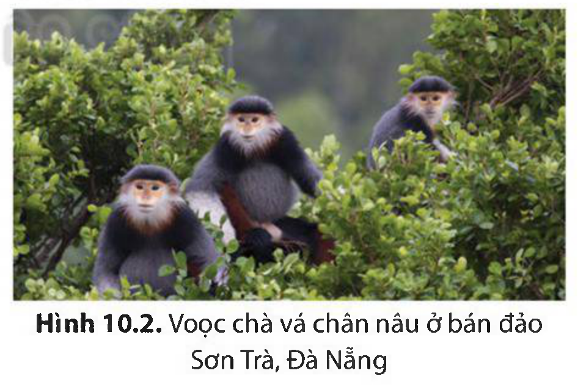
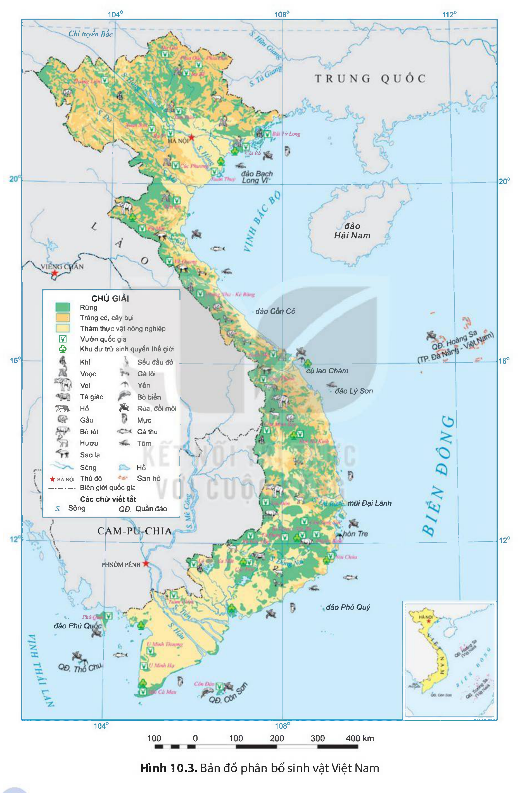
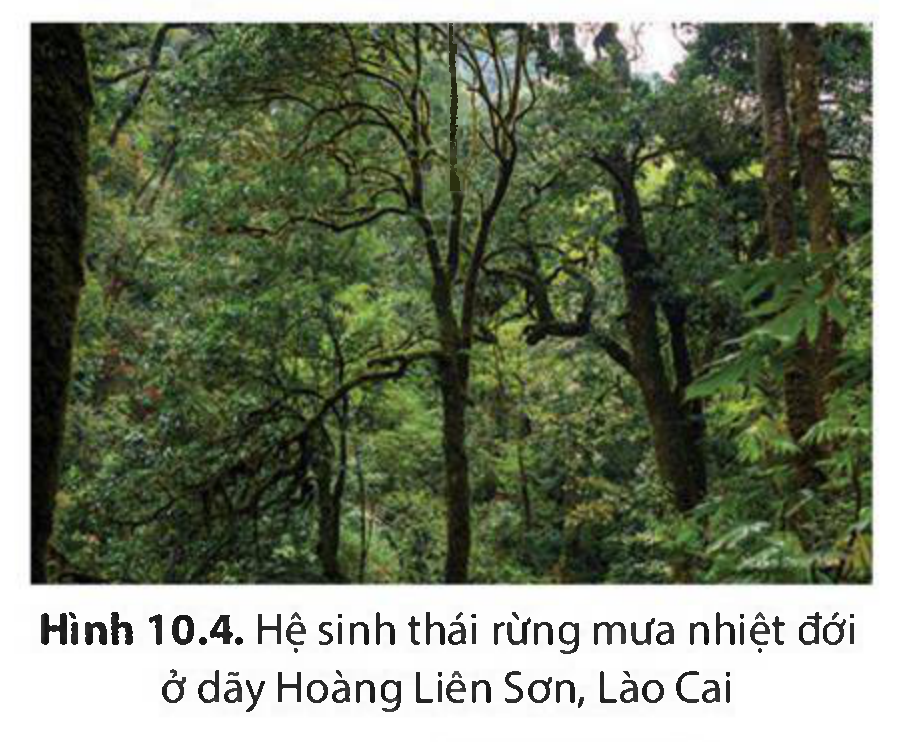
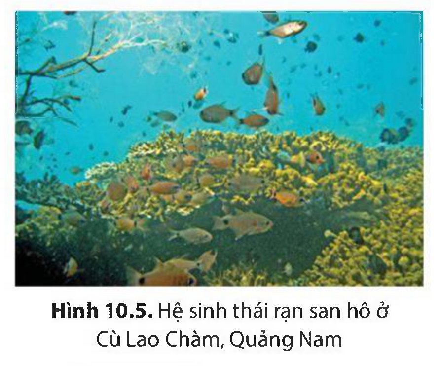
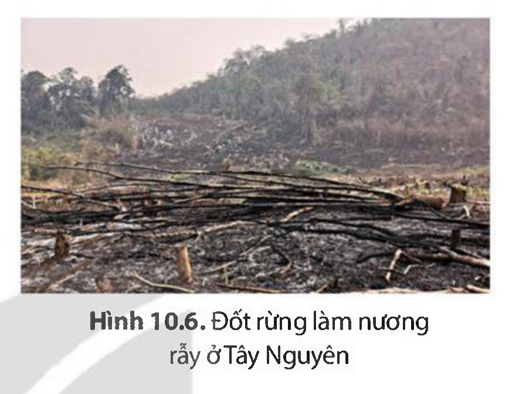

<!-- pdf:143 -->

# BÀI 10: SINH VẬT VIỆT NAM

## 🎯 Học xong bài này, em sẽ:

- Chứng minh được sự đa dạng của sinh vật ở Việt Nam.
- Chứng minh được tính cấp thiết của vấn đề bảo tồn đa dạng sinh học ở Việt Nam.

## 🔴 Mở đầu

Việt Nam là quốc gia có tính đa dạng sinh học cao trên thế giới. Giới sinh vật Việt Nam đa dạng và phong phú với nhiều loài động, thực vật và các hệ sinh thái khác nhau. Hãy chia sẻ một số hiểu biết của em về sinh vật ở nước ta.

## 1. Sự đa dạng của sinh vật ở Việt Nam

<!-- term: Đa dạng sinh học ở Việt Nam -->
Sự phong phú và đa dạng của sinh vật Việt Nam thể hiện ở sự đa dạng về thành phần loài, gen di truyền và kiểu hệ sinh thái.

- *Sự đa dạng về thành phần loài, gen di truyền*

<!-- term: Đa dạng sinh học ở Việt Nam -->
Việt Nam là một trong 16 quốc gia sở hữu sự đa dạng sinh học cao nhất thế giới với hơn 50 000 loài đã được xác định. Trong đó, có nhiều loài thực vật quý hiếm (trầm hương, trắc, sâm Ngọc Linh, gõ đỏ, nghiến, cẩm lai, vàng tâm, gụ,...) và động vật quý hiếm (sao la, voi, bò tót, hươu xạ, voọc, trĩ, công,...).

<!-- term: Đa dạng sinh học ở Việt Nam -->
Số lượng cá thể trong mỗi loài tương đối phong phú, tạo nên sự đa dạng về nguồn gen di truyền.

*Hình 10.1. Sâm Ngọc Linh ở Nam Trà My, Quảng Nam*

*Hình 10.2. Voọc chà vá chân nâu ở bán đảo Sơn Trà, Đà Nẵng*

- *Sự đa dạng về kiểu hệ sinh thái*

Các hệ sinh thái ở nước ta rất phong phú và đa dạng, bao gồm các hệ sinh thái tự nhiên trên cạn, các hệ sinh thái tự nhiên dưới nước và các hệ sinh thái nhân tạo.

<!-- term: Hệ sinh thái tự nhiên trên cạn -->
  + Các hệ sinh thái tự nhiên trên cạn bao gồm các kiểu hệ sinh thái rừng khác nhau, phổ biến nhất là rừng mưa nhiệt đới, rừng nhiệt đới gió mùa với lớp phủ thực vật rậm rạp nhiều tầng, thành phần loài phong phú. Ngoài ra, còn có các hệ sinh thái trảng cỏ cây bụi, rừng cận nhiệt, rừng ôn đới núi cao,...

<!-- pdf:144 -->

*Hình 10.3. Bản đồ phân bố sinh vật Việt Nam*

<!-- pdf:145 -->

<!-- term: Hệ sinh thái tự nhiên dưới nước -->
  + Các hệ sinh thái tự nhiên dưới nước bao gồm hệ sinh thái nước mặn và hệ sinh thái nước ngọt. Các hệ sinh thái nước mặn (bao gồm cả vùng nước lợ) điển hình là rừng ngập mặn, cỏ biển, rạn san hô, đầm phá ven biển,... và hệ sinh thái biển chia thành các vùng nước theo độ sâu. Các hệ sinh thái nước ngọt ở sông, suối, hồ, ao, đầm.

*Hình 10.4. Hệ sinh thái rừng mưa nhiệt đới ở dãy Hoàng Liên Sơn, Lào Cai*

*Hình 10.5. Hệ sinh thái rạn san hô ở Cù Lao Chàm, Quảng Nam*

<!-- term: Hệ sinh thái nhân tạo -->
  + Các hệ sinh thái nhân tạo hình thành do hoạt động sản xuất nông, lâm nghiệp, thuỷ sản cũng rất đa dạng như hệ sinh thái đồng ruộng, vùng chuyên canh,...; hệ sinh thái nuôi trồng thuỷ sản; rừng trồng,... ngày càng mở rộng, chiếm khoảng 1/4 diện tích lãnh thổ.

> 💡 **Em có biết?**
>
> Ở nước ta, các kiểu rừng nhiệt đới là phổ biến nhất, chiếm diện tích lớn nhất và được phân bố rộng khắp từ bắc xuống nam. Phần lớn các loài thực vật ở nước ta là thực vật nhiệt đới (các loài cây thuộc họ Dầu, họ Dâu tằm, họ Dẻ,...). Sống trong rừng là các loài động vật nhiệt đới điển hình như các loài động vật leo trèo, ăn thực vật (khỉ, voọc, sóc,...), các loài thú nhỏ (cầy, cáo,...), các loài thú lớn ăn cỏ (hươu, nai, voi, tê giác,...) và các loài ăn thịt (hổ, gấu,...).

> ❓ Dựa vào thông tin và các hình ảnh trong mục 1, hãy chứng minh sự đa dạng của sinh vật ở Việt Nam.

## 2. Tính cấp thiết của vấn đề bảo tồn đa dạng sinh học ở Việt Nam

<!-- term: Suy giảm đa dạng sinh học ở Việt Nam -->
- Tính đa dạng sinh học ở nước ta đang ngày càng bị suy giảm nghiêm trọng, nên việc bảo tồn đa dạng sinh học đã trở thành vấn đề cấp thiết ở nước ta hiện nay.

> 💡 **Em có biết?**
>
> Theo báo cáo năm 2021 của Tổ chức Bảo tồn Thiên nhiên Quốc tế (IUCN), Việt Nam có 75 loài thú, 57 loài chim, 75 loài bò sát, 53 loài lưỡng cư, 136 loài cá được liệt kê là các loài bị đe doạ.

<!-- term: Suy giảm đa dạng sinh học ở Việt Nam -->
  + Suy giảm số lượng cá thể, loài sinh vật: Số lượng cá thể các loài thực vật, động vật hoang dã suy giảm nghiêm trọng. Một số loài thực vật, động vật có nguy cơ tuyệt chủng, như: nhiều loài cây gỗ quý (đinh, lim, sến, táu, trắc, gụ,...); nhiều loài động vật hoang dã quý hiếm (voi, hổ, bò tót, tê giác một sừng, sao la,...).

<!-- term: Suy giảm đa dạng sinh học ở Việt Nam -->
  + Suy giảm hệ sinh thái: Các hệ sinh thái rừng nguyên sinh bị phá hoại gần hết, chỉ còn chủ yếu là rừng thứ sinh; các hệ sinh thái rừng ngập mặn, các hệ sinh thái biển cũng đứng trước nguy cơ bị tàn phá bởi con người.

<!-- pdf:146 -->

<!-- term: Suy giảm đa dạng sinh học ở Việt Nam -->
  + Suy giảm nguồn gen: Việc suy giảm số lượng cá thể cộng với suy giảm số lượng loài đã làm suy giảm nguồn gen.

- Nguyên nhân suy giảm đa dạng sinh học là do cả yếu tố tự nhiên và hoạt động của con người.

  + Do tự nhiên: Biến đổi khí hậu với những hệ quả như bão, lũ lụt, hạn hán, cháy rừng,... làm suy giảm đa dạng sinh học nhanh hơn, trầm trọng hơn, nhất là các hệ sinh thái rừng và hệ sinh thái ven biển.

  + Do hoạt động của con người như: khai thác lâm sản, đốt rừng làm nương rẫy, du canh du cư, sử dụng động – thực vật hoang dã cho nhu cầu đời sống, đánh bắt thuỷ sản quá mức, ô nhiễm môi trường do chất thải sinh hoạt và sản xuất, sự xâm nhập của các loài ngoại lai,...

*Hình 10.6. Đốt rừng làm nương rẫy ở Tây Nguyên*

<!-- term: Biện pháp bảo tồn đa dạng sinh học ở Việt Nam -->
- Trước tình trạng suy giảm đa dạng sinh học như vậy, cần có các biện pháp để bảo tồn đa dạng sinh học ở Việt Nam. Một số biện pháp chủ yếu:

<!-- term: Biện pháp bảo tồn đa dạng sinh học ở Việt Nam -->
  + Xây dựng các khu bảo tồn thiên nhiên và vườn quốc gia nhằm bảo vệ và khôi phục một số hệ sinh thái tự nhiên, rừng nguyên sinh và động, thực vật quý hiếm.

<!-- term: Biện pháp bảo tồn đa dạng sinh học ở Việt Nam -->
  + Tăng cường trồng rừng và bảo vệ rừng tự nhiên – nơi sinh sống của nhiều loài sinh vật.

<!-- term: Biện pháp bảo tồn đa dạng sinh học ở Việt Nam -->
  + Ngăn chặn nạn phá rừng, săn bắt động vật hoang dã trái phép, khai thác và đánh bắt thuỷ sản quá mức.

<!-- term: Biện pháp bảo tồn đa dạng sinh học ở Việt Nam -->
  + Xử lí các chất thải công nghiệp, nông nghiệp và sinh hoạt nhằm giảm thiểu ô nhiễm môi trường sống của các loài sinh vật.

<!-- term: Biện pháp bảo tồn đa dạng sinh học ở Việt Nam -->
  + Nâng cao ý thức của người dân về bảo vệ đa dạng sinh học.

> ❓ Đọc thông tin và quan sát hình ảnh trong mục 2, hãy chứng minh tính cấp thiết của vấn đề bảo tồn đa dạng sinh học ở Việt Nam.

## ✏️ Luyện tập – Vận dụng

- Cho bảng số liệu sau:

DIỆN TÍCH RỪNG TỰ NHIÊN CỦA VIỆT NAM GIAI ĐOẠN 1943 – 2020

| Năm | 1943 | 1983 | 2020 |
| --- | :---: | :---: | :---: |
| Diện tích rừng tự nhiên *(triệu ha)* | 14,3 | 6,8 | 10,3 |

*(Nguồn: Niên giám thống kê Việt Nam các năm)*

Hãy nhận xét sự biến động diện tích rừng tự nhiên của Việt Nam giai đoạn 1943 – 2020.

- Tìm hiểu và viết báo cáo ngắn (15 – 20 dòng) về một vườn quốc gia ở Việt Nam.

## 📷 Danh sách hình trong bài

| Mã hình | Trang PDF | Trang sách | Chú thích |
| --- | :---: | :---: | --- |
| H8-lich_su_va_dia_ly-dl-b10-01 | 143 | 141 | Hình 10.1. Sâm Ngọc Linh ở Nam Trà My, Quảng Nam |
| H8-lich_su_va_dia_ly-dl-b10-02 | 143 | 141 | Hình 10.2. Voọc chà vá chân nâu ở bán đảo Sơn Trà, Đà Nẵng |
| H8-lich_su_va_dia_ly-dl-b10-03 | 144 | 142 | Hình 10.3. Bản đồ phân bố sinh vật Việt Nam |
| H8-lich_su_va_dia_ly-dl-b10-04 | 145 | 143 | Hình 10.4. Hệ sinh thái rừng mưa nhiệt đới ở dãy Hoàng Liên Sơn, Lào Cai |
| H8-lich_su_va_dia_ly-dl-b10-05 | 145 | 143 | Hình 10.5. Hệ sinh thái rạn san hô ở Cù Lao Chàm, Quảng Nam |
| H8-lich_su_va_dia_ly-dl-b10-06 | 146 | 144 | Hình 10.6. Đốt rừng làm nương rẫy ở Tây Nguyên |
