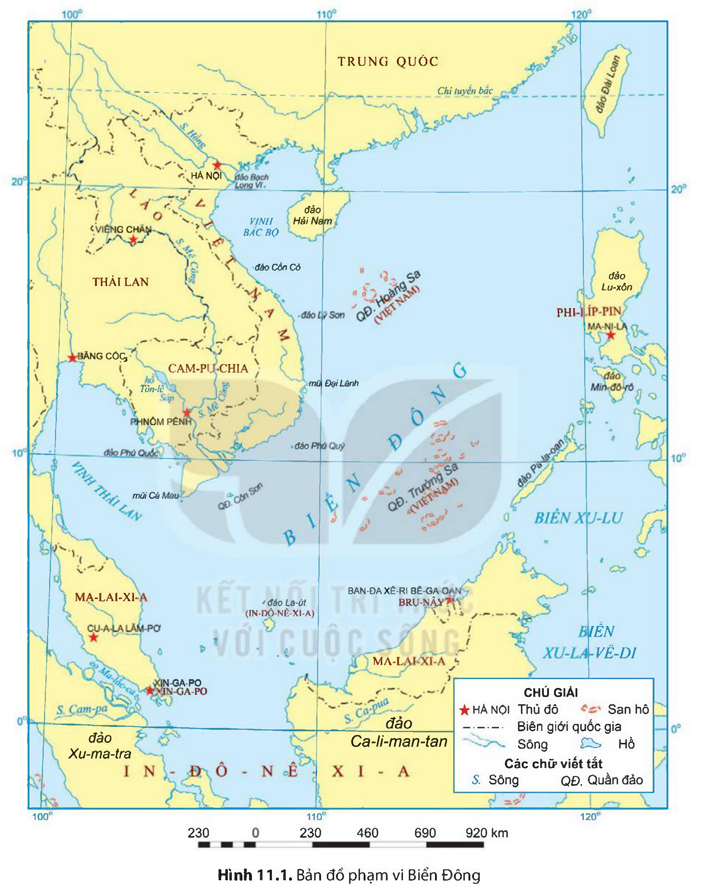
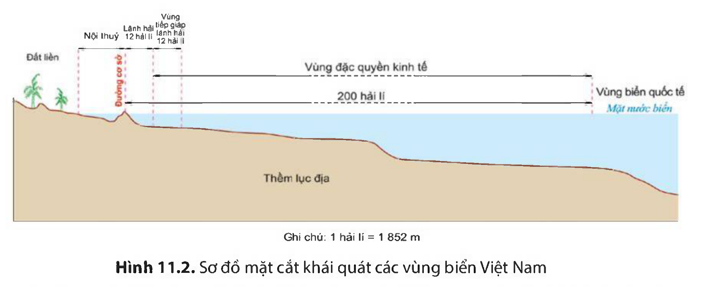
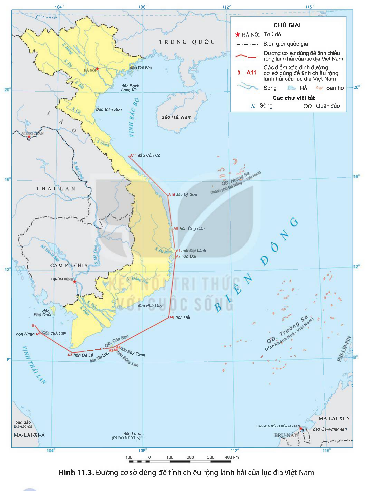
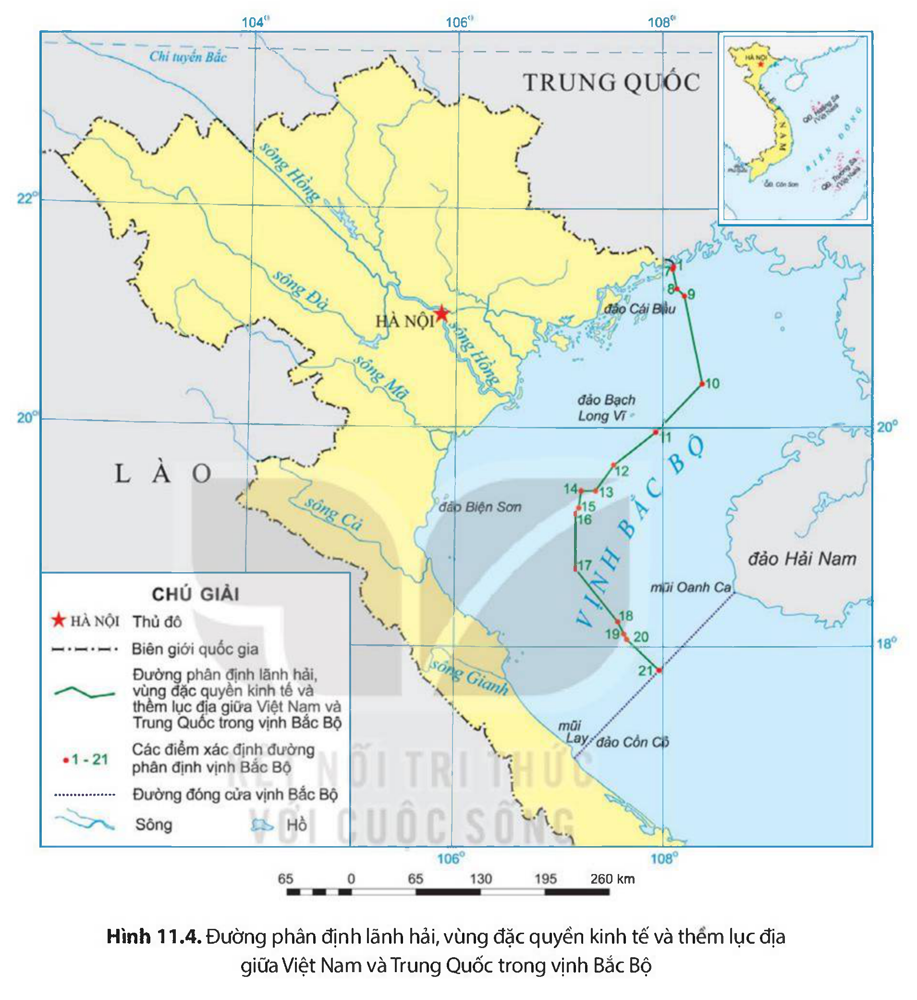
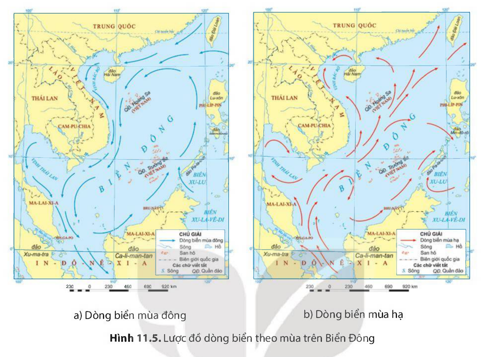

<!-- pdf:147 -->

# BÀI 11: PHẠM VI BIỂN ĐÔNG. VÙNG BIỂN ĐẢO VÀ ĐẶC ĐIỂM TỰ NHIÊN VÙNG BIỂN ĐẢO VIỆT NAM

## 🎯 Học xong bài này, em sẽ:

- Xác định được trên bản đồ phạm vi Biển Đông, các nước và vùng lãnh thổ có chung Biển Đông với Việt Nam.
- Xác định được trên bản đồ các mốc xác định đường cơ sở, đường phân chia vịnh Bắc Bộ giữa Việt Nam và Trung Quốc; trình bày được khái niệm vùng nội thuỷ, lãnh hải, tiếp giáp lãnh hải, vùng đặc quyền kinh tế, thềm lục địa của Việt Nam (theo Luật Biển Việt Nam).
- Trình bày được đặc điểm tự nhiên vùng biển đảo Việt Nam.

## 🔴 Mở đầu

Việt Nam là một quốc gia biển, từ bao đời, cuộc sống của dân tộc Việt Nam đã gắn bó với biển. Em hãy nêu một số hiểu biết của mình về vùng biển Việt Nam.

## 1. Khái quát về phạm vi Biển Đông

<!-- term: Biển Đông -->
Biển Đông là một biển thuộc Thái Bình Dương, trải rộng từ khoảng vĩ độ 3°N đến vĩ độ 26°B và từ khoảng kinh độ 100°Đ đến kinh độ 121°Đ. Với diện tích khoảng 3,44 triệu km², Biển Đông lớn thứ hai ở Thái Bình Dương và thứ ba trên thế giới.

<!-- term: Biển Đông -->
Biển Đông tương đối kín. Các nước có chung Biển Đông với Việt Nam là: Trung Quốc, Phi-líp-pin, In-đô-nê-xi-a, Bru-nây, Ma-lai-xi-a, Xin-ga-po, Thái Lan, Cam-pu-chia.

> ❓ Xác định trên hình 11.1: phạm vi của Biển Đông, các nước có chung Biển Đông với Việt Nam.

<!-- pdf:148 -->

*Hình 11.1. Bản đồ phạm vi Biển Đông*

## 2. Các vùng biển của Việt Nam ở Biển Đông

Biển Việt Nam có diện tích khoảng 1 triệu km². Theo Công ước Liên hợp quốc về Luật Biển năm 1982 và Luật Biển Việt Nam năm 2012, Việt Nam có các vùng biển là: nội thuỷ, lãnh hải, tiếp giáp lãnh hải, vùng đặc quyền kinh tế và vùng thềm lục địa.

<!-- pdf:149 -->

*Hình 11.2. Sơ đồ mặt cắt khái quát các vùng biển Việt Nam*

**Đường cơ sở** là căn cứ để xác định phạm vi, chiều rộng của lãnh hải và các vùng biển khác. Đường cơ sở để tính chiều rộng lãnh hải Việt Nam là đường thẳng gẫy khúc nối liền các điểm từ 0 đến A11.

Bảng 11.1. TOẠ ĐỘ CÁC ĐIỂM CHUẨN ĐƯỜNG CƠ SỞ DÙNG ĐỂ TÍNH CHIỀU RỘNG LÃNH HẢI CỦA LỤC ĐỊA VIỆT NAM

| Điểm | Vị trí *(Một số địa danh lấy theo tên đơn vị hành chính ngày nay)* | Vĩ độ (Bắc) | Kinh độ (Đông) |
| :---: | --- | :---: | :---: |
| 0 | Nằm trên ranh giới phía Tây Nam của vùng nước lịch sử của nước Cộng hoà XHCN Việt Nam và Cộng hoà nhân dân Cam-pu-chia. | | |
| A1 | Tại Hòn Nhạn, quần đảo Thổ Chu, tỉnh Kiên Giang. | 9°15'0 | 103°27'0 |
| A2 | Tại Hòn Đá Lẻ ở Đông Nam Hòn Khoai, tỉnh Cà Mau. | 8°22'8 | 104°52'4 |
| A3 | Tại Hòn Tài Lớn, Côn Đảo. | 8°37'8 | 106°37'5 |
| A4 | Tại Hòn Bông Lang, Côn Đảo. | 8°38'9 | 106°40'3 |
| A5 | Tại Hòn Bảy Cạnh, Côn Đảo. | 8°39'7 | 106°42'1 |
| A6 | Tại Hòn Hải (Nhóm đảo Phú Quý), tỉnh Bình Thuận. | 9°58'0 | 109°05'0 |
| A7 | Tại Hòn Đôi, tỉnh Khánh Hoà. | 12°39'0 | 109°28'0 |
| A8 | Tại mũi Đại Lãnh, tỉnh Phú Yên. | 12°53'8 | 109°27'2 |
| A9 | Tại Hòn Ông Căn, tỉnh Bình Định. | 13°54'0 | 109°21'0 |
| A10 | Tại đảo Lý Sơn, tỉnh Quảng Ngãi. | 15°23'1 | 109°09'0 |
| A11 | Tại đảo Cồn Cỏ, tỉnh Quảng Trị. | 17°10'0 | 107°20'6 |

*(Nguồn: Tuyên bố của Chính phủ nước Cộng hoà xã hội chủ nghĩa Việt Nam về đường cơ sở dùng để tính chiều rộng lãnh hải của lục địa Việt Nam)*

<!-- pdf:150 -->

*Hình 11.3. Đường cơ sở dùng để tính chiều rộng lãnh hải của lục địa Việt Nam*

<!-- pdf:151 -->

- **Nội thuỷ** là vùng nước tiếp giáp với bờ biển, ở phía trong đường cơ sở và là bộ phận lãnh thổ của Việt Nam.

> 💡 **Em có biết?**
>
> Trong vùng biển nước ta còn có các đảo và quần đảo. **Đảo** là một vùng đất tự nhiên có nước bao bọc, khi thuỷ triều lên vùng đất này vẫn ở trên mặt nước. **Quần đảo** là một tập hợp các đảo, bao gồm cả bộ phận của các đảo, vùng nước tiếp liền và các thành phần tự nhiên khác có liên quan chặt chẽ với nhau.

- **Lãnh hải** là vùng biển có chiều rộng 12 hải lí tính từ đường cơ sở ra phía biển. Ranh giới ngoài của lãnh hải là biên giới quốc gia trên biển của Việt Nam.

- **Vùng tiếp giáp lãnh hải** là vùng biển tiếp liền và nằm ngoài lãnh hải Việt Nam, có chiều rộng 12 hải lí tính từ ranh giới ngoài của lãnh hải.

- **Vùng đặc quyền kinh tế** là vùng biển tiếp liền và nằm ngoài lãnh hải Việt Nam, hợp với lãnh hải thành một vùng biển có chiều rộng 200 hải lí tính từ đường cơ sở.

- **Thềm lục địa Việt Nam** là đáy biển và lòng đất dưới đáy biển, tiếp liền và nằm ngoài lãnh hải Việt Nam, trên toàn bộ phần kéo dài tự nhiên của lãnh thổ đất liền, các đảo và quần đảo của Việt Nam cho đến mép ngoài của rìa lục địa.

Trong trường hợp mép ngoài của rìa lục địa này cách đường cơ sở chưa đủ 200 hải lí thì thềm lục địa nơi đó được kéo dài đến 200 hải lí tính từ đường cơ sở. Trong trường hợp mép ngoài của rìa lục địa này vượt quá 200 hải lí tính từ đường cơ sở thì thềm lục địa ở nơi đó được kéo dài không quá 350 hải lí tính từ đường cơ sở hoặc không quá 100 hải lí tính từ đường đẳng sâu 2 500 m.

Trong vùng biển Việt Nam có hai vịnh biển quan trọng là vịnh Thái Lan (được bao bọc bởi bờ biển Việt Nam, Thái Lan, Cam-pu-chia và Ma-lai-xi-a) và vịnh Bắc Bộ (được bao bọc bởi bờ biển Việt Nam và Trung Quốc).

<!-- term: Đường phân định vịnh Bắc Bộ -->
Ngày 25 – 12 – 2000, Việt Nam và Trung Quốc kí Hiệp định Phân định vịnh Bắc Bộ nhằm xác định biên giới lãnh hải, thềm lục địa và vùng đặc quyền kinh tế giữa hai nước trên vịnh Bắc Bộ.

<!-- term: Đường phân định vịnh Bắc Bộ -->
Đường phân định vịnh Bắc Bộ giữa Việt Nam và Trung Quốc được xác định qua 21 điểm nối tuần tự với nhau bằng các đoạn thẳng.

<!-- pdf:152 -->

*Hình 11.4. Đường phân định lãnh hải, vùng đặc quyền kinh tế và thềm lục địa giữa Việt Nam và Trung Quốc trong vịnh Bắc Bộ*

> ❓ 1. Quan sát các hình 11.3, 11.4 và bảng 11.1, 11.2, hãy xác định:
>
> - Các mốc để xác định đường cơ sở tính chiều rộng của lãnh hải của lục địa nước ta.
> - Các mốc đường phân định lãnh hải, vùng đặc quyền kinh tế và thềm lục địa giữa Việt Nam và Trung Quốc trong vịnh Bắc Bộ.
>
> 2. Quan sát hình 11.2 và dựa vào thông tin trong mục 2, hãy trình bày các khái niệm nội thuỷ, lãnh hải, vùng tiếp giáp lãnh hải, vùng đặc quyền kinh tế và thềm lục địa của Việt Nam theo Luật Biển Việt Nam năm 2012.

<!-- pdf:153 -->

Bảng 11.2. TOẠ ĐỘ 21 ĐIỂM ĐƯỜNG PHÂN ĐỊNH LÃNH HẢI, VÙNG ĐẶC QUYỀN KINH TẾ VÀ THỀM LỤC ĐỊA GIỮA VIỆT NAM VÀ TRUNG QUỐC TRONG VỊNH BẮC BỘ

| Điểm | Toạ độ | Điểm | Toạ độ |
| :---: | --- | :---: | --- |
| Điểm số 1 | 21°28'12".5 Bắc; 108°06'04".3 Đông | Điểm số 12 | 19°39'33" Bắc; 107°31'40" Đông |
| Điểm số 2 | 21°28'01".7 Bắc; 108°06'01".6 Đông | Điểm số 13 | 19°25'26" Bắc; 107°21'00" Đông |
| Điểm số 3 | 21°27'50".5 Bắc; 108°05'57".7 Đông | Điểm số 14 | 19°25'26" Bắc; 107°12'43" Đông |
| Điểm số 4 | 21°27'39".5 Bắc; 108°05'51".5 Đông | Điểm số 15 | 19°16'04" Bắc; 107°11'23" Đông |
| Điểm số 5 | 21°27'28".2 Bắc; 108°05'39".9 Đông | Điểm số 16 | 19°12'55" Bắc; 107°09'34" Đông |
| Điểm số 6 | 21°27'23".1 Bắc; 108°05'38".8 Đông | Điểm số 17 | 18°42'52" Bắc; 107°09'34" Đông |
| Điểm số 7 | 21°27'08".2 Bắc; 108°05'43".7 Đông | Điểm số 18 | 18°13'49" Bắc; 107°34'00" Đông |
| Điểm số 8 | 21°16'32" Bắc; 108°08'05" Đông | Điểm số 19 | 18°07'08" Bắc; 107°37'34" Đông |
| Điểm số 9 | 21°12'35" Bắc; 108°12'31" Đông | Điểm số 20 | 18°04'13" Bắc; 107°39'09" Đông |
| Điểm số 10 | 20°24'05" Bắc; 108°22'45" Đông | Điểm số 21 | 17°47'00" Bắc; 107°58'00" Đông |
| Điểm số 11 | 19°57'33" Bắc; 107°55'47" Đông | | |
<!-- ocr-ok: đã đối chiếu từng kí tự ảnh trang gốc PDF 153 (trang in 151), Bảng 11.2 toạ độ 21 điểm đường phân định vịnh Bắc Bộ bị OCR bỏ sót các dòng 2–11 và 13–21 -->

*(Nguồn: Hiệp định giữa nước Cộng hoà xã hội chủ nghĩa Việt Nam và nước Cộng hoà nhân dân Trung Hoa về phân định lãnh hải, vùng đặc quyền kinh tế và thềm lục địa của hai nước trong vịnh Bắc Bộ)*

## 3. Đặc điểm tự nhiên của vùng biển đảo Việt Nam

### a) Địa hình

<!-- term: Địa hình vùng biển đảo Việt Nam -->
- Các dạng địa hình ven biển nước ta rất đa dạng, bao gồm: vịnh cửa sông, bờ biển mài mòn, tam giác châu, các bãi cát phẳng, cồn cát, đầm phá, vũng vịnh nước sâu,...

<!-- pdf:154 -->

<!-- term: Địa hình vùng biển đảo Việt Nam -->
- Địa hình thềm lục địa có sự tiếp nối với địa hình trên đất liền: nông và bằng phẳng ở phía bắc và phía nam, hẹp và sâu ở miền Trung.

<!-- term: Địa hình vùng biển đảo Việt Nam -->
- Địa hình đảo: Ngoài quần đảo Hoàng Sa và quần đảo Trường Sa, nước ta có hệ thống đảo ven bờ phân bố tập trung ở vùng biển Quảng Ninh, Hải Phòng, Khánh Hoà, Kiên Giang,... Các đảo ven bờ có diện tích lớn nhất là Phú Quốc (Kiên Giang), Cát Bà (Hải Phòng),... Ở phía bắc, đặc biệt trong vùng biển Quảng Ninh – Hải Phòng các đảo, quần đảo thường có cấu tạo từ đá vôi với các dạng địa hình các-xtơ. Ở phía nam, nhiều đảo và quần đảo lớn có nguồn gốc hình thành từ san hô.

### b) Khí hậu

<!-- term: Khí hậu vùng biển đảo Việt Nam -->
Khí hậu vùng biển đảo nước ta mang tính chất nhiệt đới gió mùa.

<!-- term: Khí hậu vùng biển đảo Việt Nam -->
- Nhiệt độ không khí trung bình năm của vùng biển dao động từ 23 – 28°C. Vào mùa hạ, nhiệt độ giữa các vùng biển ít chênh lệch; trong khi mùa đông, nhiệt độ giảm khá nhanh từ vùng biển phía nam lên vùng biển phía bắc. Biên độ nhiệt độ trung bình năm ở vùng biển đảo nhỏ hơn trên đất liền.

<!-- term: Khí hậu vùng biển đảo Việt Nam -->
- Hướng gió thay đổi theo mùa: từ tháng 10 đến tháng 4 năm sau, gió mùa mùa đông và Tín phong có hướng đông bắc chiếm ưu thế; từ tháng 5 đến tháng 9, gió mùa hướng đông nam chiếm ưu thế. Gió trên biển mạnh hơn trên đất liền rõ rệt.

<!-- term: Khí hậu vùng biển đảo Việt Nam -->
- Lượng mưa trên biển thường nhỏ hơn trên đất liền, khoảng trên 1 100 mm/năm; các đảo có lượng mưa lớn hơn.

<!-- term: Khí hậu vùng biển đảo Việt Nam -->
- Vùng biển nước ta là nơi chịu nhiều thiên tai: bão, áp thấp nhiệt đới, lốc,... Trung bình mỗi năm có 3 – 4 cơn bão trực tiếp đổ bộ vào vùng biển Việt Nam.

### c) Hải văn

- Nhiệt độ nước biển tầng mặt trung bình năm khoảng 23°C.

- Độ muối trung bình của vùng biển Việt Nam khoảng 32‰ – 33‰, có sự biến động theo mùa và theo khu vực.

<!-- term: Dòng biển theo mùa ở vùng biển Việt Nam -->
- Dòng biển ven bờ ở nước ta có sự thay đổi theo mùa, cả về hướng chảy và cường độ. Vào mùa đông, dòng biển có hướng đông bắc – tây nam; còn vào mùa hạ, dòng biển chảy theo hướng ngược lại, là tây nam – đông bắc. Dòng biển mùa đông chảy mạnh hơn dòng biển mùa hạ.

- Trên vùng biển Việt Nam còn xuất hiện các vùng nước trồi, vận động theo chiều thẳng đứng, kéo theo nguồn dinh dưỡng cho các loài sinh vật biển.

<!-- term: Chế độ thuỷ triều dọc bờ biển Việt Nam -->
- Chế độ thuỷ triều dọc bờ biển Việt Nam rất đa dạng, gồm: nhật triều đều, nhật triều không đều, bán nhật triều và bán nhật triều không đều. Trong đó, chế độ nhật triều đều (một ngày đêm có một lần nước lên và một lần nước xuống) rất điển hình (đặc biệt ở vịnh Bắc Bộ). Độ cao triều cũng thay đổi tuỳ đoạn bờ biển (cao nhất là từ Quảng Ninh đến Thanh Hoá, thấp nhất là vùng biển ven bờ đồng bằng sông Cửu Long).

<!-- pdf:155 -->

*Hình 11.5. Lược đồ dòng biển theo mùa trên Biển Đông*

> ❓ Dựa vào thông tin mục 3, hình 11.5 và kiến thức đã học, em hãy trình bày đặc điểm địa hình, khí hậu và hải văn ở vùng biển đảo nước ta.

## ✏️ Luyện tập – Vận dụng

- Dựa vào hình 11.5, hãy cho biết sự khác nhau về hướng chảy của dòng biển mùa đông và dòng biển mùa hạ trên Biển Đông.

- Tìm hiểu về vị trí địa lí, đặc điểm tự nhiên của một trong các khu vực biển và hải đảo sau: vịnh Bắc Bộ; vịnh Thái Lan; quần đảo Hoàng Sa; quần đảo Trường Sa.

## 📷 Danh sách hình trong bài

| Mã hình | Trang PDF | Trang sách | Chú thích |
| --- | :---: | :---: | --- |
| H8-lich_su_va_dia_ly-dl-b11-01 | 148 | 146 | Hình 11.1. Bản đồ phạm vi Biển Đông |
| H8-lich_su_va_dia_ly-dl-b11-02 | 149 | 147 | Hình 11.2. Sơ đồ mặt cắt khái quát các vùng biển Việt Nam |
| H8-lich_su_va_dia_ly-dl-b11-03 | 150 | 148 | Hình 11.3. Đường cơ sở dùng để tính chiều rộng lãnh hải của lục địa Việt Nam |
| H8-lich_su_va_dia_ly-dl-b11-04 | 152 | 150 | Hình 11.4. Đường phân định lãnh hải, vùng đặc quyền kinh tế và thềm lục địa giữa Việt Nam và Trung Quốc trong vịnh Bắc Bộ |
| H8-lich_su_va_dia_ly-dl-b11-05 | 155 | 153 | Hình 11.5. Lược đồ dòng biển theo mùa trên Biển Đông |
