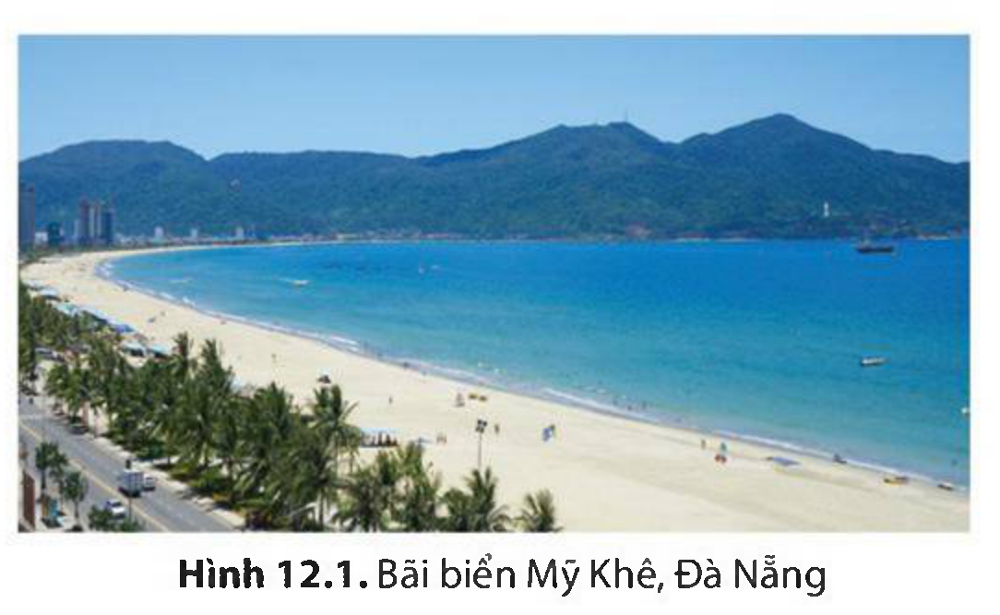
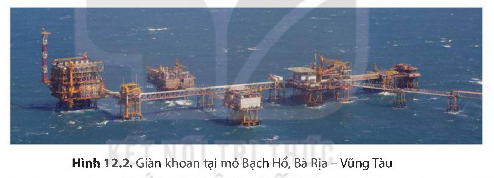

<!-- pdf:156 -->

# BÀI 12: MÔI TRƯỜNG VÀ TÀI NGUYÊN BIỂN ĐẢO VIỆT NAM

## 🎯 Học xong bài này, em sẽ:

- Nêu được đặc điểm môi trường biển đảo và vấn đề bảo vệ môi trường biển đảo Việt Nam.
- Trình bày được các tài nguyên biển và thềm lục địa Việt Nam.

## 🔴 Mở đầu

Việt Nam là quốc gia có tiềm năng lớn về tài nguyên biển. Biển đảo chứa đựng nhiều tài nguyên có giá trị để phát triển kinh tế – xã hội của đất nước. Hãy nêu một số tài nguyên biển Việt Nam mà em biết.

## 1. Môi trường biển đảo Việt Nam

### a) Đặc điểm môi trường biển đảo

**Môi trường biển đảo** là một bộ phận trong môi trường sống của con người nói chung, bao gồm các yếu tố tự nhiên (bờ biển, đáy biển, nước biển, đa dạng sinh học biển,...) và các yếu tố nhân tạo (các công trình xây dựng, các cơ sở sản xuất,... nằm ven biển, trên biển và các đảo).

Môi trường biển đảo có những đặc điểm khác biệt với môi trường trên đất liền:

- Môi trường biển là không chia cắt được. Vì vậy, khi một vùng biển bị ô nhiễm sẽ gây thiệt hại cho cả vùng bờ biển, vùng nước và cả các đảo xung quanh.

- Môi trường đảo do có sự biệt lập với đất liền, lại có diện tích nhỏ nên rất nhạy cảm trước tác động của con người, dễ bị suy thoái hơn so với đất liền.

### b) Vấn đề bảo vệ môi trường biển đảo Việt Nam

> 💡 **Em có biết?**
>
> - **Ô nhiễm môi trường biển đảo** là sự biến đổi của các thành phần môi trường không phù hợp với tiêu chuẩn môi trường, gây ảnh hưởng tới con người, sinh vật.
>
> - **Suy thoái môi trường biển đảo** là sự suy giảm về chất lượng và số lượng của thành phần môi trường, gây ảnh hưởng xấu đối với con người và sinh vật.

- Biển đảo có vai trò quan trọng đối với sự phát triển kinh tế – xã hội ở nước ta. Vùng ven biển và hải đảo là nơi cư trú và diễn ra các hoạt động sản xuất của dân cư nước ta. Nhiều hoạt động kinh tế biển như du lịch, khai thác và nuôi trồng thuỷ sản, khai thác khoáng sản, giao thông vận tải,... đã đóng góp đáng kể vào GDP của đất nước. Hệ thống các đảo tiền tiêu có vị trí rất quan trọng trong sự nghiệp xây dựng và bảo vệ Tổ quốc.

<!-- pdf:157 -->

- Theo đánh giá của Bộ Tài nguyên và Môi trường, chất lượng nước biển ven bờ ở nước ta còn khá tốt với hầu hết các chỉ số đặc trưng đều nằm trong giới hạn cho phép. Nhìn chung, chất lượng nước biển ven các đảo và cụm đảo khá tốt, kể cả ở các đảo tập trung đông dân cư. Chất lượng nước biển xa bờ đều đạt chuẩn cho phép, tương đối ổn định và ít biến động qua các năm.

Tuy nhiên, chất lượng môi trường nước biển có xu hướng giảm do chịu tác động mạnh của các hoạt động phát triển kinh tế – xã hội khu vực ven bờ, đặc biệt là các hoạt động phát triển cảng biển, nuôi trồng hải sản và phát triển du lịch biển, nước thải, rác thải sinh hoạt của người dân,... Ngoài ra, biến đổi khí hậu và nước biển dâng cũng có tác động xấu tới môi trường biển đảo.

<!-- term: Bảo vệ môi trường biển đảo Việt Nam -->
- Để bảo vệ môi trường biển đảo cần kết hợp nhiều giải pháp như: xây dựng cơ chế chính sách, luật bảo vệ môi trường biển đảo; áp dụng các thành tựu khoa học công nghệ để kiểm soát và xử lí vấn đề môi trường biển đảo; tuyên truyền, nâng cao nhận thức của người dân về bảo vệ và cải thiện môi trường biển đảo,...

Trong đó, học sinh có thể tham gia với các hành động sau:

  + Tham gia các hoạt động (làm sạch bờ biển, giữ gìn môi trường sinh thái,...) nhằm giảm thiểu sự suy thoái, ô nhiễm môi trường biển và trên các đảo.

  + Đấu tranh với các hoạt động khai thác, sử dụng tài nguyên biển đảo trái với quy định của pháp luật.

  + Rèn luyện kĩ năng để thích ứng với các thiên tai và sự cố xảy ra trong vùng biển đảo.

> ❓ Dựa vào thông tin trong mục 1, hãy:
>
> 1. Nêu đặc điểm môi trường biển đảo Việt Nam.
>
> 2. Trình bày vấn đề bảo vệ môi trường biển đảo Việt Nam. Bản thân em có thể làm gì để góp phần bảo vệ môi trường biển đảo?

## 2. Tài nguyên biển và thềm lục địa Việt Nam

- Tài nguyên sinh vật

<!-- term: Tài nguyên sinh vật biển Việt Nam -->
Sinh vật ở vùng biển Việt Nam phong phú, có tính đa dạng sinh học cao. Vùng biển Việt Nam có hơn 2 000 loài cá, trong đó có khoảng 110 loài có giá trị kinh tế cao. Ngoài ra, còn có các loài động vật giáp xác, thân mềm, trong đó nhiều loài là thực phẩm được ưa thích, có giá trị dinh dưỡng cao: tôm, mực, hải sâm,... Vùng triều ven bờ có nhiều loài rong biển được sử dụng trong công nghiệp thực phẩm và xuất khẩu.

<!-- term: Tài nguyên sinh vật biển Việt Nam -->
Năm 2019, vùng biển nước ta có trữ lượng thuỷ sản là 3,87 triệu tấn và khả năng khai thác là gần 1,55 triệu tấn.

<!-- pdf:158 -->

- Tài nguyên du lịch

<!-- term: Tài nguyên du lịch biển Việt Nam -->
Bờ biển dài, có nhiều bãi cát, vịnh, hang động đẹp, nước biển trong xanh, hệ sinh thái biển phong phú, khung cảnh thiên nhiên các đảo đa dạng, là điều kiện thuận lợi phát triển du lịch biển. Một số địa điểm thu hút khách du lịch ở nước ta là: vịnh Hạ Long (Quảng Ninh), Mỹ Khê (Đà Nẵng), Quy Nhơn (Bình Định), Nha Trang (Khánh Hoà), Mũi Né (Bình Thuận), Cát Bà (Hải Phòng), Côn Đảo (Bà Rịa – Vũng Tàu), Phú Quốc (Kiên Giang),...

*Hình 12.1. Bãi biển Mỹ Khê, Đà Nẵng*

- Tài nguyên khoáng sản

<!-- term: Tài nguyên khoáng sản biển và thềm lục địa Việt Nam -->
Dầu mỏ, khí tự nhiên tập trung ở các bể (bồn trũng) trong vùng thềm lục địa, như các bể Sông Hồng, Phú Khánh, Cửu Long, Nam Côn Sơn, Malay – Thổ Chu, Tư Chính – Vũng Mây, nhóm bể Trường Sa và Hoàng Sa.

*Hình 12.2. Giàn khoan tại mỏ Bạch Hổ, Bà Rịa – Vũng Tàu*

<!-- term: Tài nguyên khoáng sản biển và thềm lục địa Việt Nam -->
Các khoáng sản khác bao gồm 35 loại khoáng sản, phân bố dọc vùng ven biển, sườn bờ và dưới đáy biển. Trong đó, có giá trị nhất là ti-tan, cát thuỷ tinh, muối,... Băng cháy cũng là một loại khoáng sản có tiềm năng sử dụng lớn trong tương lai.

Ngoài ra, vùng biển Việt Nam có thuận lợi để xây dựng các cảng nước sâu, phát triển giao thông vận tải biển.

> ❓ Đọc thông tin mục 2, hãy trình bày các tài nguyên biển và thềm lục địa Việt Nam.

## ✏️ Luyện tập – Vận dụng

- Lập sơ đồ thể hiện các tài nguyên ở vùng biển và thềm lục địa Việt Nam.

- Sưu tầm thông tin và hình ảnh về môi trường biển đảo Việt Nam.

## 📷 Danh sách hình trong bài

| Mã hình | Trang PDF | Trang sách | Chú thích |
| --- | :---: | :---: | --- |
| H8-lich_su_va_dia_ly-dl-b12-01 | 158 | 156 | Hình 12.1. Bãi biển Mỹ Khê, Đà Nẵng |
| H8-lich_su_va_dia_ly-dl-b12-02 | 158 | 156 | Hình 12.2. Giàn khoan tại mỏ Bạch Hổ, Bà Rịa – Vũng Tàu |
