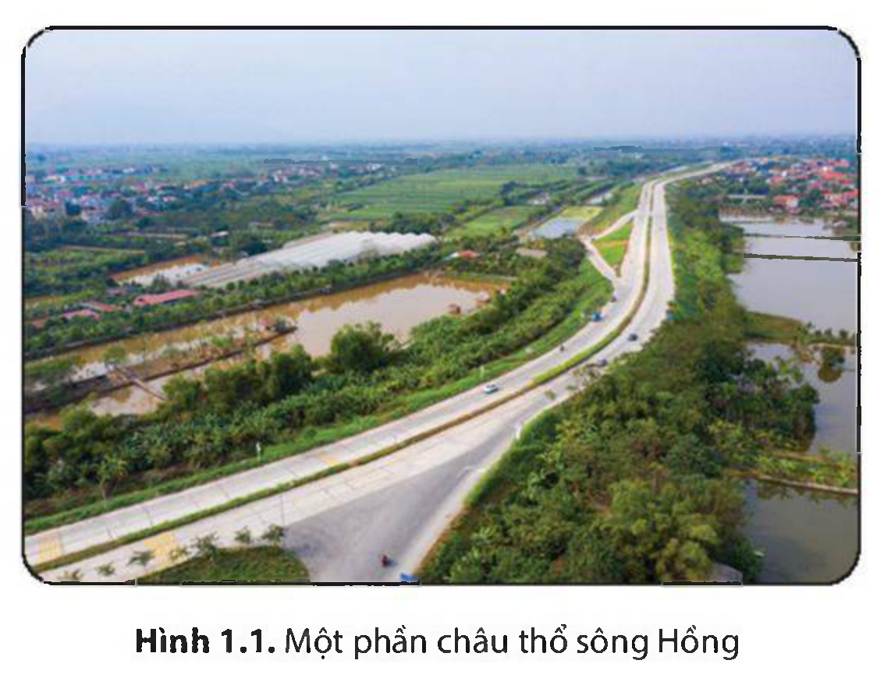
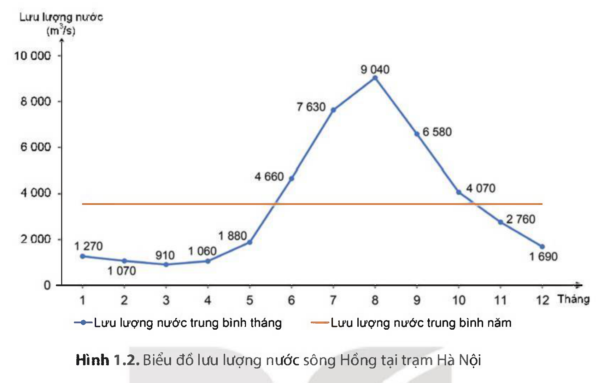
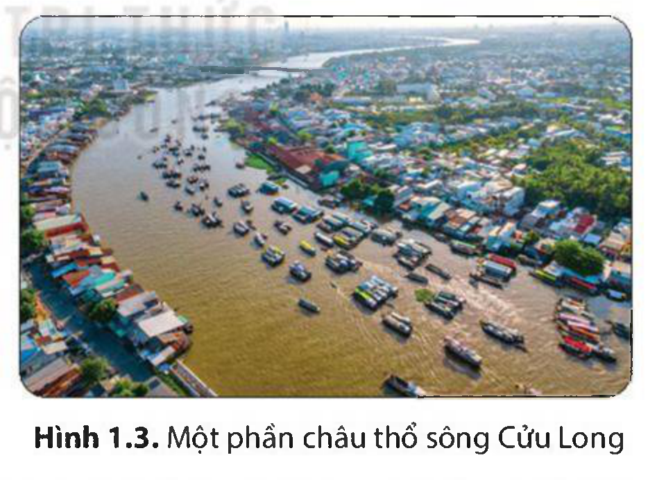
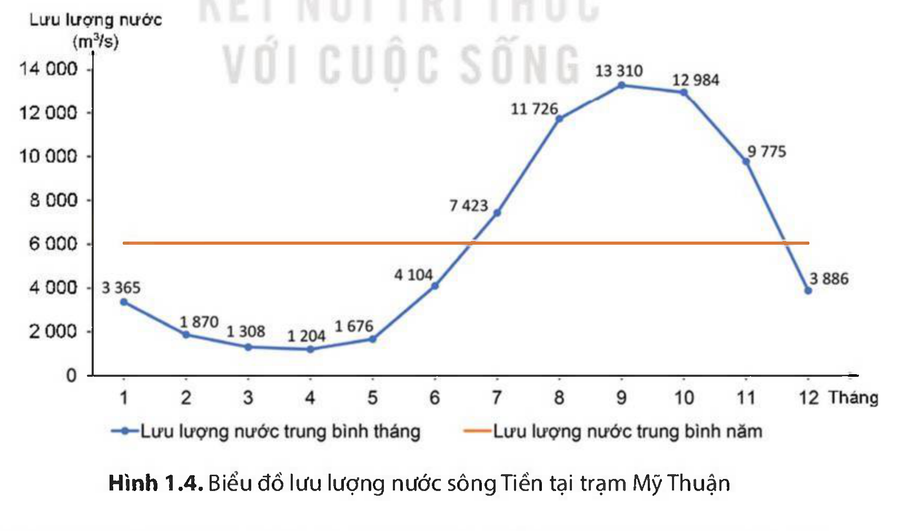
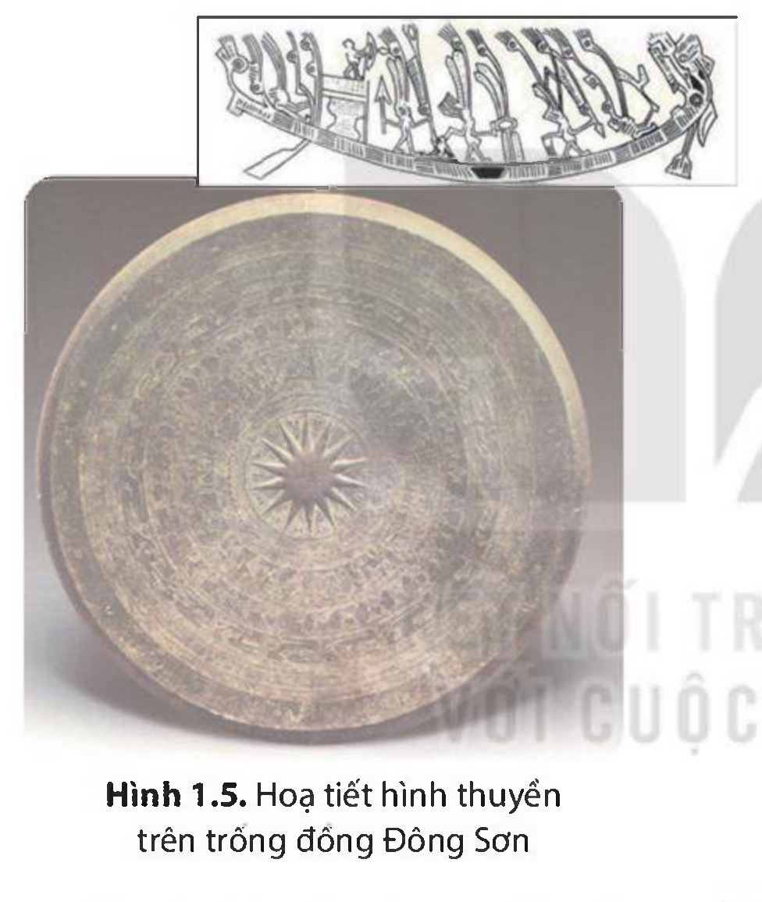
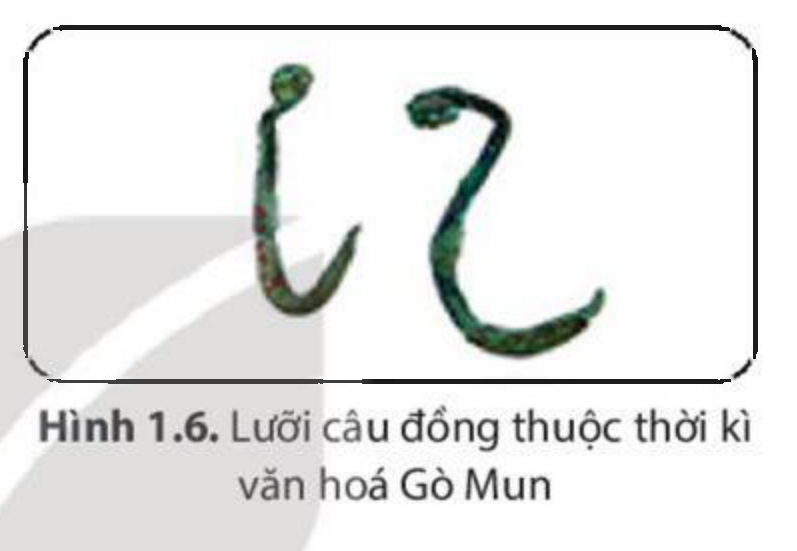
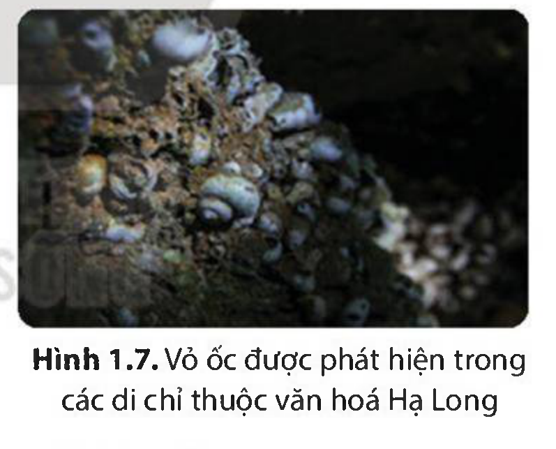
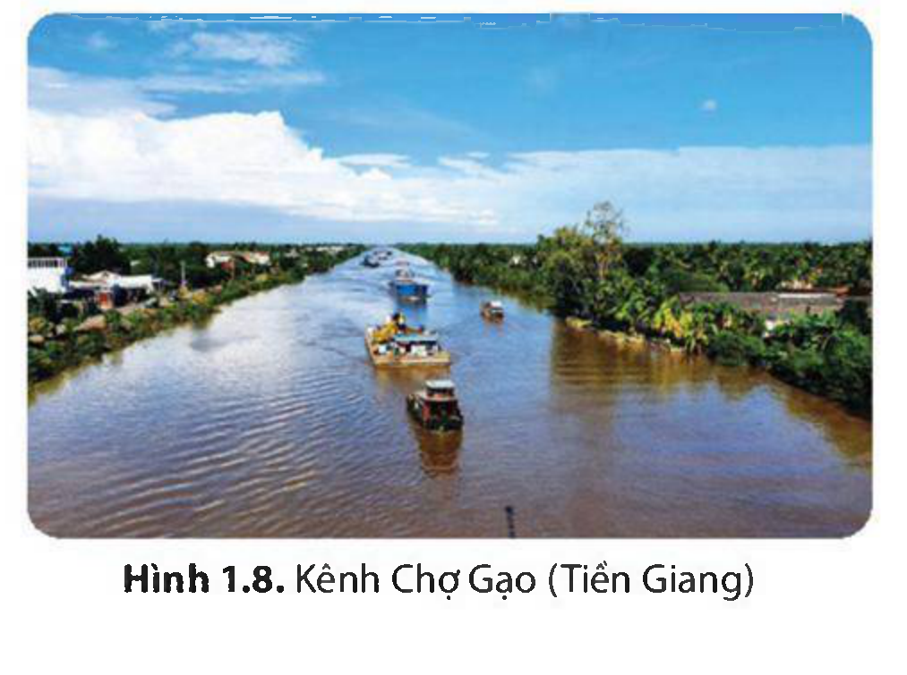
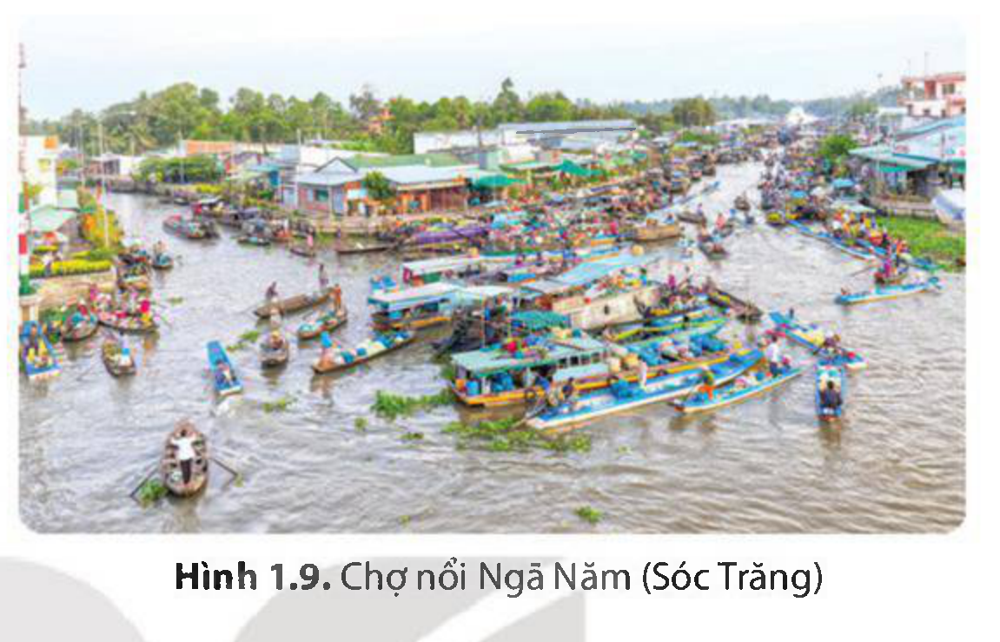

<!-- pdf:159 -->

# CHỦ ĐỀ CHUNG 1: VĂN MINH CHÂU THỔ SÔNG HỒNG VÀ SÔNG CỬU LONG

## 🎯 Học xong bài này, em sẽ:

- Trình bày được quá trình hình thành và phát triển châu thổ; mô tả được chế độ nước của các dòng sông chính.
- Trình bày được quá trình con người khai khẩn và cải tạo châu thổ, chế ngự và thích ứng với chế độ nước của sông Hồng và sông Cửu Long.

## 🔴 Mở đầu

Phù sa của hệ thống sông Hồng và hệ thống sông Cửu Long đã bồi đắp nên hai đồng bằng châu thổ lớn nhất nước ta là đồng bằng châu thổ sông Hồng và đồng bằng châu thổ sông Cửu Long. Hai châu thổ được hình thành và phát triển như thế nào? Con người đã khai khẩn và cải tạo châu thổ, chế ngự và thích ứng với chế độ nước của các dòng sông chính trên châu thổ ra sao?

## 1. Quá trình hình thành và phát triển châu thổ sông Hồng. Chế độ nước sông Hồng

### a) Quá trình hình thành và phát triển châu thổ sông Hồng

- Khái quát

<!-- term: Châu thổ sông Hồng -->
Châu thổ sông Hồng rộng khoảng 15 000 km², có dạng tam giác, đỉnh ở Việt Trì (Phú Thọ), đáy là đường bờ biển từ Quảng Yên (Quảng Ninh) đến cửa sông Đáy (Ninh Bình).

- Quá trình hình thành và phát triển

<!-- term: Hệ thống sông Hồng -->
Hệ thống sông Hồng là một trong hai hệ thống sông lớn nhất ở Việt Nam, với dòng sông chính là sông Hồng (phần chảy ở Việt Nam dài 556 km), hàng trăm phụ lưu các cấp (lớn nhất là sông Đà và sông Lô) và hàng chục chi lưu (sông Trà Lý, sông Đáy,...).

<!-- term: Hệ thống sông Hồng -->
Hệ thống sông Hồng có tổng lượng dòng chảy lên tới 112 tỉ m³/năm và lượng phù sa hết sức phong phú, khoảng 120 triệu tấn/năm.

<!-- term: Châu thổ sông Hồng -->
Châu thổ sông Hồng được hình thành từ quá trình bồi đắp phù sa của hệ thống sông Hồng, kết hợp với tác động của thuỷ triều và sóng biển.

<!-- pdf:160 -->

Khi đổ ra biển, phù sa được lắng đọng ở cửa sông và hình thành châu thổ. Cùng với thời gian, châu thổ sông Hồng ngày càng tiến ra biển (ở Kim Sơn – Ninh Bình, Tiền Hải – Thái Bình tốc độ tiến ra biển lên tới hàng chục mét/năm).

*Hình 1.1. Một phần châu thổ sông Hồng*

Phù sa sông còn có tác dụng bồi cao để hoàn chỉnh bề mặt châu thổ. Để mở rộng diện tích sản xuất đồng thời để phòng chống lũ lụt, ông cha ta đã xây dựng một hệ thống đê dài hàng nghìn ki-lô-mét dọc hai bên bờ sông (tuyến đê đầu tiên được xây dựng năm 1108 vào thời vua Lý Nhân Tông). Điều này đã làm cho địa hình bề mặt châu thổ đã có sự thay đổi.

> ❓ Dựa vào thông tin trong mục a, hãy trình bày quá trình hình thành và phát triển châu thổ sông Hồng.

### b) Chế độ nước sông Hồng

Hệ thống sông Hồng là một trong hai hệ thống sông lớn nhất Việt Nam. Dòng chính bắt nguồn từ Trung Quốc, chảy vào lãnh thổ Việt Nam theo hướng tây bắc – đông nam rồi đổ ra vịnh Bắc Bộ.

<!-- term: Chế độ nước sông Hồng -->
Toàn hệ thống sông Hồng có tới hàng trăm phụ lưu các cấp (lớn nhất là sông Đà và sông Lô). Các phụ lưu hợp với dòng chính thành một mạng lưới hình nan quạt. Hệ thống sông Hồng có lượng dòng chảy phong phú và lượng phù sa lớn. Chế độ nước sông Hồng tương đối đơn giản, trong năm có một mùa lũ và một mùa cạn rõ rệt. Mùa lũ kéo dài 5 tháng (từ tháng 6 đến tháng 10), chiếm khoảng 75% lưu lượng dòng chảy cả năm với các đợt lũ lên nhanh và đột ngột. Mùa cạn kéo dài 7 tháng (từ tháng 11 đến tháng 5 năm sau), chỉ chiếm khoảng 25% lưu lượng dòng chảy cả năm, mực nước sông hạ thấp rõ rệt.

Từ khi các hệ thống hồ chứa nước được xây dựng ở thượng lưu hệ thống sông thì chế độ nước sông đã trở nên điều hoà hơn.

<!-- pdf:161 -->

*Hình 1.2. Biểu đồ lưu lượng nước sông Hồng tại trạm Hà Nội*

> ❓ Dựa vào thông tin mục b và hình 1.2, hãy mô tả chế độ nước của sông Hồng.

## 2. Quá trình hình thành và phát triển châu thổ sông Cửu Long. Chế độ nước sông Cửu Long

### a) Quá trình hình thành và phát triển châu thổ sông Cửu Long

- Khái quát

<!-- term: Đồng bằng châu thổ sông Cửu Long -->
Đồng bằng châu thổ sông Cửu Long là đồng bằng châu thổ lớn nhất nước ta, có diện tích hơn 40 nghìn km², bao gồm phần đất nằm trong phạm vi tác động trực tiếp của sông Tiền, sông Hậu và một phần đất nằm ngoài phạm vi tác động đó nhưng vẫn được cấu tạo bởi phù sa sông (như bán đảo Cà Mau).

*Hình 1.3. Một phần châu thổ sông Cửu Long*

- Quá trình hình thành và phát triển

<!-- term: Hệ thống sông Cửu Long -->
Hệ thống sông Mê Công là một trong những hệ thống sông lớn ở châu Á và thế giới. Phần sông Mê Công chảy trên lãnh thổ Việt Nam (sông Cửu Long) dài hơn 230 km. Sông Cửu Long gồm hai nhánh chính là sông Tiền và sông Hậu cùng hệ thống sông ngòi, kênh rạch chằng chịt trên bề mặt châu thổ.

<!-- term: Hệ thống sông Cửu Long -->
Tổng lượng dòng chảy của hệ thống sông Cửu Long rất lớn, đạt 507 tỉ m³/năm, chiếm 60,4% tổng lượng nước của tất cả sông ngòi ở Việt Nam, vì vậy tuy hàm lượng phù sa không cao nhưng tổng lượng phù sa của hệ thống sông Cửu Long vẫn rất lớn.

<!-- pdf:162 -->

- Do không có hệ thống đê ven sông như ở châu thổ sông Hồng nên khi mùa lũ đến, nước sông Cửu Long dâng tràn ngập một vùng rộng khoảng 10 000 km² (chủ yếu ở Đồng Tháp Mười và Tứ giác Long Xuyên), bồi đắp phù sa cho bề mặt châu thổ.

Trước đây, hằng năm châu thổ sông Cửu Long tiến ra biển ở khu vực bán đảo Cà Mau tới hàng trăm mét mỗi năm. Hiện nay, do biến đổi khí hậu, nước biển dâng và hàm lượng phù sa trong nước sông giảm nên nhiều nơi ở ven biển của châu thổ bị sạt lở.

> ❓ Dựa vào thông tin trong mục a, hãy trình bày quá trình hình thành và phát triển châu thổ sông Cửu Long.

### b) Chế độ nước sông Cửu Long (Mê Công)

Hệ thống sông Mê Công là một trong những hệ thống sông lớn nhất của châu Á và thế giới. Sông Cửu Long là phần hạ lưu của sông Mê Công, gồm hai nhánh chính là sông Tiền và sông Hậu, hiện đổ ra Biển Đông qua tám cửa sông. Lưu lượng nước trung bình năm và tổng lượng phù sa của sông Cửu Long rất lớn.

<!-- term: Chế độ nước sông Cửu Long -->
Chế độ nước của sông Cửu Long đơn giản và điều hoà, chia thành hai mùa:

<!-- term: Chế độ nước sông Cửu Long -->
- Mùa lũ dài 5 tháng (từ tháng 7 đến tháng 11), chiếm khoảng 80% lưu lượng dòng chảy cả năm. Lũ khi lên và khi rút đều diễn ra chậm vì lưu vực sông Mê Công dài, có dạng lông chim và được điều tiết bởi hồ Tôn-lê Sáp.

<!-- term: Chế độ nước sông Cửu Long -->
- Mùa cạn dài 7 tháng (từ tháng 12 đến tháng 6 năm sau), chiếm khoảng 20% lưu lượng dòng chảy cả năm.

Đặc biệt, vùng hạ lưu châu thổ chịu tác động rất mạnh của chế độ thuỷ triều.

*Hình 1.4. Biểu đồ lưu lượng nước sông Tiền tại trạm Mỹ Thuận*

> ❓ Dựa vào thông tin mục b và hình 1.4, hãy mô tả chế độ nước của sông Cửu Long.

<!-- pdf:163 -->

## 3. Quá trình con người khai khẩn và cải tạo châu thổ, chế ngự và thích ứng với chế độ nước của sông Hồng và sông Cửu Long

Sinh cơ lập nghiệp trên vùng đất có nhiều sông ngòi, từ rất sớm, tổ tiên của những tộc người sinh sống trên đất nước Việt Nam đã biết khai thác nguồn lợi từ sông nước, cải tạo châu thổ, chế ngự và thích ứng với chế độ nước của các con sông lớn.

### a) Đối với sông Hồng

Mạng lưới thuộc hệ thống sông Hồng đóng vai trò hết sức quan trọng trong cuộc sống của người Việt cổ ở miền Bắc. Đó là nơi cung cấp nguồn thức ăn, là đường giao thông liên kết giữa các vùng. Hình ảnh về cuộc sống sông nước, cũng như dựa vào khai thác các sản phẩm tự nhiên từ sông nước được in đậm trên các di vật, hoặc vẫn được lưu giữ trong các tầng văn hoá khảo cổ học.

*Hình 1.5. Hoạ tiết hình thuyền trên trống đồng Đông Sơn*

*Hình 1.6. Lưỡi câu đồng thuộc thời kì văn hoá Gò Mun*

*Hình 1.7. Vỏ ốc được phát hiện trong các di chỉ thuộc văn hoá Hạ Long*

Để phát triển nền nông nghiệp trồng lúa nước, công việc quan trọng hàng đầu là điều tiết và chế ngự nguồn nước.

Từ xa xưa, để khai thác nguồn nước giàu phù sa của hệ thống sông Hồng, người Việt đã sớm biết tạo nên những hệ thống kênh (sông đào) dẫn nước vào ruộng, hoặc tiêu nước, phân lũ về mùa mưa; đồng thời cũng sớm phải tổ chức đắp đê, trị thuỷ để phát triển sản xuất và bảo vệ cuộc sống.

<!-- term: Thổ nhô -->
<!-- term: Đê Cơ Xá -->
> 💡 **Em có biết?**
>
> - Các chuyên gia về thuỷ lợi, đê điều giải thích đê có từ thời Hùng Vương, xuất hiện ở Phong Châu (Phú Thọ). Khi đó, lũ lên ngập đồng ruộng thì người dân đã đổ đất, tôn ruộng lên cao, cứ mỗi năm tôn thêm một chút. Đó gọi là “thổ nhô”.
>
> - Đê Cơ Xá được vua Lý Nhân Tông cho xây dựng vào tháng 3 – 1108 để bảo vệ kinh thành Thăng Long khỏi ngập lụt. Nhà vua cũng ra lệnh đắp đê trên sông Như Nguyệt (sông Cầu bây giờ) dài 30 km.

<!-- pdf:164 -->

<!-- term: Đê quai vạc và chức quan Hà đê sứ -->
Từ thế kỉ XI, dưới thời Lý, Nhà nước Đại Việt đã cho đắp đê dọc theo hầu hết các con sông lớn. Tới thời Trần, triều đình đã cho gia cố cho các đoạn đê xung yếu ở hai bên bờ sông Hồng từ đầu nguồn tới biển (đê quai vạc) và đặt ra chức quan Hà đê sứ chuyên trách trông coi việc bồi đắp và bảo vệ hệ thống đê điều,...

<!-- term: Quai đê lấn biển -->
Sang thế kỉ XV, nhà Lê bắt đầu tiến hành quai đê lấn biển để khai thác bãi bồi vùng cửa sông. Công việc này được đẩy mạnh vào thời Nguyễn ở các vùng ven biển Thái Bình, Nam Định và Ninh Bình, gắn liền với tên tuổi Doanh điền sứ Nguyễn Công Trứ.

> Vua Gia Long triều Nguyễn ban chiếu rằng: “Những huyện ven sông Hồng... từ trước đã đắp đê phòng lụt. Song hễ đến mùa lụt thì đê vỡ lở, lúa ruộng bị ngập lụt, người và vật đều bị hại... Vậy đắp đê hay bỏ đê, cách nào lợi, cách nào hại, cho được bày tỏ. Lời bàn có thể thực hành sẽ được nêu thưởng”.
>
> (Theo Quốc sử quán triều Nguyễn, *Đại Nam thực lục*, Tập một, Sđd, tr. 572 – 573)

> ❓ 1. Khai thác tư liệu trên giúp em biết được điều gì về vấn đề đê điều dưới triều Nguyễn?
>
> 2. Trình bày những nét chính về quá trình con người khai khẩn và cải tạo châu thổ, chế ngự chế độ nước sông Hồng.

### b) Đối với sông Cửu Long

Với vùng đồng bằng phì nhiêu, rộng lớn, vùng đất Nam Bộ Việt Nam sớm được khai khẩn và trở thành một trung tâm nông nghiệp lúa nước thời Vương quốc Phù Nam. Trên nền tảng kinh tế nông nghiệp phát triển, một nền văn minh rực rỡ gắn với các di tích thuộc văn hoá Óc Eo, Vương quốc Phù Nam đã để lại dấu ấn đặc sắc trong lịch sử Đông Nam Á từ thế kỉ I đến đầu thế kỉ VII.

Đến thế kỉ IV, ở Nam Bộ xuất hiện tình trạng biển tiến cục bộ, nước mặn dần dâng cao. Quá trình này đã làm cho toàn bộ vùng đất thấp bị ngập mặn, gây ra hậu quả lâu dài và ảnh hưởng nghiêm trọng đến nghề trồng lúa. Cho đến thế kỉ XIII, Nam Bộ vẫn còn là vùng đất tương đối hoang vu.

Nếu quá trình khai khẩn châu thổ sông Hồng ở miền Bắc gắn liền với việc đắp đê trị thuỷ, thì việc khai khẩn đồng bằng sông Cửu Long lại là quá trình thích ứng với tự nhiên.

<!-- term: Kênh Vĩnh Tế -->
> 💡 **Em có biết?**
>
> Kênh Vĩnh Tế với chiều dài gần 90 km, nối liền Châu Đốc và Hà Tiên, hai trung tâm kinh tế lớn ở miền Tây Nam Bộ được đào từ đầu thế kỉ XIX, trải qua ba đời vua: Gia Long, Minh Mạng, Thiệu Trị. Đây cũng là công trình hiếm hoi được khắc trên Cửu đỉnh – Bảo vật quốc gia.

*Hình 1.8. Kênh Chợ Gạo (Tiền Giang)*

<!-- pdf:165 -->

<!-- term: Văn hoá sông nước ở đồng bằng sông Cửu Long -->
Quá trình khai hoang, phục hoá đồng ruộng bắt đầu được đẩy mạnh từ khoảng thế kỉ XVII với nhiều dòng kênh lớn được đào và đưa vào khai thác. Các cộng đồng cư dân đến từ phía bắc, cùng với những nhóm cư dân có mặt từ trước đã sát cánh bên nhau khai phá trên quy mô lớn, phát triển vùng đất Nam Bộ dần thành một trung tâm kinh tế của đất nước.

<!-- term: Văn hoá sông nước ở đồng bằng sông Cửu Long -->
Cuộc sống trên sông nước, gần sông nước và những ứng xử thường xuyên với môi trường đã tạo nên một nền văn hoá đậm chất sông nước. Chợ nổi, nhà nổi,... là những cách thích ứng với môi trường sông nước của cư dân đồng bằng sông Cửu Long.

Do tác động lớn của môi trường sông nước mà *“nước”* thành quan niệm của người Việt về Tổ quốc từ xưa đến nay.

*Hình 1.9. Chợ nổi Ngã Năm (Sóc Trăng)*

> ❓ Trình bày những nét chính về quá trình con người khai khẩn và cải tạo châu thổ, chế ngự và thích ứng với chế độ nước sông Cửu Long.

## ✏️ Luyện tập – Vận dụng

1. Chế độ nước của các sông chính ở châu thổ sông Hồng và châu thổ sông Cửu Long khác nhau như thế nào?

2. Theo em, quá trình con người khai thác và cải tạo châu thổ, chế ngự và thích ứng với chế độ nước của sông Hồng và sông Cửu Long có điểm gì giống và khác nhau?

- Chọn và hoàn thành một trong hai nhiệm vụ sau:

  1. Sưu tầm tư liệu, hình ảnh về địa hình, sông ngòi của châu thổ sông Hồng và châu thổ sông Cửu Long.

  2. Tìm hiểu thêm từ sách, báo, internet và cho biết: Hiện nay việc khai thác và cải tạo châu thổ, chế ngự và thích ứng với chế độ nước của sông Hồng và sông Cửu Long có cần thiết không? Vì sao?

## 📷 Danh sách hình trong bài

| Mã hình | Trang PDF | Trang sách | Chú thích |
| --- | :---: | :---: | --- |
| H8-lich_su_va_dia_ly-cdc-01-01 | 160 | 158 | Hình 1.1. Một phần châu thổ sông Hồng |
| H8-lich_su_va_dia_ly-cdc-01-02 | 161 | 159 | Hình 1.2. Biểu đồ lưu lượng nước sông Hồng tại trạm Hà Nội |
| H8-lich_su_va_dia_ly-cdc-01-03 | 161 | 159 | Hình 1.3. Một phần châu thổ sông Cửu Long |
| H8-lich_su_va_dia_ly-cdc-01-04 | 162 | 160 | Hình 1.4. Biểu đồ lưu lượng nước sông Tiền tại trạm Mỹ Thuận |
| H8-lich_su_va_dia_ly-cdc-01-05 | 163 | 161 | Hình 1.5. Hoạ tiết hình thuyền trên trống đồng Đông Sơn |
| H8-lich_su_va_dia_ly-cdc-01-06 | 163 | 161 | Hình 1.6. Lưỡi câu đồng thuộc thời kì văn hoá Gò Mun |
| H8-lich_su_va_dia_ly-cdc-01-07 | 163 | 161 | Hình 1.7. Vỏ ốc được phát hiện trong các di chỉ thuộc văn hoá Hạ Long |
| H8-lich_su_va_dia_ly-cdc-01-08 | 164 | 162 | Hình 1.8. Kênh Chợ Gạo (Tiền Giang) |
| H8-lich_su_va_dia_ly-cdc-01-09 | 165 | 163 | Hình 1.9. Chợ nổi Ngã Năm (Sóc Trăng) |
