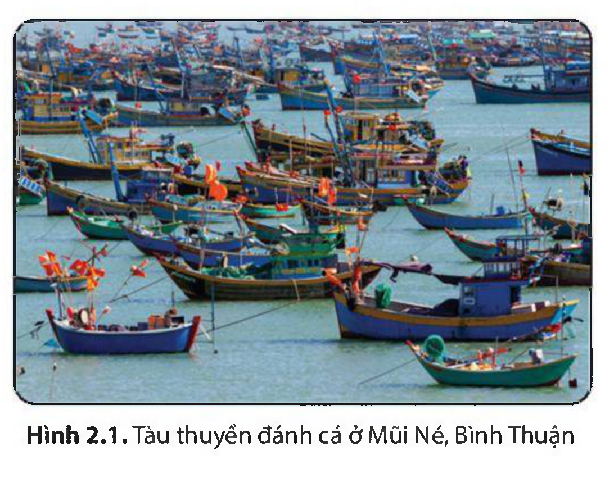
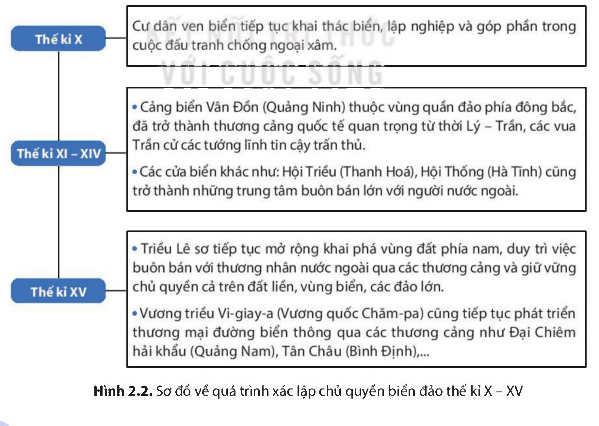
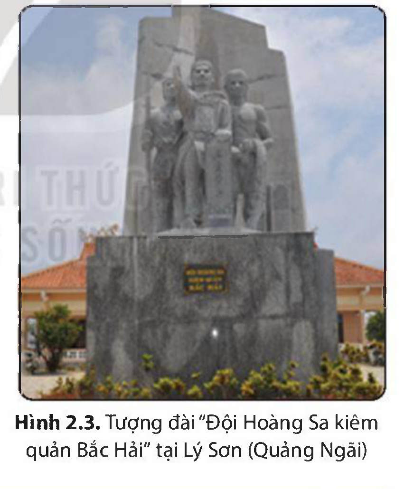
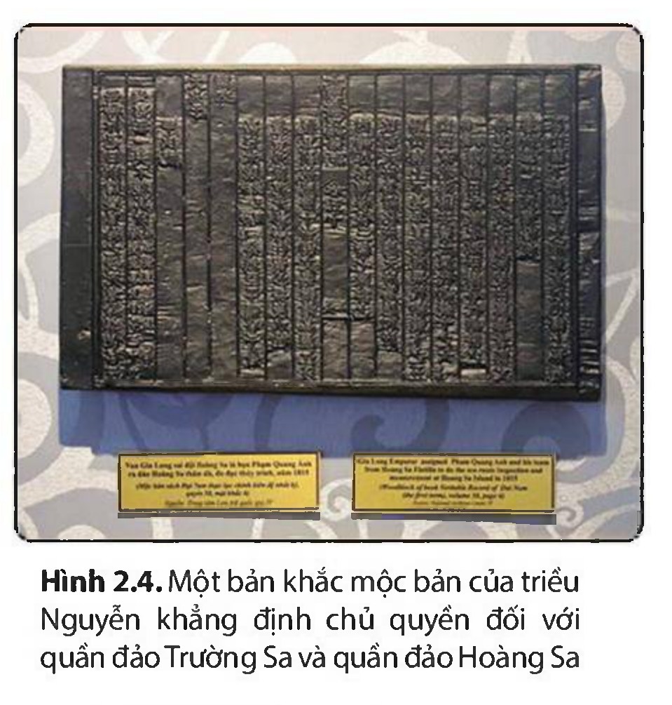

<!-- pdf:166 -->

# CHỦ ĐỀ CHUNG 2: BẢO VỆ CHỦ QUYỀN, CÁC QUYỀN VÀ LỢI ÍCH HỢP PHÁP CỦA VIỆT NAM Ở BIỂN ĐÔNG

## 🎯 Học xong bài này, em sẽ:

- Xác định được vị trí, phạm vi của vùng biển và hải đảo Việt Nam (theo Luật Biển Việt Nam).
- Trình bày được những nét chính về môi trường, tài nguyên thiên nhiên; phân tích được những thuận lợi và khó khăn đối với phát triển kinh tế và bảo vệ chủ quyền, các quyền và lợi ích hợp pháp của Việt Nam ở Biển Đông.
- Trình bày được quá trình xác lập chủ quyền biển đảo của Việt Nam trong lịch sử.

## 🔴 Mở đầu

Cùng với phần đất liền, biển đảo là không gian sinh tồn và phát triển của dân tộc Việt Nam từ bao đời nay. Hiểu biết về biển đảo sẽ góp phần phát triển kinh tế và bảo vệ chủ quyền biển đảo của đất nước. Hãy cho biết những thuận lợi và khó khăn trong phát triển kinh tế và bảo vệ chủ quyền, các quyền và lợi ích hợp pháp của Việt Nam ở Biển Đông.

## 1. Vị trí, phạm vi các vùng biển và hải đảo Việt Nam

<!-- term: Vùng biển Việt Nam theo Luật Biển Việt Nam năm 2012 -->
Theo Luật Biển Việt Nam năm 2012, vùng biển Việt Nam trong Biển Đông bao gồm: nội thuỷ, lãnh hải, vùng tiếp giáp lãnh hải, vùng đặc quyền kinh tế, thềm lục địa thuộc chủ quyền, quyền chủ quyền, quyền tài phán quốc gia của Việt Nam.

<!-- term: Vùng biển Việt Nam theo Luật Biển Việt Nam năm 2012 -->
Vùng biển của Việt Nam mở rộng ra tới ranh giới ngoài của vùng đặc quyền kinh tế và thềm lục địa trên Biển Đông với diện tích khoảng 1 triệu km² (gấp hơn ba lần diện tích phần đất liền).

<!-- term: Hệ thống đảo, quần đảo và huyện đảo của Việt Nam -->
Vùng biển Việt Nam có hàng nghìn hòn đảo lớn nhỏ, trong đó có quần đảo Hoàng Sa và quần đảo Trường Sa ở giữa Biển Đông.

<!-- term: Hệ thống đảo, quần đảo và huyện đảo của Việt Nam -->
Hiện nay, một số đảo và quần đảo của nước ta được tổ chức thành các đơn vị hành chính cấp huyện.

<!-- pdf:167 -->

CÁC HUYỆN, THÀNH PHỐ ĐẢO Ở VIỆT NAM, NĂM 2022

| STT | Đơn vị | Diện tích đất nổi (km²) | Trực thuộc tỉnh, thành phố trực thuộc Trung ương |
| :---: | --- | :---: | --- |
| 1 | Huyện Vân Đồn | 551,30 | Tỉnh Quảng Ninh |
| 2 | Huyện Cô Tô | 46,20 | Tỉnh Quảng Ninh |
| 3 | Huyện Cát Hải | 345,00 | Thành phố Hải Phòng |
| 4 | Huyện Bạch Long Vĩ | 2,50 | Thành phố Hải Phòng |
| 5 | Huyện Cồn Cỏ | 2,50 | Tỉnh Quảng Trị |
| 6 | Huyện Hoàng Sa | 305,00 | Thành phố Đà Nẵng |
| 7 | Huyện Lý Sơn | 9,97 | Tỉnh Quảng Ngãi |
| 8 | Huyện Trường Sa | 496,00 | Tính Khánh Hoà |
| 9 | Huyện Phú Quý | 16,00 | Tỉnh Bình Thuận |
| 10 | Huyện Côn Đảo | 75,15 | Tỉnh Bà Rịa – Vũng Tàu |
| 11 | Huyện Kiên Hải | 30,00 | Tỉnh Kiên Giang |
| 12 | Thành phố Phú Quốc | 589,23 | Tỉnh Kiên Giang |

> ❓ Dựa vào hình 11.1, 11.2 bài 11 phần Địa lí (trang 146, 147) và thông tin trong mục 1, hãy xác định vị trí, phạm vi của các vùng biển và hải đảo Việt Nam.

## 2. Đặc điểm môi trường và tài nguyên biển đảo Việt Nam

### a) Đặc điểm môi trường vùng biển đảo

Nhìn chung, chất lượng môi trường nước biển (ven bờ và xa bờ, ven các đảo và cụm đảo) đều còn khá tốt, hầu hết các chỉ số đặc trưng đều nằm trong giới hạn cho phép của Tiêu chuẩn môi trường Việt Nam hiện hành. Các hệ sinh thái biển rất đa dạng, đặc biệt là hệ sinh thái rừng ngập mặn và hệ sinh thái rạn san hô.

Tuy nhiên, chất lượng môi trường biển đảo có xu hướng suy thoái: lượng rác thải, chất thải trên biển tăng, nhiều vùng biển ven bờ bị ô nhiễm, số lượng nhiều loài hải sản giảm, một số hệ sinh thái (nhất là rạn san hô, cỏ biển,...) bị suy thoái,...

Trong những năm gần đây, chất lượng môi trường biển và hải đảo đang từng bước được cải thiện với những biện pháp cụ thể: trồng và bảo vệ rừng ngập mặn, bảo vệ rạn san hô, cải thiện tình trạng ô nhiễm ven bờ,...

### b) Tài nguyên vùng biển đảo

Vùng biển và hải đảo nước ta có nguồn tài nguyên khá phong phú và đa dạng.

Vùng biển Việt Nam có nhiều loài thuỷ sản cho giá trị kinh tế cao. Hằng năm, trên vùng biển Việt Nam có thể khai thác 1,6 – 1,7 triệu tấn cá, 60 – 70 nghìn tấn tôm, 30 – 40 nghìn tấn mực,... Dọc ven biển có nhiều vũng vịnh, đầm phá rất thuận lợi để nuôi trồng thuỷ sản có giá trị cao (tôm, cua, cá, rong biển,...).

<!-- pdf:168 -->

Biển Việt Nam là nguồn cung cấp muối vô tận. Các khoáng sản có trữ lượng tương đối lớn như: dầu mỏ, khí tự nhiên, cát thuỷ tinh, ti-tan,... tạo thuận lợi phát triển các ngành công nghiệp.

Việt Nam có nguồn tài nguyên du lịch biển đặc sắc và đa dạng. Gồm các bãi biển đẹp, các vịnh biển có phong cảnh độc đáo, các khu bảo tồn, khu dự trữ sinh quyển biển và hải đảo,... thu hút khách du lịch trong và ngoài nước.

*Hình 2.1. Tàu thuyền đánh cá ở Mũi Né, Bình Thuận*

> ❓ Dựa vào thông tin trong mục 2, hãy:
>
> - Nêu các đặc điểm chính về môi trường biển và hải đảo nước ta.
> - Trình bày các tài nguyên vùng biển đảo Việt Nam.

## 3. Những thuận lợi, khó khăn đối với phát triển kinh tế và bảo vệ chủ quyền biển đảo

Biển đảo có vai trò quan trọng trong sự nghiệp xây dựng và bảo vệ tổ quốc cả trong lịch sử, hiện tại và tương lai.

### a) Đối với phát triển kinh tế

- Thuận lợi

Tài nguyên biển (sinh vật, khoáng sản,...) đa dạng, phong phú tạo điều kiện để phát triển nhiều ngành kinh tế biển: khai thác và nuôi trồng thuỷ sản, làm muối, khai thác dầu khí,... Vị trí nằm gần các tuyến hàng hải quốc tế trên Biển Đông, dọc bờ biển có nhiều vịnh biển kín để xây dựng các cảng nước sâu,... là điều kiện để phát triển giao thông vận tải biển, là cửa ngõ để Việt Nam giao thương với thị trường quốc tế. Nhiều bãi biển đẹp, nước biển ấm, chan hoà ánh nắng, nhiều vườn quốc gia, khu dự trữ sinh quyển ven biển và trên các đảo,... tạo điều kiện để phát triển du lịch biển đảo.

- Khó khăn

  + Vùng biển nhiệt đới nước ta nhiều thiên tai, đặc biệt là bão. Những năm gần đây, biến đổi khí hậu đã tác động lớn tới thiên nhiên vùng biển đảo (đặc biệt là sạt lở bờ biển và nước biển dâng), gây khó khăn cho phát triển kinh tế biển đảo.

  + Cơ sở hạ tầng các vùng biển và hải đảo nhìn chung còn chưa đầy đủ và đồng bộ, không tương xứng với tiềm năng và thế mạnh biển đảo.

> ❓ Dựa vào thông tin trong mục a và các kiến thức đã học, hãy:
>
> - Nêu một số hoạt động kinh tế ở vùng biển đảo nước ta.
> - Cho biết việc phát triển kinh tế ở vùng biển đảo nước ta có những thuận lợi, khó khăn gì.

<!-- pdf:169 -->

### b) Đối với bảo vệ chủ quyền, các quyền và lợi ích hợp pháp của Việt Nam ở Biển Đông

- Thuận lợi

<!-- term: Công ước của Liên hợp quốc về Luật Biển 1982 -->
Công ước của Liên hợp quốc về Luật Biển 1982 là cơ sở pháp lí để các quốc gia khẳng định và bảo vệ chủ quyền, các quyền và lợi ích hợp pháp trên biển. Cùng năm đó, Việt Nam đã kí kết Công ước này và được sự ủng hộ của nhiều quốc gia trên thế giới trong quá trình đấu tranh nhằm thực thi Công ước trên Biển Đông.

<!-- term: Cơ sở pháp lí bảo vệ chủ quyền biển đảo của Việt Nam -->
Trên cơ sở Công ước của Liên hợp quốc về Luật Biển 1982, Việt Nam đã xây dựng được hệ thống luật và pháp luật làm cơ sở để bảo vệ chủ quyền, các quyền và lợi ích hợp pháp của đất nước trên Biển Đông, như: Luật Biển Việt Nam năm 2012, Luật Biên giới Quốc gia năm 2003,...

<!-- term: Bộ Quy tắc ứng xử trên Biển Đông -->
Đồng thời, Việt Nam tích cực tham gia xây dựng Bộ Quy tắc ứng xử trên Biển Đông (COC), kí một số thoả thuận và hiệp định về phân định và hợp tác trên biển với các nước láng giềng như Hiệp định phân định ranh giới thềm lục địa với In-đô-nê-xi-a năm 2003, Thoả thuận hợp tác khai thác chung thềm lục địa chồng lấn với Ma-lai-xi-a năm 1992,...

Tình hình an ninh, chính trị khu vực Đông Nam Á ngày càng ổn định, các nước ASEAN ngày càng đồng thuận trong cách ứng xử của các bên trên Biển Đông.

- Khó khăn

Hiện nay, khó khăn lớn nhất là tình trạng chồng lấn giữa vùng biển đảo của nhiều quốc gia đã dẫn đến những tranh chấp, ảnh hưởng đến tình hình an ninh trên Biển Đông, đòi hỏi giải quyết tranh chấp bằng các biện pháp hoà bình.

> ❓ Dựa vào thông tin trong mục b và hiểu biết của em, hãy phân tích những thuận lợi, khó khăn đối với bảo vệ chủ quyền, các quyền và lợi ích hợp pháp của Việt Nam ở Biển Đông.

## 4. Quá trình xác lập chủ quyền biển đảo trong lịch sử Việt Nam

Do sống ở gần biển, sớm nhận thức được vai trò của biển, các thế hệ người Việt từ xa xưa đã dành nhiều công sức để khai phá, xác lập và thực thi quyền, chủ quyền biển đảo nói chung và đối với quần đảo Hoàng Sa, quần đảo Trường Sa nói riêng.

> 💡 **Kết nối với văn học**
>
> Ca dao, tục ngữ xưa cũng phản ánh mối liên hệ của biển với đời sống người dân:
>
> *Dã tràng xe cát Biển Đông;*
>
> *Công cha như núi ngất trời,*
> *Nghĩa mẹ như nước ngời ngời Biển Đông;*
>
> *Thuận vợ thuận chồng tát Biển Đông cũng cạn.*

- *Thời tiền sử*

Ngay từ thời tiền sử, nhiều bộ lạc đã sinh sống ở các hang động ven biển Hải Phòng, Quảng Ninh, Nghệ An, Hà Tĩnh, Quảng Bình,... Những bằng chứng khảo cổ học được tìm thấy ở vùng ven biển từ bắc vào nam cho thấy cư dân Việt cổ đã có những hoạt động đánh bắt hải sản cũng như giao lưu kinh tế, văn hoá giữa các vùng và trong khu vực.

<!-- pdf:170 -->

- *Từ khoảng thế kỉ VII trước Công nguyên đến thế kỉ X*

> 💡 **Em có biết?**
>
> Các truyền thuyết cho thấy người Việt là cư dân khai thác biển từ rất sớm. Vì thế các câu chuyện đều có yếu tố kết hợp rừng với biển, đất liền với biển đảo như: Câu chuyện về Lạc Long Quân – Âu Cơ và cội nguồn dân tộc; về Mai An Tiêm chinh phục đảo, trồng được dưa hấu đỏ ngon; về An Dương Vương được Rùa vàng (thần biển) giúp đỡ,...

Đây là thời kì ra đời và phát triển của các nhà nước đầu tiên trên lãnh thổ Việt Nam (Văn Lang – Âu Lạc, Chăm-pa, Phù Nam). Những trống đồng, thạp đồng có trang trí hoa văn hình thuyền thuộc văn hoá Đông Sơn được phát hiện đã chứng tỏ cư dân ở đây tiếp tục sinh sống và khai thác biển.

Trong khoảng hơn một nghìn năm Bắc thuộc, người Việt ở phía bắc vừa đấu tranh giành độc lập, vừa duy trì và thực thi chủ quyền thông qua khai thác biển đảo.

Với vị trí ven biển, thuận lợi cho giao thương nên Vương quốc Chăm-pa đã sớm trở thành nơi thu hút nhiều thương nhân nước ngoài đến buôn bán. Còn Óc Eo (An Giang) cũng là một thương cảng nổi tiếng của Vương quốc Phù Nam trong giao thương với Chăm-pa và các vương quốc trong khu vực Đông Nam Á cũng như với Trung Quốc, Ấn Độ,...

- *Từ thế kỉ X đến thế kỉ XV*

<!-- term: Xác lập chủ quyền biển đảo Việt Nam thế kỉ X – XV -->
Biển trở thành tuyến đường giao thông thuỷ quan trọng, kết nối Đại Việt và các nước xung quanh.

<!-- term: Xác lập chủ quyền biển đảo Việt Nam thế kỉ X – XV -->
- Thế kỉ X: Cư dân ven biển tiếp tục khai thác biển, lập nghiệp và góp phần trong cuộc đấu tranh chống ngoại xâm.
- Thế kỉ XI – XIV:
  + Cảng biển Vân Đồn (Quảng Ninh) thuộc vùng quần đảo phía đông bắc, đã trở thành thương cảng quốc tế quan trọng từ thời Lý – Trần, các vua Trần cử các tướng lĩnh tin cậy trấn thủ.
  + Các cửa biển khác như: Hội Triều (Thanh Hoá), Hội Thống (Hà Tĩnh) cũng trở thành những trung tâm buôn bán lớn với người nước ngoài.
- Thế kỉ XV:
  + Triều Lê sơ tiếp tục mở rộng khai phá vùng đất phía nam, duy trì việc buôn bán với thương nhân nước ngoài qua các thương cảng và giữ vững chủ quyền cả trên đất liền, vùng biển, các đảo lớn.
  + Vương triều Vi-giay-a (Vương quốc Chăm-pa) cũng tiếp tục phát triển thương mại đường biển thông qua các thương cảng như Đại Chiêm hải khẩu (Quảng Nam), Tân Châu (Bình Định),...

*Hình 2.2. Sơ đồ về quá trình xác lập chủ quyền biển đảo thế kỉ X – XV*

<!-- pdf:171 -->

- *Từ thế kỉ XVI đến cuối thế kỉ XIX*

Các cảng thị, đô thị cổ ở cả Đàng Ngoài và Đàng Trong như: Vân Đồn, Phố Hiến, Hội An, Thanh Hà, Gia Định,... đều hướng ra biển, thúc đẩy việc mở rộng giao thương không chỉ với các nước trong khu vực mà cả với các nước châu Âu.

Trong 60 năm của thế kỉ XVI, chính quyền chúa Nguyễn ở Đàng Trong khuyến khích quan lại, địa chủ mộ dân phiêu tán vào khai khẩn, lập xã thôn ở vùng đồng bằng sông Cửu Long. Vì vậy, các đảo như: Côn Lôn (Bà Rịa – Vũng Tàu), Phú Quốc (Kiên Giang),... đều có dân cư đến khai phá, lập nghiệp.

> 1. Tháng 8 – 1702, người Anh đã đánh chiếm đảo (Côn Lôn) và xây dựng căn cứ lâu dài ở đây. Hơn một năm sau, chúa Nguyễn Phúc Chu đã tổ chức chiến đấu đánh đuổi quân xâm lược Anh, giành lại chủ quyền biển đảo. Khi Hà Tiên (bao gồm cả dải đất liền duyên hải từ Cà Mau cho đến biên giới Cam-pu-chia – Thái Lan và các đảo, quần đảo trên vịnh Thái Lan) thuộc về Đàng Trong, đội Hà Tiên được thành lập đặc trách khu vực vịnh Thái Lan.
>
> (Theo Nguyễn Quang Ngọc (Chủ biên), *Vùng đất Nam Bộ*, Tập IV, NXB Chính trị quốc gia Sự thật, 2019, tr. 144)

<!-- term: Đội Hoàng Sa và đội Bắc Hải -->
Bên cạnh việc tổ chức khai phá đất đai, các chúa Nguyễn còn xây dựng thành trì, đắp luỹ trên đất liền, bố trí việc phòng thủ ở ven biển, thành lập các đội quân canh giữ biển đảo. Các chúa Nguyễn tổ chức các đội Hoàng Sa, Bắc Hải hằng năm ra quần đảo Hoàng Sa, quần đảo Trường Sa thực hiện khai thác sản vật và quản lí biển đảo.

<!-- term: Đội Hoàng Sa và đội Bắc Hải -->
Tiếp nối các chúa Nguyễn, triều Tây Sơn cũng luôn quan tâm đến việc duy trì, tổ chức việc khai thác quần đảo Hoàng Sa, thực hiện chủ quyền của mình đối với biển đảo.

*Hình 2.3. Tượng đài “Đội Hoàng Sa kiêm quản Bắc Hải” tại Lý Sơn (Quảng Ngãi)*

> 2. Tờ sai năm 1786 của quan Thượng tướng công triều Tây Sơn có ghi: Sai cai Hội Đức Hầu đội Hoàng Sa dẫn bốn chiếc thuyền câu vượt biển đến thẳng Hoàng Sa và các cù lao trên biển thu lượm đồ vàng bạc, đồ đồng và vũ khí, đồi mồi, cá quý mang về kinh đô dâng nộp theo lệ”.
>
> (Theo Bộ ngoại giao, *Chủ quyền của Việt Nam đối với hai quần đảo Hoàng Sa và Trường Sa*, NXB Tri thức, 2013, tr. 8)

<!-- pdf:172 -->

<!-- term: Thực thi chủ quyền biển đảo Việt Nam từ năm 1802 đến nay -->
Từ năm 1802 cho đến năm 1884: Các vua triều Nguyễn ra sức củng cố chủ quyền biển đảo qua việc tổ chức khảo sát, thăm dò, khai thác, đo đạc thuỷ trình, vẽ bản đồ và cắm cờ trên quần đảo Hoàng Sa để khẳng định chủ quyền của Việt Nam.

<!-- term: Thực thi chủ quyền biển đảo Việt Nam từ năm 1802 đến nay -->
Từ năm 1884 đến năm 1945: Sau khi kí Hiệp ước Pa-tơ-nốt với triều Nguyễn, Pháp đại diện quyền lợi trong quan hệ đối ngoại và việc bảo vệ chủ quyền, toàn vẹn lãnh thổ của Việt Nam, tiếp tục thực thi chủ quyền trên Biển Đông, quần đảo Hoàng Sa và quần đảo Trường Sa.

*Hình 2.4. Một bản khắc mộc bản của triều Nguyễn khẳng định chủ quyền đối với quần đảo Trường Sa và quần đảo Hoàng Sa*

<!-- term: Thực thi chủ quyền biển đảo Việt Nam từ năm 1802 đến nay -->
Từ năm 1945 đến nay: Nhà nước Việt Nam qua các thời kì lịch sử tiếp tục có hoạt động đấu tranh kiên quyết nhằm thực thi chủ quyền biển đảo cũng như chủ quyền ở quần đảo Trường Sa và quần đảo Hoàng Sa.

> ❓ Khai thác tư liệu 1, 2 và thông tin trong mục, hãy trình bày quá trình xác lập chủ quyền biển đảo của Việt Nam trong lịch sử.

## ✏️ Luyện tập – Vận dụng

- Lập và hoàn thành bảng tổng kết (theo gợi ý dưới đây) về quá trình khai thác và xác lập quyền, chủ quyền biển đảo của Việt Nam trong lịch sử.

| Thời gian | Biểu hiện/Bằng chứng | Ý nghĩa |
| --- | :---: | :---: |
| Thời tiền sử | ? | ? |
| Thế kỉ VII TCN đến thế kỉ X | ? | ? |
| Thế kỉ X đến thế kỉ XV | ? | ? |
| Thế kỉ XVI đến cuối thế kỉ XIX | ? | ? |

- Chọn và hoàn thành một trong hai nhiệm vụ sau:

  1. Đóng vai hướng dẫn viên du lịch, em hãy giới thiệu cho du khách về những giá trị của môi trường, tài nguyên biển đảo và nét chính về quá trình xác lập chủ quyền biển đảo của Việt Nam.

  2. Sưu tầm tư liệu từ sách, báo và internet, em hãy viết một bản tin (khoảng 7 – 10 câu) tuyên truyền về chủ quyền biển đảo của Việt Nam qua tư liệu tìm được.

## 📷 Danh sách hình trong bài

| Mã hình | Trang PDF | Trang sách | Chú thích |
| --- | :---: | :---: | --- |
| H8-lich_su_va_dia_ly-cdc-02-01 | 168 | 166 | Hình 2.1. Tàu thuyền đánh cá ở Mũi Né, Bình Thuận |
| H8-lich_su_va_dia_ly-cdc-02-02 | 170 | 168 | Hình 2.2. Sơ đồ về quá trình xác lập chủ quyền biển đảo thế kỉ X – XV |
| H8-lich_su_va_dia_ly-cdc-02-03 | 171 | 169 | Hình 2.3. Tượng đài “Đội Hoàng Sa kiêm quản Bắc Hải” tại Lý Sơn (Quảng Ngãi) |
| H8-lich_su_va_dia_ly-cdc-02-04 | 172 | 170 | Hình 2.4. Một bản khắc mộc bản của triều Nguyễn khẳng định chủ quyền đối với quần đảo Trường Sa và quần đảo Hoàng Sa |
