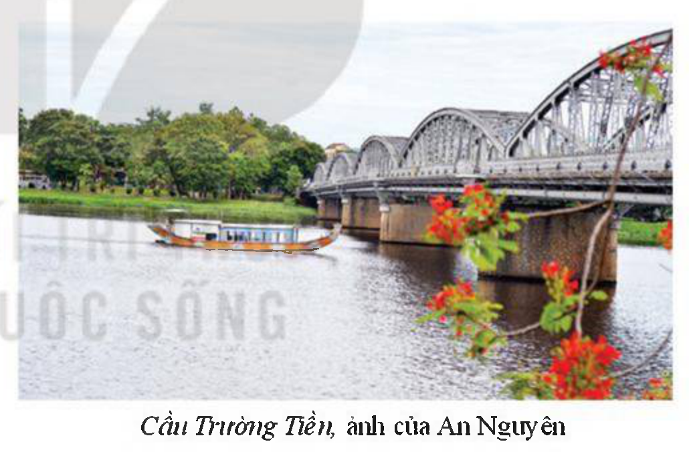

<!-- pdf:40 -->

# BÀI 2: VẺ ĐẸP CỔ ĐIỂN

*Túi thơ chứa hết mọi giang san.*

(Nguyễn Trãi)

## Giới thiệu bài học

- Có thể nói, nền văn hoá, văn học của một dân tộc là mạch nguồn sâu xa nuôi dưỡng trí tuệ, tâm hồn con người. Vì vậy, hiểu biết, đón nhận và gìn giữ những di sản tinh thần của ông cha là trách nhiệm thiêng liêng với cộng đồng và với bản thân mỗi chúng ta.
- Đến với những bài thơ Đường luật trong bài học này, em sẽ được khám phá những vẻ đẹp cổ điển đặc sắc của nền văn học dân tộc. Các tác giả đã sử dụng thể thơ Đường luật một cách nhuần nhuyễn và sáng tạo để ngợi ca cảnh sắc quê hương xứ sở và thể hiện bản sắc tâm hồn Việt. Văn bản thông tin kết nối về chủ đề giúp em hiểu thêm về di sản tinh thần của ông cha qua một hình thức sinh hoạt văn hoá độc đáo.

## 🎯 Yêu cầu cần đạt

<!-- term: thi luật -->
<!-- term: thất ngôn bát cú -->
<!-- term: tứ tuyệt Đường luật -->
<!-- term: thơ Đường luật -->
<!-- term: bố cục -->
<!-- term: niêm -->
<!-- term: luật -->
<!-- term: vần -->
<!-- term: nhịp -->
<!-- term: đối -->
<!-- term: đảo ngữ -->
<!-- term: từ tượng hình -->
<!-- term: từ tượng thanh -->
<!-- term: chủ đề -->
- Nhận biết được một số yếu tố thi luật của thơ thất ngôn bát cú và thơ tứ tuyệt Đường luật như: bố cục, niêm, luật, vần, nhịp, đối.
- Nhận biết và phân tích được tình cảm, cảm xúc của người viết thể hiện qua văn bản.
- Hiểu được đặc điểm và tác dụng của biện pháp tu từ đảo ngữ, từ tượng hình, từ tượng thanh.
- Viết được bài văn phân tích một tác phẩm văn học: nêu được chủ đề; dẫn ra và phân tích được tác dụng của một vài nét đặc sắc về hình thức nghệ thuật được dùng trong tác phẩm.
- Trình bày được ý kiến về một vấn đề xã hội.
- Biết yêu quý, trân trọng những giá trị văn hoá, văn học truyền thống.

<!-- pdf:41 -->

## Đọc

### TRI THỨC NGỮ VĂN

**Thơ Đường luật**

<!-- term: thơ Đường luật -->
<!-- term: luật -->
<!-- term: bát cú Đường luật -->
<!-- term: tứ tuyệt Đường luật -->
<!-- term: thất ngôn bát cú -->
<!-- term: niêm -->
<!-- term: đối -->
<!-- term: vần -->
<!-- term: nhịp -->
**Thơ Đường luật** là thuật ngữ chỉ chung các thể thơ được viết theo quy tắc chặt chẽ (**luật**) định hình từ thời nhà Đường (Trung Quốc), gồm hai thể chính là **bát cú Đường luật** và **tứ tuyệt Đường luật**, trong đó **thất ngôn bát cú** (mỗi câu thơ có 7 tiếng, mỗi bài thơ có 8 câu) được xác định là dạng cơ bản nhất. Bài thơ Đường luật có quy định nghiêm ngặt về hoà thanh (phối hợp, điều hoà thanh điệu), về niêm, đối, vần và nhịp. Ngôn ngữ thơ Đường luật rất cô đọng, hàm súc; bút pháp tả cảnh thiên về gợi và ngụ tình; ý thơ thường gắn với mối liên hệ giữa tình và cảnh, tĩnh và động, thời gian và không gian, quá khứ và hiện tại, hữu hạn và vô hạn,...

**Thất ngôn bát cú Đường luật**

<!-- term: bố cục -->
<!-- term: niêm -->
<!-- term: luật bằng trắc -->
<!-- term: vần -->
<!-- term: nhịp -->
<!-- term: đối -->
- Về **bố cục**: Bài thơ thất ngôn bát cú gồm bốn cặp câu thơ, thường tương ứng với bốn phần: *đề* (triển khai ý ẩn chứa trong nhan đề), *thực* (nói rõ các khía cạnh chính của đối tượng được bài thơ đề cập), *luận* (luận giải, mở rộng suy nghĩ về đối tượng), *kết* (thâu tóm tinh thần của cả bài, có thể kết hợp mở ra những ý tưởng mới). Khi đọc hiểu, cũng có thể vận dụng cách chia bố cục bài thơ thành hai phần: bốn câu đầu, bốn câu cuối hoặc sáu câu đầu, hai câu cuối.
- Về **niêm** và **luật bằng trắc**: Bài thơ phải sắp xếp thanh bằng, thanh trắc trong từng câu và cả bài theo quy định chặt chẽ. Quy định này được tính từ chữ thứ 2 của câu thứ nhất: nếu chữ này là thanh bằng thì bài thơ thuộc *luật bằng*, là thanh trắc thì bài thơ thuộc *luật trắc*. Trong mỗi câu, các thanh bằng, trắc đan xen nhau đảm bảo sự hài hoà, cân bằng, luật quy định ở chữ thứ 2, 4, 6; trong mỗi cặp câu (*liên*), các thanh bằng, trắc phải ngược nhau. Về niêm, hai cặp câu liền nhau được “dính” theo nguyên tắc: chữ thứ 2 của câu 2 và câu 3, câu 4 và câu 5, câu 6 và câu 7, câu 1 và câu 8 phải cùng thanh.
- Về **vần** và **nhịp**: Bài thơ thất ngôn bát cú chỉ gieo một vần là vần bằng ở chữ cuối các câu 1, 2, 4, 6, 8; riêng vần của câu thứ nhất có thể linh hoạt. Câu thơ trong bài thất ngôn bát cú thường ngắt theo nhịp 4/3.
- Về **đối**: Bài thơ thất ngôn bát cú chủ yếu sử dụng phép đối ở hai câu *thực* và hai câu *luận*.

**Tứ tuyệt Đường luật**

<!-- term: tứ tuyệt Đường luật -->
Mỗi bài thơ **tứ tuyệt Đường luật** có bốn câu, mỗi câu có năm chữ hoặc bảy chữ. Về *bố cục*, bài thơ tứ tuyệt thường triển khai theo hướng: *khởi* (mở ý cho bài thơ), *thừa* (tiếp nối, phát triển ý thơ), *chuyển* (chuyển hướng ý thơ), *hợp* (thâu tóm ý tứ của toàn bài). Về *luật thơ*, bài thơ tứ tuyệt cơ bản vẫn tuân theo các quy định như ở bài thơ thất ngôn bát cú nhưng không bắt buộc phải đối.

<!-- pdf:42 -->

**Biện pháp tu từ đảo ngữ**

<!-- term: đảo ngữ -->
<!-- term: biện pháp tu từ -->
**Đảo ngữ** là biện pháp tu từ được tạo ra bằng cách thay đổi vị trí thông thường của các từ ngữ trong câu nhằm nhấn mạnh đặc điểm (màu sắc, đường nét,...), hoạt động, trạng thái của sự vật, hiện tượng, gợi ấn tượng rõ hơn hoặc bộc lộ cảm xúc của người viết (người nói).

**Từ tượng hình và từ tượng thanh**

<!-- term: từ tượng hình -->
<!-- term: từ tượng thanh -->
**Từ tượng hình** là từ gợi tả dáng vẻ, trạng thái của sự vật; **từ tượng thanh** là từ mô phỏng âm thanh của tự nhiên hoặc con người. Các từ tượng hình, từ tượng thanh có giá trị gợi hình ảnh, âm thanh và có tính biểu cảm, làm cho đối tượng cần miêu tả hiện lên cụ thể, sinh động.

### VĂN BẢN ĐỌC

- **VĂN BẢN 1.** *Thu điếu* (Nguyễn Khuyến)
- **VĂN BẢN 2.** *Thiên Trường vãn vọng* (Trần Nhân Tông)
- **VĂN BẢN 3.** *Ca Huế trên sông Hương* (Hà Ánh Minh)

### VĂN BẢN 1: Thu điếu

**Trước khi đọc**

Em yêu thích mùa nào trong năm? Liệt kê một số từ ngữ em muốn dùng để miêu tả vẻ đẹp của mùa đó.

**Đọc văn bản**

**Thu điếu**

(Mùa thu câu cá)

NGUYỄN KHUYẾN

Ao thu lạnh lẽo nước trong veo,
Một chiếc thuyền câu bé tẻo teo.
Sóng biếc theo làn hơi gợn tí,
Lá vàng trước gió sẽ đưa vèo.

> **Hình dung:** Hình dáng, màu sắc, âm thanh, chuyển động của sự vật.

Tầng mây lơ lửng trời xanh ngắt,
Ngõ trúc quanh co khách vắng teo.
Tựa gối, buông cần lâu chẳng được,
Cá đâu đớp động dưới chân bèo.

> **Theo dõi:** Những hình ảnh thể hiện cảm xúc, tâm trạng của nhà thơ.

(*Thơ văn Nguyễn Khuyến*, Xuân Diệu *giới thiệu*, NXB Văn học, Hà Nội, 1971, tr. 107)

<!-- pdf:43 -->

**Sau khi đọc**

> - **Nguyễn Khuyến** (1835 – 1909) quê ở xã Yên Đổ, huyện Bình Lục, tỉnh Hà Nam. Ông đỗ đầu cả ba kì thi(1) nên thường được gọi là Tam Nguyên Yên Đổ. Thơ Nguyễn Khuyến thể hiện tình cảm thiết tha gắn bó với quê hương và ẩn chứa tâm sự yêu nước cùng nỗi u uẩn trước thời thế. Đặc biệt, Nguyễn Khuyến đã đưa cảnh sắc thiên nhiên và cuộc sống thân thuộc, bình dị của làng quê vào trong thơ một cách tự nhiên, tinh tế. Ngòi bút tả cảnh của ông vừa chân thực vừa tài hoa; ngôn ngữ thơ giản dị mà điêu luyện.
> - Nguyễn Khuyến sáng tác bằng cả chữ Hán và chữ Nôm nhưng đóng góp lớn nhất của ông là ở thơ Nôm, trong đó nổi tiếng nhất là chùm ba bài thơ mùa thu: *Thu vịnh*, *Thu điếu*, *Thu ẩm*.

**Trả lời câu hỏi**

<!-- term: thi luật -->
<!-- term: bố cục -->
<!-- term: niêm -->
<!-- term: luật bằng trắc -->
<!-- term: vần -->
<!-- term: nhịp -->
<!-- term: đối -->
<!-- term: thất ngôn bát cú -->
<!-- term: chủ đề -->
1. Chỉ ra đặc điểm thi luật (bố cục, niêm, luật bằng trắc, vần, nhịp, đối) của thể thơ thất ngôn bát cú Đường luật được thể hiện trong bài thơ *Thu điếu*.
2. Giải thích ý nghĩa của nhan đề bài thơ. Chỉ ra mối liên hệ giữa nhan đề và hai câu đề.
3. Bức tranh thiên nhiên mùa thu được tái hiện ở những khoảng không gian nào? Nhận xét về trình tự miêu tả những khoảng không gian đó.
4. Phân tích các từ ngữ miêu tả hình dáng, màu sắc, âm thanh, chuyển động,... của các sự vật; từ đó hãy khái quát những nét đẹp điển hình của mùa thu vùng nông thôn đồng bằng Bắc Bộ được tái hiện trong bài thơ.
5. Ở hai câu kết, hình ảnh con người hiện lên trong tư thế, trạng thái như thế nào? Qua đó, em cảm nhận được nỗi niềm tâm sự gì của tác giả?
6. Nêu chủ đề của bài thơ. Chủ đề ấy giúp em hiểu thêm điều gì về tâm hồn tác giả?

#### Viết kết nối với đọc
<!-- ocr-ok: tiêu đề màu cam trên trang PDF 43 bị OCR đọc nhầm thành "VIEI KEI NÚI VUI U", đã đối chiếu ảnh p043.png -->

Viết đoạn văn (khoảng 7 – 9 câu) phân tích hai câu thơ khiến em có ấn tượng nhất trong bài thơ *Thu điếu*.

> (1) Ba kì thi tuyển chọn nhân tài thời phong kiến: thi Hương (mở ở một số tỉnh), thi Hội (mở ở kinh đô cho những người đã đỗ kì thi Hương), thi Đình (mở ở sân điện nhà vua cho những người đã đỗ thi Hội).

<!-- pdf:44 -->

### Thực hành tiếng Việt

*TỪ TƯỢNG HÌNH VÀ TỪ TƯỢNG THANH*

<!-- term: từ tượng hình -->
<!-- term: từ tượng thanh -->
1. Chỉ ra các từ tượng hình và từ tượng thanh trong những trường hợp sau:

   a. *Ao thu lạnh lẽo nước trong veo,*
      *Một chiếc thuyền câu bé tẻo teo.*
      *[...] Tầng mây lơ lửng trời xanh ngắt,*
      *Ngõ trúc quanh co khách vắng teo.*

      (Nguyễn Khuyến, *Thu điếu*)

   b. *Líu lo kìa giọng vàng anh*
      *Mùa xuân vắt vẻo trên nhành lộc non.*

      (Ngô Văn Phú, *Mùa xuân*)

   c. *Tôi không nhớ tôi đã nghe tiếng chồi non tách vỏ vào lúc nào, tôi cũng không nhớ tôi đã nghe tiếng chim lích chích mổ hạt từ đâu, nhưng tôi cảm nhận tất cả một cách rõ rệt trong từng mạch máu đang phập phồng bên dưới làn da.*

      (Nguyễn Nhật Ánh, *Tôi là Bê-tô*)

2. Xác định và phân tích tác dụng của các từ tượng hình, từ tượng thanh trong những đoạn thơ sau:

   a. *Năm gian nhà cỏ thấp le te,*
      *Ngõ tối đêm sâu đóm lập loè.*
      *Lưng giậu phất phơ màu khói nhạt,*
      *Làn ao lóng lánh bóng trăng loe.*

      (Nguyễn Khuyến, *Thu ẩm*)

   b. *Sáng hồng lơ lửng mây son,*
      *Mặt trời thức giấc véo von chim chào.*
      *Cổng làng rộng mở. Ồn ào,*
      *Nông phu lững thững đi vào nắng mai.*

      (Bàng Bá Lân, *Cổng làng*)

> **Nhận biết đặc điểm và tác dụng của từ tượng hình, từ tượng thanh**
>
> - **Từ tượng hình**
>   *Trong làn nắng ửng, khói mơ tan*
>   *Đôi mái nhà tranh lấm tấm vàng.*
>   (Hàn Mặc Tử, *Mùa xuân chín*)
>   Từ *lấm tấm* gợi hình ảnh những đốm nắng rải qua vòm cây, in trên những mái nhà tranh, gợi khung cảnh bình yên của buổi bình minh mùa xuân nơi làng quê.
> - **Từ tượng thanh**
>   *Sáng chớm lạnh trong lòng Hà Nội*
>   *Những phố dài xao xác hơi may.*
>   (Nguyễn Đình Thi, *Đất nước*)
>   Từ *xao xác* gợi âm thanh thoảng nhẹ, mơ hồ của tiếng lá và tiếng gió trong không gian im vắng, tĩnh lặng của một Hà Nội cổ kính, êm đềm.

<!-- pdf:45 -->

3. Đọc đoạn văn sau và thực hiện các yêu cầu nêu ở dưới:

   *Giữa vùng cỏ tranh khô vàng, gió thổi lao xao, một bầy chim hàng nghìn con vụt cất cánh bay lên. Chim áo già màu nâu, chim manh manh mỏ đỏ bóng như màu thuốc đánh móng tay, lại có bộ lông xám tro điểm những chấm trắng chấm đỏ li ti rất đẹp mắt... Những con chim nhỏ bay vù vù kêu líu ríu lượn vòng trên cao một chốc, lại đáp xuống phía sau lưng chúng tôi.*

   (Đoàn Giỏi, *Đất rừng phương Nam*)

   a. Liệt kê các từ tượng hình và từ tượng thanh trong đoạn văn trên.
   b. Phân tích tác dụng của một từ tượng hình và một từ tượng thanh trong đoạn văn.

### VĂN BẢN 2: Thiên Trường vãn vọng
<!-- ocr-ok: OCR đọc nhầm "vãn" thành "vấn" trên trang PDF 45, đã đối chiếu ảnh p045.png -->

**Trước khi đọc**

Em có thích ngắm cảnh hoàng hôn không? Vì sao?

**Đọc văn bản**

**Thiên Trường(1) vãn vọng**
<!-- ocr-ok: nhan đề kèm số cước chú (1) và chữ "vãn" bị OCR đọc nhầm thành "vấn", đã đối chiếu ảnh p045.png -->

(Ngắm cảnh Thiên Trường trong buổi chiều tà)

TRẦN NHÂN TÔNG

**Phiên âm:**

Thôn hậu thôn tiền đạm tự yên,
Bán vô bán hữu tịch dương biên.
Mục đồng địch lí quy ngưu tận,
Bạch lộ song song phi hạ điền.

**Dịch nghĩa:**

Trước thôn, sau thôn đều mờ mờ như khói phủ,
Bên bóng chiều cảnh vật nửa như có, nửa như không.
Trong tiếng sáo, mục đồng lùa trâu về hết,
Từng đôi cò trắng hạ cánh xuống đồng.

> (1) *Thiên Trường*: phủ Thiên Trường, quê hương của các vua Trần, nay thuộc tỉnh Nam Định. Tại đây, nhà Trần đã cho xây dựng một hành cung (cung điện ở ngoài kinh thành).

<!-- pdf:46 -->

**Dịch thơ:**

Trước xóm sau thôn tựa khói(1) lồng,
Bóng chiều dường có lại dường không.

> **Theo dõi:** Biện pháp tu từ điệp ngữ và hình thức đối trong hai câu thơ đầu.

Mục đồng(2) sáo vẳng, trâu về hết,
Cò trắng từng đôi liệng xuống đồng.
<!-- ocr-ok: hai dòng dịch thơ ngắn có số cước chú (2) bị OCR đọc sai dấu thanh ("đông? sáo văng, trâu về hệt"), đã đối chiếu ảnh p046.png -->

> **Hình dung:** Hình ảnh con người và thiên nhiên.

(Ngô Tất Tố *dịch*, in trong *Thơ văn Lý – Trần*, tập II, NXB Khoa học xã hội, Hà Nội, 1989, tr. 464 – 465)

**Sau khi đọc**

> - **Trần Nhân Tông** (1258 – 1308) là vị vua thứ ba của nhà Trần. Ông là vị hoàng đế anh minh đã lãnh đạo nhân dân ta đánh thắng hai cuộc xâm lược của quân Nguyên và khôi phục nền kinh tế, văn hoá Đại Việt. Trần Nhân Tông còn là vị thiền sư sáng lập dòng thiền Trúc Lâm Yên Tử, đồng thời là một tác giả có đóng góp quan trọng cho nền văn học dân tộc.
> - Thơ Trần Nhân Tông tràn đầy cảm hứng yêu nước và hào khí Đông A(3); cảm xúc rất tinh tế, lãng mạn, sâu sắc mà vẫn gần gũi, thân thuộc; ngôn ngữ thơ hàm súc; hình ảnh vừa chân thực, bình dị vừa giàu ý nghĩa ẩn dụ, tượng trưng. Đặc biệt, thơ ông luôn thể hiện cái nhìn trìu mến, nâng niu; tình cảm gắn bó với cảnh sắc thiên nhiên đất nước và cuộc sống của nhân dân.

**Trả lời câu hỏi**

<!-- term: thể thơ -->
<!-- term: hình ảnh -->
1. Hãy xác định thể thơ của bài *Thiên Trường vãn vọng* và cho biết em dựa vào các yếu tố nào để nhận biết thể thơ đó.
2. Cảnh vật ở hai câu thơ đầu được tái hiện vào khoảng thời gian nào? Chỉ ra mối liên hệ giữa thời gian và các hình ảnh được miêu tả.
3. Những hình ảnh ở hai câu thơ cuối đã gợi lên một bức tranh cuộc sống như thế nào?
4. Bài thơ tái hiện cảnh vật và cuộc sống con người trong nhiều khoảng không gian. Em hãy chỉ ra những khoảng không gian đó theo trình tự được miêu tả trong bài thơ.
5. Theo em, qua bức tranh thiên nhiên và cuộc sống được tái hiện trong bài thơ, tác giả đã bộc lộ cảm xúc, tâm trạng gì?

> (1) *Khói*: ở làng quê đồng bằng Bắc Bộ, vào mùa thu và mùa đông, khi chiều xuống thường có lớp sương bao quanh thôn xóm giống như làn khói.
> (2) *Mục đồng*: trẻ chăn trâu, chăn bò.
> (3) *Hào khí Đông A*: hào khí thời nhà Trần (*Đông A* là chiết tự của chữ *Trần* trong tiếng Hán), một thời đại rực rỡ trong lịch sử dân tộc.

<!-- pdf:47 -->

<!-- term: tứ tuyệt Đường luật -->
6. Câu kết trong bài thơ tứ tuyệt Đường luật thường để lại dư âm. Hãy cho biết câu kết trong *Thiên Trường vãn vọng* có thể gợi cho em những cảm xúc, suy nghĩ gì.
7. Tác giả *Thiên Trường vãn vọng* còn là một vị vua. Điều đó gợi cho em những suy nghĩ gì khi đọc bài thơ?

#### Viết kết nối với đọc
<!-- ocr-ok: tiêu đề màu cam trên trang PDF 47 bị OCR bỏ sót, đã đối chiếu ảnh p047.png -->

Viết đoạn văn (khoảng 7 – 9 câu) trình bày cảm nhận của em về nhan đề hoặc một hình ảnh đặc sắc trong bài thơ *Thiên Trường vãn vọng*.

### Thực hành tiếng Việt

*BIỆN PHÁP TU TỪ*

<!-- term: đảo ngữ -->
<!-- term: biện pháp tu từ -->
1. Chỉ ra câu thơ, câu văn có sử dụng biện pháp tu từ đảo ngữ trong các trường hợp sau:

   a. *Lặn lội thân cò khi quãng vắng*
      *Eo sèo mặt nước buổi đò đông.*

      (Trần Tế Xương, *Thương vợ*)

   b. *Xóm làng xanh mát bóng cây,*
      *Sông xa trắng cánh buồm bay lưng trời.*

      (Trần Đăng Khoa, *Quê em*)

   c. *Chị Dậu về đến đầu nhà đã nghe tiếng khóc khàn khàn của hai đứa trẻ. Sấp ngửa, chị chạy vào cổng, quẳng cả rổ mẹt, mê nón xuống sân, rồi vội vàng chị vào trong nhà.*

      (Ngô Tất Tố, *Tắt đèn*)

2. Đọc đoạn thơ sau và thực hiện các yêu cầu nêu ở dưới:

   *Lom khom dưới núi, tiều vài chú,*
   *Lác đác bên sông, chợ mấy nhà.*
   *Nhớ nước đau lòng con quốc quốc,*
   *Thương nhà mỏi miệng cái gia gia.*

   (Bà Huyện Thanh Quan, *Qua Đèo Ngang*)

   a. Chỉ ra các câu thơ sử dụng biện pháp tu từ đảo ngữ trong đoạn thơ.
   b. Phân tích tác dụng của biện pháp tu từ đảo ngữ trong từng câu thơ.

> **Nhận biết đặc điểm và tác dụng của biện pháp tu từ đảo ngữ**
>
> Biện pháp tu từ **đảo ngữ** có hai hình thức cơ bản: đảo các thành tố trong cụm từ và đảo các thành phần trong câu. Tác dụng chính của biện pháp tu từ này là nhấn mạnh nội dung biểu đạt ở từ ngữ được đảo lên trước. Ví dụ:
>
> *Tìm nơi thăm thẳm rừng sâu*
> *Bập bùng hoa chuối, trắng màu hoa ban.*
>
> (Nguyễn Đức Mậu, *Hành trình của bầy ong*)
>
> Thông thường, trong tiếng Việt, tính từ *thăm thẳm* được đặt sau cụm từ *rừng sâu*. Nhưng ở dòng thơ thứ nhất, tính từ *thăm thẳm* đã được đảo vị trí lên trước nhằm nhấn mạnh không gian hoang vắng, nguyên sơ của rừng già.
>
> Tương tự, ở dòng thơ thứ hai, có sự thay đổi trật tự cú pháp của hai thành phần trong các vế câu: vị ngữ (*bập bùng, trắng*) được đảo lên trước chủ ngữ (*hoa chuối, hoa ban*). Việc đảo trật tự này có tác dụng làm nổi bật màu đỏ của những bông hoa chuối rừng như ngọn lửa giữa ngàn xanh và không gian tràn ngập sắc trắng của hoa ban.

<!-- pdf:48 -->

3. Nêu tác dụng của biện pháp tu từ đảo ngữ trong các đoạn thơ sau:

   a. *Bỏ nhà lũ trẻ lơ xơ chạy*
      *Mất ổ bầy chim dáo dác bay.*

      (Nguyễn Đình Chiểu, *Chạy giặc*)
<!-- ocr-ok: dòng xuất xứ ngắn bị OCR đọc nhầm "Chiểu" thành "Chiều", đã đối chiếu ảnh p048.png -->

   b. *Con đê cát đỏ cỏ viền*
      *Leng keng nhạc ngựa ngược lên chợ Gò.*

      (Hoàng Tố Nguyên, *Gò Me*)

   c. *Ngày hôm sau ồn ào trên bến đỗ*
      *Khắp dân làng tấp nập đón ghe về.*

      (Tế Hạnh, *Quê hương*)

### VĂN BẢN 3: Ca Huế trên sông Hương

**Đọc văn bản**

**Ca Huế(1) trên sông Hương**
<!-- ocr-ok: nhan đề kèm số cước chú (1) tách cụm từ, đã đối chiếu ảnh p048.png -->

HÀ ÁNH MINH

Xứ Huế vốn nổi tiếng với các điệu hò, hò khi đánh cá trên sông ngòi, biển cả, hò lúc cấy cày, gặt hái, trồng cây, chăn tằm. Mỗi câu hò Huế dù ngắn hay dài đều được gửi gắm ít ra một ý tình trọn vẹn. Từ ngữ địa phương được dùng nhuần nhuyễn và phổ biến, nhất là trong các câu hò đối đáp tri thức, ngôn ngữ được thể hiện thật tài ba, phong phú. Chèo cạn, bài thai, hò đưa linh buồn bã, hò giã gạo, ru em, giã vôi, giã điệp, bài chòi, bài tiệm, nàng vung(2) náo nức nồng hậu tình người. Hò lơ, hò ô, xay lúa, hò nện(3) gần gũi với dân ca Nghệ Tĩnh. Hò Huế thể hiện lòng khao khát, nỗi mong chờ hoài vọng thiết tha của tâm hồn Huế. Ngoài ra còn có các điệu lí như: lí con sáo, lí hoài xuân, lí hoài nam(4).

*Cầu Trường Tiền*, ảnh của An Nguyên

Đêm. Thành phố lên đèn như sao sa. Màn sương dày dần lên, cảnh vật mờ đi trong một màu trắng đục. Tôi như một lữ khách(5) thích giang hồ với hồn thơ lai láng, tình người nồng hậu bước xuống một con thuyền rồng, có lẽ con thuyền này xưa kia chỉ dành cho vua chúa. Trước mũi thuyền là một không gian rộng thoáng để vua hóng mát

> (1) *Ca Huế*: một thể loại âm nhạc cổ truyền của cố đô Huế.
> (2), (3), (4) *Chèo cạn, bài thai, hò đưa linh, hò giã gạo, ru em, giã vôi, giã điệp, bài chòi, bài tiệm, nàng vung, hò lơ, hò ô, xay lúa, hò nện; lí con sáo, lí hoài xuân, lí hoài nam*: các làn điệu dân ca Huế.
> (5) *Lữ khách*: người đi đường xa.

<!-- pdf:49 -->

ngắm trăng, giữa là một sàn gỗ bào nhẵn có mui vòm được trang trí lộng lẫy, xung quanh thuyền có hình rồng và trước mũi là một đầu rồng như muốn bay lên. Trong khoang thuyền, dàn nhạc gồm đàn tranh, đàn nguyệt, tì bà, nhị, đàn tam(1). Ngoài ra còn có đàn bầu(2), sáo và cặp sanh(3) để gõ nhịp.

Các ca công(4) còn rất trẻ, nam mặc áo dài the, quần thụng, đầu đội khăn xếp, nữ mặc áo dài, khăn đóng duyên dáng. Huế chính là quê hương chiếc áo dài Việt Nam. Những chiếc áo dài đầu tiên hiện còn được lưu giữ tại Bảo tàng Mĩ thuật cung đình Huế.

Trăng lên. Gió mơn man dìu dịu. Dòng sông trăng gợn sóng. Con thuyền bồng bềnh. Đêm nằm trên dòng Hương thơ mộng để nghe ca Huế, với tâm trạng chờ đợi rộn lòng.

Không gian yên tĩnh bỗng bừng lên những âm thanh của dàn hoà tấu, bởi bốn nhạc khúc lưu thuỷ, kim tiền, xuân phong, long hổ(5) du dương, trầm bổng, réo rắt mở đầu đêm ca Huế. Nhạc công dùng các ngón đàn trau chuốt như ngón nhấn, mổ, vỗ, vả, ngón bấm, day, chớp, búng, ngón phi, ngón rãi(6). Tiếng đàn lúc khoan lúc nhặt làm nên tiết tấu xao động tận đáy hồn người.

Ca Huế hình thành từ dòng ca nhạc dân gian và ca nhạc cung đình, nhã nhạc(7) trang trọng uy nghi nên có thần thái của ca nhạc thính phòng(8), thể hiện theo hai dòng lớn điệu Bắc và điệu Nam, với trên sáu mươi tác phẩm thanh nhạc và khí nhạc(9). Thú nghe ca Huế tao nhã, đầy sức quyến rũ.

Đêm đã về khuya. Xa xa bờ bên kia Thiên Mụ hiện ra mờ ảo, ngọn tháp Phước Duyên dát ánh trăng vàng. Sóng vỗ ru mạn thuyền rồi gợn vô hồi xa mãi cùng những tiếng đàn réo rắt du dương. Đấy là lúc các ca nhi(10) cất lên những khúc điệu Nam nghe buồn man mác, thương cảm, bi ai, vương vấn như nam ai, nam bình, quả phụ, nam xuân, tương tư khúc, hành vân(11). Cũng có bản nhạc mang âm hưởng điệu Bắc pha phách điệu Nam không vui, không buồn như tứ đại cảnh(12). Thể điệu ca Huế có sôi nổi, tươi vui, có buồn cảm, bâng khuâng, có tiếc thương ai oán,... Lời ca thong thả, trang trọng, trong sáng gợi lên tình người, tình đất nước, trai hiền, gái lịch. Nghe tiếng gà gáy bên làng Thọ Cương, cùng tiếng chuông chùa Thiên Mụ gọi năm canh, mà trong khoang thuyền vẫn đầy ắp lời ca tiếng nhạc.

Không gian như lắng đọng. Thời gian như ngừng lại.

(Dẫn theo *Ngữ văn 7*, tập hai, NXB Giáo dục, 2003, tr. 99 – 102)

> (1) *Đàn tranh, đàn nguyệt, tì bà, nhị, đàn tam*: các loại nhạc cụ dân tộc (*đàn tranh*: còn gọi là đàn thập lục, có 16 dây; *đàn nguyệt*: đàn có hai dây; *tì bà*: đàn có bốn dây; *nhị*: nhạc cụ có hai dây, kéo bằng vĩ làm từ lông đuôi ngựa; *đàn tam*: đàn có ba dây).
> (2) *Đàn bầu*: nhạc cụ truyền thống, có một dây.
> (3) *Cặp sanh*: nhạc khí làm bằng hai thỏi gỗ cứng, dùng để điểm nhịp.
> (4) *Ca công*: nghệ sĩ biểu diễn ca Huế.
> (5) *Lưu thuỷ, kim tiền, xuân phong, long hổ*: bốn khúc nhạc mở đầu đêm ca Huế.
> (6) *Ngón nhấn, mổ, vỗ, vả, ngón bấm, day, chớp, búng, ngón phi, ngón rãi*: các động tác của nhạc công khi biểu diễn với các loại đàn cổ.
> (7) *Nhạc cung đình, nhã nhạc*: nhạc dùng trong các buổi lễ tôn nghiêm của triều đình thời phong kiến.
> (8) *Ca nhạc thính phòng*: ca nhạc do một người hoặc một nhóm ít người biểu diễn trong không gian nhỏ.
> (9) *Thanh nhạc và khí nhạc*: các hình thức biểu diễn âm nhạc (*thanh nhạc*: âm nhạc biểu diễn bằng giọng hát; *khí nhạc*: âm nhạc biểu diễn bằng nhạc cụ).
> (10) *Ca nhi*: các cô gái biểu diễn ca Huế.
> (11), (12) *Nam ai, nam bình, quả phụ, nam xuân, tương tư khúc, hành vân; tứ đại cảnh*: những điệu ca Huế.

<!-- pdf:50 -->

**Sau khi đọc**

**Trả lời câu hỏi**

1. Các điệu hò xứ Huế gắn bó như thế nào với cuộc sống của con người?
2. Đêm ca Huế có gì đặc biệt về thời gian, không gian? Theo em, thời gian, không gian ấy tác động như thế nào đến việc thưởng thức ca Huế?
3. Theo văn bản, ca Huế được hình thành từ đâu? Nguồn gốc đặc biệt ấy mang lại cho ca Huế vẻ đẹp gì?
4. Nêu tác dụng của việc kết hợp các yếu tố có vai trò kể chuyện, miêu tả, bộc lộ cảm xúc, bình luận,... trong văn bản.
5. Nhận xét về tình cảm tác giả dành cho ca Huế, xứ Huế.

## Viết

<!-- term: bài văn phân tích một tác phẩm văn học -->
<!-- term: thất ngôn bát cú -->
<!-- term: tứ tuyệt Đường luật -->
<!-- term: chủ đề -->
<!-- term: thi luật -->
**Viết bài văn phân tích một tác phẩm văn học (bài thơ thất ngôn bát cú hoặc tứ tuyệt Đường luật)**

Trong phần Đọc, em đã được học các tác phẩm mẫu mực của thể thơ thất ngôn bát cú và tứ tuyệt Đường luật. Em hãy vận dụng các thao tác, kĩ năng đọc hiểu đã được hình thành, rèn luyện để viết bài văn phân tích một bài thơ thất ngôn bát cú hoặc tứ tuyệt Đường luật.

*Yêu cầu:*

<!-- term: bài văn phân tích một tác phẩm văn học -->
- Giới thiệu khái quát về tác giả và bài thơ (nhan đề, đề tài, thể thơ,...); nêu ý kiến chung của người viết về bài thơ.
- Phân tích được nội dung cơ bản của bài thơ (đặc điểm của hình tượng thiên nhiên, con người; tâm trạng của nhà thơ), khái quát chủ đề bài thơ.
- Phân tích được một số nét đặc sắc về hình thức nghệ thuật (một số yếu tố thi luật của thể thơ thất ngôn bát cú hoặc tứ tuyệt Đường luật; nghệ thuật tả cảnh, tả tình; nghệ thuật sử dụng ngôn ngữ (từ ngữ, biện pháp tu từ,...); ...).
- Khẳng định được vị trí, ý nghĩa của bài thơ.

### Phân tích bài viết tham khảo

**Phân tích bài thơ *Thương vợ* của Trần Tế Xương**

*Quanh năm buôn bán ở mom sông(1),*
*Nuôi đủ năm con với một chồng.*

> (1) *Mom sông*: phần đất ở bờ nhô ra phía lòng sông.

<!-- pdf:51 -->

*Lặn lội thân cò khi quãng vắng,*
*Eo sèo mặt nước buổi đò đông.*
*Một duyên(1) hai nợ(2) âu đành phận,*
*Năm nắng mười mưa dám quản công.*
*Cha mẹ thói đời ăn ở bạc!*
*Có chồng hờ hững cũng như không!*

(Hoàng Hữu Yên (Chủ biên), *Tinh tuyển văn học Việt Nam*, tập 6, NXB Khoa học xã hội, Hà Nội, 2004, tr. 1158)

Trần Tế Xương (Tú Xương) được xếp vào hàng những cây bút trào phúng xuất sắc nhất của nền văn học dân tộc. Ông cũng là một nhà thơ trữ tình giàu cảm hứng nhân đạo và lòng yêu nước. Tú Xương còn là tác giả có nhiều cách tân táo bạo đối với thể loại thơ Nôm Đường luật. *Thương vợ* là một trong những bài thơ Nôm nổi tiếng nhất của ông.

> Giới thiệu tác giả, tác phẩm và nêu khái quát giá trị của tác phẩm.

*Thương vợ* được viết bằng thể thơ thất ngôn bát cú Đường luật, với niêm, luật chặt chẽ mà vẫn thể hiện được hồn thơ phóng khoáng và sáng tạo độc đáo của tác giả. Đề tài và cảm hứng sáng tác được khơi nguồn từ cuộc sống của chính nhà thơ, từ tình cảm dành cho người vợ tần tảo, một nắng hai sương:

> Giới thiệu đề tài, thể thơ.

*Quanh năm buôn bán ở mom sông,*
*Nuôi đủ năm con với một chồng.*
*Lặn lội thân cò khi quãng vắng,*
*Eo sèo mặt nước buổi đò đông.*

Trên dòng thời gian đằng đẵng “quanh năm” suốt tháng, hình ảnh người vợ hiện lên với gánh gia đình trĩu nặng. Bà không chỉ một mình “nuôi đủ” đàn con mà còn phải “gánh” cả ông chồng! Cách miêu tả của nhà thơ khiến bên gánh “một chồng” kia còn có vẻ trĩu xuống hơn. Hai hình ảnh “sóng đôi” ẩn chứa nỗi niềm thương vợ và cả thái độ tự trào. Bởi vì, trong cuộc mưu sinh vất vả, nhọc nhằn “khi quãng vắng... buổi đò đông”, lúc nào cũng chỉ một *thân cò* lặn lội, xông pha. Cấu trúc đảo ngữ ở hai câu thực vừa tô đậm hình ảnh người vợ đảm đang, chịu thương chịu khó vừa thể hiện được sự cảm thông, nỗi xót xa, ái ngại của tác giả. Cùng với tình cảm yêu thương, nhà thơ còn bày tỏ lòng biết ơn, sự cảm phục người vợ của mình:

> Phân tích nội dung cơ bản của bài thơ.

*Một duyên hai nợ âu đành phận,*
*Năm nắng mười mưa dám quản công.*

> (1) *Duyên*: ở đây chỉ mối quan hệ tốt lành của lứa đôi do trời định sẵn.
> (2) *Nợ*: gánh nặng phải chịu (nghĩa trong văn bản).

<!-- pdf:52 -->

Hai câu luận không chỉ gợi liên tưởng đến hình ảnh bà Tú trong đời thực mà còn có ý nghĩa khái quát sâu sắc. Lời thơ như có sự hoà quyện của hai giọng điệu: giọng yêu thương, cảm thông, chia sẻ của người chồng và giọng tâm tình, dịu dàng, nhẫn nại của người vợ. Bà Tú nên đôi với nhà thơ hay chữ là mối duyên đẹp đẽ, tốt lành nên dẫu cuộc sống có nhiều cay đắng, gian nan vẫn “âu đành phận”. Và cho dù “năm nắng mười mưa”, một đời lam lũ, một mình lo toan, người vợ ấy vẫn không hề tiếc công sức, không cậy công lao. Mỗi câu thơ là một lời khẳng định, ngợi ca phẩm cách của người vợ thầm lặng, vị tha, giàu đức hi sinh. Đó cũng là vẻ đẹp truyền thống của những người vợ, người mẹ Việt Nam. Vì thế, tác giả *Thương vợ* đã cất lên tiếng nói thể hiện niềm cảm thông sâu sắc đối với bà Tú cũng như bao nhiêu người phụ nữ khác đồng cảnh ngộ:

*Cha mẹ thói đời ăn ở bạc!*
*Có chồng hờ hững cũng như không!*

Nhìn lướt qua, người đọc có thể ngạc nhiên khi thấy bài thơ thấm thía ân tình lại kết thúc bằng một lời “chửi đổng”. Nhưng dõi theo mạch cảm xúc, thì tiếng chửi kia cũng là một biểu hiện của chủ đề “thương vợ” và thể hiện cảm hứng nhân đạo của tác phẩm. Nhà thơ không chỉ tự trách giận bản thân mà còn lên án “thói đời” bạc bẽo, bất công trong xã hội nam quyền. Bằng tấm lòng yêu thương, trân trọng, ông Tú đã “cất tiếng” thay cho bà Tú và bao nhiêu người phụ nữ thầm lặng, tảo tần, giàu đức hi sinh.

> Phân tích một số nét đặc sắc về hình thức nghệ thuật của bài thơ.

Bài thơ *Thương vợ* của Tú Xương vừa kết tinh những giá trị nghệ thuật đặc sắc của thơ Nôm Đường luật vừa in đậm dấu ấn sáng tạo của tác giả. Nhà thơ đã sử dụng một cách linh hoạt và điêu luyện các yếu tố đặc trưng của thể loại: sự hoà phối thanh điệu, kết cấu chặt chẽ, tính cô đọng, hàm súc,... Đồng thời, bài thơ mang đến những cách tân độc đáo ở nhiều bình diện: đề tài, thi liệu, ý tứ, đặc biệt là ngôn ngữ thơ. Tú Xương đã đưa các thành ngữ (*một duyên hai nợ, năm nắng mười mưa*), khẩu ngữ (*cha mẹ*), lối nói dân dã (*âu đành phận, dám quản công, ăn ở bạc, có... cũng như không*) vào thơ ca một cách tự nhiên, nhuần nhuyễn. Ngôn ngữ thơ giản dị, rất gần gũi với đời thường, giàu tính tạo hình và giá trị biểu cảm. Chẳng hạn, ở hai câu thực: từ *thân cò* không chỉ gợi vóc dáng hao gầy của người vợ, ánh nhìn xót xa của nhà thơ mà còn diễn tả được thân phận người phụ nữ – kết nối với nguồn mạch văn học dân gian. Các từ láy tượng hình, tượng thanh kết hợp với biện pháp tu từ đảo ngữ đã làm nổi bật hình ảnh người vợ thức khuya dậy sớm, lặn lội “nơi quãng vắng”, xông pha chốn chợ búa xô bồ “eo sèo”, thậm chí tiềm ẩn cả những hiểm nguy (*buổi đò đông*) để kiếm sống, nuôi chồng nuôi con. Sự đan xen, hoà quyện giữa yếu tố trữ tình và yếu tố trào phúng (thể hiện rõ nhất ở các câu thơ 2, 7, 8)

<!-- pdf:53 -->

tạo nên vẻ đẹp riêng cho bài thơ (cũng là một đặc điểm nổi bật của thơ Tú Xương), trong đó cảm xúc trữ tình thiết tha, sâu lắng là cội rễ...

> Khẳng định vị trí, ý nghĩa của bài thơ.

Có thể nói, *Thương vợ* là tác phẩm tiêu biểu cho giá trị tư tưởng và nghệ thuật của thơ Tú Xương. Lựa chọn đề tài từ cuộc sống đời thường nhưng tác giả đã đặt ra nhiều vấn đề có ý nghĩa xã hội to lớn. Vì vậy, bài thơ vẫn khơi lên ở người đọc hôm nay sự đồng cảm, vẫn có giá trị bồi đắp những tình cảm đẹp đẽ, sâu sắc.

(*Nhóm biên soạn*)

**Thực hành viết theo các bước**

### 1. TRƯỚC KHI VIẾT

<!-- term: mục đích viết -->
<!-- term: người đọc -->
> **Mục đích viết**
> Làm rõ cái hay, cái đẹp về nội dung và nghệ thuật của một bài thơ thất ngôn bát cú hoặc tứ tuyệt Đường luật.
>
> **Người đọc**
> Những người có nhu cầu hiểu biết về thơ Đường luật hoặc về bài thơ được phân tích.

**a. Lựa chọn bài thơ**

– Liệt kê một số bài thơ viết theo thể thất ngôn bát cú hoặc tứ tuyệt Đường luật em đã học hoặc đã đọc.

– Lựa chọn bài thơ em hiểu và yêu thích để phân tích.

**b. Tìm ý**

Em hãy đọc kĩ bài thơ đã chọn và dựa vào đặc điểm cơ bản của thể thơ để xác định các phương diện nội dung và nghệ thuật cần phân tích:

– Tìm hiểu nhan đề và bố cục của bài thơ để nhận biết đề tài và nội dung chính.

– Chia tách bài thơ thành các phần và xác định nội dung chính của từng phần. Có thể chia tách bài thơ theo chiều ngang (dựa vào mạch ý), hoặc theo chiều dọc (dựa vào hình tượng thơ). Ví dụ: Bài thơ *Thương vợ* (Trần Tế Xương) có thể chia thành hai phần căn cứ theo mạch ý: Phần 1 gồm sáu câu đầu (hình tượng người vợ); Phần 2 gồm hai câu cuối (tâm sự của nhà thơ).

– Tìm những nét đặc sắc về nội dung và hình thức nghệ thuật của bài thơ.

+ Về nội dung: Chú ý đặc điểm nổi bật của hình tượng thiên nhiên, hình tượng con người; những cảm xúc, tâm trạng của nhà thơ; chủ đề bài thơ;... Ví dụ, trong bài thơ *Thương vợ*, hình tượng người vợ được khắc hoạ với những nét riêng biệt, cụ thể (*buôn bán ở mom sông, nuôi đủ năm con với một chồng*,...) và mang nhiều phẩm chất tiêu biểu của người phụ nữ Việt Nam (chịu thương chịu khó, đảm đang, nhẫn nại, vị tha,...).

<!-- pdf:54 -->

<!-- term: thi luật -->
<!-- term: từ tượng hình -->
<!-- term: từ tượng thanh -->
<!-- term: đối -->
<!-- term: đảo ngữ -->
+ Về nghệ thuật: Cách sử dụng các yếu tố thi luật của thể thơ, từ ngữ, hình ảnh, nghệ thuật tả cảnh ngụ tình,... Chú ý các từ gợi hình ảnh, âm thanh, biểu cảm và các biện pháp tu từ (so sánh, ẩn dụ, điệp ngữ, đảo ngữ,...). Ví dụ: Các từ tượng hình, từ tượng thanh (*lặn lội, thân cò, eo sèo*,...), các cụm từ đối nhau (*khi quãng vắng/ buổi đò đông*) và cấu trúc đảo ngữ trong hai câu thực của bài *Thương vợ* đã nhấn mạnh nỗi vất vả, cơ cực của người vợ và thể hiện sự thấu hiểu, nỗi xót xa, thương cảm của nhà thơ.

– Tìm hiểu thông tin cơ bản về tác giả, về hoàn cảnh sáng tác để hiểu thêm về bài thơ. Chẳng hạn, nắm được một số thông tin về tiểu sử của Trần Tế Xương, về người vợ tần tảo, đảm đang của ông; hiểu tư tưởng “trọng nam khinh nữ” thời phong kiến;... sẽ giúp em cảm nhận được một cách sâu sắc hơn bài thơ *Thương vợ*.

**c. Lập dàn ý**

Sử dụng kết quả của phần *Tìm ý*, sắp xếp, tổ chức thành dàn ý. Khi lập dàn ý, cần chú ý những yêu cầu đối với kiểu bài để tập trung vào trọng tâm:

> **Dàn ý**
>
> - *Mở bài:* Giới thiệu khái quát, ngắn gọn về tác giả và bài thơ; nêu ý kiến chung về bài thơ.
> - *Thân bài:*
>   + Ý 1. Phân tích đặc điểm nội dung:
>     - Phân tích hình tượng thơ (hình tượng thiên nhiên, hình tượng con người)
>     - Phân tích cảm xúc, tâm trạng của nhà thơ
>     - Khái quát chủ đề của bài thơ.
>   + Ý 2. Phân tích một số nét đặc sắc về nghệ thuật:
>     - Cách sử dụng thể thơ thất ngôn bát cú hoặc tứ tuyệt Đường luật (theo mô hình chuẩn mực hay có sự cách tân)
>     - Những nét đặc sắc trong nghệ thuật tả cảnh, tả tình
>     - Nghệ thuật sử dụng ngôn ngữ (từ ngữ, cấu trúc câu thơ, biện pháp tu từ,...).
> - *Kết bài:* Khẳng định vị trí và ý nghĩa của bài thơ.

### 2. VIẾT BÀI

– Khi viết bài, em cần bám sát dàn ý đã lập; sử dụng đa dạng các hình thức trích dẫn; kết hợp phân tích với nhận xét, đánh giá.

– Sử dụng từ ngữ chính xác, chọn lọc; diễn đạt sáng rõ, thể hiện được cảm xúc của người viết.

– Chú ý sự khác nhau về yêu cầu, mục đích của kiểu bài ghi lại cảm xúc sau khi đọc một bài thơ và kiểu bài phân tích một bài thơ.

<!-- pdf:55 -->

### 3. CHỈNH SỬA BÀI VIẾT

Đọc lại bài viết, đối chiếu với yêu cầu của kiểu bài và dàn ý đã lập để chỉnh sửa. Tập trung vào một số nội dung sau:

– Các thông tin về nhan đề bài thơ, tên tác giả, đề tài, thể thơ và giá trị của bài thơ.

– Các ý chính thể hiện đặc điểm nội dung và một số đặc sắc nghệ thuật của bài thơ.

– Những nhận xét, đánh giá về vị trí, ý nghĩa của bài thơ.

## Nói và nghe

<!-- term: trình bày ý kiến về một vấn đề xã hội -->
**Trình bày ý kiến về một vấn đề xã hội (một sản phẩm văn hoá truyền thống trong cuộc sống hiện tại)**

Đất nước ta có một nền văn hoá phong phú và lâu đời. Bên cạnh những di sản chung, mỗi miền đất đều có những di sản văn hoá riêng biệt, cần được giữ gìn, phát triển. Trong bài học này, em sẽ có cơ hội trình bày ý kiến về một sản phẩm văn hoá truyền thống trong cuộc sống hiện tại.

### 1. TRƯỚC KHI NÓI

<!-- term: mục đích nói -->
<!-- term: người nghe -->
> **Mục đích nói**
> Trình bày ý kiến về một sản phẩm văn hoá truyền thống trong cuộc sống hiện tại nhằm giúp người nghe có quan niệm, ứng xử đúng đắn đối với di sản văn hoá của dân tộc.
>
> **Người nghe**
> Những người có nhu cầu tìm hiểu các giá trị văn hoá truyền thống.

– Lựa chọn một sản phẩm văn hoá mà em yêu thích: có thể chọn một sản phẩm văn hoá riêng của vùng, miền nơi em sống (danh lam thắng cảnh, trang phục dân tộc, lễ hội, món ăn truyền thống,...) hoặc một sản phẩm văn hoá chung của đất nước (bánh chưng ngày Tết, múa rối nước, áo dài Việt Nam, phở,...).

– Để nêu được ý kiến xác đáng, em cần tìm hiểu về nguồn gốc, đặc điểm, giá trị của sản phẩm văn hoá truyền thống được lựa chọn trong cuộc sống hiện tại.

– Em có thể tìm ý cho bài nói bằng cách đặt và trả lời các câu hỏi như: *Em sẽ trình bày ý kiến về phương diện nào của sản phẩm văn hoá truyền thống? Ý kiến của em là gì? Vì sao em có ý kiến như vậy?*

– Sắp xếp các ý thành một dàn ý với các phần Mở đầu, Triển khai, Kết luận.

– Lựa chọn một số từ ngữ then chốt phù hợp với vấn đề trình bày.

<!-- pdf:56 -->

### 2. TRÌNH BÀY BÀI NÓI

– Mở đầu: Giới thiệu tên sản phẩm văn hoá truyền thống và nêu khái quát ý kiến của em về sản phẩm văn hoá đó trong cuộc sống hiện tại.

– Triển khai:

+ Nêu ngắn gọn một số thông tin cơ bản về sản phẩm văn hoá truyền thống: *nơi ra đời của sản phẩm, vị trí của sản phẩm, ý nghĩa của sản phẩm*,...

<!-- term: trình bày ý kiến về một vấn đề xã hội -->
+ Trình bày ý kiến nhận xét, đánh giá về sản phẩm văn hoá truyền thống (của quê hương, đất nước). Tuỳ theo đề tài và thời gian, có thể chọn trình bày ý kiến về một vài khía cạnh: hiện trạng, giá trị, hướng bảo tồn, phát triển,... sản phẩm văn hoá đó trong cuộc sống hiện tại. Chú ý đưa ra các lí lẽ, bằng chứng làm cơ sở cho ý kiến của em.

<!-- term: trình bày ý kiến về một vấn đề xã hội -->
+ Sử dụng ngôn ngữ cơ thể (cử chỉ, điệu bộ, nét mặt,...) và điều chỉnh ngữ điệu nói cho phù hợp.

– Kết luận: Khẳng định ý nghĩa của sản phẩm văn hoá truyền thống đối với cuộc sống hiện tại.

### 3. SAU KHI NÓI

Trao đổi về bài nói theo một số gợi ý sau:

| Người nghe | Người nói |
| --- | --- |
| Trao đổi về bài nói với thái độ tôn trọng và tinh thần xây dựng: - Nêu câu hỏi về những điểm còn băn khoăn xung quanh các ý kiến được trình bày trong bài nói. - Bày tỏ sự đồng tình hoặc phản biện ý kiến của người nói về sản phẩm văn hoá truyền thống trong cuộc sống hiện tại. - Nhận xét, đánh giá về nội dung và cách trình bày bài nói. | Lắng nghe ý kiến của người nghe; tiếp thu và phản hồi với thái độ lịch sự, tinh thần cầu thị: - Giải thích những vấn đề người nghe chưa hiểu rõ hoặc còn băn khoăn. - Trao đổi về những nhận xét, đánh giá em cho là chưa thoả đáng. - Tự rút kinh nghiệm để hoàn thiện kĩ năng chuẩn bị và trình bày bài nói. |

<!-- pdf:57 -->

## Củng cố, mở rộng

<!-- term: thi luật -->
<!-- term: thất ngôn bát cú -->
<!-- term: tứ tuyệt Đường luật -->
<!-- term: luật bằng trắc -->
<!-- term: niêm -->
<!-- term: vần -->
<!-- term: nhịp -->
<!-- term: đối -->
<!-- term: bố cục -->
<!-- term: chủ đề -->
1. Kẻ bảng vào vở theo mẫu dưới đây và điền nội dung về một số yếu tố thi luật của thể thơ thất ngôn bát cú Đường luật thể hiện qua bài thơ *Thu điếu* của Nguyễn Khuyến:

| Câu | Luật bằng trắc | Niêm | Vần | Nhịp | Đối |
| --- | --- | --- | --- | --- | --- |
| 1 | | | | | |
| 2 | | | | | |
| 3 | | | | | |
| 4 | | | | | |
| 5 | | | | | |
| 6 | | | | | |
| 7 | | | | | |
| 8 | | | | | |

2. Kẻ bảng vào vở theo mẫu dưới đây và điền nội dung về một số yếu tố thi luật của thể thơ tứ tuyệt Đường luật thể hiện qua bài thơ *Thiên Trường vãn vọng* của Trần Nhân Tông:

| Câu | Luật bằng trắc | Niêm | Vần | Nhịp |
| --- | --- | --- | --- | --- |
| 1 | | | | |
| 2 | | | | |
| 3 | | | | |
| 4 | | | | |

3. Hãy chọn một bài thơ thất ngôn bát cú hoặc tứ tuyệt Đường luật mà em yêu thích và thực hiện các yêu cầu sau:
   a. Nhận xét về niêm, luật của bài thơ.
   b. Xác định bố cục và nêu ý chính của từng phần.
   c. Nêu chủ đề và chỉ ra một số nét đặc sắc nghệ thuật của bài thơ.

<!-- pdf:58 -->

## Thực hành đọc

<!-- term: đề tài -->
<!-- term: thi luật -->
<!-- term: thất ngôn bát cú -->
<!-- term: từ tượng hình -->
<!-- term: từ tượng thanh -->
<!-- term: đảo ngữ -->
*Khi đọc văn bản dưới đây, em cần chú ý những vấn đề sau:*

- Đề tài và các yếu tố thi luật của bài thơ thất ngôn bát cú Đường luật.
- Các yếu tố thời gian, không gian, âm thanh, sự vật được tác giả sử dụng để miêu tả bức tranh thiên nhiên.
- Cảm xúc, tâm trạng của nhà thơ.
- Tác dụng của các từ tượng hình, từ tượng thanh và biện pháp tu từ đảo ngữ.

**Qua Đèo Ngang**(1)

BÀ HUYỆN THANH QUAN(2)

Bước tới Đèo Ngang bóng xế tà,
Cỏ cây chen đá, lá chen hoa.
Lom khom dưới núi, tiều vài chú,
Lác đác bên sông, chợ mấy nhà.
Nhớ nước đau lòng con quốc quốc(3),
Thương nhà mỏi miệng cái gia gia(4).
Dừng chân đứng lại: trời, non, nước,
Một mảnh tình riêng, ta với ta.

(Hoàng Hữu Yên (Chủ biên), *Tinh tuyển văn học Việt Nam*, tập 6, Sđd, tr. 119 – 120)
<!-- ocr-ok: dòng xuất xứ in nghiêng cỡ nhỏ bị OCR đọc nhầm "Tinh tuyển văn học Việt Nam" thành "7i!) tuyên văn học Diệt Man", đã đối chiếu ảnh p058.png -->

> (1) Đèo Ngang thuộc dãy núi Hoành Sơn, nằm giữa hai tỉnh Hà Tĩnh và Quảng Bình. Địa danh Đèo Ngang đã khơi nguồn cảm hứng sáng tác cho nhiều thi nhân (Cao Bá Quát, Nguyễn Khuyến, Nguyễn Thượng Hiền,...).
> (2) Bà Huyện Thanh Quan (không rõ năm sinh, năm mất) tên thật là Nguyễn Thị Hinh, sống vào khoảng nửa đầu thế kỉ XIX; quê ở phường Nghi Tàm, nay thuộc Hà Nội. Chồng bà từng làm Tri huyện Thanh Quan. Bà là một trong những nhà thơ nữ nổi tiếng nhất thời trung đại. Thơ Bà Huyện Thanh Quan hầu hết được viết bằng chữ Nôm, theo thể Đường luật với niêm, luật chặt chẽ, bút pháp điêu luyện, ngôn từ trau chuốt. Các tác phẩm tiêu biểu của bà như *Qua Đèo Ngang*, *Thăng Long thành hoài cổ*, *Chiều hôm nhớ nhà*, *Chùa Trấn Bắc*,... đều ẩn chứa niềm nhớ tiếc quá khứ và nỗi buồn man mác trước hiện tại.
> (3) *Quốc quốc*: từ tượng thanh, tả tiếng kêu của con chim cuốc; đồng thời từ còn được dùng theo lối chơi chữ dựa trên hiện tượng đồng âm (*quốc*: nước).
> (4) *Gia gia*: từ tượng thanh, tả tiếng kêu của con chim gia gia; đồng thời từ còn được dùng theo lối chơi chữ dựa trên hiện tượng đồng âm (*gia*: nhà, gia đình).

## 📷 Danh sách hình trong bài

| Mã hình | Trang PDF | Vị trí trong bài | Chú thích gốc |
| --- | --- | --- | --- |
| H8-ngu_van-b02-01 | 48 | Văn bản 3: *Ca Huế trên sông Hương* (trang 46) | *Cầu Trường Tiền*, ảnh của An Nguyên |
