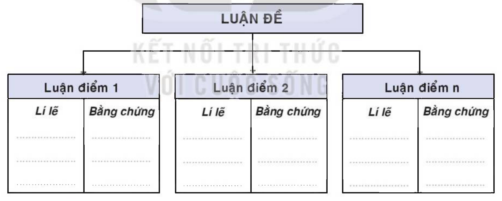

<!-- pdf:59 -->

# BÀI 3: LỜI SÔNG NÚI

*Đêm đêm rì rầm trong tiếng đất*
*Những buổi ngày xưa vọng nói về.*
<!-- ocr-ok: câu đề từ chữ trắng trên nền hoa văn xanh bị OCR đọc nhầm thành "Đêm đêwA rì rằm... ngàu xưa", đã đối chiếu ảnh p059.png -->

(Nguyễn Đình Thi)

## Giới thiệu bài học

- Trong suốt chiều dài lịch sử, biết bao thế hệ người Việt Nam đã hi sinh xương máu để xây đắp và gìn giữ đất nước mình. Gia tài vô cùng quý báu trong truyền thống của người Việt Nam là lòng yêu nước, là sự gắn bó máu thịt với quê hương, xứ sở. Lòng yêu nước thể hiện ở hành động đấu tranh dựng nước và giữ nước, ở các giá trị tinh thần được tạo nên, trong đó có những áng văn sống mãi với thời gian.
- Với bài học này, em sẽ đọc một số bài văn nghị luận đặc sắc, được viết nên bởi những con người kiệt xuất – những nhân vật lịch sử có trọng trách đối với đất nước, kết tinh hào khí của cha ông trong công cuộc chống giặc ngoại xâm. Các văn bản trong bài ra đời vào những thời đại khác nhau, nhưng vẫn đồng điệu ở tình cảm yêu nước, và đều là mẫu mực của văn bản nghị luận. Kết nối với chủ đề bài học là một bài thơ nổi tiếng trong lịch sử văn học dân tộc, ra đời cách đây hơn một nghìn năm, thể hiện ý chí độc lập, tự chủ của cha ông ta.

## 🎯 Yêu cầu cần đạt

<!-- term: luận đề -->
<!-- term: luận điểm -->
<!-- term: lí lẽ -->
<!-- term: bằng chứng -->
<!-- term: văn bản nghị luận -->
<!-- term: bằng chứng khách quan -->
<!-- term: diễn dịch -->
<!-- term: quy nạp -->
<!-- term: song song -->
<!-- term: phối hợp -->
- Nhận biết được nội dung bao quát; luận đề, luận điểm, lí lẽ và bằng chứng tiêu biểu trong văn bản nghị luận.
- Phân tích được mối liên hệ giữa luận đề, luận điểm, lí lẽ và bằng chứng; vai trò của luận điểm, lí lẽ và bằng chứng trong việc thể hiện luận đề; phân biệt được lí lẽ, bằng chứng khách quan (có thể kiểm chứng được) với ý kiến, đánh giá chủ quan của người viết.
- Liên hệ được nội dung nêu trong văn bản với những vấn đề của xã hội đương đại.
- Nhận biết được đặc điểm và chức năng của các kiểu đoạn văn diễn dịch, quy nạp, song song, phối hợp; biết vận dụng trong tiếp nhận và tạo lập văn bản.
- Viết được văn bản nghị luận về một vấn đề của đời sống.
- Biết thảo luận ý kiến về một vấn đề trong đời sống phù hợp với lứa tuổi; nắm bắt được nội dung chính mà nhóm đã thảo luận và trình bày lại được nội dung đó.
- Có tinh thần yêu nước, có trách nhiệm đối với những vấn đề của cộng đồng.

<!-- pdf:60 -->

## Đọc

### TRI THỨC NGỮ VĂN

**Luận đề, luận điểm trong văn bản nghị luận**

<!-- term: luận đề -->
<!-- term: luận điểm -->
<!-- term: văn bản nghị luận -->
- **Luận đề** là vấn đề được luận bàn trong văn bản nghị luận. Vấn đề đó có tính chất bao trùm, xuyên suốt văn bản. Mỗi văn bản nghị luận thường chỉ có một luận đề. Luận đề có thể được nêu rõ ở nhan đề, ở một số câu hoặc có thể được khái quát từ toàn bộ nội dung của văn bản. Luận đề trong văn bản nghị luận xã hội là hiện tượng hay vấn đề của đời sống được nêu để bàn luận.
- **Luận điểm** là các ý triển khai những khía cạnh khác nhau của một luận đề trong văn bản nghị luận. Qua luận điểm được trình bày, có thể nhận thấy ý kiến cụ thể của người viết về vấn đề được bàn luận.

**Mối liên hệ giữa luận đề, luận điểm, lí lẽ, bằng chứng trong văn bản nghị luận**

<!-- term: lí lẽ -->
<!-- term: bằng chứng -->
**Luận đề**, **luận điểm**, **lí lẽ** và **bằng chứng** là những yếu tố có mối liên hệ chặt chẽ với nhau trong văn bản nghị luận. Mối liên hệ này có tính tầng bậc. Như đã nêu trên, văn bản nghị luận trước hết phải có một luận đề. Từ luận đề, người viết triển khai thành các luận điểm. Mỗi luận điểm muốn có sức thuyết phục, cần được làm rõ bằng các lí lẽ và mỗi lí lẽ cần được chứng minh bằng các bằng chứng cụ thể. Có thể hình dung mối liên hệ này qua sơ đồ sau:

> **LUẬN ĐỀ**
> - **Luận điểm 1**: *Lí lẽ* | *Bằng chứng*
> - **Luận điểm 2**: *Lí lẽ* | *Bằng chứng*
> - **Luận điểm n**: *Lí lẽ* | *Bằng chứng*

**Đoạn văn diễn dịch, quy nạp, song song, phối hợp**

<!-- term: diễn dịch -->
<!-- term: quy nạp -->
<!-- term: song song -->
<!-- term: phối hợp -->
<!-- term: câu chủ đề -->
**Diễn dịch**, **quy nạp**, **song song**, **phối hợp** là các kiểu đoạn văn được phân biệt dựa vào cách thức tổ chức, triển khai nội dung. Việc phân biệt các kiểu đoạn văn này liên quan đến **câu chủ đề**, tức là câu thể hiện nội dung bao quát của đoạn văn.

- **Đoạn văn diễn dịch**: Đoạn văn có câu chủ đề được đặt ở đầu đoạn, những câu tiếp theo triển khai các nội dung cụ thể để làm rõ chủ đề của đoạn văn.
- **Đoạn văn quy nạp**: Đoạn văn triển khai nội dung cụ thể trước, từ đó mới khái quát nội dung chung, được thể hiện bằng câu chủ đề ở cuối đoạn văn.

<!-- pdf:61 -->

- **Đoạn văn song song**: Đoạn văn không có câu chủ đề, các câu trong đoạn có nội dung khác nhau, nhưng cùng hướng tới một chủ đề.
- **Đoạn văn phối hợp**: Đoạn văn kết hợp diễn dịch với quy nạp, có câu chủ đề ở đầu đoạn và cuối đoạn.

### VĂN BẢN ĐỌC

- **VĂN BẢN 1.** *Hịch tướng sĩ*, Trần Quốc Tuấn
- **VĂN BẢN 2.** *Tinh thần yêu nước của nhân dân ta*, Hồ Chí Minh
- **VĂN BẢN 3.** *Nam quốc sơn hà*

### VĂN BẢN 1: Hịch tướng sĩ

**Trước khi đọc**

1. Hãy kể tên một số vị tướng nổi tiếng trong lịch sử nước ta.
2. Theo em, vì sao quân Mông – Nguyên ba lần đem quân xâm lược nước ta đều phải chịu thất bại?

**Đọc văn bản**

**Hịch(1) tướng sĩ(2)**
<!-- ocr-ok: nhan đề kèm số cước chú (1), (2) bị OCR bỏ sót số chú thích, đã đối chiếu ảnh p061.png -->

TRẦN QUỐC TUẤN

Ta thường nghe: Kỉ Tín(3) đem mình chết thay, cứu thoát cho Cao Đế; Do Vu(4) chìa lưng chịu giáo, che chở cho Chiêu Vương; Dự Nhượng(5) nuốt than báo thù cho chủ;

<!-- term: hịch -->
> (1) *Hịch*: thể văn nghị luận thường được vua, quan, tướng lĩnh thời xưa dùng để thuyết phục hoặc kêu gọi người dưới quyền đấu tranh chống kẻ thù trong bối cảnh có chiến tranh. Hịch cũng có thể được người dân sáng tác để kêu gọi mọi người chống ngoại xâm hoặc giai cấp thống trị. Bài hịch kêu gọi đánh giặc thường gồm ba nội dung chính: nêu cơ sở, căn cứ của quan điểm, lập trường; làm rõ tính chính nghĩa của phe mình, tính phi nghĩa của phe địch, miêu tả, phân tích, đánh giá tình hình thực tế; đưa ra lời khuyến dụ.
> (2) *Hịch tướng sĩ*: nguyên văn bài hịch trong *Đại Việt sử kí toàn thư* không có nhan đề, trong *Hoàng Việt văn tuyển* có tên là *Trần Hưng Đạo Đại Vương dụ chư tì tướng hịch văn* (*Bài hịch Trần Hưng Đạo Đại Vương khuyên bảo các tì tướng*). Đối tượng người nghe trực tiếp của bài hịch này là tì tướng (các viên tướng giúp việc cho chủ tướng). Tuy nhiên, sức lay động lòng người trong bối cảnh đất nước lâm nguy đã khiến bài hịch được lan toả rộng khắp và lưu truyền đến ngày nay với tên gọi *Hịch tướng sĩ*.
> (3) *Kỉ Tín*: tướng của Lưu Bang (Hán Cao Tổ – hoàng đế sáng lập nhà Hán). Khi Lưu Bang bị Hạng Vũ vây ở đất Huỳnh Dương, thế khó thoát, Kỉ Tín (có ngoại hình giống Lưu Bang) bèn giả làm Lưu Bang ra hàng, bị Hạng Vũ giết. Nhờ đó Lưu Bang thoát nạn.
> (4) *Do Vu*: tướng của Sở Chiêu Vương (thời Xuân Thu). Chiêu Vương lúc lánh nạn ở đầm Vân Mộng, đang ngủ thì bị kẻ cướp đâm. Do Vu đã chìa lưng che chở cho Chiêu Vương, bị đâm trúng bả vai.
> (5) *Dự Nhượng*: gia thần của Trí Bá (thời Chiến Quốc). Trí Bá bị Triệu Tương Tử giết chết, Dự Nhượng nuốt than nóng cho khác giọng, giả làm hành khất, mưu giết Tương Tử báo thù cho chủ.

<!-- pdf:62 -->

Thân Khoái(1) chặt tay chết theo nạn của vua(2); Kính Đức(3), một chàng tuổi trẻ, thân phò Thái Tông thoát khỏi vòng vây Thế Sung; Cảo Khanh(4), một bề tôi xa, miệng mắng Lộc Sơn, không theo mưu kế nghịch tặc. Từ xưa, các bậc trung thần nghĩa sĩ bỏ mình vì nước, đời nào không có? Giả sử các bậc đó cứ khư khư theo thói nữ nhi thường tình, thì cũng chết già ở xó cửa, sao có thể lưu danh sử sách, cùng trời đất muôn đời bất hủ được!

> **Theo dõi:** Điểm chung của các cặp nhân vật lịch sử được nêu tên.

Các ngươi con nhà võ tướng, không hiểu văn nghĩa, nghe những chuyện ấy nửa tin nửa ngờ. Thôi những chuyện xưa, ta không nói đến nữa. Nay ta chỉ kể chuyện Tống, Nguyên mới đây.

Vương Công Kiên(5) là người thế nào? Tì tướng của ông là Nguyễn Văn Lập lại là người thế nào, mà giữ thành Điếu Ngư(6) nhỏ như cái đấu, chống với quân Mông Kha(7) đông đến hàng trăm vạn, khiến cho nhân dân đời Tống, đến nay còn đội ơn sâu! Cốt Đãi Ngột Lang(8) là người thế nào? Tì tướng của ông là Xích Tu Tư lại là người thế nào, mà xông vào chỗ lam chướng(9) xa xôi nghìn trùng, đánh bại được quân Nam Chiếu(10) trong vài tuần, khiến cho quân trưởng(11) đời Nguyên đến nay còn lưu tiếng tốt!

> **Theo dõi:** Mối quan hệ vua – tôi, chủ tướng – tì tướng được Trần Quốc Tuấn viện dẫn làm cơ sở cho những lập luận kế tiếp.

Huống chi ta cùng các ngươi sinh phải thời loạn lạc, lớn gặp buổi gian nan. Ngó thấy sứ giặc đi lại nghênh ngang ngoài đường, uốn lưỡi cú diều mà sỉ mắng triều đình, đem thân dê chó mà bắt nạt

> **Theo dõi:** Những lí lẽ và bằng chứng được Trần Quốc Tuấn sử dụng nhằm lay động cảm xúc của các tì tướng.

> (1) *Thân Khoái*: viên quan giữ ao cá của Tề Trang Công (thời Xuân Thu). Khi Trang Công bị Thôi Trữ giết, Thân Khoái chặt tay tỏ lòng trung thành rồi chết theo chủ.
> (2) *Chết theo nạn của vua*: nguyên tác là “phó quốc nạn” (đi theo (chết theo) vận nạn của vua); *quốc* vốn chỉ quốc gia, nhưng cũng được dùng để chỉ vua (*quốc tính*: họ vua; *quốc thích*: bên ngoại của vua,...). Ở trường hợp này, *quốc nạn* chỉ việc vua Trang Công bị giết. Trần Quốc Tuấn sử dụng các nhân vật có quan hệ chủ – tớ hoặc vua – tôi làm bằng chứng, nên cách diễn đạt “cứu nạn cho nước” của bản dịch không thực sự phù hợp, nay xin chỉnh lại.
> (3) *Kính Đức*: tức Uất Trì Cung thời Đường. Khi Đường Thái Tông (lúc bấy giờ còn là Tần Vương) bị một viên tướng của Vương Thế Sung dùng gươm đâm, Kính Đức đã lấy thân mình che chở cho Đường Thái Tông thoát nạn.
> (4) *Cảo Khanh*: tức Nhan Cảo Khanh. Khi An Lộc Sơn khởi loạn đánh Đường Minh Hoàng, Cảo Khanh cầm quân chống lại. Bị quân của An Lộc Sơn bắt, Cảo Khanh chửi mắng An Lộc Sơn, không chịu hàng, bị cắt lưỡi mà vẫn không sợ.
> (5) *Vương Công Kiên*: tướng nhà Tống, khi giữ Hợp Châu đã huy động quân dân chiến đấu ở Điếu Ngư, chống cự với đạo quân Mông Cổ suốt bốn tháng trời, khiến quân Mông Cổ phải rút lui.
> (6) *Điếu Ngư*: tên một toà thành trên một trái núi cùng tên ở Tứ Xuyên, Trung Quốc, có địa thế hiểm trở. Thời Tống, Vương Công Kiên làm Tri châu, cùng tì tướng Nguyễn Văn Lập đóng giữ thành này, khiến quân Mông Kha đánh mấy tháng không hạ nổi.
> (7) *Mông Kha*: anh của Hốt Tất Liệt (vua đầu tiên của nhà Nguyên), trực tiếp chỉ huy cuộc viễn chinh sang Trung Quốc, bị tử trận ở thành Điếu Ngư khi vây hãm quân Tống do Vương Công Kiên chỉ huy. Một thuyết khác cho rằng Mông Kha ốm chết sau trận chiến này.
> (8) *Cốt Đãi Ngột Lang*: tướng của Mông Cổ, từng đem quân đi đánh các nước phương Nam, trong đó có nước ta.
> (9) *Lam chướng*: khí (được cho là độc hại) toả ra từ đất đá, khiến người dễ sinh bệnh khi nhiễm phải.
> (10) *Nam Chiếu*: một nước nhỏ ở vào khoảng giữa hai tỉnh Tứ Xuyên và Vân Nam, Trung Quốc.
> (11) *Quân trưởng*: người đứng đầu một bộ tộc hoặc một đội quân (thường dùng ở các dân tộc thiểu số Trung Quốc thời xưa).

<!-- pdf:63 -->

tể phụ(1), thác mệnh Hốt Tất Liệt(2) mà đòi ngọc lụa, để thoả lòng tham không cùng; giả hiệu Vân Nam Vương(3) mà thu bạc vàng, để vét của kho có hạn. Thật khác nào như đem thịt mà nuôi hổ đói, sao cho khỏi để tai vạ về sau?

Ta thường tới bữa quên ăn, nửa đêm vỗ gối; ruột đau như cắt, nước mắt đầm đìa; chỉ căm tức chưa xả thịt lột da, nuốt gan uống máu quân thù. Dẫu cho trăm thân này phơi ngoài nội cỏ, nghìn xác này gói trong da ngựa(4), ta cũng cam lòng.

Các ngươi ở cùng ta coi giữ binh quyền đã lâu ngày, không có mặc thì ta cho áo, không có ăn thì ta cho cơm; quan nhỏ thì ta thăng chức, lương ít thì ta cấp bổng; đi thuỷ thì ta cho thuyền, đi bộ thì ta cho ngựa; lúc trận mạc xông pha thì cùng nhau sống chết, lúc ở nhà nhàn hạ thì cùng nhau vui cười. Cách đối đãi so với Vương Công Kiên, Cốt Đãi Ngột Lang ngày trước cũng chẳng kém gì.

Nay các ngươi nhìn chủ nhục mà không biết lo, thấy nước nhục mà không biết thẹn. Làm tướng triều đình phải hầu quân giặc mà không biết tức; nghe nhạc thái thường(5) để đãi yến(6) nguỵ sứ mà không biết căm. Hoặc lấy việc chọi gà làm vui đùa, hoặc lấy việc đánh bạc làm tiêu khiển; hoặc vui thú vườn ruộng, hoặc quyến luyến vợ con; hoặc lo làm giàu mà quên việc nước, hoặc ham săn bắn mà quên việc binh; hoặc thích rượu ngon, hoặc mê tiếng hát. Nếu có giặc Mông Cổ tràn sang, thì cựa gà trống không thể đâm thủng áo giáp của giặc, mẹo cờ bạc không thể dùng làm mưu lược nhà binh; dẫu rằng ruộng lắm vườn nhiều, tấm thân quý nghìn vàng khôn chuộc; vả lại vợ bìu con rịn, việc quân cơ trăm sự ích chi; tiền của tuy nhiều khôn mua được đầu giặc, chó săn tuy khoẻ khôn đuổi được quân thù; chén rượu ngon không thể làm cho giặc say chết, tiếng hát hay không thể làm cho giặc điếc tai. Lúc bấy giờ, ta cùng các ngươi sẽ bị bắt, đau xót biết chừng nào! Chẳng những thái ấp(7) của ta không còn, mà bổng lộc các ngươi cũng mất; chẳng những gia quyến của ta

> **Theo dõi:** Các bằng chứng và lí lẽ Trần Quốc Tuấn sử dụng để khẳng định các tì tướng đang suy nghĩ và hành động không đúng.
<!-- ocr-ok: thẻ Theo dõi cột phải bị OCR trộn vào dòng văn bản chính và đọc lỗi nhiều từ, đã đối chiếu ảnh p063.png -->

> (1) *Tể phụ*: chức quan hàng đầu triều đình giúp vua trị nước, thông thường chỉ Tể tướng.
> (2) *Hốt Tất Liệt*: vua Thế Tổ nhà Nguyên.
> (3) *Vân Nam Vương*: Thoát Hoan, con thứ chín của Hốt Tất Liệt, được phong vương ở đất Vân Nam, Trung Quốc, trực tiếp cầm đầu quân Nguyên xâm lược nước ta lần thứ hai.
> (4) *Nghìn xác này gói trong da ngựa*: ý nói làm trai phải đánh đông dẹp bắc, xả thân nơi chiến trường mà chẳng sờn lòng; lấy ý từ lời của Mã Viện thời Hán: “Đấng nam nhi nên chết ở chiến trường, lấy da ngựa bọc thây”.
> (5) *Nhạc thái thường*: nhạc của triều đình, vốn dùng trong những dịp tế lễ quan trọng ở tông miếu. Bấy giờ, trong yến tiệc tiếp sứ giặc, triều đình nhà Trần phải dùng đến nhạc thái thường để giúp vui, Trần Quốc Tuấn coi đó là một điều nhục nhã.
> (6) *Yến*: bữa tiệc.
> (7) *Thái ấp*: phần đất vua phong cho giới quý tộc.

<!-- pdf:64 -->

bị tan, mà vợ con các ngươi cũng khốn; chẳng những xã tắc tổ tông ta bị giày xéo, mà phần mộ cha mẹ các ngươi cũng bị quật lên; chẳng những thân ta kiếp này chịu nhục, rồi đến trăm năm sau, tiếng dơ khôn rửa, tên xấu còn lưu, mà đến gia thanh(1) các ngươi cũng không khỏi mang tiếng là tướng bại trận. Lúc bấy giờ, dẫu các ngươi muốn vui chơi phỏng có được không?

Nay ta bảo thật các ngươi: Nên nhớ câu “đặt mồi lửa vào dưới đống củi”(2) là nguy cơ, nên lấy điều “kiềng canh nóng mà thổi rau nguội”(3) làm răn sợ. Huấn luyện quân sĩ, tập dượt cung tên; khiến cho người người giỏi như Bàng Mông, nhà nhà đều là Hậu Nghệ(4); có thể bêu được đầu Hốt Tất Liệt ở cửa khuyết(5), làm rữa thịt Vân Nam Vương ở Cảo Nhai(6). Như vậy, chẳng những thái ấp của ta mãi mãi vững bền, mà bổng lộc các ngươi cũng đời đời hưởng thụ; chẳng những gia quyến của ta được êm ấm gối chăn, mà vợ con các ngươi cũng được bách niên giai lão; chẳng những tông miếu của ta sẽ được muôn đời tế lễ, mà tổ tông các ngươi cũng được thờ cúng quanh năm; chẳng những thân ta kiếp này đắc chí, mà đến các ngươi, trăm năm về sau tiếng vẫn lưu truyền; chẳng những danh hiệu ta không bị mai một, mà tên họ các ngươi cũng sử sách lưu thơm. Lúc bấy giờ, dẫu các ngươi không muốn vui chơi phỏng có được không?

> **Theo dõi:** Những lí lẽ Trần Quốc Tuấn dùng để thuyết phục các tì tướng nghe theo lời khuyên của chủ tướng.

Nay ta chọn binh pháp các nhà hợp làm một quyển gọi là *Binh thư yếu lược*(7). Nếu các ngươi biết chuyên tập sách này, theo lời dạy bảo của ta, thì mới phải đạo thần chủ(8); nhược bằng khinh bỏ sách này, trái lời dạy bảo của ta, tức là kẻ nghịch thù.

Vì sao vậy? Giặc với ta là kẻ thù không đội trời chung, các ngươi cứ điềm nhiên không biết rửa nhục, không lo trừ hung, không dạy quân sĩ; chẳng khác nào quay mũi giáo mà chịu đầu hàng, giơ tay không mà chịu thua giặc. Nếu vậy, rồi đây sau khi dẹp yên quân giặc, muôn đời để thẹn, há còn mặt mũi nào đứng trong trời đất nữa? Ta viết ra bài hịch này để các ngươi biết bụng ta.

(Bùi Văn Nguyên *dịch*, in trong *Hợp tuyển thơ văn Việt Nam: Văn học Việt Nam thế kỉ X – thế kỉ XVII*, NXB Văn hoá, Hà Nội, 1962, tr. 91 – 93)
<!-- ocr-ok: dòng xuất xứ in nghiêng cỡ nhỏ bị OCR đọc lỗi ("địch", "tuyên", "Diệt Nam thể kì X - thể lì XVH"), đã đối chiếu ảnh p064.png -->

> (1) *Gia thanh*: tiếng tăm, danh dự của dòng tộc, gia đình.
> (2) *Đặt mồi lửa vào dưới đống củi*: ý nói phải cảnh giác như nằm trên đống củi mà có mồi lửa ở dưới; lấy ý từ một câu trong *Hán thư*: “Ôm mồi lửa đặt dưới đống củi rồi nằm lên trên, lửa chưa kịp cháy vẫn cho là yên”.
> (3) *Kiềng canh nóng mà thổi rau nguội*: theo một câu trong *Sở từ*, đại ý: Người bị bỏng vì canh nóng, trong lòng e sợ, dù gặp rau nguội đi nữa cũng lấy miệng thổi.
> (4) *Bàng Mông, Hậu Nghệ*: hai nhân vật bắn cung rất giỏi trong thần thoại Trung Quốc.
> (5) *Cửa khuyết*: cửa lớn ở kinh thành.
> (6) *Cảo Nhai*: nơi trú ngụ của các vua chư hầu khi vào chầu vua Hán ở Trường An, Trung Quốc. Ở đây dùng để chỉ nơi tiếp đón sứ thần nước ngoài của ta.
> (7) *Binh thư yếu lược*: sách tóm tắt những điều cốt yếu về binh pháp, do Trần Quốc Tuấn soạn, chuẩn bị cho việc đánh giặc, giữ nước.
> (8) *Đạo thần chủ*: đạo giữa bề tôi (*thần*) với chủ tướng, lãnh chúa (*chủ*).

<!-- pdf:65 -->

**Sau khi đọc**

> - **Trần Quốc Tuấn** (1231? – 1300) tước Hưng Đạo Vương, là một danh tướng kiệt xuất của dân tộc. Trong cuộc kháng chiến chống quân Nguyên xâm lược nước ta lần thứ hai (năm 1285) và thứ ba (năm 1287 – 1288), ông đều được vua Trần Nhân Tông cử làm Tiết chế thống lĩnh các đạo quân, cả hai lần đều chiến thắng oanh liệt. Đời Trần Anh Tông, ông về trí sĩ ở Vạn Kiếp (nay là xã Hưng Đạo, huyện Chí Linh, tỉnh Hải Dương) rồi mất ở đấy. Nhân dân tôn ông là Đức Thánh Trần và lập đền thờ ở nhiều nơi trên cả nước.
> - *Hịch tướng sĩ* do Trần Quốc Tuấn viết vào khoảng trước cuộc kháng chiến chống quân Nguyên lần thứ hai.

**Trả lời câu hỏi**

<!-- term: bố cục -->
<!-- term: bằng chứng -->
<!-- term: lí lẽ -->
<!-- term: văn bản nghị luận -->
1. Bài hịch được Trần Quốc Tuấn viết ra nhằm mục đích gì?
2. Xác định bố cục của bài hịch và nêu rõ vai trò của từng phần trong việc thực hiện mục đích của bài hịch.
3. Hãy chỉ ra những điểm chung của các cặp nhân vật lịch sử được nêu ở phần đầu bài hịch. Tác giả đã nêu hành động của tám cặp nhân vật lịch sử này để minh chứng điều gì?
4. Để khơi gợi những cảm xúc mạnh mẽ trong lòng các tì tướng và thuyết phục họ, Trần Quốc Tuấn đã nhắc đến nhiều hiện tượng trong thực tế. Đó là những hiện tượng nào?
5. Tác giả đã dùng những bằng chứng và lí lẽ nào để chứng minh các tì tướng đã suy nghĩ, hành động không đúng?
6. Tác giả đã chọn cách diễn đạt như thế nào để lời hịch có sức tác động lớn đến nhận thức và tình cảm của các tì tướng? Hãy phân tích một ví dụ mà em cho là tiêu biểu cho cách diễn đạt đó.
7. Với tư cách là chủ tướng, Trần Quốc Tuấn đã dùng những lí lẽ nào để kêu gọi các tì tướng phải rèn tập võ nghệ, học tập cuốn *Binh thư yếu lược*, chuẩn bị cho việc đánh giặc, giữ nước?
8. Từ bài hịch này, em rút ra được bài học gì cho bản thân khi viết một bài văn nghị luận?

#### Viết kết nối với đọc
<!-- ocr-ok: tiêu đề màu cam trên trang PDF 65 bị OCR đọc nhầm thành "YIE! vu!i XxI Ÿ VI", đã đối chiếu ảnh p065.png -->

Viết đoạn văn (khoảng 7 – 9 câu) về một truyền thống đáng tự hào của dân tộc Việt Nam.

<!-- pdf:66 -->

### Thực hành tiếng Việt

*ĐOẠN VĂN DIỄN DỊCH VÀ ĐOẠN VĂN QUY NẠP*

<!-- term: câu chủ đề -->
<!-- term: diễn dịch -->
<!-- term: quy nạp -->
1. Tìm câu chủ đề trong các đoạn văn sau, từ đó, xác định kiểu đoạn văn (diễn dịch, quy nạp). Phân tích tác dụng của từng cách thức tổ chức đoạn văn.

   a. *Ta thường nghe: Kỉ Tín đem mình chết thay, cứu thoát cho Cao Đế; Do Vu chìa lưng chịu giáo, che chở cho Chiêu Vương; Dự Nhượng nuốt than để báo thù cho chủ; Thân Khoái chặt tay chết theo nạn của vua; Kính Đức, một chàng tuổi trẻ, thân phò Thái Tông thoát khỏi vòng vây Thế Sung; Cảo Khanh, một bề tôi xa, miệng mắng Lộc Sơn, không theo mưu kế nghịch tặc. Từ xưa, các bậc trung thần nghĩa sĩ bỏ mình vì nước, đời nào không có? Giả sử các bậc đó cứ khư khư theo thói nữ nhi thường tình, thì cũng chết già ở xó cửa, sao có thể lưu danh sử sách, cùng trời đất muôn đời bất hủ được!*

   (Trần Quốc Tuấn, *Hịch tướng sĩ*)

   b. *Đồng phục không chỉ đẹp mà còn góp phần tạo nên bản sắc của mỗi trường. Cậu này là học sinh Trường THCS Lê Quý Đôn, bạn ấy thuộc Trường THCS Lương Thế Vinh, còn cô bé kia học ở Trường THCS Đặng Thai Mai,... tất cả đều được nhận ra nhờ bộ đồng phục mà họ mặc. Trong cuộc thi “Nhóm bạn lí tưởng” ở huyện, “màu cờ sắc áo” không chỉ thể hiện ở tài trí của năm bạn trong đội hình thi đấu trên sân khấu, mà còn ở các nhóm cổ động viên tưng bừng, nổi bật trong bộ đồng phục của trường mình trên khán đài.*

   Dẫn theo *Ngữ văn 6*, tập hai (*Kết nối tri thức với cuộc sống*), NXB Giáo dục Việt Nam, 2021, tr. 67)

2. Hãy sắp xếp các câu sau đây thành đoạn văn diễn dịch, sau đó sắp xếp lại thành đoạn văn quy nạp và cho biết dựa vào cơ sở nào, em sắp xếp như vậy.

> **Nhận biết đặc điểm và chức năng của kiểu tổ chức đoạn văn diễn dịch và đoạn văn quy nạp**
>
> - **Đặc điểm**
>   – ***Đoạn văn diễn dịch***
>   ***Tiếng Việt có những đặc sắc của một thứ tiếng đẹp, một thứ tiếng hay.*** *Nói thế có nghĩa là nói rằng: tiếng Việt là một thứ tiếng hài hoà về mặt âm hưởng, thanh điệu mà cũng rất tế nhị, uyển chuyển trong cách đặt câu. Nói thế cũng có nghĩa là nói rằng: tiếng Việt có đầy đủ khả năng để diễn đạt tình cảm, tư tưởng của người Việt Nam và để thoả mãn cho yêu cầu của đời sống văn hoá nước nhà qua các thời kì lịch sử.*
>   (Đặng Thai Mai, *Tiếng Việt, một biểu hiện hùng hồn của sức sống dân tộc*)
>   Ở đoạn văn trên, câu chủ đề (in đậm) được đặt ở đầu đoạn, khẳng định hai nét đặc sắc của tiếng Việt là đẹp và hay. Các câu tiếp theo nói rõ cái đẹp và cái hay thể hiện cụ thể như thế nào.
>   – ***Đoạn văn quy nạp***
>   *Đề cao sự khác biệt không phải là cổ động cho lối sống cá nhân ích kỉ, hẹp hòi, chối bỏ mọi trách nhiệm. Đề cao sự khác biệt không có nghĩa chấp nhận những sự kì dị, quái đản cốt làm cho cá nhân nổi bật giữa đám đông, xa lạ với văn hoá truyền thống của dân tộc. Đề cao sự khác biệt cũng không đồng nghĩa với việc tán thành lối sống tự do vô mục đích. **Xét cho cùng, chỉ sự khác biệt nào toát lên được giá trị của cá nhân và có ích cho cộng đồng thì mới thực sự có ý nghĩa, đáng được đề cao.***
>   (Nhiều tác giả, *Để làm tốt bài thi môn Ngữ văn kì thi trung học phổ thông quốc gia – phần nghị luận xã hội*, NXB Giáo dục Việt Nam, 2016)

<!-- pdf:67 -->

>   Ba câu đầu nêu những biểu hiện của sự khác biệt tầm thường, vô nghĩa, từ đó, câu chủ đề (in đậm) ở cuối đoạn văn mới có cơ sở khẳng định sự khác biệt có ý nghĩa, đáng được đề cao.
> - **Chức năng**
>   **Diễn dịch**, **quy nạp** là hai kiểu tổ chức đoạn văn khác nhau, nhưng đều đáp ứng yêu cầu cơ bản của một đoạn văn: thể hiện rõ chủ đề. Do có câu chủ đề, việc tiếp nhận nội dung đoạn văn trở nên thuận lợi hơn, dù câu chủ đề được đặt ở đầu đoạn (diễn dịch) hay ở cuối đoạn (quy nạp). Hai kiểu đoạn văn này đặc biệt phù hợp với văn bản nghị luận.

   *(1) Một cô Tấm (trong truyện “Tấm Cám”) bao lần bị hại, cuối cùng vẫn được làm hoàng hậu, nhưng mụ dì ghẻ và Cám – những kẻ lắm mưu mô tàn ác thì bị trừng phạt đích đáng.*

   *(2) Một Thạch Sanh (truyện “Thạch Sanh”) chất phác, thật bụng tin người, dẫu trải qua bao khổ nạn, oan khuất rồi đến lúc cũng cưới được công chúa và lên ngôi, còn Lý Thông lừa lọc, xảo trá thì trời đất không dung tha.*

   *(3) Ở hiền gặp lành, ác giả ác báo là ước mơ công bằng được nhân dân gửi gắm vào truyện cổ tích.*

   *(4) Một người em (truyện “Cây khế”) thật thà, hiền lành, bị anh đối xử bất công, ai ngờ cuộc sống về sau lại giàu sang, hạnh phúc, trong khi người anh tham lam thì bỏ mạng giữa biển khơi.*

3. *Lòng yêu nước ban đầu là lòng yêu những vật tầm thường nhất.* (Ilya Ehrenburg (I-li-a Ê-ren-bua)). Hãy xem đây là câu chủ đề, từ đó, viết hai đoạn văn, một đoạn đặt câu chủ đề ở đầu đoạn (diễn dịch) và một đoạn đặt câu chủ đề ở cuối đoạn (quy nạp).

### VĂN BẢN 2: Tinh thần yêu nước của nhân dân ta

**Trước khi đọc**

1. Qua những bài học từ môn Lịch sử hoặc qua những truyện lịch sử đã học, đã đọc, hành động yêu nước của nhân vật nào để lại cho em ấn tượng sâu sắc nhất? Vì sao?
2. Trong cuộc sống hôm nay, con người có thể thể hiện tinh thần yêu nước bằng những cách nào?

**Đọc văn bản**

**Tinh thần yêu nước của nhân dân ta**

HỒ CHÍ MINH

> **Theo dõi:** Cách mở đầu và câu văn thể hiện nội dung bao quát của văn bản.

Dân ta có một lòng nồng nàn yêu nước. Đó là một truyền thống quý báu của ta. Từ xưa đến nay, mỗi khi Tổ quốc bị xâm lăng, thì tinh thần ấy lại
<!-- ocr-ok: đoạn văn ngắn cuối trang PDF 67 bị OCR đọc sai dấu thanh ("nông nàn", "truyền thông quy báu", "môi khi Tô quốc", "tình thân ây"), đã đối chiếu ảnh p067.png -->

<!-- pdf:68 -->

sôi nổi, nó kết thành một làn sóng vô cùng mạnh mẽ, to lớn, nó lướt qua mọi sự nguy hiểm, khó khăn, nó nhấn chìm tất cả lũ bán nước và lũ cướp nước.

> **Theo dõi:** Những bằng chứng được sử dụng nhằm làm sáng tỏ điều gì?

Lịch sử ta đã có nhiều cuộc kháng chiến vĩ đại chứng tỏ tinh thần yêu nước của dân ta. Chúng ta có quyền tự hào vì những trang lịch sử vẻ vang thời đại Bà Trưng, Bà Triệu, Trần Hưng Đạo, Lê Lợi, Quang Trung,... Chúng ta phải ghi nhớ công lao của các vị anh hùng dân tộc, vì các vị ấy là tiêu biểu của một dân tộc anh hùng.

> **Theo dõi:** Cách nêu bằng chứng ở đây có gì đáng chú ý?

Đồng bào ta ngày nay cũng rất xứng đáng với tổ tiên ta ngày trước. Từ các cụ già tóc bạc đến các cháu nhi đồng trẻ thơ, từ những kiều bào(1) ở nước ngoài đến những đồng bào ở vùng tạm bị chiếm(2), từ nhân dân miền ngược đến miền xuôi, ai cũng một lòng nồng nàn yêu nước, ghét giặc. Từ những chiến sĩ ngoài mặt trận chịu đói mấy ngày để bám sát lấy giặc đặng tiêu diệt giặc, đến những công chức ở hậu phương nhịn ăn để ủng hộ bộ đội, từ những phụ nữ khuyên chồng con đi tòng quân mà mình thì xung phong giúp việc vận tải, cho đến các bà mẹ chiến sĩ săn sóc yêu thương bộ đội như con đẻ của mình. Từ những nam nữ công nhân và nông dân thi đua tăng gia sản xuất, không quản khó nhọc để giúp một phần vào kháng chiến, cho đến những đồng bào điền chủ quyên đất ruộng cho Chính phủ,... Những cử chỉ cao quý đó, tuy khác nhau nơi việc làm, nhưng đều giống nhau nơi lòng nồng nàn yêu nước.

> **Theo dõi:** Cần phải làm gì để phát huy tinh thần yêu nước của nhân dân ta?

Tinh thần yêu nước cũng như các thứ của quý. Có khi được trưng bày trong tủ kính, trong bình pha lê, rõ ràng dễ thấy. Nhưng cũng có khi cất giấu kín đáo trong rương, trong hòm. Bổn phận của chúng ta là làm cho những của quý kín đáo ấy đều được đưa ra trưng bày. Nghĩa là phải ra sức giải thích, tuyên truyền, tổ chức, lãnh đạo, làm cho tinh thần yêu nước của tất cả mọi người đều được thực hành vào công việc yêu nước, công việc kháng chiến.

(*Hồ Chí Minh toàn tập*, tập 7, NXB Chính trị quốc gia Sự thật, Thành phố Hồ Chí Minh, 2011, tr. 38 – 39)

> (1) *Kiều bào*: người dân một nước sinh sống ở nước khác, ở đây chỉ người Việt Nam sống ở nước ngoài.
> (2) *Vùng tạm bị chiếm*: vùng đất đang tạm thời bị giặc chiếm đóng. Ở đây chỉ vùng bị quân xâm lược Pháp chiếm trong thời kì nhân dân ta kháng chiến chống thực dân Pháp (1946 – 1954).

<!-- pdf:69 -->

**Sau khi đọc**

> - **Hồ Chí Minh** (1890 – 1969) quê ở huyện Nam Đàn, tỉnh Nghệ An, là nhà cách mạng, lãnh tụ của Việt Nam, nhà văn, nhà thơ, nhà văn hoá lớn. Trong suốt cuộc đời hoạt động cách mạng và cầm bút, Hồ Chí Minh để lại một di sản văn học rất phong phú, gồm văn chính luận, truyện kí, thơ ca,... Về văn chính luận, phải kể đến một số áng văn nổi tiếng như *Tuyên ngôn Độc lập* (1945), *Lời kêu gọi toàn quốc kháng chiến* (1946), *Không có gì quý hơn độc lập tự do* (1966),...
> - *Tinh thần yêu nước của nhân dân ta* trích trong Báo cáo Chính trị do Chủ tịch Hồ Chí Minh trình bày tại Đại hội lần thứ II, tháng 2 năm 1951 của Đảng Lao động Việt Nam (tên gọi từ năm 1951 đến năm 1976 của Đảng Cộng sản Việt Nam ngày nay).

**Trả lời câu hỏi**

<!-- term: văn bản nghị luận -->
<!-- term: luận điểm -->
<!-- term: bằng chứng khách quan -->
1. Người viết văn bản nghị luận bao giờ cũng hướng tới đối tượng cần thuyết phục. Theo em, văn bản *Tinh thần yêu nước của nhân dân ta* hướng tới đối tượng nào?
2. *Tinh thần yêu nước của nhân dân ta* là một trích đoạn của Báo cáo Chính trị tại Đại hội Đảng Lao động Việt Nam. Điều gì cho thấy phần trích này vẫn thể hiện đầy đủ các đặc điểm của một văn bản hoàn chỉnh?
3. Bài nghị luận có mấy luận điểm? Nêu từng luận điểm và chỉ ra mối quan hệ giữa các luận điểm, từ đó rút ra nội dung bao quát của văn bản.
4. Căn cứ vào những bằng chứng khách quan nào mà tác giả khẳng định: “Dân ta có một lòng nồng nàn yêu nước”? Vì sao lòng yêu nước nồng nàn của nhân dân ta được tác giả xem là một “truyền thống quý báu”?
5. Văn nghị luận của Hồ Chí Minh bao giờ cũng hướng người đọc đi từ nhận thức tới hành động. Qua văn bản này, tác giả muốn người đọc nhận thức được điều gì và có hành động như thế nào? Những nhận thức và hành động đó có ý nghĩa như thế nào trong đời sống cộng đồng?
6. Theo em, những yếu tố nào đã góp phần làm nên sức thuyết phục của bài nghị luận này? Vấn đề được bàn luận trong văn bản còn có ý nghĩa trong thời đại ngày nay nữa không? Vì sao?

#### Viết kết nối với đọc
<!-- ocr-ok: tiêu đề màu cam trên trang PDF 69 bị OCR bỏ sót, đã đối chiếu ảnh p069.png -->

Viết đoạn văn (khoảng 7 – 9 câu) trả lời cho câu hỏi: *Phải chăng lòng yêu nước của mỗi người chỉ cần thể hiện khi Tổ quốc bị xâm lăng?*

<!-- pdf:70 -->

### Thực hành tiếng Việt

*ĐOẠN VĂN SONG SONG VÀ ĐOẠN VĂN PHỐI HỢP*

<!-- term: song song -->
<!-- term: phối hợp -->
<!-- term: chủ đề -->
1. Xác định kiểu đoạn văn của những trường hợp sau. Phân tích tác dụng của từng cách thức tổ chức đoạn văn.

   a. *Nay ta chọn binh pháp các nhà hợp làm một quyển gọi là “Binh thư yếu lược”. Nếu các ngươi biết chuyên tập sách này, theo lời dạy bảo của ta, thì mới phải đạo thần chủ; nhược bằng khinh bỏ sách này, trái lời dạy bảo của ta, tức là kẻ nghịch thù.*

   (Trần Quốc Tuấn, *Hịch tướng sĩ*)

   b. *Đồng bào ta ngày nay cũng rất xứng đáng với tổ tiên ta ngày trước. Từ các cụ già tóc bạc đến các cháu nhi đồng trẻ thơ, từ những kiều bào ở nước ngoài đến những đồng bào ở vùng tạm bị chiếm, từ nhân dân miền ngược đến miền xuôi, ai cũng một lòng nồng nàn yêu nước, ghét giặc. Từ những chiến sĩ ngoài mặt trận chịu đói mấy ngày để bám sát lấy giặc đặng tiêu diệt giặc, đến những công chức ở hậu phương nhịn ăn để ủng hộ bộ đội, từ những phụ nữ khuyên chồng con đi tòng quân mà mình thì xung phong giúp việc vận tải, cho đến các bà mẹ chiến sĩ săn sóc yêu thương bộ đội như con đẻ của mình. Từ những nam nữ công nhân và nông dân thi đua tăng gia sản xuất, không quản khó nhọc để giúp một phần vào kháng chiến, cho đến những đồng bào điền chủ quyên đất ruộng cho Chính phủ,... Những cử chỉ cao quý đó, tuy khác nhau nơi việc làm, nhưng đều giống nhau nơi lòng nồng nàn yêu nước.*

   (Hồ Chí Minh, *Tinh thần yêu nước của nhân dân ta*)

2. Đoạn văn sau được tổ chức theo kiểu nào? Chủ đề của đoạn văn là gì? Dựa vào đâu em nhận biết được điều đó?

> **Nhận biết đặc điểm và chức năng của kiểu tổ chức đoạn văn song song và đoạn văn phối hợp**
>
> - **Đặc điểm**
>   – ***Đoạn văn song song***
>   *Cần tạo cho trẻ em cơ hội tìm biết được nguồn gốc lai lịch của mình và nhận thức được giá trị của bản thân trong một môi trường mà các em cảm thấy là nơi nương tựa an toàn, thông qua gia đình hoặc những người khác trông nom các em tạo ra. Phải chuẩn bị để các em có thể sống một cuộc sống có trách nhiệm trong một xã hội tự do. Cần khuyến khích trẻ em ngay từ lúc còn nhỏ tham gia vào sinh hoạt văn hoá xã hội.*
>   (Trích *Tuyên bố của Hội nghị cấp cao thế giới về trẻ em*)
>   Đoạn văn có ba câu, mỗi câu nêu một điều cần làm để đáp ứng quyền lợi của trẻ em. Mặc dù không có câu chủ đề, nhưng tất cả các câu trong đoạn cùng thể hiện một chủ đề: trách nhiệm đối với trẻ em.
>   – ***Đoạn văn phối hợp***
>   ***Bị cười, không phải mọi người đều phản ứng giống nhau.*** *Có người tỏ thái độ mặc kệ, bất cần, ai cười, người ấy nghe. Có người, nhân bị thiên hạ cười mà nghiêm túc soi xét bản thân, lặng lẽ sửa mình. Nhưng cũng có những người, bị tiếng cười của đám đông nhằm tới, do thiếu bản lĩnh, nên hoảng hốt, lo âu và tưởng rằng khiếm khuyết của mình là rất nghiêm trọng. Rơi vào bế tắc, họ tìm lối thoát trong hành vi tiêu cực.* ***Như vậy, sự cười nhạo chẳng phải đã vô tình làm hại người ta đó sao?***
>   (Minh Đăng, *Tiếng cười không muốn nghe*)

<!-- pdf:71 -->

>   Đoạn văn trên có câu mở đầu (in đậm) nêu chủ đề của đoạn: mọi người sẽ có phản ứng khác nhau khi bị chê cười. Bốn câu tiếp nêu các kiểu phản ứng cụ thể. Câu cuối đoạn (in đậm) khái quát tác hại của sự cười nhạo đối với con người.
> - **Chức năng**
>   – **Đoạn văn song song** tuy không có câu chủ đề, nhưng nội dung của cả đoạn vẫn thống nhất. Kiểu đoạn văn song song rất phù hợp với việc trình bày các thông tin khách quan, không hàm chứa sự đánh giá chủ quan của người viết. Kết luận thế nào là do người đọc tự suy nghĩ và rút ra.
>   – **Đoạn văn phối hợp** có cấu trúc rất chặt theo kiểu tổng hợp – phân tích – tổng hợp. Câu đầu và câu cuối đoạn đều là câu chủ đề. Kiểu đoạn văn này rất phù hợp với việc khẳng định chắc chắn điều mà người viết cho là chân lí.

   *Không gian yên tĩnh bỗng bừng lên những âm thanh của dàn hoà tấu, bởi bốn nhạc khúc lưu thuỷ, kim tiền, xuân phong, long hổ du dương trầm bổng, réo rắt mở đầu đêm ca Huế. Nhạc công dùng các ngón đàn trau chuốt như ngón nhấn, mổ, vỗ, vả, ngón bấm, day, chớp, búng, ngón phi, ngón rãi. Tiếng đàn lúc khoan lúc nhặt làm nên tiết tấu xao động tận đáy hồn người.*

   (Hà Ánh Minh, *Ca Huế trên sông Hương*)

3. Hãy viết một đoạn văn song song và một đoạn văn phối hợp (mỗi đoạn khoảng 7 – 9 câu) theo chủ đề tự chọn.

### VĂN BẢN 3: Nam quốc sơn hà

**Đọc văn bản**

**Nam quốc sơn hà**

(Sông núi nước Nam)

**Phiên âm:**

Nam quốc sơn hà Nam đế cư,
Tiệt nhiên định phận tại thiên thư.
Như hà nghịch lỗ lai xâm phạm,
Nhữ đẳng hành khan thủ bại hư.

**Dịch nghĩa:**

Sông núi nước Nam vua nước Nam cai quản,
Giới phận đã được khẳng định rõ ràng ở trong sách trời.
Cớ gì lũ giặc kia tới xâm phạm,
Các ngươi sẽ nhìn thấy việc chuốc lấy bại vong.

<!-- pdf:72 -->

**Dịch thơ:**

Sông núi nước Nam(1), vua Nam ngự(2),
Rành rành định phận(3) ở sách trời(4).
Cớ sao lũ giặc sang xâm phạm,
Chúng bay sẽ bị đánh tơi bời.
<!-- ocr-ok: bốn câu dịch thơ kèm các số cước chú (1)–(4) bị OCR đọc sai dấu ("ngụ", "ớ", "tơi bòi"), đã đối chiếu ảnh p072.png -->

(Theo *Lịch sử Việt Nam*, tập I, NXB Khoa học xã hội, Hà Nội, 1971, tr. 181)

**Sau khi đọc**

> - Bài thơ hiện chưa rõ tác giả. Nhiều tài liệu cho là của Lý Thường Kiệt. Có những ghi chép khác nhau về sự xuất hiện của bài thơ. Theo sách *Lĩnh Nam chích quái*, bài thơ được một vị thần ngâm đọc khiến cho quân Tống hoảng sợ, giúp vua Lê Đại Hành đánh bại quân xâm lược năm 981. Theo sách *Đại Việt sử kí toàn thư*, khi Lý Thường Kiệt chặn đánh quân Tống bên sông Như Nguyệt năm 1076, bài thơ đã vang lên trong đền thờ thần sông là Trương tướng quân(5). Sau đó quân Tống thảm bại đúng như lời trong bài thơ.
> - Bài thơ vốn không có nhan đề. Tên gọi *Nam quốc sơn hà* là do những người biên soạn cuốn sách *Hợp tuyển thơ văn Việt Nam*, tập 2 (NXB Văn học, Hà Nội, 1976) đặt, lấy từ bốn chữ đầu tiên của bài thơ.

**Trả lời câu hỏi**

<!-- term: lí lẽ -->
1. Bài thơ được coi là bản “tuyên ngôn độc lập” đầu tiên của đất nước ta. Em hiểu thế nào là bản “tuyên ngôn độc lập”?
2. Từ “cư” trong nguyên tác có thể dịch là “ngự” (cai quản), cũng có thể dịch là “ở” (cư trú). Theo em, cách dịch nào thể hiện được rõ tinh thần của một bản “tuyên ngôn độc lập” hơn? Hãy lí giải ý kiến của em.
3. Để khẳng định chủ quyền của đất nước ta, tác giả đã sử dụng những lí lẽ nào?
4. Theo em, câu thơ cuối cảnh báo điều gì đối với quân xâm lược? Do đâu em khẳng định như vậy?

> (1) *Nước Nam*: nước của người phương Nam (ở phương Nam), ở đây chỉ đất nước ta, phân biệt với nước của người phương Bắc. Vào thời điểm bài thơ xuất hiện, triều đình phương Bắc (nhà Tống) chưa công nhận thực tế nước ta đã là một quốc gia có chủ quyền.
> (2) Nguyên bản câu thơ được tạm dịch trong cuốn *Lịch sử Việt Nam*, tập I là “Sông núi nước Nam, vua Nam ở”.
> (3) *Phận*: địa phận, phần lãnh thổ thuộc một quốc gia, tổ chức hoặc đối tượng.
> (4) *Sách trời*: có nhiều cách giải thích khác nhau (sách của trời, sách của thần linh trong Đạo giáo,...), nhưng tựu trung đều chỉ một hình thức ghi nhận chủ quyền lãnh thổ mang tính quyền uy, không thể chối cãi.
> (5) *Trương tướng quân*: tướng quân họ Trương, chỉ anh em Trương Hống, Trương Hát, vốn là danh tướng từng đi theo Triệu Việt Vương. Tương truyền sau khi mất, hai anh em từng hiển linh giúp nước nên được tôn làm thần sông Như Nguyệt, có đền thờ ở nhiều nơi (có nơi thờ cả hai vị, có nơi chỉ thờ riêng một vị). Các nhà nghiên cứu đã xác định được tại khu vực Lý Thường Kiệt đóng quân chặn quân Tống bên sông Như Nguyệt có Đền Xà (thuộc thôn Xà Đoài, xã Tam Giang, huyện Yên Phong, tỉnh Bắc Ninh ngày nay) là nơi thờ Trương Hống.

<!-- pdf:73 -->

5. Câu thơ nào trong bài thơ để lại cho em ấn tượng sâu sắc nhất? Vì sao?
6. Em rút ra được nhận thức gì cho bản thân sau khi học bài thơ này?

## Viết

<!-- term: bài văn nghị luận về một vấn đề đời sống -->
<!-- term: lí lẽ -->
<!-- term: bằng chứng -->
**Viết bài văn nghị luận về một vấn đề đời sống (con người trong mối quan hệ với cộng đồng, đất nước)**
<!-- ocr-ok: tiêu đề màu cam phần Viết trên trang PDF 73 bị OCR bỏ sót, đã đối chiếu ảnh p073.png -->

Mỗi cá nhân bao giờ cũng có mối quan hệ với cộng đồng, đất nước. Qua những vấn đề cụ thể của đời sống xã hội, mối quan hệ này càng được thể hiện rõ ràng. Thế nhưng, trước một vấn đề, nhận thức của mọi người thường có những điểm khác nhau. Vì thế, bàn luận một cách thấu đáo về một vấn đề nào đó, giúp người đọc thấy được trách nhiệm của bản thân đối với cộng đồng, đất nước là điều rất cần thiết.

*Yêu cầu:*

<!-- term: bài văn nghị luận về một vấn đề đời sống -->
- Nêu được vấn đề nghị luận và giải thích để người đọc hiểu vì sao vấn đề này đáng được bàn đến.
- Trình bày rõ ý kiến về vấn đề được bàn; đưa ra được những lí lẽ thuyết phục, bằng chứng đa dạng để chứng minh ý kiến của người viết.
- Đối thoại với những ý kiến khác (giả định) nhằm khẳng định quan điểm của người viết.
- Nêu được ý nghĩa của vấn đề nghị luận và phương hướng hành động.

### Phân tích bài viết tham khảo
<!-- ocr-ok: nhãn hộp màu trên trang PDF 73 bị OCR đọc nhầm thành "Phôn tích bởi viết tham khỏo", đã đối chiếu ảnh p073.png -->

**Hiểu biết về lịch sử**

Nói đến hiểu biết về lịch sử, ta nghĩ ngay đến vai trò của môn Lịch sử ở nhà trường với những cuốn sách giáo khoa, những tiết học trên lớp, những giờ dã ngoại đến các di tích nổi tiếng,... Trước hết là như vậy. Lịch sử là một môn học trong nhà trường nước ta, cũng như ở bất cứ nền giáo dục nào trên thế giới. Có quốc gia nào không dạy lịch sử nước mình và lịch sử nhân loại cho các thế hệ học sinh?

> Giới thiệu vấn đề cần bàn luận

Tìm hiểu lịch sử nước nhà, ta như lật mở từng lớp trầm tích lặng lẽ, để quá khứ cất lên tiếng nói, đưa ta về với cội nguồn xa xôi, nơi tổ tiên người Việt đã sống và vượt qua bao gian nan, thử thách, đặt những viên đá đầu tiên xây toà nhà Tổ quốc. Với những bài học lịch sử, ta được biết từ buổi bình minh của dân tộc, nhà nước Văn Lang, Âu Lạc đã ra đời như thế nào. Bài học lịch sử giúp ta hình dung không khí oai hùng ngày xưa, thuở Hai Bà Trưng, Bà Triệu, Ngô Quyền, Lý Thường Kiệt, Trần Hưng Đạo,

> Dùng lí lẽ và bằng chứng để làm rõ ý nghĩa của việc hiểu biết về lịch sử.

<!-- pdf:74 -->

Lê Lợi, Quang Trung,... đánh đuổi giặc ngoại xâm, giữ gìn bờ cõi thiêng liêng và khẳng định chủ quyền của đất nước. Bài học lịch sử đã làm sống dậy trước mắt ta những sự kiện lớn lao giữa thế kỉ XX: chiến thắng Điện Biên Phủ lừng lẫy năm châu và chiến dịch Hồ Chí Minh oanh liệt thu non sông về một mối. Và, cũng nhờ kiến thức lịch sử, ta mới biết dân tộc mình từng có thời điểm trải qua những giai đoạn tăm tối, đau thương.

> Tiếp tục dùng lí lẽ để mở rộng ý nghĩa của việc hiểu biết về lịch sử.

Con người thời đại nào, quốc gia nào cũng cần biết yêu đất nước mình, biết thể hiện tình cảm với quê hương, xứ sở. Lòng yêu nước chỉ thực sự sâu sắc, khi con người có ý thức sâu xa về cội nguồn, hiểu biết quá khứ, tự hào về truyền thống của ông cha, soi mình trước những gương sáng của tiền nhân để biết cách hành động. Vì thế, học lịch sử không chỉ cần nắm những tri thức đã được đúc kết trong sách vở, mà còn phải biết rút ra từ đó bài học cho cuộc sống hôm nay. Với ý nghĩa này, bài học lịch sử là bài học kinh nghiệm, bởi vì, lịch sử không ngủ yên trong sách vở, mà luôn hiện diện, đối thoại, nhắc nhớ chúng ta phát huy truyền thống oanh liệt của cha ông và biết tránh những sai lầm không đáng có.

> Dùng lí lẽ và bằng chứng để làm sáng tỏ thực tế: có những bạn trẻ không quan tâm đến lịch sử dân tộc, hậu quả của tình trạng đó.

Hiện nay có một thực tế: Nhiều người trẻ cho rằng lịch sử là những gì thuộc về thời xa xưa, không liên quan gì đến cuộc sống sôi động hằng ngày. Dường như họ không có nhu cầu hiểu biết về quá khứ của đất nước. Họ nhầm lẫn các thời kì, các sự kiện, các nhân vật lịch sử. Không ít bạn học sinh lúng túng khi được hỏi về các nhân vật và sự kiện lịch sử nổi bật được dùng đặt tên đường, tên phố nơi mình sinh sống... Việc thiếu hiểu biết về lịch sử ảnh hưởng tiêu cực rõ rệt đến nhân cách của các bạn đó. Bởi vì, một khi con người không có ý niệm gì về lịch sử dựng nước và giữ nước vẻ vang của dân tộc, thì sự mơ hồ, nhạt phai lòng yêu nước, sự thiếu trách nhiệm với cộng đồng, với quốc gia là điều khó tránh khỏi.

Đến đây, ta đã biết kiến thức lịch sử có vai trò như thế nào đối với sự trưởng thành của con người. Tuy nhiên, hiện nay, chúng ta đang đối diện với bài toán nan giải. Làm sao để môn Lịch sử trở thành một môn học được học sinh yêu thích? Làm sao để hiểu biết về lịch sử dân tộc và nhân loại trở thành một nhu cầu của các bạn trẻ? Những câu hỏi đó từng được đặt ra, song vẫn chưa có lời đáp thoả đáng từ nhiều phía.

> Nêu ý nghĩa của vấn đề nghị luận và phương hướng hành động.

Ở một số nước trên thế giới, Lịch sử là một môn học yêu thích của giới trẻ. Các bạn học sinh thường tìm hiểu, nghiên cứu tài liệu trong thư viện, trên in-tơ-nét, đến viện bảo tàng, và nếu có điều kiện thì gặp gỡ các nhân chứng để được nghe kể lại một cách sống động những chuyện đã xảy ra... Nhờ vậy, họ có thể viết về sự kiện hay nhân vật lịch sử bằng tất cả niềm hứng thú, say mê. Vậy, cớ gì mỗi học sinh không thể làm điều đó với lịch sử nước mình? Câu trả lời thuộc về tất cả chúng ta.

(*Nhóm biên soạn*)

<!-- pdf:75 -->

**Thực hành viết theo các bước**

### 1. TRƯỚC KHI VIẾT

<!-- term: mục đích viết -->
<!-- term: người đọc -->
> **Mục đích viết**
> Làm rõ quan hệ giữa con người với cộng đồng, đất nước, từ đó góp phần nâng cao ý thức trách nhiệm của mỗi cá nhân đối với công việc chung.
>
> **Người đọc**
> Những người quan tâm đến vấn đề trách nhiệm của cá nhân với cộng đồng, đất nước.

**a. Lựa chọn đề tài**

Với yêu cầu nghị luận về vấn đề con người trong quan hệ với cộng đồng, đất nước, em cần huy động vốn hiểu biết qua học môn Ngữ văn và các môn học khác, qua sách báo và các phương tiện truyền thông, nêu ra một số vấn đề để suy nghĩ, lựa chọn. Có thể tham khảo các đề tài sau:

– Học sinh với vấn đề xây dựng trường học thân thiện.

– Học sinh với việc giữ gìn sự trong sáng của tiếng Việt.

– Giữ gìn và phát huy giá trị văn hoá của dân tộc thông qua việc tổ chức một lễ hội ở quê em.

– Trách nhiệm của con người đối với nơi mình sinh sống.

**b. Tìm ý**

Ghi nhanh ra giấy những ý nghĩ bất chợt nảy sinh trong quá trình tìm hiểu các khía cạnh của đề tài, kết hợp với việc tự trả lời các câu hỏi xoay quanh đề tài. Chẳng hạn:

– *Vấn đề có tầm quan trọng như thế nào?*

Phải nêu được vấn đề và xác định ý nghĩa, tầm quan trọng của vấn đề đó đối với cộng đồng, đất nước. Ví dụ: Vai trò của hiểu biết về lịch sử trong việc bồi đắp lòng yêu nước, ý thức trách nhiệm của học sinh đối với cộng đồng (Bài viết tham khảo).

– *Vấn đề có những khía cạnh cơ bản nào? Cần dùng lí lẽ và bằng chứng nào để làm rõ từng khía cạnh?*

Mỗi khía cạnh của vấn đề được nêu ra tương ứng với một luận điểm (ý) cần triển khai. Tìm hiểu bài viết tham khảo để nắm được cách xác định ý:

+ Ý 1: *Môn Lịch sử giúp ta biết được những gì?* (Những sự kiện và nhân vật lịch sử cụ thể ở các thời kì khác nhau).

+ Ý 2: *Hiểu biết về lịch sử có ý nghĩa gì?* (Dùng lí lẽ để làm rõ: Hiểu biết về lịch sử giúp ta rút ra bài học của lòng yêu nước và ý thức trách nhiệm với cộng đồng, là kinh nghiệm được rút ra từ quá khứ để hành động đúng trong cuộc sống hôm nay.)

<!-- pdf:76 -->

+ Ý 3: *Thực tế hiện nay, có những bạn trẻ không quan tâm đến lịch sử dân tộc* (nêu lí lẽ và bằng chứng làm rõ thực trạng học sinh ít hiểu biết về lịch sử và những hệ quả tiêu cực của điều đó).

+ Ý 4: *Xác định nhiệm vụ của thế hệ trẻ* (bồi đắp lòng yêu nước, trước hết bằng sự hiểu biết và niềm tự hào về lịch sử dân tộc).

– *Cần có hành động như thế nào sau khi nhận thức về vấn đề?*

Văn bản nghị luận hướng người đọc đi từ nhận thức đến hành động. Chẳng hạn, sau khi làm rõ giá trị tinh thần yêu nước của nhân dân ta, Hồ Chí Minh yêu cầu: “phải ra sức giải thích, tuyên truyền, tổ chức, lãnh đạo, làm cho tinh thần yêu nước của tất cả mọi người đều được thực hành vào công việc yêu nước, công việc kháng chiến”.

Trả lời các câu hỏi trên, em sẽ tìm được các ý. Phải suy nghĩ, tìm tòi để không bỏ sót những ý quan trọng của bài. Em cần ghi lại ngay, mặc dù có thể còn lộn xộn. Việc sắp xếp các ý sao cho mạch lạc sẽ được thực hiện ở bước tiếp theo.

**c. Lập dàn ý**

Kết quả của việc tìm ý là cơ sở để lập dàn ý. Lập dàn ý là tổ chức, sắp xếp các ý đã tìm được ở trên thành một hệ thống chặt chẽ, hợp lí, gồm các phần Mở bài, Thân bài, Kết bài.

> **Dàn ý**
>
> - *Mở bài:* Nêu vấn đề đời sống và ý kiến riêng của người viết về vấn đề đó.
> - *Thân bài:* Lập luận làm sáng rõ ý kiến và thuyết phục người đọc.
>   + Vì sao lại có ý kiến như vậy? (Lí lẽ, bằng chứng)
>   + Ý kiến đó đúng đắn như thế nào? (Lí lẽ, bằng chứng)
>   + Liên hệ, mở rộng vấn đề. (Lí lẽ, bằng chứng)
> - *Kết bài:* Những nhận thức và hành động người đọc cần hướng tới.

### 2. VIẾT BÀI

Khi viết, luôn luôn chú ý nhiệm vụ của từng phần trong bài viết:

– Mở bài: Viết thành một đoạn văn, giới thiệu trực tiếp hoặc gián tiếp vấn đề nghị luận. Tìm hiểu cách mở bài của các văn bản đọc và của bài viết tham khảo để vận dụng.

– Thân bài: Triển khai các ý đã nêu ở dàn ý. Mỗi ý lớn viết thành một đoạn văn. Cần luôn quan tâm vị trí của câu chủ đề (đầu đoạn, cuối đoạn,...), sự phù hợp của câu chủ đề với nội dung cần trình bày và mục đích nghị luận. Tham khảo các kiểu đoạn văn đã phân tích ở các văn bản đọc và ở phần *Thực hành tiếng Việt* để học tập cách viết. Chú ý dùng phương tiện liên kết giữa các câu trong đoạn và các đoạn trong bài.

<!-- pdf:77 -->

– Kết bài: Nêu ý nghĩa của vấn đề và phương hướng hành động (viết trong một đoạn văn).

### 3. CHỈNH SỬA BÀI VIẾT

Đọc kĩ bài viết, căn cứ vào yêu cầu của kiểu bài và dàn ý đã lập, rà soát các phần, các ý đã triển khai để có cách chỉnh sửa:

– Nếu thấy vấn đề đời sống liên quan đến con người trong mối quan hệ với cộng đồng, đất nước nêu chưa rõ ràng, cụ thể thì cần bổ sung.

– Nếu thấy luận điểm ở từng đoạn văn chưa rõ ràng, lí lẽ chưa xác đáng, bằng chứng chưa đầy đủ thì cần bổ sung, chỉnh sửa.

## Nói và nghe

<!-- term: thảo luận về một vấn đề trong đời sống -->
**Thảo luận về một vấn đề trong đời sống phù hợp với lứa tuổi (ý thức trách nhiệm với cộng đồng của học sinh)**

Trước những vấn đề của cuộc sống, không phải mọi người đều nhận thức giống nhau. Do vậy, chúng ta cần biết tổ chức thảo luận. Việc thảo luận đòi hỏi chúng ta phải nắm được nội dung chính mà nhóm đã trao đổi, trình bày lại được các nội dung đó để hiểu sâu hơn về vấn đề và nâng cao khả năng nói. Cũng qua thảo luận, ta mới thấy được trách nhiệm của bản thân đối với cộng đồng, đất nước, từ đó biết hành động một cách đúng đắn.

### 1. TRƯỚC KHI THẢO LUẬN

<!-- term: mục đích thảo luận -->
<!-- term: người nghe -->
> **Mục đích thảo luận**
> Để những người tham gia thảo luận cùng hiểu đúng bản chất của vấn đề, tạo được sự đồng thuận, từ đó có thái độ và hành động phù hợp.
>
> **Người nghe**
> Các thành viên tham gia cuộc thảo luận và những người tham dự buổi thảo luận do muốn hiểu thêm về vấn đề.

– Từng thành viên trong lớp cần nêu vấn đề theo góc nhìn của mình, tập thể lớp trao đổi, thống nhất chọn một vấn đề trong đời sống phù hợp với lứa tuổi, được nhiều người quan tâm làm đề tài cho cuộc thảo luận. Có thể xem lại các đề tài đã gợi ý ở phần Viết, hoặc tham khảo thêm một số đề tài sau để lựa chọn:

+ Học sinh có cần quan tâm đến những vấn đề lớn lao của đất nước?

<!-- pdf:78 -->

+ Học sinh có trách nhiệm như thế nào với vấn đề trật tự an toàn giao thông?

+ Học sinh cần làm gì để góp phần giữ gìn tiếng nói của dân tộc?

– Sau khi thống nhất đề tài, mỗi cá nhân tự tìm hiểu, tham khảo thêm những tài liệu có liên quan, ghi chép nhanh các ý nảy sinh trong quá trình suy nghĩ để chuẩn bị phát biểu ý kiến thảo luận.

– Lớp cử một người điều hành thảo luận đảm nhận việc sắp xếp, giới thiệu tuần tự các ý kiến, định hướng vào trọng tâm đề tài, kiểm soát thời gian phát biểu ý kiến của từng người; tổ chức đánh giá, tổng kết cuộc thảo luận.

– Cử một thư kí ghi ghép các ý kiến trong cuộc thảo luận.

### 2. THẢO LUẬN

<!-- term: thảo luận về một vấn đề trong đời sống -->
– Người điều hành nhắc lại đề tài, nêu định hướng và mục đích thảo luận.

<!-- term: thảo luận về một vấn đề trong đời sống -->
– Theo định hướng của người điều hành, các thành viên trong lớp lần lượt phát biểu ý kiến. Ý kiến cần tập trung vào trọng tâm vấn đề, phân tích từng khía cạnh, có lí lẽ và bằng chứng để thuyết phục người nghe.

<!-- term: thảo luận về một vấn đề trong đời sống -->
– Người phát biểu sau có thể bàn luận về vấn đề theo góc nhìn riêng, tán thành hay phản đối ý kiến của người phát biểu trước, trên cơ sở đó, khẳng định quan điểm của mình.

<!-- term: thảo luận về một vấn đề trong đời sống -->
– Các thành viên tham gia thảo luận cần nắm được nội dung chính mà nhóm đã trao đổi và trình bày lại được nội dung các ý kiến đó.

<!-- term: thảo luận về một vấn đề trong đời sống -->
– Thư kí ghi chép các ý kiến, người điều hành dựa vào đó tổng hợp, kết luận về vấn đề. Tuỳ thực tế cuộc thảo luận, người điều hành có thể khẳng định sự đồng thuận của các ý kiến hoặc khái quát các nhóm ý kiến khác nhau. Mục đích cuối cùng là để mọi người hiểu sâu sắc hơn về bản chất của vấn đề và có thái độ, hành động phù hợp.

### 3. ĐÁNH GIÁ

Sau khi thảo luận, cả lớp cần tập trung trao đổi về một số khía cạnh:

– Vấn đề đời sống được thảo luận thực sự có ý nghĩa không, có tác động gì đến nhận thức của bản thân?

– Các ý kiến phát biểu đã tập trung vào trọng tâm của vấn đề chưa, có tác dụng làm sáng tỏ vấn đề như thế nào?

– Các thành viên tương tác với nhau ở mức độ nào, có thể hiện thái độ tôn trọng, học hỏi nhau trong thảo luận không?

– Người điều hành và thư kí đã thể hiện đúng vai trò của mình chưa?

<!-- pdf:79 -->

## Củng cố, mở rộng

<!-- term: luận đề -->
<!-- term: luận điểm -->
<!-- term: lí lẽ -->
<!-- term: bằng chứng -->
<!-- term: văn bản nghị luận -->
1. Kẻ bảng theo mẫu sau vào vở và điền các thông tin phù hợp:

| Văn bản | Thời điểm ra đời | Luận đề | Luận điểm | Lí lẽ | Bằng chứng |
| --- | --- | --- | --- | --- | --- |
| *Hịch tướng sĩ* | | | | | |
| *Tinh thần yêu nước của nhân dân ta* | | | | | |

2. Kẻ bảng theo mẫu sau vào vở và điền thông tin phù hợp:

| Xác định luận điểm | *Hịch tướng sĩ* | *Tinh thần yêu nước của nhân dân ta* |
| --- | --- | --- |
| Luận điểm 1 ... | – Đoạn từ... đến... – Đoạn văn thuộc kiểu: ... | – Đoạn từ... đến... – Đoạn văn thuộc kiểu: ... |
| Luận điểm 2 ... | – Đoạn từ... đến... – Đoạn văn thuộc kiểu: ... | – Đoạn từ... đến... – Đoạn văn thuộc kiểu: ... |
| Luận điểm n ... | – Đoạn từ... đến... – Đoạn văn thuộc kiểu: ... | – Đoạn từ... đến... – Đoạn văn thuộc kiểu: ... |

3. Từ các thông tin ở hai bảng trên, hãy rút ra những đặc điểm cơ bản của văn bản nghị luận.
4. Nêu những điểm giống và khác nhau trong cách sử dụng bằng chứng ở hai văn bản *Hịch tướng sĩ* và *Tinh thần yêu nước của nhân dân ta*.
5. Tìm đọc một văn bản nghị luận bàn về vấn đề xã hội, ghi vào vở luận đề, các luận điểm, các kiểu đoạn văn được sử dụng ở văn bản đó.

<!-- pdf:80 -->

## Thực hành đọc

<!-- term: luận điểm -->
<!-- term: lí lẽ -->
<!-- term: bằng chứng -->
*Khi đọc văn bản dưới đây, em cần chú ý những vấn đề sau:*

- Bài chiếu là một văn bản hành chính, nhưng vẫn đậm chất văn chương, thể hiện khát vọng xây dựng quốc gia giàu mạnh hơn trong tương lai.
- Hệ thống các luận điểm, lí lẽ, bằng chứng được tác giả dùng để thuyết phục người đọc việc dời đô từ Hoa Lư về Đại La.

**Chiếu(1) dời đô(2)**
<!-- ocr-ok: nhan đề màu cam kèm số cước chú (1), (2) bị OCR bỏ sót, đã đối chiếu ảnh p080.png -->

LÝ CÔNG UẨN(3)

Xưa nhà Thương đến vua Bàn Canh năm lần dời đô(4); nhà Chu đến vua Thành Vương cũng ba lần dời đô(5). Phải đâu các vua thời Tam đại(6) theo ý riêng mình mà tự tiện chuyển dời? Chỉ vì muốn đóng đô ở nơi trung tâm, mưu toan nghiệp lớn, tính kế muôn đời cho con cháu; trên vâng mệnh trời, dưới theo ý dân, nếu thấy thuận tiện thì thay đổi. Cho nên vận nước lâu dài, phong tục phồn thịnh(7). Thế mà hai nhà Đinh, Lê lại theo ý riêng mình, khinh thường mệnh trời, không noi theo dấu cũ của Thương, Chu, cứ đóng yên đô thành ở nơi đây(8), khiến cho triều đại không được lâu bền, số vận ngắn ngủi, trăm họ phải hao tổn, muôn vật không được thích nghi. Trẫm rất đau xót về việc đó, không thể không dời đổi.

<!-- term: chiếu -->
> (1) *Chiếu*: thể văn hành chính thời phong kiến, có tính chất mệnh lệnh, gắn liền với những hoạt động của nhà nước.
> (2) *Chiếu dời đô*: nguyên văn bằng chữ Hán (*Thiên đô chiếu*), được Lý Công Uẩn viết khi quyết định dời đô từ Hoa Lư về Đại La (sau đổi tên là Thăng Long) vào năm 1010.
> (3) *Lý Công Uẩn* (974 – 1028): tức Lý Thái Tổ, vị vua đầu tiên của triều Lý. Việc dời đô cùng một loạt chính sách đúng đắn của ông đã giúp đất nước ta bước sang trang sử mới, ổn định và phát triển vượt bậc so với các triều đại trước.
> (4) Nhà Thương (một triều đại xưa của Trung Hoa) từ đời vua đầu tiên là Thành Thang đến đời vua thứ mười bảy là Bàn Canh dời đô năm lần.
> (5) Nhà Chu (một triều đại xưa của Trung Hoa, nối tiếp nhà Thương) từ đời vua đầu tiên là Chu Văn Vương đến đời vua thứ ba là Chu Thành Vương dời đô ba lần.
> (6) *Tam đại*: tên chung của ba triều đại Hạ, Thương, Chu trước khi nhà Tần thống nhất Trung Hoa.
> (7) *Phồn thịnh*: trạng thái phát triển tốt đẹp, dồi dào, sung túc.
> (8) *Nơi đây*: chỉ kinh đô Hoa Lư (Ninh Bình) của nhà Đinh và Tiền Lê. Thực tế, đất Hoa Lư nhỏ hẹp, có núi non ngăn trở, phù hợp làm nơi phòng thủ khi có giặc (nhất là khi quốc gia mới hình thành, lực lượng còn hạn chế) mà không thuận lợi cho sự phát triển kinh tế – xã hội. Đến thời nhà Lý, đất nước đã cường thịnh hơn, thì không thể làm nơi đóng đô nữa.

<!-- pdf:81 -->

Huống gì thành Đại La, kinh đô(1) cũ của Cao Vương(2): Ở vào nơi trung tâm trời đất; được cái thế rồng cuộn hổ ngồi(3). Đã đúng ngôi nam bắc đông tây; lại tiện hướng nhìn sông dựa núi. Địa thế rộng mà bằng; đất đai cao mà thoáng. Dân cư khỏi chịu cảnh khốn khổ ngập lụt; muôn vật cũng rất mực phong phú tốt tươi. Xem khắp đất Việt ta, chỉ nơi này là thắng địa(4). Thật là chốn tụ hội trọng yếu của bốn phương đất nước; cũng là nơi kinh đô bậc nhất của đế vương muôn đời.

Trẫm muốn dựa vào sự thuận lợi của đất ấy để định chỗ ở. Các khanh nghĩ thế nào?
<!-- ocr-ok: câu kết ngắn bị OCR đọc sai dấu thanh ("Trâm muôn... đật ây đề định chô ở... thê nào?"), đã đối chiếu ảnh p081.png -->

(Nguyễn Đức Vân *dịch*, in trong *Thơ văn Lý – Trần*, tập I, NXB Khoa học xã hội, Hà Nội, 1977, tr. 229 – 230)

## Đọc mở rộng

<!-- term: đề tài -->
<!-- term: thơ Đường luật -->
<!-- term: chủ đề -->
<!-- term: bối cảnh -->
<!-- term: cốt truyện -->
<!-- term: nhân vật -->
<!-- term: ngôn ngữ -->
<!-- term: truyện lịch sử -->
<!-- term: thi luật -->
<!-- term: thất ngôn bát cú -->
<!-- term: tứ tuyệt Đường luật -->
<!-- term: luận đề -->
<!-- term: luận điểm -->
<!-- term: lí lẽ -->
<!-- term: bằng chứng -->
<!-- term: bằng chứng khách quan -->
1. Tìm đọc một số văn bản truyện viết về đề tài lịch sử, một số bài thơ Đường luật (bát cú và tứ tuyệt) viết về vẻ đẹp của thiên nhiên và cuộc sống con người trong quá khứ, một số văn bản nghị luận xã hội viết về những vấn đề liên quan đến đất nước và con người Việt Nam. Ghi vào nhật kí đọc sách những thông tin cơ bản mà em thu nhận được từ văn bản.

2. Trao đổi với các bạn về:

   – Chủ đề, bối cảnh, cốt truyện, nhân vật, ngôn ngữ trong một truyện lịch sử.

   – Chủ đề, một số yếu tố thi luật của thơ thất ngôn bát cú và thơ tứ tuyệt Đường luật (bố cục, niêm, luật, vần, nhịp, đối) thể hiện qua bài thơ đã đọc.

   – Luận đề, luận điểm, lí lẽ và bằng chứng tiêu biểu; sự khác biệt giữa lí lẽ, bằng chứng khách quan (có thể kiểm chứng được) với ý kiến đánh giá chủ quan của người viết trong văn bản nghị luận.

3. Học thuộc lòng một số đoạn thơ, bài thơ Đường luật (bát cú, tứ tuyệt) em yêu thích.

> (1) *Kinh đô*: nơi đóng đô của nhà vua, ở đây chỉ toà thành to lớn xứng đáng làm kinh đô (chứ thực sự không phải là kinh đô bởi Cao Biền vốn không làm vua).
> (2) *Cao Vương*: Cao Biền, người đã cho mở rộng La Thành (từ đó thành có tên là Đại La).
> (3) *Thế rồng cuộn hổ ngồi*: thế đất đẹp, kì vĩ theo quan niệm của người xưa, phù hợp với những công việc trọng yếu (ở đây là việc đóng đô của đất nước).
> (4) *Thắng địa*: đất có địa thế và phong cảnh đẹp.

## 📷 Danh sách hình trong bài

| Mã hình | Trang PDF | Vị trí trong bài | Chú thích gốc |
| --- | --- | --- | --- |
| H8-ngu_van-b03-01 | 60 | Tri thức ngữ văn – *Mối liên hệ giữa luận đề, luận điểm, lí lẽ, bằng chứng trong văn bản nghị luận* (trang 58) | Sơ đồ mối liên hệ giữa luận đề, luận điểm, lí lẽ và bằng chứng |
