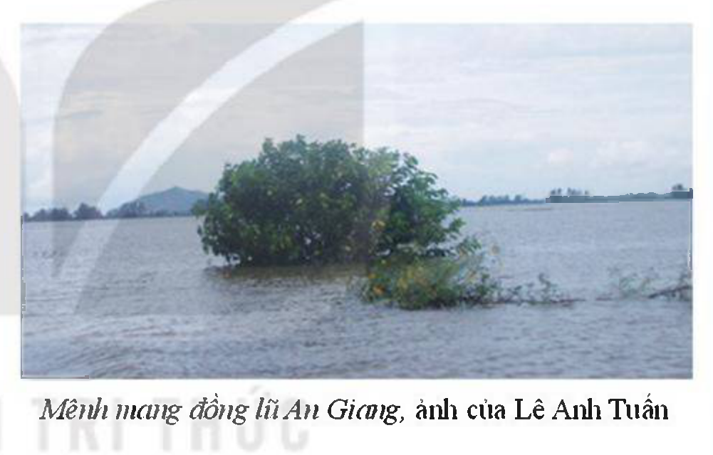
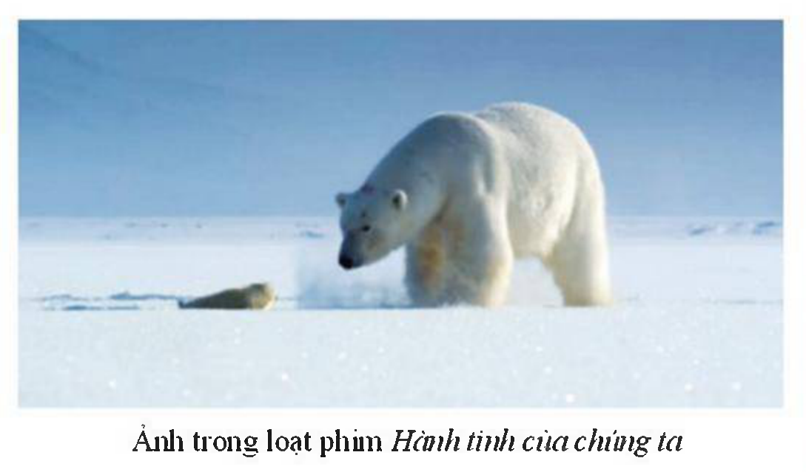
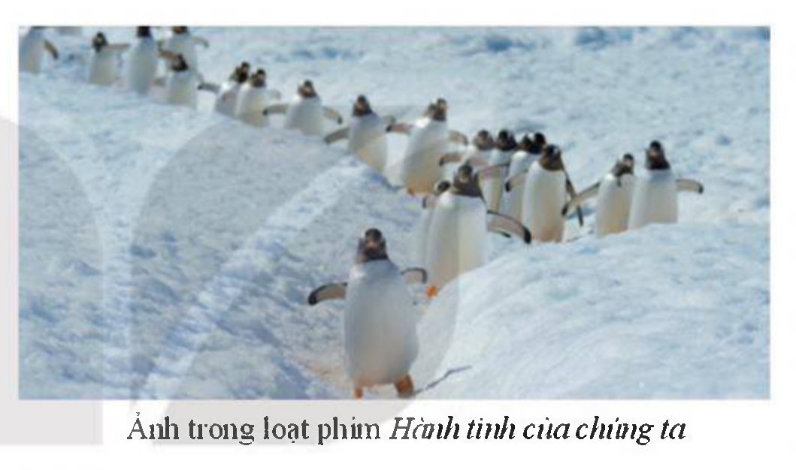
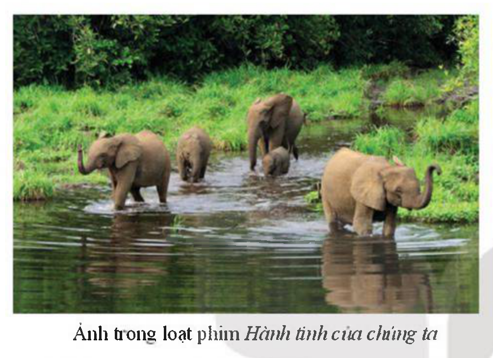

<!-- pdf:88 -->

# BÀI 9: HÔM NAY VÀ NGÀY MAI

*Hãy nhìn sâu vào thiên nhiên, bạn sẽ thấu hiểu mọi thứ rõ ràng hơn.*
<!-- ocr-ok: câu đề từ chữ kiểu trên nền xanh bị OCR đọc nhầm ("Hãu", "thiện whiêm", "vAọi"), đã đối chiếu trực tiếp ảnh trang PDF 88 -->

An-be Anh-xtanh

## Giới thiệu bài học

- Chúng ta đang sống trong một thế giới luôn biến chuyển do tác động không ngừng của các điều kiện tự nhiên vừa quen thuộc vừa khó lường và do những hoạt động đa dạng của con người. Phải làm gì để có được hôm nay hạnh phúc và ngày mai tươi sáng, đó là điều tất thảy mọi người quan tâm. Bao nhiêu câu hỏi về tự nhiên, về cuộc sống đang đòi hỏi chúng ta giải đáp bằng sự hiểu biết và tinh thần trách nhiệm. Trong việc tìm lời giải đáp, không ai có thể đứng ngoài.

- Qua tìm hiểu các văn bản thông tin – loại văn bản đọc chính của bài học – và một văn bản nghị luận cùng chung chủ đề, em sẽ có thêm hiểu biết về thế giới tự nhiên, về sự ứng phó tích cực của con người trước những thách thức mới của môi trường. Đồng thời, em cũng sẽ nắm được đặc điểm của một số kiểu văn bản như: giải thích một hiện tượng tự nhiên, giới thiệu một tác phẩm nghệ thuật đã xem, đã đọc; từ đó biết tạo lập các văn bản viết và nói tương ứng, có nội dung đề cập những vấn đề đời sống gần gũi với trải nghiệm của bản thân.

## 🎯 Yêu cầu cần đạt

- Nhận biết và phân tích được đặc điểm của văn bản giải thích một hiện tượng tự nhiên, văn bản giới thiệu một bộ phim và cách trình bày thông tin trong văn bản; chỉ ra được mối quan hệ giữa đặc điểm văn bản với mục đích của nó.
- Phân tích được thông tin cơ bản của văn bản và vai trò của các chi tiết trong việc thể hiện thông tin; đánh giá được hiệu quả biểu đạt của phương tiện phi ngôn ngữ; liên hệ được thông tin trong văn bản với những vấn đề của xã hội đương đại.
- Nhận biết được các kiểu câu phân loại theo mục đích nói; phân biệt được câu phủ định và câu khẳng định.
- Viết được văn bản thuyết minh giải thích một hiện tượng tự nhiên và văn bản kiến nghị về một vấn đề đời sống.
<!-- term: văn bản thuyết minh -->
<!-- term: văn bản kiến nghị -->

<!-- pdf:89 -->

- Biết thảo luận ý kiến về một vấn đề trong đời sống phù hợp với lứa tuổi.
- Thể hiện được thái độ quan tâm những vấn đề nóng hổi của cuộc sống với tinh thần chủ động, có trách nhiệm trước hiện tại và tương lai.

## Đọc

### TRI THỨC NGỮ VĂN

**Mục đích của văn bản thông tin, mối quan hệ giữa thông tin khách quan và ý kiến chủ quan**

- **Văn bản thông tin** có mục đích chính là cung cấp thông tin xác thực về một sự vật, sự việc, hiện tượng trong đời sống tự nhiên và xã hội. Chính vì vậy, đối với loại văn bản này, tính khách quan của cách đưa thông tin và bản thân thông tin là điều có tầm quan trọng đặc biệt.
- Muốn đưa **thông tin khách quan**, người viết cần công phu tra cứu tài liệu, biết tiếp cận thực tế và ghi chép tỉ mỉ, cẩn thận những gì mình thu nhận được với sự hỗ trợ của các phương tiện tác nghiệp chuyên dụng.
- Trong bối cảnh phát triển mạnh mẽ của các phương tiện truyền thông và mạng xã hội, bên cạnh việc cung cấp thông tin, tác giả văn bản còn cần thể hiện quan điểm đánh giá của mình về đối tượng được đề cập, xem như là một cách định hướng giá trị. Tuy vậy, ý kiến chủ quan của tác giả phải được đặt độc lập với phần cung cấp thông tin khách quan, đảm bảo thông tin đưa đến cho người tiếp nhận không bị bóp méo, sai lạc.
<!-- term: thông tin khách quan -->

**Văn bản giải thích một hiện tượng tự nhiên**

Đây là loại văn bản phổ biến trên báo chí và các tài liệu khoa học, được thực hiện nhằm làm sáng tỏ bản chất, nguyên nhân xuất hiện và những tác động tích cực hoặc tiêu cực có thể có đối với đời sống con người của một hiện tượng tự nhiên nào đó. Trước khi giải thích hiện tượng bằng những căn cứ và lập luận khoa học, người thực hiện văn bản phải miêu tả được hiện tượng với những biểu hiện điển hình, có thể kèm theo những hình ảnh trực quan, kết quả của việc ghi nhận tại chỗ hoặc khai thác từ những nguồn tài liệu đáng tin cậy.
<!-- term: văn bản giải thích một hiện tượng tự nhiên -->

**Văn bản giới thiệu một bộ phim**
<!-- ocr-ok: tiêu đề tiểu mục màu cam bị OCR bỏ sót hoàn toàn, đã đối chiếu trực tiếp ảnh trang PDF 89 -->

Loại văn bản này thường hướng tới mục đích quảng bá các sản phẩm điện ảnh hay giúp khán giả có được những hiểu biết thường thức về điện ảnh. Tuỳ vào loại phim được phân chia theo các tiêu chí khác nhau (phim nhựa, phim truyền hình; phim tài liệu, phim truyện; phim hành động, phim dã sử, phim tâm lí xã hội, phim giả tưởng;...) mà người viết xác định điểm nhấn và chọn cách triển khai khác nhau. Tuy nhiên, văn bản giới thiệu nào cũng cần nêu được thông tin về nhà sản xuất, năm phát hành, các thành viên chủ chốt của đoàn làm phim, nội dung phim, những giá trị nổi bật của phim,... Văn bản giới thiệu có sự kết hợp linh hoạt giữa thông tin khách quan và đánh giá chủ quan, giữa phương tiện ngôn ngữ và phi ngôn ngữ (thường là ảnh chụp pa-nô quảng cáo hoặc một số cảnh phim đặc sắc), được trình bày hấp dẫn, có sức thu hút đối với người tiếp nhận.
<!-- term: văn bản giới thiệu một bộ phim hoặc một cuốn sách -->

<!-- pdf:90 -->

**Câu phân loại theo mục đích nói, câu phủ định và câu khẳng định**

***Các kiểu câu phân loại theo mục đích nói***

- **Câu hỏi** (nghi vấn): kiểu câu chủ yếu được dùng để hỏi, thường có sự xuất hiện của những từ nghi vấn như: *ai, gì, nào, sao, tại sao, đâu, bao giờ, bao nhiêu, à, ư, hử, hả, (có)... không, (đã)... chưa* hoặc từ *hay* dùng để nối các vế câu biểu đạt quan hệ lựa chọn. Khi viết, câu hỏi được kết thúc bằng dấu chấm hỏi.
- **Câu khiến** (cầu khiến): kiểu câu dùng để ra mệnh lệnh, yêu cầu, đề nghị, khuyên bảo,..., thường có mặt các từ cầu khiến như: *hãy, đừng, chớ, đi, thôi, nào*,... Khi viết, câu khiến được kết thúc bằng dấu chấm than hoặc dấu chấm, tuỳ vào mức độ nhấn mạnh của người nói đối với yêu cầu được phát ra.
- **Câu cảm** (cảm thán): kiểu câu được dùng để bộc lộ cảm xúc của người nói hay người viết, thường có sự hiện diện của những từ ngữ cảm thán như: *ôi, than ôi, hỡi ôi (ơi), chao ôi (ơi), trời ơi (ôi), thay, biết (xiết) bao, biết chừng nào*,... Khi viết, người ta thường kết thúc câu cảm bằng dấu chấm than.
- **Câu kể** (trần thuật): kiểu câu cơ bản, phổ biến nhất trong giao tiếp, đảm nhiệm chức năng chính là kể, nhận định, thông báo, miêu tả,... nhưng cũng có khi được dùng để yêu cầu, đề nghị hay bộc lộ cảm xúc. Khi viết, câu kể thường được kết thúc bằng dấu chấm, cũng có khi bằng dấu chấm than hay chấm lửng.

Lưu ý: Mỗi kiểu câu thường có một hình thức thể hiện điển hình, dễ nhận biết. Nhưng trong thực tế giao tiếp, việc mượn hình thức điển hình của kiểu câu này để thể hiện mục đích của kiểu câu kia diễn ra khá phổ biến. Ví dụ, hình thức câu hỏi có thể được sử dụng với mục đích cầu khiến: *“Cậu có tránh ra không thì bảo?”* hoặc với mục đích bộc lộ cảm xúc: *“Sao lại thế này hả trời?”*. Còn trong câu sau, mục đích cầu khiến lại được thể hiện thông qua hình thức quen thuộc của câu kể: *“Bác cứ dùng bữa tự nhiên.”*.
<!-- term: câu hỏi -->
<!-- term: câu khiến -->
<!-- term: câu cảm -->
<!-- term: câu kể -->

***Câu phủ định và câu khẳng định***

- **Câu phủ định** là câu có những từ ngữ phủ định như: *không, chẳng, chả, chưa, không phải* (là), *chẳng phải* (là), *đâu có phải* (là), *đâu* (có),... Câu phủ định dùng để: a) thông báo, xác nhận không có sự vật, sự việc, tính chất, quan hệ nào đó (**phủ định miêu tả**); b) phản bác một ý kiến, một nhận định (**phủ định bác bỏ**).
- **Câu khẳng định** là câu không có phương tiện thể hiện sự phủ định vốn thường được dùng để đánh dấu câu phủ định. Câu khẳng định xác nhận có sự tồn tại của một đối tượng hay của một diễn biến nào đó.
<!-- term: câu phủ định -->
<!-- term: câu khẳng định -->

### VĂN BẢN ĐỌC

- **VĂN BẢN 1.** *Miền châu thổ sông Cửu Long cần chuyển đổi từ sống chung sang chào đón lũ*, Lê Anh Tuấn
- **VĂN BẢN 2.** *Choáng ngợp và đau đớn những cảnh báo từ loạt phim “Hành tinh của chúng ta”*, Lâm Lê
- **VĂN BẢN 3.** *Diễn từ ứng khẩu của thủ lĩnh da đỏ Xi-át-tơn (Seattle)*, Xi-át-tơn

<!-- pdf:91 -->

### VĂN BẢN 1: MIỀN CHÂU THỔ SÔNG CỬU LONG CẦN CHUYỂN ĐỔI TỪ SỐNG CHUNG SANG CHÀO ĐÓN LŨ

**Trước khi đọc**

1. Hãy nêu tên một sáng tác dân gian có nói đến hiện tượng lũ lụt. Theo em, trong sáng tác đó, lũ lụt đã để lại ấn tượng nổi bật gì?

2. Em hiểu thế nào về nội dung của thành ngữ *sống chung với lũ*? Thử suy đoán về nguồn gốc của thành ngữ này.

**Đọc văn bản**

**Miền châu thổ sông Cửu Long cần chuyển đổi từ sống chung sang chào đón lũ**

**LÊ ANH TUẤN(1)**

***Khi “lũ” không về hoặc về ít đi trong nhiều năm liền, các nhà quản lí mới nhận ra Đồng bằng sông Cửu Long không thể “sống” thiếu lũ, điều mà người nông dân ở đây đã nhận ra từ hàng trăm năm nay và đặt cho mùa đặc biệt này cái tên “mùa nước nổi”.***
<!-- ocr-ok: đoạn sa-pô in nghiêng đậm bị OCR đọc nhầm nhiều từ ("HH", "nông dãi", "nữa", "cúi", "nuùa"), đã đối chiếu trực tiếp ảnh trang PDF 91 -->

> **THEO DÕI:** Phần sa-pô báo hiệu điều gì sẽ được triển khai trong văn bản?

Đã đến lúc Việt Nam cần thay đổi về tư duy đối với vùng đất quan trọng này, từ “sống chung với lũ” mang nặng hàm ý chấp nhận và chịu đựng sang “chào đón” lũ.

Tất cả các vùng châu thổ của vùng hạ lưu sông thường được hình thành và phát triển hình thể từ các trận lũ hàng năm của con sông mà giới khoa học thường gọi là quá trình kiến tạo đồng bằng. Hàng trăm năm, hàng ngàn năm tại các đứt gãy địa chất của các thung lũng sông và các dòng rãnh ở những sườn dốc của đồi, núi,... nước mưa từ trời rơi xuống thấm vào lòng đất, cây rừng và các thảm thực vật hấp thu và chảy tràn theo nguyên tắc trọng lực xuống các đường rãnh hình thành nên các mạch nước, dòng suối, nhánh sông và tụ tập ra sông lớn xuôi về hạ lưu rồi đổ ra biển cả như một phần của chu trình thuỷ văn.

> **THEO DÕI:** Tác giả giải thích như thế nào về quá trình kiến tạo đồng bằng nói chung?

Trên quá trình xuôi chảy theo những sườn dốc, các mạch ngầm, dòng nước âm thầm hoà tan những chất vi lượng, các thành phần hữu cơ phân huỷ, cuốn theo đất, cát, sỏi cuội đưa dần về phía nơi thấp hơn. Hiện tượng lũ lụt lớn hay nhỏ sẽ tạo nên những đợt trầm tích(2) bùn cát khác nhau.

Một quy luật thuỷ văn là dòng chảy ở trên cao sẽ có lưu tốc(3) lớn, sức nước mạnh đi trên những dải hẹp sẽ mang những vật liệu trầm tích đi xa, nhưng khi dần xuống vùng

> (1) Lê Anh Tuấn sinh năm 1960, quê ở Thừa Thiên Huế, chuyên gia nghiên cứu về môi trường và tài nguyên thiên nhiên, về biến đổi khí hậu, thành viên Ban cố vấn Mạng lưới sông ngòi Việt Nam và Mạng lưới Đồng bằng sông Mê Kông vì bảo vệ môi trường và thích nghi với biến đổi khí hậu; đã xuất bản hơn 50 bài báo, tài liệu hội thảo, sách cả tiếng Việt và tiếng Anh.
> (2) *Trầm tích*: chất do các vật thể trong nước hồ, sông, biển lắng đọng lâu ngày kết lại mà thành.
> (3) *Lưu tốc*: tốc độ của dòng chảy.

<!-- pdf:92 -->

thung lũng và đồng bằng, địa hình dần thoải hơn, khu vực ngập nước càng mở rộng, dòng sông chia thành nhiều nhánh nhỏ và lưu tốc chậm dần, khi gần ra đến biển, tác dụng của thuỷ triều ngược lại sẽ gia tăng khả năng tích tụ trầm tích, các chất bùn cát dần dần tích luỹ tạo nên những vùng đồng bằng trù phú và những châu thổ điển hình.

Vùng châu thổ sông Cửu Long cũng không ngoài quy luật đó và càng đặc biệt hơn với vùng địa mạo có tuổi địa chất trẻ, nằm tận cùng của một lưu vực sông rộng nhất Đông Nam Á, chảy qua nhiều vùng địa chất khác nhau đổ dài từ các rặng của dãy Hi-ma-lay-a (Hymalaya) cao nhất thế giới, băng qua vùng cao nguyên Tây Tạng, bổ sung nước từ hai phía tả ngạn và hữu ngạn của các khu rừng mưa nhiệt đới rậm rạp hình thành ở các vùng đồi núi dãy Trường Sơn, tiếp nối với cao nguyên trung phần Việt Nam hùng vĩ và tiếp tục xuôi về phía đồng bằng của đất nước Chùa Tháp, kết nối với Biển Hồ bao la và cuối cùng đổ về vùng châu thổ sông Cửu Long thấp và phẳng của Việt Nam trước khi hoà mình với Biển Đông.

> **CHÚ Ý:** Những điểm đặc biệt trong sự hình thành vùng châu thổ sông Cửu Long là gì?

Quá trình trầm tích vùng châu thổ xảy ra liên tục hơn 5 000 – 7 000 năm và theo quy luật vật lí của sự phân bố bùn cát, những hạt vật chất lớn như đá, sỏi cuội to, sỏi nhỏ và cát thô sẽ trầm tích ở phía trên trong khi các hạt cát trung, cát mịn và phù sa lơ lửng xuôi về vùng châu thổ tiếp giáp với biển, giúp cho vùng châu thổ nâng dần cao độ và mở rộng ra phía nam của thềm lục địa Tổ quốc.

*Mênh mang đồng lũ An Giang*, ảnh của Lê Anh Tuấn
<!-- ocr-ok: chú thích ảnh chữ nhỏ in nghiêng bị OCR đọc nhầm ("1ô) I6 đồng l An Giang"), đã đối chiếu trực tiếp ảnh trang PDF 92 -->

Vùng châu thổ sông Cửu Long nghèo nàn về vật liệu xây dựng và khoáng sản kim loại, ngoại trừ vài vùng núi của tỉnh An Giang và Kiên Giang. Cát xây dựng và san lấp cũng khá ít ỏi so với nhu cầu, trong khi nền địa chất yếu về kết cấu, nhưng bù lại về thổ nhưỡng(1) và sinh thái(2) vùng châu thổ lớn nhất Việt Nam có lớp đất mặt giàu dinh dưỡng với thành phần chính là đất sét và đất thịt, có thêm nguồn nước dồi dào giúp cho việc sản xuất nông nghiệp và thuỷ sản phát triển mạnh, với năng suất sinh học vô cùng lớn.

> **HÌNH DUNG:** Sự trù phú của vùng Đồng bằng sông Cửu Long được biểu hiện như thế nào?

Khó tìm đâu ra một vùng đồng bằng nào trên thế giới mà chỉ trong vòng 100 ngày, người dân ở đây có thể sản xuất ra một lượng lúa đến 7 – 8 triệu tấn. Với một vụ mùa mưa 3 – 4 tháng, người nông dân có thể thu hoạch xấp xỉ 5 triệu tấn rau củ và trái cây các loại. Đặc biệt, những năm có lũ lớn, người dân đầu nguồn sông Cửu Long có thể đánh bắt 1,2 – 1,5 triệu tấn cá tôm và các loài thuỷ sản khác nhau.

> (1) *Thổ nhưỡng*: đất đai (dùng để chỉ vùng đất mềm, xốp, thuận lợi cho việc canh tác, nơi các sinh vật sinh sống, phát triển mạnh mẽ).
> (2) *Sinh thái*: quan hệ giữa sinh vật (trong đó có con người) và môi trường.

<!-- pdf:93 -->

Những vị lão nông tri điền(1) vùng đồng bằng khẳng định, năm nào có lũ lớn là năm đó cá nhiều, chim nhiều, sản vật mùa lũ (rùa, rắn, ếch, ốc,...) nhiều và chắc chắn năm sau canh tác sẽ trúng mùa, sản lượng cao và lượng phân bón, nông dược sử dụng ít đi vì lũ mang lại phù sa màu mỡ, làm vệ sinh đồng ruộng và bổ sung nguồn nước tại chỗ. Cuối mùa lũ cũng là mùa thu hoạch vụ mùa cuối năm, lúc đó những đàn chim én tụ về, bay lượn kiếm ăn trên những cánh rừng, theo các hàng cây cối vườn tược xanh tươi ở vùng đất ngập nước và những khu đất trũng lung bàu(2).

> **THEO DÕI:** Vì sao có lũ lớn lại là điều được người dân miền sông nước mong đợi?

Ngập lụt đã tạo nên ít nhất là ba kết nối quan trọng cho hệ sinh thái Đồng bằng sông Cửu Long, bao gồm dòng nước, phù sa và dòng sinh vật. Thứ nhất là kết nối dòng chảy giữa đoạn sông thượng lưu và đoạn sông hạ lưu trong quá trình chuyển nước, cá và phù sa. Thứ hai là sự kết nối giữa sông và hai bên bờ: mùa mưa lũ, nước theo các sườn dốc, cuốn các chất hữu cơ (thực và động vật) và các khoáng vô cơ (đất đá, chất khoáng vi lượng) xuống dòng sông, chảy mạnh xuống hạ lưu, đến vùng thấp hơn và xuống đồng bằng thì nước sông đủ lớn và nhiều, “nước nhảy” lên bờ tràn ngập nhiều vùng rộng lớn, mang theo phù sa màu mỡ và tôm cá. Cuối cùng, thứ ba, là sự kết nối thuỷ vực(3) từ dòng sông và cửa sông ra vùng ven biển, thềm lục địa và biển cả tạo nên nguồn dinh dưỡng cho sinh vật vùng cửa sông và cung cấp vật liệu bồi đắp nuôi dưỡng cho hệ sinh thái rừng ngập mặn ven biển. Nếu không có sự kết nối thứ ba này, vùng cửa sông sẽ nghèo nàn tính đa dạng sinh học và hệ sinh thái rừng ngập mặn khó tồn tại.

> **CHÚ Ý:** Hiện tượng ngập lụt đã tạo nên những kết nối quan trọng nào?

Khoảng những năm sau mùa lũ lịch sử năm 2000, vùng châu thổ dấy lên khẩu hiệu “sống chung với lũ”. Thật ra, điều này không mới, ít nhất vài trăm năm trước, các cư dân đầu tiên đến vùng hoang địa(4) châu thổ, họ đã quen với cách sống với mùa nước nổi hàng năm.

Ngược dòng lịch sử, vùng hạ lưu sông Mê Kông đã từng có nhiều trận lũ lớn. Ngày nay, thỉnh thoảng khi đào nền nhà, đào kinh(5), đào móng công trình, người ta gặp những hòn đá tròn lẳn, hình ô-van(6), có màu xanh trắng hoặc xanh đen như đá gra-nít(7), đường kính trung bình khoảng 10 – 15 xen-ti-mét hoặc đôi khi xấp xỉ 20 xen-ti-mét giống như các hòn đá tròn ngoài bãi biển, nhưng ở đây chìm sâu trong lớp đất nội đồng. Nhiều người thấy lạ, đặt trên bàn thờ “ông Thiên”(8) gọi đó là “đầu ông Địa, ông Tà(9)”.

> (1) *Lão nông tri điền*: (thành ngữ) người nông dân tuổi cao am hiểu đồng ruộng, có nhiều kinh nghiệm sản xuất.
> (2) *Lung bàu*: kết hợp của hai từ đơn là *lung* và *bàu*, vốn có chung nét nghĩa chỉ vùng đất trũng ngập nước giữa đồng hoặc giữa rừng.
> (3) *Thuỷ vực*: vùng nước.
> (4) *Hoang địa*: đất hoang, nơi không được con người chăm sóc hay sử dụng đến.
> (5) *Kinh*: kênh, công trình dẫn nước thường được đào bằng xáng (phương tiện di chuyển dưới nước để đào kênh, vét bùn) hoặc bằng tay nhằm phục vụ giao thông, thuỷ lợi.
> (6) *Hình ô-van*: hình bầu dục.
> (7) *Đá gra-nít*: đá hoa cương, loại đá rất cứng gồm nhiều hạt khoáng vật khác nhau.
> (8) *Ông Thiên*: ông Trời, thường được thờ cúng nơi ban thờ đặt trước sân nhà hay sân đình, chùa.
> (9) *Ông Địa, ông Tà*: hai vị thần gần gũi với người dân, luôn mang lại điều lành, có khi được thờ cúng trong cùng một ngôi miếu (*ông Địa*: thổ thần trong tín ngưỡng của người Việt và người Hoa, trông coi việc từng nhà hay cai quản một vùng đất, địa điểm; *ông Tà*: vị thần có nguồn gốc từ tín ngưỡng của người Khơ-me, đảm nhiệm việc bảo hộ cho một cộng đồng dân cư ở làng quê).

<!-- pdf:94 -->

Thực chất, những trận lũ lớn lịch sử đã cuốn những hòn đá to từ thượng nguồn. Lúc đầu đá có sắc cạnh, sau được dòng nước nhiều năm bào mòn và di đáy, dần dần “trôi” xuống đồng bằng.

Tình trạng lũ thấp và trung bình trong mùa mưa lũ có xu thế gia tăng ở vùng Đồng bằng sông Cửu Long, đặc biệt trong thập niên vừa qua, trong khi mùa khô ngày càng kéo dài và căng thẳng, tương ứng với sự gia tăng sâu hơn mức độ xâm nhập mặn vào đồng bằng. Điều này dẫn đến chiến lược điều chỉnh sản xuất nông nghiệp, đặc biệt là cây lúa và gia tăng diện tích nuôi trồng thuỷ sản, nhằm sử dụng hợp lí nguồn nước, bảo đảm cấp nước sinh hoạt ở các thời đoạn khó khăn.

Mùa nước nổi xưa kia hay mùa lũ theo cách gọi hiện nay, không là mối lo ngại cho nông dân vùng châu thổ Cửu Long, một mùa nước lũ lớn, như một niềm tin tâm linh, sẽ đem lại sự giàu có, sung túc cho vùng đất. Có lũ lớn, sẽ có phù sa, sẽ có nguồn cá và sau lũ, chim chóc, cây cỏ, cá tôm vẫy mình chào đón một vòng chu kì Trái Đất quay quanh Mặt Trời. Người dân châu thổ mong được đón lũ là vậy.

> **SUY LUẬN:** Đoạn văn này có sự kết nối như thế nào với nhan đề của văn bản?

(*Theo* Lê Anh Tuấn, tạp chí *Kinh tế Sài Gòn Online*, ngày 06/02/2022)

**Sau khi đọc**

**Trả lời câu hỏi**

1. Thông tin chính mà tác giả muốn chuyển tải qua văn bản này là gì?

2. Có thể xếp *Miền châu thổ sông Cửu Long cần chuyển đổi từ sống chung sang chào đón lũ* vào kiểu văn bản giải thích một hiện tượng tự nhiên được không? Vì sao?

3. Thông tin trong văn bản được trình bày theo trật tự hay quan hệ nào? Nêu nhận xét về hiệu quả của cách trình bày đó.

4. Trong văn bản, hiện tượng lũ ở miền châu thổ sông Cửu Long đã được soi chiếu từ những góc nhìn nào? Sự phối hợp các góc nhìn như vậy có ý nghĩa gì?

5. Vì sao trong văn bản, tác giả hầu như không nói đến tác hại của lũ, dù không quên nhắc đến một số “trận lũ lớn lịch sử”?

6. Những thông tin được đưa đến trong văn bản có điểm gì mới so với điều em đã biết?

7. Theo em, những nhận định của tác giả về lũ ở miền châu thổ sông Cửu Long có thể được áp dụng để nói về lũ ở mọi lưu vực sông khác hay không? Vì sao?

#### Viết kết nối với đọc
<!-- ocr-ok: tiêu đề mục màu cam "VIẾT KẾT NỐI VỚI ĐỌC" bị OCR bỏ sót hoàn toàn, đã đối chiếu trực tiếp ảnh trang PDF -->

Viết đoạn văn (khoảng 7 – 9 câu) nêu những thu nhận bổ ích của em qua đọc văn bản *Miền châu thổ sông Cửu Long cần chuyển đổi từ sống chung sang chào đón lũ*.

<!-- pdf:95 -->

### Thực hành tiếng Việt

**CÁC KIỂU CÂU PHÂN LOẠI THEO MỤC ĐÍCH NÓI**
<!-- ocr-ok: tiêu đề mục màu cam bị OCR bỏ sót hoàn toàn, đã đối chiếu trực tiếp ảnh trang PDF 95 -->

> **Nhận biết các kiểu câu: câu hỏi, câu khiến, câu cảm, câu kể**
> Các kiểu câu này được nhận biết căn cứ vào:
> - Sự có mặt của những từ ngữ đặc thù, chuyên dùng đánh dấu mỗi kiểu câu.
> - Dấu kết thúc câu khi câu được thể hiện bằng chữ viết.
> - Nội dung biểu đạt của câu và ngữ cảnh xuất hiện câu.
>
> Ví dụ:
> - *Anh bảo cuốn sách còn có ở trên bàn nữa không?*
> Câu được đặt trong mạch đối thoại; trực tiếp nêu một thắc mắc nhờ giải đáp; có từ *không* và dấu chấm hỏi → **câu hỏi**.
> - *Mở cổng nhanh lên!*
> Câu hướng về một đối tượng cụ thể để đưa ra yêu cầu; có động từ chỉ điều đối tượng cần thực hiện (*mở*); có dấu chấm than kết thúc → **câu khiến**.
> - *Tôi thấy nhớ cái mùi nồng mặn quá!* (Tế Hanh, *Quê hương*)
> Câu được dùng để trực tiếp nêu cảm xúc của người viết; có từ *quá* và dấu chấm than kết thúc → **câu cảm**.
> - *Trên quá trình xuôi chảy theo những sườn dốc, các mạch ngầm, dòng nước âm thầm hoà tan những chất vi lượng, các thành phần hữu cơ phân huỷ, cuốn theo đất, cát, sỏi cuội đưa dần về phía nơi thấp hơn.* (Lê Anh Tuấn, *Miền châu thổ sông Cửu Long cần chuyển đổi từ sống chung sang chào đón lũ*)
> Câu dùng để trần thuật về một hiện tượng, sự việc; kết thúc bằng dấu chấm → **câu kể**.
>
> *Lưu ý:* Để xác định đúng kiểu câu, cần chú ý đồng thời vừa đặc điểm hình thức của câu, vừa nội dung câu và ngữ cảnh.

1. Xác định kiểu câu của các câu sau và cho biết căn cứ giúp em xác định như vậy:

a. *Khó tìm đâu ra một vùng đồng bằng nào trên thế giới mà chỉ trong vòng 100 ngày, người dân ở đây có thể sản xuất ra một lượng lúa đến 7 – 8 triệu tấn.*

(Lê Anh Tuấn, *Miền châu thổ sông Cửu Long cần chuyển đổi từ sống chung sang chào đón lũ*)

b. *Để có hơn 400 phút phim sống động đến từng giây, nhà sản xuất A-lớt-xtơ Phơ-dơ-gheo và nhóm làm phim lên tới 60 người đã bỏ tới 4 năm để quay tại hơn 50 quốc gia với công nghệ quay phim hiện đại nhất.*

(Lâm Lê, *Choáng ngợp và đau đớn những cảnh báo từ loạt phim “Hành tinh của chúng ta”*)

c. *Có lẽ, người da đỏ hoang dã và tăm tối chăng?*

(Xi-át-tơn, *Diễn từ ứng khẩu của thủ lĩnh da đỏ Xi-át-tơn*)

d. *Ngài phải bảo chúng rằng đất đai giàu có được là do nhiều mạng sống của chủng tộc chúng tôi bồi đắp nên.*

(Xi-át-tơn, *Diễn từ ứng khẩu của thủ lĩnh da đỏ Xi-át-tơn*)

2. Xác định kiểu câu của từng câu sau và cho biết: Tại sao cùng có chung một số dấu hiệu hình thức mà hai câu có thể được xếp vào hai kiểu khác biệt?

a. *Và cái gì sẽ xảy ra đối với cuộc sống, nếu con người không nghe được âm thanh lẻ loi của chú chim đớp mồi hay tiếng tranh cãi của những chú ếch ban đêm bên hồ?*

(Xi-át-tơn, *Diễn từ ứng khẩu của thủ lĩnh da đỏ Xi-át-tơn*)

<!-- pdf:96 -->

b. *Tôi là kẻ hoang dã, tôi không hiểu nổi tại sao một con ngựa sắt nhả khói lại quan trọng hơn nhiều con trâu rừng mà chúng tôi chỉ giết để duy trì cuộc sống.*

(Xi-át-tơn, *Diễn từ ứng khẩu của thủ lĩnh da đỏ Xi-át-tơn*)

3. Tìm trong các văn bản đọc ở *Ngữ văn 8*, tập hai những ví dụ về hiện tượng: người nói hay người viết đã thể hiện mục đích của kiểu câu này bằng hình thức mang tính điển hình của một kiểu câu khác.

### VĂN BẢN 2: CHOÁNG NGỢP VÀ ĐAU ĐỚN NHỮNG CẢNH BÁO TỪ LOẠT PHIM “HÀNH TINH CỦA CHÚNG TA”

**Trước khi đọc**

1. Em đã từng xem những bộ phim nào nói về sự sống trên Trái Đất? Hãy chia sẻ điều em tâm đắc về một trong những bộ phim ấy.

2. Trong những năm gần đây, khi bàn về môi trường tự nhiên trên Trái Đất, có một số cụm từ hay hình ảnh được các phương tiện truyền thông nhắc đến rất nhiều lần. Theo tìm hiểu của em, đó là những cụm từ hay hình ảnh nào?

**Đọc văn bản**

**Choáng ngợp và đau đớn những cảnh báo từ loạt phim *Hành tinh của chúng ta*(1)**

**LÂM LÊ(2)**

Loạt phim tài liệu *Hành tinh của chúng ta* đưa ra lời cảnh báo về sự nóng lên của toàn cầu, những môi trường sống bị huỷ diệt và nhiều loài biến mất, đồng thời mang đến một thông điệp sống còn: “Hãy cứu lấy hành tinh của chúng ta trước khi quá muộn!”.

Ảnh trong loạt phim *Hành tinh của chúng ta*

Vẫn qua giọng dẫn chuyện hấp dẫn tuyệt vời của nhà làm phim, nhà nghiên cứu tự nhiên Đê-vít Át-tin-bo-râu (David Attenborough), tám tập phim tài liệu của *Hành tinh của chúng ta* mới phát trực tuyến trên Nét-phơ-lít (Netflix) như là phần tiếp theo của *Hành tinh Trái Đất (Earth Planet)* – loạt phim

> (1) Tên tiếng Anh của loạt phim là *Our Planet*.
> (2) *Lâm Lê*: bút danh của của Lê Hồng Lâm, sinh năm 1977, quê ở Quảng Trị, là nhà báo chuyên viết phê bình điện ảnh; tác giả của các cuốn sách: *Xem chữ đọc hình* (2005), *Chơi cùng cấu trúc* (2009), *Cánh chim trong gió* (2016), *101 bộ phim Việt Nam hay nhất* (2018), *Người tình không chân dung* (2020).

<!-- pdf:97 -->

tài liệu nổi tiếng trước đây của kênh BBC Earth(1), bởi cách mà các nhà làm phim tạo sự tương phản và đối nghịch giữa vẻ đẹp của thiên nhiên, sự đa dạng của giống loài với cuộc khủng hoảng môi trường, khí hậu đang tàn phá và giết chết chúng mỗi ngày.

**Rất nhiều loài đang đứng bên bờ vực tuyệt chủng**

Tám tập phim, với tám môi trường sống trên khắp thế giới, từ vùng cực băng giá (Nam Cực và Bắc Cực), những cánh rừng mưa nhiệt đới, vùng sa mạc và đồng cỏ ở châu Phi, những đại dương sâu thẳm cho đến sông ngòi và những khu rừng rậm đa dạng ở Nam Mỹ,... mang tới cho người xem những hình ảnh sống động và những thông tin chính xác nhất về hành tinh của chúng ta.

> **THEO DÕI:** Tác giả cho biết điều gì về bố cục và quy mô phản ánh của bộ phim?

Ở mỗi tập phim, người xem lại được thưởng thức những thước phim đẹp đẽ, thậm chí choáng ngợp mà những nhà làm phim đã kì công tạo nên.

Ảnh trong loạt phim *Hành tinh của chúng ta*

Hàng chục ngàn chú chim cánh cụt đi lạch bạch qua những con đường nhỏ hẹp trên tuyết ở Nam Cực để tìm gia đình của chúng; những con hải mã khổng lồ, mập mạp nằm lười biếng trong đàn hay cạnh tranh để chinh phục con cái; cuộc săn mồi kì vĩ của đàn cá heo, cá mập, cá ngừ vây xanh ở đại dương; những chú ếch có đôi mắt to bám trên dây leo được quay chậm, như thể chúng bước ra từ một bộ phim hoạt hình của hãng Pích-xa(2) (Pixar)...

> **HÌNH DUNG:** Vẻ đẹp ở các cảnh phim hiện lên như thế nào qua lời miêu tả của tác giả văn bản?

Nhưng đằng sau vẻ đẹp ngoạn mục đó của thế giới tự nhiên hoang dã là những con số, những lời cảnh báo đau lòng của các nhà làm phim, các nhà khoa học về hành tinh của chúng ta.

> **THEO DÕI:** Nội dung nào của bộ phim được nhắc đến trong đoạn này?

Trong tập phim về *Thế giới băng giá*, rất nhiều loài động vật hoang dã sống ở môi trường băng tuyết tại Nam Cực và Bắc Cực đang có nguy cơ bị thu hẹp do biến đổi khí hậu khiến băng đang tan ra nhanh chóng.

Loài gấu tuyết Bắc Cực phải vất vả kiếm mồi trên những tảng băng trôi. Một cảnh phim đau lòng khác ghi lại cảnh những con hải mã bị mất môi trường sống do băng tan

> (1) *BBC Earth*: một chương trình thuê bao tài liệu, thuộc quyền sở hữu và điều hành của BBC Studios (Anh).
> (2) *Pích-xa*: hãng phim hoạt hình nổi tiếng của Hoa Kỳ.

<!-- pdf:98 -->

phải leo lên những vực đá và chen chúc trong khoảng không gian chật hẹp, dẫn đến việc chúng bị rơi tự do xuống những phiến đá phía dưới và chết hàng loạt.

Không chỉ ở hai vùng cực, gần như ở bất cứ môi trường sống nào trên hành tinh Trái Đất, từ trên cạn đến dưới nước, từ những rừng mưa nhiệt đới đến rừng rậm ở A-ma-dôn (Amazon), từ sa mạc ở châu Phi đến vùng đồng cỏ ở Bắc Mỹ, những dòng sông nước ngọt dài đến hàng ngàn ki-lô-mét như sông Mê Kông,... đều bị tàn phá nghiêm trọng khiến nhiều giống loài biến mất hoặc đứng bên bờ tuyệt chủng.

Ảnh trong loạt phim *Hành tinh của chúng ta*

Hơn 70% diện tích của các rừng mưa nhiệt đới bị tàn phá, khiến nhiều loài động vật hoang dã mất nơi ở và là một trong những nguyên do khiến nhiệt độ trên Trái Đất ngày càng nóng dần lên, cũng như những thiên tai do lũ lụt, hạn hán ngày càng gây hậu quả nặng nề. Số lượng những loài động vật quý như hổ, sư tử, báo đốm, linh trưởng,... cũng đang giảm nhanh chóng do nạn săn bắn hoặc môi trường sống bị thu hẹp.

Những con voi ở Tan-da-ni-a (Tanzania) đang thiếu nguồn nước ngọt do hạn hán khiến số lượng của chúng giảm sút. Việc ngăn chặn các dòng chảy tự nhiên trên dòng sông Mê Kông để làm đập hoặc thuỷ điện khiến hàng chục triệu người ở các quốc gia châu Á sống dựa vào dòng sông này đang bị ảnh hưởng nặng nề...

Ở các đại dương, nhiều loài cá cũng đang đứng trước nguy cơ tuyệt chủng. Hàng thập kỉ săn bắt cá không bền vững đã làm số lượng nhiều loài cá bị giảm nghiêm trọng. Một phần ba lượng cá đã biến mất. Ô nhiễm nhựa cũng là một vấn đề đáng báo động đối với đại dương, nhưng việc đánh bắt cá công nghiệp quá đà còn nguy hiểm hơn nhiều.

> **SUY LUẬN:** Em nghĩ như thế nào về khả năng tác động của bộ phim qua những gì được tác giả văn bản nhắc đến ở đoạn này?

**Nhưng vẫn chưa quá muộn**

Rất nhiều lời cảnh báo đã được đưa ra, tuy nhiên điều khác biệt lớn nhất giữa loạt phim *Hành tinh của chúng ta* với những bộ phim tài liệu về tự nhiên trước đây là những thông điệp tích cực ở phần cuối mỗi tập phim.

> **CHÚ Ý:** Sự so sánh ở đây có ý nghĩa gì đối với việc đánh giá về bộ phim?

Dù Trái Đất đang bị tàn phá nghiêm trọng, nhưng vẫn còn kịp để cứu lấy ngôi nhà duy nhất của chúng ta. Các nhà làm phim đã tìm đến những khu vực bảo tồn thiên nhiên hay động thực vật hoang dã và cho thấy những kết quả tuyệt vời của chúng.

<!-- pdf:99 -->

Nhiều loài động thực vật lại được hồi sinh nhờ những cam kết bảo vệ nghiêm ngặt trong các khu vực bảo tồn trên thế giới.

Trong tập phim *Những đại dương (The High Seas)*, các nhà khoa học cho biết nếu chúng ta đánh bắt hải sản bền vững, các đại dương sẽ trở nên vô cùng phì nhiêu và cung cấp cho chúng ta nguồn thức ăn dồi dào. Đã có những dấu hiệu cho thấy đại dương có sức mạnh hồi phục nhanh chóng tới mức đáng kinh ngạc, đặc biệt ở những khu vực mà con người không săn bắt hoặc bị cấm săn bắt.

Một ví dụ điển hình nhất là loài cá voi lưng gù. Chúng là loại cá lớn, có mặt ở tất cả các đại dương, di chuyển trong những vùng biển cả, từ nơi kiếm thức ăn ở vùng cực tới miền nhiệt đới nơi chúng sinh sản.

Trước đây, cá voi lưng gù có tới hơn cả trăm ngàn con nhưng sau những đợt săn bắn lớn, chúng chỉ còn vài ngàn cá thể. Sau khi báo động về sự sụt giảm của chúng, lệnh cấm săn bắt cá voi cho mục đích thương mại được ban hành từ năm 1986. Kể từ đó, số lượng cá voi lưng gù đang dần dần tăng lên.

Trong sự phục hồi rất đáng ghi nhận, cá voi lưng gù gần như đã quay lại số lượng như lúc ban đầu. “Chúng ta đã cứu được những con cá voi bằng sự đồng thuận quốc tế, giờ đây đã tới lúc chúng ta cứu lấy các đại dương” – Đê-vít nói.

Câu chuyện về sự phục hồi từ loài cá voi lưng gù và nhiều khu vực bảo tồn trên thế giới cho thấy vẫn có nhiều cơ hội để cứu lấy hành tinh này, nếu con người có những hành động kịp thời để bảo vệ các loài động vật hoang dã và hệ sinh thái của chúng. Vì con người cũng là một mắt xích trong hệ sinh thái trên Trái Đất, nên nếu hệ sinh thái khoẻ mạnh thì hành tinh và con người mới khoẻ mạnh!

Đê-vít Át-tin-bo-râu đưa ra những thông tin đáng báo động: “Nếu chúng ta tiếp tục vắt kiệt biển theo cách này thì không chỉ ngành đánh bắt hải sản sẽ sụp đổ, mà cả hệ thống đại dương cũng sụp đổ theo. 100 triệu con cá mập bị giết mỗi năm chỉ để làm món xúp vi cá mập. 90% những loài săn mồi sống ở những đại dương lớn đã biến mất. Không có chúng đứng ở đầu chuỗi thức ăn, toàn bộ cộng đồng sinh thái dưới biển sẽ suy giảm và thay đổi tới mức không thể nhận ra”.

> **CHÚ Ý:** Việc trích dẫn ở đây có ý nghĩa gì?

Để có hơn 400 phút phim sống động đến từng giây, nhà sản xuất A-lớt-xtơ Phơ-dơ-gheo (Alastair Fothergill) và nhóm làm phim lên tới 60 người đã bỏ tới 4 năm để quay tại hơn 50 quốc gia với công nghệ quay phim hiện đại nhất.

> **CHÚ Ý:** Cách kết thúc văn bản có gì đặc biệt?

(*Theo* Lâm Lê, báo *Tuổi trẻ Online*, ngày 12/5/2019)

<!-- pdf:100 -->

**Sau khi đọc**

**Trả lời câu hỏi**

1. Văn bản *Choáng ngợp và đau đớn những cảnh báo từ loạt phim “Hành tinh của chúng ta”* thuộc kiểu văn bản gì? Nêu căn cứ cho phép em xác định như vậy.

2. Tóm tắt những thông tin cơ bản về loạt phim *Hành tinh của chúng ta* được tác giả văn bản cung cấp. Theo em, tác giả muốn người đọc chú ý đặc biệt tới thông tin nào?

3. Xác định cách triển khai của văn bản và nhận xét về cách triển khai đó.

4. Sự hiện diện của các hình ảnh minh hoạ trong văn bản có ý nghĩa gì?

5. Tác giả văn bản đã thể hiện sự đồng cảm như thế nào đối với nhóm làm phim? Xét theo đặc điểm của kiểu văn bản, yếu tố đồng cảm ở đây giữ vai trò như thế nào?

6. Nêu tên những tác phẩm văn học, nghệ thuật, khoa học mà em đã học, đã biết có đưa ra lời cảnh báo tương tự cảnh báo của loạt phim *Hành tinh của chúng ta*. Sự gặp gỡ đó giữa các tác phẩm nói lên điều gì?

7. Em có nhận xét gì về cách giới thiệu một bộ phim tài liệu mà tác giả đã thực hiện ở văn bản này?

#### Viết kết nối với đọc
<!-- ocr-ok: tiêu đề mục màu cam "VIẾT KẾT NỐI VỚI ĐỌC" bị OCR bỏ sót hoàn toàn, đã đối chiếu trực tiếp ảnh trang PDF -->

Viết đoạn văn (khoảng 7 – 9 câu) thể hiện sự hưởng ứng của em đối với thông điệp chính được nêu lên trong loạt phim *Hành tinh của chúng ta*.

### VĂN BẢN 3: DIỄN TỪ ỨNG KHẨU CỦA THỦ LĨNH DA ĐỎ XI-ÁT-TƠN

**Đọc văn bản**

**Diễn từ(1) ứng khẩu(2) của thủ lĩnh da đỏ Xi-át-tơn(3)**
<!-- ocr-ok: nhan đề màu xanh kèm số mũ cước chú bị OCR đọc nhầm ("Diên từ ứng khẩu” ? ? 1Z ? Š 3"), đã đối chiếu trực tiếp ảnh trang PDF 100 -->

[...] Đối với đồng bào tôi, mỗi tấc đất là thiêng liêng, mỗi lá thông óng ánh, mỗi bờ cát, mỗi hạt sương long lanh trong những cánh rừng rậm rạp, mỗi bãi đất hoang và tiếng thì thầm của côn trùng là những điều thiêng liêng trong kí ức và kinh nghiệm của đồng bào tôi. Những dòng nhựa chảy trong cây cối cũng mang trong đó kí ức của người da đỏ.

> (1) *Diễn từ*: lời phát biểu trong một dịp long trọng.
> (2) *Ứng khẩu*: nói ngay thành văn, không chuẩn bị trước hoặc không có văn bản soạn sẵn để dựa vào khi nói.
> (3) *Xi-át-tơn* (1786 – 1866): người lãnh đạo các bộ lạc da đỏ Đu-oa-mớt (Duwamish) và Xơ-qua-mớt (Suquamish) – những chủ nhân đầu tiên của một vùng rộng lớn ở lục địa Bắc Mỹ. Năm 1854, Preng-klin Pi-ơ-xơ (Franklin Pierce), tổng thống thứ 14 của Hoa Kỳ đã viết thư tới Xi-át-tơn, ngỏ ý muốn mua phần đất người da đỏ đang sở hữu. Đáp lại, thủ lĩnh Xi-át-tơn đã thực hiện một diễn từ ứng khẩu trước Thống đốc Ai-xớc Xti-vần (Isaac Stevens). Diễn văn này được dịch sang tiếng Anh qua ba thổ ngữ của người da đỏ nên có nhiều phiên bản khác nhau. Bản dịch trên đây được thực hiện căn cứ vào bản tiếng Anh do bác sĩ Hen-ry A. Xmít (Henry A. Smith) cho đăng tải trên tờ *Ngôi sao Chủ nhật của Xi-át-tơn (Seattle Sunday Star)*, số 29, tháng 10 năm 1887. Trong SGK *Ngữ văn 6*, tập hai, NXB Giáo dục, Hà Nội, 2002, nhan đề *Diễn từ ứng khẩu của thủ lĩnh da đỏ Xi-át-tơn* được ghi là *Bức thư của thủ lĩnh da đỏ*. Ở đây, xin được đặt lại nhan đề cho đúng với tính chất thực của văn bản.

<!-- pdf:101 -->

Khi người da trắng chết đi, họ thường dạo chơi giữa các vì sao(1) và quên đi đất nước họ sinh ra. Còn chúng tôi, chúng tôi chẳng thể quên được mảnh đất tươi đẹp này. Bởi lẽ mảnh đất này là bà mẹ của người da đỏ. Chúng tôi là một phần của mẹ và mẹ cũng là một phần của chúng tôi. Những bông hoa ngát hương là người chị, người em của chúng tôi. Những mỏm đá, những vũng nước trên đồng cỏ, hơi ấm của chú ngựa con và của con người, tất cả đều cùng chung một gia đình.

[...] Dòng nước óng ánh, êm ả trôi dưới những dòng sông, con suối đâu chỉ là những giọt nước, mà còn là máu của tổ tiên chúng tôi. Nếu chúng tôi bán mảnh đất này cho Ngài, Ngài phải nhớ rằng, Ngài phải dạy bảo con cháu rằng, mảnh đất này là thiêng liêng và những tia sáng chói chang phản chiếu từ mặt hồ trong vắt sẽ nói lên cái gì đó về kí ức của người da đỏ. Tiếng thì thầm của dòng nước chính là tiếng nói của cha ông chúng tôi.

[...] Tôi biết người da trắng không hiểu cách sống của chúng tôi. Đối với họ, mảnh đất này cũng như mảnh đất khác, bởi lẽ họ là kẻ xa lạ, và trong đêm tối, họ lấy đi từ lòng đất những gì họ cần. Mảnh đất này đâu phải là những người anh em của họ, mảnh đất này là kẻ thù của họ và khi đã chinh phục được, thì họ sẽ lấn tới. Mồ mả tổ tiên của họ, họ còn quên và họ cũng chẳng cần tới dòng tộc của họ. Họ cư xử với mẹ đất và anh em bầu trời như những vật mua được, tước đoạt được, rồi bán đi như những con cừu và những hạt kim cương sáng ngời. Lòng thèm khát của họ sẽ ngấu nghiến đất đai, rồi để lại đằng sau những bãi hoang mạc.

Tôi biết, cách sống của chúng tôi khác với cách sống của Ngài. Cảnh đẹp nơi thành phố của Ngài làm nhức nhối con mắt người da đỏ. Có lẽ, người da đỏ hoang dã và tăm tối chăng?

Ở thành phố của người da trắng, chẳng có nơi nào yên tĩnh cả, chẳng có nơi nào là nghe được tiếng lá cây lay động vào mùa xuân hay tiếng vỗ cánh của côn trùng. Nếu có nghe thấy thì đó cũng chỉ là những tiếng ồn ào lăng mạ trong tai. Và cái gì sẽ xảy ra đối với cuộc sống, nếu con người không nghe được âm thanh lẻ loi của chú chim đớp mồi hay tiếng tranh cãi của những chú ếch ban đêm bên hồ? Tôi là người da đỏ, tôi thật không hiểu nổi điều đó. Người Anh-điêng(2) chúng tôi ưa những âm thanh êm ái của những cơn gió thoảng qua trên mặt hồ, được nước mưa gội rửa và thấm đượm hương thơm của phấn thông.

Không khí quả là quý giá đối với người da đỏ, bởi lẽ bầu không khí này là của chung, muông thú, cây cối và con người cùng nhau hít thở. Người da trắng cũng cùng chia sẻ, hít thở bầu không khí đó. Nhưng hình như người da trắng chẳng để ý gì đến nó. Nếu chúng tôi bán cho Ngài mảnh đất này, Ngài phải nhớ rằng không khí đối với chúng tôi là vô cùng quý giá và phải chia sẻ linh hồn với tất cả cuộc sống mà không khí ban cho. Ngọn gió mang lại hơi thở đầu tiên của cha ông chúng tôi và cũng nhận lại hơi thở cuối cùng của họ. Nếu có bán cho Ngài mảnh đất này, Ngài phải giữ gìn và làm cho nó

> (1) Ý nói dạo chơi chốn Thiên đường – không gian hội tụ của những linh hồn siêu thoát theo tín ngưỡng thờ Thiên Chúa của người da trắng.
> (2) *Anh-điêng*: tên phiên âm của danh từ *Indien* trong tiếng Pháp, dùng để chỉ chung các dân tộc da đỏ bản địa châu Mỹ, xuất phát từ một ngộ nhận của những người châu Âu lần đầu tiên khám phá ra Tây Bán Cầu, ngỡ vùng đất họ đến chính là Ấn Độ và những người họ gặp ở đó là người Ấn Độ (Indien).

<!-- pdf:102 -->

thành một nơi thiêng liêng cho ngay cả người da trắng cũng có thể thưởng thức được những làn gió thấm đượm hương hoa đồng cỏ.

Như vậy, chúng tôi mới cân nhắc những ý muốn mua mảnh đất này của Ngài. Nếu có quyết định chấp nhận yêu cầu của Ngài, chúng tôi phải đưa ra một điều kiện – đó là, người da trắng phải đối xử với các muông thú sống trên mảnh đất này như những người anh em.

Tôi là kẻ hoang dã, tôi không hiểu bất cứ một cách sống nào khác. Tôi đã chứng kiến cả ngàn con trâu rừng bị chết dần chết mòn trên những cánh đồng trơ trọi vì bị người da trắng bắn mỗi khi có đoàn tàu chạy qua. Tôi là kẻ hoang dã, tôi không hiểu nổi tại sao một con ngựa sắt nhả khói(1) lại quan trọng hơn nhiều con trâu rừng mà chúng tôi chỉ giết để duy trì cuộc sống. Con người là gì, nếu cuộc sống thiếu những con thú? Và nếu chúng ra đi, thì con người cũng sẽ chết dần chết mòn vì nỗi buồn cô đơn về tinh thần, bởi lẽ điều gì sẽ xảy đến với con thú thì cũng chính xảy ra đối với con người. Mọi vật trên đời đều có sự ràng buộc.

Ngài phải dạy con cháu rằng mảnh đất dưới chân chúng là những nắm tro tàn của cha ông chúng tôi, và vì thế, chúng phải kính trọng đất đai. Ngài phải bảo chúng rằng đất đai giàu có được là do nhiều mạng sống của chủng tộc chúng tôi bồi đắp nên. Hãy khuyên bảo chúng như chúng tôi thường dạy con cháu mình: Đất là Mẹ. Điều gì xảy ra với đất đai tức là xảy ra đối với những đứa con của Đất. Con người chưa biết làm tổ để sống, con người giản đơn là một sợi tơ trong cái tổ sống đó mà thôi. Điều gì con người làm cho tổ sống đó, tức là làm cho chính mình...

(Dẫn theo *Ngữ văn 6*, tập hai, NXB Giáo dục, Hà Nội, 2002, tr. 135 – 138)
<!-- ocr-ok: dòng xuất xứ chữ nhỏ bị OCR đọc nhầm ("Dân theo Xef? văn ó, tập hai. NXE Giáo dục"), đã đối chiếu trực tiếp ảnh trang PDF 102 -->

**Sau khi đọc**

**Trả lời câu hỏi**

1. Tình thế nào đã thúc đẩy thủ lĩnh Xi-át-tơn thực hiện diễn từ ứng khẩu này?

2. Qua lời Xi-át-tơn, sự khác nhau trong cách nhìn nhận, đối xử với thiên nhiên giữa người da trắng và người da đỏ được thể hiện ở những điểm cụ thể nào?

3. Làm rõ tính chất đặc biệt của cách trình bày mà Xi-át-tơn đã chọn khi nói về thái độ ứng xử với thiên nhiên của cộng đồng người da đỏ. Em cảm nhận, đánh giá như thế nào về cách trình bày đó?

4. Nêu cảm nhận của em về giọng điệu bài diễn từ và cách dùng hình ảnh so sánh, ẩn dụ của Xi-át-tơn.

5. Em nhận ra được điều gì về tư thế và tầm vóc văn hoá của cộng đồng người da đỏ được thể hiện qua diễn từ này?

6. Theo em, nguyên nhân chính khiến diễn từ của Xi-át-tơn được đánh giá cao và lan truyền rộng rãi là gì?

7. Trong bối cảnh đời sống hôm nay, diễn từ của thủ lĩnh da đỏ Xi-át-tơn còn có ý nghĩa nhắc nhở chúng ta điều gì?

> (1) *Con ngựa sắt nhả khói*: tàu hoả, theo cách hình dung của những người da đỏ.

<!-- pdf:103 -->

### Thực hành tiếng Việt

**CÂU PHỦ ĐỊNH VÀ CÂU KHẲNG ĐỊNH**

> **Nhận biết câu phủ định và câu khẳng định**
> Đọc các câu văn sau đây và theo dõi nội dung phân tích ngay dưới mỗi câu:
> - *Nhưng không phải vậy đâu Sam à.*
> (Đa-ni-en Gốt-li-ép, *Bản đồ dẫn đường*)
> Câu được dùng để phản bác một ý kiến, nhận định; có xuất hiện từ ngữ phủ định (*không phải*) → **câu phủ định bác bỏ**.
> - *Mảnh đất này đâu phải là những người anh em của họ, mảnh đất này là kẻ thù của họ và khi đã chinh phục được, thì họ sẽ lấn tới.*
> (Xi-át-tơn, *Diễn từ ứng khẩu của thủ lĩnh da đỏ Xi-át-tơn*)
> Câu xác nhận không có quan hệ anh em giữa “mảnh đất này” và người da trắng; có dùng từ ngữ phủ định (*đâu phải*) → **câu phủ định miêu tả**.
> - *Không có chúng đứng ở đầu chuỗi thức ăn, toàn bộ cộng đồng sinh thái dưới biển sẽ suy giảm và thay đổi tới mức không thể nhận ra.*
> (Lâm Lê, *Choáng ngợp và đau đớn những cảnh báo từ loạt phim “Hành tinh của chúng ta”*)
> Câu nêu một giả định nhằm khẳng định vấn đề → **câu khẳng định**.
>
> *Lưu ý:* Câu có hai từ phủ định đi liền nhau theo mô hình sau không phải là câu phủ định mà là câu khẳng định: *Tôi không phải không biết.*

1. Trong các câu sau, theo em, câu nào là câu khẳng định, câu nào là câu phủ định? Vì sao em xác định như vậy?

a. *Ngập lụt đã tạo nên ít nhất là ba kết nối quan trọng cho hệ sinh thái Đồng bằng sông Cửu Long, bao gồm dòng nước, phù sa và dòng sinh vật.*

(Lê Anh Tuấn, *Miền châu thổ sông Cửu Long cần chuyển đổi từ sống chung sang chào đón lũ*)

b. *Thật ra, điều này không mới, ít nhất vài trăm năm trước, các cư dân đầu tiên đến vùng hoang địa châu thổ, họ đã quen với cách sống với mùa nước nổi hàng năm.*

(Lê Anh Tuấn, *Miền châu thổ sông Cửu Long cần chuyển đổi từ sống chung sang chào đón lũ*)

c. *Còn chúng tôi, chúng tôi chẳng thể quên được mảnh đất tươi đẹp này.*

(Xi-át-tơn, *Diễn từ ứng khẩu của thủ lĩnh da đỏ Xi-át-tơn*)

2. Chỉ ra trong các câu sau, câu nào là câu phủ định bác bỏ, câu nào là câu phủ định miêu tả và câu nào không phải là câu phủ định:

a. *Tôi biết người da trắng không hiểu cách sống của chúng tôi.*

(Xi-át-tơn, *Diễn từ ứng khẩu của thủ lĩnh da đỏ Xi-át-tơn*)

b. *Ở thành phố của người da trắng, chẳng có nơi nào yên tĩnh cả, chẳng có nơi nào là nghe được tiếng lá cây lay động vào mùa xuân hay tiếng vỗ cánh của côn trùng.*

(Xi-át-tơn, *Diễn từ ứng khẩu của thủ lĩnh da đỏ Xi-át-tơn*)

c. *Mùa nước nổi xưa kia hay mùa lũ theo cách gọi hiện nay, không là mối lo ngại cho nông dân vùng châu thổ Cửu Long, một mùa nước lũ lớn, như một niềm tin tâm linh, sẽ đem lại sự giàu có, sung túc cho vùng đất.*

(Lê Anh Tuấn, *Miền châu thổ sông Cửu Long cần chuyển đổi từ sống chung sang chào đón lũ*)

<!-- pdf:104 -->

## Viết

### A. Viết văn bản thuyết minh giải thích một hiện tượng tự nhiên
<!-- ocr-ok: tiêu đề phần "Viết" và mục "A. Viết văn bản thuyết minh giải thích một hiện tượng tự nhiên" màu cam bị OCR bỏ sót, đã đối chiếu trực tiếp ảnh trang PDF 104 -->

Trong đời sống, không ít lần ta gặp các hiện tượng tự nhiên đặc biệt, có khi kì thú, có khi đáng lo ngại. Đối diện với chúng, trong ta nảy sinh nhu cầu giải thích nhằm thoả mãn nhu cầu hiểu biết, khám phá, chinh phục. Viết bài văn thuyết minh thể hiện nội dung này thực sự là một trải nghiệm thú vị, tạo cho em cơ hội chia sẻ với mọi người những hiểu biết bổ ích có được qua khảo sát, nghiên cứu riêng hoặc qua tiếp nhận những thông tin đáng tin cậy từ các tài liệu khoa học.
<!-- term: bài văn thuyết minh giải thích một hiện tượng tự nhiên -->

*Yêu cầu:*

<!-- term: bài văn thuyết minh giải thích một hiện tượng tự nhiên -->
- Nêu được hiện tượng tự nhiên cần giải thích.
- Nêu được các biểu hiện cơ bản của hiện tượng tự nhiên cần giải thích.
- Trình bày được căn cứ xác đáng để giải thích hiện tượng tự nhiên đã chọn.
- Nói rõ ảnh hưởng, tác động của hiện tượng tự nhiên đó đối với cuộc sống con người.

#### Phân tích bài viết tham khảo
<!-- ocr-ok: tiêu đề mục chữ trắng trên nền xanh bị OCR đọc nhầm dấu ("Phôn tích bài viết tham khỏo"), đã đối chiếu trực tiếp ảnh trang PDF 104 -->

**Ghềnh Đá Đĩa**

Từ thành phố Tuy Hoà, Phú Yên, xuôi theo quốc lộ 1A về hướng bắc khoảng 30 km, sau đó đến thị trấn Chí Thạnh (huyện Tuy An) rẽ phải về hướng đông khoảng 12 km, du khách sẽ đến ghềnh Đá Đĩa (hay còn gọi là gành Đá Dĩa).

> Giới thiệu hiện tượng tự nhiên (địa điểm hay toạ độ không gian).

Với chiều rộng hơn 50 m và dài khoảng 200 m, nhìn từ xa, ghềnh Đá Đĩa như một tổ ong khổng lồ, ánh lên màu đen huyền bí nổi bật giữa một vùng trời biển trong xanh. Càng tiến lại gần, du khách sẽ càng ngỡ ngàng khi trước mắt hiện ra hàng chục nghìn cột đá có hình lục giác, hình vuông hoặc hình tròn, lớp nọ xếp nối lên lớp kia, liền khít nhau như có sự sắp đặt của bàn tay con người. Có những chỗ đá xếp cao và thẳng, có chỗ lại xếp trải dài hoặc nghiêng, trông như chồng bát đĩa. Theo dòng chảy thời gian cùng những đợt sóng dồn từ biển, các cột đá ở đây không hề tách rời hay đứt gãy mà cứ bám vào nhau, lớp nọ nối tiếp lớp kia vươn mình ra biển lớn.

> Miêu tả các biểu hiện nổi bật của hiện tượng tự nhiên.

Theo các nhà khoa học, đá ở ghềnh Đá Đĩa là loại đá badan hình thành trong quá trình hoạt động của núi lửa ở vùng cao nguyên Vân Hoà (Phú Yên) cách đây gần 200 triệu năm và cách vị trí ghềnh Đá Đĩa ngày nay khoảng 30 km theo đường chim bay. Nham thạch phun ra từ miệng núi lửa, gặp nước lạnh đông cứng lại và

> Giải thích điểm đặc biệt của hiện tượng tự nhiên bằng lập luận khoa học.

<!-- pdf:105 -->

rạn nứt đa chiều một cách tự nhiên. Phần lớn đá nứt theo mạch dọc, tạo thành những cột thẳng đứng hoặc xiên, cũng có những đường xiết ngang cắt cột đá thành những hình dạng khác nhau. Trên thế giới, ngoài Phú Yên chỉ có một vài nơi khác có hiện tượng này như là các ghềnh đá Giai-ân Cao-xơ-uây (Giant’s Causeway) ở Ai-rơ-len (Ireland), Gio-xan-gi-o-li (Jusangjeolli) ở Hàn Quốc, Phin-gồ (Fingal) ở Xcốt-len (Scotland),...

Năm 1998, ghềnh Đá Đĩa đã được Nhà nước cấp chứng nhận danh thắng cấp quốc gia và được tỉnh Phú Yên đưa vào khai thác du lịch. Với vẻ đẹp hoang sơ và tạo hình ấn tượng, ghềnh Đá Đĩa ngày càng được nhiều du khách biết đến, trở thành điểm tham quan không thể bỏ qua của du khách khi đến với mảnh đất Phú Yên.

> Nêu thái độ, hành động của con người trước hiện tượng tự nhiên.

(*Theo* Phạm Phương, *Vietnamtourism* – Tạp chí điện tử của Tổng cục Du lịch thuộc Bộ Văn hoá, Thể thao và Du lịch, ngày 15/7/2016)

#### Thực hành viết theo các bước

### 1. TRƯỚC KHI VIẾT

> *Mục đích viết*
> Giúp người đọc có được hiểu biết khoa học về một hiện tượng tự nhiên.
>
> *Người đọc*
> Những người quan tâm, muốn hiểu biết thấu đáo về hiện tượng tự nhiên được nói đến.

**a. Lựa chọn đề tài**

Có vô số hiện tượng tự nhiên cần được giải thích và tài liệu viết về chúng cũng rất nhiều. Đây là điều kiện thuận lợi để em có thể chọn được đề tài viết thích hợp. Ngoài việc tự mình quan sát, ghi nhận, suy nghĩ, em cần thường xuyên xem những bản tin, phóng sự trên các phương tiện truyền thông; đọc một số tài liệu về khoa học tự nhiên, về môi trường để có được sự chuẩn bị tốt nhất cho việc viết bài. Những văn bản đọc trong bài cùng bài viết tham khảo cũng có thể đưa đến cho em nhiều gợi ý bổ ích. Sau đây là một số đề tài có thể chọn để triển khai:

- Hiện tượng thiên văn thường gặp: nhật thực, nguyệt thực, siêu trăng, mưa sao băng,...
- Hiện tượng địa chất, thuỷ văn xảy ra theo chu kì hay đột biến: thuỷ triều, núi lửa phun trào, động đất, sóng thần,...
- Hiện tượng cảnh quan có kết cấu đặc biệt (có khi tạo thành thắng cảnh) ở một số vùng địa lí: Vịnh Hạ Long, quần thể hang động Phong Nha – Kẻ Bàng, cao nguyên đá Đồng Văn,...
- Hiện tượng biến đổi khí hậu và các hệ luỵ của nó: Trái Đất nóng lên; băng tan ở các địa cực; bão, lũ thất thường; sa mạc hoá;...
- Hiện tượng biến động trong cuộc sống của muôn loài: chim di cư không về địa điểm quen thuộc, sự sinh sôi bất thường của một số loài côn trùng gây hại, sự “biến mất” của một thảm thực vật,...

<!-- pdf:106 -->

**b. Tìm ý**

Ý cần có cho bài viết có thể được chia làm 3 loại, được xác định bằng cách trả lời một số câu hỏi phù hợp:

- *Nêu những biểu hiện của hiện tượng tự nhiên:* Hiện tượng tự nhiên này là gì, có đặc điểm nào nổi bật? Nó xuất hiện ở đâu hay xảy ra khi nào? Nó có gì khác thường so với những ghi nhận từng có trước đây?
- *Giải thích về hiện tượng tự nhiên:* Nguyên nhân của hiện tượng này là gì? Các chuyên gia đã giải thích như thế nào? Có điều gì cần bổ sung cho những giải thích đã có? Hoạt động nào của con người góp phần làm nảy sinh hiện tượng này?
- *Cung cấp thông tin về thái độ, hành động của con người trước hiện tượng tự nhiên:* Hiện tượng tự nhiên đó gây ảnh hưởng tích cực hay tiêu cực như thế nào đến đời sống của con người? Con người đã bày tỏ thái độ và thực hiện những hành động gì trước hiện tượng đó?

**c. Lập dàn ý**

**Dàn ý**

- *Mở bài:* Nêu hiện tượng tự nhiên và đưa ra cái nhìn bao quát về hiện tượng này.
- *Thân bài:*
  + Miêu tả hay thuật lại các biểu hiện điển hình của hiện tượng tự nhiên.
  + Nêu lần lượt các nguyên nhân dẫn đến hiện tượng tự nhiên, kết hợp trích dẫn ý kiến của các chuyên gia và bổ sung trên cơ sở một số tài liệu được cập nhật.
  + Xác định mối liên hệ giữa hiện tượng tự nhiên với đời sống của con người; nêu, đánh giá khái quát về thái độ và những việc con người đã làm trước hiện tượng tự nhiên đó.
- *Kết bài:* Nêu ấn tượng hay đánh giá chung của bản thân về hiện tượng tự nhiên được đề cập.

### 2. VIẾT BÀI

- Triển khai mỗi ý đã dự kiến thành một đoạn văn có chủ đề riêng nằm trong chủ đề chung của văn bản.
- Tránh lạm dụng các hình thức biểu cảm (miêu tả chủ quan, rườm rà; dùng nhiều câu cảm;...).
- Phần giải thích phải thật sự tường minh, có lí lẽ và căn cứ xác đáng, khoa học. Các trích dẫn (nếu có) phải đảm bảo tính chính xác, trung thực (ghi chú nguồn đầy đủ).
- Có thể cài đặt các hình ảnh, sơ đồ, bản đồ,... phù hợp để làm tăng tính trực quan, sinh động, hấp dẫn cho văn bản.

<!-- pdf:107 -->

### 3. CHỈNH SỬA BÀI VIẾT

Đối chiếu bài viết với yêu cầu của kiểu bài và dàn ý đã lập để tiến hành chỉnh sửa.

| Nội dung rà soát | Hướng chỉnh sửa |
| --- | --- |
| Bố cục chung của bài viết | Bổ sung ý cho các phần còn viết sơ lược, chưa đủ điều kiện tồn tại như một phần không thể thiếu trong bố cục. |
| Mạch triển khai bài viết | Thực hiện các điều chỉnh nhằm đảm bảo lô-gíc: Tên hiện tượng tự nhiên → Biểu hiện của hiện tượng tự nhiên → Giải thích hiện tượng tự nhiên → Tác động của hiện tượng tự nhiên đối với đời sống con người. |
| Mạch lạc, liên kết trong toàn bài viết và ở từng đoạn văn | Lược những câu chữ lạc khỏi mạch viết; diễn đạt rõ các câu chủ đề; sửa những phương tiện liên kết dùng chưa thoả đáng; thêm những phương tiện liên kết cần thiết, phù hợp. |
| Phương tiện phi ngôn ngữ được sử dụng | Điều chỉnh để đảm bảo đặt đúng vị trí, ghi đầy đủ tên và xuất xứ các phương tiện phi ngôn ngữ được sử dụng. |
| Diễn đạt, trình bày hình thức văn bản | Sửa các lỗi chính tả; thay thế những từ ngữ dùng sai; chỉnh lại các câu chưa đúng ngữ pháp; căn lề ngay ngắn; ghi nhan đề văn bản rõ ràng, nổi bật;... |

### B. Viết văn bản kiến nghị về một vấn đề của đời sống
<!-- ocr-ok: tiêu đề mục màu cam "B. Viết văn bản kiến nghị về một vấn đề của đời sống" bị OCR bỏ sót hoàn toàn, đã đối chiếu trực tiếp ảnh trang PDF 107 -->

Với tư cách là thành viên có trách nhiệm của cộng đồng, chúng ta cần biết bộc lộ thẳng thắn, rõ ràng quan điểm của mình trước nhiều vấn đề của đời sống, với mong muốn những điều bất cập hoặc tiêu cực sớm được khắc phục. Từ chỗ đứng hay vị thế hiện tại, em có thể nêu những kiến nghị phù hợp lên các cá nhân, đơn vị, tổ chức có thẩm quyền về một vấn đề thực sự liên quan đến cuộc sống của em và của những người xung quanh. Nhìn từ góc độ này, việc tập viết **văn bản kiến nghị** sao cho đúng quy cách là điều phải được quan tâm thường xuyên.
<!-- term: văn bản kiến nghị -->

*Yêu cầu:*

- Nêu thông tin cô đọng, xác thực về người viết văn bản kiến nghị (cá nhân hay tập thể).
- Nêu khái quát về bối cảnh viết kiến nghị (thời điểm viết, nhu cầu viết,...).
- Trình bày rõ ràng về vấn đề được kiến nghị (sự việc, hiện tượng cần quan tâm, khắc phục; tác động tiêu cực của sự việc, hiện tượng; ý nghĩa của việc xử lí, giải quyết sự việc, hiện tượng;...).
- Gợi ý, đề xuất các giải pháp cần thực hiện để khắc phục tác động không tích cực của sự việc, hiện tượng.
- Bày tỏ mong muốn vấn đề kiến nghị được cấp có thẩm quyền quan tâm, xử lí.

<!-- pdf:108 -->

#### Phân tích bài viết tham khảo
<!-- ocr-ok: tiêu đề mục chữ trắng trên nền xanh bị OCR đọc nhầm dấu ("Phôn tích bài viết tham khỏo"), đã đối chiếu trực tiếp ảnh trang PDF 108 -->

**CỘNG HOÀ XÃ HỘI CHỦ NGHĨA VIỆT NAM**
**Độc lập – Tự do – Hạnh phúc**

*Th. Ch., ngày 15 tháng 9 năm 2022*
<!-- ocr-ok: dòng ghi địa điểm, thời gian in nghiêng bị OCR đọc nhầm ("7h. Ch., ngày l5"), đã đối chiếu trực tiếp ảnh trang PDF 108 -->

**KIẾN NGHỊ**
**Về việc lắp đặt bể bơi di động thông minh trong nhà trường**

*Kính gửi:* Thầy hiệu trưởng Trường THCS Th. P.

Chúng em là học sinh lớp 7A do cô giáo Hoàng Thu Th. làm chủ nhiệm.

> Thông tin về người viết kiến nghị.

Gần đây, qua nhiều phương tiện thông tin, chúng em được biết hiện tượng học sinh bị đuối nước xảy ra rất phổ biến, khiến nhiều người, trong đó có chúng em, hết sức đau buồn và lo ngại. Hiện tượng này đã được nhìn nhận là một vấn đề xã hội cần được quan tâm giải quyết.

> Khái quát về bối cảnh viết kiến nghị.

Hiện tại, trường của chúng ta chưa có bể bơi để phục vụ cho việc học ngoại khoá về môn bơi lội, trong khi nhu cầu học bơi tăng cao theo đòi hỏi của việc rèn luyện thể chất và trang bị các kĩ năng sinh tồn, cụ thể ở đây là kĩ năng bơi lội nhằm phòng chống đuối nước. Nhiều bạn trong lớp phải đi học bơi ở các cơ sở bên ngoài. Việc này không phải không gặp một số bất tiện, nhất là đối với những bạn có hoàn cảnh khó khăn.

> Trình bày cô đọng về các vấn đề liên quan đến nội dung kiến nghị.

Vì sự cấp thiết của việc dạy bơi, học bơi, chúng em kiến nghị: nhà trường cần khẩn trương nghiên cứu kế hoạch lắp đặt loại bể bơi di động thông minh – một loại bể bơi mà theo tìm hiểu của chúng em, đã được lắp đặt thành công và sử dụng có hiệu quả ở một số cơ sở giáo dục.

Rất mong nhà trường chấp thuận kiến nghị của chúng em.

> Bày tỏ mong muốn kiến nghị được xem xét, giải quyết.

Thay mặt tập thể lớp 7A
Lớp trưởng
*(Kí tên)*
M. Q.

#### Thực hành viết theo các bước

### 1. TRƯỚC KHI VIẾT

> *Mục đích viết*
> Tác động vào các cấp có thẩm quyền, yêu cầu giải quyết vấn đề đã gây ảnh hưởng tiêu cực đến cuộc sống chung.
>
> *Người đọc*
> Các đối tượng được gửi bản kiến nghị và những ai quan tâm đến vấn đề được kiến nghị.

**a. Lựa chọn vấn đề**

Khi viết văn bản kiến nghị, nên chọn vấn đề liên quan đến đời sống học đường – loại vấn đề em am hiểu hơn cả và với nó, em có thể nêu được những ý kiến thực sự có ý nghĩa. Ví dụ:

<!-- pdf:109 -->

- Vấn đề chấn chỉnh hoạt động của thư viện trường nhằm đáp ứng tốt nhất nhu cầu đọc sách, tìm hiểu, nghiên cứu của học sinh.
- Vấn đề xây dựng “góc sáng tạo” trong lớp – nơi học sinh có thể triển lãm những sản phẩm học tập có chất lượng của mình.
- Vấn đề tổ chức hoạt động trải nghiệm sao cho hiệu quả.
- Vấn đề ngăn chặn các sự cố về an ninh xảy ra trong trường học.
- Vấn đề nâng cấp nhà vệ sinh để đảm bảo các yêu cầu về y tế, môi trường.
- Vấn đề thiết lập trật tự giao thông ở không gian trước cổng trường học.

Tất nhiên, em có thể chọn viết kiến nghị về những vấn đề xã hội rộng lớn, hệ trọng, nhưng luôn phải tự nhắc nhở: Em đã nắm bắt được vấn đề ở mức độ nào? Kiến nghị của em đã thoát khỏi cái nhìn cảm tính và đã thực sự phù hợp chưa? Đâu là địa chỉ mà kiến nghị cần gửi tới?

**b. Tìm ý**

Ý cần có cho bài viết có thể được hình thành trên cơ sở trả lời một số câu hỏi chính thuộc 3 nhóm như sau:

- *Bối cảnh viết kiến nghị:* Em viết kiến nghị trong hoàn cảnh cụ thể nào? Điều gì đã thúc đẩy em viết?
- *Vấn đề được kiến nghị:* Thực chất của vấn đề kiến nghị là gì? Vấn đề này có những biểu hiện cụ thể như thế nào? Đâu là những điều cần khắc phục? Vì sao cần quan tâm giải quyết vấn đề được nêu lên?
- *Giải pháp giải quyết vấn đề:* Các cấp có thẩm quyền cần phải làm gì? Việc nào nên làm ngay, việc nào có thể được thực hiện theo kế hoạch dài hạn? Cá nhân người kiến nghị và từng thành viên của cộng đồng có thể góp phần giải quyết vấn đề như thế nào?

**c. Lập dàn ý**

**Dàn ý**

- *Phần mở đầu:* Nói rõ tư cách người kiến nghị (cá nhân hay tập thể), góc độ kiến nghị (người chịu tác động trực tiếp của vấn đề kiến nghị hay chỉ là người quan sát khách quan); nêu vấn đề kiến nghị.
- *Phần nội dung:*
  + Trình bày các biểu hiện cụ thể của vấn đề kiến nghị.
  + Nêu tác động của vấn đề kiến nghị lên đời sống của từng cá nhân hay tập thể, cộng đồng.
  + Gợi ý một số giải pháp cụ thể nhằm giải quyết vấn đề được nêu lên (nếu có).
  + Triển khai các kiến nghị theo tầng bậc hợp lí (Ví dụ: đối với các cấp lãnh đạo và các tổ chức; đối với từng cá nhân trong cộng đồng;...).
- *Phần kết thúc:* Bày tỏ mong muốn những kiến nghị đã nêu sẽ được thực hiện.

<!-- pdf:110 -->

### 2. VIẾT BÀI

- Nếu nội dung kiến nghị là những vấn đề cụ thể của đời sống, liên quan đến những cá nhân, tổ chức mà người viết có giao tiếp gần gũi, thường xuyên, văn bản kiến nghị có thể được viết theo hình thức của một lá đơn (như bài viết tham khảo). Với hình thức này, phần đầu văn bản cần có quốc hiệu, tiêu ngữ và đề rõ địa điểm, ngày, tháng, năm viết kiến nghị. Tiếp đó, phải đề rõ đối tượng nhận kiến nghị. Trước phần nội dung kiến nghị, người viết cần ghi cụ thể danh tính, cương vị của người làm đơn. Cuối văn bản là câu bày tỏ mong muốn kiến nghị được quan tâm, giải quyết; sau đó người viết kí tên (với tư cách cá nhân hay tư cách đại diện).
- Nếu vấn đề kiến nghị có tầm bao quát hơn, gắn với việc đánh thức dư luận hoặc định hướng dư luận, văn bản kiến nghị có thể được triển khai theo hình thức của một văn bản nghị luận, không nhất thiết phải đề quốc hiệu, tiêu ngữ và ghi danh tính cụ thể của người kiến nghị.
- Các kiến nghị có thể được viết theo kiểu gạch đầu dòng, câu văn đảm bảo tính khách quan, tên các đối tượng mà kiến nghị hướng tới phải được ghi chính xác.
- Kèm theo bản kiến nghị, người viết có thể đính bộ hồ sơ cung cấp đầy đủ thông tin về vấn đề kiến nghị.

### 3. CHỈNH SỬA BÀI VIẾT

Đối chiếu bài viết với yêu cầu của kiểu bài và dàn ý đã lập để tiến hành chỉnh sửa.

| Nội dung rà soát | Hướng chỉnh sửa |
| --- | --- |
| Bố cục chung của bài viết | Xác định đúng các phần trọng tâm để bổ sung ý đầy đủ: biểu hiện cụ thể của vấn đề kiến nghị; tác động của vấn đề kiến nghị; giải pháp được đề xuất. |
| Mạch triển khai bài viết | Làm rõ mối quan hệ lô-gíc giữa các phần của văn bản: Vấn đề kiến nghị → Các biểu hiện cụ thể của vấn đề kiến nghị và tác động của chúng → Sự cần thiết của việc giải quyết vấn đề kiến nghị → Các giải pháp cần thực hiện → Niềm mong mỏi vấn đề kiến nghị sẽ được quan tâm giải quyết. |
| Mạch lạc, liên kết trong toàn bài viết và ở từng đoạn | Xây dựng câu chủ đề cho từng đoạn văn; chỉnh sửa, thay thế các phương tiện liên kết dùng chưa phù hợp; bổ sung phương tiện liên kết cần thiết. |
| Phương tiện phi ngôn ngữ được sử dụng | Lược bỏ hay bổ sung một số phương tiện phi ngôn ngữ nhằm đảm bảo sự tập trung, nhất quán của văn bản. |
| Diễn đạt, hình thức trình bày văn bản | Sửa các lỗi chính tả; lược bỏ hay thay thế những từ ngữ dùng sai; chỉnh lại các câu chưa đúng ngữ pháp;... |

<!-- pdf:111 -->

## Nói và nghe

**Thảo luận về một vấn đề trong đời sống phù hợp với lứa tuổi (tổ chức hợp lí nề nếp sinh hoạt của bản thân)**
<!-- ocr-ok: tiêu đề phần "Nói và nghe" và đề mục màu cam bị OCR bỏ sót hoàn toàn, đã đối chiếu trực tiếp ảnh trang PDF 111 -->

Để trưởng thành, mỗi người chúng ta cần rất nhiều điều kiện, trong đó có những điều kiện do chính mình tạo nên. Đề cập vấn đề này, không thể không nói tới việc làm chủ bản thân, bắt đầu từ việc tổ chức hợp lí nề nếp sinh hoạt hằng ngày. Cùng các bạn chọn thảo luận về một nội dung cụ thể liên quan đến điều đó, hẳn em sẽ có được những thu hoạch bổ ích trong việc tự xây dựng cho mình một điều kiện học tập, rèn luyện, phấn đấu phù hợp và tốt đẹp.
<!-- term: thảo luận về một vấn đề trong đời sống phù hợp với lứa tuổi -->

### 1. TRƯỚC KHI THẢO LUẬN

> *Mục đích thảo luận*
> Giúp mỗi người xây dựng lộ trình làm chủ bản thân, tự hoàn thiện bản thân, bắt đầu từ những việc đơn giản thường ngày.
>
> *Người nghe*
> Những người quan tâm đến vấn đề được thảo luận, muốn học hỏi cách đóng góp ý kiến trong một cuộc thảo luận.

- Chọn thời điểm thích hợp để trao đổi về việc xác định vấn đề thảo luận. Cuộc thảo luận chỉ có kết quả tốt nếu tất cả mọi người đều có thời gian chuẩn bị. Nên tiến hành trao đổi vào cuối một buổi học trước ngày diễn ra tiết thảo luận này.
- Một số vấn đề có thể thảo luận (gợi ý): *Việc xây dựng nề nếp sinh hoạt cá nhân có mối quan hệ như thế nào đối với bước đường trưởng thành, phát triển của chúng ta? Có nên lập thời gian biểu cho sinh hoạt hằng ngày của bản thân không? Có thể tham gia làm việc nhà như thế nào để không gây ảnh hưởng tiêu cực đến thời gian dành cho việc học tập? Thói quen nào cần từ bỏ, thói quen nào cần hình thành, gây dựng để cuộc sống trở nên lành mạnh, có ý nghĩa? Chơi có cần thiết không, chơi những gì và thời gian chơi được bố trí thế nào là hợp lí? Nên xây dựng kế hoạch giao tiếp xã hội như thế nào ngay từ hôm nay?*...
- Khi đã thống nhất được vấn đề thảo luận, từng cá nhân cần suy nghĩ nghiêm túc về vấn đề và phác thảo ý kiến sẽ phát biểu xuất phát từ trải nghiệm riêng và từ việc quan sát các “mô hình” tích cực hoặc tiêu cực trong đời sống quanh mình. Có thể chuẩn bị sẵn một số tư liệu minh hoạ (truyện kể, tranh ảnh, đoạn phim,...) để sử dụng khi cần thiết.
- Để có được ý kiến hay, em có thể tìm đọc thêm các tài liệu viết về những người thành đạt biết thu xếp việc nhà và xây dựng được nề nếp sinh hoạt cá nhân hợp lí.
- Do yêu cầu mang tính đặc thù của hoạt động thảo luận, ý kiến em sẽ trình bày không cần có đầy đủ các phần hay các ý như: giới thiệu vấn đề thảo luận, điểm qua những ý kiến đã có về vấn đề,... Điều quan trọng là phải xác lập được một góc nhìn riêng khiến nhiều ý tưởng mới về vấn đề liên tục nảy sinh (có thể ý kiến em đã chuẩn bị lại trùng về nội dung với ý kiến của bạn phát biểu trước, vì vậy, em phải nhanh chóng hình thành ý kiến mới, đảm bảo cho cuộc thảo luận có bước tiến triển rõ rệt, không rơi vào tình trạng luẩn quẩn).

<!-- pdf:112 -->

### 2. THẢO LUẬN

| Người nói | Người nghe |
| --- | --- |
| - Thể hiện được sự hưởng ứng tích cực đối với cuộc thảo luận. - Triển khai được ý kiến mới, không nói lại những nội dung đã được phát biểu trước đó. - Xác định rõ nội dung then chốt của ý kiến trình bày, kết nối được với mạch thảo luận chung. - Đưa ra được những lí lẽ và bằng chứng xác đáng, phù hợp. - Chọn được cách diễn đạt sáng tạo, sinh động, tự nhiên; chú ý sử dụng các phương tiện phi ngôn ngữ khi nói (nét mặt, cử chỉ, điệu bộ,...). - Thể hiện được thái độ tôn trọng đối với tất cả những người tham gia thảo luận. - Làm chủ được thời gian (không vượt quá quy định dành cho một lượt ý kiến). | - Hoan nghênh sự tham gia thảo luận của người nói. - Theo dõi nghiêm túc các lượt phát biểu ý kiến (có thể ghi chép nhanh). - Dự kiến câu hỏi sẽ đưa ra cho người nói. - Chuẩn bị ý kiến phát biểu khi đến lượt mình. - Hỗ trợ người nói trong việc sử dụng các phương tiện trình chiếu (nếu có). - Tạo không khí thân thiện để người nói vững tin vì được chú ý lắng nghe. - Nhắc người nói tuân thủ quy định về thời gian cho một lượt phát biểu ý kiến. |

### 3. ĐÁNH GIÁ, RÚT KINH NGHIỆM

Việc đánh giá, rút kinh nghiệm hướng về hai nội dung chính: mức độ thành công của cuộc thảo luận và chất lượng của các ý kiến phát biểu. Mặc dù có liên quan với nhau nhưng hai nội dung này vẫn có điểm phân biệt: một bên đánh giá về cách tổ chức hoạt động tập thể, một bên đánh giá về sự tham gia cụ thể của từng thành viên.

Khi đánh giá về cuộc thảo luận, cần dựa vào các tiêu chí chính:

- Chọn được vấn đề thảo luận phù hợp, hấp dẫn, tạo được động lực rèn luyện, phấn đấu cho mỗi cá nhân.
- Đảm bảo được sự tập trung, không chệch khỏi vấn đề đã xác định.
- Tạo được điểm nhấn với những ý kiến đề xuất được mô hình tổ chức nề nếp sinh hoạt cá nhân đáng nhân rộng.
- Tìm được sự đồng thuận ở một số mặt cơ bản.
- Xây dựng được không khí dân chủ, tôn trọng lẫn nhau, không bài bác những cách tổ chức nề nếp sinh hoạt có tính khác biệt ở một cá nhân nào đó.

Khi đánh giá về sự tham gia cụ thể của từng thành viên, có thể dựa vào các tiêu chí đã được nêu ở bảng *Người nói – Người nghe* trong phần *Thảo luận*.

<!-- pdf:113 -->

## Củng cố, mở rộng

1. Xác định những điểm chung về nội dung của các văn bản đọc trong bài và rút ra những kết luận bổ ích cho bản thân.

2. Tóm tắt bằng một bảng tổng hợp những yêu cầu về nội dung, cách triển khai và hình thức trình bày của các kiểu văn bản thông tin đã đọc và thực hành viết. Gợi ý mẫu bảng:

| STT | Kiểu văn bản | Nội dung | Cách triển khai và hình thức trình bày |
| --- | --- | --- | --- |
| 1 | Giải thích một hiện tượng tự nhiên | | |
| 2 | Giới thiệu một bộ phim đã xem | | |
| 3 | Kiến nghị về một vấn đề đời sống | | |

3. Viết đoạn văn (khoảng 7 – 10 câu) giải thích về một hiện tượng tự nhiên đáng quan tâm mà em từng gặp.

4. Viết đoạn văn (khoảng 7 – 10 câu) giới thiệu về một bộ phim đã xem có nội dung đề cập những vấn đề bức thiết của môi trường sống trên Trái Đất hiện nay.

5. Tổ chức trao đổi trong nhóm học tập về một vấn đề đời sống đang thu hút sự quan tâm của em và các bạn.

## Thực hành đọc

*Khi đọc văn bản dưới đây, em cần chú ý những vấn đề sau:*

- Xác định thông điệp chính của văn bản.
- Làm rõ cách triển khai thông tin trong văn bản.
- Tìm hiểu khái niệm “dấu chân sinh thái” và thực hành đo “dấu chân sinh thái” của bản thân theo những chỉ dẫn trong văn bản.

**“Dấu chân sinh thái” của mỗi người và thông điệp từ Trái Đất(1)**
<!-- ocr-ok: nhan đề văn bản màu cam bị OCR làm hỏng ("LH + . ta."), đã đối chiếu trực tiếp ảnh trang PDF 113 -->

**DƯƠNG XUÂN THẢO(2)**

Nếu mọi người đều đang sống như tôi thì gần 8 quả địa cầu mới chịu đựng nổi. Mà chúng ta lại chỉ có một Trái Đất.
<!-- ocr-ok: đoạn mở đầu bị OCR đọc thiếu dấu nhiều từ ("Nêu", "sông", "gân", "quá địa câu", "nôi", "chí", "Đât"), đã đối chiếu trực tiếp ảnh trang PDF 113 -->

> (1) Văn bản vốn có nhan đề là *Nghĩ lại về Trái Đất*, người biên soạn SGK xin được đặt lại.
> (2) *Dương Xuân Thảo*: nhà báo, người hoạt động trong ngành Tiếp thị và Truyền thông, từng tham gia hoạch định chiến lược truyền thông cho nhiều thương hiệu nổi tiếng trong và ngoài nước.

<!-- pdf:114 -->

Buổi sáng mùa đông của bốn tháng trước, trong căn phòng gỗ ấm cúng tại ngôi trường trung học dân gian ở Hen-xinh-gơ (Helsingor), Đan Mạch, chúng tôi, những người trẻ đến từ hơn 30 quốc gia thảo luận về tương lai Trái Đất. Cô bé người Đức 18 tuổi cao dong dỏng, mái tóc đen nhánh và nụ cười hiền, hướng dẫn chúng tôi tự đo lường “dấu chân sinh thái” của mình trên trang *Máy đo dấu chân* (Footprint calculator).

Bài trắc nghiệm gồm các câu hỏi cụ thể xoay quanh cách sống, nơi sinh sống và cách thức làm việc, di chuyển của mỗi người. Từ đó kết quả trả ra rất thú vị rằng: nếu ai cũng sống như bạn thì chúng ta cần phải có bao nhiêu hành tinh như Trái Đất mới đủ. Kết quả lí tưởng dĩ nhiên phải nhỏ hơn hoặc bằng 1. Nếu cao hơn điều đó có nghĩa là chúng ta đang đẩy Trái Đất vào tình trạng diệt vong.

Kết quả tôi làm ra là 7,5. Thật xấu hổ. Cô bé người Đức kia, ngồi kế tôi, trợn mắt nhìn vào 7,5 quả đất trên màn hình điện thoại, thảng thốt không nói nên lời. Kết quả của cô là 3,5. Tôi giải thích cho cô nghe lí do vì sao “số của tôi” – một công dân Việt Nam – lại cao như vậy. Từ điều kiện sống và sinh hoạt ở một đất nước đang phát triển, vốn đáp ứng thấp tiêu chuẩn chung để bảo vệ môi trường, đến thực tế rằng tôi là một người đi làm, những chuyến bay công tác và du lịch khá thường xuyên. Hôm ấy, chỉ có hai trong căn phòng hơn trăm người có chỉ số dưới 1,5, đều là người các nước Bắc Âu.

Dù từ lâu biết rằng Trái Đất đang nguy cấp, nhưng khi có số liệu từ chính bản thân mình, tương lai trở nên rõ ràng. Chúng tôi bắt đầu tìm giải pháp. Một tiếng đồng hồ trôi qua, nhiều người bắt đầu mệt mỏi. Có bạn tranh luận hăng quá, mặt đỏ lên và có vẻ sắp gây hấn với nhau đến nơi về việc ăn hay không ăn hăm-bơ-gơ và khoai tây chiên. Bạn biết đấy, công nghiệp thực phẩm đóng góp dấu chân không hề nhỏ vào biến đổi khí hậu. Vài giải pháp đã nghe đâu đó được từng nhóm đưa lên bảng tổng hợp trước toàn trường. Thầy giáo bông đùa: “Nào, thế ai có giải pháp chấm dứt ngay lập tức và hoàn toàn mớ bòng bong này để cứu lấy Trái Đất không?”. Chúng tôi lắc đầu cười trừ. Làm sao khiến người ta ngừng bay, bớt đi lại, nấu ăn tại nhà, giảm thiểu tiêu thụ, cắt bớt sản xuất, toàn câu hỏi đem lại bế tắc. [...]

Hơn một tháng sau, tôi ngồi ở sân bay Duy-rích (Zurich) chờ chuyến bay về Việt Nam và đọc những dòng tin đầu tiên về căn bệnh lạ tại Vũ Hán. Cho đến hôm nay, hơn mười vạn người đã bị giết bởi loài vi-rút mới. Tôi tự hỏi, COVID-19 có phải một kháng thể của Trái Đất, của Mẹ Thiên Nhiên đang gửi tối hậu thư cảnh báo loài người. Câu chuyện sẽ đi về đâu, ta chưa biết. Nhưng trong lo lắng, ta có thể tạm vui bởi ngôi nhà chung đã khá hơn một chút.

Tương lai COVID-19 đi về đâu, những biến chủng mới, năng lực tàn phá mới, câu trả lời đang không thuộc hiểu biết của loài người. Chỉ biết rằng, với một liều kháng thể đầu tiên của Trái Đất, “vi-rút loài người” đã co cụm lại, và địa cầu lần đầu tiên khoẻ khoắn hơn.

<!-- pdf:115 -->

Lần đầu tiên sau nhiều năm, các chỉ số môi trường được cải thiện thực sự. Nhiều nhà môi trường học sung sướng đến nghẹn ngào. Lượng khí thải nhà kính lần đầu tiên trong 10 năm qua đã giảm đến con số mơ ước trên 5% chỉ trong vài tháng. Một giáo sư của đại học Xten-phọt (Stanford) đã thốt lên: “Trong cuộc đời tôi chưa bao giờ chứng kiến một sự sụt giảm nào đáng kinh ngạc như vậy. Chúng ta thật sự chưa bao giờ thấy bất cứ thứ gì có thể so sánh với tình trạng hiện tại, trừ khi ta trở về trước Chiến tranh thế giới thứ hai”.

Điều này được giải thích bởi 14% lượng khí thải nhà kính vốn dĩ từ các phương tiện giao thông. Khi mọi người đều ở nhà, các sân bay và nhà ga đóng cửa, ta đã giúp Trái Đất thoát khỏi một lượng đáng kể khí độc. Không khí sạch hơn giúp ta có thể nhìn thấy bằng mắt thường nhiều thứ trước đó khó nhìn thấy. Ở Ấn Độ, nơi không khí ô nhiễm hàng đầu thế giới, nhiều người đã trầm trồ vì lần đầu trong đời họ nhìn thấy dãy Hi-ma-lay-a từ nhà mình nhờ bầu trời không còn bụi bủa vây. Sông Hằng, dòng sông thiêng chỉ trong vòng 10 ngày phong toả của đất nước này đã giảm một nửa ô nhiễm. Lần đầu tiên màu nước trong xanh thay vì ngầu đục nhờ thoát khỏi ống xả thải khổng lồ của các nhà máy và sinh hoạt của dân chúng.

Trái Đất đang được thanh lọc. Vỏ Trái Đất bớt di chuyển. Tiếng động địa chấn giảm 30% đến 50% tại Brúc-xen (Brussels). Mức độ tiếng ồn tại Pa-ri (Paris) giảm tới gần 90% so với trước đại dịch. Ô nhiễm không khí giảm khoảng 40% tại các thành phố lớn ở châu Âu và châu Á.

Khắp mọi nơi trên địa cầu, thiên nhiên đang vui khúc hoan ca. Những bầu trời xanh không còn vần vũ khói máy bay và âm thanh chát chúa của những lần cất, hạ cánh. Những con kênh vắng bóng tàu thuyền và khách du lịch, cá heo đã đến vui đùa. Lợn lòi đưa con vào dạo đêm giữa phố ở vùng dịch miền bắc nước Ý. Khi những khu cảng biển tại châu Âu không còn huyên náo bởi còi tàu và những vệt dầu loang lổ, người ta thấy các loài chim, cá tụ về. Từ những chú hải âu bạo dạn đến những con ó biển quý hiếm, các loài cá ngừ, cá heo cho đến cả rùa biển. Rùa biển lần đầu tiên còn thoải mái đến mức biến cả bờ biển Ru-si-cu-li-a (Rushikulya) của Ấn Độ thành “bệnh viện phụ sản”. Khi con người, trong một lần hiếm hoi của lịch sử, lùi lại, thiên nhiên đã chầm chậm tìm về những nơi mà chúng cũng có quyền sở hữu.

Ở Việt Nam, ngay cả khi chúng ta chưa kết thúc 14 ngày giãn cách xã hội đầu tiên, chỉ số đo lường chất lượng không khí AQI tại Thành phố Hồ Chí Minh và Hà Nội đã cải thiện rất đáng kể. Chỉ số bụi mịn PM 2.5 tại Thành phố Hồ Chí Minh đạt 20,8 mg/m³ – giảm gần 5 lần so với trước Tết. Mọi người đã bắt đầu kháo nhau về việc ngắm sao. Bầu trời sạch hơn đã cho ta thấy nhiều sao hơn, đặc biệt trong những đêm trăng khuyết. Cá heo xuất hiện ở bờ biển Nha Trang.

<!-- pdf:116 -->

Nhìn nhận công bằng, COVID-19 ngoài cái chết và sự sợ hãi, còn đem đến ý tốt cho hàng tỉ con người. Những gia đình bận rộn không có dịp gặp nhau nay tề tựu dưới một mái nhà, cùng sinh hoạt và chia sẻ cả ngày như thời xưa cũ. Những học sinh quay cuồng với sách vở, các nhân viên ham việc nay có kì nghỉ dài kỉ lục để cân bằng lại thói quen sống. COVID đã giúp đồng nghiệp tôi không còn phải đội nắng mỗi trưa tranh thủ về nhà cho con ăn sữa. Giờ đây cô có thể ôm con nhỏ trong lúc họp hành. COVID cũng giúp những bữa ăn gia đình thường xuyên và đầy đủ hơn. Khi lo lắng đến gần, người ta tìm về những giá trị cơ bản và chân thực hơn, ở đó có tình người nảy nở. Những chuyến xe phát gạo, những phần ăn nghĩa tình mong sao vẫn còn ở đó.

Tôi và bạn, chúng ta vẫn chiến đấu với COVID-19, nhưng mặt khác, cũng lắng nghe thông điệp mà vũ trụ đang muốn gửi đến mỗi người. Để rồi khi dịch đi qua, ta thức tỉnh và thân ái hơn với Trái Đất, với Mẹ Thiên Nhiên và với nhau. Tôi đặt mục tiêu giảm dấu chân sinh thái của mình từ 7,5 về chỉ 1 Trái Đất mà thôi. Tôi không muốn con cháu mình sẽ hỏi: “Gấu Bắc Cực là gì? Vì sao chúng lại gầy đi rồi biến mất?”.

(*Theo* Dương Xuân Thảo, báo điện tử *VnExpress*, ngày 17/4/2020)

## Đọc mở rộng
<!-- ocr-ok: tiêu đề hộp chữ trắng trên nền cam "ĐỌC MỞ RỘNG" bị OCR bỏ sót hoàn toàn, đã đối chiếu trực tiếp ảnh trang PDF 116 -->

1. Tìm đọc một số văn bản nghị luận văn học viết về nhà văn và tác phẩm; văn bản thông tin giải thích một hiện tượng tự nhiên, văn bản giới thiệu một bộ phim đã xem. Ghi vào nhật kí đọc sách những thông tin quan trọng của các văn bản đã đọc.
<!-- term: nghị luận văn học -->

2. Trao đổi với các bạn về:

- Nội dung chính của mỗi văn bản.
- Luận đề, luận điểm, lí lẽ và bằng chứng tiêu biểu trong văn bản nghị luận văn học; vai trò của luận điểm, lí lẽ và bằng chứng trong việc thể hiện luận đề; những cách tiếp nhận khác nhau đối với một văn bản văn học.
- Đặc điểm của văn bản giải thích một hiện tượng tự nhiên, văn bản giới thiệu một bộ phim; cách triển khai nội dung trong văn bản thông tin; hiệu quả biểu đạt của phương tiện phi ngôn ngữ; mối liên hệ giữa thông tin trong văn bản với những vấn đề của xã hội đương đại.

## 📷 Danh sách hình trong bài

| Mã hình | Trang PDF | Vị trí trong bài | Chú thích gốc |
| --- | --- | --- | --- |
| H8-ngu_van-b09-01 | 92 | Văn bản 1: *Miền châu thổ sông Cửu Long cần chuyển đổi từ sống chung sang chào đón lũ* (trang 90) | *Mênh mang đồng lũ An Giang*, ảnh của Lê Anh Tuấn |
| H8-ngu_van-b09-02 | 96 | Văn bản 2: *Choáng ngợp và đau đớn những cảnh báo từ loạt phim “Hành tinh của chúng ta”* (trang 94) | Ảnh trong loạt phim *Hành tinh của chúng ta* |
| H8-ngu_van-b09-03 | 97 | Văn bản 2: *Choáng ngợp và đau đớn những cảnh báo từ loạt phim “Hành tinh của chúng ta”* (trang 95) | Ảnh trong loạt phim *Hành tinh của chúng ta* |
| H8-ngu_van-b09-04 | 98 | Văn bản 2: *Choáng ngợp và đau đớn những cảnh báo từ loạt phim “Hành tinh của chúng ta”* (trang 96) | Ảnh trong loạt phim *Hành tinh của chúng ta* |
