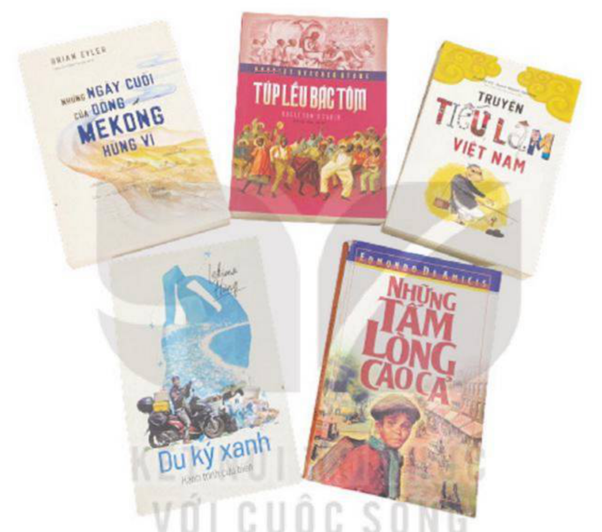

<!-- pdf:117 -->

# BÀI 10: SÁCH – NGƯỜI BẠN ĐỒNG HÀNH

*Cuộc đời ta thay đổi theo hai cách: qua những người ta gặp và những cuốn sách ta đọc.*
<!-- ocr-ok: câu đề từ chữ kiểu trên nền xanh bị OCR làm hỏng dòng thứ hai ("p.Av..AÔỔó⁄ð⁄AeE⁄.."), đã đối chiếu trực tiếp ảnh trang PDF 117 -->

Ha-vây Mắc-cay (Harvay MacKay)

## Giới thiệu bài học

- Qua những bài học Ngữ văn với các chủ đề phong phú về lịch sử, văn hoá, đời sống của dân tộc và nhân loại, em đã được đọc các văn bản thuộc nhiều loại, thể loại: văn bản văn học (truyện ngắn, truyện lịch sử, thơ Đường luật (thất ngôn bát cú và thất ngôn tứ tuyệt), hài kịch và truyện cười, thơ tự do), văn bản nghị luận (nghị luận xã hội, nghị luận văn học), văn bản thông tin (giải thích một hiện tượng tự nhiên, giới thiệu một bộ phim). Việc đọc các văn bản thuộc những loại, thể loại khác nhau nhưng có mối liên hệ về đề tài, chủ đề giúp em nhận diện và hiểu rõ hơn mối quan hệ giữa văn bản và các vấn đề của đời sống xã hội.

- Sách luôn là người bạn đồng hành của mỗi chúng ta trên hành trình khám phá và vận dụng tri thức vào đời sống. Trong bài học này, cùng với việc lựa chọn và tìm hiểu những cuốn sách mới, em hãy trải nghiệm việc đọc như một sự đón đợi những điều bất ngờ, một cuộc thám hiểm đời sống để có thể thay đổi chính mình qua trang sách.

## 🎯 Yêu cầu cần đạt

- Nhận biết và phân tích được đặc điểm của văn bản giới thiệu một cuốn sách.
- Nhận biết và phân tích được vai trò của tưởng tượng trong tiếp nhận văn bản văn học.
- Nhận xét được nội dung phản ánh và cách nhìn cuộc sống, con người của tác giả trong văn bản văn học.
- Viết được văn bản thuyết minh giới thiệu một cuốn sách; nêu được những thông tin quan trọng, trình bày mạch lạc, thuyết phục.
- Biết trình bày bài giới thiệu ngắn về một cuốn sách: cung cấp cho người đọc những thông tin quan trọng nhất; nêu được đề tài hay chủ đề của cuốn sách và một số nét đặc sắc về hình thức nghệ thuật.
- Yêu thích và chủ động chia sẻ những tác dụng tích cực của việc đọc sách tới cộng đồng.
<!-- term: tiếp nhận văn bản văn học -->
<!-- term: văn bản thuyết minh -->

<!-- pdf:118 -->

## Đọc

### TRI THỨC NGỮ VĂN

**Đặc điểm của văn bản thông tin giới thiệu một cuốn sách**

**Văn bản giới thiệu một cuốn sách** thuộc loại văn bản thông tin trình bày khách quan những đặc điểm chung của cuốn sách: nhan đề; tác giả; loại, thể loại văn bản; đề tài; chủ đề; bố cục; nội dung chính (tóm tắt). Đồng thời, loại văn bản này cũng nêu cách nhìn (quan điểm, thái độ) của tác giả cuốn sách về đời sống; những giá trị, đóng góp nổi bật hoặc điểm mới, thú vị của cuốn sách. Có thể nêu ngắn gọn quan điểm và đánh giá của người viết nhưng không cần bàn luận sâu, không yêu cầu mở rộng và triển khai các lí lẽ, bằng chứng như văn bản nghị luận. Với những cuốn sách đã phổ biến rộng rãi, có thể giới thiệu thông tin về nhà xuất bản, năm xuất bản.
<!-- term: văn bản giới thiệu một bộ phim hoặc một cuốn sách -->

**Vai trò của tưởng tượng trong sáng tạo và tiếp nhận văn học**
<!-- ocr-ok: tiêu đề tiểu mục màu cam bị OCR bỏ sót hoàn toàn, đã đối chiếu trực tiếp ảnh trang PDF 118 -->

Trong quá trình sáng tạo, tác giả cần quan sát, tìm hiểu đời sống, con người, hoàn cảnh lịch sử, xã hội, văn hoá,... Không có vốn sống, tác giả không thể xây dựng được các hình tượng nghệ thuật sống động. Mỗi tác giả có cách quan sát, cảm nhận và lí giải riêng về đời sống. Đồng thời, nhà văn từ tái hiện hiện thực mà **tưởng tượng**, hư cấu nên hình tượng văn học. Tưởng tượng giúp tác giả có thể hình dung rõ rệt hơn về con người với những đặc điểm ngoại hình, hành động, nội tâm,... Tưởng tượng khiến tác giả có thể nhập thân vào đời sống để hiểu hơn những điều còn tiềm ẩn, chưa bộc lộ rõ ràng, dự đoán về diễn biến của sự việc, số phận nhân vật. Tưởng tượng là cách để tác giả hồi tưởng và tái hiện những điều đã chìm vào quá khứ, hiểu bản chất của những cảnh tượng chợt xuất hiện và nhìn thấy trước tương lai của những gì đang diễn ra... Tưởng tượng cũng là cách để tác giả kết nối những cuộc đời, những khoảng không gian, thời gian tưởng chừng rất xa nhau trong thế giới nghệ thuật của tác phẩm. Hiện thực và tưởng tượng luôn gắn kết với nhau, hoà trộn vào nhau ở từng chi tiết, ở chuỗi sự việc, ở hình tượng nhân vật,... được biểu hiện trong tác phẩm. Do đó, khi tiếp nhận tác phẩm văn học, người đọc cũng cần huy động trí tưởng tượng để có thể cảm nhận, hình dung cụ thể, sống động về thế giới đời sống: không gian, thời gian, nhân vật, cảm xúc,... đã được tác giả sáng tạo nên. Tưởng tượng giúp cho người đọc đồng cảm với tác giả và hiểu các chi tiết, sự việc, nhân vật,... một cách sâu sắc hơn.
<!-- term: tưởng tượng -->

**Nhan đề và cách đặt nhan đề văn bản văn học**
<!-- ocr-ok: tiêu đề tiểu mục màu cam bị OCR bỏ sót hoàn toàn, đã đối chiếu trực tiếp ảnh trang PDF 118 -->

Trong cấu tạo của văn bản, **nhan đề** là thành phần được đặt ở vị trí đầu tiên để gọi tên, đánh dấu sự bắt đầu của một văn bản và thu hút sự chú ý của người đọc. Nhan đề của văn bản văn học cũng có những đặc điểm chung đó. Tuy nhiên, khác với nhan đề của văn bản nghị luận, văn bản thông tin (thường mang nghĩa tường minh, khái quát), nhan đề của văn bản văn học lại thường mang nghĩa hàm ẩn, gợi hình tượng. Trong một số trường hợp, nhan đề của văn bản văn học cũng có thể gợi ra đặc điểm loại hay thể loại văn bản, đề tài, chủ đề, nhân vật,...

<!-- pdf:119 -->

### THÁCH THỨC ĐẦU TIÊN: ĐỌC NHƯ MỘT HÀNH TRÌNH

**Trước khi đọc**

1. Xây dựng mục tiêu đọc sách của cá nhân em hoặc nhóm học tập trước khi thực hiện dự án đọc sách.

2. Lập danh mục sách theo chủ đề và thể loại phù hợp với mục tiêu đọc sách đã xây dựng và lên kế hoạch cụ thể để thực hiện hoạt động đọc sách hiệu quả.

**Cùng đọc và trải nghiệm**

**Đọc như sự đón đợi**

Để tìm và chọn cuốn sách phù hợp với sở thích và mục tiêu của mình, em có thể đọc từ phần mở đầu (nhan đề, đề từ hoặc lời tựa và khám phá từng phần của cuốn sách). Tuy nhiên, trước khi chính thức chọn đọc một cuốn sách, có thể tìm hiểu qua các văn bản giới thiệu sách.

Để thu hút sự chú ý, tạo tâm lí đón đợi của độc giả, trước khi công bố tác phẩm, nhà xuất bản hoặc đơn vị phát hành thường sử dụng các văn bản giới thiệu sách. Ở đầu cuốn sách thường có lời giới thiệu cung cấp những thông tin đáng chú ý về hoàn cảnh ra đời, tác giả, đề tài, chủ đề, ý nghĩa, mục đích của người viết, đồng thời nêu bật những điểm riêng, thú vị nhằm gợi sự hứng thú, khiến độc giả muốn tìm hiểu tác phẩm.

Em hãy đọc văn bản dưới đây để hiểu rõ về văn bản thông tin giới thiệu một cuốn sách.

<!-- pdf:120 -->

**Đọc văn bản**

**Lời giới thiệu cuốn sách *Nhóc Ni-cô-la: những chuyện chưa kể***

**AN-NƠ GÔ-XI-NHI(1) (ANNE GOSCINNY)**

Sau lần xuất bản *Nhóc Ni-cô-la: những chuyện chưa kể* vào tháng 10 năm 2004, bốn mươi lăm mẩu chuyện khác, cũng chưa được kể, đã được chuẩn bị giới thiệu với công chúng.

> **THEO DÕI:** Nhan đề, thể loại, hoàn cảnh ra đời của cuốn sách.

Đã đến thời điểm những mẩu chuyện từng xuất hiện trên tờ *Tây Nam Chủ nhật* và *Hoa tiêu* vào khoảng thời gian từ 1959 đến 1965 từ trong bóng tối của những tập tài liệu lưu trữ của cha tôi, bước ra ánh sáng trước niềm vui thích của độc giả, những người sẽ được khám phá các mẩu chuyện ấy.

Tập 3 của *Nhóc Ni-cô-la: những chuyện chưa kể* lần này sẽ mang đến cho chúng ta những câu pha trò mới tinh của cậu học trò nổi tiếng nhất trong số những cậu nhóc tiểu học. Một lần nữa, các tác giả lại khiến ta ngạc nhiên khi dẫn dắt nhân vật của họ đến những tình huống chẳng ai ngờ tới [...].

> **THEO DÕI:** Đề tài và đặc điểm nổi bật về nội dung, nghệ thuật của cuốn sách.

Nhờ vào thủ thuật kết hợp tuyệt vời giữa thứ ngôn ngữ trẻ thơ của Gô-xi-nhi với nét vẽ thi vị, vui nhộn và đầy khác biệt của Xăng-pê, phép màu đã hiện ra! Mỗi câu chuyện, khi thì tươi mới, dịu dàng, lúc lại hài hước và đôi chỗ xúc động, gợi lên niềm vui thích vô tư lự khi được là một đứa trẻ hay được nhớ lại kỉ niệm thơ ấu. Và nếu ở vào địa vị của một người đang hồi tưởng, ta sẽ thấy mình chẳng bao giờ bị buồn chán.

Ra đời cách đây năm mươi năm, *Nhóc Ni-cô-la* đã lôi cuốn mọi thế hệ. Nhưng làm sao lại không có một số phận đặc biệt cho được khi người ta là thành quả sinh ra từ tình bạn của hai nhà sáng tạo như Gô-xi-nhi và Xăng-pê? Khi mà những kỉ niệm thơ ấu của hai nhà kịch nghệ nổi tiếng ấy chính là khởi nguồn cho sự sáng tạo này?

> **THEO DÕI:** Những điểm đáng chú ý về tác giả và giá trị độc đáo của cuốn sách.

Mọi thế hệ đều bị tác phẩm không thể xếp hạng và vô cùng lí thú này quyến rũ. Là người lớn hay con trẻ, là ông bố hay cậu con trai, là người bà hay cô cháu gái, ai là người đã cất lời trước với người kia mà rằng: “Đọc đi, nó thật tuyệt vời!”. [...]

Nếu nhóc Ni-cô-la xuất hiện trước công chúng trong một thế giới mang vẻ ngoài đầy chất hiện thực thì thực ra cha tôi và Giăng-giắc Xăng-pê đã miêu tả một thế giới

> (1) An-nơ Gô-xi-nhi sinh năm 1968, người Pháp, là con gái nhà văn Rơ-nê Gô-xi-nhi, tác giả bộ truyện về nhân vật nhóc Ni-cô-la. Nhan đề lời giới thiệu do người biên soạn đặt.
<!-- ocr-ok: dòng thứ hai của cước chú (1) ở chân trang bị OCR bỏ sót, đã đối chiếu trực tiếp ảnh trang PDF 120 -->

<!-- pdf:121 -->

kì diệu nơi con trẻ nhìn các bậc phụ huynh bằng con mắt tỉnh táo, châm biếm nhưng vẫn luôn trìu mến và nơi ấy người lớn về phần mình, giải quyết một cách non nớt các vấn đề cứ như là thực!
<!-- ocr-ok: đoạn văn bị OCR đọc nhầm dấu nhiều từ ("băng", "mặt tính táo", "châm biêm", "tru mên", "vân đề"), đã đối chiếu trực tiếp ảnh trang PDF 121 -->

[...] Phải chăng giờ đây khi những mẩu chuyện mới chưa bao giờ được kể này đến tay các bạn thì bức màn sân khấu đã mãi mãi khép lại những cuộc phiêu lưu của nhóc Ni-cô-la? Phải chăng buổi trình diễn đã thực sự kết thúc? Có lẽ là không... Và chúng ta phó thác cho trí tưởng tượng không giới hạn của những nhà sáng tạo!

> **THEO DÕI:** Cách thu hút sự chú ý và khích lệ người đọc tìm hiểu cuốn sách.

Nếu nhóc Ni-cô-la được đưa lên sân khấu, khán giả sẽ vỗ tay tán thưởng nhiều đến mức cậu nhóc hẳn phải bước ra sân khấu lần nữa.
<!-- ocr-ok: câu văn bị OCR đọc nhầm dấu ("Nêu", "sân khâu", "vô tay", "đền", "hắn", "lân"), đã đối chiếu trực tiếp ảnh trang PDF 121 -->

Và đây là lần bước ra sân khấu ấy!
<!-- ocr-ok: câu văn ngắn bị OCR đọc thiếu dấu ("lân", "sân khâu ây"), đã đối chiếu trực tiếp ảnh trang PDF 121 -->

(Rơ-nê Gô-xi-nhi và Giăng-giắc Xăng-pê, *Nhóc Ni-cô-la: những chuyện chưa kể*, tập 3, NXB Hội Nhà văn, Hà Nội, 2017, tr. 7 – 9)

**Sau khi đọc**

**Trả lời câu hỏi**

1. Có điều gì đáng lưu ý về mối quan hệ giữa nhan đề, hoàn cảnh ra đời và sức hấp dẫn của cuốn sách trong lời giới thiệu của người viết?

2. Theo lời giới thiệu, đề tài và đặc điểm nội dung, nghệ thuật của cuốn sách có gì đặc biệt?

3. Người giới thiệu nhấn mạnh điều gì về mối quan hệ đặc biệt giữa các tác giả và sự độc đáo của cuốn sách?

4. Cách thu hút và khích lệ người đọc tìm hiểu cuốn sách trong lời giới thiệu có điểm gì đáng chú ý?

#### Viết kết nối với đọc
<!-- ocr-ok: tiêu đề mục bị OCR đọc nhầm dấu ("VIẾT KẾT NỔI VỚI ĐỌC"), đã đối chiếu trực tiếp ảnh trang PDF 121 -->

Tìm đọc một cuốn sách có liên quan đến một chủ đề hoặc thuộc một thể loại trong bài học của *Ngữ văn 8* và viết lời giới thiệu cuốn sách đó (khoảng 8 – 10 câu).

**Đọc như một cuộc thám hiểm**

Mỗi tác phẩm văn học là một thế giới đời sống phong phú, sinh động. Tác giả đã tưởng tượng và tái hiện bằng ngôn từ hoàn cảnh, không gian, thời gian, con người với những đặc điểm riêng về tính cách biểu hiện cụ thể qua ngoại hình, hành động, lời nói, suy nghĩ,... Qua trang sách, những vùng đất, những miền quê với phong tục, tập quán khác nhau hiện lên rõ nét. Cũng qua trang sách, những thời đại, giai đoạn hoặc khoảnh khắc của lịch sử, của cuộc đời con người được khắc hoạ. Đọc, vì thế, cũng có thể coi như một hành trình, một cuộc thám hiểm và sách là bạn dẫn đường, là người đồng hành nhưng cũng là một thế giới mới trong chuyến phiêu lưu thú vị này.

<!-- pdf:122 -->

Sau khi chọn cuốn sách yêu thích, em hãy lập nhật kí đọc sách như là nhật kí hành trình. Thử vẽ một sơ đồ về hành trình đọc (giống như sơ đồ của một cuộc thám hiểm) với những biển chỉ đường là các câu hỏi sau đây:

1. Nhan đề của cuốn sách có gì đáng chú ý? Chỉ ra mối quan hệ giữa nhan đề với một số yếu tố trong tác phẩm (thể loại, đề tài, nhân vật,...).

2. Đề tài gì được tác giả khai thác ở cuốn sách? Cách chọn đề tài cho thấy tác giả quan tâm đến những vấn đề nào của đời sống?

3. Những sự việc, chi tiết nào thể hiện dấu ấn của trí tưởng tượng trong tác phẩm?

4. Vì sao tác phẩm trở nên hấp dẫn đối với người đọc?

5. Những chi tiết, sự việc hoặc nhân vật nào để lại cho em ấn tượng sâu đậm nhất?

6. Nếu được nhà văn cho phép thay đổi một số chi tiết, sự việc trong tác phẩm, em sẽ chọn thay đổi điều gì? Vì sao?

7. Chủ đề của tác phẩm là gì? Chủ đề này có liên quan như thế nào với những vấn đề của đời sống hiện tại?

Em có thể tự đặt thêm các câu hỏi trong quá trình đọc và khám phá thế giới qua trang sách. Việc tự đặt câu hỏi và tìm câu trả lời trong quá trình đọc sẽ giúp em không chỉ tiếp nhận mà còn sáng tạo cùng tác giả, hiểu sâu hơn đặc điểm nội dung, nghệ thuật và những vấn đề của đời sống được phản ánh trong tác phẩm.

**Đọc để đồng hành và chia sẻ**
<!-- ocr-ok: tiêu đề tiểu mục màu xanh bị OCR đọc nhầm dấu ("Đọc đề đồng hảnh vã chia sẻ"), đã đối chiếu trực tiếp ảnh trang PDF 122 -->

Để có thể viết nên được những tác phẩm có giá trị, tác giả phải thực sự đắm mình vào đời sống. Không chỉ bắt nguồn từ xúc cảm mãnh liệt, một tác phẩm còn là kết tinh bao trăn trở, suy tư, chiêm nghiệm của tác giả về cuộc đời, con người và cả về chính mình. Chính vì thế, đọc tác phẩm cũng là đồng hành với tác giả để có thể hiểu tác phẩm, chia sẻ và đồng cảm với thế giới tinh thần của nhà văn, nhà thơ.

Đôi khi, chúng ta may mắn được nghe chính tác giả nói về tác phẩm của mình trong một cuộc trò chuyện tâm tình, một cuộc gặp gỡ, phỏng vấn. Đó cũng là dịp tác giả chia sẻ về mối quan hệ giữa trang sách và cuộc sống, giữa tác phẩm và hoàn cảnh ra đời của nó, hoặc những điều đã gợi lên cảm hứng, ý tưởng để tác giả viết nên tác phẩm.

1. Đọc những lời tâm tình của nhà thơ Y Phương về bài thơ *Nói với con* và thực hiện yêu cầu nêu ở dưới:

**Nhà thơ Y Phương: “Nói với con” cũng chính là nói với lòng mình!**

Đến gặp nhà thơ Y Phương, tác giả của bài thơ *Nói với con* [...] tại nhà riêng của ông, chúng tôi không khỏi ngạc nhiên với nhà thơ người dân tộc Tày này. Cánh cửa nhà mở toang, vọng ra tiếng ông đang ngâm một bài thơ tiếng Tày đầy sảng khoái. Khi chúng tôi tới, ông vừa gò lưng lau nhà vừa hát thơ. Ngẩng đầu lên, ông tươi cười, thay cho lời chào đáp lại, ông nói: “Nghề chính của tôi là tạp vụ, có nghề phụ làm thơ.”

<!-- pdf:123 -->

**Đó là lúc tôi dường như không biết lấy gì để vịn!**

Vợ chồng chúng tôi sinh cô con gái đầu lòng vào giữa năm 1979. Bài thơ *Nói với con* tôi viết năm 1980. Đó là thời điểm đất nước ta gặp vô vàn khó khăn. Thời kì cả nước mới thoát ra khỏi cuộc chiến tranh chống đế quốc Mỹ lâu dài và gian khổ. Giống như một người mới ốm dậy, xã hội khi ấy bắt đầu xuất hiện người tốt, kẻ xấu để tranh giành sự sống. Thực ra, theo tôi không có con người xấu, mà chỉ có những tính xấu như trộm cắp, tham nhũng, lừa đảo, sự dối trá,... Ta phải biến những cái xấu ấy thành “phân”, để “bón” cho cây cối và làm giàu cho đất cát.

Bài thơ với nhan đề là *Nói với con*, đó là lời tâm sự của tôi với đứa con gái đầu lòng. Tâm sự với con còn là tâm sự với chính mình. Nguyên do thì nhiều, nhưng lí do lớn nhất để bài thơ ra đời chính là lúc tôi dường như không biết lấy gì để vịn, để tin. Cả xã hội lúc bấy giờ đang hối hả gấp gáp kiếm tìm tiền bạc. Muốn sống đàng hoàng như một con người, tôi nghĩ phải bám vào văn hoá. Phải tin vào những giá trị tích cực vĩnh cửu của văn hoá. Chính vì thế, qua bài thơ ấy, tôi muốn nói rằng chúng ta phải vượt qua sự ngặt nghèo, đói khổ bằng văn hoá.

Bài thơ 28 câu này được xem như là viết riêng cho đứa con đầu lòng. Ở phạm vi hẹp, bài thơ chủ yếu đề cập đến văn hoá dân tộc, nhằm tôn vinh nét đẹp của văn hoá truyền thống dân tộc Tày.

Tôi rất bất ngờ khi biết *Nói với con* được đưa vào sách giáo khoa. Tuy nhiên tôi không biết đích xác đưa vào năm nào. Quan trọng là tác phẩm của tôi đã được đông đảo các em học sinh đón nhận [...].

**Nhiều giáo viên và học sinh đã đến nhà nhờ giảng về bài thơ**

Bài thơ *Nói với con*, dù thấy chẳng có gì đặc biệt hay, nhưng cũng khiến nhiều người băn khoăn. Chẳng hạn trong bài thơ có hai câu:

*Người đồng mình thô sơ da thịt*
*Chẳng mấy ai nhỏ bé đâu con*

Đấy là hai câu chốt của bài thơ *Nói với con* [...]. Nó cao và sâu hơn câu chuyện về tình phụ tử. Chúng ta đừng viện cớ thiếu thốn khó khăn mà đánh mất đạo đức, văn hoá. Tôi thấy, dường như giờ đây, nhiều con em các dân tộc không mấy mặn mà với văn hoá truyền thống. Và họ đang tự nguyện nhập ngoại, lai căng một cách dễ dãi. Tôi ủng hộ hoà nhập nhưng không thể hoà tan. Văn hoá dân tộc là tài sản lớn. Giữ cho mình và giữ cho con cháu mình. Tôi là người dân tộc Tày. Chúng tôi sinh hoạt như những người Tày ngay giữa lòng Thủ đô. Không phải do tôi sợ đánh mất bản sắc mà là niềm tự hào chính đáng về văn hoá dân tộc của mình. Tôi tự hào vì tôi là người Tày.

Có lần, một cậu bé ở tận trong Huế lặn lội ra Hà Nội, tìm đến nhà và hỏi chuyện tôi về bài thơ. Hình như cậu bé chuẩn bị thi vào Trường Quốc học Huế. Đúng vậy. Cậu học trò ấy đã chọn bài thơ *Nói với con* để làm bài thi môn Ngữ văn. Và cậu ấy đã đỗ thủ khoa. Một số giáo viên ở trường chuyên ở các tỉnh cũng đích thân tới tận nhà gặp và hỏi trực tiếp tôi về bài thơ *Nói với con*.

<!-- pdf:124 -->

Trong bài thơ, người đọc có thể băn khoăn, thắc mắc về hai câu: *Chân phải bước tới cha/ Chân trái bước tới mẹ*. Tôi bật cười, cái đó thì quá đơn giản. Có gì đâu, đứa con sinh ra thì phải có cha có mẹ. Đó là khởi điểm của một con người. Một điều nữa, “*vách nhà ken câu hát*” là yếu tố văn hoá phi vật thể. Người con trai ngồi ngoài vách. Người con gái ở bên trong vách. Họ hát cho nhau nghe. Hát tràn đêm đến sáng bạch. Bởi thế, bức vách ở đây không chỉ là một bức vách cụ thể bằng đất bằng đá nữa. Nó đã trở thành một chủ thể văn hoá [...].

(*Theo* Y Khương, báo điện tử *Thể thao và văn hoá*, ngày 15/6/2008)

**Trả lời câu hỏi**

a. Lời tâm tình của nhà thơ Y Phương cho biết điều gì về hoàn cảnh ra đời của bài thơ *Nói với con*? Hoàn cảnh ấy có tác động như thế nào đến sự biểu đạt cảm xúc và hình tượng trong bài thơ?

b. Không chỉ nói về tình phụ tử, tình cảm gia đình, câu thơ *“Người đồng mình thô sơ da thịt/ Chẳng mấy ai nhỏ bé đâu con”* còn thể hiện ý nghĩa gì? Vì sao nhà thơ thực sự trăn trở, tâm huyết với điều đó?

c. Qua lời giải thích của nhà thơ Y Phương, những hình ảnh trong các dòng thơ: *“Chân phải bước tới cha/ Chân trái bước tới mẹ”* và *“Vách nhà ken câu hát”* là hình ảnh thực hay tưởng tượng? Vì sao?

d. Theo em, điều gì làm nhà thơ xúc động, trăn trở nhất khi viết bài thơ *Nói với con*?

2. Chọn một tác phẩm của tác giả mà em đã biết và mong muốn tiếp tục tìm hiểu, khám phá. Đọc, cảm nhận về tác phẩm và trả lời những câu hỏi sau:

a. Hoàn cảnh ra đời của tác phẩm có điều gì đáng chú ý? Hoàn cảnh ấy có tác động như thế nào đến việc lựa chọn đề tài, thể hiện nội dung của tác phẩm?

b. Việc chọn đề tài, thể hiện nội dung, chủ đề của tác phẩm cho thấy tác giả quan tâm, xúc động, trăn trở nhất về điều gì?

c. Tưởng tượng nếu em là tác giả, điều gì sẽ làm em hứng thú nhất và đâu là điều em cảm thấy khó khăn nhất khi viết tác phẩm này?

d. Sau khi đã tìm hiểu kĩ tác phẩm, em nhận thấy nhan đề có mối liên quan như thế nào với đặc điểm nội dung, nghệ thuật của tác phẩm?

## Viết

### THÁCH THỨC THỨ HAI: KẾT NỐI CỘNG ĐỒNG NGƯỜI ĐỌC
<!-- ocr-ok: dòng phụ đề màu cam "Kết nối cộng đồng người đọc" bị OCR bỏ sót, đã đối chiếu trực tiếp ảnh trang PDF 124 -->

Để tiếp tục hoạt động của dự án đọc sách, em hãy thực hiện vai trò của một người viết (giới thiệu sách hoặc sáng tạo tác phẩm) và kết nối cộng đồng người đọc để hành trình đọc sách được hiệu quả, thú vị hơn. Hãy chọn một trong hai hoạt động sau:

<!-- pdf:125 -->

1. Viết bài thuyết minh giới thiệu cuốn sách yêu thích.

2. Viết một nhan đề và sáng tạo một tác phẩm mới (thơ, truyện,...).

**Viết bài thuyết minh giới thiệu cuốn sách yêu thích**

*Yêu cầu:*

<!-- term: bài văn thuyết minh giới thiệu một cuốn sách -->
- Giới thiệu được những thông tin cơ bản để nhận diện cuốn sách: nhan đề; tác giả; loại, thể loại văn bản; đề tài; chủ đề; bố cục; nội dung chính (tóm tắt).
- Trình bày được cách nhìn (quan điểm, thái độ) của tác giả về đời sống.
- Nêu được những giá trị, đóng góp nổi bật hoặc những điểm mới, thú vị của cuốn sách.
- Nhấn mạnh được những đặc điểm gợi hứng thú đối với việc đọc, tìm hiểu cuốn sách.

#### Phân tích bài viết tham khảo
<!-- ocr-ok: tiêu đề mục màu trắng trên nền xanh bị OCR đọc nhầm dấu ("Phôn tích bởi viết tham khỏo"), đã đối chiếu trực tiếp ảnh trang PDF 125 -->

***Mắt sói* – câu chuyện về cuộc phiêu lưu của những điều ngẫu nhiên và kì diệu**

*Mắt sói* là cuốn sách viết cho thiếu nhi của nhà văn lớn người Pháp – Đa-ni-en Pen-nắc. Cuốn tiểu thuyết bao gồm hơn 100 trang, được xuất bản lần đầu năm 1984. Tác phẩm này đã được dịch ra nhiều thứ tiếng trên thế giới và được đông đảo độc giả nhỏ tuổi đón nhận, yêu mến.

> Giới thiệu nhan đề, tác giả, thể loại, thời gian ra đời, xuất bản của cuốn sách.

*Mắt sói* xoay quanh cuộc gặp gỡ kì lạ giữa Sói Lam và Phi Châu – hai nhân vật chính trong tác phẩm. Tại một vườn bách thú, tình cờ, Sói Lam và Phi Châu gặp nhau, nhìn sâu vào mắt nhau và câu chuyện bắt đầu từ đó. Ngôn từ của cuộc trò chuyện chỉ là ánh mắt, nhưng đó thực sự là cuộc đối thoại đầy ám ảnh. Các chi tiết về cuộc đời của gia đình sói và gia đình con người hiện lên bi thảm, khốc liệt, đầy xúc động. Trong đó, vang lên tiếng nói của niềm say mê, tình yêu thương và lòng trắc ẩn giữa thiên nhiên và con người. Cậu bé và con sói nhỏ, hai sinh mệnh đó vừa như những đại diện của giống loài, vừa như hai cá thể độc đáo không gì thay thế được.

> Trình bày ngắn gọn về đề tài, nội dung chính, chủ đề của cuốn sách.

Không có phù thuỷ và siêu nhân, không có phép thuật biến hoá khôn lường hay những cuộc giao chiến nảy lửa, chỉ có hồi ức về cuộc mưu sinh của các gia đình sói, lạc đà, báo, sư tử,... và những con người từ đồng cỏ Châu Phi Vàng, Châu Phi Xám, Châu Phi Xanh đến Bắc Cực xa xôi, lạnh giá. Hành trình sống của mỗi nhân vật, mỗi gia đình hay mỗi giống loài trong cuộc mưu sinh ấy vừa bình thường vừa dữ dội. Cách kể chuyện đầy sáng tạo của *Mắt sói* đã tạo nên một thế giới tưởng như rời rạc, như những mảnh ghép trong một bức tranh lớn chưa được sắp xếp đúng thứ tự.

> Nêu những điểm đặc biệt, thú vị, mới mẻ của cuốn sách về nội dung và nghệ thuật.

<!-- pdf:126 -->

Tuy nhiên, mỗi mạch nổi hoặc chìm trong cốt truyện đa tuyến đó đều có sự liên hệ ngẫu nhiên, kì diệu – như chính bản chất của cuộc sống.

Câu chuyện được hồi hiện trong mắt của Sói Lam và câu chuyện được tái hiện trong mắt người – mắt cậu bé Phi Châu như những dòng suối nhỏ tuôn chảy và giao hoà vào nhau. Câu chuyện về bạn và thù, yêu thương và ghét bỏ, gắn bó và rời xa. Trong sâu thẳm của đời sống, con người và thiên nhiên, con sói và mỗi chúng ta không thể tách rời. Đó có lẽ là thông điệp mà Đa-ni-en Pen-nắc muốn gửi tới không chỉ cho bạn đọc nhỏ tuổi mà cho nhân loại trong hành trình tìm kiếm ý nghĩa thực sự của cuộc sống qua câu chuyện về số phận của các nhân vật Sói Lam, Phi Châu, mẹ Hắc Hoả, Ánh Vàng, Sói Xám, Báo, lạc đà Hàng Xén, Vua Dê,...

> Nêu quan niệm của tác giả về đời sống qua nội dung phản ánh trong cuốn sách.

Hãy đọc *Mắt sói* để phiêu lưu cùng những con mắt trong một thế giới đa chiều của sói và người, châu Phi và Bắc Cực, nóng và lạnh, đen và trắng,... nhưng không thể phân tách trong dòng chảy thiêng liêng của sự sống.

> Gợi hứng thú, khuyến khích việc đọc cuốn sách.

*(Nhóm biên soạn)*

#### Thực hành viết theo các bước

### 1. TRƯỚC KHI VIẾT

> *Mục đích viết*
> Giới thiệu cuốn sách yêu thích, nêu những điểm mới và thú vị của sách, làm cho mọi người quan tâm, tìm đọc.
>
> *Người đọc*
> Những người yêu thích đọc sách hoặc quan tâm đến cuốn sách được giới thiệu.

**a. Lựa chọn đề tài**

Hãy lựa chọn cuốn sách để giới thiệu và tìm hiểu những thông tin quan trọng về cuốn sách: nhan đề, tác giả, thể loại, đề tài, chủ đề, nội dung chính,... Em cần đọc kĩ cuốn sách trước khi viết bài giới thiệu về cuốn sách tới độc giả.

**b. Tìm ý**

Em có thể tìm ý bằng cách đặt ra và trả lời những câu hỏi sau:

- Nhan đề của cuốn sách là gì? Sách được sáng tác hoặc xuất bản khi nào?
- Tác giả của cuốn sách là ai? Cuộc đời và sự nghiệp của tác giả có điều gì đáng chú ý? Tác giả hướng tới đối tượng độc giả nào khi viết cuốn sách này?
- Loại, thể loại; đề tài và chủ đề của cuốn sách là gì?
- Cuốn sách có gì mới mẻ, thú vị về nội dung và nghệ thuật?
- Quan niệm của tác giả về đời sống, con người được thể hiện qua cuốn sách như thế nào?
- Vì sao nên đọc, tìm hiểu về cuốn sách này?

<!-- pdf:127 -->

**c. Lập dàn ý**

Sắp xếp các ý đã tìm được thành dàn ý của bài viết:

**Dàn ý**

- *Mở bài:* Giới thiệu nhan đề, tác giả và một số thông tin ngắn gọn về hoàn cảnh ra đời, năm xuất bản, đối tượng độc giả của cuốn sách.
- *Thân bài:*
  + Nêu thông tin về loại, thể loại; đề tài và chủ đề của cuốn sách.
  + Trình bày những điểm mới nổi bật về nội dung và nghệ thuật của cuốn sách.
  + Trình bày quan niệm của tác giả về đời sống, con người và thông điệp chính mà tác giả muốn gửi đến độc giả.
- *Kết bài:* Nêu ngắn gọn hiệu quả tác động, giải thích rõ lí do vì sao nên đọc, tìm hiểu về cuốn sách.

Bên cạnh những nội dung cơ bản như đã nêu trong dàn ý, có thể bổ sung những ý khác mà em thấy cần thiết và có sức thuyết phục đối với người đọc.

### 2. VIẾT BÀI

Khi thực hành viết bài văn thuyết minh giới thiệu cuốn sách yêu thích, em cần chú ý bám sát các nội dung đã dự kiến ở dàn ý. Tuy nhiên, để nhấn mạnh một nội dung mà em thấy cần thiết và thu hút sự chú ý của người đọc, có thể bổ sung hoặc sắp xếp lại trật tự của các ý. Điều quan trọng nhất là chỉ ra được sự mới mẻ, hấp dẫn của cuốn sách và lí do cần đọc, tìm hiểu về cuốn sách này.

### 3. CHỈNH SỬA BÀI VIẾT

Đọc lại bài viết để tự kiểm tra, dựa trên những gợi ý sau:

- Nhan đề, tác giả, hoàn cảnh ra đời và thông tin xuất bản (nếu có) đã chính xác chưa?
- Cách sắp xếp các ý đã làm nổi bật được thông tin quan trọng cần giới thiệu về cuốn sách chưa?
- Bài giới thiệu có lỗi chính tả, diễn đạt không?

**Viết một nhan đề và sáng tạo một tác phẩm mới**

Từ đọc (tiếp nhận) đến viết (sáng tạo) là một hành trình đòi hỏi sự nỗ lực vượt bậc. Tuy nhiên, mỗi người đều có thể đóng vai trò một tác giả để sáng tạo nên những tác phẩm theo cách của mình. Em đã tập làm thơ lục bát, thơ bốn chữ, thơ năm chữ, viết bài văn kể lại một trải nghiệm,... ở các lớp dưới. Hành trình sáng tạo một tác phẩm thường bắt đầu từ những gì nhỏ nhất: một ý tưởng; một nhan đề; một số hình ảnh gợi cảm xúc, liên tưởng; nhịp điệu của ngôn từ; một chi tiết nào đó (không gian, thời gian, đồ vật, con vật,...); những nhân vật, sự việc có thể gợi ra từ đó,... Trí tưởng tượng, sự suy luận, dự đoán và cảm xúc,... tất cả đều tham gia vào quá trình sáng tạo. Điều quan trọng nhất là em hãy bắt đầu. Hãy thử vượt qua thách thức này và viết một nhan đề – sáng tạo một tác phẩm mới – một thế giới đời sống mới theo cách của em.

<!-- pdf:128 -->

### 1. TRƯỚC KHI VIẾT

a. Đọc những nhan đề sau và thử dự đoán về thể loại, đề tài, nội dung của tác phẩm:

- Cánh đồng
- Ngôi nhà có khu vườn nhỏ
- Chuyện kể trong thành phố
- Những bông huệ
- Con lừa và tôi
- Trên sa mạc và trong rừng thẳm
- Ngày cuối cùng của chiến tranh
- Món quà của mùa thu.

b. Lựa chọn một thể loại mà em có thể viết (thơ, truyện, tản văn, tuỳ bút,...).

c. Huy động ý tưởng, tưởng tượng

- Hình dung về ý tưởng, cảm xúc (nếu em định làm thơ).
- Viết tóm tắt đề cương cốt truyện: nhân vật, sự việc (mở đầu, diễn biến, kết thúc) nếu em viết truyện.
- Dự kiến một hoặc một số nhan đề cho bài thơ, tác phẩm truyện,... mà em định viết. Tham khảo một số nhan đề sau đây:
  + Ngày đầu tiên của mùa thu
  + Câu chuyện trong xóm nhỏ
  + Cuộc gặp gỡ khó quên
  + Mùa hè đáng nhớ.

Lưu ý rằng, nhan đề là tín hiệu đầu tiên để dẫn dắt người đọc đến với thế giới đời sống trong tác phẩm.

### 2. VIẾT

Có thể viết một nhan đề và bắt đầu sáng tác bài thơ hay tác phẩm truyện, tuỳ bút, tản văn,... của em. Và em chính là người sáng tạo ra một thế giới mới của mình.

### 3. CHỈNH SỬA

- Đọc lại tác phẩm đã viết.
- Thay đổi, sắp xếp lại một số từ ngữ, câu văn/ thơ, chi tiết, sự việc,... (nếu cần).
- Đọc lại nhan đề và có thể chỉnh sửa, thay đổi sao cho phù hợp và thú vị hơn (nếu cần).
- Rà soát chính tả và diễn đạt, nhất là cách dùng từ.

<!-- pdf:129 -->

## Nói và nghe

### VỀ ĐÍCH: NGÀY HỘI VỚI SÁCH
<!-- ocr-ok: tiêu đề chặng "VỀ ĐÍCH: Ngày hội với sách" bị OCR đọc nhầm dấu ("VE ĐỊCH", "Ngàu"), đã đối chiếu trực tiếp ảnh trang PDF 129 -->

Sau khi thực hiện vai trò một người đọc thấu hiểu, đồng cảm, chia sẻ với tác giả, một người viết kiên nhẫn và sáng tạo, em hãy làm một diễn giả có khả năng thuyết phục cao để giới thiệu về cuốn sách yêu thích hoặc trình bày tác phẩm của mình. Hãy đem đến ngày hội với sách những bài viết, tác phẩm của em.
<!-- term: giới thiệu một cuốn sách -->

### 1. TRƯỚC KHI NÓI

<!-- term: giới thiệu một cuốn sách -->
> *Mục đích nói*
> Chọn một trong hai mục đích nói sau đây để chuẩn bị và trình bày:
> - Giới thiệu cuốn sách yêu thích để thu hút sự chú ý đối với tác phẩm, gợi hứng thú đọc sách của người nghe.
> - Giới thiệu tác phẩm của mình tới người nghe (đọc diễn cảm, ngâm thơ,...).
>
> *Người nghe*
> Những người quan tâm đến kết quả dự án đọc sách hoặc muốn có thêm kinh nghiệm tổ chức dự án đọc sách.

Lựa chọn hoạt động và nội dung cần trình bày (giới thiệu cuốn sách yêu thích hoặc tác phẩm của em).

<!-- term: giới thiệu một cuốn sách -->
- Nếu trình bày về cuốn sách yêu thích, em cần lập dàn ý bài nói, đánh dấu những nội dung cần nhấn mạnh như: tên cuốn sách, hoàn cảnh ra đời, những đặc điểm nổi bật về nghệ thuật và nội dung, ảnh hưởng của cuốn sách tới em hoặc sức hút với độc giả nói chung,...
- Nếu trình bày về tác phẩm của em, nên có một số lời giới thiệu rõ về hoàn cảnh, nguồn cảm hứng gợi cho em viết tác phẩm và lựa chọn cách đọc, cách minh hoạ phù hợp, hấp dẫn với người nghe.

### 2. TRÌNH BÀY BÀI NÓI

Dù lựa chọn trình bày về cuốn sách yêu thích hay tác phẩm của em, cần chú ý những điểm chung sau đây:

- Trình bày một cách rõ ràng và sinh động các nội dung đã chuẩn bị.
- Cố gắng nhấn mạnh những điểm nổi bật cần chú ý trong khi trình bày.
- Sử dụng phù hợp các phương tiện phi ngôn ngữ để phần trình bày được hấp dẫn hơn và thu hút sự chú ý của người nghe.

### 3. SAU KHI NÓI

Trao đổi về bài nói theo một số gợi ý sau:

| Người nghe | Người nói |
| --- | --- |
| - Nghe và ghi vắn tắt những nội dung quan trọng trong bài giới thiệu cuốn sách hoặc tác phẩm (thơ, truyện,...) được trình bày. - Nêu ý kiến, chia sẻ cảm nghĩ về bài nói, tác phẩm và cách trình bày. | - Nghe góp ý và phản hồi những ý kiến của người nghe về bài giới thiệu sách hoặc chia sẻ thêm về tác phẩm đã sáng tác. - Trao đổi với người nghe để tiếp thu góp ý về cách trình bày. |

## 📷 Danh sách hình trong bài

| Mã hình | Trang PDF | Vị trí trong bài | Chú thích gốc |
| --- | --- | --- | --- |
| H8-ngu_van-b10-01 | 119 | Đọc – Thách thức đầu tiên: Đọc như một hành trình (trang 117) | Bìa một số cuốn sách gợi ý đọc mở rộng (*Những ngày cuối của dòng Mekong hùng vĩ*, *Túp lều bác Tôm*, *Truyện tiếu lâm Việt Nam*, *Du ký xanh*, *Những tấm lòng cao cả*) |
