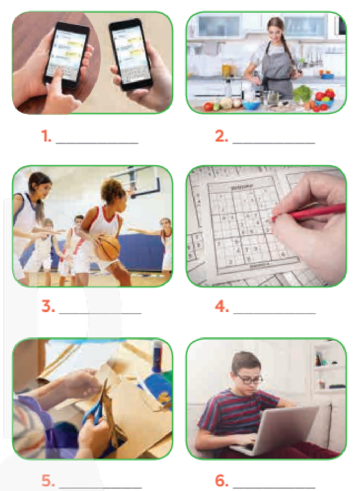
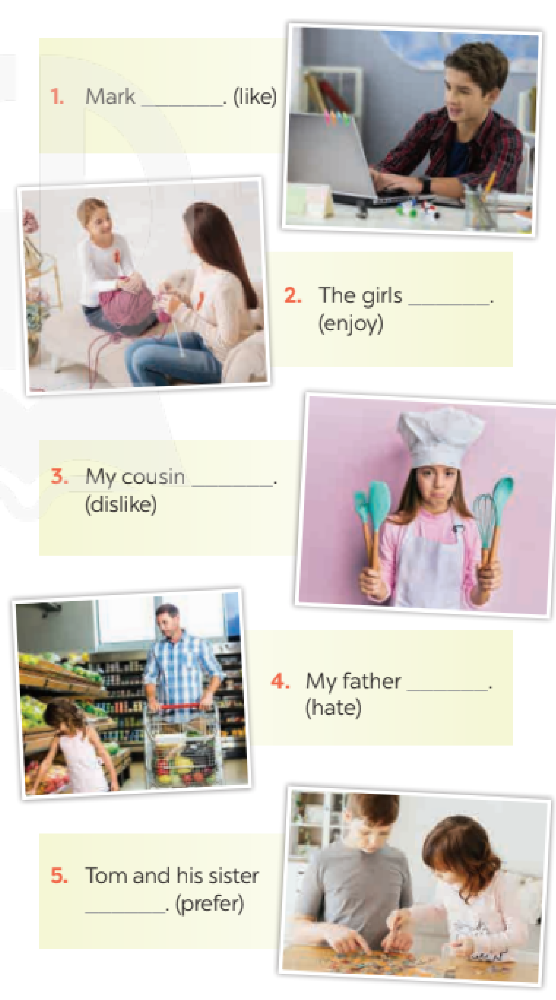
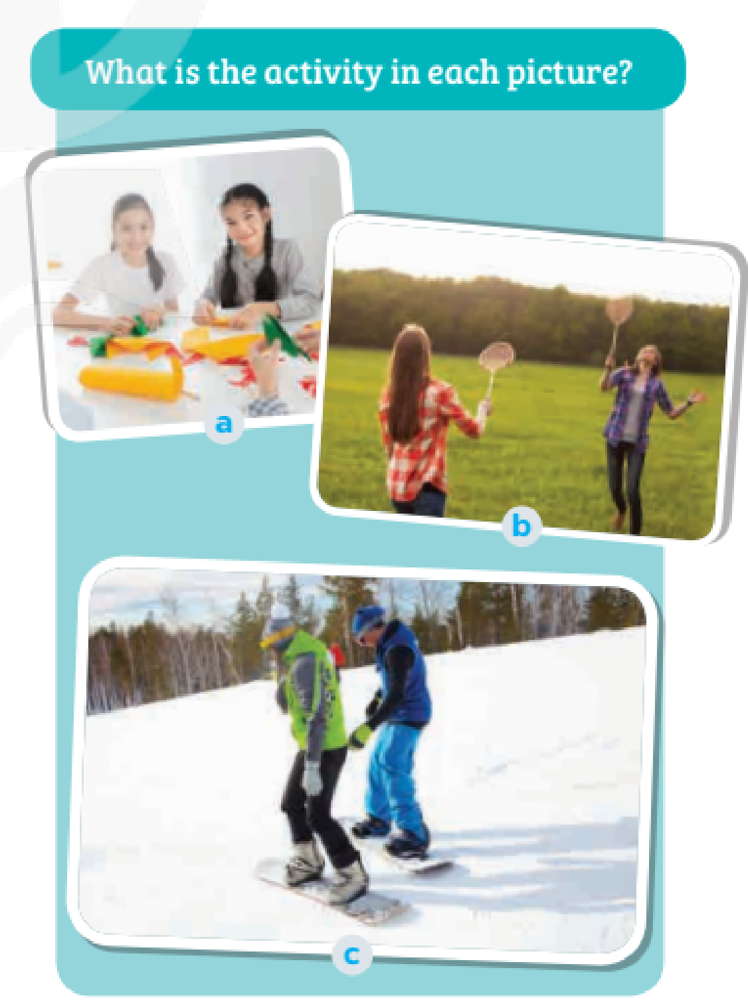
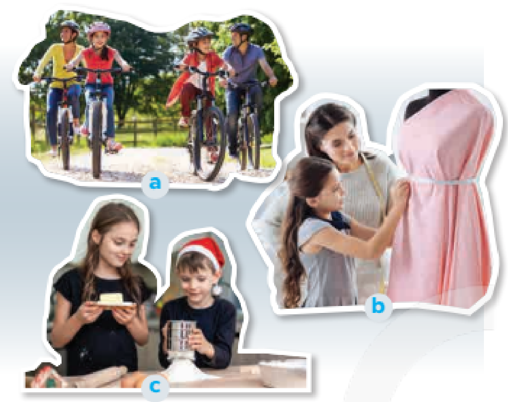
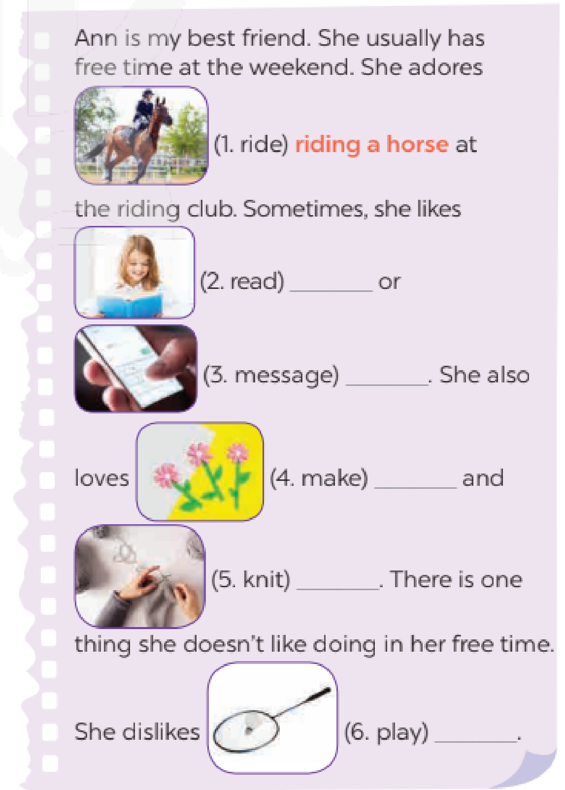

<!-- pdf:10 -->

# UNIT 1: LEISURE TIME

> **THIS UNIT INCLUDES:**
> - **Vocabulary:**
>   - **Leisure** activities
>   - Expressions about likes and dislikes
> - **Pronunciation:**
>   - Sounds: /ʊ/ and /uː/
> - **Grammar:**
>   - Verbs of liking / disliking + gerunds
>   - Verbs of liking / disliking + *to*-infinitives
> - **Skills:**
>   - Reading about **leisure** activities with family
>   - Talking about **leisure** activities with family
>   - Listening about **leisure** activities with friends
>   - Writing an email about **leisure** activities with friends
> - **Everyday English:**
>   - Inviting and accepting invitations

## GETTING STARTED

**I'm keen on doing DIY (do-it-yourself).**

**1. Listen and read.**

**Tom:** Hi, Trang. Surprised to see you. What brings you here?

**Trang:** Oh, hello Tom. I'm looking for a knitting **kit**.
<!-- ocr-ok: đã đối chiếu ảnh trang gốc, OCR đọc nhầm looking thành locking -->

**Tom:** A knitting **kit**? I didn't know you like knitting.
<!-- term: knitting -->

**Trang:** Actually, I'm **keen** on many **DIY** activities. In my **leisure** time, I love knitting, building dollhouses, and making paper flowers.

**Tom:** I see. So, you like spending time on your own.

**Trang:** Yeah. What do you do in your free time?

**Tom:** I'm a bit different. I usually hang out with my friends. We go to the cinema, go cycling, or play sport in the park.
<!-- term: hang out -->

**Trang:** You love spending free time with other people, don't you?

**Tom:** That's right. By the way, would you like to go to the cinema with me and Mark this Sunday? There's a new comedy at New World Cinema.

**Trang:** Yes, I'd love to. Can I ask Mai to join us?

**Tom:** Sure. Let's meet outside the cinema at 9 a.m.
<!-- ocr-ok: đã đối chiếu ảnh trang gốc, OCR đọc nhầm 9 a.m. thành 5 a.m. -->

<!-- pdf:11 -->

**2. Read the conversation again and complete the sentences.**

1. Trang is looking for a \_\_\_\_\_\_\_.
2. She likes doing **DIY** in her \_\_\_\_\_\_\_.
3. Tom loves spending his free time with \_\_\_\_\_\_\_.
4. Tom and his friends usually \_\_\_\_\_\_\_ together.
5. Tom, Mark, Trang, and Mai are going to see a comedy this \_\_\_\_\_\_\_.

**3. Work in pairs. Write the activities from the box under the correct pictures.**

| | |
| --- | --- |
| doing **DIY** | cooking |
| doing **puzzles** | playing sport |
| surfing the net | **messaging** friends |
<!-- ocr-ok: đã đối chiếu ảnh trang gốc, bảng khung từ vựng 2 cột bị OCR tách rời các dòng -->

1. \_\_\_\_\_\_\_
2. \_\_\_\_\_\_\_
3. \_\_\_\_\_\_\_
4. \_\_\_\_\_\_\_
5. \_\_\_\_\_\_\_
6. \_\_\_\_\_\_\_
<!-- ocr-ok: đã đối chiếu ảnh trang gốc, 6 chỗ trống đánh số 1-6 nằm dưới từng tranh minh hoạ -->

**4. Work in pairs. Read the word and phrases, and guess which activities in 3 are described.**

1. improve memory, a mental exercise
2. save money, increase creativity
3. improve physical health, make friends
4. **keep in touch**, relaxation
5. learn something about IT, computer skills
<!-- ocr-ok: đã đối chiếu ảnh trang gốc, OCR đọc nhầm memory thành memaory và bỏ sót số 4 -->

**5. Work in groups. Ask one another the question below. Then report your friends' answers to the class.**

If you have some free time this weekend, what will you do?

<!-- pdf:12 -->

## A CLOSER LOOK 1

### Vocabulary

**1. Match a word / phrase in column A with a word in column B to make expressions about likes.**

| A | B |
| --- | --- |
| 1. be **fond** | a. about |
| 2. be **keen** | b. in |
| 3. be interested | c. on |
| 4. be **crazy** | d. into |
| 5. be | e. of |
<!-- ocr-ok: đã đối chiếu ảnh trang gốc, bảng nối cột A và cột B bị OCR đọc lệch dòng -->

**Remember!**

When we want to change the above expressions so that they are about dislikes, we add "not" after the verb "be".
<!-- term: Expressions about likes and dislikes -->

*Example:*
- She is **keen** on cooking.
- → She is not **keen** on cooking.

**2. Fill in each blank with a correct word from the box.**

| into | **fond** | **keen** | interested | about |
| --- | --- | --- | --- | --- |

1. I'm \_\_\_\_\_\_\_ of taking photos. In my free time, I usually go out and take photos of people and things.
2. Mai is \_\_\_\_\_\_\_ in history. She often goes to museums to see new exhibits and learn about the past.
3. My sister is \_\_\_\_\_\_\_ on cooking. She wants to become a chef in the future.
4. My brother spends lots of time surfing the net, but I'm not \_\_\_\_\_\_\_ it.
<!-- term: surfing the net -->
5. I'm not **crazy** \_\_\_\_\_\_\_ doing **DIY**. I'm never able to finish any **DIY** projects I start.

**3. Complete the sentences about what you like or dislike doing. Use the word or phrases from the box or your own ideas.**

| | |
| --- | --- |
| cooking | playing sport |
| doing **DIY** | doing **puzzles** |
| surfing the net | **messaging** friends |

**Example:** I'm interested in doing **DIY**.

1. I'm **crazy** about \_\_\_\_\_\_\_.
2. I'm **keen** on \_\_\_\_\_\_\_.
3. I'm **fond** of \_\_\_\_\_\_\_.
4. I'm not interested in \_\_\_\_\_\_\_.
5. I'm not into \_\_\_\_\_\_\_.

### Pronunciation

**/ʊ/ and /uː/**
<!-- ocr-ok: đã đối chiếu ảnh trang gốc, OCR đọc nhầm kí hiệu phiên âm /ʊ/ thành bd -->

**4. Listen and repeat the words. Pay attention to the sounds /ʊ/ and /uː/. Then put the words into the correct columns.**

| cook | group | push | June |
| --- | --- | --- | --- |
| school | would | woman | move |

| /ʊ/ | /uː/ |
| --- | --- |
| | |
<!-- ocr-ok: đã đối chiếu ảnh trang gốc, bảng phân loại hai cột âm /ʊ/ và /uː/ -->

**5. Listen and practise the sentences. Underline the bold words with /ʊ/, and circle the bold words with /uː/.**

1. She likes reading *books* and swimming in the *pool*.
2. When it is *cool*, we like to play *football*.
3. She *drew* and made *puddings* in her free time.
4. My mum loves pumpkin *soup* and coffee with a little *sugar*.
5. My brother is **fond** of watching the *cartoon* about a clever *wolf*.

<!-- pdf:13 -->

## A CLOSER LOOK 2

### Grammar

**Verbs of liking / disliking + gerunds**

**Verbs of liking / disliking + *to*-infinitives**

**Remember!**

- Some verbs of liking and disliking can be followed by gerunds only.
  *Example:* They *dislike surfing* the net.
- Some are followed by both gerunds and *to*-infinitives.
  *Example:* I *love going / to go* to the cinema.
<!-- term: Verbs of liking / disliking + gerunds / to-infinitives -->

**1. Work in pairs. Put the verbs in the appropriate column.**

| love | like | **detest** | **fancy** |
| --- | --- | --- | --- |
| dislike | enjoy | hate | **prefer** |

| Verbs followed by gerunds only | Verbs followed by both gerunds and *to*-infinitives |
| --- | --- |
| | |

**2. Choose the correct answer(s).**

1. I love \_\_\_\_\_\_\_, so in my **leisure** time, I go to some villages near Ha Noi to relax and enjoy the **outdoors**.
   - A. travelling
   - B. travel
   - C. to travel
2. Tom enjoys \_\_\_\_\_\_\_ **puzzles**, especially Sudoku.
   - A. doing
   - B. do
   - C. to do
3. When do you like \_\_\_\_\_\_\_ TV?
   - A. to watch
   - B. watch
   - C. watching
4. Do you **fancy** \_\_\_\_\_\_\_ to the cinema this weekend?
   - A. go
   - B. going
   - C. to go
5. I **detest** \_\_\_\_\_\_\_. I think it's **cruel** to harm animals.
   - A. hunting
   - B. to hunt
   - C. hunt

**3. Look at the pictures and complete the sentences, using the verbs in brackets in their suitable form.**

1. Mark \_\_\_\_\_\_\_. (like)
2. The girls \_\_\_\_\_\_\_. (enjoy)
3. My cousin \_\_\_\_\_\_\_. (dislike)
4. My father \_\_\_\_\_\_\_. (hate)
5. Tom and his sister \_\_\_\_\_\_\_. (**prefer**)
<!-- ocr-ok: đã đối chiếu ảnh trang gốc, OCR bỏ sót câu 1 và câu 4 nằm cạnh các tranh minh hoạ -->

<!-- pdf:14 -->

**4. Complete the sentences about yourself.**
<!-- ocr-ok: đã đối chiếu ảnh trang gốc, OCR đọc trộn tiêu đề bài 4 và bài 5 trên hai cột -->

**All about me!**

| 🙂 | ☹️ |
| --- | --- |
| I like \_\_\_\_\_\_\_. | I dislike \_\_\_\_\_\_\_. |
| I **prefer** \_\_\_\_\_\_\_. | I hate \_\_\_\_\_\_\_. |
| I love \_\_\_\_\_\_\_. | I **detest** \_\_\_\_\_\_\_. |
<!-- ocr-ok: đã đối chiếu ảnh trang gốc, bảng hai cột mặt cười và mặt buồn điền câu về bản thân -->

**5. GAME: Likes and dislikes mimes**
<!-- ocr-ok: đã đối chiếu ảnh trang gốc, chữ GAME in màu trong các ô vuông trang trí -->

**Work in groups. One mimes a leisure activity he / she likes or dislikes. The others guess the activity by asking *Yes / No* questions using the verbs they have learnt.**

**Example:**
- **A:** Do you like surfing the net?
- **B:** No, I don't.
- **C:** Do you love **messaging** your friends?
- **B:** Yes, I do.

## COMMUNICATION

### Everyday English

*Inviting and accepting invitations*

**1. Listen and read the dialogues below. Pay attention to the highlighted parts.**

1. **Trang:** *Would you like* to go to the cooking club with me this Sunday?
   **Ann:** *I'd love to. Thanks.*
<!-- term: Inviting and accepting invitations -->

2. **Tom:** *Do you* **fancy** going for a walk?
   **Mark:** *That's great. Thanks.*
<!-- term: Inviting and accepting invitations -->

**2. Work in pairs. Practise inviting and accepting invitations in the following situations. Remember to use the highlighted language in 1.**

- You invite your friend to play badminton.
- You invite your friend to make paper flowers with you.
- You invite your friend to try your home-made pizza.

**Teens' leisure activities around the world**

**3. Work in pairs. Answer the question.**

*What is the activity in each picture?*

<!-- pdf:15 -->

**4. Read what three teenagers say about their leisure activities. Complete the table with the information from the text.**

- **Sakura (Kyoto, Japan):** **Origami** is the art of paper **folding**. I love doing it on my own in my free time. With just some sheets of paper, I can create almost anything: flowers, birds, or fans. Doing **origami** helps me to relax.
- **Eric (St. Gallen, Switzerland):** My home town has some famous ski **resorts**. I'm into **snowboarding** and usually go to a nearby ski **resort** with my parents at weekends. **Snowboarding** improves my overall health and **balance**.
- **Lan (Quang Binh, Viet Nam):** I'm **keen** on playing sport, especially badminton. My best friend lives next door, so we play badminton almost every afternoon. It's an easy sport, and it also improves my **muscle** strength and helps reduce stress.
<!-- ocr-ok: đã đối chiếu ảnh trang gốc, ba tờ giấy ghi chú đặt nghiêng khiến OCR bỏ sót lời kể của Eric và Lan -->

| Name | Country | Leisure activity | Person / People to do the activity with | Benefits of the activity |
| --- | --- | --- | --- | --- |
| Sakura | Japan | | | |
| Eric | Switzerland | | | |
| Lan | Viet Nam | | | |
<!-- ocr-ok: đã đối chiếu ảnh trang gốc, OCR bỏ sót dòng tiêu đề 5 cột của bảng -->

**5. Work in groups. Ask and answer the questions.**

- Which of the activities in 4 do you want to try?
- Why do you want to try it?

**Report your group's answers to the class.**

<!-- pdf:16 -->

## SKILLS 1

### Reading

**1. Look at the pictures. What activities can you see?**

**2. Read about Trang's leisure activities. Choose the correct answer.**

Some teenagers enjoy spending free time with their friends. Others **prefer** doing **leisure** activities with their family members. I love spending time with my family because it's a great way to connect with them.

At the weekend, we usually go for a bike ride. We cycle to some nearby villages to enjoy the fresh air. We take photos and look at them later. My big brother and I are also into cooking. My brother looks for easy recipes. After that, we prepare the ingredients and cook. Sometimes the food is good, but sometimes it isn't; nevertheless, we love whatever we cook. The **leisure** activity I like the most is doing **DIY** projects with my mum. She teaches me to make my own dresses and doll clothes. On special occasions, we make special dresses together. Once I won the first prize in a costume contest at my school.
<!-- term: be into -->

1. The text is about Trang's **leisure** activities \_\_\_\_\_\_\_.
   - A. in the past
   - B. with her friends
   - C. with her family
2. The word "*connect*" is closest in meaning to \_\_\_\_\_\_\_.
   - A. join with something
   - B. better understand someone
   - C. speak to someone by phone

**3. Read the text again and answer the questions.**

1. What does Trang do with her family members at the weekend?
2. Who looks for recipes when Trang and her brother cook?
3. Is the food they cook always good?
4. Which **leisure** activity does she love the most?
5. What does Trang's mum teach her to do?
6. What did she win?

### Speaking

**4. Work in groups. Take turns to ask and answer the questions.**

1. What **leisure** activities do you usually do with your family?
2. Which one do you like the most? Why?
3. How do you feel when you spend time with your family members?

**Record your friends' answers in the table below.**

| Friend's name | Question 1 | Question 2 | Question 3 |
| --- | --- | --- | --- |
| | | | |
<!-- ocr-ok: đã đối chiếu ảnh trang gốc, bảng ghi chép câu trả lời phỏng vấn gồm 4 cột -->

**5. Report your group members' answers to the class. What activities are the most common?**

<!-- pdf:17 -->

## SKILLS 2

### Listening

**1. Answer the questions.**

1. In your opinion, what activities can we do with our friends in our **leisure** time?
2. Why should we spend time with our friends?

**2. Listen to an interview with Mark about his leisure activities. Choose the correct answer.**

1. When does Mark usually have free time?
   - A. At weekends.
   - B. On Sundays.
   - C. On Saturdays.
2. Who does he spend his free time with?
   - A. His neighbours and friends.
   - B. His family and relatives.
   - C. His family and friends.

**3. Listen to the interview again. Fill in each blank in the table with no more than TWO words.**

| Activities | Reasons |
| --- | --- |
| - Inviting friends to his house - Cooking and watching a (1) \_\_\_\_\_\_\_ | - Fun and better than going to the (2) \_\_\_\_\_\_\_ |
| - Going to the (3) \_\_\_\_\_\_\_ to play volleyball or skateboard | - Stay in (4) \_\_\_\_\_\_\_ |
| - Going for a (5) \_\_\_\_\_\_\_ around our city | - See different (6) \_\_\_\_\_\_\_ |
<!-- ocr-ok: đã đối chiếu ảnh trang gốc, OCR bỏ sót dòng tiêu đề Activities | Reasons và đọc lỗi số thứ tự (1), (5) -->

### Writing

**4. Work in pairs. Ask and answer the questions.**

1. When do you usually have free time?
2. What do you usually do with your friends in your free time?
3. Why do you do these activities?

**5. Write an email (80 – 100 words) to a penfriend to tell him / her about what you usually do with your friends in your free time. Use your answers in 4.**

**Start and end the email as follows:**

> **New Message**
> - **From:**
> - **To:**
> - **Subject:** My free time
>
> *Hi* \_\_\_\_\_\_\_,
>
> *It's nice to hear from you again.*
>
> *Let me tell you about* \_\_\_\_\_\_\_\_\_\_\_\_\_\_\_\_\_\_\_\_\_\_\_
>
> *Bye for now,*
<!-- ocr-ok: đã đối chiếu ảnh trang gốc, khung cửa sổ soạn thư điện tử New Message -->

<!-- pdf:18 -->

## LOOKING BACK

### Vocabulary

**1. Complete the sentences with appropriate leisure activities.**

1. Mai loves \_\_\_\_\_\_\_ online for about 30 minutes a day. She thinks **puzzles** are good for the brain.
2. My favourite **leisure** activity is \_\_\_\_\_\_\_. I can make many things myself, such as paper flowers and **bracelets**.
3. \_\_\_\_\_\_\_ is a popular way for teens to spend their free time. Many of them send messages to each other every day.
4. My brother is **fond** of \_\_\_\_\_\_\_ with his friends. On Sundays, he usually plays football, goes swimming, or plays badminton with them.
5. Tom spends one hour on the Internet almost every day. He is **keen** on \_\_\_\_\_\_\_.

**2. Write complete sentences from the given cues.**

1. I / not / **fond** / make models / because / I / not patient.
2. my friends / **keen** / do judo / and / they / go / judo club / every Sunday.
3. – why / you / not into / cook?
   – because / often / burn / myself.
4. they / interested / play / badminton / after / school?
5. my cousin / **crazy** / about / surf / net / and / play / computer / games.

### Grammar

**3. Fill in each blank with the correct form(s) of the verb in brackets.**

1. Does Tom enjoy (cycle) \_\_\_\_\_\_\_ in the park with his friends?
2. Some teenagers don't like (read) \_\_\_\_\_\_\_ comic books.
3. Mai **detests** (play) \_\_\_\_\_\_\_ sport because it's tiring.
4. Trang and Ann love (chat) \_\_\_\_\_\_\_ with each other in their free time.
5. What do Nam and Mark **prefer** (do) \_\_\_\_\_\_\_ at the weekend?

**4. Complete the passage. Use the correct form(s) of the verbs in brackets and the pictures. Add more words if necessary.**

Ann is my best friend. She usually has free time at the weekend. She adores (1. ride) *riding a horse* at the riding club. Sometimes, she likes (2. read) \_\_\_\_\_\_\_ or (3. **message**) \_\_\_\_\_\_\_. She also loves (4. make) \_\_\_\_\_\_\_ and (5. knit) \_\_\_\_\_\_\_. There is one thing she doesn't like doing in her free time. She dislikes (6. play) \_\_\_\_\_\_\_.
<!-- ocr-ok: đã đối chiếu ảnh trang gốc, các biểu tượng tranh xen giữa đoạn văn làm OCR bỏ sót (2. read) và (3. message) -->

<!-- pdf:19 -->

## PROJECT

**LEISURE TIME SURVEY**
<!-- ocr-ok: đã đối chiếu ảnh trang gốc, tiêu đề chữ in hoa màu cam nghiêng -->

**Work in groups.**

**1. Interview some students from your class or from other classes. Use the questions below.**

1. When do you have free time?
2. What do you like doing with your family in your free time?
3. What do you like doing with your friends in your free time?
4. What **leisure** activities do you like doing on your own?
5. What **leisure** activities would you like to try in the future?

**2. Collect the answers. Use the table below.**

| Student | Question 1 | Question 2 | Question 3 | Question 4 | Question 5 |
| --- | --- | --- | --- | --- | --- |
| | | | | | |
<!-- ocr-ok: đã đối chiếu ảnh trang gốc, OCR đọc dính chữ và đọc nhầm Question 3 thành Question5 -->

**3. Report your group's findings to your class based on the following guiding questions:**

1. How many students did you interview?
2. When do the students have free time?
3. What are the most popular activities they do with their family?
4. What are the most popular activities they do with their friends?
5. What are the most popular activities they do on their own?
6. What **leisure** activities would they like to try in the future?

### Now I can ...

- use the words related to **leisure** activities and expressions about likes and dislikes.
- pronounce the sounds /ʊ/ and /uː/ correctly in words and sentences.
- use verbs of liking / disliking followed by gerunds and / or *to*-infinitives to talk about likes and dislikes.
- invite and accept invitations.
- read about **leisure** activities with family.
- talk about **leisure** activities with family.
- listen about **leisure** activities with friends.
- write an email about **leisure** activities with friends.

## 📷 Danh sách hình trong bài

| Mã hình | Trang PDF | Trang sách | Chú thích / Mô tả |
| --- | --- | --- | --- |
| H8-tieng_anh-u01-01 | 11 | 9 | Sáu bức ảnh 1–6 thuộc bài tập 3 phần Getting Started: (1) nhắn tin cho bạn bè trên điện thoại, (2) nấu ăn, (3) chơi bóng rổ, (4) giải ô số Sudoku, (5) tự làm đồ thủ công DIY, (6) lướt mạng trên máy tính xách tay |
| H8-tieng_anh-u01-02 | 13 | 11 | Năm bức ảnh 1–5 kèm câu gợi ý thuộc bài tập 3 phần A Closer Look 2 – Grammar: (1) Mark lướt mạng, (2) hai bạn nữ đan len, (3) em họ nấu ăn với vẻ không thích, (4) hai bố con đi mua sắm ở siêu thị, (5) hai anh em ghép hình |
| H8-tieng_anh-u01-03 | 14 | 12 | Ba bức ảnh a–c dưới câu hỏi "What is the activity in each picture?" thuộc bài tập 3 phần Communication: (a) gấp giấy origami, (b) chơi cầu lông ngoài trời, (c) trượt tuyết bằng ván (snowboarding) |
| H8-tieng_anh-u01-04 | 16 | 14 | Ba bức ảnh a–c thuộc bài tập 1 phần Skills 1 – Reading (chấp nhận allow_edge_ink ở cạnh trái do nền xám chuyển sắc của cụm tranh nối liền tới dải lề xanh trang sách): (a) gia đình đạp xe dã ngoại, (b) hai mẹ con may váy, (c) hai anh em cùng làm bánh / nấu ăn |
| H8-tieng_anh-u01-05 | 18 | 16 | Đoạn văn bài tập 4 phần Looking Back – Grammar kèm 6 tranh gợi ý: (1) cưỡi ngựa, (2) đọc sách, (3) nhắn tin điện thoại, (4) làm hoa giấy, (5) đan len, (6) chơi cầu lông |
