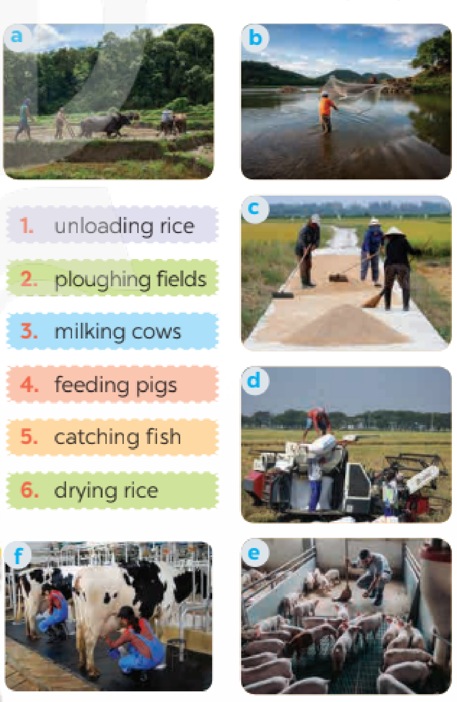
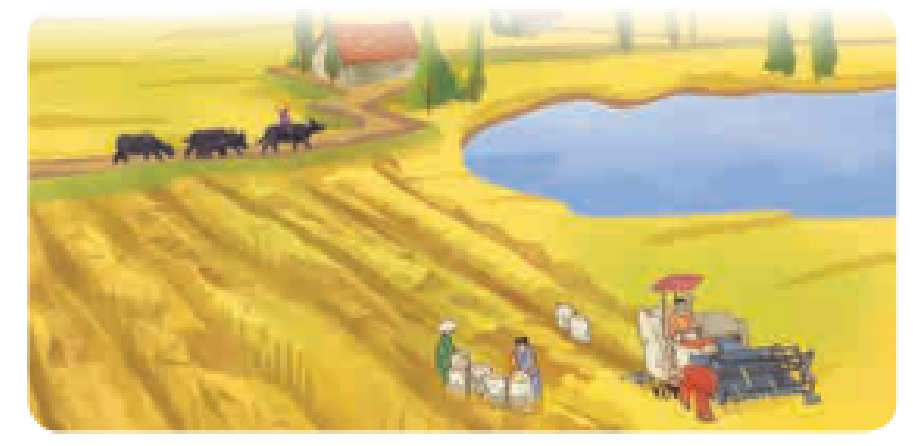
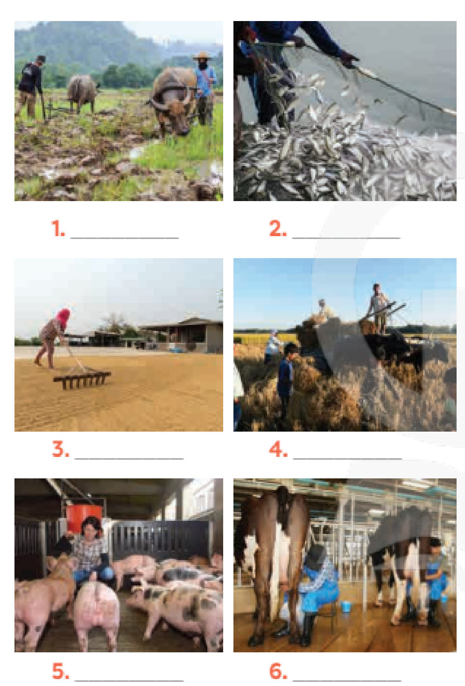

<!-- pdf:20 -->

# UNIT 2: LIFE IN THE COUNTRYSIDE

> **THIS UNIT INCLUDES:**
> - **Vocabulary:**
>   - Life in the countryside
> - **Pronunciation:**
>   - Sounds: /ə/ and /ɪ/
> - **Grammar:**
>   - Comparative forms of adverbs
> - **Skills:**
>   - Reading about different aspects of a Vietnamese village
>   - Talking about the village or town where someone lives
>   - Listening to someone's opinion about life in the countryside
>   - Writing a paragraph about what someone likes or dislikes about life in the countryside
> - **Everyday English:**
>   - Giving and responding to compliments

## GETTING STARTED

**Last summer holiday**

**1. Listen and read.**

**Nick:** You look great with a tan, Mai!

**Mai:** Thank you. I've just come back from a very enjoyable summer holiday.

**Nick:** Really? Where did you stay?

**Mai:** I stayed at my uncle's house in a small village in Bac Giang Province.

**Nick:** What did you do there?

**Mai:** A lot of things. It was harvest time. The villagers were **harvesting** rice with a **combine harvester**. I helped them **load** the rice onto a truck. Then we **unloaded** the rice and **dried** it.
<!-- term: harvest time -->

**Nick:** Sounds great!

**Mai:** And sometimes I went with the village children to **herd** the buffaloes and cows. I made friends with them on my first day.

**Nick:** Were they friendly?

**Mai:** Yes, they were. They took me to the **paddy fields** to fly kites. And in the evening, we played traditional games like bamboo dancing and dragon-snake.

**Nick:** Oh, I envy you!
<!-- ocr-ok: đã đối chiếu ảnh trang gốc, OCR đọc nhầm chữ I thành kí tự | -->

**Mai:** Things move more slowly there than in our city, but people seem to have a healthier life.

<!-- pdf:21 -->

**2. Read the conversation again and choose the correct answer to each question.**

1. How does Mai feel about her summer holiday?
   - A. She likes it.
   - B. She doesn't like it.
   - C. She thought it was fine.
2. Where did she stay during her summer holiday?
   - A. At her friend's house.
   - B. At her uncle's house.
   - C. At her grandparents' house.
3. During harvest time, people **harvest** rice by \_\_\_\_\_\_\_.
   - A. themselves
   - B. using a truck
   - C. using a **combine harvester**
4. Which of the following is NOT true according to the conversation?
   - A. Mai made friends with the village children on her first day.
   - B. Mai and the village children played traditional games.
   - C. Nick doesn't like what Mai and the village children did.
5. Mai thinks people in the countryside lead \_\_\_\_\_\_\_.
   - A. a healthy life
   - B. an exciting life
   - C. an interesting life

**3. Complete the sentences with the words and phrases from the box.**

| **paddy field** | **herd** | **load** |
| --- | --- | --- |
| harvest time | **combine harvester** | |

1. It took them an hour to \_\_\_\_\_\_\_ all the goods onto the truck.
2. Nowadays, people in my village use a \_\_\_\_\_\_\_ to **harvest** their rice and separate the grains from the rest of the plant.
3. Today it is my turn to \_\_\_\_\_\_\_ the cows.
4. A place in which people grow rice is called a \_\_\_\_\_\_\_.
5. A busy time when people cut and gather their **crops** is called \_\_\_\_\_\_\_.
<!-- term: harvest time -->

**4. Match the activities (1 – 6) that people living in the countryside often do with the pictures (a – f).**

1. **unloading** rice
2. **ploughing** fields
3. **milking** cows
4. **feeding** pigs
5. **catching** fish
6. **drying** rice
<!-- ocr-ok: đã đối chiếu ảnh trang gốc, OCR đọc lộn thứ tự các thẻ hoạt động 1-6 cạnh tranh a-f -->

**Can you add any more activities?**
<!-- ocr-ok: đã đối chiếu ảnh trang gốc, OCR bỏ sót dòng câu hỏi cuối trang 19 -->

<!-- pdf:22 -->

**5. Work in pairs. Ask and answer about the pictures in 4.**

**Example:**
- **A:** What are they doing in picture *a*?
- **B:** They're **ploughing** fields.

## A CLOSER LOOK 1

### Vocabulary

**1. Circle the correct words to complete the sentences.**

1. We helped the farmers **herd** **cattle** / poultry.
<!-- term: poultry -->
2. They are helping their parents pick *plants* / *fruit* in the **orchard**.
3. At harvest time farmers are busy cutting and collecting *food* / **crops**.
4. The driver **loaded** / **unloaded** the rice from the back of the truck.
5. People here live by **catching** / *holding* fish from nearby lakes and ponds.

**2. Match the following adjectives with their definitions.**

| | |
| --- | --- |
| 1. **vast** | a. pretty, especially in a way that looks old-fashioned |
| 2. **hospitable** | b. having something near or around |
| 3. **well-trained** | c. extremely large in area, size, amount, etc. |
| 4. surrounded | d. pleased to welcome guests; generous and friendly to visitors |
| 5. **picturesque** | e. having received good or thorough training |

**3. Complete the sentences with the words from 2.**

1. The local people are kind and \_\_\_\_\_\_\_ to visitors.
2. Our factory needs a lot of \_\_\_\_\_\_\_ workers.
3. While travelling up the mountain, people always stop and take photos of the \_\_\_\_\_\_\_ scenery.
4. The Sahara is a \_\_\_\_\_\_\_ desert that covers parts of eleven countries in northern Africa.
5. The lake is \_\_\_\_\_\_\_ by a lot of trees.
<!-- term: surrounded -->

### Pronunciation

**/ə/ and /ɪ/**
<!-- ocr-ok: đã đối chiếu ảnh trang gốc, OCR đọc nhầm kí hiệu phiên âm /ə/ và /ɪ/ thành /a/ and /1/ -->

**4. Listen and repeat the words. Pay attention to the sounds /ə/ and /ɪ/.**

| /ə/ | /ɪ/ |
| --- | --- |
| activity | pick |
| **hospitable** | village |
| garden | **harvest** |
| **picturesque** | busy |
| collect | cottage |

**5. Listen and practise the sentences. Underline the bold words with /ə/, and circle the bold words with /ɪ/.**

1. There is a lot of *water* in the *bottle*.
2. The *farmers* here are *hard-working*.
3. They are *picking* fruits in the **orchard**.
4. People in my *village* usually *gather* at weekends.
5. Please buy some *milk* and *pasta* at the supermarket.

<!-- pdf:23 -->

## A CLOSER LOOK 2

### Grammar

*Comparative adverbs*

**Remember!**

- For most adverbs (often with two or more syllables), we make comparative forms by adding *more*.
  *Example:*
  - slowly → *more* slowly
  - carefully → *more* carefully
- For adverbs that have the same forms as adjectives like *fast*, *hard*, *soon*, etc., we make comparative forms by adding *-er*.
  *Example:*
  - fast → fast*er*
  - hard → hard*er*
- Some irregular adverbs:
  - well → better
  - badly → worse
<!-- term: Comparative adverbs -->

**1. Write the comparative forms of the adverbs in the table below.**

| Adverbs | Comparative forms |
| --- | --- |
| long | *longer* |
| high | |
| late | |
| quickly | |
| frequently | |
| early | |
| much | |
| little | |

**2. Complete the sentences with the comparative forms of the adverbs in brackets.**

1. Mai dances (beautifully) \_\_\_\_\_\_\_ than Hoa does.
2. Please write (clearly) \_\_\_\_\_\_\_. I can't read it.
3. Life in the city seems to move (fast) \_\_\_\_\_\_\_ than that in the countryside.
4. If you want to get better marks, you must work much (hard) \_\_\_\_\_\_\_.
5. Today it's raining (heavily) \_\_\_\_\_\_\_ than it was yesterday.

**3. Complete the sentences with suitable comparative forms of the adverbs from the box.**

| early | soundly | fast |
| --- | --- | --- |
| carefully | quietly | |

1. After his accident last month, he drives \_\_\_\_\_\_\_ now.
2. A horse can run \_\_\_\_\_\_\_ than a buffalo.
3. You're too loud. Can you speak a bit \_\_\_\_\_\_\_?
4. After working hard all day on the farm, we slept \_\_\_\_\_\_\_ than ever before.
5. The farmers started **harvesting** their **crops** \_\_\_\_\_\_\_ than expected.

<!-- pdf:24 -->

**4. Read the situations and complete the sentences using the comparative forms of the adverbs in brackets.**

1. The red car can run 200 km/h while the black car can run 160 km/h.
   The red car can run \_\_\_\_\_\_\_. (fast)
2. Nick can jump 1.5 m high while Tom can jump only 1.3 m.
   Nick can jump \_\_\_\_\_\_\_. (high)
3. Mai and Hoa both did well on the exam. Hoa got 80% of the answers correct and Mai got 90%.
   Mai did \_\_\_\_\_\_\_. (well)
4. My dad expected the workers to arrive at 7 a.m. But they arrived at 6:30 a.m.
   The workers arrived \_\_\_\_\_\_\_. (early)
5. The buses run every 15 minutes. The trains run every 30 minutes.
   The buses run \_\_\_\_\_\_\_. (frequently)

**5. Work in pairs. Ask and answer to find out who:**

- can run faster
- can jump higher
- stays up later at night
- gets up earlier in the morning

**Example:**
- **A:** How fast can you run?
- **B:** I can run 15 kilometres an hour.
- **A:** OK, you can run faster than me.

**Report your results to the class.**

## COMMUNICATION

### Everyday English

*Giving and responding to compliments*

**1. Listen and read the conversations. Pay attention to the highlighted sentences.**

1. **Tom:** *What a beautiful kite you have, Mai!*
   **Mai:** *Thank you, Tom.* My dad made it for me last weekend.
<!-- term: Giving and responding to compliments -->

2. **Nick:** *You really have a nice dress, Hoa.*
   **Hoa:** *I'm glad you like it, Nick.* I think its colour really suits me.
<!-- term: Giving and responding to compliments -->

**2. Work in pairs. Make similar conversations to practise giving and responding to compliments, using the cues below.**

- a shirt
- a bicycle
- a school bag

<!-- pdf:25 -->

**Adverts for beautiful villages**

**3. Read the adverts for the two beautiful villages. Tick (✓) the boxes to show which village the statements describe. Sometimes both boxes need to be ticked.**

**Duong Lam Village**

Duong Lam, one of the most ancient villages in Ha Noi, is situated in Son Tay. Visitors can get there from the centre of Ha Noi by car, bus or even by bicycle. It is famous for its ancient pagoda, traditional houses, and temples. Besides these, visitors can observe the locals making **specialities**, such as *keo doi*, *che lam*, etc. and then try them.

**Hollum Village**

Hollum is one of the ancient villages on the island of Ameland, the Netherlands. Many visitors come to the village because of its historical and cultural values. It is full of fascinating sights, such as traditional houses, a museum, a church, a **lighthouse**, etc. Besides sightseeing, visitors can also take part in sports like flying kites, surfing, etc. Visitors can reach the village by air or **ferry**.

| Statements | Duong Lam | Hollum |
| --- | --- | --- |
| 1. It's an ancient village. | | |
| 2. We can visit an ancient pagoda, traditional houses, and temples in this village. | | |
| 3. We can get there by plane or **ferry**. | | |
| 4. We can go there by car, bus, or bike. | | |
| 5. It has a **lighthouse**. | | |

**4. Work in groups. Take turns to talk about the similarities and differences between Duong Lam and Hollum.**

**Example:**

Duong Lam and Hollum are both ancient villages, ...

**5. Work in pairs. Which village in 3 would you like to visit for a holiday? Explain your choice to your partner.**

**Example:**
- **A:** Which village would you like to visit for a holiday?
- **B:** Duong Lam, of course!
- **A:** Why?
- **B:** Because I love watching the locals making **specialities** and ...

<!-- pdf:26 -->

## SKILLS 1

### Reading

**1. Work in pairs. Look at the picture and discuss the following questions.**

1. What can you see in it?
2. Which of the following adjectives describe the picture?

| peaceful | **vast** | crowded |
| --- | --- | --- |
| **picturesque** | noisy | |

**2. Read the text about life in a village in Viet Nam. Match the highlighted words in the text with their meanings.**

I feel fortunate that I am living in a peaceful village in southern Viet Nam. The scenery here is beautiful and **picturesque** with **vast** fields **stretching** long distances. The houses are surrounded by green trees. There are lakes, ponds, and canals here and there. The air is fresh and cool.
<!-- term: surrounded -->
<!-- term: canal -->

Life here seems to move more slowly than in cities. The people work very hard. They grow vegetables, **cultivate** rice, and raise **cattle**. At harvest time, they use **combine harvesters** to **harvest** their **crops**. Many families live by growing fruit trees in the **orchards**. Others live by fishing in lakes, ponds, and canals.

Life in the village is very comfortable for children. They play traditional games. Sometimes they help their parents pick fruit and **herd** **cattle**.

People in my village know each other well. They are friendly and **hospitable**. They often meet each other in the evening, eating fruit, playing chess, singing folk songs, and chatting about everyday activities.

| | |
| --- | --- |
| 1. **stretching** | a. small passages used for carrying water to fields, crops, etc. |
| 2. canals | b. places where people grow fruit trees |
| 3. **cultivate** | c. covering a large area of land |
| 4. **orchards** | d. to grow plants or crops |
<!-- term: canal -->

**3. Read the text again and tick (✓) T (True) or F (False) for each sentence.**

| | T | F |
| --- | --- | --- |
| 1. Life in the author's village is very peaceful. | | |
| 2. The people in the village work very hard. | | |
| 3. Villagers live only by **catching** fish in lakes, ponds, and canals. | | |
| 4. The children are always busy helping their parents. | | |
| 5. The villagers get along well. | | |

### Speaking

**4. Make notes about the village or town where you live or which you know.**

| | |
| --- | --- |
| Name | |
| Location | |
| Scenery | |
| How people live | |
| Activities adults or children often do | |
| The relationships among the people | |
| Special features | |

**5. Work in groups. Take turns to talk about the village or town where you live or which you know. Use the information in 4.**

**Example:**

I live in Duong Lam. It's an old village outside Ha Noi. It has ...

<!-- pdf:27 -->

## SKILLS 2

### Listening

**1. Work in pairs. Discuss the following question.**

What do you like or dislike about life in the countryside?

**2. Listen to three people talking about life in the countryside. Choose the opinion (A – C) that each speaker (1 – 3) expresses.**

| Speaker | Opinion |
| --- | --- |
| Speaker 1 | |
| Speaker 2 | |
| Speaker 3 | |
<!-- ocr-ok: đã đối chiếu ảnh trang gốc, bảng điền đáp án của 3 người nói -->

| Opinions |
| --- |
| A. I don't like rural life because there are not many good schools and colleges. And entertainment and means of transport are very poor. |
| B. I like rural life because the people here are close to each other. |
| C. I want to live in the countryside because there are many things I can't easily do in the city. |

**3. Listen again and choose the correct answer A, B, or C.**

1. According to speaker 1, there is a great sense of \_\_\_\_\_\_\_ in his village.
   - A. security
   - B. duty
   - C. community
2. Speaker 1 says that people in his village are very \_\_\_\_\_\_\_.
   - A. supportive
   - B. unsociable
   - C. **well-trained**
3. In speaker 2's opinion, \_\_\_\_\_\_\_ is a big problem in the countryside.
   - A. the cost of living
   - B. safety
   - C. transportation
4. Speaker 2 says that they should \_\_\_\_\_\_\_ in the countryside.
   - A. improve the lives of people
   - B. prevent crime
   - C. protect nature
5. According to speaker 3, life in the countryside is peaceful and \_\_\_\_\_\_\_.
   - A. slow
   - B. simple
   - C. safe

### Writing

**4. Work in groups. Discuss and write what you like or dislike about life in the countryside.**

| LIKE | DISLIKE |
| --- | --- |
| - The cost of living is rather low, you can buy many things here at a lower price. - ... | - There are not many entertainment places, such as theatres, cinemas, etc. - ... |
<!-- term: cost of living -->
<!-- ocr-ok: đã đối chiếu ảnh trang gốc, bảng hai cột LIKE và DISLIKE bị OCR trộn dòng -->

**5. Write a paragraph (80 – 100 words) about what you like or dislike about life in the countryside.**

*There are some things I like / dislike about life in the countryside.* \_\_\_\_\_\_\_\_\_\_\_\_\_\_\_\_\_\_\_\_\_\_\_

<!-- pdf:28 -->

## LOOKING BACK

### Vocabulary

**1. Write a phrase from the box under the correct picture.**

| | |
| --- | --- |
| **unloading** rice | **ploughing** fields |
| **milking** cows | **feeding** pigs |
| **catching** fish | **drying** rice |

1. \_\_\_\_\_\_\_
2. \_\_\_\_\_\_\_
3. \_\_\_\_\_\_\_
4. \_\_\_\_\_\_\_
5. \_\_\_\_\_\_\_
6. \_\_\_\_\_\_\_
<!-- ocr-ok: đã đối chiếu ảnh trang gốc, 6 chỗ trống đánh số 1-6 nằm dưới từng bức ảnh hoạt động nông thôn -->

**2. Choose the correct answer A, B, or C.**

1. There is a huge cloud \_\_\_\_\_\_\_ as far as the eye can see.
   - A. surrounded
   - B. **stretching**
   - C. **vast**
2. People in my village are really \_\_\_\_\_\_\_; they are always generous and friendly to visitors.
   - A. **well-trained**
   - B. funny
   - C. **hospitable**
3. The development of cities destroys \_\_\_\_\_\_\_ areas of countryside.
   - A. **vast**
   - B. much
   - C. **stretching**
4. The workers in our factory are very \_\_\_\_\_\_\_ because they took a lot of good training courses.
   - A. **hospitable**
   - B. kind
   - C. **well-trained**
5. The area around the village is famous for its \_\_\_\_\_\_\_ landscape.
   - A. **picturesque**
   - B. boring
   - C. dull

### Grammar

**3. Complete the sentences with the comparative forms of the adverbs in brackets.**

1. Every morning Nick gets up ten minutes (early) \_\_\_\_\_\_\_ than his sister.
2. I speak French (fluently) \_\_\_\_\_\_\_ now than I did last year.
3. You'll find your way around the village (easily) \_\_\_\_\_\_\_ if you have a good map.
4. It rained (heavily) \_\_\_\_\_\_\_ today than it did yesterday.
5. If you work (hard) \_\_\_\_\_\_\_, you will do (well) \_\_\_\_\_\_\_ in your exam.

**4. Underline the mistakes in the sentences and correct them.**

1. I run faster as my brother does.
2. People in the city seem to react quicklier to changes than those in the country.
3. We need to work more hardly, especially at exam time.
4. You must finish **harvesting** the rice the earlier this year than you did last year.
5. As they climbed more highly up the mountain, the air became cooler.

<!-- pdf:29 -->

## PROJECT

**MY FAVOURITE VILLAGE**

**Work in groups.**

**1. Search for a village in Viet Nam or a foreign country that you would like to visit.**

**2. Design a poster about that village, including:**

- name
- location
- scenery
- people and their activities
- ...

**3. Present your poster to the class.**

### Now I can ...

- use the words about life in the countryside.
- pronounce the sounds /ə/ and /ɪ/ correctly in words and sentences.
- recognise and use comparative forms of adverbs.
- give and respond to compliments.
- read about different aspects of a Vietnamese village.
- talk about the village or town where someone lives.
- listen to someone's opinion about life in the countryside.
- write a paragraph about what someone likes or dislikes about life in the countryside.

## 📷 Danh sách hình trong bài

| Mã hình | Trang PDF | Trang sách | Chú thích / Mô tả |
| --- | --- | --- | --- |
| H8-tieng_anh-u02-01 | 21 | 19 | Sáu bức ảnh a–f ghép với 6 cụm từ hoạt động nông thôn 1–6 thuộc bài tập 4 phần Getting Started (chấp nhận allow_edge_ink ở cạnh trái do nền tranh cánh đồng cột trái lan sát mép ảnh a): (a) cày ruộng, (b) đánh bắt cá, (c) phơi thóc, (d) dỡ lúa từ máy gặt, (e) cho lợn ăn, (f) vắt sữa bò |
| H8-tieng_anh-u02-02 | 26 | 24 | Tranh vẽ phong cảnh làng quê yên bình với cánh đồng lúa chín, hồ nước, đàn trâu và máy gặt đập liên hợp thuộc bài tập 1 phần Skills 1 – Reading |
| H8-tieng_anh-u02-03 | 28 | 26 | Sáu bức ảnh 1–6 thuộc bài tập 1 phần Looking Back – Vocabulary: (1) cày ruộng với trâu, (2) kéo lưới bắt cá, (3) cào phơi thóc, (4) chuyển bao thóc lên/xuống xe, (5) cho đàn lợn ăn, (6) vắt sữa bò |
