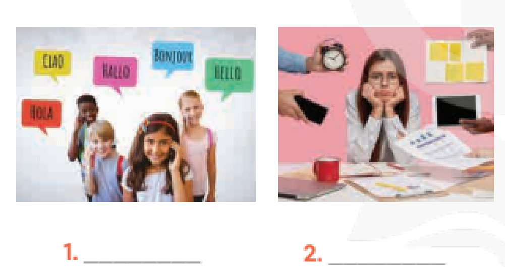
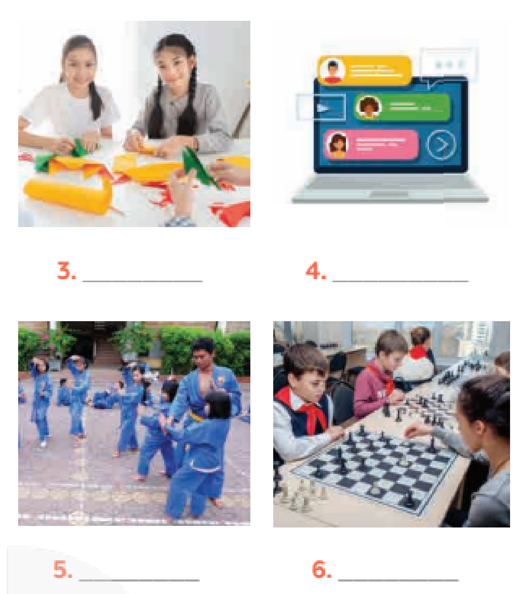
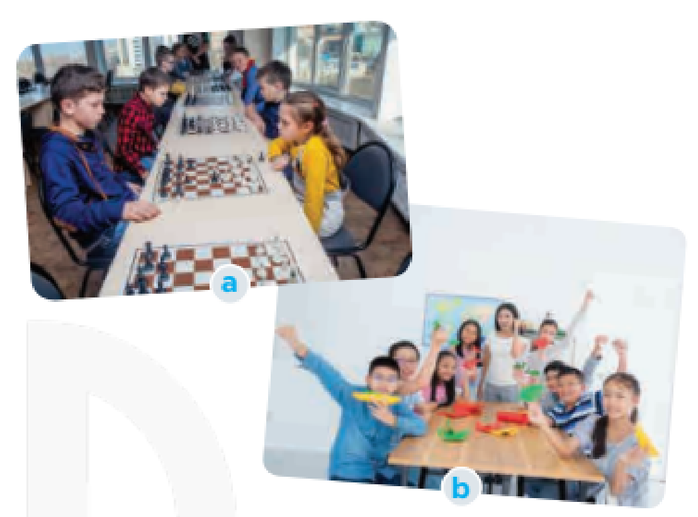
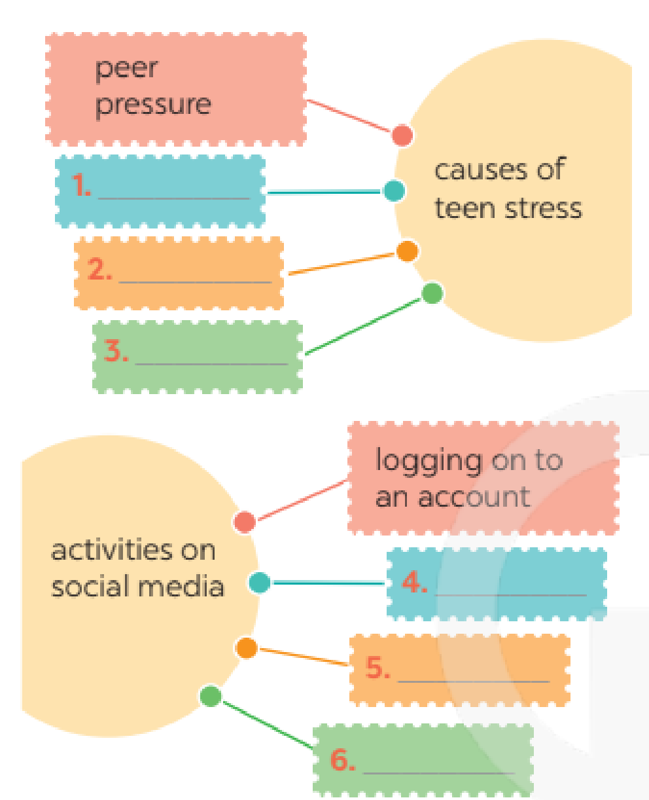

<!-- pdf:30 -->

# UNIT 3: TEENAGERS

> **THIS UNIT INCLUDES:**
> - **Vocabulary:**
>   - Teen school clubs
>   - Teen's use of social **media**
>   - Teen **stress**
> - **Pronunciation:**
>   - Sounds: /ʊə/ and /ɔɪ/
> - **Grammar:**
>   - Simple sentences and compound sentences
> - **Skills:**
>   - Reading about school club activities
>   - Asking and answering questions about school clubs
>   - Listening about teen **stress**
>   - Writing a paragraph about the cause(s) of one's **stress** and solutions to deal with it
> - **Everyday English:**
>   - Making requests

## GETTING STARTED

**It's great to see you again!**

**1. Listen and read.**

**Teacher:** It's great to see you again, class! What's going on?

**Minh:** We've decided to use Facebook for our class **forum**, and we joined some school club activities. We're also preparing for the **midterm** tests. It's really **stressful**.

**Teacher:** I'm sorry to hear that. I know exams may give you a lot of **stress**. But stay calm and work hard. What other **pressure** do you have?

**Minh:** Well, we also have **pressure** from our parents and friends.

**Teacher:** Do you? Let's discuss these problems in your new Facebook group. By the way, why did you choose Facebook?

**Ann:** Because it's **user-friendly**.

**Teacher:** Good! How about club activities? Do you find them **enjoyable**?

**Ann:** Yes. This year there are some new clubs like arts and **crafts**, and music. The club leaders will provide us with a variety of activities to suit different interests. And there will also be competitions as usual.

**Teacher:** Awesome! I hope you can all join the clubs you like.

<!-- pdf:31 -->

**2. Read the conversation again and tick (✓) T (True) or F (False) for each sentence.**

| | T | F |
| --- | --- | --- |
| 1. The students finished their **midterm** tests. | | |
| 2. Minh mentions the different types of **pressure** they are facing. | | |
| 3. The teacher tells them to stay calm and work hard. | | |
| 4. The class will discuss their problems offline. | | |
| 5. The school has different clubs for its students. | | |

**3. Write a word or phrase from the box under the correct picture.**

| | |
| --- | --- |
| chess club | **forum** |
| language club | sports club |
| arts and **crafts** club | **pressure** |
<!-- ocr-ok: đã đối chiếu ảnh trang gốc, khung từ vựng gồm 6 từ/cụm từ bị OCR đọc lỗi dòng đầu -->

1. \_\_\_\_\_\_\_
2. \_\_\_\_\_\_\_
3. \_\_\_\_\_\_\_
4. \_\_\_\_\_\_\_
5. \_\_\_\_\_\_\_
6. \_\_\_\_\_\_\_
<!-- ocr-ok: đã đối chiếu ảnh trang gốc, 6 chỗ trống đánh số 1-6 nằm dưới từng tranh minh hoạ -->

**4. Complete each of the sentences with a word or phrase in 3. There is one extra word or phrase.**

1. Minh is a member of our \_\_\_\_\_\_\_. The greeting cards he makes are really creative.
2. Students can discuss their problems in their class \_\_\_\_\_\_\_.
3. We share the essays and stories that we write in English in our \_\_\_\_\_\_\_.
4. She is not feeling very well this weekend because of all the \_\_\_\_\_\_\_ from her **schoolwork**.
5. The coach of our \_\_\_\_\_\_\_ tells us to drink plenty of water during our practice **sessions**.

**5. Work in pairs. Ask and answer the questions below. Report your friend's answers to the class.**

1. What types of social media do you use?
<!-- term: social media -->
2. What kinds of **pressure** do you have?
3. What clubs do you participate in?
4. Why do you choose to participate in that club?

<!-- pdf:32 -->

## A CLOSER LOOK 1

### Vocabulary

**1. Circle the correct options to complete the phrases.**

1. **upload** — A. a picture | B. the **website**
2. **browse** — A. a **website** | B. a clip
3. check — A. pictures | B. **notifications**
4. **log on** — A. to a club | B. to an **account**
5. **connect** — A. a post | B. with friends
<!-- ocr-ok: đã đối chiếu ảnh trang gốc, các thẻ lựa chọn A/B của câu 1-5 bị OCR đọc lệch thứ tự -->

**2. Use the correct forms of the verbs in 1 to complete the sentences.**

1. I \_\_\_\_\_\_\_ the school **website** and found pictures of school activities.
2. Our teacher \_\_\_\_\_\_\_ a video of our last meeting in our **forum** for everyone to see.
3. She \_\_\_\_\_\_\_ with some old friends at the English club.
4. Tom \_\_\_\_\_\_\_ the **notifications** and saw some new posts.
5. Mi often \_\_\_\_\_\_\_ to her Instagram **account** to chat with her friends.

**3. Choose the correct answer A, B, or C.**

1. Our class has a(n) \_\_\_\_\_\_\_, and we often post questions there to discuss.
   - A. office
   - B. **forum**
   - C. club
2. We try to meet our parents' \_\_\_\_\_\_\_, but it is hard.
   - A. dreams
   - B. interests
   - C. **expectations**
3. He is a big \_\_\_\_\_\_\_ and scares his weaker classmates.
   - A. **bully**
   - B. **forum**
   - C. **pressure**
4. She was chatting with her friends, so she couldn't \_\_\_\_\_\_\_ on the lesson.
   - A. **concentrate**
   - B. coach
   - C. advise
5. We have \_\_\_\_\_\_\_ from our exams, **peers**, and parents. This makes us feel very stressed.
   - A. interests
   - B. **pressure**
   - C. friends

### Pronunciation

**/ʊə/ and /ɔɪ/**
<!-- ocr-ok: đã đối chiếu ảnh trang gốc, OCR đọc nhầm kí hiệu phiên âm /ʊə/ và /ɔɪ/ -->

**4. Listen and repeat the words. Pay attention to the sounds /ʊə/ and /ɔɪ/. Then put the words into the correct columns.**

| boy | tourist | toy | ensure |
| --- | --- | --- | --- |
| avoid | choice | sure | tournament |

| /ʊə/ | /ɔɪ/ |
| --- | --- |
| | |
<!-- ocr-ok: đã đối chiếu ảnh trang gốc, bảng phân loại hai cột âm /ʊə/ và /ɔɪ/ -->

**5. Listen and practise the sentences. Underline the words with /ʊə/, and circle the words with /ɔɪ/.**

1. She is a noisy and curious girl.
2. They joined a full-day city tour.
3. I found it **enjoyable** to watch the tournament.
4. She'll record our voices during the interview.
5. He is not acting very **mature** and is starting to annoy me.

<!-- pdf:33 -->

## A CLOSER LOOK 2

### Grammar

*Simple sentences and compound sentences*

**Remember!**

A simple sentence is made up of one independent clause.
*Example:* Minh has some problems with his **schoolwork**.
<!-- term: Simple sentences and compound sentences -->

A compound sentence is made up of two or more independent clauses, and they are joined by:
<!-- term: Simple sentences and compound sentences -->

- a coordinating conjunction: *for*, *and*, *but*, *or*, *so*.
  *Example:* Mai bought many books, *for* she likes reading.
<!-- term: coordinating conjunction -->

- a conjunctive adverb: *however*, *therefore*, *otherwise*.
  *Example:* Mark is hard-working; *therefore*, he usually gets high scores on exams.
<!-- term: conjunctive adverb -->

**1. Tick (✓) the simple sentences.**

- [ ] 1. We work together on different projects.
- [ ] 2. Teens need good friends and tolerant teachers at schools.
- [ ] 3. She plays chess very well, and she won the first prize last year.
- [ ] 4. Sports activities at school help me relax.
- [ ] 5. Teens should learn teamwork, and they should also have communication skills.

**2. Write S for simple sentences and C for compound sentences.**

- \_\_\_\_\_\_\_ 1. Teenagers are often very active and talkative.
- \_\_\_\_\_\_\_ 2. He often chats with his friends on Facebook Messenger.
- \_\_\_\_\_\_\_ 3. She is a smart student, and she is an active member of our club.
- \_\_\_\_\_\_\_ 4. My friends and I joined a sports competition last year.
- \_\_\_\_\_\_\_ 5. He is a club member, but he never participates in any of the activities.

**3. Choose the correct answer A, B, or C.**

1. Parents should give teens some freedom, \_\_\_\_\_\_\_ they should also set limits.
   - A. for
   - B. so
   - C. but
2. We don't cheat on exams, \_\_\_\_\_\_\_ it is a wrong thing to do.
   - A. or
   - B. for
   - C. and
3. Lan wants to join the school music club; \_\_\_\_\_\_\_, she can't sing or play any instruments.
   - A. however
   - B. otherwise
   - C. therefore
4. **Schoolwork** causes teens a lot of **pressure**, \_\_\_\_\_\_\_ they also feel **pressure** from their parents.
   - A. and
   - B. but
   - C. or
5. She wanted to prepare for the exam; \_\_\_\_\_\_\_, she turned off her mobile phone.
   - A. however
   - B. otherwise
   - C. therefore

<!-- pdf:34 -->

**4. Combine the two sentences to make compound sentences, using the words from the box.**

| or | but | so |
| --- | --- | --- |
| therefore | otherwise | |
<!-- ocr-ok: đã đối chiếu ảnh trang gốc, khung 5 từ nối bị OCR bỏ sót từ so và đọc lệch cột -->

1. Phong has to study harder. He may fail the exam.
2. She is very sensitive. Don't comment on her new hairstyle.
3. Mi wants to have more friends. She doesn't **connect** well with others.
4. Students can work in groups. Students can work in pairs.
5. My friend likes showing off her new things. She often posts pictures on social **media**.

**5. GAME: Which group has the most sentences?**
<!-- ocr-ok: đã đối chiếu ảnh trang gốc, chữ GAME in màu trong các ô vuông trang trí -->

**Work in groups. Each group makes as many compound sentences as possible. The group with the most correct sentences is the winner.**

## COMMUNICATION

### Everyday English

*Making requests*

**1. Listen and read the dialogue. Pay attention to the highlighted sentences.**

**Student:** *Can you tell me more about the music club, please?*
<!-- term: Making requests -->

**School club leader:** Certainly. It meets on Mondays and Thursdays.

**Student:** *Could you tell me the time it meets?*
<!-- term: Making requests -->

**School club leader:** Yes, it's after school, from 5:00 p.m. to 6:30 p.m.

**2. Work in pairs. Make similar conversations, using the cues below.**

- Request information about a science project
- Request information about the school library

**Social media popular among teens**

**3. Work in pairs. Read some posts on a forum about different social media and match the names of the posters with their activities.**

- **Ann:** I think YouTube is the most popular social media site. I **log on** to it daily. I **upload** videos and watch other people's videos.
- **Tom:** I use Facebook to **connect** with friends, post pictures, and share others' posts. I use it daily. It's **user-friendly**.
<!-- term: social media -->

<!-- pdf:35 -->

- **Trang:** I love Instagram. It's really fun, and easy to **browse**. People like my photos, so I feel happy. That's why I often check my **notifications**.
<!-- ocr-ok: đã đối chiếu ảnh trang gốc, OCR bỏ sót dòng đầu I love Instagram. It's really fun, and -->
- **Nam:** I have a Facebook page. I don't often update it, but I often use Messenger to discuss **schoolwork** with my classmates.

| Poster | Activity |
| --- | --- |
| Ann | 1. checks **notifications** regularly |
| Tom | 2. watches videos on YouTube |
| Trang | 3. uses Facebook Messenger to discuss **schoolwork** |
| Nam | 4. thinks Facebook is **user-friendly** |
| | 5. **connects** with friends on Facebook |
<!-- ocr-ok: đã đối chiếu ảnh trang gốc, sơ đồ nối tên 4 bạn với 5 hoạt động bị OCR đọc lỗi chữ regularly và thinks -->

**4. Work in pairs. Ask and answer questions about what social media the teens in 3 use, why, and how often they use them.**

**Example:**
- **Tom:** What social **media** does Ann use?
- **Nam:** She uses YouTube.
- **Tom:** What does she use it for?
- **Nam:** She **uploads** her videos and watches other people's videos.
- **Tom:** How often does she use it?
- **Nam:** Every day.

**5. Work in groups. Discuss the following questions:**

1. What social **media** do you use?
2. How often do you use it?
3. What do you use the social **media** for?

**Report your group's results to the class.**

## SKILLS 1

### Reading

**1. Work in pairs.**

**a. Look at each picture and say what club it is.**

**b. Which of your school clubs do you want to join?**

**2. Read the conversation and tick (✓) T (True) or F (False) for each sentence.**

**Mai:** Tom, so which club do you want to join?

**Tom:** I'm interested in two clubs: badminton and chess.

**Mai:** I like badminton, too. It's relaxing.

**Tom:** Yes, I play it to keep fit. So let's join that club together.

**Mai:** OK. It's on Tuesdays and Fridays from 5:00 p.m. to 6:30 p.m. It starts 30 minutes after school, so we have enough time to get some snacks beforehand. I know you like chess. Will you join the chess club?

**Tom:** Well, I started playing it five years ago. My mum first sent me to a chess club because she wanted me to be more **focused**. Now I find that I can **concentrate** better. Do you like chess? Let's join the chess club too.

<!-- pdf:36 -->

**Mai:** Actually, this year there is a new arts and **crafts** club, and I want to join *it*. I hear that the members will work together in small community service projects. Members can do art projects and also improve their practical skills and teamwork skills too.
<!-- term: arts and crafts club -->

**Tom:** Awesome, Mai. Who will coach that club?

**Mai:** Ms Hoa, the art teacher. She will help us **connect** with the community.

| | T | F |
| --- | --- | --- |
| 1. The school has badminton, chess, and arts and **crafts** clubs. | | |
| 2. The badminton club activities are after school. | | |
| 3. Tom started playing chess when he was five. | | |
| 4. Members of the arts and **crafts** club do community activities. | | |

**3. Read the conversation again and choose the correct answer A, B, or C.**

1. Tom and Mai are discussing \_\_\_\_\_\_\_.
   - A. their leisure time activities
   - B. their school club activities
   - C. their likes and dislikes
2. Tom started playing chess because \_\_\_\_\_\_\_.
   - A. he loved it
   - B. he wanted to stay **focused**
   - C. his mum wanted him to play
3. Playing chess helps Tom \_\_\_\_\_\_\_.
   - A. **connect** with other members
   - B. **concentrate** better
   - C. do community service
4. The word "*it*" refers to \_\_\_\_\_\_\_.
   - A. chess club
   - B. arts and **crafts** club
   - C. community service
5. Mai will participate in the arts and **crafts** club to \_\_\_\_\_\_\_.
   - A. help the school
   - B. coach her friends
   - C. do art projects

### Speaking

**4. Work in pairs. Make conversations using the given information.**

> **GUITAR CLUB**
> - **Time:** Mondays, 5:00 p.m. – 6:30 p.m.
> - **Venue:** Music room, 2nd floor
> - **Contact number:** 0084 623486
> - **Coach:** Mr Quang, a professional guitarist
> - **Benefits:** Enjoy music and make new friends

> **PAINTING CLUB**
> - **Time:** Saturdays, 9:00 a.m. – 10:30 a.m.
> - **Venue:** School Hall, 1st floor
> - **Contact number:** 0084 135798
> - **Coach:** Ms Hoa, a school art teacher
> - **Benefits:** Do art and relax
<!-- ocr-ok: đã đối chiếu ảnh trang gốc, OCR bỏ sót tiêu đề PAINTING CLUB và đọc nhầm 9:00 a.m. – 10:30 a.m. thành 2:00 am. - 10:50 am. -->

**Example:**
- **A:** What time does the guitar club meet?
- **B:** It meets on Mondays, from 5:00 p.m. to 6:30 p.m.
- **A:** Where does it meet?
- **B:** It meets in the music room, on the second floor.
- ...

**5. Work in groups. Ask and answer questions about a club at your school. Report the answers to your class.**

**Example:**

The music club at my school meets on Tuesdays, from 5:00 p.m. to 6:30 p.m. It meets in the music room, on the third floor ...

<!-- pdf:37 -->

## SKILLS 2

### Listening

**1. Teens face many types of pressure. Which types of pressure below do you think teens face?**

- A. parental **pressure**
- B. **pressure** from work
- C. **pressure** from **schoolwork**
- D. **pressure** from their clubs

**2. Listen to a conversation and choose the correct answer to each question.**

1. How many students are talking?
   - A. One.
   - B. Two.
   - C. Three.
2. What are they discussing?
   - A. Their class **forum**.
   - B. Their **stress**.
   - C. Their community activities.

**3. Listen to the conversation again and fill in each blank with ONE word.**

| Problems | Solutions |
| --- | --- |
| Minh has **pressure** from his (1) \_\_\_\_\_\_\_. | Minh should tell his parents about his interests and (2) \_\_\_\_\_\_\_. |
| Ann is unhappy about her (3) \_\_\_\_\_\_\_. | Ann should feel (4) \_\_\_\_\_\_\_ about her body. |
| Mi doesn't get on with her (5) \_\_\_\_\_\_\_. | She should (6) \_\_\_\_\_\_\_ to her mum. |

### Writing

**4. Match the causes of teen stress with the possible solutions. There may be more than one solution to a problem.**

| Causes of teen stress | Possible solutions |
| --- | --- |
| 1. **peer** **pressure** | A. avoiding **bullies** wherever possible |
| 2. too much **schoolwork** | B. staying calm and relaxed |
| 3. spending too much time on social **media** | C. turning off smartphones |
| 4. **bullying** | D. talking to teachers |
<!-- term: peer pressure -->
<!-- ocr-ok: đã đối chiếu ảnh trang gốc, OCR bỏ sót dòng tiêu đề bảng Causes of teen stress | Possible solutions -->

**5. Write a paragraph (80 – 100 words) about the cause(s) of your stress and offer solutions.**

*I often feel stressed because of \_\_\_\_\_\_\_ and here are the ways I deal with my* **stress**.* \_\_\_\_\_\_\_\_\_\_\_\_\_\_\_\_\_\_\_\_\_\_\_
<!-- term: deal with stress -->

<!-- pdf:38 -->

## LOOKING BACK

### Vocabulary

**1. Complete the webs with suitable words and phrases.**

- **causes of teen stress:** **peer** **pressure**, 1. \_\_\_\_\_\_\_, 2. \_\_\_\_\_\_\_, 3. \_\_\_\_\_\_\_
- **activities on social media:** **logging on** to an **account**, 4. \_\_\_\_\_\_\_, 5. \_\_\_\_\_\_\_, 6. \_\_\_\_\_\_\_
<!-- ocr-ok: đã đối chiếu ảnh trang gốc, hai sơ đồ mạng từ causes of teen stress và activities on social media -->

**2. Fill in each blank with the correct form of the word from the box.**

| skill | club | participate |
| --- | --- | --- |
| **upload** | **bully** | **connect** |

Mike has a busy and active life. He does well at school and (1) \_\_\_\_\_\_\_ in many (2) \_\_\_\_\_\_\_ like basketball and chess clubs. He is also a member of the school community projects, where he (3) \_\_\_\_\_\_\_ with other teens and learns new (4) \_\_\_\_\_\_\_. He has many classes, but he can still manage his **schoolwork** well. Mike is also an active member of his class **forum**. He and his friends (5) \_\_\_\_\_\_\_ pictures and videos about their class activities. They also discuss homework, their problems and how to deal with **pressure** from parents, friends, and **schoolwork**. The most common problem they discuss is how to deal with (6) \_\_\_\_\_\_\_.

### Grammar

**3. Use the conjunctions provided to connect the sentences.**

1. Mai is the head of the music club. She knows the members very well. **SO**
2. Lan wanted to go to the party. She couldn't choose a suitable dress. **BUT**
3. Tom felt stressed. He tried to finish his homework. **HOWEVER**
4. He isn't a member of the chess club. He didn't join the chess competition. **THEREFORE**
5. We will have a short holiday. We will feel very stressed. **OTHERWISE**

**4. Complete the sentences below. Then compare your sentences with your partners'.**

1. Teens need to have good health, so \_\_\_\_\_\_\_.
2. His parents have high **expectations** of him, but \_\_\_\_\_\_\_.
3. Teenagers should develop social skills; otherwise \_\_\_\_\_\_\_.
4. We sometimes feel lonely and sad; therefore, \_\_\_\_\_\_\_.
5. He does very well at school; however, \_\_\_\_\_\_\_.

<!-- pdf:39 -->

## PROJECT

**OUR SCHOOL CLUB**

**Work in groups.**

**1. Think about a club you would like to have at your school. Brainstorm details about the club by answering these questions.**

- What club is it?
- What specific activities will the club have?
- How often will the club meet? When?
- What will you contribute to the club?

**2. Create a poster about the club.**

**3. Present your poster to the class.**

### Now I can ...

- use the words related to teen school clubs, teens' use of social **media** and teen **stress**.
- pronounce the sounds /ʊə/ and /ɔɪ/ correctly in words and sentences.
- use simple sentences and compound sentences.
- make requests.
- read about school club activities.
- ask and answer questions about school clubs.
- listen to a talk about teen **stress**.
- write a paragraph about the cause(s) of my **stress** and my solutions to deal with it.

## 📷 Danh sách hình trong bài

| Mã hình | Trang PDF | Trang sách | Chú thích / Mô tả |
| --- | --- | --- | --- |
| H8-tieng_anh-u03-01 | 31 | 29 | Hai bức ảnh 1–2 thuộc bài tập 3 phần Getting Started: (1) câu lạc bộ ngoại ngữ (language club), (2) học sinh căng thẳng trước bài vở (pressure) |
| H8-tieng_anh-u03-02 | 31 | 29 | Bốn bức ảnh 3–6 thuộc bài tập 3 phần Getting Started: (3) câu lạc bộ mĩ thuật và thủ công (arts and crafts club), (4) diễn đàn trực tuyến trên máy tính (forum), (5) câu lạc bộ thể thao / võ thuật (sports club), (6) câu lạc bộ cờ vua (chess club) |
| H8-tieng_anh-u03-03 | 35 | 33 | Hai bức ảnh a–b thuộc bài tập 1a phần Skills 1 – Reading: (a) các bạn học sinh đánh cờ vua, (b) các bạn học sinh trong câu lạc bộ mĩ thuật và thủ công |
| H8-tieng_anh-u03-04 | 38 | 36 | Hai sơ đồ mạng từ thuộc bài tập 1 phần Looking Back – Vocabulary: nguyên nhân gây căng thẳng ở tuổi thiếu niên (causes of teen stress) và các hoạt động trên mạng xã hội (activities on social media) |
