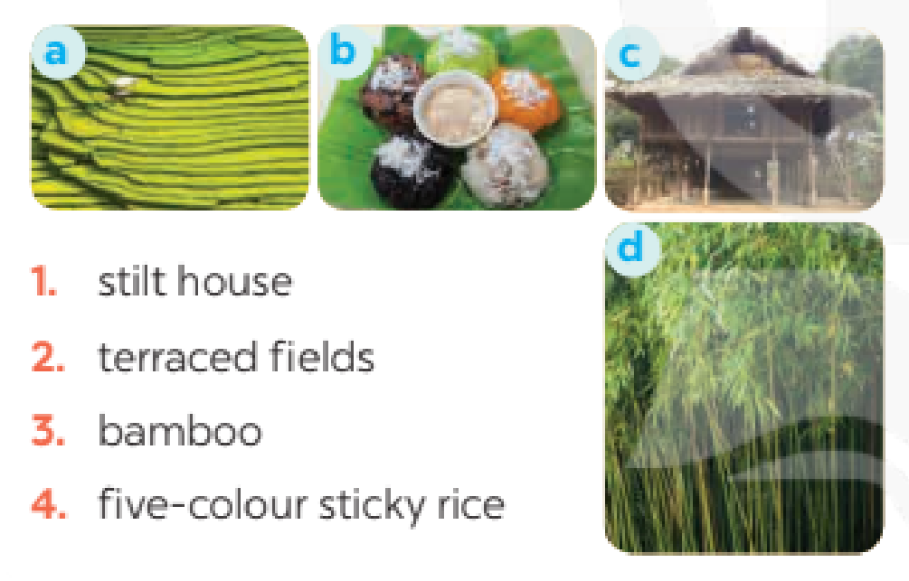
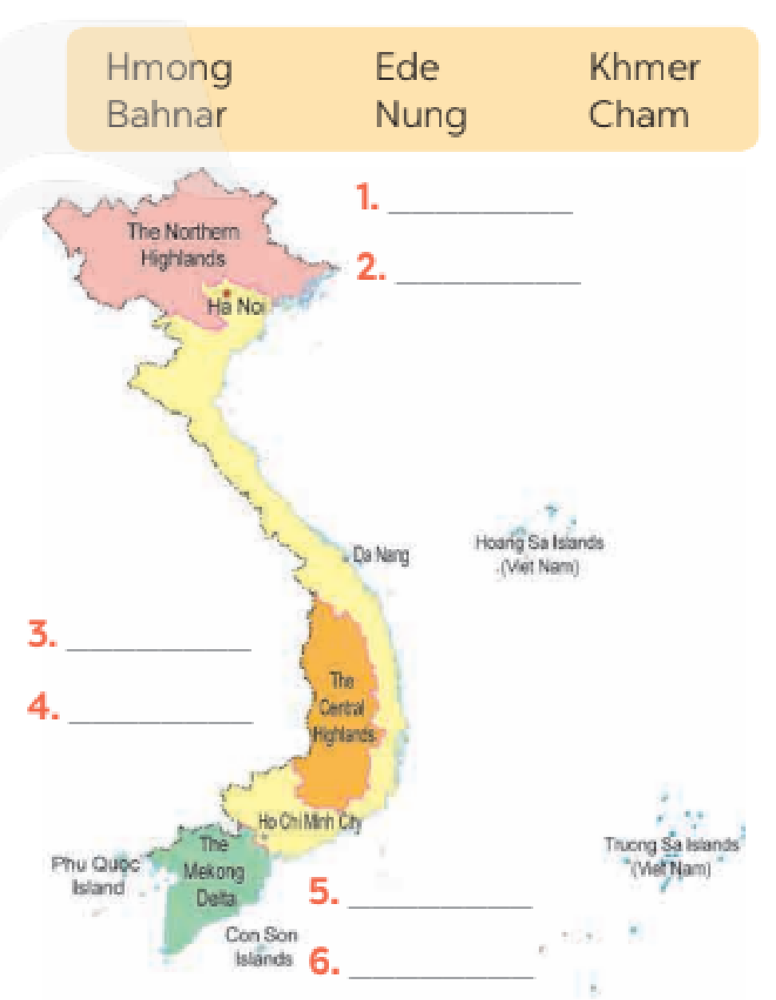
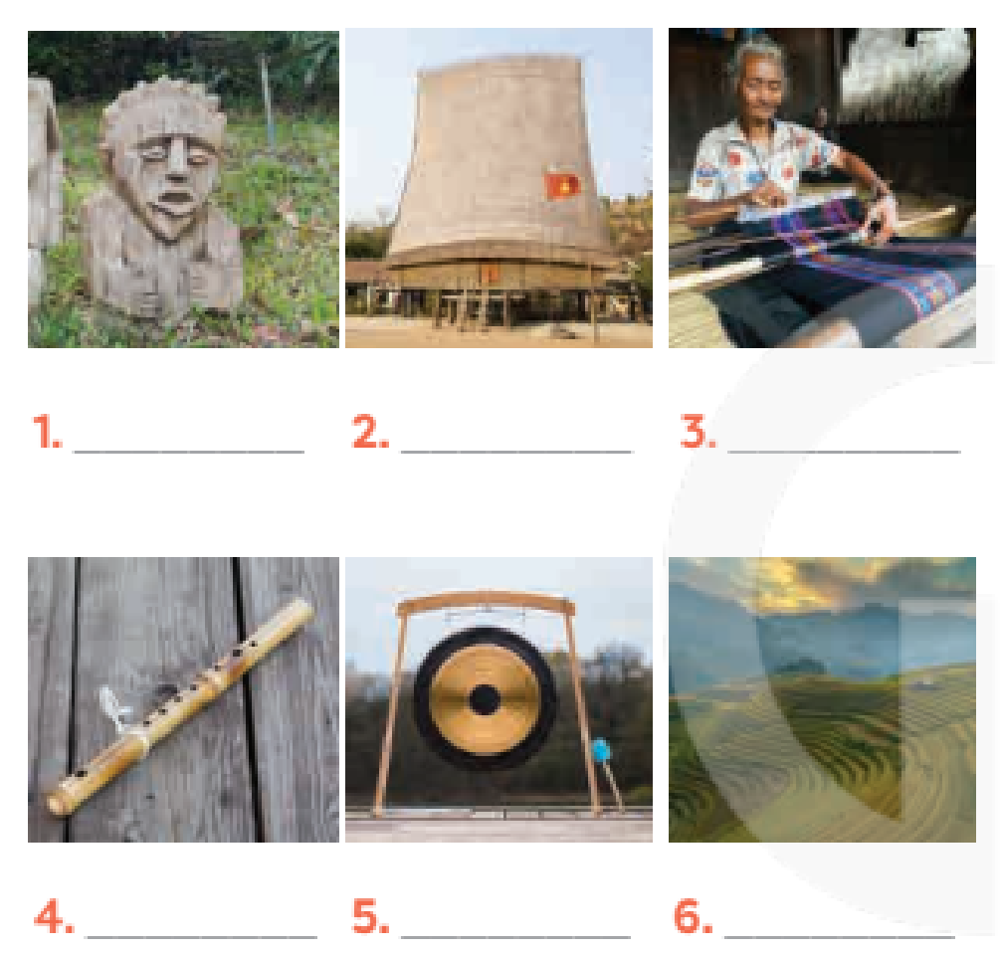
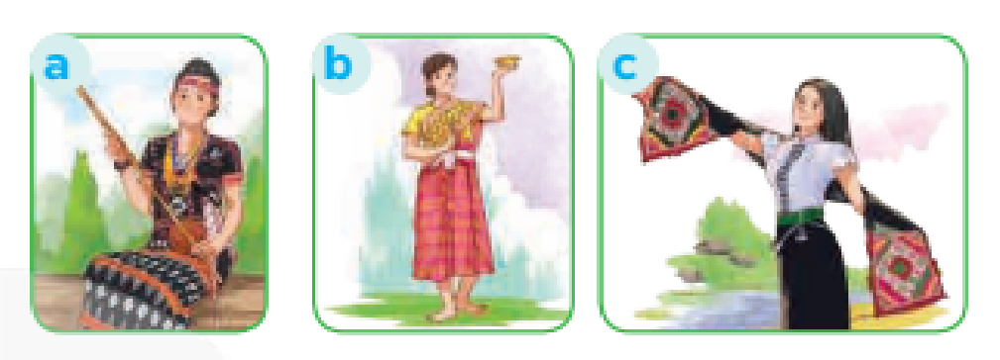
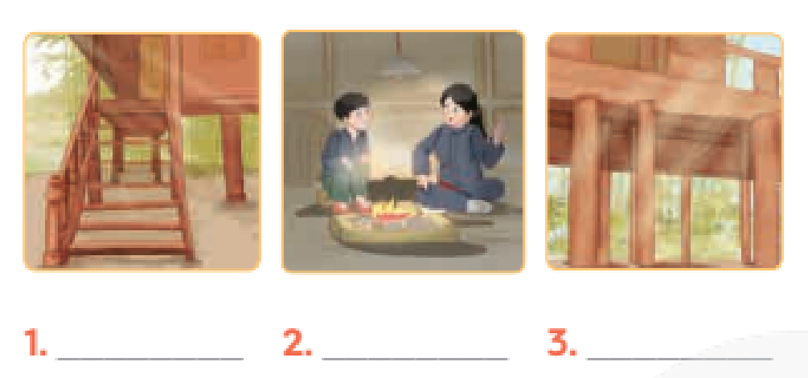
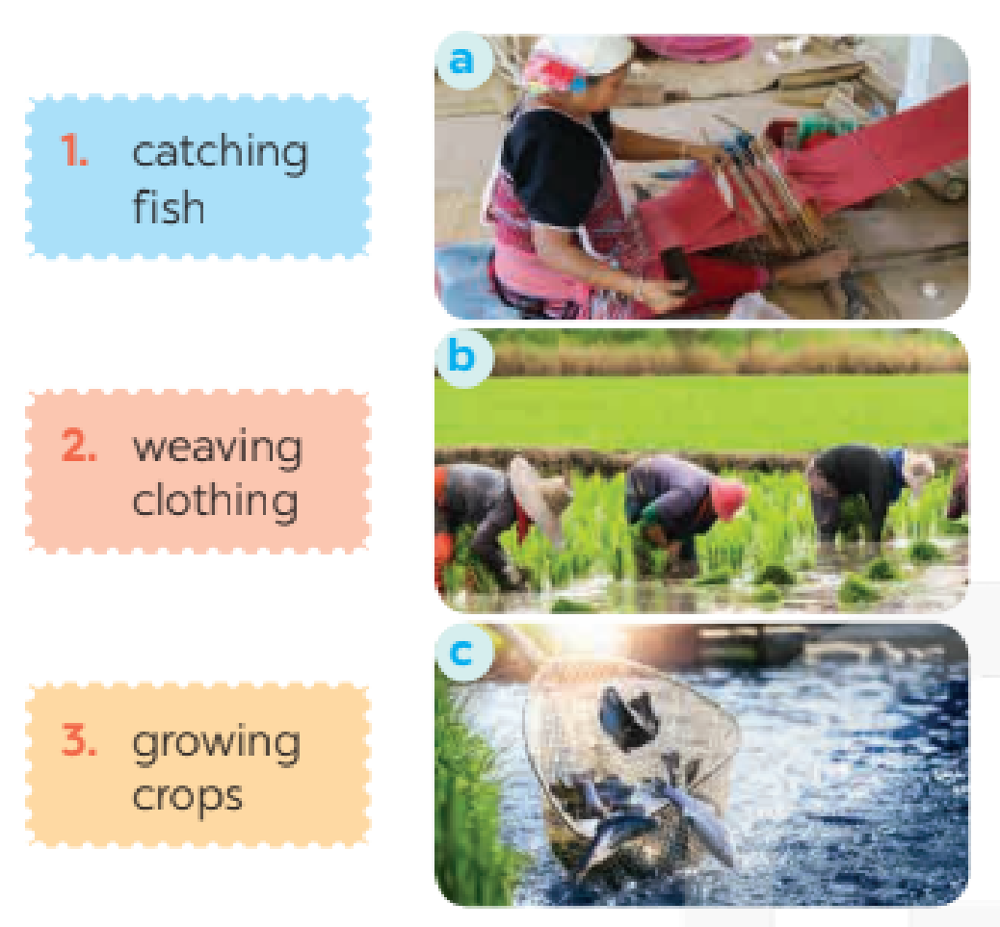
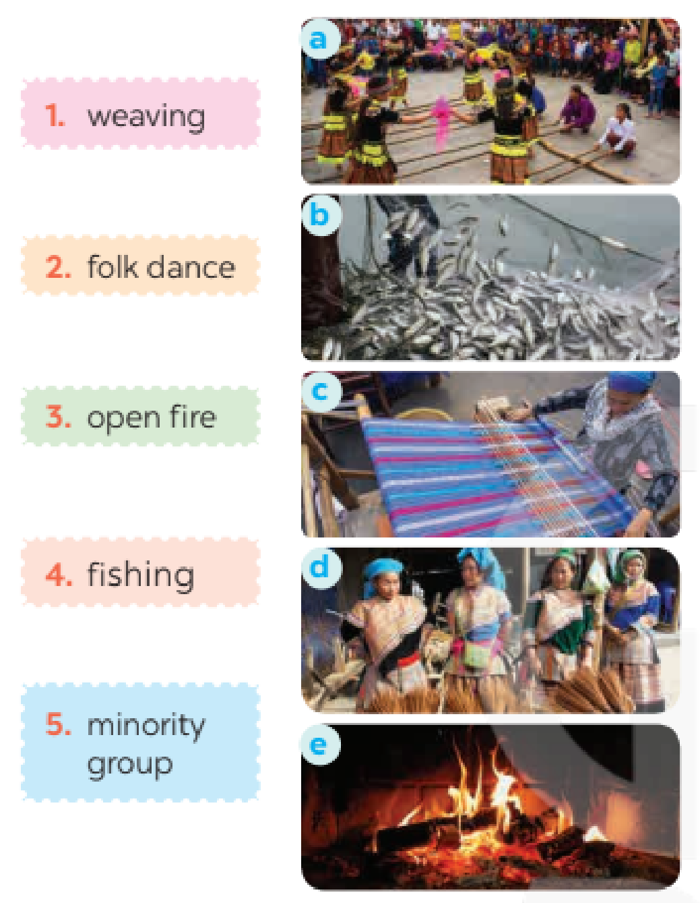

<!-- pdf:42 -->

# UNIT 4: ETHNIC GROUPS OF VIET NAM

> **THIS UNIT INCLUDES:**
> - **Vocabulary:**
>   - The lifestyle of **ethnic groups**
> - **Pronunciation:**
>   - Sounds: /k/ and /ɡ/
> - **Grammar:**
>   - *Yes / No* and *Wh*-questions
>   - Countable and uncountable nouns
> - **Skills:**
>   - Reading about **stilt houses**
>   - Talking about the type of home you live in
>   - Listening about the life of **minority** children
>   - Writing a paragraph about the things you do to help your family
> - **Everyday English:**
>   - Giving opinions
<!-- ocr-ok: đã đối chiếu ảnh trang gốc, khung tóm tắt đầu bài hai cột kèm kí hiệu phiên âm /k/ và /ɡ/ -->

## GETTING STARTED

**I'm from the Tay ethnic group.**

**1. Listen and read.**

**Tom:** Hi, I'm Tom. You look new here.

**Lai:** I am. I'm Lai from Ha Giang.
<!-- ocr-ok: đã đối chiếu ảnh trang gốc, OCR đọc nhầm chữ I thành kí tự | -->

**Tom:** Oh, I've heard about beautiful Ha Giang. Do you live in the mountains?

**Lai:** Yes, I do. I'm from the Tay **ethnic group**. We are the second largest **ethnic group** in Viet Nam, only after the Kinh.

**Tom:** Oh ... I once saw a bamboo house on high **posts** in a travel brochure. Do you live in a home like that?

**Lai:** Yes, we call it a "**stilt house**". Our house **overlooks** **terraced** fields.

**Tom:** Awesome. What is life in your village like?

**Lai:** It's peaceful. There are 16 houses in my village. We live very close to nature.

**Tom:** I love it. Can you tell me something about your culture?

**Lai:** Certainly. We have our own culture. You can see it in our **folk** dances, musical instruments like the *dan tinh*, and our special five-colour sticky rice.
<!-- term: musical instrument -->
<!-- term: five-colour sticky rice -->

**Tom:** It sounds interesting. I hope to visit Ha Giang one day.

<!-- pdf:43 -->

**2. Read the conversation again and circle the correct answers.**

1. What are Tom and Lai talking about?
   - A. **Minority** groups in Viet Nam.
   - B. Ha Giang.
   - C. Life of the Tay people.
2. A "**stilt house**" \_\_\_\_\_\_\_.
   - A. is a multi-storey home
   - B. is on high **posts**
   - C. always faces a field
3. Lai mentions \_\_\_\_\_\_\_ of the Tay people.
   - A. **folk** dances
   - B. popular festivals
   - C. **costumes**

**3. Match the pictures with the word and phrases from the conversation.**

1. **stilt house**
2. **terraced** fields
3. bamboo
4. five-colour sticky rice

**4. Complete the sentences with the words and phrases from the box.**

| **overlooks** | traditional |
| --- | --- |
| **folk** dance | **ethnic groups** |
| musical instrument | |
<!-- ocr-ok: đã đối chiếu ảnh trang gốc, khung từ vựng hai cột nên OCR đọc theo cột dọc -->

1. I love *mua sap*, a popular \_\_\_\_\_\_\_ of the Thai people.
2. Their beautiful **stilt house** \_\_\_\_\_\_\_ a large rice field.
3. **A:** What is the name of a popular Tay's \_\_\_\_\_\_\_?
   **B:** It's *dan tinh*.
4. Every **ethnic group** has their own \_\_\_\_\_\_\_ culture.
5. Of the 54 \_\_\_\_\_\_\_ in Viet Nam, the Kinh is the largest.

**5. GAME: Where are they?**
<!-- ocr-ok: đã đối chiếu ảnh trang gốc, chữ GAME in màu trong các ô vuông trang trí -->

**Work in groups. Discuss and label the map with the names of the ethnic groups from the box. The first team to get all the correct answers wins.**

| Hmong | Ede | Khmer |
| --- | --- | --- |
| Bahnar | Nung | Cham |
<!-- ocr-ok: đã đối chiếu ảnh trang gốc, khung tên 6 dân tộc nằm trên lược đồ Việt Nam -->

1. \_\_\_\_\_\_\_
2. \_\_\_\_\_\_\_
3. \_\_\_\_\_\_\_
4. \_\_\_\_\_\_\_
5. \_\_\_\_\_\_\_
6. \_\_\_\_\_\_\_
<!-- ocr-ok: đã đối chiếu ảnh trang gốc, 6 vị trí điền tên dân tộc trên lược đồ Việt Nam -->

<!-- pdf:44 -->

## A CLOSER LOOK 1

### Vocabulary

**1. Write a word or phrase from the box under each picture.**

| *Rong* house | **bamboo flute** |
| --- | --- |
| **gong** | **terraced** fields |
| **weaving** | **wooden** **statue** |

1. \_\_\_\_\_\_\_
2. \_\_\_\_\_\_\_
3. \_\_\_\_\_\_\_
4. \_\_\_\_\_\_\_
5. \_\_\_\_\_\_\_
6. \_\_\_\_\_\_\_
<!-- ocr-ok: đã đối chiếu ảnh trang gốc, các chỗ trống đánh số 1-6 nằm dưới từng tranh minh hoạ -->

**2. Match the words and phrases with their meanings.**

| | |
| --- | --- |
| 1. **minority group** | a. the animals we keep on a farm like cows and sheep |
| 2. **livestock** | b. a large room for community activities |
| 3. gardening | c. a group smaller in size than other groups in the same country |
| 4. **gong** | d. a traditional musical instrument |
| 5. **communal house** | e. work like growing, watering, weeding, and **harvesting** |

**3. Complete the sentences with the words and phrases from the box.**

| **communal house** | **raise** |
| --- | --- |
| **unique features** | **weave** |
| **minority group** | **livestock** |

1. It's interesting to learn about the \_\_\_\_\_\_\_ of an **ethnic group**'s traditional culture.
2. Most mountain girls know how to \_\_\_\_\_\_\_ clothing.
3. The Cham in Ninh Thuan \_\_\_\_\_\_\_ sheep and cows.
4. A \_\_\_\_\_\_\_ is for community meetings and events.
5. There are fewer Nung than Kinh, so they are an **ethnic** \_\_\_\_\_\_\_.
6. Children in both the lowlands and **highlands** help **raise** their family's \_\_\_\_\_\_\_.

### Pronunciation

**/k/ and /ɡ/**
<!-- ocr-ok: đã đối chiếu ảnh trang gốc, kí hiệu phiên âm /k/ và /ɡ/ -->

**4. Listen and repeat the words. Pay attention to the sounds /k/ and /ɡ/.**
<!-- ocr-ok: đã đối chiếu ảnh trang gốc, OCR đọc nhầm kí hiệu băng nghe và phiên âm -->

| /k/ | /ɡ/ |
| --- | --- |
| cultural | **gong** |
| communal | garden |
| musical | gathering |
| **folk** | tiger |
| **overlook** | pig |
<!-- ocr-ok: đã đối chiếu ảnh trang gốc, bảng phát âm hai cột và OCR đọc khuyết chữ musical -->

**5. Listen and repeat the sentences. Pay attention to the underlined words.**

1. The *kitchen* is for family *gatherings*.
2. *Tigers* and *monkeys* live in the forest.
3. I love five-*colour* *sticky* rice.
4. Yesterday, we **harvested** *cucumbers* from our *garden*.
5. Most *girls* know how to *cook*.

<!-- pdf:45 -->

## A CLOSER LOOK 2

### Grammar

**Yes / No and Wh-questions**

**1. Change the sentences into Yes / No questions.**

**Example:**
The farmers are **harvesting** their **crops** in the fields.
→ Are the farmers **harvesting** their **crops** in the fields?
<!-- term: Yes / No questions and Wh-questions -->

1. Women play an important role in a Jrai family.
   → \_\_\_\_\_\_\_\_\_\_\_\_\_\_\_\_\_\_\_\_\_\_\_?
2. *Mua sap* is a popular **folk** dance of the Thai people.
   → \_\_\_\_\_\_\_\_\_\_\_\_\_\_\_\_\_\_\_\_\_\_\_?
3. We didn't have boarding schools for **minority** students in 1950.
   → \_\_\_\_\_\_\_\_\_\_\_\_\_\_\_\_\_\_\_\_\_\_\_?
<!-- ocr-ok: đã đối chiếu ảnh trang gốc, OCR đọc nhầm năm 1950 thành 1350 -->
4. I attended the *Ban* Flower Festival in Dien Bien last year.
   → \_\_\_\_\_\_\_\_\_\_\_\_\_\_\_\_\_\_\_\_\_\_\_?
5. We will watch a documentary about the Khmer.
   → \_\_\_\_\_\_\_\_\_\_\_\_\_\_\_\_\_\_\_\_\_\_\_?

**2. Choose the correct question word for each question below.**

1. **A:** \_\_\_\_\_\_\_ do you like best about Sa Pa?
   **B:** I like its local markets best.
   - A. Why
   - B. What
2. **A:** \_\_\_\_\_\_\_ can we find the most beautiful **terraced** fields?
   **B:** In Mu Cang Chai.
   - A. When
   - B. Where
3. **A:** \_\_\_\_\_\_\_ is the *Ban* Flower Festival?
   **B:** It's in spring.
   - A. When
   - B. Why
4. **A:** \_\_\_\_\_\_\_ tall is an average **stilt house**?
   **B:** About 5 – 6 metres tall.
   - A. How
   - B. What
5. **A:** \_\_\_\_\_\_\_ festival is more important for the Kinh: the Mid-Autumn or the Lunar New Year?
   **B:** The Lunar New Year.
   - A. What
   - B. Which
<!-- ocr-ok: đã đối chiếu ảnh trang gốc, OCR bỏ sót chữ Sa Pa ở câu 1 và đọc nhầm chữ B thành BE -->

**Countable and uncountable nouns**

**3. Write C (countable) or U (uncountable) for the underlined words.**

Some **minority** (1) *groups* are farmers. They do not have much (2) *land* and they use simple farming techniques. After finding an (3) *area* for a garden, the men cut the (4) *trees* down and burn them. The (5) *ash* they collect helps enrich the **soil**. They then grow a few (6) *crops* like rice and corn. When the (7) *soil* becomes poor, they move to a new (8) *place*.
<!-- term: Countable nouns and uncountable nouns -->
<!-- ocr-ok: đã đối chiếu ảnh trang gốc, đoạn văn có cột điền C/U từ 1 đến 8 nằm song song bên phải làm OCR trộn dòng -->

1. \_\_\_\_\_\_\_
2. \_\_\_\_\_\_\_
3. \_\_\_\_\_\_\_
4. \_\_\_\_\_\_\_
5. \_\_\_\_\_\_\_
6. \_\_\_\_\_\_\_
7. \_\_\_\_\_\_\_
8. \_\_\_\_\_\_\_
<!-- ocr-ok: đã đối chiếu ảnh trang gốc, 8 chỗ trống điền C hoặc U bên phải đoạn văn -->

**4. Fill in each blank with a, much, many, a little, or a few.**

1. My uncle has \_\_\_\_\_\_\_ coffee plantation in Kon Tum.
2. How \_\_\_\_\_\_\_ **ethnic groups** live on the Hoang Lien Son mountain range?
3. There are only \_\_\_\_\_\_\_ waterwheels left in my village.
4. You should add \_\_\_\_\_\_\_ more water to your noodles. It's a bit dry.
5. How \_\_\_\_\_\_\_ information about the Van Kieu have you collected?
<!-- ocr-ok: đã đối chiếu ảnh trang gốc, OCR đọc nhầm in my village thành Invay village -->

**5. GAME: Word games**
<!-- ocr-ok: đã đối chiếu ảnh trang gốc, chữ GAME in màu cách điệu -->

**Work in groups. Think of six nouns related to each of the topics below, in which three nouns are countable and three nouns are uncountable. The group that comes up with the correct six words first wins.**

- Leisure time
- Living in the mountains

<!-- pdf:46 -->

## COMMUNICATION

### Everyday English

**Giving opinions**

**1. Listen and read the conversation, paying attention to the highlighted parts.**

**Tom:** What do you think about life in the mountains?

**Trang:** *I think* it's very interesting. People in the mountains live close to nature.

**Tom:** What about you, Mai? What do you think?

**Mai:** *To my way of thinking*, there are better services in the city.
<!-- term: I think / To my way of thinking -->

**2. Work in pairs. One asks the question and the other gives opinions about these topics.**

1. Playing traditional games
2. Living close to nature

**Lifestyle of the ethnic minority groups**

**3. QUIZ: How much do you know about ethnic groups in Viet Nam?**
<!-- ocr-ok: đã đối chiếu ảnh trang gốc, chữ QUIZ in màu cách điệu -->

1. There are \_\_\_\_\_\_\_ **ethnic groups** in Viet Nam.
   - A. 63
   - B. 45
   - C. 54
2. **Ethnic** **minority** groups form about \_\_\_\_\_\_\_ of the total population of Viet Nam.
   - A. 7%
   - B. 13%
   - C. 25%
3. They mainly live \_\_\_\_\_\_\_.
   - A. in the lowlands
   - B. in the mountains
   - C. in the Mekong Delta
4. The Jrai decorate houses for the dead with a lot of \_\_\_\_\_\_\_.
   - A. wood **statues**
   - B. flowers
   - C. colourful pictures
5. The Khmer mostly earn their living from **weaving** and \_\_\_\_\_\_\_.
   - A. farming
   - B. hunting
   - C. fishing
6. Picture \_\_\_\_\_\_\_ shows a Thai woman's **costume**.
<!-- ocr-ok: đã đối chiếu ảnh trang gốc, OCR tách 2 cột câu trắc nghiệm 1-6 -->

**4. Work in pairs. Read the notes below about the Jrai. Take turns to ask and answer about the information.**

**THE JRAI**

- **Population:** 513.930 (2019), the largest **minority group** in the Central **Highlands**
- **Living place:** mainly in Gia Lai
- **Houses:** **stilt houses**
- **Economy:** growing **crops**, **weaving**, planting industrial trees (coffee, cacao, rubber, ...), **raising** buffalos, and elephants
- **Traditional culture:**
  - Rich **folk** dances, songs, games, and musical instruments
  - Dominant role in the family: women

**5. Work in groups. Share with your group the information about the Jrai people you find interesting.**

**You may start sharing your opinion with:**
- I like ... because ...
- I think that ...

<!-- pdf:47 -->

## SKILLS 1

### Reading

**1. Write the words and phrase from the box under the correct pictures.**

| open fire | **posts** | **staircase** |
| --- | --- | --- |

1. \_\_\_\_\_\_\_
2. \_\_\_\_\_\_\_
3. \_\_\_\_\_\_\_
<!-- ocr-ok: đã đối chiếu ảnh trang gốc, 3 chỗ trống đánh số 1-3 nằm dưới tranh -->

**2. Read the passage and tick (✓) T (True) or F (False).**

**Stilt houses**
<!-- ocr-ok: đã đối chiếu ảnh trang gốc, tiêu đề chữ viết tay màu xanh Stilt houses -->

**Stilt houses** are popular among different **ethnic** **minority** groups, from the Thai in the Northern **Highlands** to the Khmer in the Mekong Delta. The houses come in different sizes and styles, and show the traditional culture of their owners.

**Stilt houses** are made from natural materials like wood, bamboo, and leaves. They stand on strong **posts**, about two or three metres above the ground. This allows them to keep people safe from wild animals. People climb a seven- or nine-step **staircase** to enter the house. The most important place in the house is the kitchen. It has an open fire in the middle of the house. It is the place for family gatherings and receiving guests.
<!-- term: open fire -->

The **stilt houses** of the Tay and Nung usually **overlook** a field. The **stilt houses** of the Thai, however, face mountains or a forest. The Bahnar and Ede have a **communal house** (called a *Rong* house) as the heart of their village. These **communal houses** are the largest and tallest ones in the village.
<!-- term: Rong house -->

| | T | F |
| --- | --- | --- |
| 1. Only a few **minority** groups live in **stilt houses**. | | |
| 2. All **stilt houses** look alike. | | |
| 3. Family gatherings take place by the open fire in the middle of the house. | | |
| 4. The *Rong* house serves as the centre of an Ede village. | | |

**3. Read the passage again and fill in each blank with ONE word.**

1. A **stilt house** shows the \_\_\_\_\_\_\_ culture of the owner.
2. The Tay's and Nung's **stilt houses** **overlook** a \_\_\_\_\_\_\_.
3. The Thai's **stilt houses** **overlook** a \_\_\_\_\_\_\_ or \_\_\_\_\_\_\_.
4. The largest and tallest house in an Ede village is the \_\_\_\_\_\_\_ house.
<!-- ocr-ok: đã đối chiếu ảnh trang gốc, OCR đọc thiếu dấu sở hữu cách và chữ or câu 3 -->

<!-- pdf:48 -->

### Speaking

**4. Work in pairs. Discuss and tick (✓) the features of a stilt house from the list below. Share your opinions with the class.**

A **stilt house** \_\_\_\_\_\_\_.
- has a flat cement roof ☐
- stands on big **posts** ☐
- is made from natural materials ☐
- has a modern toilet ☐
- is a flat in a big block ☐
- is close to nature ☐

**5. Work in pairs. Ask and answer about the type of home each of you lives in. Take notes of your partner's answers and report what you find to the class.**

**Suggested questions:**
- What type of home do you live in? (a flat, a house, a detached house, a **stilt house**, a farmhouse, a cottage, a tree house, ...)
- What materials is it made from?
- What is the most important part of your home? What do you do there?

<!-- pdf:49 -->

## SKILLS 2

### Listening

**1. Match the phrases with the correct pictures.**

1. catching fish
2. **weaving** clothing
3. growing **crops**
<!-- ocr-ok: đã đối chiếu ảnh trang gốc, 3 khung chữ màu đặt cạnh tranh minh hoạ làm OCR đọc khuyết chữ -->

**2. Listen and tick (✓) the activities that minority children do to help their families.**

1. look after the house ☐
2. **weave** clothing ☐
3. prepare food ☐
4. build houses ☐
5. grow **crops** ☐
6. **raise** **livestock** ☐
<!-- ocr-ok: đã đối chiếu ảnh trang gốc, danh sách 6 hoạt động kèm ô vuông làm OCR đảo thứ tự dòng -->

**3. Listen again and circle the correct answer A, B, or C.**

1. **Minority** children usually learn to work at \_\_\_\_\_\_\_.
   - A. twelve
   - B. ten
   - C. six
2. Girls \_\_\_\_\_\_\_.
   - A. **weave** clothing
   - B. do the gardening
   - C. catch fish
3. Boys \_\_\_\_\_\_\_.
   - A. prepare food
   - B. **raise** **livestock**
   - C. do housework
4. Children learn traditions through \_\_\_\_\_\_\_.
   - A. work
   - B. music
   - C. stories
5. The number of **minority** children going to school is \_\_\_\_\_\_\_.
   - A. going up
   - B. going down
   - C. staying the same
<!-- ocr-ok: đã đối chiếu ảnh trang gốc, các câu 3-5 nằm ở cột phải đầu trang làm OCR đảo thứ tự -->

### Writing

**4. Note five things you do to help your family.**

**Example:**
- cook meals
- \_\_\_\_\_\_\_\_\_\_\_\_\_\_\_\_\_\_\_\_\_\_\_
- \_\_\_\_\_\_\_\_\_\_\_\_\_\_\_\_\_\_\_\_\_\_\_
- \_\_\_\_\_\_\_\_\_\_\_\_\_\_\_\_\_\_\_\_\_\_\_
- \_\_\_\_\_\_\_\_\_\_\_\_\_\_\_\_\_\_\_\_\_\_\_
- \_\_\_\_\_\_\_\_\_\_\_\_\_\_\_\_\_\_\_\_\_\_\_

**5. Write a paragraph (80 – 100 words) about the things you do to help your family. Use the ideas in 4.**

<!-- pdf:50 -->

## LOOKING BACK

### Vocabulary

**1. Match the words and phrases with the pictures.**

1. **weaving**
2. **folk** dance
3. open fire
4. fishing
5. **minority group**
<!-- ocr-ok: đã đối chiếu ảnh trang gốc, 5 khung từ vựng nằm cạnh 5 bức tranh a-e -->

**2. Complete the sentences with the word and phrases from the box.**

| **folk** songs | **communal house** |
| --- | --- |
| **staircase** | musical instruments |
| sticky rice | |

1. **Minority** groups have their own \_\_\_\_\_\_\_ like the *dan tinh*, **gong**, *t'rung*.
2. The Kinh use \_\_\_\_\_\_\_ to make *banh chung* and *banh tet*.
3. For most **minority** groups like the Bahnar and Ede, the \_\_\_\_\_\_\_, usually known as *Rong* house, is the heart of the village.
4. My grandmother taught me to sing many \_\_\_\_\_\_\_.
5. The \_\_\_\_\_\_\_ of a Muong's **stilt house** has an odd number of steps: 5, 7, or 9.
<!-- ocr-ok: đã đối chiếu ảnh trang gốc, OCR đọc nhầm số 9 cuối câu 5 thành 5 -->

### Grammar

**3. Write questions from the clues.**

1. you / attend / the Khmer's Moon Worship Festival / last year / ?
   \_\_\_\_\_\_\_\_\_\_\_\_\_\_\_\_\_\_\_\_\_\_\_\_\_\_\_\_\_\_\_
2. How many / **ethnic** **minority** groups / Viet Nam / ?
   \_\_\_\_\_\_\_\_\_\_\_\_\_\_\_\_\_\_\_\_\_\_\_\_\_\_\_\_\_\_\_
3. Where / the Hmong / live / ?
   \_\_\_\_\_\_\_\_\_\_\_\_\_\_\_\_\_\_\_\_\_\_\_\_\_\_\_\_\_\_\_
4. What / you / do / the Ede's **Harvest** Festival / last October / ?
   \_\_\_\_\_\_\_\_\_\_\_\_\_\_\_\_\_\_\_\_\_\_\_\_\_\_\_\_\_\_\_
5. How old / **minority** children / when / they / start helping / the family / ?
   \_\_\_\_\_\_\_\_\_\_\_\_\_\_\_\_\_\_\_\_\_\_\_\_\_\_\_\_\_\_\_

**4. There is one incorrect underlined word in each sentence. Circle and correct it.**

| | Correct word |
| --- | --- |
| 1. A big stilt *houses* stands on high *posts*. | \_\_\_\_\_\_\_ |
| 2. The Lahu build their houses from *wood* and wild banana *leave*. | \_\_\_\_\_\_\_ |
| 3. *Much* people in remote *areas* travel on foot. | \_\_\_\_\_\_\_ |
| 4. Most **minority** *women* **weave** clothes and do *houseworks*. | \_\_\_\_\_\_\_ |
| 5. In the mountains, there is not *many* land for growing *crops*. | \_\_\_\_\_\_\_ |
<!-- ocr-ok: đã đối chiếu ảnh trang gốc, OCR làm hỏng dòng cuối câu 5 trong bảng xanh -->

<!-- pdf:51 -->

## PROJECT

**OUR ETHNIC GROUPS**
<!-- ocr-ok: đã đối chiếu ảnh trang gốc, tiêu đề chữ in hoa nhiều màu -->

**Work in groups.**

1. Choose an **ethnic group** in Viet Nam you are most interested in.
2. Do a little research about it, focusing on its:
   - living place (homes or villages).
   - economy.
   - traditional culture.
3. Make a poster (including pictures and information) to introduce the group.
4. Present your poster to the class.
<!-- ocr-ok: đã đối chiếu ảnh trang gốc, các mục 1-4 phần Project trình bày hai cột -->

### Now I can ...

- use the words related to the lifestyle of **ethnic groups**.
- pronounce the sounds /k/ and /ɡ/ correctly in words and sentences.
- recognise and use *Yes / No* and *Wh*- questions, and countable and uncountable nouns.
- give opinions.
- read about **stilt houses**.
- talk about the type of home I live in.
- listen about the life of **minority** children.
- write a paragraph about the things I do to help my family.

## 📷 Danh sách hình trong bài

| Mã hình | Trang PDF | Trang sách | Chú thích / Mô tả |
| --- | --- | --- | --- |
| H8-tieng_anh-u04-01 | 43 | 41 | Bốn bức ảnh a–d nối với từ/cụm từ 1–4 thuộc bài tập 3 phần Getting Started: (a) ruộng bậc thang, (b) xôi ngũ sắc, (c) nhà sàn, (d) cây tre |
| H8-tieng_anh-u04-02 | 43 | 41 | Lược đồ Việt Nam kèm khung tên 6 dân tộc và 6 vị trí điền tên thuộc bài tập 5 (GAME: Where are they?) phần Getting Started |
| H8-tieng_anh-u04-03 | 44 | 42 | Sáu bức ảnh 1–6 thuộc bài tập 1 phần A Closer Look 1 – Vocabulary: (1) tượng gỗ, (2) nhà rông, (3) dệt vải, (4) sáo trúc, (5) cồng chiêng, (6) ruộng bậc thang |
| H8-tieng_anh-u04-04 | 46 | 44 | Ba bức tranh trang phục truyền thống a–c thuộc câu 6 bài tập 3 (QUIZ) phần Communication |
| H8-tieng_anh-u04-05 | 47 | 45 | Ba bức tranh 1–3 thuộc bài tập 1 phần Skills 1 – Reading: (1) cầu thang nhà sàn, (2) bếp lửa giữa nhà, (3) cột nhà sàn |
| H8-tieng_anh-u04-06 | 49 | 47 | Ba bức ảnh a–c nối với cụm từ 1–3 thuộc bài tập 1 phần Skills 2 – Listening: (a) dệt vải, (b) trồng trọt trên đồng, (c) đánh bắt cá |
| H8-tieng_anh-u04-07 | 50 | 48 | Năm bức ảnh a–e nối với từ/cụm từ 1–5 thuộc bài tập 1 phần Looking Back – Vocabulary: (a) múa dân gian, (b) đánh bắt cá, (c) dệt vải, (d) nhóm dân tộc thiểu số, (e) bếp lửa |
