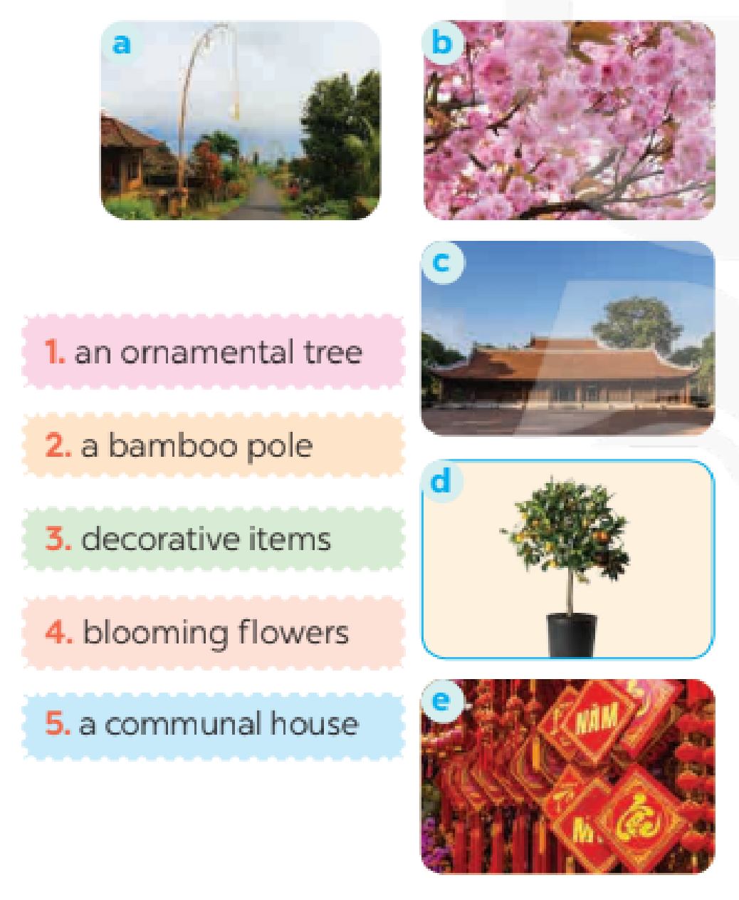
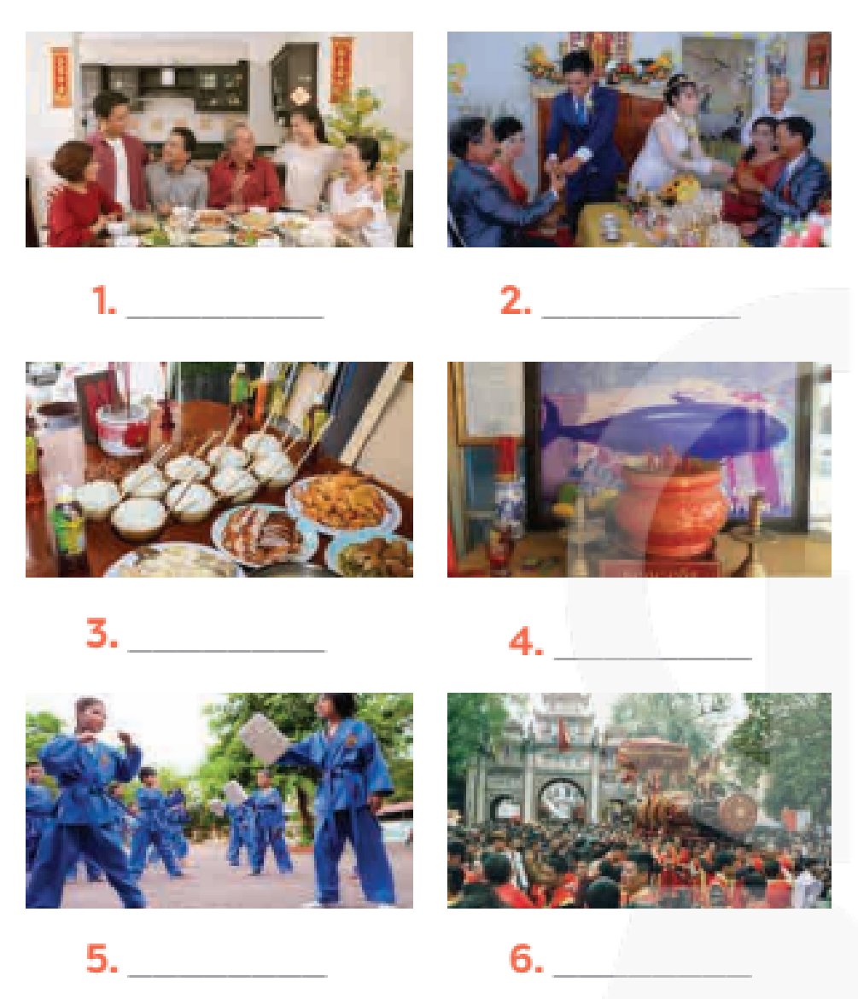
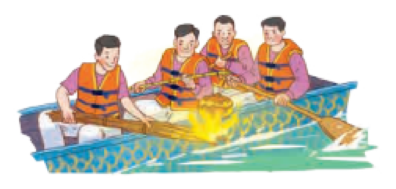
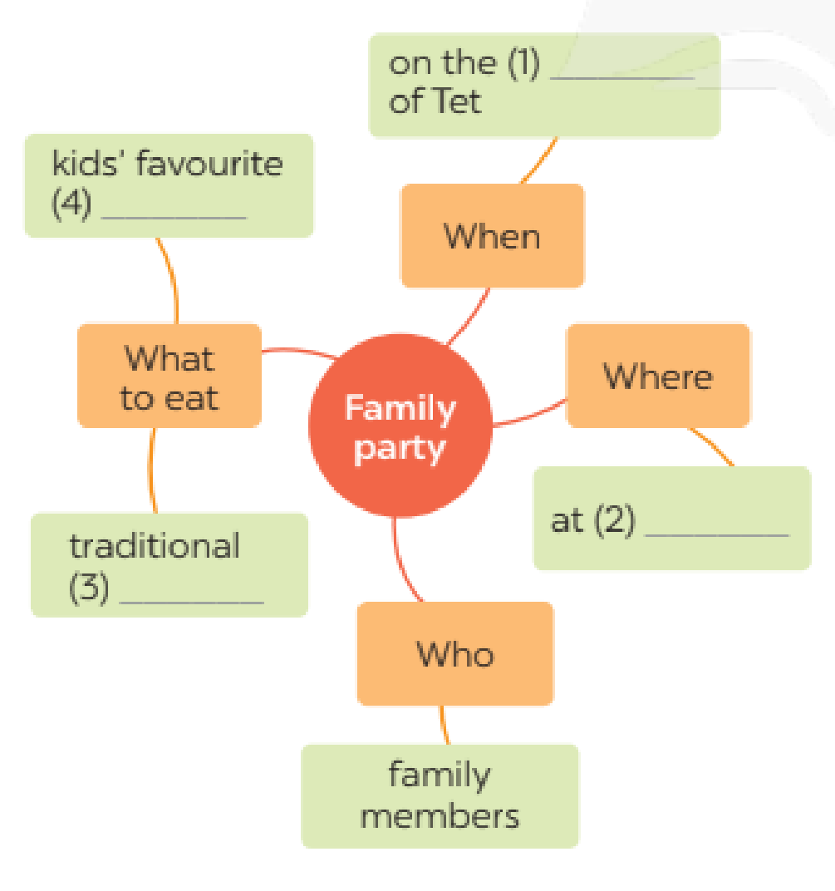
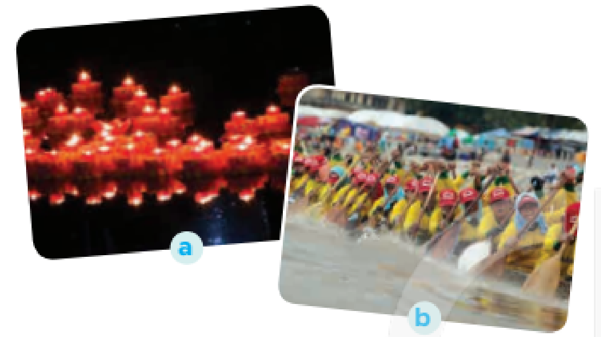

<!-- pdf:52 -->

# UNIT 5: OUR CUSTOMS AND TRADITIONS

> **THIS UNIT INCLUDES:**
> - **Vocabulary:**
>   - Customs and traditions
> - **Pronunciation:**
>   - Sounds: /n/ and /ŋ/
> - **Grammar:**
>   - Articles (*a / an*, *the*, and *zero article*)
> - **Skills:**
>   - Reading about a local festival
>   - Talking about a normal family event that you take part in
>   - Listening about a festival
>   - Writing an email to give advice on taking part in a festival
> - **Everyday English:**
>   - Giving advice
<!-- ocr-ok: đã đối chiếu ảnh trang gốc, khung tóm tắt đầu bài hai cột kèm kí hiệu phiên âm /n/ và /ŋ/ -->

## GETTING STARTED

**Tet is coming!**

**1. Listen and read.**

**Elena:** Wow, this girl looks so cute.

**Trang:** Yeah... She's my cousin. She's at Sa Dec Flower Village. Tet is coming soon, so many people visit flower villages to take pictures with the blooming flowers.

**Elena:** Oh, I'm fond of **admiring** the flowers. Does your family visit places like this too?

**Trang:** Yes, we do. We usually visit Nhat Tan Village to buy kumquat trees and peach blossoms.
<!-- term: kumquat trees -->
<!-- term: peach blossoms -->
<!-- ocr-ok: đã đối chiếu ảnh trang gốc, OCR đọc nhầm kumquat thành kumgquat -->

**Elena:** I see flowers and **ornamental trees** everywhere these days. What are they for?

**Trang:** We, Vietnamese, use plants and flowers for decorations and for **offerings**. They are an important part of our Tet tradition.
<!-- term: tradition -->

**Elena:** And what's that tall tree in the photo?

**Trang:** Well, it's actually a **bamboo pole**. People place it in the yard of the communal house. They hang **decorative** items like small bells and **lanterns** on it. They want to **chase away** bad luck and **pray** for a lucky new year.

**Elena:** Interesting! I didn't know that.

<!-- pdf:53 -->

**2. Read the conversation again and tick (✓) T (True) or F (False).**

| | T | F |
| --- | --- | --- |
| 1. Elena and Trang are at Sa Dec Flower Village. | | |
| 2. Many people visit flower villages to take photos. | | |
| 3. Trang's family usually buys kumquat trees and peach blossoms at Nhat Tan Village. | | |
| 4. Flowers are not part of any Vietnamese traditions. | | |
| 5. People decorate **bamboo poles** with small bells and **lanterns** for New Years. | | |

**3. Match the phrases with the correct pictures.**

1. an **ornamental tree**
2. a **bamboo pole**
3. **decorative** items
4. blooming flowers
5. a communal house

**4. Complete the sentences with the verbs from the box.**

| **admire** | chase | **pray** | place |
| --- | --- | --- | --- |
<!-- ocr-ok: đã đối chiếu ảnh trang gốc, OCR đọc nhầm chữ admire thành Sgmire -->

1. The British decorate their Christmas trees and \_\_\_\_\_\_\_ presents under them.
2. Tom likes to \_\_\_\_\_\_\_ the view from the hill.
3. In many cultures, knocking on wood is a way to \_\_\_\_\_\_\_ away **bad spirits**.
4. Many Asians go to Buddhist temples to \_\_\_\_\_\_\_ for good luck.

**5. QUIZ: New Years around the world**
<!-- ocr-ok: đã đối chiếu ảnh trang gốc, chữ QUIZ in màu cách điệu -->

**People around the world celebrate New Years differently. Choose the country with each tradition below.**

1. Visiting pagodas
   - A. The US
   - B. Viet Nam
2. Throwing water at each other
   - A. Thailand
   - B. Japan
3. Ringing a bell 108 times
   - A. Japan
   - B. Viet Nam
4. Giving and receiving lucky money
   - A. The US
   - B. Viet Nam
5. Watching a ball drop at midnight in Times Square
   - A. Thailand
   - B. The US
<!-- ocr-ok: đã đối chiếu ảnh trang gốc, các phương án A và B trình bày hai cột -->

<!-- pdf:54 -->

## A CLOSER LOOK 1

### Vocabulary

**1. Write a phrase from the box under each picture.**

| wedding **ceremony** | whale **worship** |
| --- | --- |
| food **offerings** | **family reunion** |
| **martial arts** | **festival goers** |

1. \_\_\_\_\_\_\_
2. \_\_\_\_\_\_\_
3. \_\_\_\_\_\_\_
4. \_\_\_\_\_\_\_
5. \_\_\_\_\_\_\_
6. \_\_\_\_\_\_\_
<!-- ocr-ok: đã đối chiếu ảnh trang gốc, 6 chỗ trống đánh số 1-6 nằm dưới từng tranh minh hoạ -->

**2. Complete each sentence with the correct option A, B, or C.**

1. We have a tradition of holding a family \_\_\_\_\_\_\_ on the first day of Tet.
   - A. reunion
   - B. work
   - C. meal
2. It's a tradition for shops to have a lion dance performance at their opening \_\_\_\_\_\_\_.
   - A. **worship**
   - B. celebration
   - C. **ceremony**
3. The tradition of \_\_\_\_\_\_\_ whales is popular in Vietnamese **coastal** villages.
   - A. **admiring**
   - B. **worshipping**
   - C. **praying**
4. She broke with family tradition by not practising \_\_\_\_\_\_\_.
   - A. acrobat
   - B. **martial arts**
   - C. **offering**
<!-- term: break with tradition -->
5. Traditionally, the Vietnamese prepare \_\_\_\_\_\_\_ to **worship** their ancestors during Tet.
   - A. **offerings**
   - B. decoration
   - C. **worshipping**

**3. Complete the sentences with the word and phrases from the box.**

| traditionally |
| --- |
| maintain our traditions |
| break with tradition |
| customs we practise |
| it's becoming a custom for |

1. This year, we will \_\_\_\_\_\_\_ and go on holiday instead of staying at home during Tet.
2. \_\_\_\_\_\_\_, children in the US go from house to house to ask for sweets on Halloween.
3. Holding a party to wish our grandparents **longevity** is one of the \_\_\_\_\_\_\_ at Tet.
<!-- term: custom -->
4. Organising a folk song club is one way for us to \_\_\_\_\_\_\_.
5. \_\_\_\_\_\_\_ young people to celebrate New Years in addition to Tet.

### Pronunciation

**/n/ and /ŋ/**
<!-- ocr-ok: đã đối chiếu ảnh trang gốc, kí hiệu phiên âm /n/ và /ŋ/ -->

**4. Listen and repeat the words. Pay attention to the sounds /n/ and /ŋ/.**
<!-- ocr-ok: đã đối chiếu ảnh trang gốc, OCR đọc nhầm kí hiệu phiên âm /ŋ/ -->

| /n/ | /ŋ/ |
| --- | --- |
| thin | thing |
| land | thank |
| **ceremony** | single |
| **longevity** | language |
| tradition | **offering** |

<!-- pdf:55 -->

**5. Listen and practise the sentences. Underline the words with the sound /n/ and circle the words with the sound /ŋ/.**
<!-- ocr-ok: đã đối chiếu ảnh trang gốc, OCR đọc nhầm kí hiệu phiên âm /ŋ/ -->

1. Mary wore a pink dress last night.
2. I think we should buy this **ornamental tree**.
3. He thanked the host for the enjoyable party.
4. My mum made the spring rolls for the **longevity** party.
5. I will bring some food to the party on Saturday.

## A CLOSER LOOK 2

### Grammar

**Articles (a / an, the, and zero article)**

**Remember!**

Articles in English include *a / an*, *the*, and the *zero article*.
Sometimes, we use nouns without *a / an* or *the*. We call this the *zero article*.
We use the *zero article*
- with uncountable or abstract nouns.
  *Example:* Sugar is not good for your teeth.
- when making general statements.
  *Example:* Students should work hard.
- when describing general forms of transport.
  *Example:* We went there by boat.
<!-- term: Articles -->

**1. Choose the correct option in each sentence below.**

1. It takes more than *a* / *an* hour to drive to Can Tho.
2. It's *a* / *Ø* tradition for children to wake up early on Christmas Day.
3. The Ok Om Bok Festival takes place in *the* / *Ø* October.
4. We went to Can Tho by *an* / *Ø* air.
5. **A:** Where's *a* / *the* book?
   **B:** I thought you left it next to the TV.
<!-- ocr-ok: đã đối chiếu ảnh trang gốc, kí hiệu rỗng Ø trong bài tập mạo từ bị OCR đọc thành @ -->

**2. Which of the underlined parts in each question is incorrect? Find and correct it.**

1. *The* (A) **worshipping** Kitchen Gods is *a* (B) long-time tradition of *the* (C) Vietnamese.
2. People organise *the* (A) **worshipping** **ceremony** at *noon* (B) so that *a* (C) Kitchen Gods can leave for Heaven at 12 o'clock.
3. *Most* (A) families in *the* (B) Viet Nam prepare *offerings* (C) for the Kitchen Gods.
4. *The* (A) **offerings** include *a* (B) set of flowers and fruits, *a* (C) paper clothes, and three **carps**.
5. *The* (A) Vietnamese people believe that *the* (B) Kitchen Gods go to Heaven on *carps* (C).
<!-- ocr-ok: đã đối chiếu ảnh trang gốc, chữ A, B, C đặt dưới chân phần gạch chân làm OCR tách dòng -->

<!-- pdf:56 -->

**3. Complete the sentences with a, an, the, or Ø (zero article).**

1. It is a custom in my family to have \_\_\_\_\_\_\_ breakfast at home on Sundays.
2. When visiting a family home in some countries, you should bring \_\_\_\_\_\_\_ small gift with you.
3. Our village festival is held on the 10th of \_\_\_\_\_\_\_ January.
4. Ancient Egyptians **worshipped** \_\_\_\_\_\_\_ Sun.
5. Many people think that hard work is \_\_\_\_\_\_\_ important Vietnamese value.

**4. Complete the text with the or Ø (zero article).**

A recent study in (1) \_\_\_\_\_\_\_ UK shows that family time traditions are good for (2) \_\_\_\_\_\_\_ teens. These traditions include family members playing card games, watching their favourite TV programmes, or performing (3) \_\_\_\_\_\_\_ karaoke shows at weekends with one another. These activities often lead to lots of laughter and (4) \_\_\_\_\_\_\_ fun conversations. By taking part in such activities, teens strengthen (5) \_\_\_\_\_\_\_ bonds with their family.

**5. GAME: Bingo!**
<!-- ocr-ok: đã đối chiếu ảnh trang gốc, chữ GAME in màu cách điệu -->

**Work in groups.**

1. Read the sentences that the teacher gives you.
2. Identify the mistake with article(s) in each sentence.
3. Correct the mistakes.
4. Say *Bingo!* as soon as your group finishes.
5. The first group to come up with all the correct answers wins.

## COMMUNICATION

### Everyday English

**Giving advice**

**1. Listen and read the conversation below. Pay attention to the highlighted parts.**

**Tom:** My parents are taking me to their friend's house for dinner. Could you tell me a bit about Vietnamese **table manners**?

**Mai:** Well, *perhaps you should* wait for the host to start eating.

**Tom:** I will.

**Mai:** *It's a good idea* to hand bowls with both hands.

**Tom:** Sure. I'll remember that one.

**Mai:** And *don't* hit the bowl with your chopsticks. This may bring bad luck to the host family.
<!-- term: Perhaps you should / It's a good idea to -->

**2. Work in pairs. Make similar conversations with the following situations.**

1. Student A is travelling to Sa Pa in winter. He / She doesn't know what to wear. Student B gives advice.
2. Student A is going to a birthday party. He / She doesn't know what kind of gift to bring. Student B gives advice.

**The Japanese lion dance and Vietnamese unicorn dance**

**3. Read the text about the lion dance in Japan and complete the table with the information from the text.**

The lion dance is called *shishi-mai* in Japanese. People perform it during New Year celebrations. *Shishi-mai* groups also perform at other important occasions such as business openings and weddings. Most forms of *shishi-mai* have one or more people performing the dance. The performers are excellent at **acrobatics**. One person controls the lion's head

<!-- pdf:57 -->

and the other moves the lion's body. The lion dances to the sounds of flutes and drums. The drummers and flute players often follow the lion around, but they do not dance with it.

The Japanese perform *shishi-mai* to **chase away** **bad spirits** and to bring good luck.

**Japanese lion dance**

| | |
| --- | --- |
| Japanese name | (1) \_\_\_\_\_\_\_ |
| Occasions | - (2) \_\_\_\_\_\_\_ - other important occasions |
| Number of performers | one or more |
| Skills | (3) \_\_\_\_\_\_\_ |
| Dance partner | no dance partner |
| Musical instruments | (4) \_\_\_\_\_\_\_ and drums |
| Purposes | - to **chase away** (5) \_\_\_\_\_\_\_ - to bring good luck |
<!-- ocr-ok: đã đối chiếu ảnh trang gốc, bảng thông tin múa sư tử Nhật Bản có các chỗ trống (1)-(5) -->

**4. Work in groups. Read Mai's notes on the Vietnamese unicorn dance. Compare the Vietnamese unicorn dance with the Japanese lion dance.**

**Vietnamese unicorn dance**

| | |
| --- | --- |
| Vietnamese name | *mua lan* |
| Occasions | - Mid-Autumn and New Year Festivals - business openings and weddings |
| Number of performers | one or more |
| Skills | **martial arts** and **acrobatics** |
| Dance partner | *ong Dia* |
| Musical instrument | drum |
| Purpose | to wish for luck and success |
<!-- ocr-ok: đã đối chiếu ảnh trang gốc, bảng ghi chú của Mai về múa lân Việt Nam -->

**Example:**
The Vietnamese unicorn dance and the Japanese lion dance are both popular on New Year Festivals.

## SKILLS 1

### Reading

**1. Work in pairs. Look at the picture and answer the following questions.**

1. What are the men doing?
2. When do you think this event occurs?

**2. Read the text. Choose the correct answer A, B, or C.**
<!-- ocr-ok: đã đối chiếu ảnh trang gốc, OCR đọc dính chữ answerA,B,orC -->

**A village festival day**

Every year, people in my village look forward to the third day of Tet. It is one of our most important festival days.

In the morning, we gather along the riverside to watch some competitions. First, there is a special boat race. Some team members cook rice on the boat while others row the boat as fast as they can. The fastest team with well-cooked rice wins the race. Then, the referee **releases a duck** into the middle of the river. **Contestants** jump into the river to catch it. The atmosphere becomes loud with the sound of drums and cheers of **festival goers**.

At noon, there is a village party at the communal house for the elders. Each family also holds a home party. We cook traditional dishes like sticky rice and steamed chicken. Sometimes, we include food that children love, such as *bun cha* or even pizzas!

The village festival helps us maintain our traditions, connect with other people, and strengthen our family bonds.

<!-- pdf:58 -->

1. What is the text mainly about?
   - A. A local tradition.
   - B. A family tradition.
   - C. A cooking contest.
2. To win the boat race, a team must \_\_\_\_\_\_\_.
   - A. row the boat more quickly than the other teams
   - B. be the fastest boat and properly cook the rice
   - C. cook rice properly and catch the duck
3. The phrase "**releases a duck**" in the text means \_\_\_\_\_\_\_.
   - A. gives it freedom
   - B. catches it
   - C. takes it home
4. Why is the festival important?
   - A. Because it is exciting.
   - B. Because people win valuable prizes.
   - C. Because it keeps some village traditions alive.

**3. Read the text again. Complete the mind map about a family party.**

**Family party**
- **When:** on the (1) \_\_\_\_\_\_\_ of Tet
- **Where:** at (2) \_\_\_\_\_\_\_
- **Who:** family members
- **What to eat:**
  - traditional (3) \_\_\_\_\_\_\_
  - kids' favourite (4) \_\_\_\_\_\_\_
<!-- ocr-ok: đã đối chiếu ảnh trang gốc, sơ đồ tư duy Family party có 4 nhánh -->

### Speaking

**4. Work in pairs. Put the questions (A – E) in the correct blanks (1 – 5) to make a complete dialogue. Then role-play it.**

- A. And what do you do at parties?
- B. Lan, what family event do you often take part in?
- C. Do you like these parties?
- D. Where do you hold these parties?
- E. Who joins you at these parties?

**Nick:** (1) \_\_\_\_\_\_\_

**Lan:** Well, I join birthday parties of all my family members.

**Nick:** (2) \_\_\_\_\_\_\_

**Lan:** In a Vietnamese restaurant. But sometimes we break with tradition by going to a Western one.

**Nick:** (3) \_\_\_\_\_\_\_

**Lan:** Everyone in my family.

**Nick:** (4) \_\_\_\_\_\_\_

**Lan:** Well, the birthday person opens the gifts. And everyone has some good food.

**Nick:** (5) \_\_\_\_\_\_\_

**Lan:** Yes, I always look forward to them. They are a great time for **family bonding**.

**5. Make notes about a normal family event that you take part in. Use the questions below as cues.**

- What is the event?
- Where and when does it happen?
- Who joins with you?
- What do you often do at that event?
- Do you like it or not? Why or why not?

**Now work in pairs. Make a dialogue asking and answering about the event. You can use your notes.**

<!-- pdf:59 -->

## SKILLS 2

### Listening

**1. Work in pairs. Look at the photos and answer the following questions.**

1. What can you see in the photos?
2. In which part of Viet Nam might the festival occur?

**2. Listen to part of the programme "Charming Viet Nam". Fill in each blank with no more than TWO words.**
<!-- ocr-ok: đã đối chiếu ảnh trang gốc, OCR đọc nhầm to thành tơ và kí hiệu băng nghe 31 thành 45is -->

**Ok Om Bok Festival**

| | |
| --- | --- |
| Purposes | - to thank the Moon God - to mark the (1) \_\_\_\_\_\_\_ of the Khmer year |
| Time | mid-October (lunar calendar) |
| **Offerings** | (2) \_\_\_\_\_\_\_ and fruits |
| Activities | - singing and dancing - games and traditional (3) \_\_\_\_\_\_\_ - Ngo Boat (4) \_\_\_\_\_\_\_ |
<!-- ocr-ok: đã đối chiếu ảnh trang gốc, bảng thông tin lễ hội Ok Om Bok có các chỗ trống (1)-(4) -->

**3. Listen again and tick (✓) T (True) or F (False).**

| | T | F |
| --- | --- | --- |
| 1. Ok Om Bok is the Moon **Worshipping** Festival. | | |
| 2. On the night of the festival, the elders talk about their wishes. | | |
| 3. There are **lantern** contests at the festival. | | |
| 4. Tourists should wear informal clothes when attending the **worshipping** **ceremony**. | | |

### Writing

**4. Work in groups. Read the following pieces of advice for tourists at the Ok Om Bok Festival. Put them in the correct column.**

- a. dress up for the Moon God **offering** **ceremony**
- b. keep quiet when the **monks** and the elders are talking
- c. climb on the animal statues in the temple ground
- d. show respect to the **monks** and the elders
- e. refuse **young rice** when the elders offer it to you
- f. litter the temple ground

| Dos | Don'ts |
| --- | --- |
| - dress up for the Moon God **offering** **ceremony** - ... | - litter the temple ground - ... |

**5. Tom sent you an email. Read part of his email below.**

"... Guess what! My dad is taking me with him to Soc Trang Province. We will be there during the Ok Om Bok Festival. What are some dos and don'ts at this festival? ..."

**Write an email (80 – 100 words) to advise Tom about participating in the Ok Om Bok Festival.**

> **New Message**
> **To:** handsometom@mymail.com | Cc Bcc
> **Subject:** Re: Ok Om Bok Festival
>
> Dear Tom,
> \_\_\_\_\_\_\_\_\_\_\_\_\_\_\_\_\_\_\_\_\_\_\_\_\_\_\_\_\_\_\_\_\_\_\_\_\_\_\_
> \_\_\_\_\_\_\_\_\_\_\_\_\_\_\_\_\_\_\_\_\_\_\_\_\_\_\_\_\_\_\_\_\_\_\_\_\_\_\_
> Cheers,
<!-- ocr-ok: đã đối chiếu ảnh trang gốc, khung soạn thảo thư điện tử New Message -->

<!-- pdf:60 -->

## LOOKING BACK

### Vocabulary

**1. Choose the correct option to complete each sentence below.**

1. It is becoming a \_\_\_\_\_\_\_ for many families in Viet Nam to celebrate Women's Day and Family Day.
   - A. habit
   - B. custom
2. \_\_\_\_\_\_\_, we hold the Spring Festival on the 15th of January in Lunar calendar.
   - A. Traditionally
   - B. In the past
3. Janet is from a family of doctors, but she broke with \_\_\_\_\_\_\_ when she went to an art college.
   - A. tradition
   - B. habit
4. Having dinner at my grandparents' house on Saturdays is one of the customs our family \_\_\_\_\_\_\_.
   - A. does
   - B. practises
5. Story telling is a great way to \_\_\_\_\_\_\_ the local tradition alive.
   - A. maintain
   - B. keep

**2. Fill in each blank with the suitable form of the word given.**

1. Kien was so tall that no one recognised him at the family \_\_\_\_\_\_\_ last summer. (union)
2. My mum puts in a lot of effort to prepare \_\_\_\_\_\_\_ to **worship** our ancestors. (offer)
3. The festival \_\_\_\_\_\_\_ gathered on the riverside to cheer the boat racers. (go)
4. Dragon-snake (Rong ran len may) is a \_\_\_\_\_\_\_ Vietnamese game for children. It is very enjoyable. (tradition)
5. We happened to see some locals \_\_\_\_\_\_\_ animals in their village temples. (**worship**)

### Grammar

**3. Complete the sentences with a, an, the or Ø (zero article).**
<!-- ocr-ok: đã đối chiếu ảnh trang gốc, kí hiệu rỗng Ø trong đầu bài bị OCR đọc thành @ -->

1. These days, many teenagers write \_\_\_\_\_\_\_ emails instead of letters.
2. My dad bought \_\_\_\_\_\_\_ ornamental kumquat tree for Tet.
3. I don't like that restaurant. \_\_\_\_\_\_\_ food there isn't very good.
4. Don't wear \_\_\_\_\_\_\_ hat when you go into a temple or a pagoda.
5. It's becoming a custom for us to stay out very late on \_\_\_\_\_\_\_ New Year's Eve.

**4. Complete the text with a, an, the or Ø (zero article).**
<!-- ocr-ok: đã đối chiếu ảnh trang gốc, kí hiệu rỗng Ø trong đầu bài bị OCR đọc thành @ -->

Here are two easy ways to raise children's awareness of (1) \_\_\_\_\_\_\_ customs and traditions. First, it is (2) \_\_\_\_\_\_\_ good idea for parents to teach children to cook. By doing this, children can learn and preserve their family recipes. Second, parents can take children to (3) \_\_\_\_\_\_\_ local festivals. This helps them discover (4) \_\_\_\_\_\_\_ culture of their community and develop (5) \_\_\_\_\_\_\_ understanding of local traditions.

<!-- pdf:61 -->

## PROJECT

**LOCAL CUSTOMS AND TRADITIONS**
<!-- ocr-ok: đã đối chiếu ảnh trang gốc, tiêu đề chữ in hoa màu cam -->

**Work in groups.**

1. Choose a custom or tradition practised in your home town.
2. Search for information about that custom or tradition. You can ask your parents or grandparents about it.
   **Use the following guiding questions:**
   - What is the custom / tradition?
   - Who practises it?
   - Where and when do people practise it?
   - What do people do?
   - Why do people practise that custom / tradition?
3. Report your findings to your class. You can use visual aids to illustrate your report.
<!-- ocr-ok: đã đối chiếu ảnh trang gốc, các mục hướng dẫn Project trình bày hai cột -->

### Now I can ...

- use the words related to customs and traditions.
- pronounce the sounds /n/ and /ŋ/ correctly in words and sentences.
- recognise and use articles.
- give advice.
- read about a local festival.
- talk about a normal family event that I take part in.
- listen about a festival.
- write an email to give advice on taking part in a festival.

## 📷 Danh sách hình trong bài

| Mã hình | Trang PDF | Trang sách | Chú thích / Mô tả |
| --- | --- | --- | --- |
| H8-tieng_anh-u05-01 | 53 | 51 | Năm bức ảnh a–e nối với cụm từ 1–5 thuộc bài tập 3 phần Getting Started: (a) cây nêu, (b) hoa nở rộ, (c) đình làng / nhà sinh hoạt cộng đồng, (d) cây quất cảnh, (e) đồ trang trí Tết |
| H8-tieng_anh-u05-02 | 54 | 52 | Sáu bức ảnh 1–6 thuộc bài tập 1 phần A Closer Look 1 – Vocabulary: (1) sum họp gia đình, (2) lễ cưới, (3) mâm cỗ cúng, (4) tục thờ cá Ông, (5) võ thuật cổ truyền, (6) người đi trẩy hội |
| H8-tieng_anh-u05-03 | 57 | 55 | Tranh minh hoạ các chàng trai vừa chèo thuyền đua vừa thổi cơm trên sông thuộc bài tập 1 phần Skills 1 – Reading |
| H8-tieng_anh-u05-04 | 58 | 56 | Sơ đồ tư duy Family party gồm 4 nhánh (When, Where, Who, What to eat) thuộc bài tập 3 phần Skills 1 – Reading |
| H8-tieng_anh-u05-05 | 59 | 57 | Hai bức ảnh a–b (thả đèn hoa đăng và đua ghe Ngo của đồng bào Khmer) thuộc bài tập 1 phần Skills 2 – Listening |
