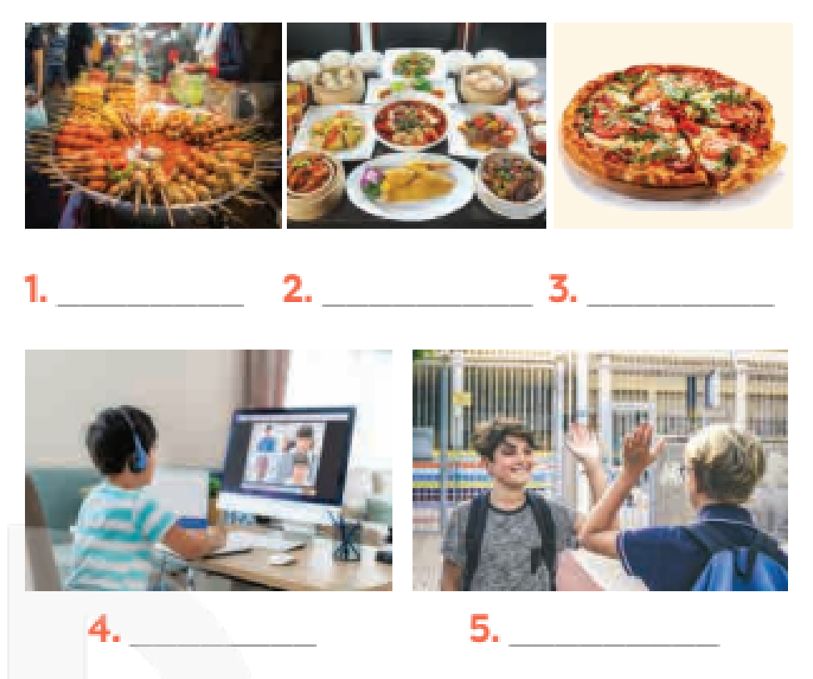
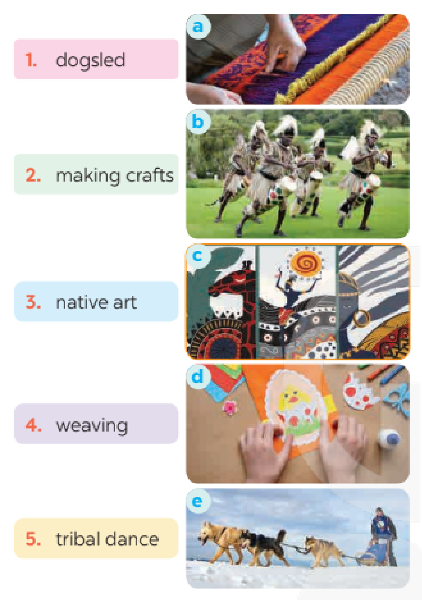
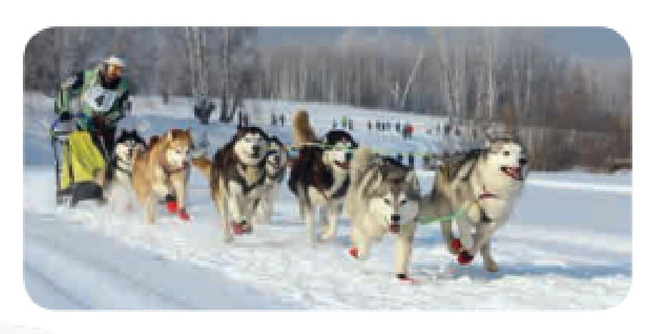
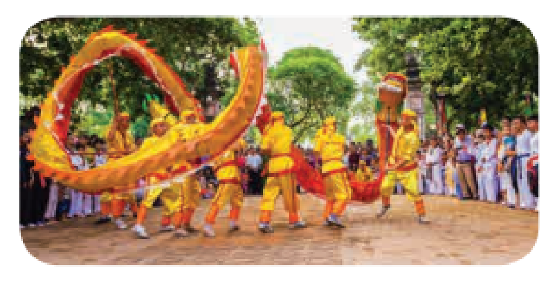
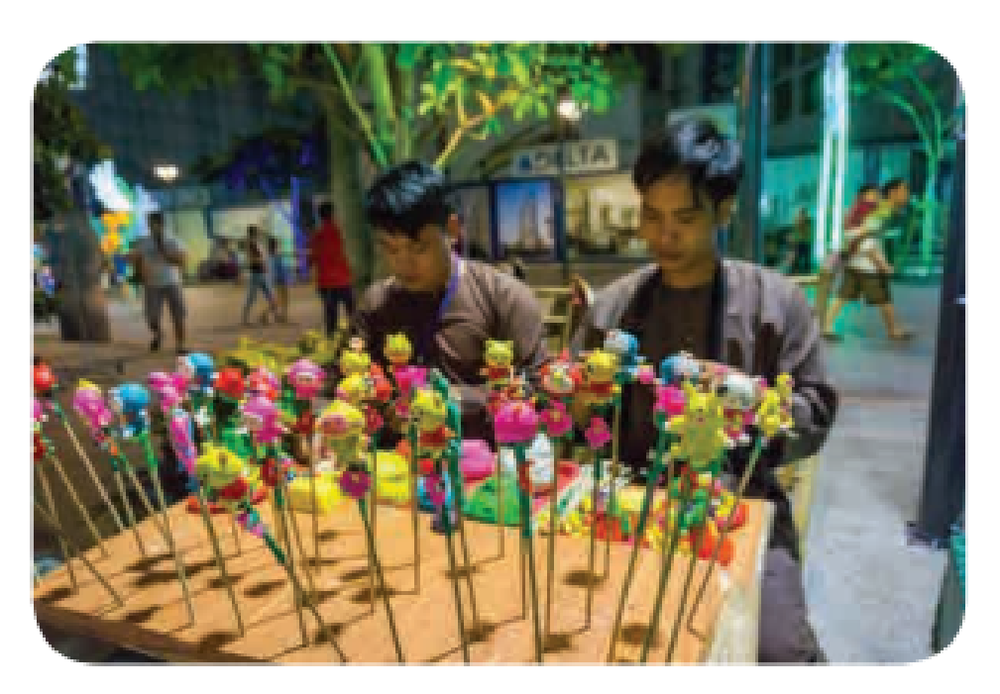
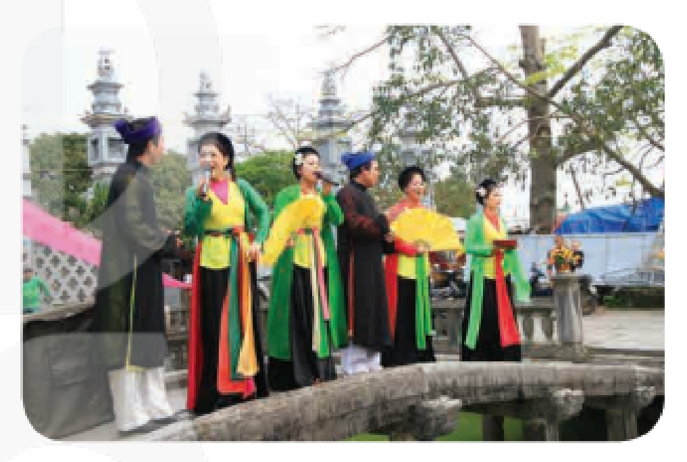

<!-- pdf:62 -->

# UNIT 6: LIFESTYLES

> **THIS UNIT INCLUDES:**
> - **Vocabulary:**
>   - Different **lifestyles**
> - **Pronunciation:**
>   - Sounds: /br/ and /pr/
> - **Grammar:**
>   - Future simple
>   - First conditional
> - **Skills:**
>   - Reading about an interesting **lifestyle** and ways to **maintain** its traditional **lifestyle**
>   - Talking about **maintaining** traditional **lifestyles**
>   - Listening about the **impact** of modern technology on **lifestyles**
>   - Writing a paragraph about the advantages or disadvantages of **online learning**
> - **Everyday English:**
>   - Expressing certainty
<!-- ocr-ok: đã đối chiếu ảnh trang gốc, khung tóm tắt đầu bài hai cột -->

## GETTING STARTED

**Lifestyle differences**

**1. Listen and read.**

**Nam:** Hello, Tom. How're things?

**Tom:** Oh good. I like it here. The **lifestyle** is interesting and different from that in my country.

**Nam:** Really?

**Tom:** Sure. Students here call their teachers by their title "teacher", not by their names.

**Nam:** Right. How do you **greet** your teachers?

**Tom:** We usually say "Hello" or "Good morning" then Mr, Mrs, or Miss and their surnames, for example "Good morning, Mr Smith."

**Nam:** Are there other differences?

**Tom:** People buy and sell a lot of **street food** here. In my country people usually buy food in a store or a restaurant.

**Nam:** Yeah. Buying **street food** is a common practice in my city.
<!-- term: common practice -->

**Tom:** And I've noticed that many people have breakfast on the street too! In my country, we typically have a light breakfast at home.

**Nam:** I see. But here many adults are **in the habit of** having breakfast outside of their homes. If they're not **in a hurry**, they'll even have a leisurely coffee there.

**Tom:** That's fascinating!

<!-- pdf:63 -->

**2. Read the conversation again and complete the table.**

| In Nam's country | In Tom's country |
| --- | --- |
| - Students **greet** teachers by their title. - People eat breakfast (2) \_\_\_\_\_\_\_. - People buy and sell food on the roadside. | - Students refer to their teachers as Mr, Mrs, or Miss and their teachers' (1) \_\_\_\_\_\_\_. - People eat breakfast at home. - People often buy food in a (3) \_\_\_\_\_\_\_. |
<!-- ocr-ok: đã đối chiếu ảnh trang gốc, bảng so sánh hai cột có các chỗ trống (1), (2), (3) -->

**3. Complete each sentence with a word or phrase from the box.**

| **greet** | practice | **lifestyle** |
| --- | --- | --- |
| **serve** | **in the habit of** | |
<!-- ocr-ok: đã đối chiếu ảnh trang gốc, khung từ vựng 3 cột nên OCR đọc theo cột dọc -->

1. A balanced diet and exercise are important for a healthy \_\_\_\_\_\_\_.
2. Handshaking, bowing, and hugging are some of the ways in which people \_\_\_\_\_\_\_ one another.
3. Waiters and waitresses \_\_\_\_\_\_\_ food in restaurants.
4. Going out for breakfast has become a common \_\_\_\_\_\_\_ in this city.
5. My mum is \_\_\_\_\_\_\_ keeping everything in the kitchen bright and clean.

**4. Label each picture with a word or phrase from the box.**

| **greeting** | **online learning** | pizza |
| --- | --- | --- |
| **street food** | food in restaurants | |
<!-- ocr-ok: đã đối chiếu ảnh trang gốc, khung từ vựng 3 cột nên OCR đọc theo cột dọc -->

1. \_\_\_\_\_\_\_
2. \_\_\_\_\_\_\_
3. \_\_\_\_\_\_\_
4. \_\_\_\_\_\_\_
5. \_\_\_\_\_\_\_
<!-- ocr-ok: đã đối chiếu ảnh trang gốc, 5 chỗ trống đánh số 1-5 nằm dưới từng tranh minh hoạ -->

**5. QUIZ: Greetings around the world**
<!-- ocr-ok: đã đối chiếu ảnh trang gốc, chữ QUIZ in màu cách điệu -->

**Take the quiz.**

1. Which is probably the most common way of **greeting** around the world?
   - A. Shaking hands.
   - B. Sticking out one's tongue.
2. In the USA, people **greet** each other by \_\_\_\_\_\_\_.
   - A. shaking heads
   - B. saying "Hello"
3. Thais **greet** their elders by saying "sawadee" and \_\_\_\_\_\_\_.
   - A. saying their surname
   - B. slightly bowing to them
4. The Maori of New Zealand **greet** each other by \_\_\_\_\_\_\_.
   - A. kissing each other's cheek
   - B. pressing their noses together
5. How do people in Japan normally **greet** each other?
   - A. They bow to each other.
   - B. They hug each other.

<!-- pdf:64 -->

## A CLOSER LOOK 1

### Vocabulary

**1. Match the words and phrases with the pictures.**

1. **dogsled**
2. **making crafts**
3. native art
4. weaving
5. **tribal dance**
<!-- ocr-ok: đã đối chiếu ảnh trang gốc, 5 thẻ từ vựng đánh số 1-5 đặt cạnh tranh a-e -->

**2. Complete the sentences with the words and phrases from the box.**

| **tribal dances** | weaving | **dogsled** |
| --- | --- | --- |
| **making crafts** | native art | |

1. The traditional craft of the villagers is \_\_\_\_\_\_\_ bamboo baskets.
2. We all joined in the \_\_\_\_\_\_\_ when we attended the local festival.
3. The gallery in the city centre has an excellent collection of \_\_\_\_\_\_\_.
<!-- term: native art -->
4. Hoa is very keen on \_\_\_\_\_\_\_. She loves to knit gloves after school.
5. The \_\_\_\_\_\_\_ is still used as a means of transport in Alaska today.

**3. Choose the correct answer A, B, or C to complete each sentence.**

1. The **tribal** women know how to \_\_\_\_\_\_\_ these threads into beautiful clothes.
   - A. weave
   - B. make
   - C. cut
2. She comes from Korea, so her \_\_\_\_\_\_\_ language is Korean.
   - A. modern
   - B. native
   - C. practical
3. Sticking out one's tongue was a way of **greeting** in \_\_\_\_\_\_\_ Tibetan culture.
   - A. traditional
   - B. leisurely
   - C. simple
4. How do people \_\_\_\_\_\_\_ New Years in your country, Jack?
   - A. practise
   - B. keep
   - C. celebrate
5. We like that restaurant: it \_\_\_\_\_\_\_ very delicious food.
   - A. practises
   - B. **serves**
   - C. buys

### Pronunciation

**/br/ and /pr/**
<!-- ocr-ok: đã đối chiếu ảnh trang gốc, kí hiệu phiên âm /br/ và /pr/ -->

**4. Listen and repeat the words. Pay attention to the sounds /br/ and /pr/.**
<!-- ocr-ok: đã đối chiếu ảnh trang gốc, OCR đọc nhầm kí hiệu băng nghe 34 thành 34s -->

| /br/ | /pr/ |
| --- | --- |
| bridge | present |
| broccoli | practise |
| breakfast | precious |
| algebra | programme |
| celebrate | express |

<!-- pdf:65 -->

**5. Listen and practise the sentences. Underline the words with the sound /br/ and circle the words with the sound /pr/.**
<!-- ocr-ok: đã đối chiếu ảnh trang gốc, OCR đọc nhầm kí hiệu băng nghe 35 thành 655! -->

1. My brother says **online learning** improves our IT skills.
2. Santa Claus brings a lot of presents to children.
3. She briefly introduced the new programme.
4. He spent a lot of time preparing for his algebra test.
5. My mum prays at the temple before breakfast on Sundays.

## A CLOSER LOOK 2

### Grammar

**The future simple**

**1. Use the verbs from the box with will or won't to complete these dialogues.**

| take | have | tell |
| --- | --- | --- |
| join | attend | do |

**Example:**
**A:** What are you doing this weekend?
**B:** I don't know yet. I think my dad \_\_\_\_\_\_\_ us to the Ethnology Museum.
→ will take

**Remember!**

We use the future simple to describe future possibilities or conditions.
<!-- term: Future simple -->

*Example:*
If I fail the test, I will have to take the course again.

1. **Alice:** Are you taking exams next week, Phong?
   **Phong:** I'm not sure. The teacher \_\_\_\_\_\_\_ us tomorrow.
2. **Linh:** Where are you going on the holiday, Chris?
   **Chris:** We're planning to visit Ta Ho Village. We \_\_\_\_\_\_\_ the local festival, but we \_\_\_\_\_\_\_ the **tribal dance** as it is late in the evening.
3. **Dad:** Are you having **online** lessons tomorrow?
   **Daughter:** No. We \_\_\_\_\_\_\_ lessons, but we \_\_\_\_\_\_\_ experiments in the lab.

**2. Arrange these words and phrases in the correct order to form meaningful sentences.**

1. We / first-term exams / our / will take / very soon /.
   \_\_\_\_\_\_\_\_\_\_\_\_\_\_\_\_\_\_\_\_\_\_\_\_\_\_\_\_\_\_\_
2. Alaska / they / in an **igloo** / stay / when / visit / Will they /?
   \_\_\_\_\_\_\_\_\_\_\_\_\_\_\_\_\_\_\_\_\_\_\_\_\_\_\_\_\_\_\_
3. She / the **tribal** groups / to help them / will work with / **revive** their culture /.
   \_\_\_\_\_\_\_\_\_\_\_\_\_\_\_\_\_\_\_\_\_\_\_\_\_\_\_\_\_\_\_
4. **online learning** / in / I won't choose / the second semester /.
   \_\_\_\_\_\_\_\_\_\_\_\_\_\_\_\_\_\_\_\_\_\_\_\_\_\_\_\_\_\_\_
5. I'll come / to / I go / to London / if / this summer / see you /.
   \_\_\_\_\_\_\_\_\_\_\_\_\_\_\_\_\_\_\_\_\_\_\_\_\_\_\_\_\_\_\_

<!-- pdf:66 -->

**First conditional**

**3. Give the correct tense of the verbs in brackets, using the first conditional.**

1. If you (eat) \_\_\_\_\_\_\_ an apple every day, you will stay healthy.
2. Will Dan wear a kilt if he (go) \_\_\_\_\_\_\_ to Scotland?
3. He (have) \_\_\_\_\_\_\_ sore eyes if he spends too much time on the computer.
4. If you (not do) \_\_\_\_\_\_\_ anything bad, you won't get into trouble.
5. \_\_\_\_\_\_\_ she (be) \_\_\_\_\_\_\_ able to eat the soup if I put some chillies in it?

**Remember!**

We can also use *unless* in conditional sentences. *Unless* means "if ... not" or "except if ...".
<!-- term: First conditional with if and unless -->

*Example:* You will fail the test *unless* you study harder.

**4. Fill in each blank with IF or UNLESS.**
<!-- ocr-ok: đã đối chiếu ảnh trang gốc, OCR đọc dính chữ Fillineachblank -->

1. \_\_\_\_\_\_\_ we eat lunch now, we won't arrive at the cinema on time.
2. The teacher will be furious \_\_\_\_\_\_\_ you don't do the homework.
3. I won't eat kimchi when I go to Korea \_\_\_\_\_\_\_ I have to.
4. \_\_\_\_\_\_\_ you turn on the light, you will be able to see better.
5. You won't be able to find the house \_\_\_\_\_\_\_ you use your GPS. There's no one around.

**5. Complete the following sentences to make them true for you. Then share your answers with a partner.**

1. If it rains tomorrow, \_\_\_\_\_\_\_.
2. Unless I get good marks, \_\_\_\_\_\_\_.
3. If I have free time this weekend, \_\_\_\_\_\_\_.
4. If I study harder, \_\_\_\_\_\_\_.
5. Unless I go to bed early, \_\_\_\_\_\_\_.
<!-- ocr-ok: đã đối chiếu ảnh trang gốc, OCR bỏ sót số thứ tự 1-5 và đọc nhầm chữ I thành | -->

## COMMUNICATION

### Everyday English

**Expressing certainty**

**1. Listen and read the conversations, paying attention to the highlighted sentences.**

1. **Nam:** Can I come over to your house on Sunday?
   **Tom:** *Sure.* You're welcome.

2. **Alice:** Vietnamese cooking uses a lot of vegetables and herbs.
   **Mai:** *Yes, certainly.*
<!-- term: Sure / Yes, certainly -->

**2. Work in pairs. Make similar conversations to express certainty in the following situations.**

1. You ask your friend to help you with your maths homework.
2. You say that Vietnamese love seafood.

**Cuisines around the world**

**3. QUIZ: How much do you know about the cuisines of different countries?**
<!-- ocr-ok: đã đối chiếu ảnh trang gốc, chữ QUIZ in màu cách điệu -->

**Do the quiz to find out.**

1. Which country is famous for pasta and pizza?
   - A. Thailand.
   - B. Italy.
   - C. Brazil.
2. Which country is famous for kimchi?
   - A. Korea.
   - B. Portugal.
   - C. Australia.
3. England is well-known for \_\_\_\_\_\_\_.
   - A. dim sum
   - B. spaghetti
   - C. fish and chips
4. Sushi comes from \_\_\_\_\_\_\_.
   - A. Japan
   - B. Korea
   - C. Taiwan
5. In which country do you think kangaroo steak is common?
   - A. China.
   - B. Australia.
   - C. The USA.
<!-- ocr-ok: đã đối chiếu ảnh trang gốc, các phương án A, B, C trình bày ngang 3 cột -->

<!-- pdf:67 -->

**4. Work in groups. Read the two passages and discuss the questions below.**

**Italy**

Italy is famous for pizza. Pizza is a dish with a flat round bread base with cheese, meat, and vegetables on top. The country is also known for its spaghetti and pasta. Italy is also famous for its many types of cheese (over 400 types). There is one that allows flies to lay eggs on it, and it has a unique taste.

**India**

Curry is a common dish in India. It is a dish of meat and vegetables cooked in a sauce and **served** with rice or bread. In fact, India has a vast range of cuisines. People in some areas of India favour vegetarian food. But chicken, lamb, or goat are common in other areas. Generally, Indians avoid beef.

**Do you prefer Italian or Indian food? Why / Why not?**

**5. Work in groups. Talk about the typical food in your area. Discuss the following:**

- **staple** food
- favourite food
- foods eaten on special occasions

**Example:**
**A:** What is the **staple** food in your area?
**B:** It's rice.
**C:** Yes. We have rice with most of our meals.
...

## SKILLS 1

### Reading

**1. Work in groups. Look at the picture, and discuss what you know about Alaska (its location, climate, native people, culture, ...).**

**Read the text and check your answers.**

If you go to the American state of Alaska, you might find the traditional **lifestyle** there interesting. Although Alaska is quite large, with nearly 1.7 million square kilometres, it has a small population of about 730,000.

The native peoples in Alaska still **maintain** many of their traditions. They keep their old ways of making arts and crafts alive. Various native groups have their own special *styles* of carving or weaving as well as their unique **tribal dances** and drumming. Therefore, visitors to Alaska may **experience** some of their culture in their villages. They may see performances of traditional music and native art in galleries and museums.
<!-- term: native art -->

Alaska is also known for its unusual method of transport – the **dogsled**. Today, dog sledding (= mushing) is more of a sport than a true means of transport. The best-known race is the Iditarod Trail Sled Dog Race, a 1,510 km race from Anchorage to Nome. **Mushers** from all over the world come to Anchorage each March to compete for cash and prizes.
<!-- term: dog sledding -->

<!-- pdf:68 -->

**2. Match the highlighted words in the text with their meanings.**

| | |
| --- | --- |
| 1. **maintain** | a. particular ways of doing something |
| 2. styles | b. people who drive **dogsleds** |
| 3. **experience** | c. to do or feel something |
| 4. **mushers** | d. to keep, make something continue |

**3. Read the text again and answer the questions.**

1. What is the population of Alaska?
   \_\_\_\_\_\_\_\_\_\_\_\_\_\_\_\_\_\_\_\_\_\_\_\_\_\_\_\_\_\_\_
2. Who have special styles of carving or weaving?
   \_\_\_\_\_\_\_\_\_\_\_\_\_\_\_\_\_\_\_\_\_\_\_\_\_\_\_\_\_\_\_
3. Where can we find the culture of the native peoples in Alaska?
   \_\_\_\_\_\_\_\_\_\_\_\_\_\_\_\_\_\_\_\_\_\_\_\_\_\_\_\_\_\_\_
4. How long is the Iditarod Trail Sled Dog Race?
   \_\_\_\_\_\_\_\_\_\_\_\_\_\_\_\_\_\_\_\_\_\_\_\_\_\_\_\_\_\_\_
5. Is the Iditarod Trail Sled Dog Race an international competition?
   \_\_\_\_\_\_\_\_\_\_\_\_\_\_\_\_\_\_\_\_\_\_\_\_\_\_\_\_\_\_\_

### Speaking

**4. Work in pairs. Look at the pictures and use the cues to talk about what people in some places do to maintain their traditional lifestyle.**

1. **Chau An Village:**
   - performing traditional dances
   - holding festivals

2. **Dam Ri Village:**
   - cooking and selling traditional food
   - **making crafts**

3. **Son Ca Village:**
   - weaving clothing
   - singing folk songs

**Example:**
**A:** What do people in Chau An Village do to **maintain** their traditional **lifestyle**?
**B:** They perform traditional dances. They also ...

**5. Work in pairs. Ask and answer about how people in your area maintain their traditional lifestyle. You can use the ideas in 4 and the reading text in 1.**
<!-- ocr-ok: đã đối chiếu ảnh trang gốc, OCR đọc nhầm số 4 và 1 màu cam cuối câu -->

<!-- pdf:69 -->

## SKILLS 2

### Listening

**1. Work in groups. Which of the following do you think is more influenced by modern technology? Tick (✓) your choice(s).**

- ways of communicating ☐
- traditional food and drink ☐
- ways of learning ☐

**2. Listen to the conversation and tick (✓) T (True) or F (False).**

| | T | F |
| --- | --- | --- |
| 1. When Mai was studying **online**, the power went off. | | |
| 2. Chris likes studying **online** as it's convenient. | | |
| 3. Mai says it's easy to concentrate when learning **online**. | | |
| 4. Chris disagrees that technology improves friendship. | | |
| 5. Mai thinks technology is changing our way of learning and working. | | |

**3. Listen again and choose the correct answer to each question.**

1. The talk is generally about \_\_\_\_\_\_\_.
   - A. the **impact** of modern technology
   - B. the good points of **online learning**
   - C. the weak points of **online learning**
2. Both Mai and Chris think that modern technology is \_\_\_\_\_\_\_.
   - A. changing greatly
   - B. changing our **lifestyle**
   - C. entertaining us
3. Mai wants to go to class because \_\_\_\_\_\_\_.
   - A. **online learning** doesn't work for her
   - B. she likes to get up early
   - C. she wants to **interact** with her teachers and friends
4. Which of the following is true?
   - A. Mai and Chris are classmates.
   - B. Mai and Chris have similar ideas about **online learning**.
   - C. Mai thinks **online learning** has some weak points.

### Writing

**4. Look at the list below. Put the ideas about online learning in the correct columns.**

- convenient
- comfortable
- difficult to concentrate
- more freedom
- no real **interaction**
- **independent**
- harmful to our eyes
- expensive equipment

| Advantages | Disadvantages |
| --- | --- |
| | |
<!-- ocr-ok: đã đối chiếu ảnh trang gốc, bảng hai cột Advantages và Disadvantages -->

**5. Write a paragraph (80 – 100 words) about the advantages or disadvantages of online learning. You can refer to the listening and the ideas in 4.**

<!-- pdf:70 -->

## LOOKING BACK

### Vocabulary

**1. Match each word or phrase with its meaning.**

| | |
| --- | --- |
| 1. **lifestyle** | a. making things with one's hands, using skills |
| 2. common practice | b. a vehicle pulled by dogs (usually over snow) |
| 3. **street food** | c. the way in which individuals or groups of people live and work |
| 4. **making crafts** | d. the usual way of doing something |
| 5. **dogsled** | e. ready-to-eat food or drink sold in a street or other public places |

**2. Complete each sentence with a word or phrase from the box.**

| **maintain** | **in the habit of** | **greeted** |
| --- | --- | --- |
| **lifestyle** | **online** lessons | |

1. My younger sister is \_\_\_\_\_\_\_ listening to music while studying.
2. The native people there \_\_\_\_\_\_\_ us warmly when we arrived.
3. Many people are trying to adopt a healthy \_\_\_\_\_\_\_ these days.
4. I believe that \_\_\_\_\_\_\_ are not as interesting as **offline** lessons.
5. It is difficult for some villages to \_\_\_\_\_\_\_ their traditional **lifestyle**.

### Grammar

**3. Complete the sentences, using the correct tense of the verbs in brackets.**

1. No worries. The organisers (send) \_\_\_\_\_\_\_ us an invitation soon.
2. Unless they behave, those children (not be) \_\_\_\_\_\_\_ welcome here.
3. Do you think **online learning** (become) \_\_\_\_\_\_\_ the new mode of education?
4. If I (win) \_\_\_\_\_\_\_ the competition, I will donate half of the prize money to charity.
5. \_\_\_\_\_\_\_ we (have to) \_\_\_\_\_\_\_ keep to the left when we drive in Singapore next week?
<!-- ocr-ok: đã đối chiếu ảnh trang gốc, OCR làm khuyết chữ ở câu 4 và câu 5 -->

**4. Rewrite the following sentences, so that their meaning stays the same.**

1. Don't play computer games for too long. You will harm your eyes.
   If you play \_\_\_\_\_\_\_\_\_\_\_\_\_\_\_\_\_\_\_\_\_\_\_.
2. Be careful with your diet, or you will get overweight.
   You will \_\_\_\_\_\_\_\_\_\_\_\_\_\_\_\_\_\_\_\_\_\_\_.
3. We'll go to the beach unless it rains.
   If \_\_\_\_\_\_\_\_\_\_\_\_\_\_\_\_\_\_\_\_\_\_\_.
4. If you don't **hurry** up, you will be late.
   Unless \_\_\_\_\_\_\_\_\_\_\_\_\_\_\_\_\_\_\_\_\_\_\_.
5. Unless the teacher explains the lesson again, we won't understand it very well.
   If \_\_\_\_\_\_\_\_\_\_\_\_\_\_\_\_\_\_\_\_\_\_\_.

<!-- pdf:71 -->

## PROJECT

**Interesting lifestyles around the world**
<!-- ocr-ok: đã đối chiếu ảnh trang gốc, tiêu đề chữ nghiêng màu xanh lá -->

**Work in groups.**

1. Find information about an interesting way of life around the world, including:
   - everyday life
   - ways of cooking
   - **making crafts**
   - folk songs and dances
   - festivals
   - ...

   **You can refer to one of these, or you can choose your own. You may need to use the Internet to find information.**
   - Life of residents in Coober Pedy, Australia
   - **Nomadic** life in Mongolia
   - Life of the Ede ethnic group of Viet Nam

2. Work in groups. Make a poster to introduce the people.
3. Give a presentation to the class.
<!-- ocr-ok: đã đối chiếu ảnh trang gốc, các bước 1-3 phần Project trình bày hai cột -->

### Now I can ...

- use the words related to the topic *Lifestyles*.
- pronounce the sounds /br/ and /pr/ correctly in words and sentences.
- use the future simple and the first conditional.
- express certainty.
- read about an interesting **lifestyle** and ways to **maintain** its traditional **lifestyle**.
- talk about **maintaining** traditional **lifestyles**.
- listen about the **impact** of modern technology on **lifestyles**.
- write a paragraph about the advantages or disadvantages of **online learning**.

## 📷 Danh sách hình trong bài

| Mã hình | Trang PDF | Trang sách | Chú thích / Mô tả |
| --- | --- | --- | --- |
| H8-tieng_anh-u06-01 | 63 | 61 | Năm bức ảnh 1–5 thuộc bài tập 4 phần Getting Started: (1) thức ăn đường phố, (2) món ăn trong nhà hàng, (3) bánh pizza, (4) học trực tuyến, (5) chào hỏi |
| H8-tieng_anh-u06-02 | 64 | 62 | Năm bức ảnh a–e nối với từ/cụm từ 1–5 thuộc bài tập 1 phần A Closer Look 1 – Vocabulary: (a) dệt thổ cẩm, (b) điệu múa bộ lạc, (c) nghệ thuật bản địa, (d) làm đồ thủ công, (e) xe trượt tuyết chó kéo |
| H8-tieng_anh-u06-03 | 67 | 65 | Ảnh xe trượt tuyết chó kéo trên tuyết ở bang Alaska thuộc bài tập 1 phần Skills 1 – Reading |
| H8-tieng_anh-u06-04 | 68 | 66 | Ảnh múa rồng tại lễ hội truyền thống (1. Chau An Village) thuộc bài tập 4 phần Skills 1 – Speaking |
| H8-tieng_anh-u06-05 | 68 | 66 | Ảnh nghệ nhân nặn tò he truyền thống (2. Dam Ri Village) thuộc bài tập 4 phần Skills 1 – Speaking |
| H8-tieng_anh-u06-06 | 68 | 66 | Ảnh các liền anh liền chị hát dân ca (3. Son Ca Village) thuộc bài tập 4 phần Skills 1 – Speaking |
