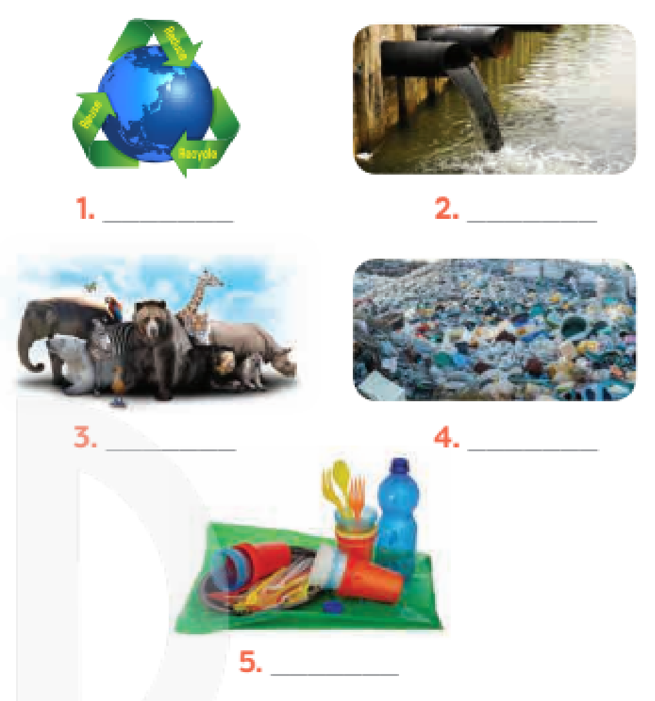
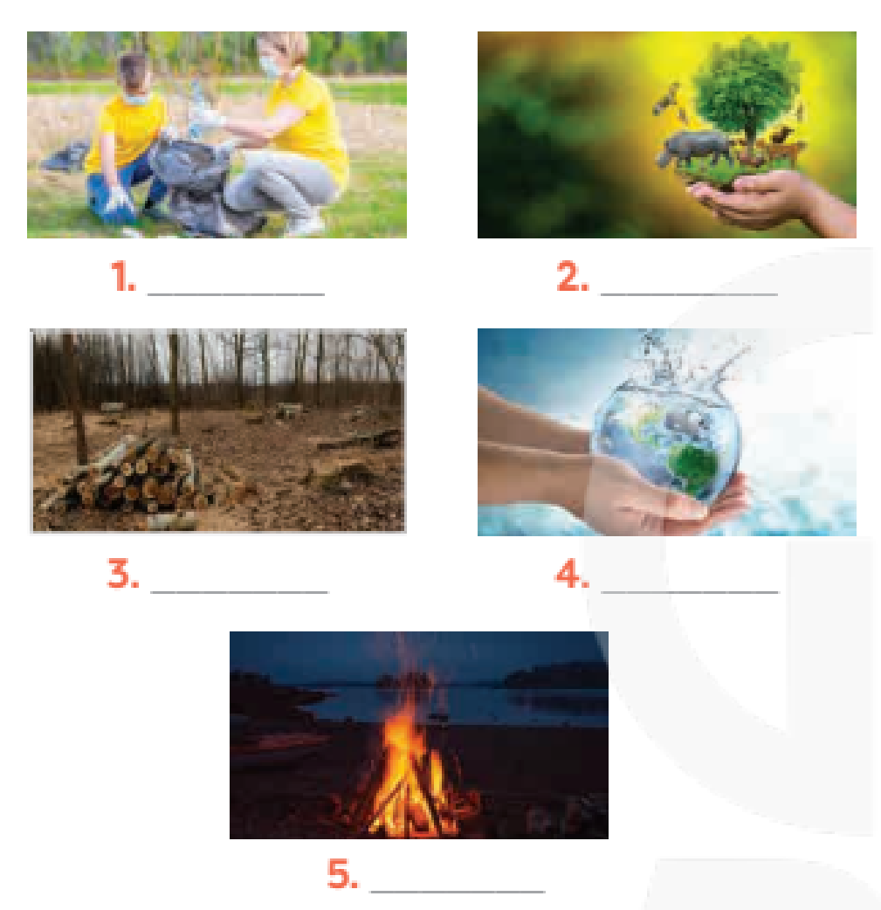
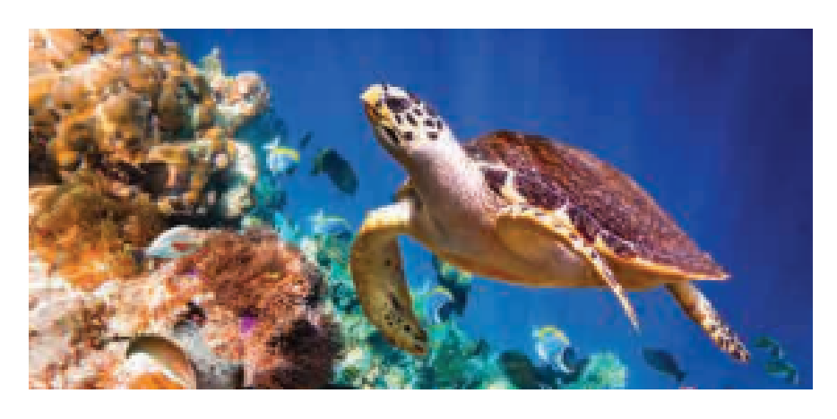

<!-- pdf:74 -->

# UNIT 7: ENVIRONMENTAL PROTECTION

> **THIS UNIT INCLUDES:**
> - **Vocabulary:**
>   - Environmental protection
> - **Pronunciation:**
>   - Sounds: /bl/ and /kl/
> - **Grammar:**
>   - Complex sentences with adverb clauses of time
> - **Skills:**
>   - Reading about Con Dao National Park
>   - Talking about Vu Quang National Park
>   - Listening about water pollution
>   - Writing a notice
> - **Everyday English:**
>   - Asking for clarification

## GETTING STARTED

**At the Go Green Club**

**1. Listen and read.**

**Club leader:** Hello. Welcome back. Today we're discussing environmental problems and environmental protection. What are our serious environmental problems now?
<!-- term: environmental protection -->

**Nam:** Pollution and **habitat** loss, I think.
<!-- ocr-ok: đã đối chiếu ảnh trang gốc, OCR đọc nhầm chữ I thành kí tự | -->

**Ann:** I agree. The air and water quality are getting worse and worse.
<!-- ocr-ok: đã đối chiếu ảnh trang gốc, OCR đọc nhầm chữ I thành kí tự | -->

**Club leader:** Any others?

**Ann:** Yes, I can think of some like global warming, **endangered species** loss, ...

**Nam:** So what should we do to help **protect** our environment?

**Club leader:** We can reduce our **carbon footprint** even in our homes.

**Ann:** What do you mean by '**carbon footprint**'?

**Club leader:** It's the amount of **carbon dioxide** we **release** into the environment.

**Ann:** I see. So we can do things like turning off devices when we're not using them.

**Club leader:** Right ... And there is much more we can do, like practising the 3Rs.
<!-- term: 3Rs -->

**Nam:** We can plant more trees in our neighbourhood too.

**Ann:** And try to avoid using **single-use** **products**, like plastic bags, and stop littering.

**Club leader:** Yeah. And we can volunteer at some local environment programmes to save **endangered species**.

<!-- pdf:75 -->

**2. Read the conversation again and match the two halves in the two columns.**

**To protect the environment, we should:**

| | |
| --- | --- |
| 1. reduce | a. using **single-use** **products** |
| 2. turn off | b. littering |
| 3. plant | c. our **carbon footprint** |
| 4. avoid | d. devices when we're not using them |
| 5. stop | e. more trees in our neighbourhood |

**3. Complete each sentence with one word or phrase from the box.**

| reduce | **single-use** |
| --- | --- |
| pollution | **carbon footprint** |
| environment programme | |

1. \_\_\_\_\_\_\_ is a serious problem everywhere.
2. We should avoid dumping waste into lakes and rivers to \_\_\_\_\_\_\_ water pollution.
3. We shouldn't throw away \_\_\_\_\_\_\_ **products** but recycle them.
4. \_\_\_\_\_\_\_ is the amount of **carbon dioxide** we **release** into the environment.
5. We hope a lot more people join our \_\_\_\_\_\_\_.
<!-- ocr-ok: đã đối chiếu ảnh trang gốc, câu 2 từ lakes and bị ảnh chéo che nhẹ nên OCR đọc nhầm thành fry -->

**4. Write a phrase from the box under each picture.**

| plastic rubbish | water pollution |
| --- | --- |
| **single-use** **products** | 3Rs |
| **endangered species** | |

1. \_\_\_\_\_\_\_
2. \_\_\_\_\_\_\_
3. \_\_\_\_\_\_\_
4. \_\_\_\_\_\_\_
5. \_\_\_\_\_\_\_
<!-- ocr-ok: đã đối chiếu ảnh trang gốc, 5 chỗ trống đánh số 1-5 nằm dưới từng tranh minh hoạ -->

**5. QUIZ: Environment Quiz**

**Do the following quiz.**

1. Which of the following is the greenest form of transport?
   - A. Motorbike.
   - B. Bus.
   - C. Bicycle.
2. Which of the following is a renewable source?
   - A. Coal.
   - B. Oil.
   - C. Wind.
3. What causes the most pollution?
   - A. Factories.
   - B. Animals.
   - C. Hospitals.
4. The surroundings in which we live are our \_\_\_\_\_\_\_.
   - A. **habitat**
   - B. place
   - C. environment
5. Which of these will reduce your **carbon footprint**?
   - A. Cutting down a lot of trees.
   - B. Recycling paper **products**.
   - C. Leaving the TV on all night.

<!-- pdf:76 -->

## A CLOSER LOOK 1

### Vocabulary

**1. Label each picture with a phrase from the list.**

- a. building a campfire
- b. cutting down trees
- c. picking up rubbish
- d. **protecting** **endangered species**
- e. saving water
<!-- term: cutting down trees -->
<!-- term: picking up rubbish -->

1. \_\_\_\_\_\_\_
2. \_\_\_\_\_\_\_
3. \_\_\_\_\_\_\_
4. \_\_\_\_\_\_\_
5. \_\_\_\_\_\_\_
<!-- ocr-ok: đã đối chiếu ảnh trang gốc, 5 chỗ trống đánh số 1-5 nằm dưới từng tranh minh hoạ -->

**Tick (✓) the actions above that protect the environment.**

**2. Match each word or phrase in column A with its meaning in column B.**

| A | B |
| --- | --- |
| 1. **ecosystem** | a. the process of making water, air, soil, etc. dirty by adding harmful **substances** |
| 2. pollution | b. the practice of **protecting** the natural environment |
| 3. **habitat** | c. the way living and non-living things in a particular area are related to each other |
| 4. environmental protection | d. animals facing a high risk of **extinction** in the wild |
| 5. **endangered species** | e. the place where a type of plant or animal lives |
<!-- term: pollution -->
<!-- term: environmental protection -->

**3. Complete each sentence with a word or phrase from the box.**

| **habitat** | cutting down trees |
| --- | --- |
| **ecosystem** | **endangered species** |
| **carbon dioxide** | |

1. People in my neighbourhood are doing a lot to save \_\_\_\_\_\_\_.
2. Con Dao National Park provides a rich \_\_\_\_\_\_\_ for marine life.
3. Forests help **release** **oxygen** and absorb \_\_\_\_\_\_\_; they also provide homes for many **species**.
4. \_\_\_\_\_\_\_ is a serious environmental concern as it harms natural **habitats**.
5. An \_\_\_\_\_\_\_ may be a whole forest, or a small pond, and it can be of any size.
<!-- term: cutting down trees -->

### Pronunciation

**/bl/ and /kl/**

**4. Listen and repeat the words. Pay attention to the sounds /bl/ and /kl/.**

| /bl/ | /kl/ |
| --- | --- |
| block | clean |
| blast | clown |
| blanket | club |
| black | class |
| problem | clear |
<!-- ocr-ok: đã đối chiếu ảnh trang gốc, bảng phát âm hai cột /bl/ và /kl/ -->

**5. Listen and practise the sentences. Underline the words with /bl/, and circle the words with /kl/.**

1. Look! There are black clouds all over!
2. A truck blocked the way to the club.
3. The students painted the classroom blue.
4. The wind blew the clock down.
5. We cleaned up the environment after the blast.

<!-- pdf:77 -->

## A CLOSER LOOK 2

### Grammar

*Complex sentences with adverb clauses of time*

**Remember!**

- A complex sentence contains one independent clause and at least one dependent clause.
  *Example:*
  *The roads were slippery* (independent clause) *when it rained.* (dependent clause)
- An adverb clause is a dependent clause.
- An adverb clause of time shows when something happens. It is usually introduced by time connectors: *before*, *after*, *when*, *while*, *till* / *until*, *as soon as*, ...
  *Example:* *As soon as* they arrive, we'll have lunch.
<!-- term: Complex sentences with adverb clauses of time -->

**1. Read the sentences and write I.C if the underlined clause is an independent clause or D.C if it is a dependent clause.**

**Example:**
You must be careful *when you cross the street*. (D.C)

1. *I'll wait for you here* until you get back. \_\_\_\_\_\_\_
2. Make sure you lock the door *when you go out*. \_\_\_\_\_\_\_
3. *You must get a permit* before you build a campfire at a national park. \_\_\_\_\_\_\_
4. Don't use too much water *while you are having a shower*. \_\_\_\_\_\_\_
5. *As soon as my friends come,* we will pick up rubbish on the beach. \_\_\_\_\_\_\_
<!-- term: picking up rubbish -->

**2. Choose A, B, or C to complete each sentence.**

1. I was not at home \_\_\_\_\_\_\_ he came to see me yesterday.
   - A. when
   - B. until
   - C. as soon as
2. We called the forest guard unit \_\_\_\_\_\_\_ we saw the bush fire.
   - A. as soon as
   - B. while
   - C. until
3. I went straight to the gym \_\_\_\_\_\_\_ I left home.
   - A. while
   - B. before
   - C. after
4. You can stay with us \_\_\_\_\_\_\_ you find a suitable place to stay.
   - A. as soon as
   - B. before
   - C. until
5. We cleaned up everything at the campsite \_\_\_\_\_\_\_ we left.
   - A. until
   - B. before
   - C. while

**3. Match the clauses in the two columns to form complex sentences.**

| | |
| --- | --- |
| 1. We will clean up the beach | a. until he made a successful light bulb. |
| 2. Don't forget to turn off the lights | b. as soon as it stops raining. |
| 3. You have to show your ticket | c. while I'm cooking the soup? |
| 4. Can you help me lay the table | d. before you go out. |
| 5. Thomas Edison kept trying | e. when you get on the train. |

<!-- pdf:78 -->

**4. Combine each pair of sentences, using the conjunction in brackets.**

1. I arrive at the station. I will call you right after. (as soon as)
   \_\_\_\_\_\_\_\_\_\_\_\_\_\_\_\_\_\_\_\_\_\_\_\_\_\_\_\_\_\_\_
2. Many Vietnamese women wear conical hats. They work in the field. (when)
   \_\_\_\_\_\_\_\_\_\_\_\_\_\_\_\_\_\_\_\_\_\_\_\_\_\_\_\_\_\_\_
3. My father taught me how to use the computer. Then he bought one for me. (before)
   \_\_\_\_\_\_\_\_\_\_\_\_\_\_\_\_\_\_\_\_\_\_\_\_\_\_\_\_\_\_\_
4. Nick is reading a novel. Jack is reading a cartoon. (while)
   \_\_\_\_\_\_\_\_\_\_\_\_\_\_\_\_\_\_\_\_\_\_\_\_\_\_\_\_\_\_\_
5. The tornado hit. There were only a few houses left standing. (After)
   \_\_\_\_\_\_\_\_\_\_\_\_\_\_\_\_\_\_\_\_\_\_\_\_\_\_\_\_\_\_\_

**5. GAME: Matching game**

**Work in two groups, A and B. Group A write main clauses. Group B write adverb clauses of time.**

**Do they match? Are there any funny sentences?**

## COMMUNICATION

### Everyday English

*Asking for clarification*

**1. Listen and read the dialogue, paying attention to the highlighted sentences.**

**Mi:** Hey, Linda. *What does '**endangered species**' mean?*
<!-- term: Asking for clarification -->

**Linda:** **Endangered species** are animals in the wild that face a high risk of **extinction**.

**Mi:** *And what do you mean by 'in the wild'?*
<!-- term: Asking for clarification -->

**Linda:** That means animals that live in their natural **habitats**, not in zoos.

**Mi:** Oh, I get it now. Thanks, Linda.
<!-- ocr-ok: đã đối chiếu ảnh trang gốc, OCR đọc nhầm chữ Oh, I thành Ch, | -->

**2. Work in pairs. Make similar conversations to ask for and give clarification for the following.**

- **single-use** **products**
- global warming

**Earth Day**

**3. Read the passage and tick (✓) the correct answers.**

Every year on April 22nd, more than 190 countries celebrate Earth Day to **protect** the planet. The first Earth Day started in 1970 in America. Today more than 1 billion people **participate** in Earth Day activities each year, making it one of the largest movements. By taking part in activities like picking up litter and planting trees, you can help **protect** nature and the environment. You can also do things like buying green **products** and practising reduce, reuse and recycle. We can celebrate Earth Day and **protect** the earth at the same time. Moreover, we should continue doing things to save the earth every day of the year.

<!-- pdf:79 -->

**What activities do people do on Earth Day?**
<!-- ocr-ok: đã đối chiếu ảnh trang gốc, OCR bỏ sót đầu câu hỏi đầu trang 77 -->

1. picking up litter
2. **protecting** **endangered species**
3. planting trees
4. buying green **products**
5. helping neighbours
<!-- ocr-ok: đã đối chiếu ảnh trang gốc, OCR bỏ sót số thứ tự và đọc nhầm các ô vuông đánh dấu -->

**4. Work in groups. Match the activities people do on Earth Day with their results.**

| | |
| --- | --- |
| 1. planting trees | a. making our environment clean, reducing pollution |
| 2. buying green **products** | b. reducing global warming, **protecting** animal **habitats** |
| 3. picking up litter | c. saving electricity to save natural resources |
| 4. turning off the lights | d. improving our health, reducing pollution |

**5. Work in pairs. Ask and answer about the things you and your friends do on Earth Day.**

**Example:**

**A:** What do you do on Earth Day?

**B:** We pick up litter and clean the streets. And you?

**A:** ...

## SKILLS 1

### Reading

**1. Work in groups. Look at the picture and say what you see. Then list the names of some endangered species you know.**

**2. Read the text and choose the words or phrases to make the following statements correct.**

Today, there are national parks all over the world, and the number is rising all the time. A national park is a special area for the protection of the environment and wildlife.

In Viet Nam, there are now 34 national parks. Con Dao National Park is one of them. It became a national park in 1993. The park is in Con Dao District, Ba Ria-Vung Tau Province. It contains 16 small islands covering 20,000 hectares. The **ecosystem** here is very diverse with thousands of **species**, including marine animals. Many **species** of **corals** as well as sea turtles, dolphins, and endangered **dugongs** live here as well. The park is also home to a lot of valuable kinds of woods and medicinal plants. Three ancient trees in the park were named "Vietnamese Heritage Trees".

Con Dao National Park, like other national parks, plays a key role in saving **endangered species** as well as **protecting** the environment and natural resources. It also helps raise the awareness of local **residents** about the importance of nature.

<!-- pdf:80 -->

1. There are 34 *national parks* / *nations' parks* in Viet Nam now.
2. The *conservation* / ***ecosystem*** in Con Dao is very diverse.
3. The **dugong** is a(n) *dangerous* / *endangered* animal.
4. National parks play a key role in saving *the environment* / *small islands*.

**3. Read the text again and choose the correct option A, B, or C.**

1. What is the best title for the passage?
   - A. National Parks in Viet Nam
   - B. Con Dao National Park
   - C. The Protection of Wildlife
2. National parks are areas for \_\_\_\_\_\_\_.
   - A. the protection of the environment
   - B. the management of marine life
   - C. the sale of animal **products**
3. What is the area of Con Dao National Park?
   - A. 34 hectares.
   - B. 16 hectares.
   - C. 20,000 hectares.
4. Con Dao National Park has many kinds of \_\_\_\_\_\_\_.
   - A. valuable plants
   - B. ancient trees
   - C. natural values
5. Which of the following is NOT true, according to the passage?
   - A. There are more and more national parks in the world.
   - B. Con Dao National Park is rich in animal **species**.
   - C. Con Dao National Park's mission is to help other national parks.

### Speaking

**4. Work in pairs. Ask and answer about Vu Quang National Park. Look at the facts.**

- **Location:** Vu Quang District, Ha Tinh Province
- **Opened:** 2002
- **Area:** about 55,000 hectares
- **Animals:** Saolas, "black deer"
- **Valuable plants:** woods, medicinal plants

*Vu Quang National Park*

**Example:**

**A:** Where is Vu Quang National Park?

**B:** It's in Vu Quang District, Ha Tinh Province.

**5. Work in groups. Talk about Vu Quang National Park, using the answers in 4.**

**You can begin your talk with:**

*Vu Quang National Park is in ...*

<!-- pdf:81 -->

## SKILLS 2

### Listening

**1. Work in groups. Make a list of some activities that cause water pollution.**

**Example:**
- throwing rubbish into rivers and lakes
- ...

**2. Listen to the conversation and choose the correct word to complete each sentence.**

1. Polluted water is unsafe for *drinking* / *cooking* and for other uses.
2. Sometimes **toxic** **substances** flow into rivers from *factories* / *hospitals*.
3. Water pollution has a *dangerous* / *harmful* effect on our life.
4. We *couldn't* / *shouldn't* throw litter into rivers and lakes.
<!-- term: water pollution -->

**3. Listen again and give short answers to the following questions. Use no more than THREE words.**

1. What is the listening text about?
2. How many sources of water pollution are there?
3. What are two common sources of drinking water?
4. What type of effect does water pollution have on our life?
5. What **products** can we use to reduce water pollution?

### Writing

**4. Work in pairs. Read the notice and match the headings (a – e) below with the numbers (1 – 5).**

> (1) ABS Secondary School
> **NOTICE**
> (2) March 10, 20...
> **Inter-School Writing Contest**
>
> (3) Our school is organising an inter-school writing contest about the environment. Students from more than 10 schools from all over our town will **participate**. Interested students should contact the school by March 20, 20...
>
> Contest details:
> Time: 2 p.m. – 4 p.m., April 5
> Place: School Grand Hall
> Topic: Environmental Protection
>
> (4) If you have any questions, please contact us at 031-823-1231 or email abs@fmail.com.
>
> (5) Head Teacher
> Dr. Adam Sanders
> (signed)

- a. Name of institution or organisation (school, etc.)
- b. Body (date / time / duration / place, etc.)
- c. Date of writing the notice
- d. Author's name and signature
- e. Contact details

> **Writing tip:**
> A notice can be an announcement, a warning, or an invitation.
> A notice should be brief but contain all the necessary details.

<!-- pdf:82 -->

**5. Write a notice for the Go Green Club leader to invite students to attend a lecture on water pollution. Use the following details.**

- **Time:** 2 p.m. – 4 p.m., March 6
- **Place:** School Grand Hall
- **Topic:** Water pollution

> Go Green Club
> **NOTICE**
> January 12, 20...
> **Lecture On Water Pollution**
> \_\_\_\_\_\_\_\_\_\_\_\_\_\_\_\_\_\_\_\_\_\_\_\_\_\_\_\_\_\_\_
> \_\_\_\_\_\_\_\_\_\_\_\_\_\_\_\_\_\_\_\_\_\_\_\_\_\_\_\_\_\_\_
> \_\_\_\_\_\_\_\_\_\_\_\_\_\_\_\_\_\_\_\_\_\_\_\_\_\_\_\_\_\_\_
> Club Leader
> Nguyen Hong Mai

## LOOKING BACK

### Vocabulary

**1. Choose the correct answer A, B, or C to complete each sentence.**

1. The panda's natural \_\_\_\_\_\_\_ is the bamboo forest.
   - A. **habitat**
   - B. **ecosystem**
   - C. area
2. This forest provides a **habitat** for hundreds of \_\_\_\_\_\_\_ of plants and animals.
   - A. styles
   - B. classes
   - C. **species**
3. \_\_\_\_\_\_\_ the environment must be the job of everyone in the community.
   - A. Caring
   - B. **Protecting**
   - C. Keeping
4. We should \_\_\_\_\_\_\_ the consumption of **single-use** **products** like plastic bottles and bags.
   - A. reduce
   - B. encourage
   - C. raise
5. \_\_\_\_\_\_\_ trees and burning forests destroy a lot of wildlife **habitats**.
   - A. Watering
   - B. Cleaning up
   - C. Cutting down

**2. Complete each of the sentences with a word or phrase from the box.**

| **carbon footprint** | littering |
| --- | --- |
| picking up rubbish | **habitat** |
| **endangered species** | |

1. Do you know that \_\_\_\_\_\_\_ can cause pollution?
2. One effective way to reduce your \_\_\_\_\_\_\_ is to walk or cycle whenever you can.
3. By planting trees and \_\_\_\_\_\_\_, we can improve our environment.
4. Humans are harming the \_\_\_\_\_\_\_ of bees throughout the world.
5. Animals such as saolas and **dugongs** are \_\_\_\_\_\_\_.

### Grammar

**3. Complete the following sentences using a clause. Use your own ideas.**

1. We should wait here until \_\_\_\_\_\_\_.
2. As soon as I arrived, \_\_\_\_\_\_\_.
3. Remember to lock the door before \_\_\_\_\_\_\_.
4. There were not many animals on the mountain after \_\_\_\_\_\_\_.
5. When we finished our picnic, \_\_\_\_\_\_\_.

<!-- pdf:83 -->

**4. Circle A, B, or C to identify the underlined part that needs correction.**

1. *As soon as* (A) it rains, I *go to* (B) school *by bus* (C).
2. I learned *a lot* (A) about wildlife *until* (B) I visited Cuc Phuong National Park *last week* (C).
3. You can't *go out* (A) to play *before* (B) you *will finish* (C) your homework.
4. Instead of *riding* (A) a motorbike, *walk* (B) or cycle *while* (C) you can.
5. *How much* (A) power *do* (B) we *save* (C) this year for Earth Hour?
<!-- ocr-ok: đã đối chiếu ảnh trang gốc, kí hiệu A, B, C đặt dưới chân cụm gạch chân được ghi liền trong ngoặc đơn -->

## PROJECT

**A serious pollution problem in my area**

**Work in groups.**

1. Choose a serious pollution problem in your area (noise pollution, air pollution, water pollution, ...). Suggest solutions to the problem.
2. Make a poster. Write your solutions on the poster. Use pictures to illustrate / decorate your poster.
3. Present your poster to the class.

### Now I can ...

- use the words related to environmental protection.
- pronounce the sounds /bl/ and /kl/ correctly in words and sentences.
- use complex sentences with adverb clauses of time.
- ask for clarification.
- read about Con Dao National Park.
- talk about Vu Quang National Park.
- listen about water pollution.
- write a notice.

## 📷 Danh sách hình trong bài

| Mã hình | Trang PDF | Trang sách | Chú thích / Mô tả |
| --- | --- | --- | --- |
| H8-tieng_anh-u07-01 | 75 | 73 | Năm bức tranh 1–5 thuộc bài tập 4 phần Getting Started: (1) biểu tượng 3Rs, (2) nước thải đổ ra sông, (3) các loài động vật hoang dã có nguy cơ tuyệt chủng, (4) bãi rác nhựa, (5) bộ đồ nhựa dùng một lần |
| H8-tieng_anh-u07-02 | 76 | 74 | Năm bức tranh 1–5 thuộc bài tập 1 phần A Closer Look 1 – Vocabulary: (1) nhặt rác, (2) bảo vệ các loài có nguy cơ tuyệt chủng, (3) chặt phá rừng, (4) tiết kiệm nước, (5) đốt lửa trại |
| H8-tieng_anh-u07-03 | 79 | 77 | Ảnh rùa biển bơi cạnh rạn san hô thuộc bài tập 1 phần Skills 1 – Reading |
