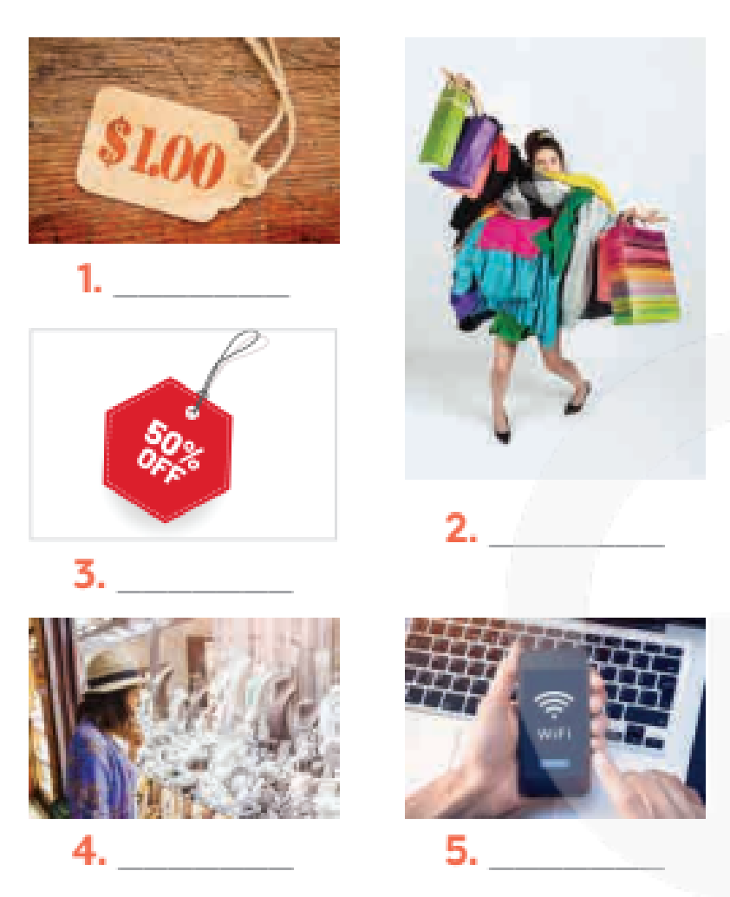

<!-- pdf:84 -->

# UNIT 8: SHOPPING

> **THIS UNIT INCLUDES:**
> - **Vocabulary:**
>   - Words about **shopping**
> - **Pronunciation:**
>   - Sounds: /sp/ and /st/
> - **Grammar:**
>   - Adverbs of frequency
>   - Present simple for future events
> - **Skills:**
>   - Reading about the reasons people go to **shopping centres**
>   - Talking about a **shopping** place
>   - Listening to a talk about online **shopping**
>   - Writing a paragraph about the advantages and disadvantages of a **shopping** place
> - **Everyday English:**
>   - Making **complaints**

## GETTING STARTED

**My favourite shopping place**

**1. Listen and read.**

**Mai:** How was your trip to Bac Ha, Alice?

**Alice:** It's awesome. I like Bac Ha **Fair**, most. It's an **open-air market** in Lao Cai.

**Mai:** What do you like about it?

**Alice:** Many things. The people at the market were wearing really colourful costumes.

**Mai:** Yeah ... They came from different minority groups.

**Alice:** I think so, and most of the products sold at the market were **home-grown** and **home-made**. I love it.

**Mai:** Do you have similar markets in New Zealand?

**Alice:** We do. Back in my city, Auckland, we have a **farmers' market** every Saturday where farmers sell their products. My mother loves **shopping** there, and she rarely misses one.

**Mai:** I prefer **shopping** at the supermarket. I can find almost everything I need there, and I don't have to **bargain**. All the **items** have fixed prices on their **price tags**.

**Alice:** Right. It's more convenient.

**Mai:** Yeah ... Oh, I've got to go. My art lesson starts at one o'clock, and I want to go to a **convenience store** on the way. See you later.

**Alice:** See you.

<!-- pdf:85 -->

**2. Mai and Alice mentioned four places where they can buy things. Complete the list.**

1. **open-air market**
2. \_\_\_\_\_\_\_
3. \_\_\_\_\_\_\_
4. \_\_\_\_\_\_\_

**3. Match the types of markets with the features.**

| Types of markets | Features |
| --- | --- |
| 1. **open-air market** | a. It's outdoor. |
| 2. supermarket | b. **Goods** are **displayed** on shelves. |
| | c. Shoppers can **bargain**. |
| | d. All **items** have fixed prices. |
| | e. The weather does not affect **shopping**. |

**4. Complete the sentences with the words and phrases from the box.**

| **home-grown** | **bargain** |
| --- | --- |
| **home-made** | **price tag** |
| **convenience store** | |

1. – What is '\_\_\_\_\_\_\_'?
   – It's when buyers talk to the sellers to get a lower price.
2. A \_\_\_\_\_\_\_ is a small shop and is usually open 24/7.
3. This salad is made of \_\_\_\_\_\_\_ vegetables.
4. How much is this T-shirt? I cannot see the \_\_\_\_\_\_\_.
5. Try our \_\_\_\_\_\_\_ bread, Mai. My mother made it this morning.

**5. GAME: Listing**

**Work in groups. Quickly write down the names of some speciality shops. The group with the most correct answers wins.**

**Example:** clothes shop, florist's, ...
<!-- ocr-ok: đã đối chiếu ảnh trang gốc, từ florist's có dấu sở hữu cách -->

<!-- pdf:86 -->

## A CLOSER LOOK 1

### Vocabulary

**1. Write the words and phrases under the correct pictures.**

| **shopaholic** | browsing |
| --- | --- |
| **price tag** | **on sale** |
| Internet **access** | |

1. \_\_\_\_\_\_\_
2. \_\_\_\_\_\_\_
3. \_\_\_\_\_\_\_
4. \_\_\_\_\_\_\_
5. \_\_\_\_\_\_\_
<!-- ocr-ok: đã đối chiếu ảnh trang gốc, 5 chỗ trống đánh số 1-5 nằm dưới từng tranh minh hoạ -->

**2. Match the shopping places with their characteristics.**

| | |
| --- | --- |
| 1. a **speciality shop** | a. It offers lower prices on all products. |
| 2. a **discount shop** | b. It uses the Internet to sell **goods** and services. |
| 3. a supermarket | c. It is often outdoor and offers a wide range of **goods**. Buyers can **bargain**. |
| 4. an online shop | d. It is a large indoor **shopping** place with fixed prices for all the **items** offered. |
| 5. an **open-air market** | e. It offers one or two specific kinds of **goods**. |

**3. Complete the sentences with the words and phrases from the box.**

| **shopaholic** | **bargain** |
| --- | --- |
| **speciality shops** | browsing |
| range of products | |
<!-- ocr-ok: đã đối chiếu ảnh trang gốc, OCR đọc nhầm hộp từ vựng bài 3 -->

1. There are many \_\_\_\_\_\_\_ in a **shopping centre**.
2. I spent the whole morning just \_\_\_\_\_\_\_ online for clothes, but I didn't buy anything.
3. Alice doesn't know how to \_\_\_\_\_\_\_, so she paid too much for her T-shirt.
4. Both online and offline supermarkets offer a wide \_\_\_\_\_\_\_.
5. She's a \_\_\_\_\_\_\_. She spends too much time and money **shopping**.

### Pronunciation

**/sp/ and /st/**

**4. Listen and repeat the words. Pay attention to the sounds /sp/ and /st/.**

| /sp/ | /st/ |
| --- | --- |
| spend | stall |
| **speciality** | staff |
| space | outstand |
| respect | honest |
| clasp | waste |
<!-- ocr-ok: đã đối chiếu ảnh trang gốc, bảng phát âm hai cột /sp/ và /st/ -->

**5. Listen and repeat the sentences. Pay attention to the underlined words.**

1. There is a three-*storey* *sports* centre in my neighbourhood.
2. The *assistant* at her shop always gives us *special* attention.
3. The shop owner treats his ***customers*** with a lot of *respect*.
4. The food at that *restaurant* is too *spicy* for me.
5. Tom *spent* half of his savings in that music *store*.

<!-- pdf:87 -->

## A CLOSER LOOK 2

### Grammar

*Adverbs of frequency*

**1. Complete the sentences with the adverbs of frequency from the box.**
<!-- term: Adverbs of frequency -->

| always | often | sometimes |
| --- | --- | --- |
| rarely | never | |

1. My mother \_\_\_\_\_\_\_ shops at the supermarket. She never shops anywhere else.
2. I \_\_\_\_\_\_\_ buy things online, just once or twice a year. I prefer to shop at the **shopping** mall.
3. You can \_\_\_\_\_\_\_ **bargain** at a supermarket because the prices are fixed.
4. How \_\_\_\_\_\_\_ do you return things you buy online?
5. I don't often buy things at the **dollar store**. My mother only takes me there \_\_\_\_\_\_\_.
<!-- term: Adverbs of frequency -->

*Present simple for future events*

**2. Read the schedule for the grade 8 field trip tomorrow, and underline the verbs in the sentences. Then answer the questions.**

**Field trip to the Double Dragon Chocolate Factory** — *30 February*
<!-- ocr-ok: đã đối chiếu ảnh trang gốc, OCR bỏ sót tiêu đề trên nền tím của bảng lịch trình -->

| | |
| --- | --- |
| 9:00 | The bus leaves. |
| 10:00 | Students arrive at the factory. |
| 10:10 | Students watch a documentary introducing the factory. |
| 10:30 | The tour of the factory starts. |
| 12:00 | Students return to school to write the trip reports. |

1. What tense are the verbs in the sentences?
2. Are the sentences about habits or future activities?

**Remember!**

We use the present simple with a future meaning to talk about timetables or **schedules**.
*Example:*
- I have to go now. My art lesson *starts* at one o'clock.
- The train *leaves* at 4:30, so we still have a lot of time.
<!-- term: Present simple for future events -->

**3. Write A next to a sentence if it refers to a timetable, schedule or plan, and B if it is an unplanned future action.**

1. We'*ll go* to Costco to return this suitcase. \_\_\_\_\_\_\_
2. Look! We *have* a whole afternoon for **shopping** on the second day of our tour. \_\_\_\_\_\_\_
3. The summer sales *end* next Sunday. \_\_\_\_\_\_\_
4. Listen to the announcement. The train *doesn't leave* till 12:00. Let's get something to drink. \_\_\_\_\_\_\_
5. I'm too busy today, so we'*ll go* **shopping** on Tuesday. \_\_\_\_\_\_\_

**4. Choose the correct answer to complete each sentence.**

1. The supermarket in my neighbourhood *opens* / *will open* longer hours than the one in yours.
2. Don't worry. I *make* / *will make* a **shopping list**, and you just give it to the shop owner.
3. We *don't buy* / *won't buy* a birthday cake this year. We can bake one at home instead.
4. The bus **schedule** says that there *is* / *will be* a bus to Aeon at 10:05.
5. Look at the **advertisement**. *Does* / *Will* the big sale start next Friday?

<!-- pdf:88 -->

**5. In pairs, ask and answer to check planning events for the community fair next month.**

**Community Fair — 01 April**

| Time | Events |
| --- | --- |
| 01 March | Preparing for the **fair** |
| 03 March | Calling for volunteers |
| 01 April | – 8:30: Opening – 11:00: Holding food competition |
| 02 April | Cleaning up by volunteers |

**Example:**

**A:** When do we start preparing for the **fair**?

**B:** We start on the first of March.

## COMMUNICATION

### Everyday English

*Making complaints*

**1. Listen and read the conversation, paying attention to the highlighted parts.**

**Tom:** *I'm calling to make a **complaint** about* the SMART backpack I ordered from you last week. I got it this morning, and it's smaller than the one you advertised online.
<!-- term: Making complaints -->

**Trang:** Well ... Let me check it.
<!-- ocr-ok: đã đối chiếu ảnh trang gốc, OCR tách nhầm tên nhân vật Trang thành hai dòng -->

**Tom:** And *I'm not happy with* the colour, either. In your picture it's dark brown, and this one is yellowish brown.

**Trang:** I'm sorry about that. I'll send you another one.

**2. Work in pairs. In turns, make complaints about the situations below.**

1. The cans of fish you bought at the shop expired five days ago.
2. An assistant at the shop was not very helpful.

**My favourite shopping place**

**3. Listen to three people talking about their favourite shopping places and tick (✓) the place they mention.**

| People | **Open-air market** | **Discount shop** | **Convenience store** |
| --- | --- | --- | --- |
| 1. Mai | | | |
| 2. Nam | | | |
| 3. Alice | | | |
<!-- ocr-ok: đã đối chiếu ảnh trang gốc, OCR đọc nhầm dòng 1. Mai trong bảng -->

**4. Work in pairs. Take turns to ask and answer what each person in 3 likes about their shopping place.**

1. Mai
2. Nam
3. Alice
<!-- ocr-ok: đã đối chiếu ảnh trang gốc, OCR đọc nhầm số 3 thành số 5 -->

**Example:**

**A:** What does Nam like about **shopping** at a **convenience store**?

**B:** It saves him time.

**5. Work in groups. Share your favourite shopping place with your group.**

**You can include:**
- the name of the place.
- the reason(s) why you like it.

<!-- pdf:89 -->

## SKILLS 1

### Reading

**1. Read the list below and tick (✓) the most common reason(s) why you go shopping.**

- hanging out with friends
- reducing stress
- buying **goods**
- exercising
- browsing

**2. Read the passage and choose the correct answer A, B, or C.**

**Why We Go to Shopping Centres**

**Shopping centres** attract a lot of **customers**, especially at the weekend, on holidays, or during sales. People go there to shop. **Shopping centres** offer a wide range of products to choose from. **Customers** can touch the products and try on clothes and shoes. This makes them feel more comfortable when they decide to buy something.
<!-- term: wide range of products -->

However, people also go to **shopping centres** for many other reasons. Some people go there for entertainment. These centres often offer *year-round* free entertainment for **customers** of all ages such as live music and special performances. During holidays, shoppers can see decorations and join in the holiday excitement. It's a good way to relax. Some people go there just to hang out with friends. They go browsing and chat while wandering through the **shopping** malls. Others visit **shopping centres** to get exercise. They enjoy walking for one or two hours in clean and well-lit areas. Some people even go there to avoid the heat or cold outside. **Shopping centres** offer free air conditioning and heating.
<!-- term: year-round -->

1. People go to a **shopping centre** \_\_\_\_\_\_\_.
   - A. only for **shopping**
   - B. mainly to hang out
   - C. for many reasons
2. At **shopping centres**, **customers** can \_\_\_\_\_\_\_.
   - A. touch the products
   - B. **bargain** to get lower prices
   - C. pay to watch live performances
3. A kind of entertainment at a **shopping centre** is \_\_\_\_\_\_\_.
   - A. fashion contests
   - B. live music
   - C. painting exhibitions
4. Some people exercise at a **shopping centre** because they like its \_\_\_\_\_\_\_.
   - A. crowds
   - B. well-lit areas
   - C. shops
5. The word "*year-round*" in paragraph 2 is similar in meaning to \_\_\_\_\_\_\_.
   - A. always
   - B. sometimes
   - C. rarely

**3. Fill in each blank with ONE word from the passage.**

**Shopping centres**
1. attract a lot of **customers** during \_\_\_\_\_\_\_.
2. allow **customers** to \_\_\_\_\_\_\_ on clothes and shoes.
3. offer free \_\_\_\_\_\_\_ for **customers** of all ages.
4. are full of \_\_\_\_\_\_\_ during holidays.
5. offer \_\_\_\_\_\_\_ air conditioning and heating.

<!-- pdf:90 -->

### Speaking

**4. Work in pairs. Ask and answer about a new shopping centre.**

- Student A reads the suggestions for questions on card A.
- Student B reads the information about the new **shopping centre** on card B (page 91).

**CARD A — Northwood Shopping Centre**
1. Where / it?
2. How many / shops?
3. What / kind of entertainment?
4. What / opening hours?
5. What date / open?
<!-- ocr-ok: đã đối chiếu ảnh trang gốc, OCR bỏ sót số thứ tự câu hỏi trên thẻ CARD A -->

**5. Work in pairs. Ask and answer about a shopping centre, a supermarket, or an open-air market in your area. Take notes of your partner's answers and report them to the class.**

**You can use the suggestions below:**
- where it is
- how you get there
- what its opening hours are
- what you do there
- what you like / don't like about it

<!-- pdf:91 -->

## SKILLS 2

### Listening

**1. Work in pairs. Discuss and tick (✓) the things related to online shopping.**

1. Internet **access**
2. travelling
3. a smartphone / laptop
4. a credit card
<!-- ocr-ok: đã đối chiếu ảnh trang gốc, OCR bỏ sót số thứ tự 1-4 trước danh sách -->

**2. Listen to a talk about online shopping and fill in each blank with a suitable word.**

1. You can buy a product or \_\_\_\_\_\_\_ online.
2. When **shopping** online, you visit a \_\_\_\_\_\_\_ website.
3. Online **shopping** helps you save time and \_\_\_\_\_\_\_.
4. If you return a product, you still must pay for the \_\_\_\_\_\_\_.
5. **Shopping** online can make you become a \_\_\_\_\_\_\_.
<!-- term: online shopping -->

**3. Listen again and choose the correct answer A, B, or C.**
<!-- ocr-ok: đã đối chiếu ảnh trang gốc, OCR đọc dính chữ answerA -->

1. When you shop online, you can pay in \_\_\_\_\_\_\_ way(s).
   - A. one
   - B. two
   - C. three
2. The talk does NOT describe online **shopping** as \_\_\_\_\_\_\_.
   - A. convenient
   - B. easy
   - C. interesting
3. The talk is mainly about \_\_\_\_\_\_\_ of online **shopping**.
   - A. the popularity
   - B. the convenience
   - C. the advantages and disadvantages

### Writing

**4. Work in pairs. Choose a type of shopping from the list. Discuss and take notes of its advantages and disadvantages.**

1. **Shopping** online
2. **Shopping** at a supermarket
3. **Shopping** at an **open-air market**
<!-- ocr-ok: đã đối chiếu ảnh trang gốc, OCR tách rời cột số thứ tự 1-3 -->

**5. Write a paragraph (80 – 100 words) about the advantages or disadvantages of a type of shopping. Use the ideas in 4.**

**You can use the suggestions below:**

- **Shopping** ... is interesting / convenient / safe / ...
- Firstly, ...
- Secondly, ...
<!-- ocr-ok: đã đối chiếu ảnh trang gốc, OCR tách nhầm dòng gợi ý phần Writing -->

<!-- pdf:92 -->

## LOOKING BACK

### Vocabulary

**1. Match the words and phrases (1 – 5) with the meanings (a – e).**

| | |
| --- | --- |
| 1. during sales | a. the action of using the Internet to order food or **goods** |
| 2. browsing | b. a time when many things in a shop are at lower prices than usual |
| 3. online shopping | c. a person who is **addicted** to **shopping** |
| 4. wide range of products | d. going round and looking at the things on **display** |
| 5. **shopaholic** | e. a great number of **goods** |
<!-- term: browsing -->
<!-- term: online shopping -->
<!-- term: wide range of products -->

**2. Complete the sentences with the words and phrases from the box.**

| Internet **access** | offline |
| --- | --- |
| **home-grown** | **bargain** |
| **on sale** | |

1. Look! These sports shoes are \_\_\_\_\_\_\_. They are 30% off.
2. This **item** has a **price tag**, so you cannot \_\_\_\_\_\_\_.
3. Do you have \_\_\_\_\_\_\_ here? I want to check my email.
4. When you visit a **farmers' market**, you will find a lot of \_\_\_\_\_\_\_ fruit and vegetables.
5. My mother always shops \_\_\_\_\_\_\_. She never shops online.

### Grammar

**3. Complete each sentence with a suitable adverb of frequency.**

1. My sister \_\_\_\_\_\_\_ watches the Junior Master Chef programme. She never misses an episode.
2. My mum \_\_\_\_\_\_\_ shops at the supermarket. But I don't go there often.
3. My father \_\_\_\_\_\_\_ goes to a **dollar store**. He says there's nothing worth buying there.
4. We don't \_\_\_\_\_\_\_ go to the supermarket. It's far from our home.
5. These brands are \_\_\_\_\_\_\_ **on sale**, just once or twice a year.

**4. Use the correct tense and form of the verbs in brackets to complete the sentences.**

1. The shuttle bus (leave) \_\_\_\_\_\_\_ every 15 minutes to take **customers** to the parking lot.
2. – Mum, what time (be) \_\_\_\_\_\_\_ the show tonight?
   – Let me check.
3. We (can / use) \_\_\_\_\_\_\_ these vouchers for the next **shopping**.
4. The announcement says that the sale (last) \_\_\_\_\_\_\_ for just two hours, from 17:00 to 19:00 tomorrow.
5. We (not / have) \_\_\_\_\_\_\_ home economics next semester. We have music instead.

<!-- pdf:93 -->

## PROJECT

**YOUR DREAM SHOPPING PLACE**

**Work individually.**

1. Imagine a **shopping** place you would like to have in your neighbourhood.
2. Draw it or find a picture similar to it.
3. Present it to the class.

**You can include:**
- the name of the **shopping** place.
- how beautiful / convenient it is.
- range of products / services / entertainment it offers.
- what is special about it.

**CARD B — Northwood Shopping Centre**
- Opens next month: 24 March
- In Northwood, 8 kilometres from city centre
- More than 60 shops, 4 restaurants, 2 cafes, a cinema, a playground for children
- Opening hours: 9:00 – 21:00

### Now I can ...

- use the words related to **shopping**.
- pronounce the sounds /sp/ and /st/ correctly in words and sentences.
- recognise and use adverbs of frequency and the present simple for future events.
- make **complaints**.
- read about the reasons people go to **shopping centres**.
- talk about a **shopping** place.
- listen to a talk about online **shopping**.
- write a paragraph about the advantages and disadvantages of a **shopping** place.

## 📷 Danh sách hình trong bài

| Mã hình | Trang PDF | Trang sách | Chú thích / Mô tả |
| --- | --- | --- | --- |
| H8-tieng_anh-u08-01 | 86 | 84 | Năm bức tranh 1–5 thuộc bài tập 1 phần A Closer Look 1 – Vocabulary: (1) nhãn giá \$1.00, (2) người nghiện mua sắm xách nhiều túi đồ, (3) thẻ giảm giá 50% OFF, (4) khách hàng dạo xem hàng trưng bày, (5) kết nối mạng WiFi trên thiết bị |
