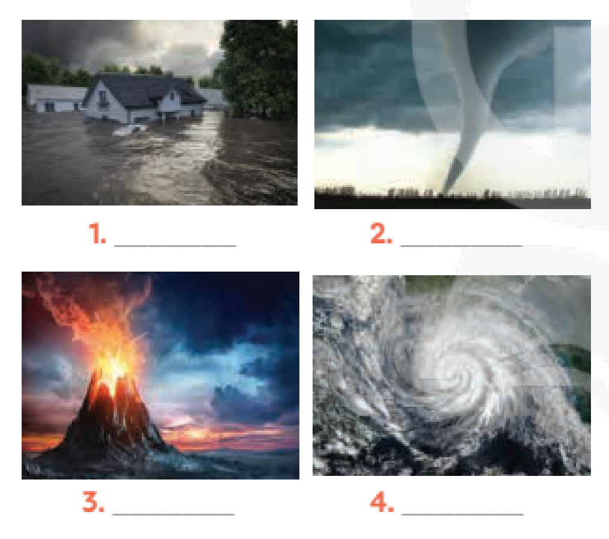
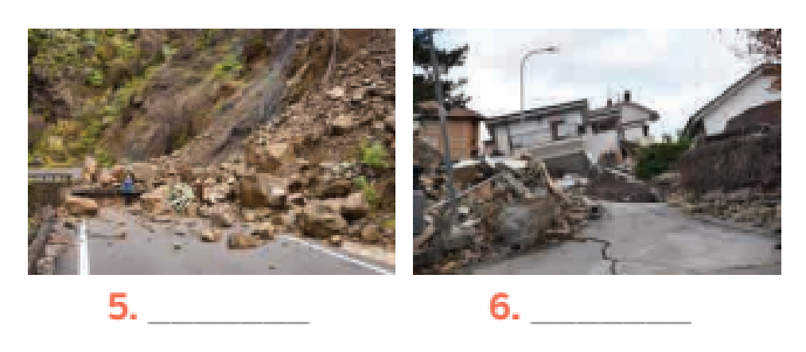
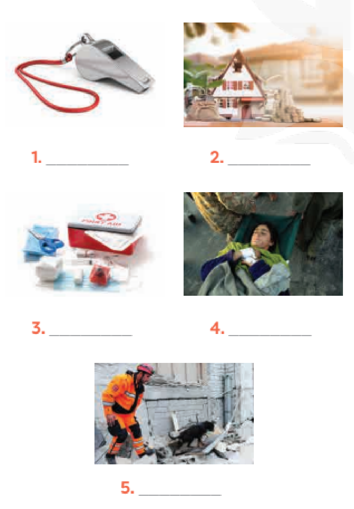
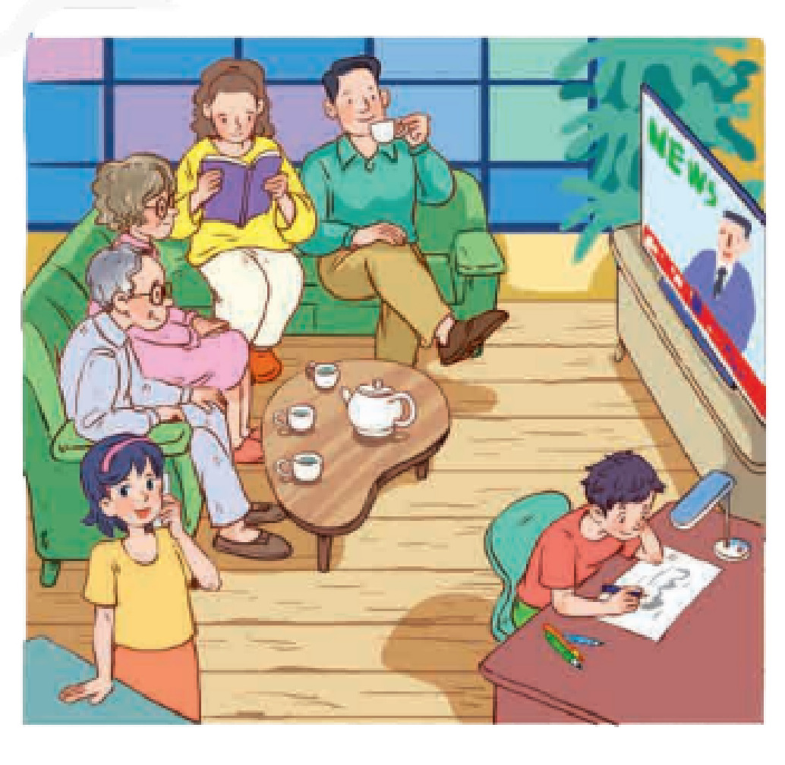
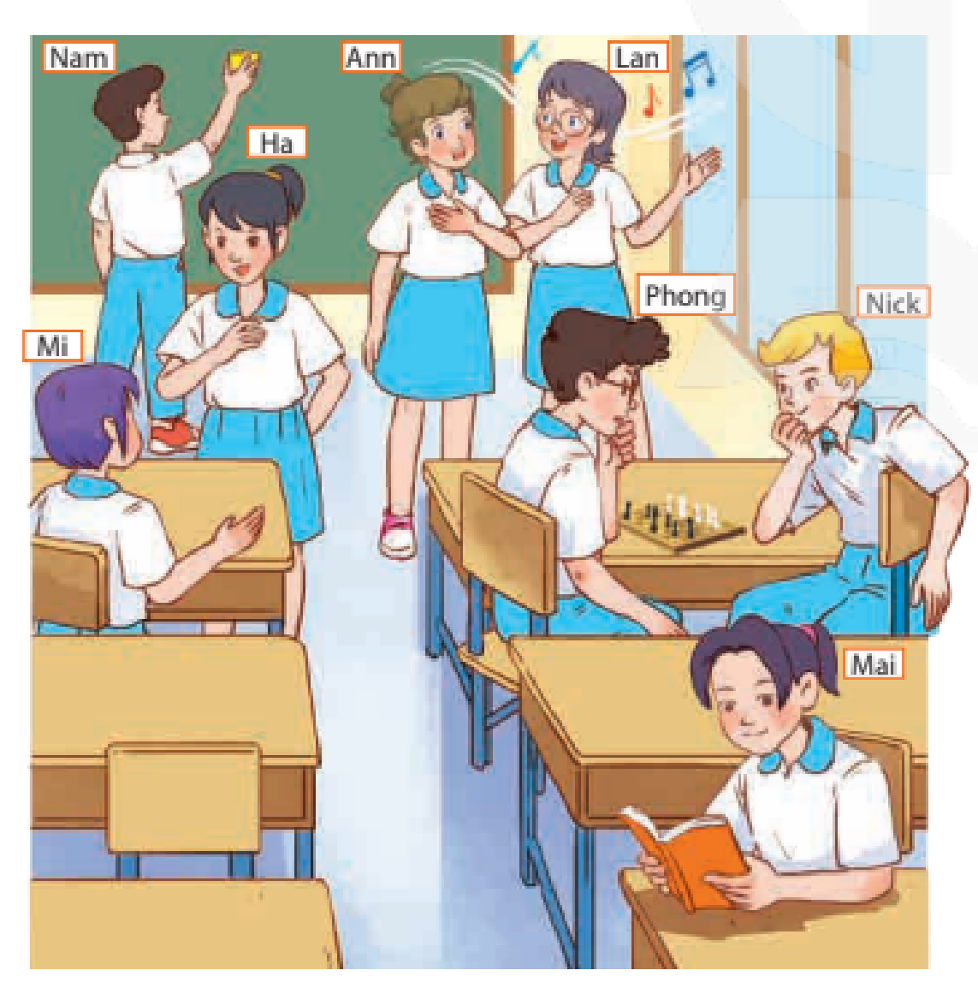
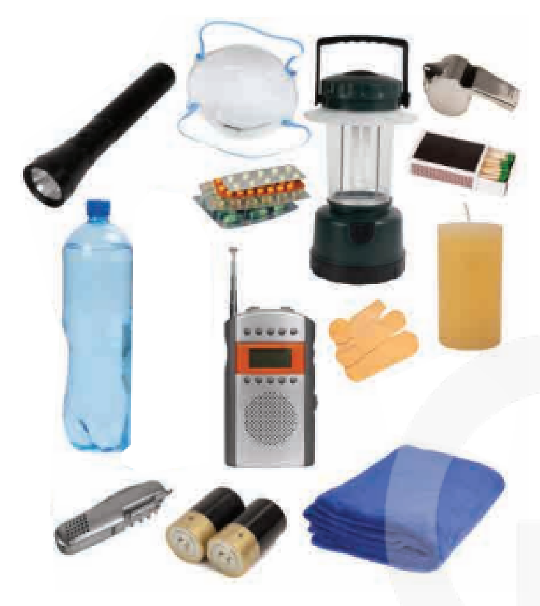

<!-- pdf:94 -->

# UNIT 9: NATURAL DISASTERS

> **THIS UNIT INCLUDES:**
> - **Vocabulary:**
>   - Types of natural **disasters**
>   - Words describing natural **disasters**
> - **Pronunciation:**
>   - Stress in words ending in *-al* and *-ous*
> - **Grammar:**
>   - Past continuous
> - **Skills:**
>   - Reading about natural **disasters**
>   - Talking about a natural **disaster**
>   - Listening about things to do before, during, and after a natural **disaster**
>   - Writing instructions about things to do before, during, and after a natural **disaster**
> - **Everyday English:**
>   - Giving and responding to bad news

## GETTING STARTED

**We are all safe!**

**1. Listen and read.**

**Tom:** You look **pretty** sad, Mi. What's the matter?

**Mi:** My uncle called us this morning. Our home town has been affected by a flood. It's the second time this year.
<!-- term: flood -->

**Tom:** I'm sorry to hear that. How are things there now?

**Mi:** My uncle, his wife, and his children are all safe. They moved everything to the second floor of their house last night. Are there natural **disasters** in your home town in the US?
<!-- term: natural disaster -->

**Tom:** Yes, we sometimes have **tornadoes**.

**Mi:** **Tornadoes**? Sounds strange. What's a **tornado**?

**Tom:** It's a violent **storm** that moves in a circle with very strong winds. I still remember the **tornado** we had last year.

**Mi:** What happened?

**Tom:** One evening my parents and I were having dinner. **Suddenly** we heard a very loud noise. When we looked out of the window, we saw a big **funnel** of wind moving towards us.

**Mi:** Did it cause any **damage**?

**Tom:** Yes, a lot. It **damaged** the roof of our house and **pulled up** some trees in our yard. Fortunately, no one was hurt.

<!-- pdf:95 -->

**2. Read the conversation again. Complete each sentence with no more than TWO words from it.**

1. There is a \_\_\_\_\_\_\_ in Mi's home town.
2. Her uncle's family had to move everything to the \_\_\_\_\_\_\_ last night.
3. A **tornado** is an example of a \_\_\_\_\_\_\_.
4. Tom's family \_\_\_\_\_\_\_ dinner when the **tornado** came.
5. The **tornado** **damaged** their roof and \_\_\_\_\_\_\_ up some trees in their yard.

**3. Write the natural disasters from the box under the pictures. Then listen, check, and repeat.**

| **volcanic** eruption | **storm** |
| --- | --- |
| **earthquake** | **tornado** |
| **landslide** | flood |

1. \_\_\_\_\_\_\_
2. \_\_\_\_\_\_\_
3. \_\_\_\_\_\_\_
4. \_\_\_\_\_\_\_
5. \_\_\_\_\_\_\_
6. \_\_\_\_\_\_\_
<!-- ocr-ok: đã đối chiếu ảnh trang gốc, 6 chỗ trống đánh số 1-6 nằm dưới từng tranh minh hoạ -->

**4. Choose the correct answer to complete each sentence.**

1. When there is a(n) **earthquake** / **volcanic** eruption, hot gases and **liquid** rock pour out from a mountain.
2. Oh, the house is **shaking**! I think we're having a(n) **earthquake** / flood.
3. We wanted to travel to Ha Giang, but there was a **tornado** / **landslide**. Some big rocks and mud came down the mountains.
4. Every year more than ten floods / **storms** with strong winds and rain cause **damage** in our country.
5. A **tornado** / **storm** looks like a huge **funnel** and causes a lot of **damage**. Its strong winds can reach 480 km per hour.
<!-- term: volcanic eruption -->

**5. Word web**

**Work in groups. Complete the web with all of the words and phrases related to natural disasters you know.**

- **Natural disasters:** **earthquakes**, \_\_\_\_\_\_\_, \_\_\_\_\_\_\_, \_\_\_\_\_\_\_, \_\_\_\_\_\_\_
<!-- ocr-ok: đã đối chiếu ảnh trang gốc, sơ đồ mạng từ trung tâm Natural disasters nối với 5 nhánh -->

<!-- pdf:96 -->

## A CLOSER LOOK 1

### Vocabulary

**1. In column B, write the noun forms of the verbs in column A.**

| A | B |
| --- | --- |
| 1. **destroy** | |
| 2. **erupt** | |
| 3. **warn** | |
| 4. **predict** | |
| 5. **damage** | |

**2. Write a word or phrase from the box under the correct picture.**

| **emergency kit** | **victim** |
| --- | --- |
| **rescue worker** | **property** |
| whistle | |

1. \_\_\_\_\_\_\_
2. \_\_\_\_\_\_\_
3. \_\_\_\_\_\_\_
4. \_\_\_\_\_\_\_
5. \_\_\_\_\_\_\_
<!-- ocr-ok: đã đối chiếu ảnh trang gốc, 5 chỗ trống đánh số 1-5 nằm dưới từng tranh minh hoạ -->

**3. Fill in each blank with a word or phrase from the box.**

| warning | **predict** | **property** |
| --- | --- | --- |
| **damage** | **emergency kit** | |
<!-- ocr-ok: đã đối chiếu ảnh trang gốc, hộp từ vựng bài 3 phần A Closer Look 1 -->

1. Natural **disasters** can cause serious \_\_\_\_\_\_\_ to human life.
2. Local **authorities** gave a flood \_\_\_\_\_\_\_ yesterday, so today people are moving to safer places.
3. To prepare for a natural **disaster**, we should make a(n) \_\_\_\_\_\_\_.
4. It's hard to believe that we cannot \_\_\_\_\_\_\_ when **earthquakes** will happen.
5. They lost all of their \_\_\_\_\_\_\_ because of the **volcanic** eruption.
<!-- term: natural disaster -->

### Pronunciation

**Stress in words ending in *-al* and *-ous***

**4. Listen and repeat the words. Pay attention to the word stress.**

| | | |
| --- | --- | --- |
| musical | dangerous | humorous |
| national | practical | poisonous |
| personal | marvellous | |

**5. Listen and repeat the sentences. Mark the stress in the underlined words.**

1. The flood **victims** are collecting their *personal* **property**.
2. Avoid *dangerous* places, such as windows or bookcases, during an **earthquake**.
3. There are *numerous* *tropical* **storms** in this area every year.
4. Some *natural* **disasters**, such as **landslides**, usually happen in *mountainous* areas.
5. She gave us *practical* tips about treating *poisonous* wastes.

<!-- pdf:97 -->

## A CLOSER LOOK 2

### Grammar

**The past continuous**

**Remember!**

We use the past continuous to describe:
- an action that was happening at a particular time in the past.
  *Example:* I *was having* dinner at 6 p.m. yesterday.
  *Were* you *having* dinner at 6 p.m. yesterday? – Yes, I *was*.
- a past action that was happening when another action interrupted it. We use the past simple for the action that interrupted it.
  *Example:* When / While we *were watching* TV, we felt the **earthquake**.
  What *were* they *doing* when they felt the **earthquake**? – They *were watching* TV.
*Notes:*
- We can use *when* or *while* before the past continuous.
- We can only use *when* before the past simple.
<!-- term: Past continuous -->

**1. Complete the sentences by putting the verbs in brackets into the past continuous.**

1. They (help) \_\_\_\_\_\_\_ the flood **victims** at 10 o'clock last night.
2. It (not snow) \_\_\_\_\_\_\_ when I left home this afternoon.
3. While she (work) \_\_\_\_\_\_\_ in the field, the **tornado** came.
4. – What \_\_\_\_\_\_\_ you (do) \_\_\_\_\_\_\_ at 9 o'clock yesterday morning?
   – I (watch) \_\_\_\_\_\_\_ the news about a **volcanic** eruption.
5. – \_\_\_\_\_\_\_ you (cry) \_\_\_\_\_\_\_ when I saw you two days ago?
   – No, I wasn't.

**2. Circle the correct answer to complete each sentence.**

1. We *donated* / *were donating* money to help the **earthquake** **victims** last month.
2. – What *did you do* / *were you doing* when the volcano **erupted**?
   – I *slept* / *was sleeping* in my bed.
3. While they *camped* / *were camping* near the river, the flood *was coming* / *came* **suddenly**.
4. After Tom *ran* / *was running* out of his house, he *moved* / *was moving* quickly to a safer place.
5. I *didn't read* / *wasn't reading* a newspaper at 9 a.m. yesterday, but I *watched* / *was watching* the news about the **tornado**.

**3. Look at the picture and write what each person in Lan's family was doing when the earthquake happened. Use the given word and phrases from the box.**

| watch TV | draw |
| --- | --- |
| read a book | drink tea |
| talk on the phone | |

<!-- pdf:98 -->

**4. Form questions using the past continuous. Then in pairs, ask and answer the questions.**

**Example:**
you / play / football / 5 o'clock yesterday afternoon?
– Were you playing football at 5 o'clock yesterday afternoon?
– Yes, I was. / No, I wasn't. I was doing my homework.

1. you / have dinner / 7 o'clock yesterday evening?
2. you / do / homework / 8 o'clock yesterday evening?
3. you / watch / film / 9 o'clock yesterday evening?

**5. GAME: Memory challenge**

**Work in groups. Take turns to say a sentence that describes what each person in the picture was doing.**

## COMMUNICATION

### Everyday English

*Giving and responding to bad news*

**1. Listen and read the dialogue below. Pay attention to the highlighted sentences.**

**Mark:** Phong, why are you so sad?

**Phong:** My grandparents called this morning. *A flood **destroyed** their house.*
<!-- term: Giving and responding to bad news -->

**Mark:** *I'm sorry to hear that.*
<!-- term: Giving and responding to bad news -->

**Phong:** *It also **damaged** all of their crops.*

**Mark:** *That's awful.* I hope your grandparents are safe.
<!-- term: Giving and responding to bad news -->

**2. Work in pairs. Practise giving and responding to bad news in the following situations.**

- You have a friend in a mountainous area. A **landslide** **destroyed** his family's garden yesterday. You share this news with your classmate.
- You hear that a big **earthquake** hit a city. You share this news with your classmate.

**Knowledge of natural disasters**

**3. Read the short passages below. Decide which natural disaster each person below is talking about.**

- **Nam:** We were travelling on the road near a mountain. **Suddenly** a lot of rocks and mud came down the mountain.
- **Ann:** While I was working in the garden, I saw a big **funnel** of wind moving towards us very quickly.
- **Tom:** **Suddenly** everything in our living room began to **shake**. My sister and I quickly hid under the table.

<!-- pdf:99 -->

**4. Choose the correct answer to each question to see how much you know about natural disasters.**

**QUESTIONNAIRE**

- **Question 1:** Which of these may cause **landslides**?
  - A. Heavy rain.
  - B. Wind.
  - C. Lightning.
- **Question 2:** Which of these activities may cause **landslides**?
  - A. Littering.
  - B. Cutting down trees.
  - C. Polluting the air.
- **Question 3:** What scale is used for measuring **earthquakes**?
  - A. **Fahrenheit** scale.
  - B. Celsius scale.
  - C. **Richter scale**.
- **Question 4:** What natural **disaster** can an **earthquake** cause?
  - A. A flood.
  - B. A **landslide**.
  - C. A **tornado**.
- **Question 5:** What do **tornadoes** form from?
  - A. An **earthquake**.
  - B. A flood.
  - C. A thunderstorm.
- **Question 6:** Where do **tornadoes** mostly happen?
  - A. In the USA.
  - B. In the UK.
  - C. In Viet Nam.

**5. Work in pairs. Compare your answers. Then check your answers with the key on page 101. How many points did each of you get?**

## SKILLS 1

### Reading

**1. Match the headlines (1 – 2) with the natural disasters (A – B).**

| | |
| --- | --- |
| 1. 30 seconds of a slight **shaking** in Ha Noi | A. **volcanic** eruption |
| 2. A thick layer of ash covers Tonga | B. **earthquake** |

**2. Read the two news articles. Match the highlighted words with their meanings.**

A volcano in the South Pacific **erupted** *violently* last Saturday. It hit Tonga, an island country in the area. The eruption sent a cloud of ash and gas into the air. People could see this cloud from 20 kilometres away. The eruption also caused a ***tsunami*** which flooded **properties** in Tonga's capital. Besides, it **destroyed** hundreds of homes on some small islands. More than twenty people on these islands are still *missing*. New Zealand sent two big ships to Tonga to help the **victims** yesterday.
<!-- term: missing -->

<!-- pdf:100 -->

Residents in tall buildings in Ha Noi were frightened when they felt a slight **shaking** for about 30 seconds last night. "I was watching TV when my building started ***trembling***. Books, lights, and other things also moved". Ms Nguyen Ha, a resident in the Sunshine Building, shared. Many people living in the building ran out of their homes in *fear*. According to scientists, a strong **earthquake** in China caused this **shaking**. Luckily, there was no **damage**.

| | |
| --- | --- |
| 1. violently | a. not yet found |
| 2. **tsunami** | b. slightly **shaking** |
| 3. missing | c. the bad feeling you have when you are frightened |
| 4. **trembling** | d. very strongly |
| 5. fear | e. very large waves in the sea |
<!-- term: missing -->

**3. Read the articles again and answer the questions.**

1. Where and when did the eruption happen?
2. What did the eruption cause?
3. What were the other effects of the eruption?
4. How long did the buildings **shake**?
5. What caused the **shaking**?

### Speaking

**4. Work in pairs. Match the questions with the answers.**

| | |
| --- | --- |
| 1. What kind of natural **disaster** was it? | a. Five days of heavy rain caused it. |
| 2. When and where did it happen? | b. Many houses were flooded, two villagers died, and five others were missing. |
| 3. What caused it? | c. It was a serious flood. |
| 4. What were its effects? | d. **Rescue workers** looked for the missing people, and volunteers gave food and drinks to the **victims**. |
| 5. How did people help the **victims**? | e. It happened in a village in Phu Yen last week. |

**5. Work in groups. Prepare a short piece of news about the natural disaster in 4 or one you know of. Report the news to the class.**

**Example:**
Five days of heavy rain caused a serious flood in a village in Phu Yen. The flood happened last week. ...
<!-- term: flood -->

<!-- pdf:101 -->

## SKILLS 2

### Listening

**1. Work in pairs. Look at the picture and answer the questions.**

1. What can you see in the picture?
2. When do we need these things?

**2. Listen to a broadcast. Put the activities (1 – 6) in the correct column.**
<!-- ocr-ok: đã đối chiếu ảnh trang gốc, OCR đọc nhầm câu lệnh bài nghe số 2 -->

1. Listen to instructions from local **authorities**
2. Prepare an **emergency kit**
3. Stay inside the house
4. Keep away from dangerous areas
5. Avoid windows and glass doors
6. Strengthen houses

| Before a **storm** | During a **storm** | After a **storm** |
| --- | --- | --- |
| | | |

**3. Listen again and tick (✓) T (True) or F (False) for each sentence.**

| | T | F |
| --- | --- | --- |
| 1. The broadcast is on TV. | | |
| 2. You should bring flowerpots and rubbish bins into the house. | | |
| 3. Right after the **storm**, you can leave your home. | | |
| 4. The local **authority** may **warn** you about dangerous places. | | |

### Writing

**4. Work in pairs. Discuss what you should do before, during, and after a flood. Write your ideas in the columns.**

| Before a flood | During a flood | After a flood |
| --- | --- | --- |
| – Prepare an **emergency kit**. ... | – Stay inside a safe and high place. ... | – Avoid moving water. ... |
<!-- ocr-ok: đã đối chiếu ảnh trang gốc, bảng 3 cột gợi ý việc nên làm trước, trong và sau lũ lụt -->

**5. Write instructions (80 – 100 words) about things to do before, during, and after a flood.**

**Start as follows:**

> Here are the things you should do before, during, and after a flood.
> Before:
> – \_\_\_\_\_\_\_
> – \_\_\_\_\_\_\_
> During:
> – \_\_\_\_\_\_\_
> – \_\_\_\_\_\_\_
> After:
> – \_\_\_\_\_\_\_
> – \_\_\_\_\_\_\_

<!-- pdf:102 -->

## LOOKING BACK

### Vocabulary

**1. Write the name of a natural disaster in each blank.**

*What natural **disaster** involves*

1. a lot of water in an area? \_\_\_\_\_\_\_
2. heavy rain and strong winds? \_\_\_\_\_\_\_
3. the earth **trembling**? \_\_\_\_\_\_\_
4. ash and gas? \_\_\_\_\_\_\_
5. rocks and mud coming down hills or mountains? \_\_\_\_\_\_\_
<!-- ocr-ok: đã đối chiếu ảnh trang gốc, OCR bỏ sót các câu 2, 3, 4 nằm xen kẽ giữa các ảnh minh hoạ -->

**2. Fill in each blank with the correct form of the word in brackets.**

1. The **tsunami** brought \_\_\_\_\_\_\_ to cities and towns near the sea. (**destroy**)
2. The government has developed some systems to help make \_\_\_\_\_\_\_ about natural **disasters**. (**predict**)
3. We are donating money and food to help the \_\_\_\_\_\_\_ of the **landslide**. (**victim**)
4. The local **authorities** \_\_\_\_\_\_\_ the villagers about a **landslide** yesterday. (warning)
5. Rescue \_\_\_\_\_\_\_ are trying hard to save people in the flooded area. (work)

### Grammar

**3. Put the verbs into the correct tense: the past simple or past continuous.**

1. What \_\_\_\_\_\_\_ you (do) \_\_\_\_\_\_\_ at 8 o'clock yesterday morning?
2. Last year, **earthquakes** (**destroy**) \_\_\_\_\_\_\_ a lot of houses in Japan.
3. He (water) \_\_\_\_\_\_\_ the flowers in his garden when the **tornado** (come) \_\_\_\_\_\_\_.
4. While they (call) \_\_\_\_\_\_\_ for help, the **rescue workers** (appear) \_\_\_\_\_\_\_.
5. \_\_\_\_\_\_\_ you (listen) \_\_\_\_\_\_\_ to music at 9 o'clock yesterday evening?

**4. Complete the sentences about you and your family members.**

*At 7 p.m. yesterday, ...*
<!-- ocr-ok: đã đối chiếu ảnh trang gốc, OCR đọc dính chữ At7 -->

1. I was \_\_\_\_\_\_\_.
2. my grandmother / grandfather \_\_\_\_\_\_\_.
3. my mother \_\_\_\_\_\_\_.
4. my father \_\_\_\_\_\_\_.
5. my sister / brother \_\_\_\_\_\_\_.
<!-- ocr-ok: đã đối chiếu ảnh trang gốc, OCR bỏ sót số thứ tự 1-5 và đọc nhầm chữ I -->

<!-- pdf:103 -->

## PROJECT

**WHAT DO WE KNOW ABOUT IT?**

**Work in groups.**

1. Choose a natural **disaster** you want to learn more about.
2. Research it. You can use these questions to guide you:
   - What causes it?
   - Where and when does it usually happen?
   - What effects can it have?
   - What should people do before, during, and after it happens?
3. Create a poster about this natural **disaster**. Draw pictures or find suitable photos for it.
4. Present the poster to the class.

> **Answers:**
> Q1: A | Q2: B | Q3: C | Q4: B | Q5: C | Q6: A
> - **5 – 6 correct answers:** You certainly know a lot about natural **disasters**.
> - **3 – 4 correct answers:** Try to learn more about natural **disasters**.
> - **0 – 2 correct answers:** You don't know much about natural **disasters**.

### Now I can ...

- use the words related to types of natural **disasters** and words describing natural **disasters**.
- pronounce the words ending in *-al* and *-ous* with correct stress.
- use the past continuous.
- give and respond to bad news.
- read about natural **disasters**.
- talk about a natural **disaster**.
- listen about things to do before, during, and after a natural **disaster**.
- write instructions about things to do before, during, and after a natural **disaster**.

## 📷 Danh sách hình trong bài

| Mã hình | Trang PDF | Trang sách | Chú thích / Mô tả |
| --- | --- | --- | --- |
| H8-tieng_anh-u09-01 | 95 | 93 | Bốn bức tranh 1–4 thuộc bài tập 3 phần Getting Started: (1) lũ lụt, (2) lốc xoáy, (3) núi lửa phun trào, (4) bão xoáy |
| H8-tieng_anh-u09-02 | 95 | 93 | Hai bức tranh 5–6 thuộc bài tập 3 phần Getting Started: (5) sạt lở đất, (6) động đất làm sập nhà |
| H8-tieng_anh-u09-03 | 96 | 94 | Năm bức tranh 1–5 thuộc bài tập 2 phần A Closer Look 1 – Vocabulary: (1) cái còi cứu hộ, (2) nhà cửa / tài sản, (3) bộ dụng cụ khẩn cấp, (4) nạn nhân thiên tai, (5) nhân viên cứu hộ |
| H8-tieng_anh-u09-04 | 97 | 95 | Tranh minh hoạ các thành viên trong gia đình Lan đang sinh hoạt trong phòng khách khi động đất xảy ra thuộc bài tập 3 phần A Closer Look 2 – Grammar |
| H8-tieng_anh-u09-05 | 98 | 96 | Tranh thử thách trí nhớ các bạn học sinh (Nam, Ha, Mi, Ann, Lan, Phong, Nick, Mai) trong lớp học thuộc trò chơi bài tập 5 phần A Closer Look 2 |
| H8-tieng_anh-u09-06 | 101 | 99 | Ảnh các vật dụng thiết yếu trong bộ dụng cụ khẩn cấp (đèn pin, khẩu trang, đèn bão, còi, diêm, nước uống, thuốc, đài radio, băng cá nhân, nến, dao đa năng, pin, chăn) thuộc bài tập 1 phần Skills 2 – Listening |
