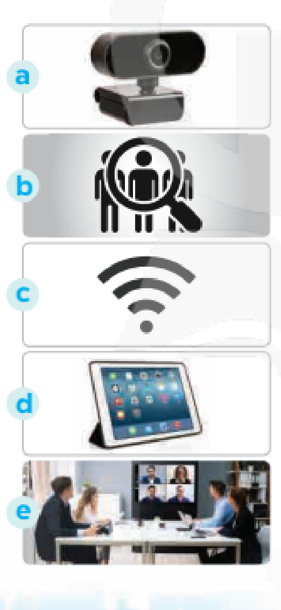
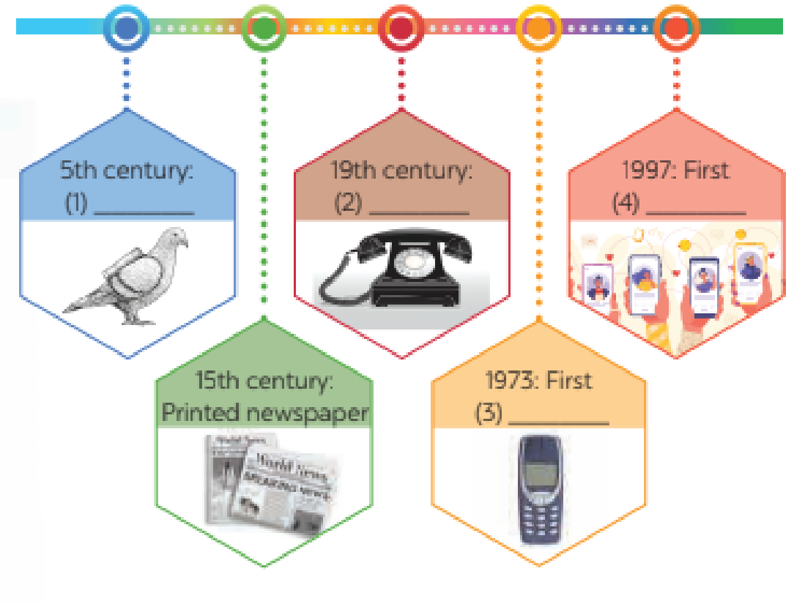
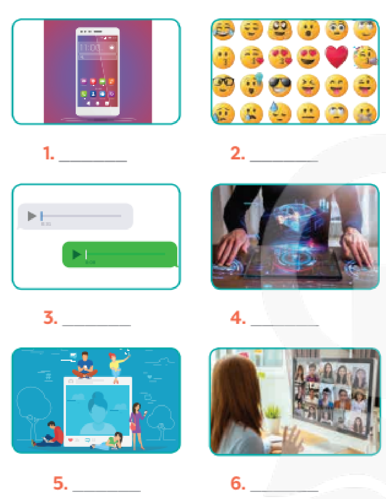
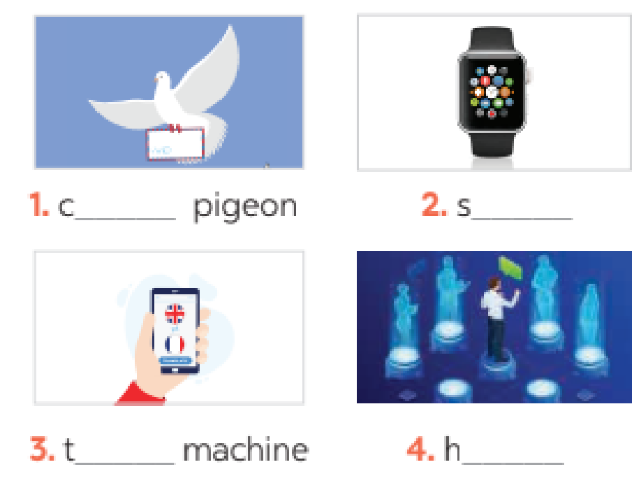

<!-- pdf:106 -->

# UNIT 10: COMMUNICATION IN THE FUTURE

> **THIS UNIT INCLUDES:**
> - **Vocabulary:**
>   - Communication technology
> - **Pronunciation:**
>   - Stress in words ending in *-ese* and *-ee*
> - **Grammar:**
>   - Prepositions of place and time
>   - Possessive pronouns
> - **Skills:**
>   - Reading about a way of communicating in the future
>   - Talking about the advantages and disadvantages of a way of communicating
>   - Listening to an announcement about a communication exhibition
>   - Writing a paragraph to describe a way of modern communication
> - **Everyday English:**
>   - Interrupting politely

## GETTING STARTED

**At the technology club**

**1. Listen and read.**

**Trang:** Mark, we're having a **video conference** with Tech Savvy next Thursday, but ...

**Mark:** Hold on. Is that the technology club at the Japanese school?

**Trang:** Exactly. But I'm a bit worried. I've never had a **video conference** call.

**Mark:** You're kidding! Who doesn't know how to make a video call? Alright, let's do a practice call now.

**Trang:** Hmm, what do I need to do first?

**Mark:** It's a piece of cake, Trang. Now, you sit in front of the computer. I'll connect with you via one of my **tablets** and ...
<!-- term: a piece of cake -->

**Trang:** Sorry, but how can I adjust this **webcam**? It's focusing on my forehead.

**Mark:** Use this button to move it up or down, and this to **zoom** in or out.

**Trang:** Thanks. And can you see me clearly on your **tablet**?

**Mark:** Yes, of course. We have a high-speed **Internet connection** here.

**Trang:** I hope the conference goes smoothly.

**Mark:** I'm sure it will. We should hold more **video conferences** like this in the future.

**Trang:** That's exactly how I feel.

<!-- pdf:107 -->

**2. Read the conversation again and circle the correct answer A, B, or C.**

1. What are Trang and Mark doing?
   A. Practising a video call.
   B. Making a call with Tech Savvy.
   C. Learning how to use a **tablet**.
2. What device does Trang need help with?
   A. The **tablet**.
   B. The computer.
   C. The **webcam**.
3. Mark says that they should \_\_\_\_\_\_\_ in the future.
   A. have more **video conferences**
   B. do more practice calls
   C. have a high-speed **Internet connection**

**3. Match the words and phrases in the conversation with their pictures.**

1. **tablet**
2. **webcam**
3. **zoom** in
4. **video conference**
5. **Internet connection**

**4. Circle the words / phrases which are CLOSEST in meaning to the underlined words / phrases.**

1. Our English exam was *a piece of cake*. I got full marks on it.
   A. easy
   B. difficult
<!-- term: a piece of cake -->

2. You're *kidding*! I can't believe Ms Mai and you are sisters.
   A. serious
   B. joking

3. I can't read the **text** on the computer screen. Can you ***zoom** in* on it?
   A. make it bigger
   B. make it smaller

4. We need a *high-speed* **Internet connection** to make video calls.
   A. fast
   B. slow

5. *That's exactly how I feel.* It's true that **video conferences** are very convenient.
   A. I don't think so.
   B. You are absolutely right.

**5. QUIZ: Work in groups. Complete the diagram of the history of communication technology with the words and phrases from the box.**

| **carrier pigeon** | telephone |
| --- | --- |
| mobile phone | **social network** |

- 5th century: (1) \_\_\_\_\_\_\_
- 15th century: Printed newspaper
- 19th century: (2) \_\_\_\_\_\_\_
- 1973: First (3) \_\_\_\_\_\_\_
- 1997: First (4) \_\_\_\_\_\_\_
<!-- ocr-ok: đã đối chiếu ảnh trang gốc, các nhãn mốc thời gian nằm trong sơ đồ hình lục giác nên OCR không nhận diện đầy đủ -->

<!-- pdf:108 -->

## A CLOSER LOOK 1

### Vocabulary

**1. Write the correct word or phrase from the box under each picture.**

| | |
| --- | --- |
| **voice message** | **smartphone** |
| **social network** | **emojis** |
| group call | **holography** |
<!-- ocr-ok: đã đối chiếu ảnh trang gốc, OCR đọc tách chữ smartphone thành smartp one trong khung từ vựng -->

1. \_\_\_\_\_\_\_
2. \_\_\_\_\_\_\_
3. \_\_\_\_\_\_\_
4. \_\_\_\_\_\_\_
5. \_\_\_\_\_\_\_
6. \_\_\_\_\_\_\_
<!-- ocr-ok: đã đối chiếu ảnh trang gốc, các chỗ trống đánh số 1-6 nằm ngay dưới từng bức tranh -->

**2. Choose the correct answer A, B, or C.**

1. Many people add \_\_\_\_\_\_\_ to their **text** messages to express their feelings.
   A. **emojis**
   B. words
   C. letters
2. I send \_\_\_\_\_\_\_ messages when I don't feel like typing.
   A. group
   B. **text**
   C. voice
3. Many teenagers like to meet on social \_\_\_\_\_\_\_ rather than face to face.
   A. television
   B. networks
   C. projects
4. In a \_\_\_\_\_\_\_, people in different places can join the conversation.
   A. **voice message**
   B. group call
   C. system of **emojis**
<!-- term: group call -->

5. By using \_\_\_\_\_\_\_, you can attend a meeting with your 3D image instead of being there in person.
   A. **holography**
   B. **voice messages**
   C. **social networks**

**3. Complete the sentences with the words from the box.**

| translation | real | language | **instantly** | private |
| --- | --- | --- | --- | --- |

1. Do you often send \_\_\_\_\_\_\_ messages to your friends?
2. Can learning English help you overcome the \_\_\_\_\_\_\_ barrier when living abroad?
3. Telephone helps you communicate in \_\_\_\_\_\_\_ time.
4. Do you think translators will lose their jobs when \_\_\_\_\_\_\_ machines become popular?
5. Many people reply to messages \_\_\_\_\_\_\_, but others take a long time to respond.

### Pronunciation

**Stress in words ending in -ese and -ee**

**4. Listen and repeat the words. Pay attention to the word stress.**

| -ese | -ee |
| --- | --- |
| Chin*ese* | agr*ee* |
| Bhutan*ese* | train*ee* |
| Japan*ese* | award*ee* |
| Taiwan*ese* | interview*ee* |
| Vietnam*ese* | guarant*ee* |
<!-- ocr-ok: đã đối chiếu ảnh trang gốc, OCR không đọc được hàng đầu bảng phát âm -ese và -ee -->

**Remember!**

Words ending in *-ese* or *-ee* often have stress on the final syllable.

*Example:* Vietna'mese, guaran'tee

<!-- pdf:109 -->

**5. Mark the stress in the underlined words. Then listen and repeat the sentences.**

1. The *interviewees* said that they were *Taiwanese*.
2. Joe *agrees* with me that learning *Chinese* is difficult.
3. She obtained a bachelor's *degree* in *Japanese*.
4. The *Taiwanese* company gave each *awardee* a **smartphone**.
5. The *Japanese* teacher sent a video to the *absentees* on Monday.

## A CLOSER LOOK 2

### Grammar

*Prepositions of place and time*

**Prepositions of place**

**1. Complete the sentences with at, in, in front of, on, opposite, or under.**

1. Lily's house is \_\_\_\_\_\_\_ the end of this street.
2. Players always sit \_\_\_\_\_\_\_ each other in a chess game.
3. She looked \_\_\_\_\_\_\_ the table and finally found her smartwatch.
4. Don't walk \_\_\_\_\_\_\_ the street. Walk \_\_\_\_\_\_\_ the pavement.
5. Ann stood \_\_\_\_\_\_\_ me in a line to get on the bus.

**Prepositions of time: in, for, by**

**Remember!**

- "in + a length of time" can express future meaning.
  *Example:* Robots will replace human shop assistants *in* ten years.
- "for + a length of time" says how long something goes on for.
  *Example:* It rained *for* three hours yesterday.
- "by + a specific time" means "not later than that time".
  *Example:* We'll be there *by* 6 p.m.
<!-- term: Prepositions of place and time -->

**2. Circle the correct preposition in each sentence.**

1. Let's get ready by / on / for 10 a.m. We are meeting Dr Saito at 10:15.
2. The first camera phone appeared on / at / in May 1999 in Japan.
3. We will be away on / for / by two weeks.
4. In the UK, supermarkets always close early in / by / on Sundays.
5. I think **language barriers** will disappear in / for / by 30 years.

**3. Complete the text with the prepositions from the box. Use each preposition only ONCE.**

| in | on | at | for | by |
| --- | --- | --- | --- | --- |

I think **smartphones** will change a lot (1) \_\_\_\_\_\_\_ the near future. They will be much thinner. (2) \_\_\_\_\_\_\_ 2035, we might be able to roll a phone like a sheet of paper. They will become much smarter, too. They will be able to **charge** their battery automatically when we are (3) \_\_\_\_\_\_\_ home. They might check the latest news (4) \_\_\_\_\_\_\_ the Internet. We won't have to wait (5) \_\_\_\_\_\_\_ a long time for these super **smartphones**.

<!-- pdf:110 -->

**4. Work in pairs. Tell each other whether you agree or disagree with the following ideas.**

1. We should not use our **smartphones** for more than a few hours every day.
2. By 2050, the way people communicate with each other will be different from now.

*Possessive pronouns*

**Remember!**

We can use possessive pronouns after *of*.
<!-- term: Possessive pronouns -->

*Example:* Mi is one of my friends.
→ Mi is a friend of *mine*.
<!-- term: Possessive pronouns -->

**5. Complete the second sentence so that it has the same meaning as the first sentence.**

1. Jack is one of her cousins.
   Jack is a \_\_\_\_\_\_\_\_\_\_\_\_\_\_\_\_\_\_\_\_\_\_\_.
2. Is this one of his **tablets**?
   Is this a \_\_\_\_\_\_\_\_\_\_\_\_\_\_\_\_\_\_\_\_\_\_\_?
3. Can I borrow a pencil of yours?
   Can I borrow \_\_\_\_\_\_\_\_\_\_\_\_\_\_\_\_\_\_\_\_\_\_\_?
4. You look like Nick and Peter. Are you one of their relatives?
   You look like Nick and Peter. Are you \_\_\_\_\_\_\_\_\_\_\_\_\_\_\_\_\_\_\_\_\_\_\_?
5. Last year, two of our classmates won scholarships to the US.
   Last year, \_\_\_\_\_\_\_\_\_\_\_\_\_\_\_\_\_\_\_\_\_\_\_ won scholarships to the US.

## COMMUNICATION

### Everyday English

*Interrupting politely*

**1. Listen and read the conversations below. Pay attention to the highlighted parts.**

1. **Mark:** Now, about the **video conference** ... Everyone must be here at 9:30 a.m., and ...
   **Trang:** *Sorry for interrupting, but* I think we should meet at 9:00 a.m. We need to test the devices.
<!-- term: Interrupting politely -->

2. **Nick:** This **webcam** is easy to handle. You click these buttons to move it up or down and these to ...
   **Lan:** *Hold on.* Can you repeat that, please?
<!-- term: Interrupting politely -->

**2. Work in pairs. Make similar conversations with the following situations.**

1. Student A is telling student B how to make a video call. Student B interrupts student A to ask for clarification.
2. Student A is telling student B the place for their next meeting. Student B interrupts student A to suggest another place.

**The future of language**

**3. Work in pairs. Read Mark's prediction about a popular means of communication in the near future. Then ask and answer the questions.**

**Mark:** In 20 years, people of all ages will be using **emojis** even more than now. **Emojis** help people communicate their emotions effectively regardless of the language they speak. For example, a smiley face expresses the same meaning everywhere. An **emoji** can replace words to a certain extent. One day, we might receive an email that contains only **emojis**!

<!-- pdf:111 -->

1. What means of communication is Mark talking about?
2. When will **emojis** become more commonly used?
3. Who will be using them?
4. How will they help in communication?
5. Why will they become more popular?

**4. Work in pairs. Choose one means of communication below. Ask and answer questions about it.**

1. **Automatic translation function**
   - When: in 10 years
   - Who: **social network** users
   - How: translate comments and private messages in all languages
   - Why: remove **language barriers**
<!-- term: private message -->

2. **Chatbot**
   - When: in 10 years
   - Who: sellers of online shops
   - How: **instantly** reply to customers in all languages
   - Why: help sell more products to customers from other countries

**5. Report your pair's conversation to the class by making a similar talk to Mark's prediction in 3.**

## SKILLS 1

### Reading

**1. Work in pairs. List as many ways of communication as you can.**

*Example:* meeting face to face, sending letters, chatting online, etc.

**2. Read an interview with two students, Minh and Tom. Then tick (✓) the speaker of each sentence.**

**TELEPATHY**

**MC:** Hi everyone. Today, I'll ask some members of the Technology Club to predict how people will communicate in the future. Let's meet Minh and Tom.

**Minh & Tom:** Hi everyone.

**MC:** Minh and Tom, how do you and your friends keep in contact?

**Minh:** Well, we mostly **text** each other. We also send **voice messages**.

**Tom:** I often see my friends in person, but sometimes we call via the Internet.

**MC:** Do you think these ways of communication will still be popular in 50 years?

**Tom:** Not really. We'll use more **advanced** ways, like **telepathy**. We'll pass our **thoughts** to another person without talking and ...

**MC:** Hold on. I think only a very few people may have this ability.

**Minh:** Yes, but in the future, everyone will be able to use **telepathy**. We'll wear a tiny device to catch our **thoughts** and send them to other people.

**MC:** Cool! But will there be any problems with **telepathy**?

**Tom:** Hmm, **telepathy** devices can "read" one's mind, so bad people might take advantage of it to control someone else.

**MC:** Besides that, some people will be too lazy to even talk anymore.

<!-- pdf:112 -->

| Who says that ...? | Minh | Tom |
| --- | --- | --- |
| 1. he sends **voice messages** to friends | | |
| 2. he calls his friends by using the Internet | | |
| 3. everyone will be able to use **telepathy** in the future | | |
| 4. people need a small device to send their **thoughts** to others | | |
| 5. bad people can make use of **telepathy** to harm others | | |

**3. Read the interview again. Choose the correct answer A, B, or C.**

1. What is the interview mainly about?
   A. One way of future communication.
   B. Voice chats and online calls.
   C. Problems of **telepathy**.
2. Which way of communication below is NOT mentioned in the interview?
   A. Meeting face to face.
   B. Writing an email.
   C. **Telepathy**.
3. According to Tom, **telepathy** means \_\_\_\_\_\_\_.
   A. making phone calls via the Internet
   B. talking on tiny devices
   C. communicating by **thoughts**
4. The MC says that \_\_\_\_\_\_\_.
   A. **telepathy** is perfect
   B. not all people can do **telepathy**
   C. she disagrees with Minh's opinion
5. What does the MC think may be a problem with **telepathy**?
   A. People won't want to meet each other.
   B. **Telepathy** devices can be expensive.
   C. Some people won't want to talk anymore.

### Speaking

**4. Work in pairs. Read the following ideas about online calls. Put the ideas in the correct column.**

a. They're cheap or even free.
b. There must be an **Internet connection**.
c. You can talk to people from distant places.
d. You may receive unwanted calls.
e. You can make group calls.
f. You need a smart device.
<!-- term: group call -->

| Advantages | Disadvantages |
| --- | --- |
| | |

**5. Work in groups. Choose a way of communication and discuss its advantages and disadvantages. Then report your answers to the class.**

**You can start your discussion as follows:**

I think there are both advantages and disadvantages of online calls. ...

## SKILLS 2

### Listening

**1. Look at the pictures. Complete the word / phrase for each picture.**

1. c\_\_\_\_\_\_\_ pigeon
2. s\_\_\_\_\_\_\_
3. t\_\_\_\_\_\_\_ machine
4. h\_\_\_\_\_\_\_
<!-- ocr-ok: đã đối chiếu ảnh trang gốc, các chữ cái đầu gợi ý và gạch trống điền từ nằm dưới 4 bức tranh -->

<!-- pdf:113 -->

**2. Listen to an announcement about an exhibition. Complete each gap in the agenda with ONE word or a number.**

**EXHIBITION AGENDA**

| Event | Where to go | When to meet |
| --- | --- | --- |
| opening ceremony | Main Hall | by (1) \_\_\_\_\_\_\_ a.m. |
| *History* | (2) \_\_\_\_\_\_\_ floor | 9:15 a.m. |
| (3) \_\_\_\_\_\_\_ *Time* | Tech Room | (4) \_\_\_\_\_\_\_ a.m. |
| animated film | (5) \_\_\_\_\_\_\_ Room | 11:30 a.m. |
<!-- ocr-ok: đã đối chiếu ảnh trang gốc, OCR đọc nhầm floor thành floae và 11:30 a.m. thành 1:50 a.m. -->

**3. Listen again. Circle the correct answer A, B, or C.**

1. Who is making the announcement?
   A. A teacher.
   B. A student
   C. Dr Lam.
2. What is in the *History* section?
   A. An introductory talk.
   B. A documentary.
   C. Many pictures.
3. What is NOT true about the *Modern Time* section?
   A. Students won't like this section.
   B. It shows smart devices.
   C. They will be there for one hour.
4. What will the film in the Cinema Room be about?
   A. Super smartwatches.
   B. Translation devices for personal use.
   C. **Telepathy** machines.
5. In general, what does the exhibition show?
   A. Problems of modern technology.
   B. History of **smartphones**.
   C. Means of communication.

### Writing

**4. Work in pairs. Match the ideas (a - h) with parts of an outline (1 - 4) for a paragraph about a video call.**

1. What is it?
2. What are its advantages?
3. What are its disadvantages?
4. Will people use it in the future?

- a. a phone call using **Internet connection**
- b. needs a high-speed Internet access
- c. saves time because people needn't travel to meet
- d. **transmits** **live** images of the speakers with a **webcam** or camera on smart devices
- e. may spend too much time chatting with each other
- f. can be useful for family members and business partners
- g. will still be a common tool of communication
- h. can see and hear each other in real time
<!-- term: in real time -->

**5. Write a paragraph (80 - 100 words) to describe a way of modern communication. You can use the ideas in 4 or your own ideas.**

<!-- pdf:114 -->

## LOOKING BACK

### Vocabulary

**1. Circle the correct option to complete each sentence below.**

1. My classmates connect with each other on a(n) **social network** / **emoji** called Friends-connect.
2. **Holography** / **Telepathy** helps people communicate by **thoughts**.
3. Sending **voice messages** / **text** messages is convenient because you don't have to type.
4. In the future, everyone can carry a human translator / **translation machine** with them whenever they go abroad.
5. If you have a high-speed **Internet connection**, making a group call / meeting face to face is a piece of cake.

**2. Fill in each gap with a word from the box to complete the passage.**

| **text** | **instantly** | language |
| --- | --- | --- |
| real | social | |
<!-- ocr-ok: đã đối chiếu ảnh trang gốc, khung từ gợi ý gồm 2 hàng ngang bị OCR đọc đảo thứ tự theo cột -->

In 30 years, social robots will become popular. This kind of robot is special because it can perform many human tasks. For example, it can send a (1) \_\_\_\_\_\_\_ message to its owner to remind them of dinner time. Some social robots may even have (2) \_\_\_\_\_\_\_ network **accounts** and interact with other users in (3) \_\_\_\_\_\_\_ time. For these robots, (4) \_\_\_\_\_\_\_ barriers are not a problem, so they can (5) \_\_\_\_\_\_\_ reply to comments or messages in any language. It might be frightening because we won't know whether we are chatting with a human or a robot online!

### Grammar

**3. Complete the sentences with the prepositions from the box. Tick (✓) the sentences which have prepositions of time.**

| in | on | for | by | opposite |
| --- | --- | --- | --- | --- |

- [ ] 1. I talk to my mum \_\_\_\_\_\_\_ the phone every weekend.
- [ ] 2. Maria **texted** me that she would be home \_\_\_\_\_\_\_ 10 minutes.
- [ ] 3. Phong waited \_\_\_\_\_\_\_ an hour. Then he called Ann and said that he had to leave.
- [ ] 4. Where's Ms Lan? – She's in the \_\_\_\_\_\_\_ room. She's having a **video conference**.
- [ ] 5. **Telepathy** might be the most popular way to communicate \_\_\_\_\_\_\_ 2050.

**4. Which of the underlined parts in each question is incorrect? Find and correct it.**

1. *A* (A) friend of *my* (B) cannot connect her phone *to* (C) the Internet.
2. Trang and Linda will be *at* (A) television *this* (B) evening to talk *about* (C) future communication.
3. Three of *ours* (A) cousins *are* (B) studying *in* (C) the same class.
<!-- ocr-ok: đã đối chiếu ảnh trang gốc, kí hiệu A, B, C đặt dưới chân các từ gạch chân nên OCR tách dòng -->

<!-- pdf:115 -->

4. I'm putting *aside* (A) some money *because* (B) I want to buy a new car *on* (C) two years.
5. Please send the homework *to* (A) your teacher *via* (B) email *in* (C) Thursday.
<!-- ocr-ok: đã đối chiếu ảnh trang gốc, kí hiệu A, B, C đặt dưới chân các từ gạch chân nên OCR tách dòng -->

## PROJECT

**COMMUNICATION IN THE FUTURE**

**Work in groups.**

**1. Imagine a means of communication in 2050.**

**2. Describe that means of communication.**

**Use the following guiding questions:**
- What is it?
- How will it help you communicate?
- What advantages might it have?
- Will it have any disadvantages? If yes, what are they?

**3. Present your idea to the class. You can make a poster or create a model for your presentation.**

### Now I can ...

- use the words related to communication technology.
- pronounce the words ending in *-ese* and *-ee* with correct stress.
- recognise and use prepositions of place and time, and possessive pronouns.
- interrupt politely.
- read about a way of communicating in the future.
- talk about the advantages and disadvantages of a way of communicating.
- listen to an announcement about a communication exhibition.
- write a paragraph to describe a way of modern communication.

## 📷 Danh sách hình trong bài

| Mã hình | Trang PDF | Trang sách | Chú thích / Mô tả |
| --- | --- | --- | --- |
| H8-tieng_anh-u10-01 | 107 | 105 | Năm hình ảnh minh hoạ gắn nhãn a–e dùng để nối với các từ và cụm từ công nghệ giao tiếp (*webcam*, *zoom in*, *Internet connection*, *tablet*, *video conference*) thuộc bài tập 3 phần Getting Started |
| H8-tieng_anh-u10-02 | 107 | 105 | Sơ đồ dòng thời gian lịch sử công nghệ giao tiếp gồm 5 mốc (*5th century*, *15th century: Printed newspaper*, *19th century*, *1973: First*, *1997: First*) thuộc bài tập 5 (QUIZ) phần Getting Started |
| H8-tieng_anh-u10-03 | 108 | 106 | Sáu bức tranh đánh số 1–6 minh hoạ các phương tiện và hình thức giao tiếp (*smartphone*, *emojis*, *voice message*, *holography*, *social network*, *group call*) thuộc bài tập 1 phần A Closer Look 1 – Vocabulary |
| H8-tieng_anh-u10-04 | 112 | 110 | Bốn bức tranh đánh số 1–4 kèm chữ cái gợi ý đầu từ (*carrier pigeon*, *smartwatch*, *translation machine*, *holography*) thuộc bài tập 1 phần Skills 2 – Listening |
