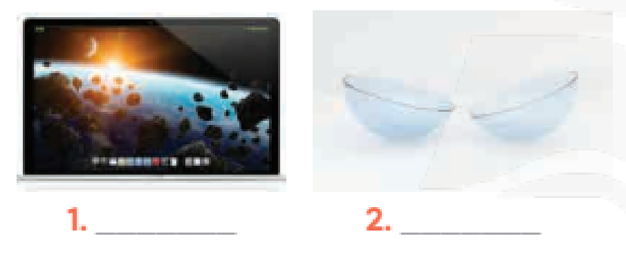
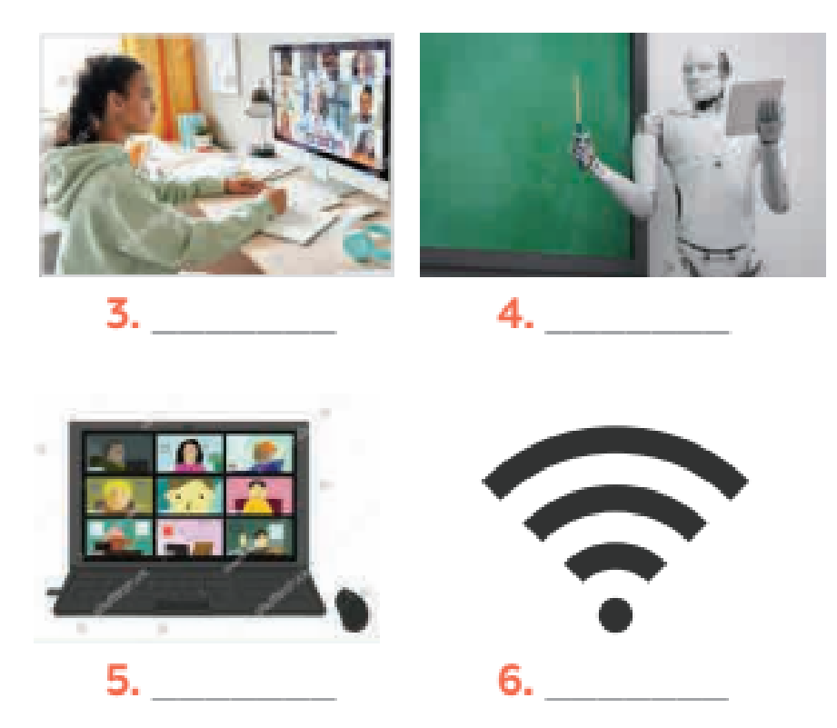
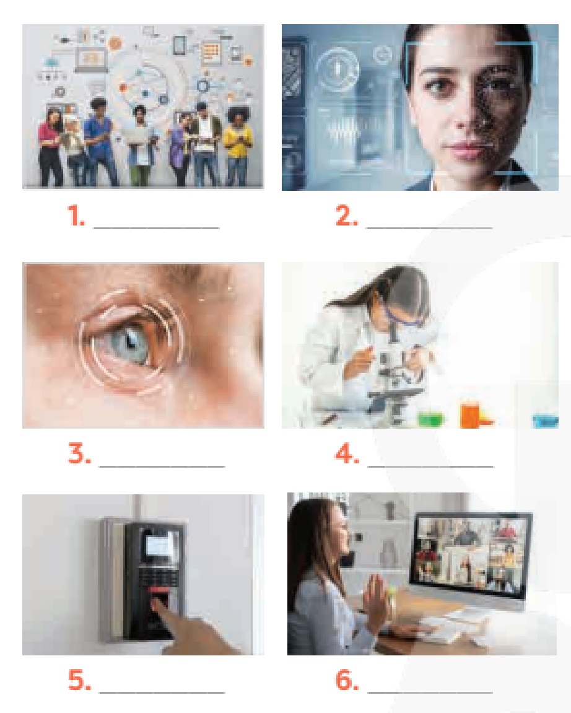
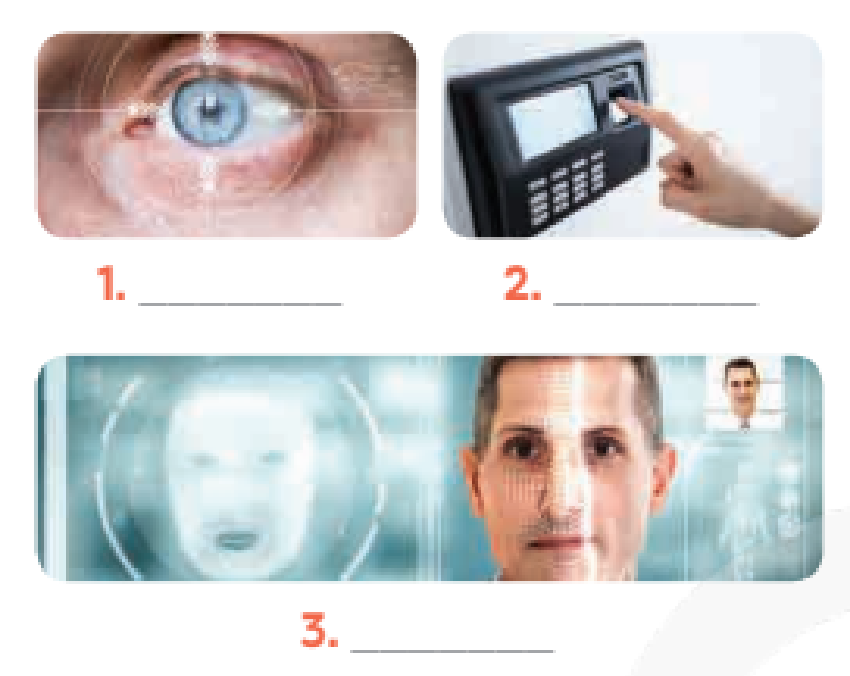

<!-- pdf:116 -->

# UNIT 11: SCIENCE AND TECHNOLOGY

> **THIS UNIT INCLUDES:**
> - **Vocabulary:**
>   - **Science** and **technology** in the future
> - **Pronunciation:**
>   - Sentence stress
> - **Grammar:**
>   - Reported speech (statements)
> - **Skills:**
>   - Reading advertisements about new **technologies**
>   - Talking about a **technology** or an **invention**
>   - Listening about a robot teacher
>   - Writing an opinion paragraph about whether robots will replace teachers at school
> - **Everyday English:**
>   - Giving and responding to good news

## GETTING STARTED

**Great news for students**

**1. Listen and read.**

**Minh:** Ann, do you like yesterday's lesson? I really enjoy learning online.

**Ann:** I prefer having **face-to-face** classes. I like to interact with my classmates during the lessons.

**Minh:** I think online classes are **convenient** during bad weather or **epidemics**. Also, students can still interact when they are in **breakout rooms**.

**Ann:** But the Internet connection doesn't always work well enough for us to learn online. And my eyes get tired when I work in front of the computer **screen** for a long time.

**Minh:** I know what you mean. But there's some great news for us. 3D **contact lenses** will soon be available. With them, our eyes won't get tired when looking at a computer **screen** all day long.

**Ann:** Wow, that's brilliant!

**Minh:** Another helpful **invention** is robot teachers. They will teach us when our human teachers are not available or get ill. My uncle said the robots would be able to **mark** our work and give us **feedback** too.
<!-- term: robot teacher -->

**Ann:** Fantastic! I can't wait.
<!-- ocr-ok: đã đối chiếu ảnh trang gốc, OCR đọc nhầm chữ I thành kí tự | -->

<!-- pdf:117 -->

**2. Read the conversation again and tick (✓) T (True) or F (False).**

| | T | F |
| --- | --- | --- |
| 1. Ann and Minh had a **face-to-face** class yesterday. | | |
| 2. Ann likes **face-to-face** classes because she can interact with her classmates. | | |
| 3. Minh finds online classes inconvenient. | | |
| 4. When students use 3D **contact lenses**, their eyes will not get tired. | | |
| 5. Robot teachers will be able to **mark** papers and comment on students' work. | | |

**3. Label each picture with a phrase from the box.**

| | |
| --- | --- |
| 3D **contact lenses** | computer **screen** |
| robot teacher | **breakout rooms** |
| online class | Internet connection |
<!-- ocr-ok: đã đối chiếu ảnh trang gốc, khung từ gợi ý gồm 2 cột bị OCR đọc dọc từng cột -->

1. \_\_\_\_\_\_\_
2. \_\_\_\_\_\_\_
3. \_\_\_\_\_\_\_
4. \_\_\_\_\_\_\_
5. \_\_\_\_\_\_\_
6. \_\_\_\_\_\_\_
<!-- ocr-ok: đã đối chiếu ảnh trang gốc, các chỗ trống đánh số 1-6 nằm ngay dưới từng bức tranh -->

**4. Complete the sentences, using the phrases in 3.**
<!-- ocr-ok: đã đối chiếu ảnh trang gốc, số 3 in màu cam cách điệu nên OCR đọc nhầm -->

1. I can't see the documents on this computer very clearly. I need a larger \_\_\_\_\_\_\_.
2. During our lessons, our teacher puts us into \_\_\_\_\_\_\_ for group discussions.
3. A \_\_\_\_\_\_\_ in Korea teaches English to primary students.
4. We had a(n) \_\_\_\_\_\_\_ yesterday with a teacher in the US.
5. Can I wear \_\_\_\_\_\_\_ and watch a movie too?

**5. QUIZ: Do you know what things were invented in these years? Work in pairs and find out.**

1. 1822: Charles Babbage **invented** it. Students use it to type essays and to learn online.
2. 1876: Alexander Graham Bell **invented** it. We use it to communicate with our friends and families.
3. 1928: Sir Alexander Fleming **discovered** it. It was the world's first antibiotic.
4. 1989: Tim Berners-Lee **invented** it. It links information sources so everyone can access them.
5. 2000: Honda **developed** it. It can run, jump, and work as a bartender.

<!-- pdf:118 -->

## A CLOSER LOOK 1

### Vocabulary

**1. Write a word or phrase from the box under each picture.**

| | |
| --- | --- |
| face **recognition** | **experiment** |
| video conferencing | **eye-tracking** |
| **fingerprint** **scanner** | |
| **digital** communication | |

1. \_\_\_\_\_\_\_
2. \_\_\_\_\_\_\_
3. \_\_\_\_\_\_\_
4. \_\_\_\_\_\_\_
5. \_\_\_\_\_\_\_
6. \_\_\_\_\_\_\_
<!-- ocr-ok: đã đối chiếu ảnh trang gốc, các chỗ trống đánh số 1-6 nằm ngay dưới từng bức tranh -->

**2. Choose the option that best completes each phrase.**

| | |
| --- | --- |
| 1. **invent** | A. a device B. a new area |
| 2. **discover** | A. a chemical element B. a **technology** |
| 3. create | A. the weather B. a medicine |
| 4. **develop** | A. a planet B. a **technology** |
<!-- ocr-ok: đã đối chiếu ảnh trang gốc, bài tập nối sơ đồ hình elip màu với các phương án A, B -->

**3. Complete the sentences with the words and phrase from the box.**

| **invented** | created |
| --- | --- |
| **experiments** | **discovered** |
| **fingerprint** **scanner** | |
<!-- ocr-ok: đã đối chiếu ảnh trang gốc, khung từ gợi ý gồm 2 cột từ vựng -->

1. Marie Curie and Pierre Curie \_\_\_\_\_\_\_ radium and polonium.
2. Thomas Edison \_\_\_\_\_\_\_ the light bulb in 1880.
3. Sarah Gilbert is the creator of a vaccine. She \_\_\_\_\_\_\_ it in 2020.
4. Scientists have carried out many \_\_\_\_\_\_\_ to find a cure for cancer.
5. Scan your finger on this \_\_\_\_\_\_\_ to check **attendance**, please.
<!-- term: fingerprint scanner -->

### Pronunciation

*Sentence stress*

**Remember!**

Sentences have stressed and unstressed words. We usually stress nouns, main verbs, adjectives, adverbs and negative auxiliaries, and question words. We normally stress the words *Yes* and *No* as well as auxiliary verbs in short answers.
<!-- term: Sentence stress -->

*Example:*

| |
| --- |
| **How** im**por**tant is **sci**ence to **stu**dents? |
| Will you **use** your com**pu**ter to **learn**? |
| Did he **buy** a **new** **smart**phone **yes**terday? – **No**, he **didn't**. |
<!-- ocr-ok: đã đối chiếu ảnh trang gốc, các âm tiết mang trọng âm được in đậm trực tiếp trong từ -->

**4. Listen and repeat the sentences. Pay attention to the bold syllables.**

| |
| --- |
| 1. I **don't** **have** a com**pu**ter. |
| 2. Do you **call** her every **day**? – **No**, I **don't**. |
| 3. They are **not** fa**mi**liar with that **new** com**pu**ter. |
| 4. **A:** Did you **lend** her your **lap**top? **B:** **Yes**, I **did**. |
| 5. **Who** do you **work** with on **Sun**days? |
<!-- ocr-ok: đã đối chiếu ảnh trang gốc, các âm tiết mang trọng âm được in đậm trực tiếp trong từ -->

<!-- pdf:119 -->

**5. Listen and repeat the sentences. How many stressed words are there in each sentence?**

1. He is an inventor.
2. We won't have a robot teacher next year.
3. She likes learning online.
4. Was she checking **attendance** when you came? – No, she wasn't.
5. What did he **invent**?

## A CLOSER LOOK 2

### Grammar

**Reported speech (statements)**

**1. Look at part of the conversation in GETTING STARTED again. Then match Minh's uncle's direct speech with his reported speech.**

> **Minh:** ... My uncle said the robots would be able to **mark** our work and give us **feedback** too.

| Direct speech | Reported speech |
| --- | --- |
| 1. The robots will be able to **mark** our work. | A. My uncle said the robots would be able to give us **feedback** too. |
| 2. The robots will be able to give us **feedback** too. | B. My uncle said the robots would be able to **mark** our work. |

**Remember!**

Reported speech is used to report what someone said.
<!-- term: Reported speech – statements -->

*Example:*
Mi said, "I want a new computer." → Mi said (that) she wanted a new computer.

- We change the verb forms when we use reported speech.
<!-- term: Reported speech – statements -->

| | |
| --- | --- |
| *Present simple* Mi said, "I love **science**." | *Past simple* Mi said (that) she loved **science**. |
| *Present continuous* Mi said, "I am learning English." | *Past continuous* Mi said (that) she was learning English. |
| *Will* "I will become a scientist," he said. | *Would* He said (that) he would become a scientist. |
<!-- ocr-ok: đã đối chiếu ảnh trang gốc, bảng đối chiếu lùi thì động từ trực tiếp – gián tiếp trong hộp Remember! -->

- We also change time and place expressions in reported speech.
  - now → then
  - today → that day
  - ago → before
  - tomorrow → the following day / the next day
  - this week → that week
  - here → there
<!-- term: Reported speech – statements -->
- We also change pronouns according to situations.
  - I → he / she
  - we → they
  - me → him / her ...
<!-- term: Reported speech – statements -->

<!-- pdf:120 -->

**2. Complete the second sentences using the correct verb forms.**

1. "I am a member of the IT club."
   Minh said that he \_\_\_\_\_\_\_ a member of the IT club.
2. "Mai will take an online course to improve her speaking."
   Nam said Mai \_\_\_\_\_\_\_ an online course to improve her speaking.
3. "I am talking to Phong on the phone."
   Tom said he \_\_\_\_\_\_\_ to Phong on the phone.
4. "They are going to send me an email."
   He said they \_\_\_\_\_\_\_ to send him an email.
5. "I don't have an iPod to listen to music."
   She said that she \_\_\_\_\_\_\_ an iPod to listen to music.

**3. Complete the second sentences with the words and phrases from the box.**

| there | that year | that day |
| --- | --- | --- |
| then | the next day | |
<!-- ocr-ok: đã đối chiếu ảnh trang gốc, khung 5 từ chỉ thời gian và nơi chốn bị OCR đọc dọc theo cột -->

1. "I'm having a **science** test tomorrow," Mary said.
   Mary said she was having a **science** test \_\_\_\_\_\_\_.
2. "The group is working on their project now," Tom said.
   Tom said the group was working on their project \_\_\_\_\_\_\_.
3. "Mai is reading about Thomas Edison today," the teacher said.
   The teacher said that Mai was reading about Thomas Edison \_\_\_\_\_\_\_.
4. "They will **invent** a smart cooker this year," my mum said.
   My mum said that they would **invent** a smart cooker \_\_\_\_\_\_\_.
5. "My teacher will park her car here," said Mi.
   Mi said her teacher would park her car \_\_\_\_\_\_\_.

**4. Complete the second sentence in each pair so that it means the same as the first one.**

1. "We will live much longer in the future," said the scientist.
   The scientist said that \_\_\_\_\_\_\_\_\_\_\_\_\_\_\_\_\_\_\_\_\_\_\_.
2. "Our school is going to have a new laboratory here," said our teacher.
   Our teacher said that \_\_\_\_\_\_\_\_\_\_\_\_\_\_\_\_\_\_\_\_\_\_\_.
3. "They are **developing** **technology** to monitor students better," my dad said.
   My dad said that \_\_\_\_\_\_\_\_\_\_\_\_\_\_\_\_\_\_\_\_\_\_\_.
4. "There are no classes tomorrow because our teacher is ill," Tom said.
   Tom said that \_\_\_\_\_\_\_\_\_\_\_\_\_\_\_\_\_\_\_\_\_\_\_.
5. "We want some students to join the **science** club next semester," the teacher said.
   The teacher said that \_\_\_\_\_\_\_\_\_\_\_\_\_\_\_\_\_\_\_\_\_\_\_.

**5. GAME: He / She said that ...**
<!-- ocr-ok: đã đối chiếu ảnh trang gốc, chữ GAME trong các ô màu và He / She bị OCR đọc dính -->

**Work in pairs. One student says a sentence and the other changes that sentence into reported speech. Then swap roles.**

<!-- pdf:121 -->

## COMMUNICATION

### Everyday English

*Giving and responding to good news*

**1. Listen and read the conversation, paying attention to the highlighted sentences.**

**Nick:** *Great news for us.* We'll have school clouds so we won't have to carry lots of books to school.
<!-- term: Giving and responding to good news -->

**Mi:** *Great!*

**Nick:** And my dad promised to get me a new Ipad to read books from the school clouds.

**Mi:** *Congratulations!*
<!-- term: Giving and responding to good news -->

**2. Work in pairs. Give news and respond to the news in the following situations.**

1. You tell your classmate about the new vending machine at your school.
2. You tell your classmate about a new laptop that your dad gave you on your birthday.

**Online learning**

**3. Work in pairs. Read the posts from some students about online learning and complete the table.**

**Mi:** Our teacher uses Zoom to teach. But some students don't have computers or smartphones. Others **complain** about the poor connection. I also feel more stressed when learning online.

**Tom:** Our teacher uses Google Meet for video conferencing. It's quite **convenient**, and we don't have to get up early. Still, I prefer to study **face to face**. I want to see my classmates.
<!-- term: video conferencing -->

**Phong:** We use Microsoft Teams. I don't like online learning. My eyes get tired. I can't concentrate well. But online learning helps us become more independent.

**Nick:** We use Zoom to discuss and share ideas. We interact in **breakout rooms**. It also helps us avoid traffic jams. But I'm not happy about the Internet connection at times.

| Benefits | Problems |
| --- | --- |
| 1. It's **convenient**. | 1. Some students don't have computers or smartphones. |
| 2. \_\_\_\_\_\_\_ | 2. \_\_\_\_\_\_\_ |
| 3. \_\_\_\_\_\_\_ | 3. \_\_\_\_\_\_\_ |
| 4. \_\_\_\_\_\_\_ | 4. \_\_\_\_\_\_\_ |
| | 5. \_\_\_\_\_\_\_ |

**4. Work in groups. Talk about a platform you use for your online classes or one you know about. What are the benefits and problems of using it?**

**5. Report the answers of one of your group members to the class.**

*Example:*

Lan said that her extra class used Microsoft Teams. She said that she and her classmates found it difficult to use. However, it is **convenient** to have online classes on Microsoft Teams when the weather is bad.

<!-- pdf:122 -->

## SKILLS 1

### Reading

**1. Work in pairs. Name the technological applications in the pictures. Can they be used in schools?**

1. \_\_\_\_\_\_\_
2. \_\_\_\_\_\_\_
3. \_\_\_\_\_\_\_

**2. Read the texts and tick (✓) B (Biometrics) or N (Nanolearning).**

**Biometrics**

No more worries about **truancy** and **cheating**! Just introduce **biometric** **applications** at your school. With **fingerprint** **scanners**, or facial or voice **recognition** **technologies**, schools will be able to check students' **attendance**. Teachers will no longer need to call students' names to find out who is absent. This will make more time for activities!
<!-- term: face recognition -->

Schools can also use these **biometric** **applications** for students who borrow books and equipment. Even more amazing, teachers can even use the **eye-tracking** **applications** to check students' understanding of a lesson and to motivate students to learn.

For more information, visit www.biometricappsolution.com

**Nanolearning**

Tired of sitting in front of a computer all day long? Unable to concentrate for very long in your classes? Or frequently forgetting large amounts of information? The **solution** to these is Nanolearning created by Junglemap in 2006.

Nanolearning provides you with small amounts of information over a short period of time. Your learning will become effortless.

Believe us! Receive bits of information within two to five minutes via our **platform**, and you will increase your learning attention and ability. Our app also reports your study activities and results to your teacher.

Contact us at www.nanolearningsolution.edu.com

| Benefits | B | N |
| --- | --- | --- |
| 1. It makes learning effortless. | | |
| 2. It checks students' understanding of the lessons. | | |
| 3. Students use it when they borrow books and equipment. | | |
| 4. It helps increase students' learning attention. | | |
| 5. It records students' study activities and results. | | |

**3. Read the texts again and choose the correct answer A, B, or C.**

1. What does checking students' **attendance** mean?
   A. Checking their presence.
   B. Scanning their faces.
   C. Checking their **fingerprints**.
2. With Nanolearning students can \_\_\_\_\_\_\_.
   A. access large amounts of information
   B. improve their learning quality
   C. concentrate longer
3. What DOESN'T Nanolearning do?
   A. Provide a **platform**.
   B. Report students' results.
   C. Entertain students.
4. The texts are from \_\_\_\_\_\_\_.
   A. **science** books
   B. advertisements
   C. manuals

<!-- pdf:123 -->

### Speaking

**4. Work in pairs. Discuss and match the questions in A with the answers in B, and then make a conversation about an invention.**

| A | B |
| --- | --- |
| 1. What **invention**? | a. Alphonse Bertillon |
| 2. Who **invented** it? | b. Check identities of people at airports or offices |
| 3. When **invented**? | c. Biometrics |
| 4. What benefit? | d. 1800s |
| | e. Check students' **attendance** |

*Example:*
- **A:** What **invention** do you like?
- **B:** I like biometrics.
- **A:** Who **invented** it?
- **B:** Alphonse Bertillon.
<!-- ocr-ok: đã đối chiếu ảnh trang gốc, OCR đọc thiếu chữ I trong câu trả lời B: I like biometrics. -->

**5. Work in groups. Ask and answer questions about a technology or an invention. Use the example in 4 as a cue. Then report your answers to the class.**

*Example:*

Mi likes biometrics. Alphonse Bertillon **invented** it in 1800s. It is a very important **technology**. We use it to ...

## SKILLS 2

### Listening

**1. Tick (✓) the things that you think a robot teacher can do.**

- [ ] 1. It can teach different subjects.
- [ ] 2. It can **mark** students' work.
- [ ] 3. It can teach students how to behave.
<!-- term: robot teacher -->

**2. Listen to the conversation and fill in each blank with ONE word.**

| Things a robot teacher can do | Things a robot teacher can't do |
| --- | --- |
| - speak many (1) \_\_\_\_\_\_\_ - teach languages, (2) \_\_\_\_\_\_\_, and many other subjects - (3) \_\_\_\_\_\_\_ with students | - teach students how to (4) \_\_\_\_\_\_\_ - have emotional connections with students - solve (5) \_\_\_\_\_\_\_ between students |
<!-- ocr-ok: đã đối chiếu ảnh trang gốc, bảng 2 cột điền từ bài nghe về giáo viên rô-bốt -->

**3. Listen again and tick (✓) T (True) or F (False).**

| | T | F |
| --- | --- | --- |
| 1. Elias can do a Gangnam style dance. | | |
| 2. Students can practise English with the robot in real time. | | |
| 3. The robot feels tired when it repeats words. | | |
| 4. The robot asks questions that are too difficult for students to answer. | | |
| 5. Robots can teach students how to behave correctly. | | |

### Writing

**4. Work in pairs. Discuss if you agree or disagree that robots will soon replace teachers at schools. Write the reasons in the table.**

| Agree | Disagree |
| --- | --- |
| 1. Robots can better remember things than teachers. | 1. Robots can't understand students' emotions. |
| 2. \_\_\_\_\_\_\_ | 2. \_\_\_\_\_\_\_ |
| 3. \_\_\_\_\_\_\_ | 3. \_\_\_\_\_\_\_ |
<!-- ocr-ok: đã đối chiếu ảnh trang gốc, bảng 2 cột Agree và Disagree bị OCR bỏ sót tiêu đề cột -->

<!-- pdf:124 -->

**5. Now write a paragraph (80 - 100 words) to express your opinion. Use the notes in 4.**

**Start your paragraph as shown below.**
<!-- ocr-ok: đã đối chiếu ảnh trang gốc, OCR đọc dính chữ Startyour -->

*I agree / disagree that robots will soon replace teachers at school. First, they* \_\_\_\_\_\_\_\_\_\_\_\_\_\_\_\_\_\_\_\_\_\_\_\_\_\_\_\_\_\_\_\_\_\_\_\_\_\_\_\_\_\_\_

## LOOKING BACK

### Vocabulary

**1. Circle the option that goes with each verb.**

| | |
| --- | --- |
| 1. create | A. an **application** B. **attendance** |
| 2. **invent** | A. a painting B. a telephone |
| 3. **develop** | A. an art B. a **technology** |
| 4. **discover** | A. a planet B. a **technology** |
<!-- ocr-ok: đã đối chiếu ảnh trang gốc, sơ đồ 4 động từ trong hình elip màu nối với phương án A, B -->

**2. Fill in each gap with a word or phrase from the box. You may have to change the form of the word or phrase.**

| **eye-tracking** | **application** |
| --- | --- |
| check **attendance** | robot teacher |
| face **recognition** | |

1. They will **develop** more \_\_\_\_\_\_\_ to support human teachers at schools.
2. Siri, the voice **recognition** **technology**, is a(n) \_\_\_\_\_\_\_ of **biometric** **technology**.
3. Please look at this \_\_\_\_\_\_\_ **screen**. It will check if you are a club member.
4. Teachers can ask students to wear \_\_\_\_\_\_\_ glasses and check if they understand a lesson.
5. Schools can \_\_\_\_\_\_\_ quickly and effectively using **fingerprint** **scanners**.
<!-- term: fingerprint scanner -->

### Grammar

**3. Which of the underlined parts in each question is incorrect? Find and correct it.**

1. He said *that* (A) Isaac Newton ***discovers*** (B) gravity when an apple fell *on* (C) him.
2. Our teacher said that the World Wide Web *is* (A) a free *space* (B) for people *to share* (C) knowledge.
3. The man said *that* (A) Nanolearning *will make* (B) students' learning more *entertaining* (C).
4. Mike *says* (A) that he danced *with* (B) an ASIMO robot *a day ago* (C).
5. The headmaster said *that* (A) his school *would use* (B) voice **recognition** *next year* (C).
<!-- ocr-ok: đã đối chiếu ảnh trang gốc, kí hiệu A, B, C đặt dưới chân các từ gạch chân nên OCR tách dòng -->

<!-- pdf:125 -->

**4. Rewrite the following sentences, using the words in BOLD.**

1. "We can't connect to the Internet to work online here," said Tom. **THERE**
   \_\_\_\_\_\_\_\_\_\_\_\_\_\_\_\_\_\_\_\_\_\_\_\_\_\_\_\_\_\_\_.
2. "Science is becoming a more important subject in schools now," Mr Thompson said. **THEN**
   \_\_\_\_\_\_\_\_\_\_\_\_\_\_\_\_\_\_\_\_\_\_\_\_\_\_\_\_\_\_\_.
3. "The school will use a machine to check students' **attendance** next year," said the headmaster. **WOULD**
   \_\_\_\_\_\_\_\_\_\_\_\_\_\_\_\_\_\_\_\_\_\_\_\_\_\_\_\_\_\_\_.
4. "We are having a **science** competition this week," said the monitor to the class. **THAT**
   \_\_\_\_\_\_\_\_\_\_\_\_\_\_\_\_\_\_\_\_\_\_\_\_\_\_\_\_\_\_\_.
5. "We don't like robot teachers at all," said the students. **DIDN'T**
   \_\_\_\_\_\_\_\_\_\_\_\_\_\_\_\_\_\_\_\_\_\_\_\_\_\_\_\_\_\_\_.

## PROJECT

**YOUR INVENTION**

**Work in groups.**

**1. Think about a problem you have at home or at school. Imagine an invention (a tool, a machine, an application ...) that helps you deal with your problem.**

**2. Discuss and answer the following questions:**
- What is the name of the **invention**?
- What does it look like?
- How can it help you solve the problem?

**3. Prepare a poster presentation with pictures or a paper model of the invention and present it to your class.**

### Now I can ...

- use the words related to **science** and **technology** in the future.
- say sentences with correct stress.
- use reported speech for statements.
- give and respond to good news.
- read advertisements about new **technologies**.
- talk about a **technology** or an **invention**.
- listen about a robot teacher.
- write an opinion paragraph about whether robots will replace teachers at school.

## 📷 Danh sách hình trong bài

| Mã hình | Trang PDF | Trang sách | Chú thích / Mô tả |
| --- | --- | --- | --- |
| H8-tieng_anh-u11-01 | 117 | 115 | Hai bức tranh đánh số 1–2 minh hoạ *computer screen* và *3D contact lenses* thuộc bài tập 3 phần Getting Started |
| H8-tieng_anh-u11-02 | 117 | 115 | Bốn bức tranh đánh số 3–6 minh hoạ *online class*, *robot teacher*, *breakout rooms* và *Internet connection* thuộc bài tập 3 phần Getting Started |
| H8-tieng_anh-u11-03 | 118 | 116 | Sáu bức tranh đánh số 1–6 minh hoạ *digital communication*, *face recognition*, *eye-tracking*, *experiment*, *fingerprint scanner* và *video conferencing* thuộc bài tập 1 phần A Closer Look 1 – Vocabulary |
| H8-tieng_anh-u11-04 | 122 | 120 | Ba bức tranh đánh số 1–3 minh hoạ các ứng dụng công nghệ sinh trắc học (*eye-tracking*, *fingerprint scanner*, *face recognition*) thuộc bài tập 1 phần Skills 1 – Reading |
