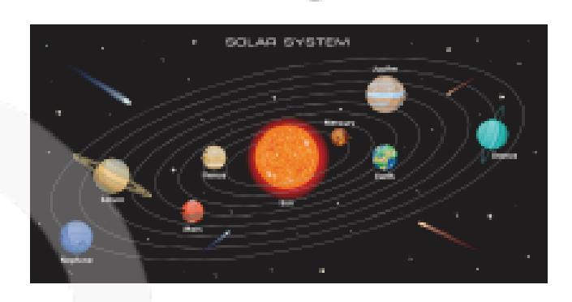

<!-- pdf:136 -->

# REVIEW 4

**(UNITS 10 - 11 - 12)**

## LANGUAGE

### Pronunciation

**1. a. Choose the word which has a different stress pattern from that of the others.**

1. A. referee
   B. amazing
   C. historic
   D. invention
2. A. digital
   B. conference
   C. Japanese
   D. difficult

**b. Read the sentences out loud with the correct stress. How many stressed words are there in each sentence? Listen, check, and repeat.**

3. How will people travel to work in the future?
4. **A:** Will technology replace humans in the future?
   **B:** No, it won't.

**c. Draw a suitable arrow above each underlined word to show intonation. Then listen and repeat.**

5. I can remember the names of some planets, such as ***Venus***, ***Neptune***, and ***Mars***.
6. They have a *TV*, a *fridge*, a *table*, and four *chairs*.

### Vocabulary

**2. Choose the best answer A, B, or C.**

1. A(n) \_\_\_\_\_\_\_ is a small digital image used on social media to express emotions.
   A. symbol
   B. emoji
   C. picture
2. We had a \_\_\_\_\_\_\_ with students from different countries yesterday.
   A. video conference
   B. video group
   C. private message
3. The results of the \_\_\_\_\_\_\_ were very interesting.
   A. finding
   B. communication
   C. experiment
4. When you look at the \_\_\_\_\_\_\_ for too long, your eyes may get tired.
   A. contact lenses
   B. computer screen
   C. online class
5. Do you know how many stars there are in the \_\_\_\_\_\_\_?
   A. spaceship
   B. planet
   C. **galaxy**

**3. Fill in each blank with the suitable form of the word given.**

1. Scientists are interested in the \_\_\_\_\_\_\_ of life on **Mars**. (possible)
2. We can use face \_\_\_\_\_\_\_ to identify people. (recognise)
3. When we communicate using technology, it is called digital \_\_\_\_\_\_\_. (communicate)
4. The Internet \_\_\_\_\_\_\_ is slow here, so we can't get in the chat room. (connect)
5. Do you think this \_\_\_\_\_\_\_ machine will be cheaper in the future? (translate)

### Grammar

**4. Which of the underlined parts in each question is incorrect? Find and correct it.**

1. The *scientists* (A) did an experiment *on* (B) three *hours* (C) yesterday.
2. Do you *think* (A) robot teachers *will* (B) replace human teachers *by* (C) 20 years?
3. *These* (A) contact lenses are *mine* (B); they aren't *your* (C).
4. This *is* (A) Ann, a friend *in* (B) mine *from* (C) the UK.
5. You should *be* (A) at school *for* (B) 7:00 a.m., so hurry *up* (C).
<!-- ocr-ok: đã đối chiếu ảnh trang gốc, kí hiệu A, B, C đặt dưới chân các từ gạch chân nên OCR tách dòng -->

**5. Change these sentences into reported speech.**

1. "What planet do you want to visit?" my friend asked me.
   \_\_\_\_\_\_\_\_\_\_\_\_\_\_\_\_\_\_\_\_\_\_\_\_\_\_\_\_\_\_\_.
2. "I'm now reading a book about future ways of communication," she told me.
   \_\_\_\_\_\_\_\_\_\_\_\_\_\_\_\_\_\_\_\_\_\_\_\_\_\_\_\_\_\_\_.
3. "How will teachers check attendance in the future?" Lan asked Nam.
   \_\_\_\_\_\_\_\_\_\_\_\_\_\_\_\_\_\_\_\_\_\_\_\_\_\_\_\_\_\_\_.
4. "We are having a video conference with other clubs next week," our club president said.
   \_\_\_\_\_\_\_\_\_\_\_\_\_\_\_\_\_\_\_\_\_\_\_\_\_\_\_\_\_\_\_.
5. I asked my mum, "When will there be a full moon?"
   \_\_\_\_\_\_\_\_\_\_\_\_\_\_\_\_\_\_\_\_\_\_\_\_\_\_\_\_\_\_\_.

<!-- pdf:137 -->

## SKILLS

### Reading

**1. Read the notices. Tick (✓) the appropriate box(es).**

**A. New club members wanted**

We need members for the new science club. Must be between 12 - 14 years old. Must be creative and want to learn new things. Club members meet once a week on Sundays in the town library. If you are interested or want more details, send an email to: science@fastmail.com or call 091234567

**B. School speaking contest**

Our school is organising an English-speaking contest about the planets in our solar system. Interested students create posters about a planet of their choosing and present them to the teachers.
<!-- term: solar system -->

Please contact your English teacher for more details no later than April 25 or send an email to: speaking@fastmail.com

**C. A talk about future means of communication**
<!-- ocr-ok: đã đối chiếu ảnh trang gốc, tiêu đề thông báo C nằm trên nền màu tím bị OCR bỏ sót -->

Are you interested in future means of communication? Do you want to learn about it from experts? Come and join our talk.
Time: 2 p.m., April 8
Place: School library
Phone 094738224 for more information.

| | A | B | C |
| --- | --- | --- | --- |
| 1. This notice mentions the age of the participants. | | | |
| 2. Participants give a presentation. | | | |
| 3. Participants discuss ways of communication in the future. | | | |
| 4. Participants meet once a week. | | | |
| 5. Interested people call for more details. | | | |

### Speaking

**2. Work in pairs. Ask and answer about a device or an app you use for studying. Report your partner's answers to the class.**

1. What kind of device / app is it?
2. How often do you use it?
3. What are the benefits of using it?
4. Are there any problems using it?

### Listening

**3. Listen to Mark talking about the solar system. Fill in each blank with no more than TWO words.**

1. Many of the planets in our solar system have \_\_\_\_\_\_\_.
2. The four inner planets are quite small and have \_\_\_\_\_\_\_.
3. The asteroid belt has millions of rocky \_\_\_\_\_\_\_.
4. The outer planets are \_\_\_\_\_\_\_ and mostly made up of gas.
5. These outer planets all have thick layers of clouds and \_\_\_\_\_\_\_ around them.
<!-- term: inner planets -->
<!-- term: asteroid belt -->

### Writing

**4. Write a paragraph (80 - 100 words) about your favourite means of communication. You may use the following questions as cues.**

1. What is your favourite means of communication?
2. How often do you use it?
3. What are the benefits of using it?
4. Do you think you will use it in the future?

*My favourite means of communication is* \_\_\_\_\_\_\_\_\_\_\_\_\_\_\_\_\_\_\_\_\_\_\_\_\_\_\_\_\_\_\_\_\_\_\_\_\_\_\_\_\_\_\_

## 📷 Danh sách hình trong bài

| Mã hình | Trang PDF | Trang sách | Chú thích / Mô tả |
| --- | --- | --- | --- |
| H8-tieng_anh-r04-01 | 137 | 135 | Sơ đồ hệ Mặt Trời (*Solar System*) minh hoạ cho bài nghe về các hành tinh trong và ngoài của hệ Mặt Trời thuộc bài tập 3 phần Skills – Listening |
