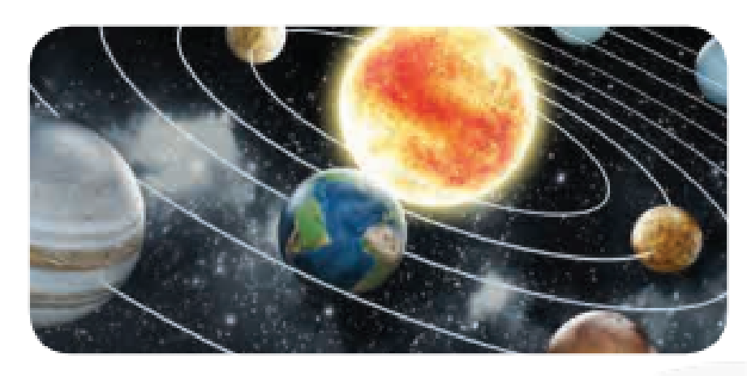
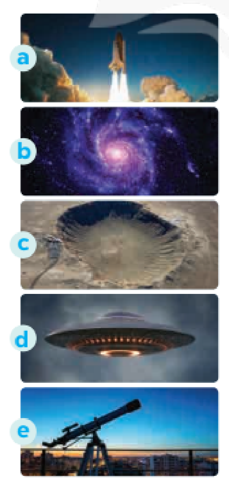
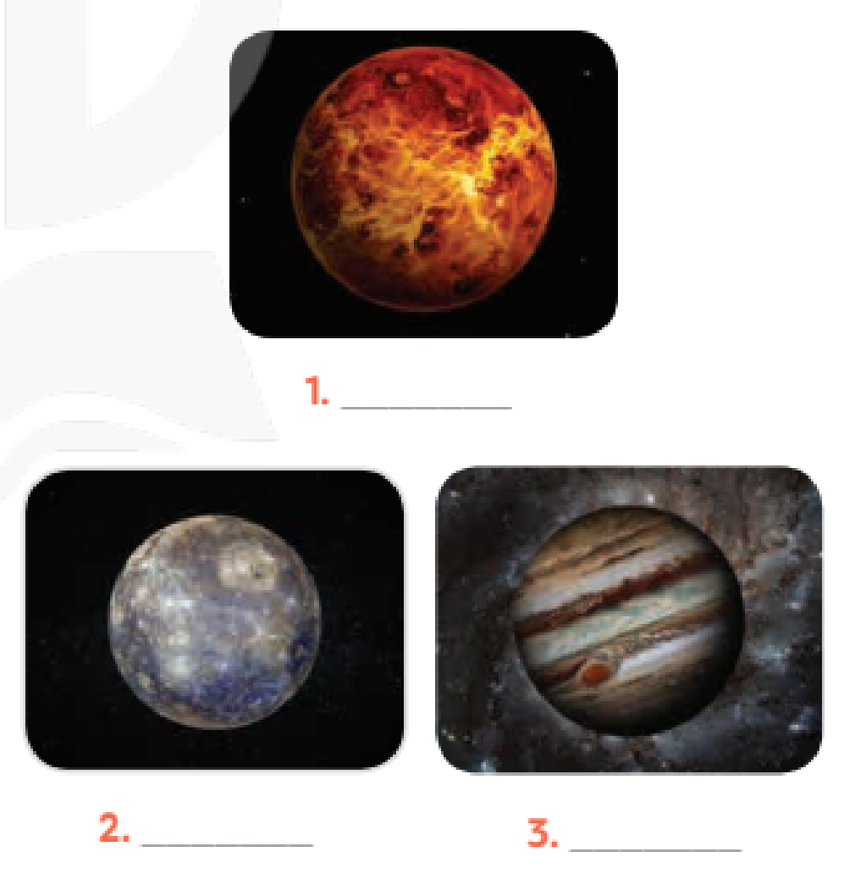
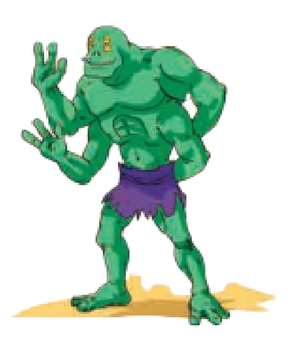
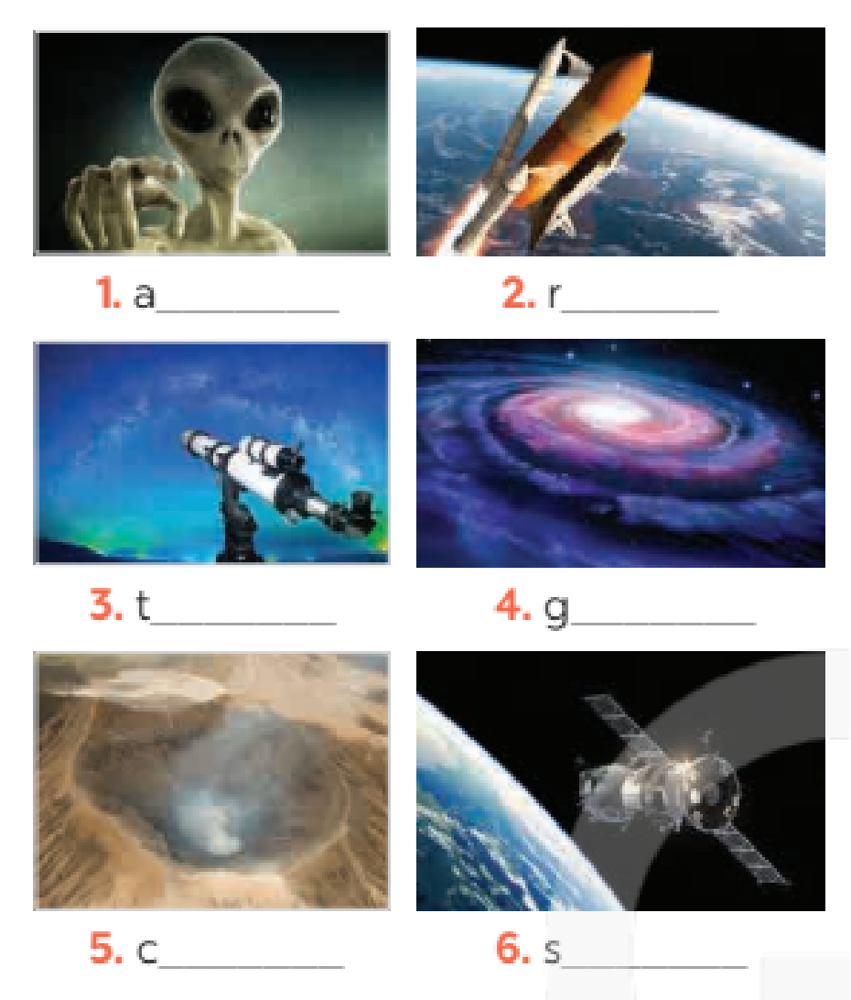

<!-- pdf:126 -->

# UNIT 12: LIFE ON OTHER PLANETS

> **THIS UNIT INCLUDES:**
> - **Vocabulary:**
>   - Outer space
> - **Pronunciation:**
>   - Intonation for making lists
> - **Grammar:**
>   - Reported speech (questions)
> - **Skills:**
>   - Reading about the **possibility** of life on other planets
>   - Talking about the conditions needed for planets to support human life
>   - Listening about an imaginary planet and its **creatures**
>   - Writing a paragraph to describe imaginary **creatures** living on another planet
> - **Everyday English:**
>   - Expressing uncertainty

## GETTING STARTED

**A thrilling science fiction novel**

**1. Listen and read.**

**Mai:** What book are you reading, Nick?

**Nick:** *A journey back to Soduka*. I'm on the last page.

**Mai:** That's a science fiction book, isn't it? What's it about?
<!-- term: science fiction -->

**Nick:** Yes, it is. It's about four **creatures** Titu, Kaku, Hub, and Barb. They're travelling back to Soduka, a planet like Earth. Along the way they have to land on Earth because their spaceship breaks down. They meet Tommy and become friends with him.
<!-- term: spaceship -->

**Mai:** What happens next?

**Nick:** Tommy helps the four **creatures** repair their spaceship, so they can travel back to their home planet. But their **commander** forces them to return to Earth to destroy it. Tommy and the four **creatures** try to **oppose** the **commander**.

**Mai:** Sounds thrilling!

**Nick:** Tommy and the four **creatures** manage to stop the **commander** from destroying Earth.

**Mai:** So it has a happy ending! What do you think about the **possibility** of **aliens** attacking Earth?

**Nick:** I'm not sure about it. But I'm starting to think about it. I sometimes ask myself what we would do if **aliens** took over our planet.

<!-- pdf:127 -->

**2. Read the conversation again and tick (✓) T (True) or F (False).**

| | T | F |
| --- | --- | --- |
| 1. Soduka is a planet that is very different from Earth. | | |
| 2. Titu, Kaku, Hub, and Barb have to land on Earth because their spaceship breaks down. | | |
| 3. Tommy helps the four **creatures** make a new spaceship so that they can return to Soduka. | | |
| 4. The four **creatures** travel to Earth again to visit Tommy. | | |
| 5. The novel makes Nick and Mai think about the **possibility** that Earth might be attacked by **aliens**. | | |

**3. Match the words (1 - 5) with their definitions (a - e).**

| | |
| --- | --- |
| 1. **oppose** | a. real or imaginary living things |
| 2. **creatures** | b. living things from another world or planet |
| 3. **commander** | c. to fight against |
| 4. **aliens** | d. the fact that something might exist or happen, but is not certain to |
| 5. **possibility** | e. an officer in charge of a particular group of soldiers |

**4. Complete the sentences with the words in 3.**

1. There is a \_\_\_\_\_\_\_ that we might visit **Mars** in the near future.
2. The main character in the film is a boy who makes friends with some \_\_\_\_\_\_\_ from a planet.
3. Dogs are more social \_\_\_\_\_\_\_ than cats.
4. These soldiers were punished because they didn't obey their \_\_\_\_\_\_\_.
5. Some people \_\_\_\_\_\_\_ sending spaceships to explore other planets.

**5. Work in groups. Discuss the following questions. Then report your group's answers to the class.**

Do you believe that there is life on other planets? Why / Why not?

<!-- pdf:128 -->

## A CLOSER LOOK 1

### Vocabulary

**1. The following are the eight planets that go around the sun:**

| Earth | **Jupiter** | **Mars** | **Venus** |
| --- | --- | --- | --- |
| **Mercury** | **Neptune** | **Saturn** | **Uranus** |

**Put them in order from the closest to the farthest from the sun. This sentence will help you learn the order of the planets:**

**M**y **V**ery **E**xcellent **M**other **J**ust **S**erved **U**s **N**oodles.
<!-- ocr-ok: đã đối chiếu ảnh trang gốc, các chữ cái đầu M, V, E, M, J, S, U, N in đậm làm mẹo ghi nhớ thứ tự 8 hành tinh -->

1. \_\_\_\_\_\_\_
2. \_\_\_\_\_\_\_
3. \_\_\_\_\_\_\_
4. \_\_\_\_\_\_\_
5. \_\_\_\_\_\_\_
6. \_\_\_\_\_\_\_
7. \_\_\_\_\_\_\_
8. \_\_\_\_\_\_\_

**Name these planets in Vietnamese.**

**2. Match the words (1 - 5) with the pictures (a - e).**

1. **telescope**
2. **UFO**
3. **rocket**
4. **galaxy**
5. **crater**
<!-- ocr-ok: đã đối chiếu ảnh trang gốc, OCR bỏ sót mục 2. UFO trong cột từ nối tranh -->

**3. Complete the following sentences with the words from the box.**

| **Venus** | **telescope** | **craters** | **rocket** | **galaxy** |
| --- | --- | --- | --- | --- |

1. There are many \_\_\_\_\_\_\_ on the surface of the moon.
2. We use a \_\_\_\_\_\_\_, which is in the shape of a big tube, for travelling or carrying things into space.
3. We need to use a \_\_\_\_\_\_\_ to clearly see the surface of the moon.
4. The planet which is the second closest to the sun is \_\_\_\_\_\_\_.
5. The Milky Way is the \_\_\_\_\_\_\_ that includes our solar system.
<!-- term: solar system -->

### Pronunciation

*Intonation for making lists*

**Remember!**

When we make a list, our voice slightly rises on the previous item(s) and falls on the last item.
<!-- term: Intonation for making lists -->

*Example:*

The inner planets are the four planets closest to the sun:
<!-- term: inner planets -->

| |
| --- |
| **Mercury** ↗, **Venus** ↗, **Earth** ↗, and **Mars** ↘. |
| We've got **bananas** ↗, **apples** ↗, **pears** ↗, and **oranges** ↘. |
<!-- ocr-ok: đã đối chiếu ảnh trang gốc, các mũi tên ngữ điệu lên/xuống bị OCR đọc thành kí tự lạ -->

<!-- pdf:129 -->

**4. Listen and repeat the sentences. Pay attention to the tones of the underlined words in each sentence.**

1. I'd like some *eggs*, some *milk*, some *cheese*, and some *bread*, please.
2. My father can speak four languages: *English*, *French*, *Russian*, and *Spanish*.
3. My favourite sports are *football*, *tennis*, *basketball*, and *volleyball*.
4. My kitten is *cute*, *smart*, *playful*, and *noisy*.
5. The outer planets, which are made up mostly of gas, include ***Jupiter***, ***Saturn***, ***Uranus***, and ***Neptune***.

**5. Listen to the conversations. Do you think the voice goes up or down on the underlined words in each second sentence? Draw a suitable arrow (↗ or ↘) on each underlined word.**

1. **A:** Good evening! What can I get you, sir?
   **B:** I'd like some *pork*, some *chicken*, some *tofu*, and some *vegetables*.
2. **A:** What did you buy at the clothing store yesterday?
   **B:** I bought a *T-shirt*, a *jumper*, a *tie*, and a *cap*.
3. **A:** What music do you like?
   **B:** I like *pop*, *blues*, *country*, and *jazz*.
4. **A:** What do you think we should bring with us to **Mars**?
   **B:** I think we should bring *food*, *water*, *clothes*, and a *tent*.

## A CLOSER LOOK 2

### Grammar

**Reported speech (questions)**

**Remember!**

We normally use *ask*, *wonder*, and *want to know* when we report questions. In reported questions, we use the same word order as in statements but omit the question mark.
<!-- term: Reported speech – questions -->

*Example:*

She asked me, "What are you doing now?"
→ She asked me what I was doing then.

Remember that pronouns, possessive adjectives, verb tenses, place expressions, and time expressions change in reported questions just as in reported statements.
<!-- term: Reported speech – questions -->

**1. Underline the correct word or phrase for each sentence.**

1. He phoned to ask his mother what she was doing now / then.
2. Ann wondered what plants Vietnamese people grow / grew for food.
3. Peter phoned the shop to ask what specialities they are selling there / here.
4. The student asked his professor what forms of life can / could exist on **Mars**.
5. He wanted to know how many planets there were / were there in our solar system.

<!-- pdf:130 -->

**2. Put the words and phrases in the correct order to make reported questions.**

1. how many moons / My little brother / asked me / had / **Venus** / .
   \_\_\_\_\_\_\_\_\_\_\_\_\_\_\_\_\_\_\_\_\_\_\_\_\_\_\_\_\_\_\_.
2. which / She / planet / the closest / wanted to know / was / to the sun / .
   \_\_\_\_\_\_\_\_\_\_\_\_\_\_\_\_\_\_\_\_\_\_\_\_\_\_\_\_\_\_\_.
3. asked the scientists / The journalist / what / for / were using / **telescopes** / in space / they / .
   \_\_\_\_\_\_\_\_\_\_\_\_\_\_\_\_\_\_\_\_\_\_\_\_\_\_\_\_\_\_\_.
4. wanted to know / when / The scientists / travel to **Mars** / would be able to / humans / .
   \_\_\_\_\_\_\_\_\_\_\_\_\_\_\_\_\_\_\_\_\_\_\_\_\_\_\_\_\_\_\_.
5. He / what / were / asked the professor / to have life / for a planet / the conditions / on it / .
   \_\_\_\_\_\_\_\_\_\_\_\_\_\_\_\_\_\_\_\_\_\_\_\_\_\_\_\_\_\_\_.

**3. Change the following questions into reported questions.**

1. "Who will be the first to step on **Mars**?" Mary asked the scientist.
   \_\_\_\_\_\_\_\_\_\_\_\_\_\_\_\_\_\_\_\_\_\_\_\_\_\_\_\_\_\_\_.
2. "How fast can a **UFO** travel?" I asked my father.
   \_\_\_\_\_\_\_\_\_\_\_\_\_\_\_\_\_\_\_\_\_\_\_\_\_\_\_\_\_\_\_.
3. The student asked his friend, "How many **craters** does the moon have?"
   \_\_\_\_\_\_\_\_\_\_\_\_\_\_\_\_\_\_\_\_\_\_\_\_\_\_\_\_\_\_\_.
4. The pupils asked the teacher, "Where can we find information about the solar system?"
   \_\_\_\_\_\_\_\_\_\_\_\_\_\_\_\_\_\_\_\_\_\_\_\_\_\_\_\_\_\_\_.
5. "What is the weather on **Mars** like?" I asked my teacher.
   \_\_\_\_\_\_\_\_\_\_\_\_\_\_\_\_\_\_\_\_\_\_\_\_\_\_\_\_\_\_\_.

**4. Report the conversation between An and Mai.**

**An:** What are you reading, Mai?

**Mai:** I'm reading *Aliens*, and I'm almost done.

**An:** What kind of book is it?

**Mai:** It's science fiction.
<!-- term: science fiction -->

**An:** What's it about?

**Mai:** It's about three **aliens** who try to take over Earth.

*Example:*

An asked Mai what she was reading. Mai told An that she was reading ...

**5. Work in pairs. Ask your partner five questions about his / her daily routine and make notes of his / her answers. Then report your questions and your partner's answers to the class.**

*Example:*

I asked A what time he got up in the morning and he told me (that) he got up at ...

<!-- pdf:131 -->

## COMMUNICATION

### Everyday English

*Expressing uncertainty*

**1. Listen and read the conversations. Pay attention to the highlighted sentences.**

1. **Nick:** Do you think **Mars** may support life?
   **Mark:** *I'm not sure about it.* Scientists are trying to find life there.
<!-- term: Expressing uncertainty -->

2. **Mary:** Do you think Ann will win tomorrow?
   **Tommy:** *I doubt it.* She injured her arm in a match last week.
<!-- term: Expressing uncertainty -->

**2. Work in pairs. Make similar conversations with the following situations.**

1. You are not sure about the **possibility** of water on **Mars**.
2. You doubt that one of your friends will get a good mark on the English test.
3. You are not sure if the weather will be fine tomorrow.

**Three planets in the solar system**

**3. Read the information below and answer the questions that follow.**

**Mercury**
- smallest and closest to the sun with no moon
- very hot in the daytime but very cold at night
- no atmosphere → no wind or weather on it
<!-- term: atmosphere -->

**Jupiter**
- largest planet with about 63 moons
- stormiest planet
- third brightest object in the night sky

**Venus**
- hottest planet with no moon
- nearly as big as Earth
- often very bright in the early morning → people call it the morning star

1. What planets have no moon?
2. What planet is similar in size to Earth?
3. What planet is the smallest and closest to the sun?
4. What planet is called the morning star?
5. What is the largest and stormiest planet?

**4. Work in pairs. Discuss and match the three planets in 3 with the pictures (1 - 3) below.**

1. \_\_\_\_\_\_\_
2. \_\_\_\_\_\_\_
3. \_\_\_\_\_\_\_

**5. Work in groups. Take turns to talk about one of the three planets in 3.**

*Example:*

I would like to tell you about **Mercury**. It is the smallest planet ...

<!-- pdf:132 -->

## SKILLS 1

### Reading

**1. Work in pairs. Discuss the following questions.**

1. What do you know about other planets?
2. Would you like to live on another planet? Why / Why not?

**2. Read the text and match the highlighted words in the text with their meanings.**

Nowadays humans are still wondering what planets in outer space might support life.
<!-- term: outer space -->

Scientists say planets need to meet three main conditions to support life. Firstly, they must have *liquid* water, so their temperature must not be too high or too low. Secondly, the planets need to have the correct amount of air so that they can hold an atmosphere around. Finally, their size is also important. If a planet is too small, its **gravity** is not strong enough to hold an enough amount of air. If it is too big, its **gravity** will be so strong that it will hold too much air.
<!-- term: liquid water -->
<!-- term: atmosphere -->

Scientists are using space **telescopes** to find **habitable** planets. According to them, **Mars** is one of the most **promising** planets for life in our solar system. It is a planet like Earth. Its days last for 24.5 hours and its seasons are similar to Earth's. Although scientists have not found actual water on **Mars**, there seems to be **traces** of it on the planet's surface. However, the climate on **Mars** is unsuitable for human life because it is too cold and **Mars** lacks oxygen to support human life.

| | |
| --- | --- |
| 1. liquid | a. suitable for people to live in |
| 2. **gravity** | b. marks, objects, or signs that show that somebody or something existed |
| 3. **habitable** | c. in the form of a substance that flows freely and is not a solid or a gas |
| 4. **promising** | d. the force that causes something to fall to the ground |
| 5. **traces** | e. showing signs of being good or successful |

**3. Read the text again and answer the following questions.**

1. What are humans still wondering nowadays?
2. Why does a **habitable** planet need to have the correct amount of air?
3. What happens if a planet is too small?
4. How long does a day on **Mars** last?
5. Why can we not live on **Mars**?

### Speaking

**4. Work in pairs. Tick (✓) the boxes to show what conditions a planet needs to support human life.**

- [ ] 1. There must be enough liquid water on the planet.
- [ ] 2. The planet must have **craters** on its surface.
- [ ] 3. The planet must hold an atmosphere.
- [ ] 4. The planet must have at least two moons.
- [ ] 5. The planet must have enough oxygen in the air.
<!-- term: liquid water -->

**Can you add other conditions for a habitable planet?**

**5. Work in groups. Take turns to talk about the conditions you think are required for a planet to support human life. Use the information in 4 and your own ideas.**

*Example:* There are some conditions planets must have to support human life on them. First, the most important condition is that ...

<!-- pdf:133 -->

## SKILLS 2

### Listening

**1. Work in pairs. Look at the picture and answer the following questions.**

1. Where do you think this **creature** is from?
2. What do you think it can do?

**2. You will hear a student talking about an imaginary planet that supports life. Listen and choose the correct answer A, B, or C.**

1. Planet Hope is located \_\_\_\_\_\_\_.
   A. in the Milky Way **Galaxy**
   B. in the Andromeda **Galaxy**
   C. close to the Milky Way **Galaxy**
2. Planet Hope is \_\_\_\_\_\_\_.
   A. as big as Earth
   B. half the size of Earth
   C. three times the size of Earth
3. The climate on Planet Hope is \_\_\_\_\_\_\_.
   A. very hot all year around
   B. very cold all year around
   C. hot in the day but very cold at night
4. Hopeans have thick skin to protect them from \_\_\_\_\_\_\_.
   A. the heat
   B. the cold
   C. **alien** attacks
5. Hopeans drink \_\_\_\_\_\_\_.
   A. liquid water from the sea
   B. petrol from under the ground
   C. almost nothing

**3. Read the following information about Hopeans. Listen again and fill in each blank with ONE word or number that you hear.**

| | |
| --- | --- |
| **Name** | Hopeans |
| **Living place** | Planet Hope in the Milky Way **Galaxy** |
| **Appearance** | - have a big head, (1) \_\_\_\_\_\_\_ eyes, two legs, and (2) \_\_\_\_\_\_\_ arms - have thick skin to protect them from the heat |
| **Behaviour** | - friendly and (3) \_\_\_\_\_\_\_ - only (4) \_\_\_\_\_\_\_ to people who try to attack them |
| **Lifestyle** | - eat special (5) \_\_\_\_\_\_\_ and drink petrol from under the ground - travel by (6) \_\_\_\_\_\_\_ at very high speeds |
<!-- ocr-ok: đã đối chiếu ảnh trang gốc, bảng thông tin về Hopeans gồm 2 cột điền từ bài nghe -->

### Writing

**4. Work in pairs. Use your imagination to make notes in the table below about what aliens living on another planet would be like.**

| | |
| --- | --- |
| **Name** | |
| **Living place** | |
| **Appearance** | |
| **Behaviour** | |
| **Lifestyle** | |
<!-- ocr-ok: đã đối chiếu ảnh trang gốc, bảng ghi chú lập dàn ý gồm 5 hàng -->

**5. Write a paragraph (80 - 100 words) describing aliens living on another planet. Use your notes in 4.**

***Creatures** living on \_\_\_\_\_\_\_\_\_\_\_\_\_\_\_\_\_\_\_\_ are called \_\_\_\_\_\_\_\_\_\_\_\_\_\_\_\_\_\_\_\_*

<!-- pdf:134 -->

## LOOKING BACK

### Vocabulary

**1. Write a word under each picture.**

1. a\_\_\_\_\_\_\_
2. r\_\_\_\_\_\_\_
3. t\_\_\_\_\_\_\_
4. g\_\_\_\_\_\_\_
5. c\_\_\_\_\_\_\_
6. s\_\_\_\_\_\_\_
<!-- ocr-ok: đã đối chiếu ảnh trang gốc, các chữ cái đầu gợi ý và chỗ trống điền từ 1-6 nằm ngay dưới từng tranh -->

**2. Circle the correct words to complete the sentences.**

1. **UFOs** / **Rockets** are spaceships from another planet.
2. We have no **possibility** / condition of making our own spaceship.
3. We can't find any living **craters** / **creatures** in the solar system except for us.
4. Scientists are working to find a habitat / **habitable** planet.
5. The **gravity** / atmosphere of the Earth makes things fall to the ground when we drop them.

### Grammar

**3. Rewrite each sentence so that it is closest in meaning to the original one.**

1. "What is this novel about?" said Mary.
   Mary wanted to know \_\_\_\_\_\_\_\_\_\_\_\_\_\_\_\_\_\_\_\_\_\_\_.
2. "Who's your favourite actor, Nick?" I said.
   I asked Nick \_\_\_\_\_\_\_\_\_\_\_\_\_\_\_\_\_\_\_\_\_\_\_.
3. "What time does the next train leave?" Mai said to me.
   Mai asked me \_\_\_\_\_\_\_\_\_\_\_\_\_\_\_\_\_\_\_\_\_\_\_.
4. "How do the scientists observe the other planets?" the students asked.
   The students wondered \_\_\_\_\_\_\_\_\_\_\_\_\_\_\_\_\_\_\_\_\_\_\_.
5. Mai wondered, "Why can't humans live on **Mars**?"
   Mai wondered \_\_\_\_\_\_\_\_\_\_\_\_\_\_\_\_\_\_\_\_\_\_\_.

**4. Which of the underlined parts in each question is incorrect? Find and correct it.**

1. The teacher asked *the* (A) pupils *what* (B) they *are* (C) doing then.
2. My father *wondered* (A) me what I *was* (B) going to do the *following* (C) weekend.
3. My brother *wanted* (A) to know *who* (B) the scientists were *exploring* (C) other planets.
4. I asked my teacher *what food* (A) spacemen *eat* (B) when they were travelling in *a* (C) spacecraft.
5. Scientists are *still* (A) wondering *how many* (B) planets *are there* (C) in our **galaxy**.
<!-- ocr-ok: đã đối chiếu ảnh trang gốc, kí hiệu A, B, C đặt dưới chân các từ gạch chân nên OCR tách dòng -->

<!-- pdf:135 -->

## PROJECT

**OUR FAVOURITE PLANET**
<!-- ocr-ok: đã đối chiếu ảnh trang gốc, tiêu đề dự án chữ viền màu cách điệu bị OCR đọc nhầm -->

**Work in groups.**

**1. Choose a planet in our solar system that you like and search for the information about it.**

**2. Design a poster about that planet, including:**
- *The planet's name:* What does its name mean?
- *Size:* How big is it?
- *Atmosphere:* What is its atmosphere like? Is it a thick or a thin atmosphere?
- *Temperature:* What is its average temperature? How hot and cold does it get?
- *Appearance:* What does it look like?
- *Something special:* Is there anything special about it?
- ...

**3. Present your poster to the class.**
<!-- ocr-ok: đã đối chiếu ảnh trang gốc, OCR đọc dính chữ Presentyour -->

### Now I can ...

- use the words related to the topic *Life on other planets*.
- use intonation for making lists correctly.
- use reported speech for questions.
- express uncertainty.
- read about the **possibility** of life on other planets.
- talk about the conditions needed for planets to support human life.
- listen about an imaginary planet and its **creatures**.
- write a paragraph to describe imaginary **creatures** living on another planet.

## 📷 Danh sách hình trong bài

| Mã hình | Trang PDF | Trang sách | Chú thích / Mô tả |
| --- | --- | --- | --- |
| H8-tieng_anh-u12-01 | 128 | 126 | Hình minh hoạ hệ Mặt Trời và quỹ đạo của 8 hành tinh quay quanh Mặt Trời thuộc bài tập 1 phần A Closer Look 1 – Vocabulary |
| H8-tieng_anh-u12-02 | 128 | 126 | Năm bức ảnh gắn nhãn a–e minh hoạ *rocket*, *galaxy*, *crater*, *UFO* và *telescope* thuộc bài tập 2 phần A Closer Look 1 – Vocabulary |
| H8-tieng_anh-u12-03 | 131 | 129 | Ba bức ảnh hành tinh đánh số 1–3 (*Venus*, *Mercury*, *Jupiter*) dùng để nối với thông tin mô tả thuộc bài tập 4 phần Communication |
| H8-tieng_anh-u12-04 | 133 | 131 | Tranh minh hoạ sinh vật ngoài hành tinh màu xanh có 4 cánh tay (*Hopean*) thuộc bài tập 1 phần Skills 2 – Listening |
| H8-tieng_anh-u12-05 | 134 | 132 | Sáu bức ảnh đánh số 1–6 kèm chữ cái gợi ý đầu từ (*alien*, *rocket*, *telescope*, *galaxy*, *crater*, *satellite* / *spaceship*) thuộc bài tập 1 phần Looking Back – Vocabulary |
