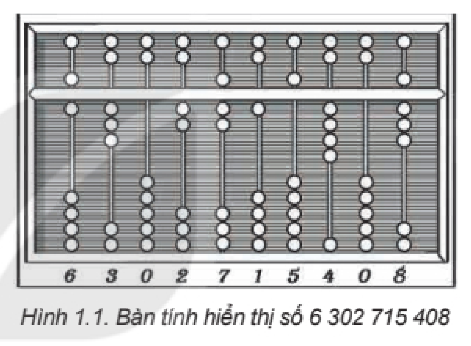
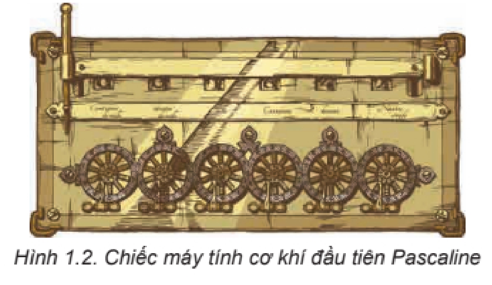
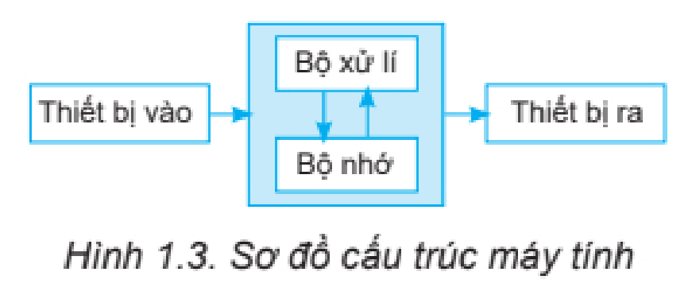
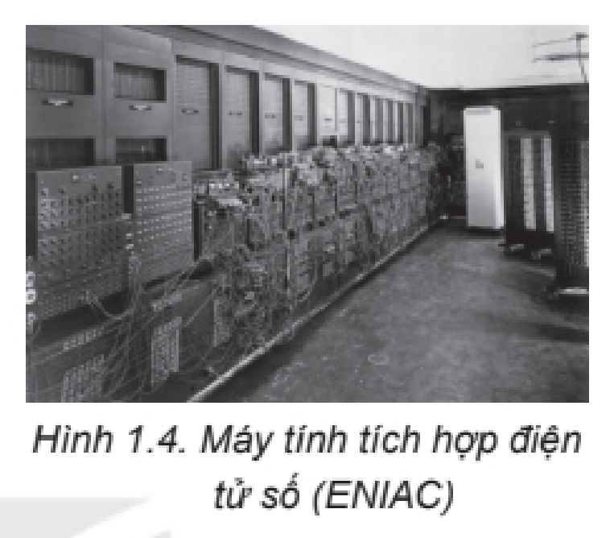
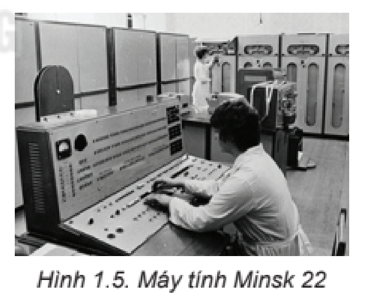
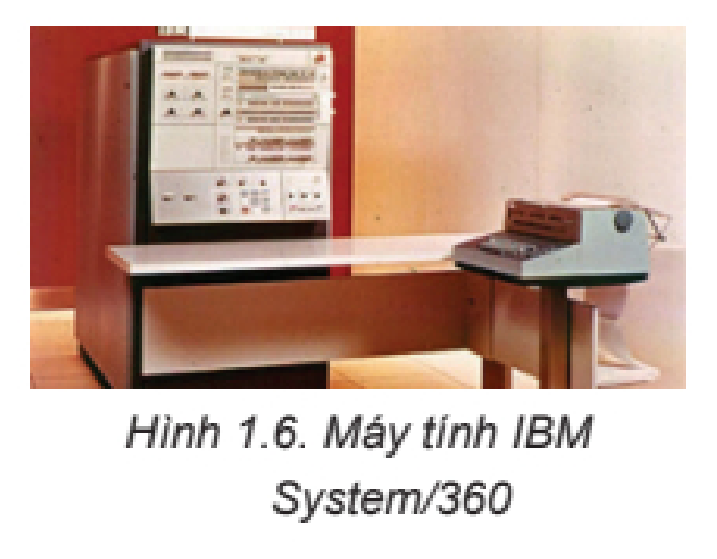

<!-- pdf:6 -->

# BÀI 1: LƯỢC SỬ CÔNG CỤ TÍNH TOÁN

## 🎯 Sau bài học này em sẽ:

- Trình bày được sơ lược lịch sử phát triển máy tính.
- Nêu được ví dụ cho thấy sự phát triển máy tính đã đem đến những thay đổi lớn lao cho xã hội loài người.

## 🔴 Khởi động

**Công cụ tính toán đầu tiên**

Các phép tính đầu tiên được con người thực hiện bằng cách sử dụng 10 ngón tay. Cho đến nay, **hệ thống ghi số thập phân** (cách ghi số sử dụng các chữ số từ 0 đến 9) vẫn là cách ghi số phổ biến hơn cả. Trong tiếng Anh, từ “chữ số” (digit) có nguồn gốc từ chữ digitus (trong tiếng Latin có nghĩa là ngón tay).

*Hình 1.1. Bàn tính hiển thị số 6 302 715 408*

**Bàn tính**

Hơn 2000 năm trước Công nguyên, con người đã biết làm các phép tính số học. Một trong những công cụ tính toán sớm nhất là **bàn tính** (Hình 1.1).

## 1. MÁY TÍNH CƠ KHÍ

> **Hoạt động 1: Sự ra đời của máy tính**
>
> Hầu hết mọi người nghĩ về máy tính như một thiết bị điện tử, có khả năng xử lí dữ liệu đa dạng với tốc độ cao và có dung lượng lưu trữ lớn. Em hãy tìm hiểu và cho biết:
> 1. Tên của một trong những chiếc máy tính đầu tiên.
> 2. Chiếc máy đó có thể làm được những gì?
> 3. Ý tưởng nào đã thúc đẩy sự phát minh ra máy tính?

**Những chiếc bánh răng**

Ý tưởng cơ giới hoá việc tính toán đóng vai trò quan trọng trong lịch sử phát triển của máy tính. Năm 1642, nhà bác học người Pháp Blaise Pascal, khi đó chưa đầy 20 tuổi, đã cho ra đời chiếc **máy tính cơ khí Pascaline** (Hình 1.2) để giúp đỡ cha trong việc tính thuế.

*Hình 1.2. Chiếc máy tính cơ khí đầu tiên Pascaline*

<!-- pdf:7 -->

Sau Pascal, nhà Toán học người Đức Gottfried Leibniz đã cải tiến và thêm phép tính nhân, chia vào máy tính của Pascal để nó thực hiện được cả bốn phép tính số học.

**Dự án máy tính của Babbage**

Năm 1833 đánh dấu dự án đầy tham vọng của nhà Toán học, nhà phát minh, kĩ sư cơ khí người Anh Charle Babbage nhằm thiết kế và chế tạo những cỗ máy, thực hiện việc tính toán một cách tự động nhằm tránh những sai sót của con người trong việc tính toán và sao chép các con số.

<!-- term: Nguyên lí thiết kế máy tính của Babbage -->
Nguyên lí thiết kế máy tính của Babbage giống như máy tính ngày nay. Đó là loại máy đa năng, thực hiện tính toán tự động và có những ứng dụng ngoài tính toán thuần tuý. Vì vậy, mặc dù dự án của ông không được hoàn thành do hạn chế về công nghệ, ông vẫn được coi là cha đẻ của công nghệ máy tính.

> - Ý tưởng cơ giới hoá việc tính toán đóng vai trò quan trọng trong lịch sử phát triển của máy tính. Năm 1642, nhà bác học Blaise Pascal đã sáng chế ra chiếc **máy tính cơ khí Pascaline**.
> - Năm 1833, nhà Toán học Charle Babbage đã thiết kế máy tính đa năng, tính toán tự động tương tự như máy tính ngày nay.

> ❓ **Câu hỏi**
>
> Máy tính trong dự án của Babbage có những đặc điểm gì?
> A. Máy tính cơ học, thực hiện tự động.
> B. Máy tính có những ứng dụng ngoài tính toán thuần tuý.
> C. Có thiết kế giống với máy tính ngày nay.
> D. Cả ba đặc điểm trên.

## 2. MÁY TÍNH ĐIỆN TỬ

**Máy tính điện – cơ và kiến trúc Von Neumann**

Năm 24 tuổi, Claude Shannon đã chỉ ra rằng có thể sử dụng các rơ le để thực hiện các thao tác tính toán trên các dãy bit. Đó là nền tảng cho việc thiết kế các máy tính kĩ thuật số hiện đại. Thời kì đầu, các máy tính được thiết kế dựa trên các rơ le, còn được gọi là **máy tính điện – cơ**.

Được thôi thúc bởi ý tưởng của Babbage, được IBM tài trợ, năm 1943, Howard Aiken đã chế tạo thành công chiếc máy tính điều khiển tuần tự tự động (ASCC Automatic Sequence Controlled Calculator), một máy tính điện – cơ đa năng, có thể hoạt động với sự can thiệp tối thiểu của con người. Nó thực hiện phép tính cộng mất gần một giây và phép tính nhân mất khoảng 6 giây. Máy tính này được giới thiệu ở Đại học Harvard vào năm 1944 nên còn được biết tới với cái tên **Harvard Mark I**.

Năm 1945, nhà Toán học người Mỹ gốc Hung-ga-ry John Von Neumann đã trình bày nguyên lí hoạt động của máy tính với khái niệm “**chương trình được lưu trữ**”. Theo đó: 1) các lệnh của chương trình được lưu trữ trong bộ nhớ giống như dữ liệu; 2) để thực hiện nhiệm vụ nào, chỉ cần tải chương trình tương ứng vào bộ nhớ; 3) chương trình được nạp từ bộ nhớ vào bộ xử lí từng lệnh một và thực hiện xong mới nạp lệnh tiếp theo (tuần tự).

<!-- pdf:8 -->

Theo nguyên lí đó, máy tính cần được cấu tạo dựa trên **kiến trúc Von Neumann**, gồm bộ xử lí, bộ nhớ, các cổng kết nối với thiết bị vào – ra và đường truyền giữa các bộ phận đó như trong Hình 1.3.

*Hình 1.3. Sơ đồ cấu trúc máy tính*
<!-- ocr-ok: đối chiếu ảnh trang PDF 8; OCR đọc nhầm dấu trong chú thích Hình 1.3 -->

Trải qua nhiều giai đoạn, dựa trên những tiến bộ về công nghệ, máy tính điện tử có thể được phân chia thành năm thế hệ.

**Thế hệ thứ nhất (1945 – 1955)**

Công nghệ **đèn điện tử chân không** đầu thế kỉ XX mau chóng thay thế rơ le điện cơ, đánh dấu kỉ nguyên đầu tiên của máy tính điện tử.

Mỗi giây, chiếc **ENIAC** (Hình 1.4) có thể thực hiện 5000 phép tính cộng hoặc 350 phép tính nhân.

*Hình 1.4. Máy tính tích hợp điện tử số (ENIAC)*

<!-- term: Máy tính thế hệ thứ nhất -->
Đặc điểm máy tính thế hệ đầu tiên:
- Thành phần điện tử chính: đèn điện tử chân không.
- Bộ nhớ chính: **trống từ**.
- Kích thước: rất lớn (thường chiếm một căn phòng).
- Thiết bị vào – ra: máy đọc và tạo thẻ đục lỗ.
- Ví dụ: Atanasoff-Berry Computer (ABC 1942), ENIAC (1943), EDVAC (1945),...

**Thế hệ thứ hai (1955 – 1965)**

**Bóng bán dẫn** là một cải tiến lớn, tạo nên thế hệ máy tính mới, có kích thước nhỏ hơn thế hệ đầu tiên. Chúng cũng rẻ hơn, tiêu thụ ít điện năng hơn, đáng tin cậy hơn và chạy nhanh hơn so với các máy tính làm bằng đèn điện tử chân không. Máy tính thế hệ thứ hai nhanh hơn máy tính thế hệ trước hàng chục lần. Chẳng hạn, chiếc IBM 7090 có thể tính được 229 000 phép tính mỗi giây. Chiếc máy tính thế hệ thứ hai được đưa vào nước ta năm 1968 là MINSK 22 (Hình 1.5) được sản xuất tại nước cộng hoà Belarus vào khoảng năm 1965.

*Hình 1.5. Máy tính Minsk 22*

<!-- term: Máy tính thế hệ thứ hai -->
Đặc điểm máy tính thế hệ thứ hai:
- Thành phần điện tử chính: bóng bán dẫn.
- Bộ nhớ: lõi từ, băng từ.
- Kích thước: lớn (bộ phận xử lí và tính toán lớn như những chiếc tủ).
- Thiết bị vào – ra: máy đọc và in băng đục lỗ, máy đọc và in băng từ.
- Ví dụ: IBM 7090 (1959), IBM 7094 (1962), UNIVAC 1107 (1960),...

**Thế hệ thứ ba (1965 – 1974)**

**Máy tính thế hệ thứ ba** là máy tính được chế tạo dựa trên các **mạch tích hợp** (IC – Integrated Circuit). Công nghệ này làm giảm kích thước và tăng tốc độ tính toán của máy tính so với thế hệ thứ hai. Chẳng hạn, IBM System/360 Model 30 có thể thực hiện khoảng 1 triệu lệnh mỗi giây và quản lí được 8 MB bộ nhớ. Chiếc máy tính thế hệ thứ ba được đưa vào nước ta năm 1967 thuộc họ IBM System/360 (Hình 1.6).

*Hình 1.6. Máy tính IBM System/360*

<!-- pdf:9 -->

Đặc điểm máy tính thế hệ thứ ba:
- Thành phần điện tử chính: mạch tích hợp.
- Bộ nhớ: lõi từ lớn, băng từ, đĩa từ.
- Kích thước: lớn (tương đương một chiếc bàn làm việc).
- Thiết bị vào – ra: được bổ sung bàn phím, màn hình, máy in,...
- Ví dụ: dòng máy IBM System/360 (1964), IBM System/370 (1970), PDP-11 (1970), UNIVAC 1108 (1964),...

**Thế hệ thứ tư (1974 – 1990)**

**Mạch tích hợp cỡ rất lớn** (VLSI – Very Large Scale Integration) tạo nên những bộ xử lí nguyên khối, chứa hàng chục nghìn đến hàng triệu linh kiện bán dẫn được gọi là những **bộ vi xử lí**. Máy tính dựa trên công nghệ vi xử lí được gọi là **máy vi tính**. Bộ xử lí 80386 XS (1988) của tập đoàn Intel có thể thực hiện khoảng 5 triệu phép tính mỗi giây và quản lí được 4 GB bộ nhớ. Chiếc Micral (1973) là một trong những máy vi tính đầu tiên.

<!-- term: Máy tính thế hệ thứ tư -->
Đặc điểm máy tính thế hệ thứ tư:
- Thành phần điện tử chính: mạch tích hợp cỡ rất lớn và bộ vi xử lí.
- Bộ nhớ: CD, RAM, ROM, USB, SSD,...
- Kích thước: nhỏ, có thể đặt trên bàn.
- Thiết bị vào – ra: được bổ sung thiết bị trỏ, máy quét,...
- **Mạng**: một nhóm gồm hai hoặc nhiều máy tính được liên kết với nhau.
- Ví dụ: IBM PC, STAR 1000, APPLE II, Apple Macintosh,...

**Thế hệ thứ năm (1990 – ngày nay)**

Tiến bộ công nghệ vào những năm 1980 cho phép tích hợp hàng chục triệu linh kiện bán dẫn vào một mạch được gọi là **mạch tích hợp cỡ siêu lớn** (ULSI – Ultra Large Scale Integration). Ngoài ra, **kĩ thuật xử lí song song** cũng là một bước tiến quan trọng giúp tăng hiệu suất tính toán đáng kể và giảm chi phí. Nhờ đó, máy tính thế hệ thứ năm có một số khả năng xử lí thông tin trong thế giới thực giống con người như: cảm nhận, suy luận, tương tác,... được gọi là **trí tuệ nhân tạo**.

<!-- term: Máy tính thế hệ thứ năm -->
Đặc điểm máy tính thế hệ thứ năm:
- Thành phần điện tử chính: mạch tích hợp cỡ siêu lớn.
- Kích thước: nhỏ, có thể mang theo người (di động) và có dung lượng lưu trữ lớn.
- Thiết bị vào – ra: được bổ sung thiết bị nhận dạng tiếng nói, hình ảnh, chuyển động,...
- Ví dụ: điện thoại thông minh, loa thông minh, kính thông minh,...

> Máy tính điện tử ra đời vào những năm 1940. Năm thế hệ của máy tính điện tử được đánh dấu bởi những tiến bộ công nghệ nhằm thu nhỏ các linh kiện điện tử, tích hợp chúng vào những thiết bị nhỏ, có tốc độ xử lí lớn, độ tin cậy cao, có khả năng kết nối toàn cầu, tiêu thụ ít năng lượng và được trang bị nhiều ứng dụng thân thiện với con người.

> ❓ **Câu hỏi**
>
> Bộ vi xử lí là linh kiện máy tính dựa trên công nghệ nào?
> A. Đèn điện tử chân không.
> B. Linh kiện bán dẫn đơn giản.
> C. Mạch tích hợp hàng chục, hàng trăm linh kiện bán dẫn.
> D. Mạch tích hợp cỡ lớn, gồm hàng chục nghìn đến hàng triệu linh kiện bán dẫn.

<!-- pdf:10 -->

## 3. MÁY TÍNH THAY ĐỔI THẾ GIỚI NHƯ THẾ NÀO?

> **Hoạt động 3: Sự thay đổi**
>
> Em hãy lấy ba ví dụ cho thấy máy tính làm thay đổi sâu sắc cuộc sống của con người.

<!-- term: Tác động của máy tính đối với xã hội -->
Máy tính đã thay đổi thế giới theo nhiều cách. Đó là do chúng có thể tiếp nhận mệnh lệnh của con người để hoạt động một cách bền bỉ, xử lí dữ liệu chính xác, với dung lượng lớn, tốc độ cao. Hơn thế, bằng cách rút ra những quy luật trong quá trình hoạt động, tạo ra những mệnh lệnh máy tính mới, máy tính có thể tự thay đổi, trở nên thông minh hơn, ví dụ:
- Trong lĩnh vực y tế, những thiết bị nhỏ gọn như đồng hồ thông minh có thể theo dõi sức khỏe thường xuyên, phát hiện kịp thời những hiện tượng bất thường của cơ thể và đưa ra những phản hồi hợp lí như tự động thông báo đến người thân, cơ sở y tế hay dịch vụ cấp cứu.
- Trong lĩnh vực giáo dục, Internet là kho thông tin khổng lồ, giúp con người có thể học mọi nơi, mọi lúc, giúp các giáo viên hỗ trợ học sinh từ xa, giúp các nhà khoa học, các chuyên gia, các nhà giáo dục phổ biến kiến thức, kĩ năng,... một cách hiệu quả.
- Trong lĩnh vực kinh tế, các giao dịch tăng lên nhanh chóng trong môi trường kĩ thuật số. Cả người tiêu dùng và nhà cung ứng hàng hoá, dịch vụ đều được hỗ trợ để đa dạng hoá hình thức giao dịch, giúp cho nền kinh tế trở nên năng động hơn, nền kinh tế nhờ đó được phát triển.
- Trong lĩnh vực quốc phòng, những thiết bị bay thông minh có thể hỗ trợ quan sát vùng trời, vùng biển, lãnh thổ; những khí tài có tính tự động cao, nhanh và chính xác có thể giúp quân đội bảo vệ Tổ quốc, giữ gìn an ninh quốc phòng.
- Trong lĩnh vực an toàn xã hội, các thiết bị thu nhận thông tin ở nơi công cộng như camera an ninh có thể phát hiện những hiện tượng vi phạm pháp luật, gây mất an toàn xã hội, giúp người dân và các cơ quan chức năng kịp thời xử lí, giữ gìn cuộc sống bình yên.

<!-- term: Tác động của máy tính đối với xã hội -->
Vì máy tính là công cụ hỗ trợ con người đắc lực trong hoạt động trí óc, tạo nên một môi trường học tập, lao động, giải trí, giao tiếp,... nên con người cũng dần thay đổi hành vi của mình để thích nghi với môi trường mới ấy. Sự thay đổi ấy góp phần tạo nên những chuyển biến mạnh mẽ trong mọi lĩnh vực, từ nghiên cứu khoa học, giáo dục, y tế, đến quản lí xã hội, phát triển kinh tế,...

> Thế giới đang biến đổi nhanh chóng và sâu sắc nhờ sự phát triển của công nghệ máy tính.

## ✏️ Luyện tập

1. Em hãy nêu một ví dụ cho thấy sự khác nhau rõ ràng trong hoạt động học tập khi chưa có và khi có các thiết bị công nghệ số hiện nay.
2. Em hãy nêu ví dụ về một ứng dụng mà em cho là thông minh của những máy tính thế hệ mới.

## 🚀 Vận dụng

1. Em hãy cho biết vào thời điểm đất nước ta hoàn toàn thống nhất năm 1975, những thế hệ máy tính điện tử nào đã xuất hiện ở nước ta?
2. Em hãy đưa ra một dự báo về ứng dụng của máy tính trong tương lai. Hãy giải thích cơ sở của dự báo đó.

## 📷 Danh sách hình trong bài

| Mã hình | Trang PDF | Trang sách | Chú thích |
| --- | :---: | :---: | --- |
| H8-tin_hoc-b01-01 | 6 | 5 | Hình 1.1. Bàn tính hiển thị số 6 302 715 408 |
| H8-tin_hoc-b01-02 | 6 | 5 | Hình 1.2. Chiếc máy tính cơ khí đầu tiên Pascaline |
| H8-tin_hoc-b01-03 | 8 | 7 | Hình 1.3. Sơ đồ cấu trúc máy tính |
| H8-tin_hoc-b01-04 | 8 | 7 | Hình 1.4. Máy tính tích hợp điện tử số (ENIAC) |
| H8-tin_hoc-b01-05 | 8 | 7 | Hình 1.5. Máy tính Minsk 22 |
| H8-tin_hoc-b01-06 | 8 | 7 | Hình 1.6. Máy tính IBM System/360 |
