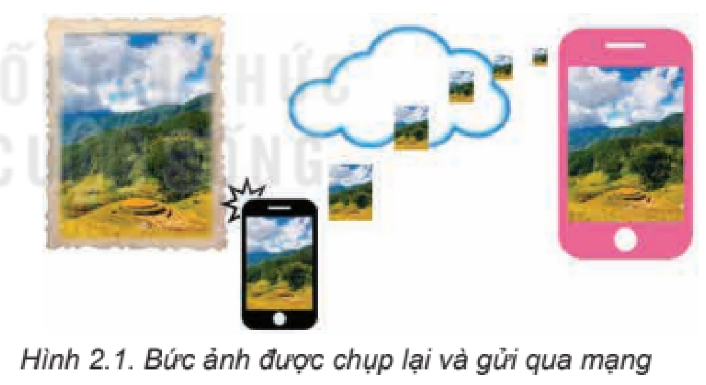
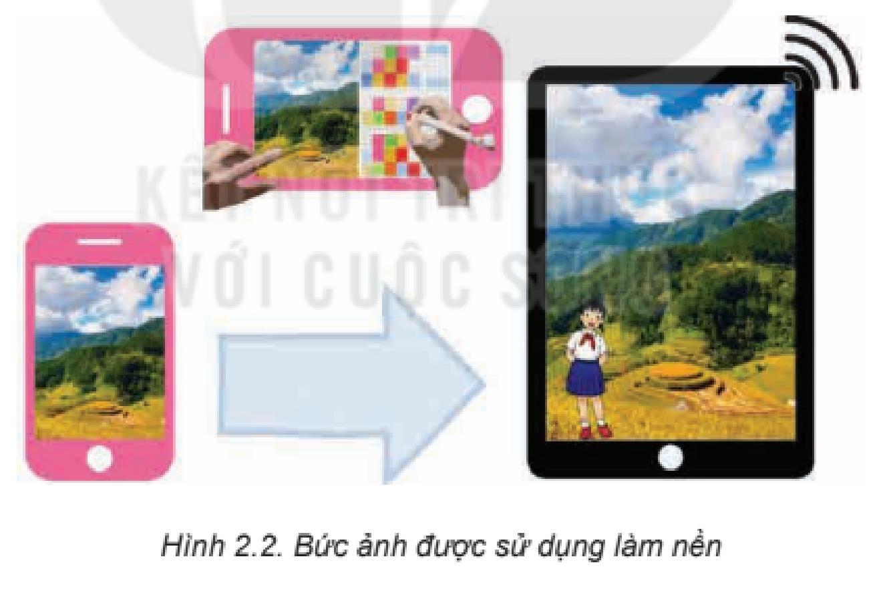
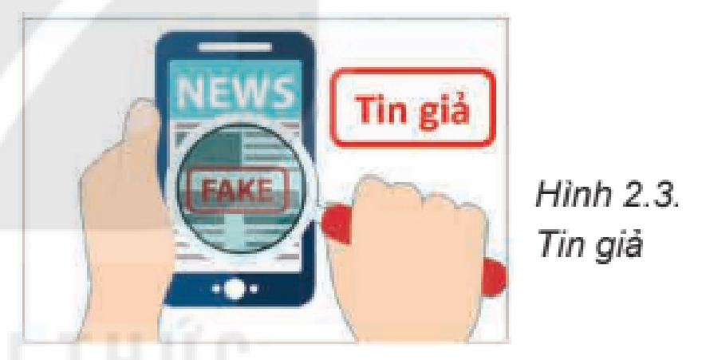

<!-- pdf:11 -->

# BÀI 2: THÔNG TIN TRONG MÔI TRƯỜNG SỐ

## 🎯 Sau bài học này em sẽ:

- Nêu được các đặc điểm của thông tin số: đa dạng, được thu thập ngày càng nhanh và nhiều, được lưu trữ với dung lượng khổng lồ bởi nhiều tổ chức và cá nhân, có tính bản quyền, có độ tin cậy rất khác nhau, có các công cụ tìm kiếm, chuyển đổi, truyền và xử lí hiệu quả.
- Trình bày được tầm quan trọng của việc biết khai thác các nguồn thông tin đáng tin cậy, nêu được ví dụ minh hoạ.

## 🔴 Khởi động

> **Hoạt động 1: Ảnh in và ảnh số**
>
> Trong tập ảnh cũ, Khoa thấy bức ảnh ruộng bậc thang. Để chia sẻ ảnh với An mà không cần phải đến nhà bạn, Khoa đã dùng điện thoại thông minh chụp lại bức ảnh và gửi cho An qua thư điện tử. Em hãy cho biết:
> 1. An có thể nhận được ảnh bằng cách nào?
> 2. Sau khi An nhận được ảnh, Khoa có bị mất bức ảnh gốc không?
> 3. An có thể lưu trữ ảnh vào những thiết bị nào?

*Hình 2.1. Bức ảnh được chụp lại và gửi qua mạng*

## 1. THÔNG TIN TRONG MÔI TRƯỜNG SỐ

### a) Thông tin số

Trong Hoạt động 1, bằng thao tác chụp lại bức ảnh, Khoa đã tạo ra một bức ảnh số. Khác với bức ảnh trên giấy, bức ảnh số được tạo ra không tốn vật liệu và khi Khoa gửi cho An, Khoa không bị mất đi bức ảnh đó.

Thông tin được mã hoá thành dãy bit, được chuyển vào máy tính, điện thoại thông minh, máy tính bảng,... để có thể lan truyền, trao đổi trong môi trường kĩ thuật số còn được gọi ngắn gọn là **thông tin số**.

<!-- pdf:12 -->

Thông tin số có thể được truy cập từ xa thông qua kết nối Internet. Chẳng hạn, khi được Khoa chia sẻ, An có thể vào hộp thư điện tử của mình để nhận ảnh mà không cần nhận trực tiếp từ Khoa như nhận bức ảnh in trên giấy. An có thể lưu ảnh về máy tính hoặc điện thoại của mình và chỉnh sửa bằng phần mềm ứng dụng rồi tiếp tục chia sẻ cho người khác.

Thông tin số dễ dàng được nhân bản và chia sẻ. Thông tin số còn có thể được lan truyền tự động do nhiều thiết bị được đồng bộ với nhau. Điều đó khiến cho em khó biết được thiết bị nào đã nhận được thông tin hoặc thông tin sẽ lan rộng đến mức nào. Thông tin số khó bị xoá bỏ hoàn toàn.

<!-- term: Đặc điểm của thông tin số -->
> Thông tin số có những đặc điểm chính sau:
> - Thông tin số dễ dàng được nhân bản và lan truyền nhưng khó bị xoá bỏ hoàn toàn.
> - Thông tin số có thể được truy cập từ xa nếu người quản lí thông tin đó cho phép.

> **Hoạt động 2: Thông tin số**
>
> Khoa gửi cho An bức ảnh ruộng bậc thang qua thư điện tử. Nhận được, An chỉnh sửa lại ảnh cho đẹp hơn và sử dụng nó làm nền cho ảnh của mình rồi đưa lên trang cá nhân trên mạng xã hội. Em hãy cho biết:
> 1. Máy chủ của dịch vụ thư điện tử có lưu trữ bức ảnh Khoa gửi không?
> 2. Những ai có thể xem được bức ảnh An đưa lên mạng xã hội?
> 3. An có thể gửi ảnh sau khi chỉnh sửa cho Khoa hoặc các bạn khác được không?

*Hình 2.2. Bức ảnh được sử dụng làm nền*

### b) Thông tin số trong xã hội

Khi bức ảnh đã được chia sẻ qua một ứng dụng, ví dụ thư điện tử, mạng xã hội, nó sẽ được ứng dụng đó lưu trữ lại và cho phép một số người được tiếp cận hay tiếp tục chia sẻ. Thông tin số có thể được lưu trữ với dung lượng rất lớn bởi nhiều cá nhân, tổ chức và được cấp quyền truy cập khác nhau.

Không phải mọi thông tin trên mạng đều chân thực. An có thể lấy bức ảnh ruộng bậc thang nhận được làm nền cho ảnh của mình, nhưng không có nghĩa là An đã tới Yên Bái, nơi có ruộng bậc thang. Thông tin số dễ dàng được chỉnh sửa và lại tiếp tục được lan truyền trên mạng. Thông tin số có độ tin cậy rất khác nhau, phụ thuộc vào nguồn gốc và mục tiêu thông tin.

<!-- pdf:13 -->

<!-- term: Đặc điểm của thông tin số -->
> - Thông tin số đa dạng, được thu thập nhanh, được lưu trữ với dung lượng rất lớn bởi nhiều tổ chức và cá nhân.
> - Có nhiều công cụ hỗ trợ tìm kiếm, truy cập, lưu trữ, xử lí và chia sẻ thông tin số.
> - Quyền tác giả của thông tin số được pháp luật bảo hộ.
> - Thông tin số có mức độ tin cậy khác nhau.
> - Thông tin số cần được quản lí, khai thác an toàn và có trách nhiệm.

> ❓ **Câu hỏi**
>
> Em hãy chọn phương án ghép đúng:
> Thông tin số được nhiều tổ chức và cá nhân lưu trữ với dung lượng rất lớn,
> A. được truy cập tự do và có độ tin cậy khác nhau.
> B. được bảo hộ quyền tác giả và không đáng tin cậy.
> C. được bảo hộ quyền tác giả và có độ tin cậy khác nhau.
> D. được bảo hộ quyền tác giả và rất đáng tin cậy.

## 2. THÔNG TIN ĐÁNG TIN CẬY

> **Hoạt động 3: Tin giả**
>
> 1. Em hãy kể lại một nội dung trên mạng mà em biết đó là tin giả.
> 2. Tin giả đó gây ra tác hại gì nếu người đọc tin vào điều đó?
> 3. Làm thế nào để em biết đó là tin giả?

*Hình 2.3. Tin giả*

Không phải mọi thông tin chúng ta nghe thấy, xem được hay đọc được đều là sự thật. Internet là một kho thông tin khổng lồ, tuy nhiên, nhiều thông tin trên Internet có thể không đáng tin cậy. **Thông tin không đáng tin cậy** có thể là:
- Thông tin không trung thực, mang tính chất lừa dối.
- Thông tin đồn thổi, dẫn em đến kết luận thiếu căn cứ.
- Thông tin thiếu kiểm chứng dẫn em đến quyết định sai lầm.

Thông tin không đáng tin cậy có giá trị sử dụng thấp, thậm chí không sử dụng được. Việc xác định thông tin đáng tin cậy và biết khai thác nguồn thông tin đáng tin cậy rất quan trọng vì điều đó giúp em đưa ra những quyết định đúng đắn. Chẳng hạn, nếu không biết khai thác nguồn thông tin đáng tin cậy, mà tin vào những quảng cáo quá mức, em có thể tiêu tiền một cách lãng phí. Sau đây là một số gợi ý giúp em xác định được thông tin đáng tin cậy hay không:

**Xác định nguồn thông tin**. Thẩm quyền và uy tín của tổ chức hay cá nhân cung cấp thông tin ảnh hưởng đến giá trị và độ tin cậy của thông tin. Chẳng hạn, thông tin từ blog có độ tin cậy thấp vì ai cũng có thể viết blog. Hoặc các nhà sản xuất có thể phóng đại lợi ích của dịch vụ hay sản phẩm mà họ cung cấp, trong khi hạ thấp vai trò của đối thủ cạnh tranh.

<!-- pdf:14 -->

**Phân biệt ý kiến và sự kiện**. Ý kiến là quan điểm, không phải sự kiện. Trong khi các ý kiến cần được xem xét và có thể cũng thú vị nhưng độ tin cậy của chúng thấp hơn sự kiện vì mang nhiều cảm xúc và định kiến cá nhân. Chẳng hạn phát biểu: “Tôi tin rằng việc đó đã xảy ra!” không có nghĩa rằng sự kiện được nói tới đã xảy ra trong thực tế.

**Kiểm tra chứng cứ của kết luận**. Những kết luận không có chứng cứ, cũng giống như những ý kiến mang tính chất cá nhân nên có độ tin cậy rất thấp. Chẳng hạn, sau khi xem một bộ phim, một người nhận xét: “Tôi nghĩ đây là bộ phim hoạt hình hay nhất mọi thời đại”. Phát biểu này rõ ràng là quan điểm cá nhân và vì vậy cần được xử lí một cách thận trọng.

**Đánh giá tính thời sự của thông tin**. Thời điểm công bố thông tin quan trọng vì nó quyết định thông tin có còn ý nghĩa không hay đã trở nên lỗi thời. Chẳng hạn, nội dung những trang web đã lâu không được cập nhật thường có độ tin cậy thấp.

> - **Thông tin đáng tin cậy** giúp em đưa ra kết luận đúng, quyết định hành động đúng và giải quyết được các vấn đề được đặt ra.
> - Một số cách xác định thông tin có đáng tin cậy hay không: kiểm tra nguồn thông tin; phân biệt ý kiến với sự kiện; kiểm tra chứng cứ của kết luận; đánh giá tính thời sự của thông tin.

## ✏️ Luyện tập

1. Em hãy kể tên ba ứng dụng thu thập nhiều thông tin từ người sử dụng và cho biết:
   a) Tổ chức, cá nhân nào sở hữu các ứng dụng đó?
   b) Mỗi ứng dụng thu thập dạng thông tin nào?
2. Em hãy đánh giá độ tin cậy của thông tin được cung cấp từ ba ứng dụng ở Câu 1.

## 🚀 Vận dụng

1. Em hãy tìm kiếm trên Internet thông tin về một đội bóng, một cầu thủ hoặc một nhân vật mà em yêu thích.
2. Em hãy phân tích mức độ tin cậy của nguồn tin tìm được ở Câu 1 và trình bày một bài giới thiệu về đội bóng, cầu thủ hoặc nhân vật đó.
3. Em hãy kể một ví dụ về tin đồn (trong cuộc sống hoặc trên mạng) và cho biết:
   a) Tin đồn đó xuất hiện từ sự việc nào?
   b) Tác hại của tin đồn đó là gì?

## 📷 Danh sách hình trong bài

| Mã hình | Trang PDF | Trang sách | Chú thích |
| --- | :---: | :---: | --- |
| H8-tin_hoc-b02-01 | 11 | 10 | Hình 2.1. Bức ảnh được chụp lại và gửi qua mạng |
| H8-tin_hoc-b02-02 | 12 | 11 | Hình 2.2. Bức ảnh được sử dụng làm nền |
| H8-tin_hoc-b02-03 | 13 | 12 | Hình 2.3. Tin giả |
