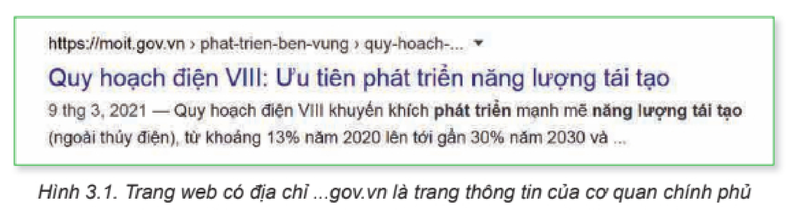
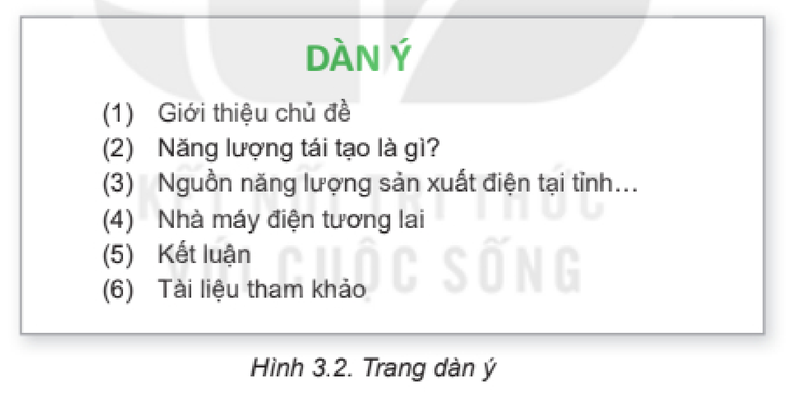
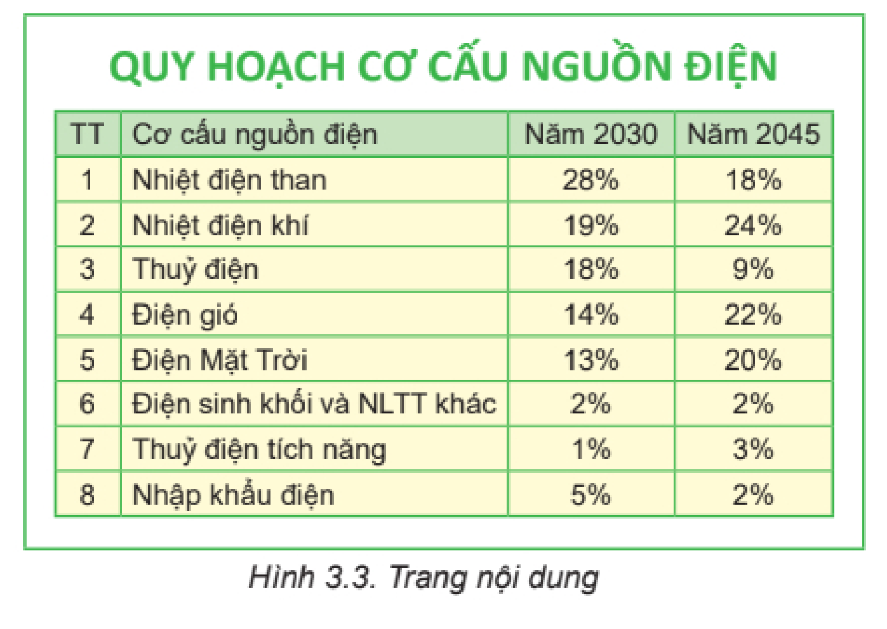
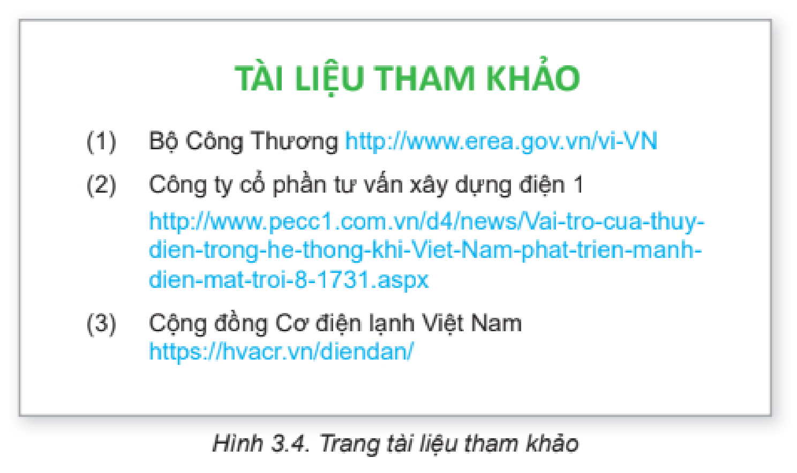

<!-- pdf:15 -->

# BÀI 3: THỰC HÀNH: KHAI THÁC THÔNG TIN SỐ

## 🎯 Sau bài học này em sẽ:

- Sử dụng được công cụ tìm kiếm, xử lí và trao đổi thông tin trong môi trường số. Nêu được ví dụ minh hoạ.
- Chủ động tìm kiếm được thông tin để thực hiện nhiệm vụ cụ thể.
- Đánh giá được lợi ích của thông tin tìm được trong giải quyết vấn đề, nêu được ví dụ minh hoạ.

## 🔴 Khởi động

*Minh:* Khi bật đèn để căn phòng tràn ngập ánh sáng, khi lái một chiếc ô tô, hay chỉ đơn giản là rang bỏng ngô, mọi người đều đang sử dụng năng lượng.

*Khoa:* Hầu hết năng lượng đến từ nhiên liệu hoá thạch như xăng và than.

*An:* Trái Đất mất hàng triệu năm để tạo ra nhiên liệu hoá thạch. Các bạn có tưởng tượng được, một ngày nào đó, chúng sẽ cạn kiệt và biến mất không. Chúng ta có thể làm gì để tránh thảm hoạ đó?

*Minh:* Khám phá các nguồn năng lượng khác để thay thế. Đó là những nguồn năng lượng dường như không bao giờ cạn kiệt như nắng, gió, nước và thậm chí là rác thải.

*Khoa:* Điện gió, điện mặt trời và cả thuỷ điện nữa đều có những nhược điểm. Chúng ta cần tìm hiểu thông tin đầy đủ hơn.

Em hãy tạo một bài trình chiếu với chủ đề Năng lượng tái tạo để giải quyết những băn khoăn của các bạn. Em có thể khai thác thông tin số để có thêm thông tin cho bài trình chiếu.

## Nhiệm vụ 1. HÌNH THÀNH Ý TƯỞNG VÀ CẤU TRÚC BÀI TRÌNH CHIẾU VỀ CHỦ ĐỀ NĂNG LƯỢNG TÁI TẠO

**Yêu cầu**

- Xây dựng ý tưởng cho bài trình chiếu.
- Xây dựng cấu trúc bài trình chiếu.

**Hướng dẫn**

<!-- term: Xây dựng ý tưởng và cấu trúc bài trình chiếu -->
*Bước 1.* Em hãy nêu một khía cạnh hay một vấn đề cụ thể về năng lượng tái tạo mà em định trình bày như thuỷ điện, điện gió, điện mặt trời,... hoặc năng lượng tái tạo tại địa phương, nơi em đang sinh sống.

<!-- term: Xây dựng ý tưởng và cấu trúc bài trình chiếu -->
*Bước 2.* Phát triển ý tưởng thành nội dung cụ thể của bài trình chiếu. Nội dung có thể sắp xếp theo trình tự lôgic và thể hiện dưới dạng những câu hỏi để thuận lợi cho việc tìm tư liệu. Chẳng hạn:

1) Năng lượng tái tạo là gì?
2) Nguồn năng lượng nào sản xuất ra điện ở nơi em sinh sống? Ưu, nhược điểm của nguồn năng lượng đó là gì?

<!-- pdf:16 -->

3) Hãy chọn một nguồn năng lượng thay thế. Ưu, nhược điểm của nguồn năng lượng được chọn là gì?
4) Loại năng lượng nào sẽ thay thế xăng dầu hiện đang được sử dụng cho ô tô, xe máy,...?
5) Nếu được quyết định thiết kế một nhà máy điện, em sẽ chọn cách nào để sản xuất điện? Tại sao cách đó tốt hơn những cách khác?

<!-- term: Xây dựng ý tưởng và cấu trúc bài trình chiếu -->
*Bước 3.* Xác định mức độ, yêu cầu cụ thể với bài trình chiếu. Ví dụ:
- Bài trình chiếu khoảng 10 trang: trang tiêu đề, trang dàn ý, trang giới thiệu vấn đề, một số trang nội dung, trang kết luận và trang tài liệu tham khảo.
- Mỗi trang nội dung không quá 6 mục; mỗi mục không quá 2 dòng.
- Bài trình chiếu cần có ít nhất 2 hình ảnh minh hoạ cho nội dung trình bày.

## Nhiệm vụ 2. TÌM KIẾM VÀ ĐÁNH GIÁ THÔNG TIN

**Yêu cầu**

- Tìm kiếm, khai thác tư liệu trong môi trường số theo chủ đề năng lượng tái tạo.
- Đánh giá lợi ích của thông tin tìm được để giải quyết vấn đề năng lượng tái tạo.

**Hướng dẫn**

<!-- term: Tìm kiếm và ghi chép kết quả tìm kiếm -->
*Bước 1.* Tìm kiếm thông tin. Sử dụng máy tìm kiếm với các từ khoá tìm kiếm như “năng lượng tái tạo”, “năng lượng thay thế”, “ưu, nhược điểm của thuỷ điện”, “ưu, nhược điểm của điện gió”,...

<!-- term: Tìm kiếm và ghi chép kết quả tìm kiếm -->
*Bước 2.* Ghi chép kết quả tìm kiếm để thuận tiện cho việc đánh giá và tham khảo. Bảng 3.1 là một ví dụ.

**Bảng 3.1. Kết quả tìm kiếm**

| STT | Nội dung | Địa chỉ trang web | Nguồn gốc | Thời gian |
| :---: | --- | --- | --- | :---: |
| 1 | Khái niệm chung về các nguồn năng lượng | https://hvacr.vn/diendan/ | Cộng đồng Cơ Điện Lạnh Việt Nam | 2008 |
| 2 | Năng lượng tái tạo sẽ thống trị công suất điện toàn thế giới | https://www.evn.com.vn/ | Tập đoàn Điện lực Việt Nam | 2022 |
| 3 | Quy hoạch điện VIII: Ưu tiên phát triển năng lượng tái tạo | http://www.erea.gov.vn/vi-VN | Bộ Công Thương | 2021 |
<!-- ocr-ok: đối chiếu ảnh trang PDF 16; bảng 5 cột và địa chỉ URL làm giảm tỉ lệ khớp OCR tiếng Việt -->

<!-- term: Đánh giá lợi ích và độ tin cậy của thông tin tìm được -->
*Bước 3.* Đánh giá thông tin. Trước khi sử dụng thông tin để minh hoạ cho lập luận của mình, em cần đánh giá lợi ích của thông tin bằng cách trả lời một số câu hỏi như:

<!-- term: Đánh giá lợi ích và độ tin cậy của thông tin tìm được -->
Thông tin có thực sự phù hợp với nội dung trình bày không? Chẳng hạn, kiến thức chung về các nguồn năng lượng sẽ không đáp ứng được yêu cầu dự báo phát triển của các nguồn năng lượng.

<!-- term: Đánh giá lợi ích và độ tin cậy của thông tin tìm được -->
Nguồn tin có đáng tin cậy không? Chẳng hạn, với nội dung quy hoạch cơ cấu nguồn điện, thông tin từ cơ quan chính phủ đáng tin cậy hơn thông tin trên các diễn đàn hay trang web của doanh nghiệp.

<!-- pdf:17 -->

*Hình 3.1. Trang web có địa chỉ ...gov.vn là trang thông tin của cơ quan chính phủ*

## Nhiệm vụ 3. XỬ LÍ VÀ TRAO ĐỔI THÔNG TIN

**Yêu cầu**

- Tạo bài trình chiếu theo cấu trúc đã định.
- Biên tập nội dung bài trình chiếu.
- Chia sẻ bài trình chiếu trong môi trường số.

**Hướng dẫn**

*Bước 1.* Tạo bài trình chiếu
- Tạo các trang của bài trình chiếu theo cấu trúc đã định (tham khảo Hình 3.2, Hình 3.3, Hình 3.4).
- Soạn nội dung từng trang sao cho phù hợp với lập luận của cả bài trình chiếu.
- Sử dụng thông tin đã được chọn làm tư liệu tham khảo cho các trang nội dung.

*Hình 3.2. Trang dàn ý*

*Hình 3.3. Trang nội dung*

<!-- pdf:18 -->

*Hình 3.4. Trang tài liệu tham khảo*

*Bước 2.* Biên tập nội dung
- Biên tập nội dung sao cho mỗi trang không quá 6 mục; mỗi mục không quá 2 dòng.
- Sử dụng phần mềm xử lí hình ảnh để tạo và sửa hình ảnh minh hoạ phù hợp với nội dung.

<!-- term: Chia sẻ bài trình chiếu trong môi trường số -->
*Bước 3.* Chia sẻ bài trình chiếu
- Lựa chọn phương tiện kĩ thuật số để chia sẻ bài trình chiếu: thư điện tử, mạng xã hội, không gian lưu trữ dùng chung,...
- Giải thích phương án lựa chọn của em theo các tiêu chí: dễ sử dụng và an toàn dữ liệu.

## ✏️ Luyện tập

1. Để tìm hiểu về cách sử dụng một chiếc máy ảnh mới, nguồn thông tin nào sau đây cần được tham khảo nhất?
   A. Hướng dẫn của một người đã từng chụp ảnh.
   B. Hướng dẫn sử dụng của nhà sản xuất.
   C. Hướng dẫn của một người giỏi Tin học.
   D. Câu trả lời trên một số diễn đàn về chụp ảnh.
2. Để tìm hiểu về một đội bóng đá ở châu Phi, nguồn thông tin nào sau đây đáng tin cậy nhất?
   A. Nguồn tin từ câu lạc bộ người hâm mộ đội bóng đó.
   B. Nguồn tin từ câu lạc bộ của đội bóng đối thủ.
   C. Nguồn tin từ Liên đoàn bóng đá châu Phi.
   D. Nguồn tin từ diễn đàn Bóng đá Việt Nam.

## 🚀 Vận dụng

Em hãy tìm thông tin về một đội bóng, một cầu thủ hay một nghệ sĩ mà em hâm mộ. Hãy đánh giá những nguồn thông tin tìm được.

## 📷 Danh sách hình trong bài

| Mã hình | Trang PDF | Trang sách | Chú thích |
| --- | :---: | :---: | --- |
| H8-tin_hoc-b03-01 | 17 | 16 | Hình 3.1. Trang web có địa chỉ ...gov.vn là trang thông tin của cơ quan chính phủ |
| H8-tin_hoc-b03-02 | 17 | 16 | Hình 3.2. Trang dàn ý |
| H8-tin_hoc-b03-03 | 17 | 16 | Hình 3.3. Trang nội dung |
| H8-tin_hoc-b03-04 | 18 | 17 | Hình 3.4. Trang tài liệu tham khảo |
