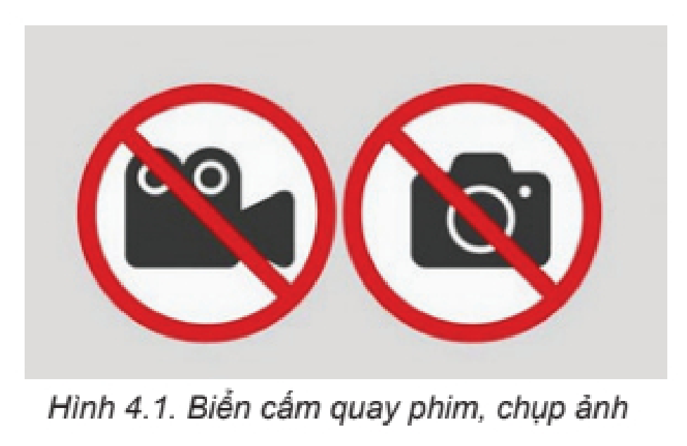
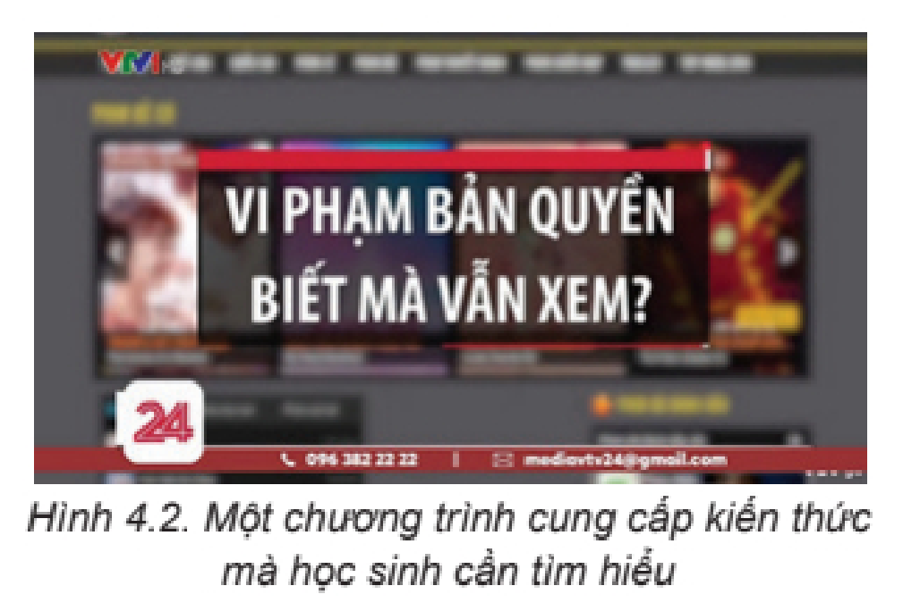
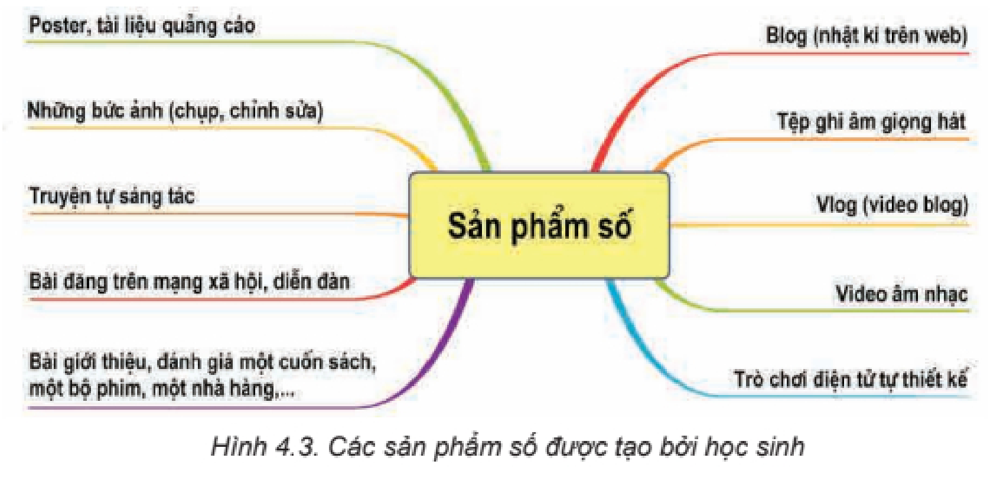

<!-- pdf:19 -->

# BÀI 4: ĐẠO ĐỨC VÀ VĂN HOÁ TRONG SỬ DỤNG CÔNG NGHỆ KĨ THUẬT SỐ

## 🎯 Sau bài học này em sẽ:

- Nhận biết và giải thích được một số biểu hiện vi phạm đạo đức và pháp luật, biểu hiện thiếu văn hoá khi sử dụng công nghệ kĩ thuật số.
- Bảo đảm được các sản phẩm số do bản thân tạo ra thể hiện được đạo đức, tính văn hoá và không vi phạm pháp luật.

## 🔴 Khởi động

Khoa chia sẻ cho An bức ảnh ruộng bậc thang mà mình đã chụp.

Trường hợp 1: An không hỏi ý kiến Khoa, tự mình chỉnh sửa bức ảnh và sử dụng làm nền cho ảnh của mình rồi đưa lên trang cá nhân trên mạng xã hội. An viết chú thích cho bức ảnh: *Thật tuyệt khi được đến thăm nơi này.*

Trường hợp 2: An xin phép Khoa, chỉnh sửa lại bức ảnh cho đẹp hơn rồi đưa lên trang cá nhân trên mạng xã hội. An viết chú thích cho bức ảnh: *Đất nước ta thật là đẹp (người chụp Lê Khoa).*

Theo em, An nên làm theo cách nào? Vì sao?

## 1. BIỂU HIỆN VI PHẠM KHI SỬ DỤNG CÔNG NGHỆ KĨ THUẬT SỐ

> **Hoạt động 1: Biểu hiện nào là vi phạm?**
>
> Từ hiểu biết của em, hãy thảo luận với các bạn về một vài biểu hiện vi phạm đạo đức và pháp luật hay biểu hiện thiếu văn hoá khi sử dụng công nghệ kĩ thuật số.

Công nghệ kĩ thuật số mang đến cho em rất nhiều lợi ích nhưng cũng tiềm ẩn những vấn nạn nhất định. Đó là những biểu hiện thiếu văn hoá, vi phạm đạo đức hoặc thậm chí vi phạm pháp luật của người sử dụng hay người tạo ra những nội dung số.

<!-- term: Biểu hiện vi phạm khi sử dụng công nghệ kĩ thuật số -->
Có thể kể ra một số biểu hiện vi phạm đạo đức, pháp luật hay thiếu văn hoá khi sử dụng công nghệ kĩ thuật số như:
- Quay phim trong rạp chiếu phim.
- Chụp ảnh ở nơi không cho phép (Hình 4.1).
- Ghi âm trái phép các cuộc nói chuyện.
- Tải về máy tính cá nhân các tệp bài hát, video có bản quyền để sử dụng mà chưa được phép.
- Sao chép thông tin từ một trang web và coi đó là của mình.
- Sử dụng phần mềm bẻ khoá.
- Phát trực tiếp (**livestream**) hoặc chia sẻ các vụ bạo lực học đường. Đưa lên mạng thông tin cá nhân của người khác mà chưa được phép.
- Tham gia, chia sẻ, quảng cáo cho các trang web cổ vũ bạo lực, đánh bạc,...

Em cần tìm hiểu thông tin, trang bị cho mình những hiểu biết, những kiến thức pháp luật (Hình 4.2) để có nhận thức đúng đắn và bảo đảm rằng mình sử dụng công nghệ kĩ thuật số có trách nhiệm, tránh vi phạm pháp luật và các chuẩn mực về văn hoá, đạo đức của xã hội.

<!-- pdf:20 -->

*Hình 4.1. Biển cấm quay phim, chụp ảnh*

*Hình 4.2. Một chương trình cung cấp kiến thức mà học sinh cần tìm hiểu*

<!-- term: Lưu ý tránh vi phạm khi sử dụng công nghệ kĩ thuật số -->
> Ba điều lưu ý để tránh các vi phạm khi sử dụng công nghệ kĩ thuật số:
> - Tìm hiểu thông tin, trang bị cho mình những kiến thức cần thiết.
> - Chỉ sử dụng những sản phẩm số khi có sự cho phép của tác giả hoặc có bản quyền sử dụng.
> - Hầu hết thông tin trên Internet là có bản quyền.

> ❓ **Câu hỏi**
>
> 1. Hành động nào sau đây **không** vi phạm đạo đức và pháp luật?
>    A. Đăng tải thông tin sai sự thật lên mạng.
>    B. Cố ý nghe, ghi âm trái phép các cuộc nói chuyện.
>    C. Tặng đĩa nhạc có bản quyền em đã mua cho người khác.
>    D. Tải một bài trình chiếu của người khác từ Internet và sử dụng như là của mình tạo ra.
> 2. Nêu một vài hành động chưa đúng của em khi sử dụng công nghệ kĩ thuật số mà em đã mắc phải. Nêu cách em sẽ phòng tránh hoặc từ bỏ vi phạm.

## 2. TRUNG THỰC KHI TẠO RA SẢN PHẨM SỐ

Có nhiều dạng **sản phẩm số** mà em có thể tạo ra (Hình 4.3), đáp ứng sở thích cũng như nhu cầu học tập, kết nối bạn bè.

*Hình 4.3. Các sản phẩm số được tạo bởi học sinh*

<!-- pdf:21 -->

Nhờ công nghệ kĩ thuật số và các thiết bị điện tử thông minh, việc tạo ra các sản phẩm số rất dễ dàng và nhanh chóng. Tuy nhiên, em cần phải bảo đảm được sản phẩm số do bản thân tạo ra thể hiện được đạo đức, tính văn hoá và không vi phạm pháp luật. Để thực hiện được việc đó em cần trang bị cho mình những kiến thức cần thiết và chú ý một số điều sau:

<!-- term: Trung thực khi tạo ra sản phẩm số -->
- Luôn trung thực trong quá trình tạo ra sản phẩm số: không sử dụng thông tin giả, thông tin không đáng tin cậy; không sao chép, chỉnh sửa thông tin của người khác rồi coi là của mình. Ở tình huống khởi động của bài, nếu An làm theo trường hợp 1, không hỏi ý kiến Khoa mà chỉnh sửa ảnh rồi viết chú thích làm người xem ảnh hiểu nhầm là An đã đến địa điểm trong ảnh, không ghi chú tác giả bức ảnh là Khoa thì đó là một việc không trung thực. Mặc dù việc này không vi phạm pháp luật nhưng vi phạm đạo đức.
- Nên sử dụng thông tin do mình tự tạo (tự quay video, chụp ảnh, viết nội dung,...), không sử dụng các thông tin có bản quyền nếu chưa mua hoặc xin phép.

<!-- term: Văn hoá và pháp luật khi tạo ra sản phẩm số -->
- Nội dung và hình thức của sản phẩm tạo ra không được vi phạm các quy định, chuẩn mực về đạo đức, văn hoá trong xã hội nói chung. Ví dụ: chỉ dùng ngôn ngữ lịch sự, không dùng các hình ảnh giật gân, không tiết lộ thông tin cá nhân của người khác,...

<!-- term: Văn hoá và pháp luật khi tạo ra sản phẩm số -->
> Cần bảo đảm tính văn hoá, thể hiện được đạo đức và tuân thủ pháp luật khi tạo ra các sản phẩm số, giúp tránh được việc lan truyền thông tin sai trái, đồng thời góp phần tạo ra một xã hội số lành mạnh và hợp pháp.

> ❓ **Câu hỏi**
>
> Em có cảnh báo và lời khuyên gì với bạn trong mỗi tình huống dưới đây?
> a) Bạn em quay video các bạn trong lớp có hành vi bạo lực và đăng lên mạng xã hội.
> b) Một người bạn sử dụng ảnh em chụp để tham gia một cuộc thi ảnh nhưng chưa có sự đồng ý của em.

## ✏️ Luyện tập

Em hãy xác định các hành động dưới đây là vi phạm hay không vi phạm đạo đức, pháp luật và văn hoá khi sử dụng công nghệ kĩ thuật số.

a) Chia sẻ thông tin mua bán động vật hoang dã quý hiếm.
b) Tạo một trang cá nhân để chia sẻ những kinh nghiệm học tập của mình.
c) Quay và lan truyền video bạo lực học đường.
d) Sáng tác một bài thơ về lớp và gửi bạn bè cùng đọc.
e) Tham gia cá cược bóng đá qua Internet.
f) Chia sẻ địa chỉ một website có chứa các bộ phim không có bản quyền sử dụng.

## 🚀 Vận dụng

Em hãy tạo một sản phẩm số theo cách sáng tạo để hướng dẫn các bạn hiểu đúng về việc sử dụng công nghệ kĩ thuật số. Em hãy đảm bảo sản phẩm của mình thể hiện được đạo đức, tính văn hoá và không vi phạm pháp luật nhé.

## 📷 Danh sách hình trong bài

| Mã hình | Trang PDF | Trang sách | Chú thích |
| --- | :---: | :---: | --- |
| H8-tin_hoc-b04-01 | 20 | 19 | Hình 4.1. Biển cấm quay phim, chụp ảnh |
| H8-tin_hoc-b04-02 | 20 | 19 | Hình 4.2. Một chương trình cung cấp kiến thức mà học sinh cần tìm hiểu |
| H8-tin_hoc-b04-03 | 20 | 19 | Hình 4.3. Các sản phẩm số được tạo bởi học sinh |
