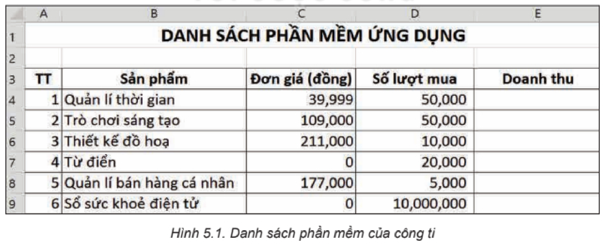
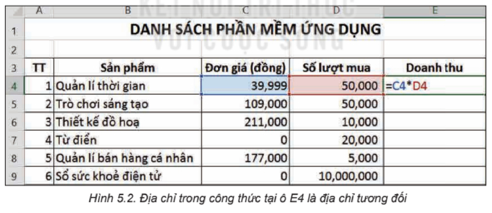
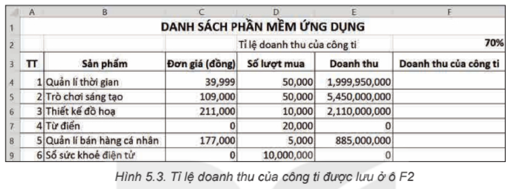
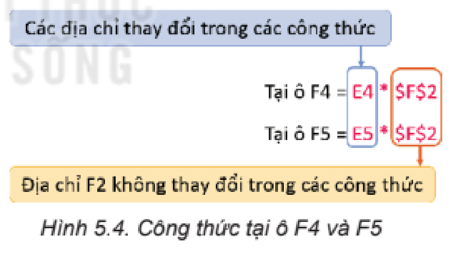
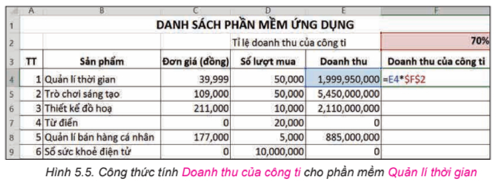
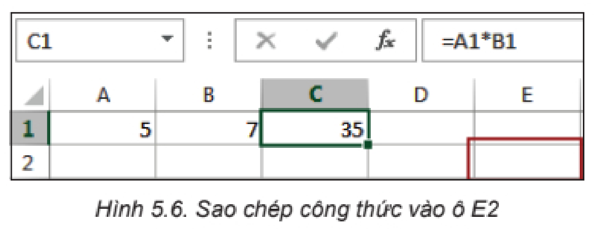
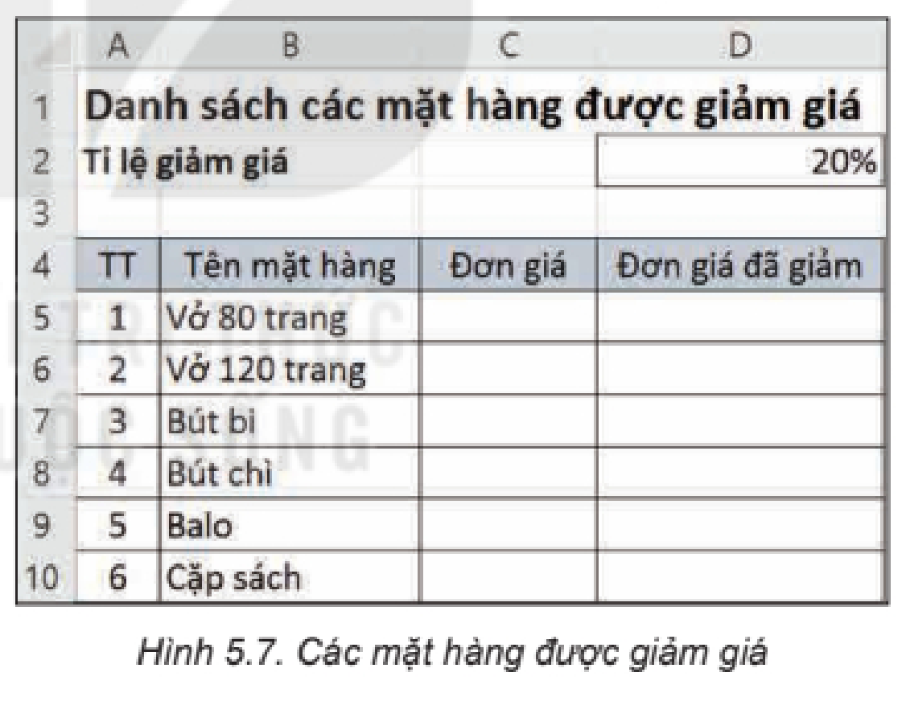

<!-- pdf:22 -->

# BÀI 5: SỬ DỤNG BẢNG TÍNH GIẢI QUYẾT BÀI TOÁN THỰC TẾ

## 🎯 Sau bài học này em sẽ:

- Giải thích được sự thay đổi địa chỉ tương đối trong công thức khi sao chép công thức.
- Giải thích được sự khác nhau giữa địa chỉ tương đối và địa chỉ tuyệt đối của một ô tính.
- Sử dụng được phần mềm bảng tính trợ giúp giải quyết bài toán thực tế.
- Sao chép được dữ liệu từ các tệp văn bản, trang trình chiếu sang trang tính.

## 🔴 Khởi động

> Bố của Khoa là giám đốc một công ti sản xuất phần mềm máy tính. Bố là người truyền cho Khoa niềm đam mê tin học. Trong kì nghỉ hè vừa qua, để ôn lại kiến thức và tìm hiểu thêm về phần mềm bảng tính, bố giao cho Khoa tính toán doanh thu một số phần mềm mà công ti của bố sản xuất. Những phần mềm này được đưa lên các **chợ ứng dụng** trên mạng. Người sử dụng truy cập vào các chợ ứng dụng tìm kiếm phần mềm mà mình cần để mua và cài đặt. Tuỳ theo từng phần mềm, người sử dụng có thể phải trả phí hoặc được miễn phí. Để hoàn thành việc bố giao, Khoa đã tạo bảng tính để lưu thông tin về các phần mềm như minh hoạ trong Hình 5.1.

*Hình 5.1. Danh sách phần mềm của công ti*

> Theo em, bảng tính bạn Khoa tạo ra ở Hình 5.1 có cần bổ sung thông tin gì không?

<!-- pdf:23 -->

## 1. ĐỊA CHỈ TƯƠNG ĐỐI

> **Hoạt động 1: Tính doanh thu phần mềm**
>
> Dựa vào thông tin mà bạn Khoa đã lưu trữ trong bảng tính ở Hình 5.1, em hãy thực hiện:
>
> 1. Viết công thức để tính Doanh thu của phần mềm Quản lí thời gian dựa trên Đơn giá và Số lượt mua (đơn giá bằng 0 là phần mềm miễn phí).
> 2. Thao tác nào giúp em tính toán doanh thu cho các phần mềm còn lại mà không cần gõ công thức vào từng ô? Khi thực hiện thao tác đó, địa chỉ ô trong công thức sẽ thay đổi như thế nào?

<!-- term: Địa chỉ tương đối, Địa chỉ tuyệt đối, Địa chỉ hỗn hợp -->
Một trong những ưu điểm nổi bật của chương trình bảng tính là tính toán tự động. Có ưu điểm này là vì chương trình bảng tính cho phép tính toán theo địa chỉ ô. Chương trình bảng tính sử dụng ba loại địa chỉ ô là **địa chỉ tương đối**, **địa chỉ tuyệt đối** và **địa chỉ hỗn hợp**. Trong bài học này, chúng ta sẽ tìm hiểu về địa chỉ tương đối và địa chỉ tuyệt đối.

Ví dụ, chúng ta tính Doanh thu của mỗi phần mềm ở Hình 5.1 theo công thức:

Doanh thu = Đơn giá*Số lượt mua

Vì đơn giá và Số lượt mua thay đổi theo từng phần mềm khác nhau nên cần tạo ra công thức tính toán (tại cột E) sao cho địa chỉ ô thay đổi theo từng dòng tương ứng với mỗi phần mềm khác nhau. Trong Hình 5.2, công thức tại ô E4 là `=C4*D4`. Khi sao chép công thức này đến ô E5 thì các địa chỉ ô trong công thức sẽ tự động thay đổi, do đó công thức tại ô E5 là `=C5*D5`. Các địa chỉ C4, D4, C5, D5 trong các công thức trên đều là **địa chỉ tương đối**. Khi nhập địa chỉ ô cho một công thức bằng thao tác nháy chuột vào ô thì chương trình bảng tính mặc định lấy địa chỉ ô đó là địa chỉ tương đối.

*Hình 5.2. Địa chỉ trong công thức tại ô E4 là địa chỉ tương đối*

<!-- term: Địa chỉ tương đối -->
> **Địa chỉ tương đối** tự động thay đổi khi sao chép công thức.

> ❓ **Câu hỏi**
>
> Nếu sao chép công thức từ ô E4 đến các ô E6, E7, E8 và E9 (Hình 5.2) thì công thức trong các ô E6, E7, E8, E9 là gì?

<!-- pdf:24 -->

## 2. ĐỊA CHỈ TUYỆT ĐỐI

> **Hoạt động 2: Địa chỉ tuyệt đối**
>
> Bạn Khoa đã tính được Doanh thu của mỗi phần mềm. Tìm hiểu thêm, bạn được biết "Doanh thu là số tiền thu được của đơn vị quản lí **chợ ứng dụng** khi người sử dụng trả tiền mua phần mềm. Công ti của bố Khoa được trả 70% của số tiền này và gọi là Doanh thu của công ti. Giả sử tỉ lệ phần trăm doanh thu mà công ti phần mềm được hưởng lưu ở ô F2 như minh hoạ trong Hình 5.3.

*Hình 5.3. Tỉ lệ doanh thu của công ti được lưu ở ô F2*

> 1. Em hãy nhập công thức để tính Doanh thu của công ti cho phần mềm Quản lí thời gian và Trò chơi sáng tạo vào ô F4 và F5, biết rằng:
>
>    Doanh thu của công ti = Doanh thu*Tỉ lệ (được lưu tại ô F2)
>
> 2. Nếu sao chép công thức từ ô F4 vào ô F5 thì công thức nhận được tại ô F5 có đúng yêu cầu không? Vì sao?

<!-- term: Địa chỉ tuyệt đối -->
Trong chương trình bảng tính, một địa chỉ ô trong công thức không thay đổi khi sao chép công thức thì địa chỉ đó là **địa chỉ tuyệt đối**. Phần mềm bảng tính quy định địa chỉ tuyệt đối có dấu `$` trước tên cột và tên hàng. Ví dụ, `$F$2` là địa chỉ tuyệt đối. Sau khi nhập địa chỉ tương đối, em nhấn phím F4 để chuyển địa chỉ tương đối thành địa chỉ tuyệt đối.

Với yêu cầu tính Doanh thu của công ti, ta có công thức Doanh thu của công ti = Doanh thu*Tỉ lệ. Trong công thức này, giá trị của Doanh thu thay đổi theo từng phần mềm, còn giá trị của Tỉ lệ luôn cố định là 70% (như minh hoạ trong Hình 5.3).
<!-- ocr-ok: đối chiếu ảnh trang PDF 24; OCR đọc nhầm dấu thanh ở "Tỉ lệ", "thay đổi", "cố định" -->

Xem xét công thức tính Doanh thu của công ti cho hai phần mềm Quản lí thời gian và Trò chơi sáng tạo, tại ô F4 và F5, ta có công thức như Hình 5.4.

*Hình 5.4. Công thức tại ô F4 và F5*

Như vậy, để công thức thực hiện chính xác yêu cầu của bài toán thì địa chỉ ô chứa giá trị Doanh thu là địa chỉ tương đối, địa chỉ ô F2 chứa Tỉ lệ là địa chỉ tuyệt đối. Vì vậy, công thức đúng tại ô F4 để tính doanh thu của công ti cho phần mềm Quản lí thời gian là `=E4*$F$2`. Khi đó, việc sao chép công thức từ ô F4 đến các ô còn lại để tính Doanh thu của công ti cho các phần mềm trong danh sách sẽ trả lại kết quả chính xác.

<!-- pdf:25 -->

<!-- term: Địa chỉ tuyệt đối -->
> - **Địa chỉ tuyệt đối** không thay đổi khi sao chép công thức.
> - Địa chỉ tuyệt đối có dấu `$` trước tên cột và tên hàng.

> ❓ **Câu hỏi**
>
> Em hãy chọn các đáp án đúng:
>
> 1. Trong Hình 5.3, công thức tại ô F5 là `=E5*$F$2`. Sao chép công thức này đến ô F6, kết quả sao chép là:
>
> A. `=E6*F3`
>
> B. `=E6*$F$2`
>
> C. `=$E$6*F3`
>
> D. `=$E$6*$F$2`
>
> 2. Cách nhập kí hiệu `$` cho địa chỉ tuyệt đối là:
>
> A. Gõ kí hiệu `$` từ bàn phím khi nhập địa chỉ ô.
>
> B. Sau khi nhập địa chỉ tương đối, nhấn phím F4 để chuyển thành địa chỉ tuyệt đối.
>
> C. Sau khi nhập địa chỉ tương đối, nhấn phím F2 để chuyển thành địa chỉ tuyệt đối.
>
> D. Thực hiện được theo cả hai cách A và B.

## 3. THỰC HÀNH: SỬ DỤNG BẢNG TÍNH GIẢI QUYẾT BÀI TOÁN THỰC TẾ

**Nhiệm vụ**

Tạo bảng tính theo mẫu như Hình 5.1. Lập công thức sử dụng địa chỉ tương đối và địa chỉ tuyệt đối để tính Doanh thu mỗi phần mềm và Doanh thu của công ti.

**Hướng dẫn**

*(Hướng dẫn sau đây sử dụng phần mềm bảng tính Microsoft Excel phiên bản 2016 để minh hoạ.)*

### a) Tạo bảng dữ liệu trong chương trình bảng tính

– Khởi động phần mềm bảng tính.

– Nhập dữ liệu và định dạng để được bảng tính chứa đầy đủ thông tin như Hình 5.1.

– Lưu tệp.

### b) Tính Doanh thu của mỗi phần mềm

– Tại ô E4, nhập công thức `=C4*D4`.

– Sao chép công thức tại ô E4 cho các ô từ E5 đến E9.

– Lưu tệp.

### c) Tính Doanh thu của công ti

– Tại ô D2, gõ nội dung “Tỉ lệ doanh thu của công ti”. Tại ô F2, gõ tỉ lệ là 70% như minh hoạ trong Hình 5.3.

– Tại ô F3, gõ tiêu đề “Doanh thu của công ti” và định dạng để được bảng dữ liệu như minh hoạ trong Hình 5.3.

<!-- pdf:26 -->

– Tại ô F4, nhập công thức `=E4*$F$2` bằng cách gõ dấu `$` từ bàn phím hoặc sau khi nhập F2 thì nhấn phím F4 trên bàn phím.

*Hình 5.5. Công thức tính Doanh thu của công ti cho phần mềm Quản lí thời gian*

– Sao chép công thức tại ô F4 đến các ô từ F5 đến F9.

– Lưu tệp.

## 4. THỰC HÀNH: SAO CHÉP DỮ LIỆU TỪ CÁC TỆP VĂN BẢN, TRANG TRÌNH CHIẾU SANG TRANG TÍNH

<!-- term: Sao chép dữ liệu sang trang tính -->
Trong thực tế, có nhiều tình huống bảng dữ liệu được tạo ra trong phần mềm soạn thảo văn bản hoặc phần mềm trình chiếu. Khi cần tính toán trên các bảng dữ liệu này, em có thể sao chép bảng dữ liệu sang phần mềm bảng tính để giúp công việc được giải quyết nhanh chóng và hiệu quả.

**Nhiệm vụ**

Giả sử kết quả số học sinh chọn mỗi nhóm nghề của lĩnh vực Công nghệ thông tin được lưu trữ trong phần mềm soạn thảo văn bản hoặc phần mềm trình chiếu như Bảng 5.1.

**Bảng 5.1. Số liệu thống kê lựa chọn nghề nghiệp của học sinh**

| TT | Nhóm nghề | Nghề | Số lượng HS |
| --- | --- | --- | --- |
| 1 | Lĩnh vực phát triển phần mềm | Lập trình viên, Thiết kế phần mềm, Kiến trúc sư phần mềm, Kiểm thử phần mềm,... | 46 |
| 2 | Lĩnh vực mạng máy tính và an toàn thông tin | Quản trị mạng, An toàn thông tin,... | 25 |
| 3 | Lĩnh vực đa phương tiện | Thiết kế đồ hoạ, truyền thông đa phương tiện | 78 |
| 4 | Lĩnh vực khác của Công nghệ thông tin | Quản trị website, giảng viên Công nghệ thông tin,... | 42 |

Em hãy sao chép bảng số liệu này sang phần mềm bảng tính.

**Hướng dẫn**

– Trong phần mềm soạn thảo văn bản hoặc phần mềm trình chiếu, chọn các hàng, cột của bảng.

– Chọn **Home**, chọn lệnh **Copy** hoặc nhấn tổ hợp phím **Ctrl + C**.

– Trong phần mềm bảng tính, mở bảng tính mới, chọn ô ở góc trên cùng bên trái của vùng muốn dán dữ liệu và chọn lệnh **Paste**.

– Đóng tệp văn bản hoặc tệp trình chiếu.

– Lưu tệp bảng tính với tên `Khaosat.xlsx`.

<!-- pdf:27 -->

## ✏️ Luyện tập

1. Em hãy chọn phương án đúng.

Công thức tại ô C1 (Hình 5.6) là `=A1*B1`. Sao chép công thức trong ô C1 vào ô E2 thì công thức tại ô E2 sau khi sao chép là:

A. `=C1*D2`

B. `=C2*D1`

C. `=C2*D2`

D. `=B2*C2`

*Hình 5.6. Sao chép công thức vào ô E2*

2. Nhân dịp khai giảng năm học mới, tại một số cửa hàng, nhà sách,... các mặt hàng đồ dùng học tập được giảm giá. Danh sách một số mặt hàng được giảm giá và tỉ lệ giảm giá được lưu ở ô D2 như trong Hình 5.7.

a) Hãy nhập dữ liệu và định dạng bảng tính như minh hoạ ở Hình 5.7.

b) Em hãy tham khảo hoặc tìm thông tin đơn giá của các mặt hàng và nhập dữ liệu cho cột Đơn giá.

c) Nhập công thức cho các ô từ D5 đến ô D10 để tính đơn giá mỗi mặt hàng sau khi đã được giảm, biết rằng:

Đơn giá đã giảm = Đơn giá*Tỉ lệ giảm giá

d) Bổ sung thêm cột Số lượng vào sau cột Đơn giá đã giảm. Nhập dữ liệu số lượng mỗi loại đồ dùng học tập mà em cần mua để dùng cho năm học lớp 8 vào cột này.

e) Bổ sung thêm cột Tổng tiền vào sau cột Số lượng. Tính Tổng tiền cần trả của mỗi mặt hàng biết Tổng tiền = Số lượng * Đơn giá đã giảm.

f) Tại ô F11, hãy nhập công thức tính Tổng tiền phải trả cho tất cả các mặt hàng.

*Hình 5.7. Các mặt hàng được giảm giá*

## 🚀 Vận dụng

Em hãy truy cập vào một số **chợ ứng dụng** để tìm thông tin về năm phần mềm ứng dụng mà em quan tâm (đơn giá, số lượt mua,...) và tạo bảng tính lưu lại các thông tin đó theo mẫu như ở Hình 5.5. Hãy lập công thức để tính Doanh thu và Doanh thu của công ti sản xuất phần mềm cho năm phần mềm ứng dụng đó (giả sử số tiền mà công ti sản xuất phần mềm nhận được là 75% Doanh thu).

## 📷 Danh mục hình ảnh

| Mã hình | Trang PDF | Trang sách | Chú thích |
| --- | --- | --- | --- |
| H8-tin_hoc-b05-01 | 22 | 21 | Hình 5.1. Danh sách phần mềm của công ti |
| H8-tin_hoc-b05-02 | 23 | 22 | Hình 5.2. Địa chỉ trong công thức tại ô E4 là địa chỉ tương đối |
| H8-tin_hoc-b05-03 | 24 | 23 | Hình 5.3. Tỉ lệ doanh thu của công ti được lưu ở ô F2 |
| H8-tin_hoc-b05-04 | 24 | 23 | Hình 5.4. Công thức tại ô F4 và F5 |
| H8-tin_hoc-b05-05 | 26 | 25 | Hình 5.5. Công thức tính Doanh thu của công ti cho phần mềm Quản lí thời gian |
| H8-tin_hoc-b05-06 | 27 | 26 | Hình 5.6. Sao chép công thức vào ô E2 |
| H8-tin_hoc-b05-07 | 27 | 26 | Hình 5.7. Các mặt hàng được giảm giá |
