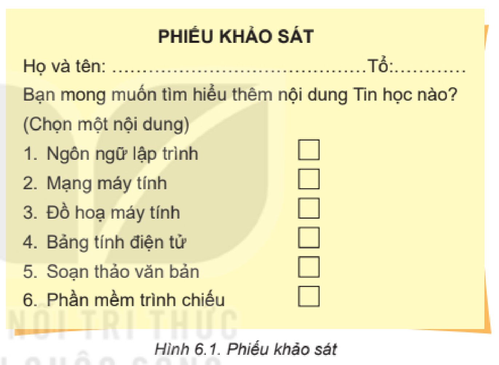
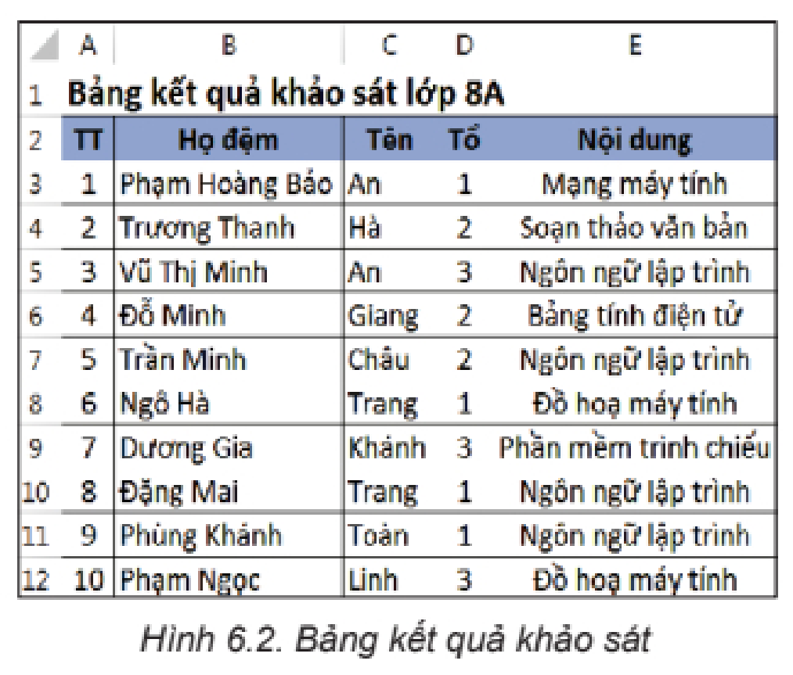
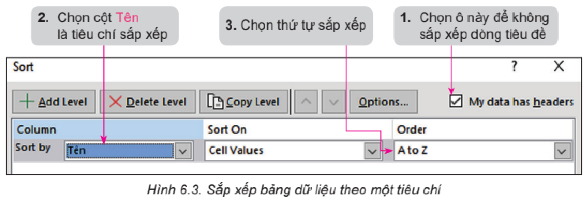
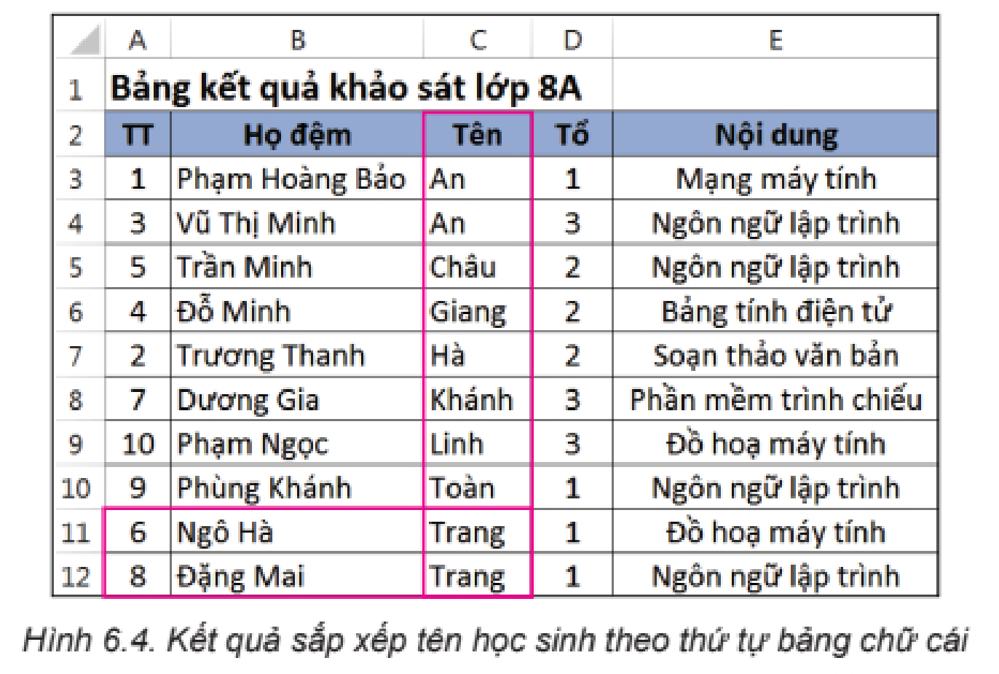
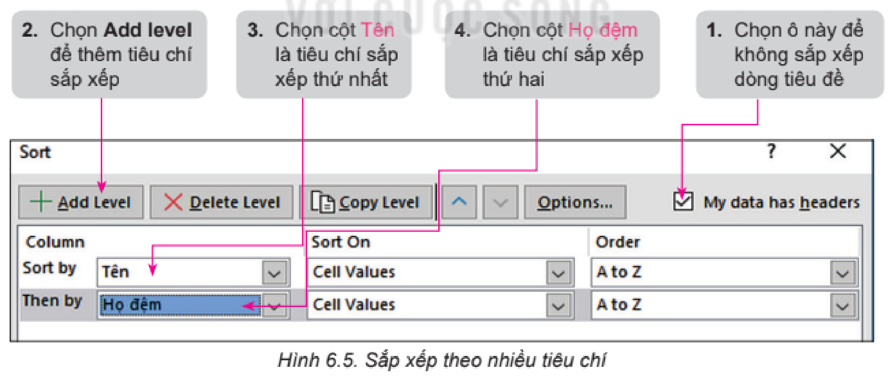
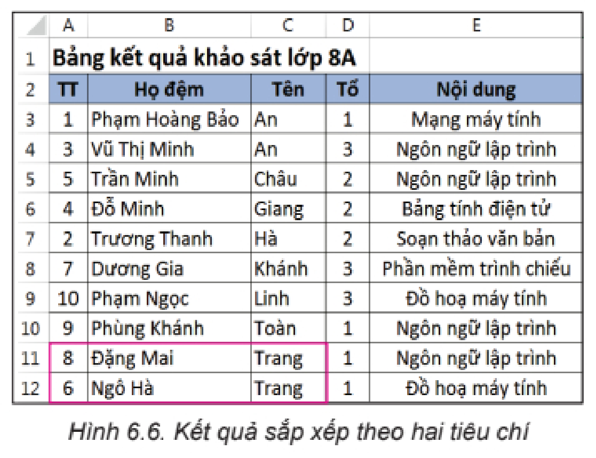
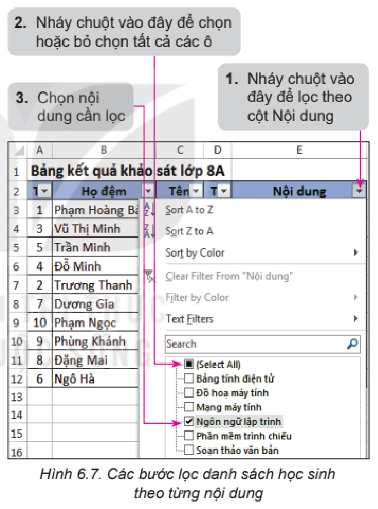
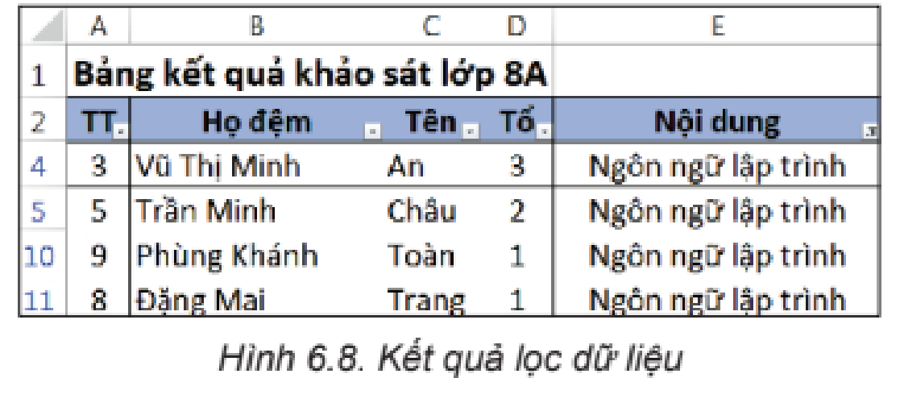
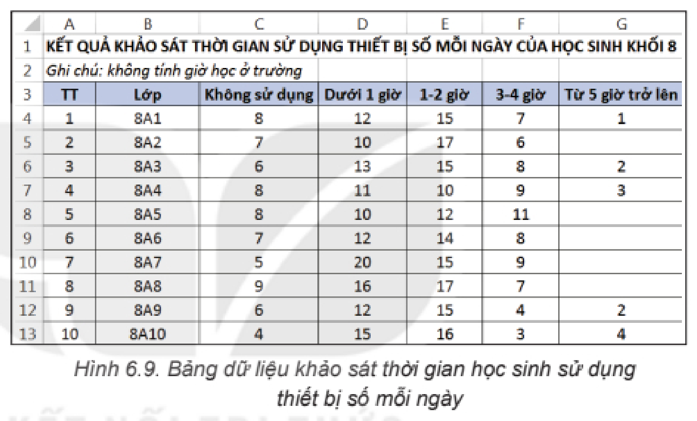

<!-- pdf:28 -->

# BÀI 6: SẮP XẾP VÀ LỌC DỮ LIỆU

## 🎯 Sau bài học này em sẽ:

- Sử dụng được phần mềm bảng tính trợ giúp giải quyết bài toán thực tế.
- Nêu được một số tình huống thực tế cần sử dụng các chức năng sắp xếp và lọc dữ liệu.
- Thực hiện được các thao tác lọc, sắp xếp dữ liệu của phần mềm bảng tính.

## 🔴 Khởi động

> Chung niềm yêu thích môn Tin học, nhóm các bạn học sinh lớp 8A đã cùng nhau thực hiện dự án Thành lập CLB Tin học. Trước tiên, các bạn thực hiện khảo sát về những nội dung Tin học mà học sinh trong lớp muốn tìm hiểu thêm. Phiếu khảo sát có nội dung như Hình 6.1. Từ dữ liệu khảo sát thu được, sẽ tiến hành xử lí dữ liệu (sắp xếp danh sách, lọc ra các bạn học sinh cùng muốn tìm hiểu mỗi nội dung tin học,...) để thu được các thông tin cần thiết làm căn cứ tổ chức các hoạt động của CLB.

*Hình 6.1. Phiếu khảo sát*

> **Hoạt động 1: Phiếu khảo sát**
>
> Phiếu khảo sát được phát cho các bạn trong lớp. Câu trả lời của các bạn cần được lưu trữ trong bảng tính. Theo em, bảng tính gồm các cột nào? Mỗi hàng của bảng lưu trữ dữ liệu gì?

## 1. SỬ DỤNG PHẦN MỀM BẢNG TÍNH TRỢ GIÚP GIẢI QUYẾT BÀI TOÁN THỰC TẾ

Phiếu khảo sát ở Hình 6.1 gồm ba thông tin chính là: Họ và tên học sinh, Tổ và Nội dung. Ba thông tin này là tiêu đề của các cột dữ liệu. Để dễ dàng quan sát tên học sinh, chúng ta sẽ tách họ tên thành hai phần là Họ đệm và Tên.

Mỗi phiếu khảo sát được trả lời là một hàng dữ liệu được lưu trong bảng tính. Hình 6.2 mô tả ví dụ một bảng tính lưu trữ kết quả của 10 phiếu khảo sát thu được, trong đó cột thứ tự (TT) được bổ sung để theo dõi số lượng phiếu khảo sát.

<!-- pdf:29 -->

Mục đích của việc khảo sát là thu thập thông tin để quyết định CLB Tin học sẽ được tổ chức như thế nào. Các bạn học sinh của lớp 8A cần thực hiện một số thao tác xử lí dữ liệu. Ví dụ:

1) Họ và tên học sinh trong bảng kết quả cần được sắp xếp theo thứ tự của bảng chữ cái để dễ tìm kiếm.

2) Ở mỗi nội dung Tin học, danh sách học sinh muốn tìm hiểu thêm là những ai?

3) Nội dung Tin học nào có nhiều học sinh lựa chọn nhất? Đó là những học sinh nào?

4) Với mỗi nội dung, học sinh thuộc những tổ nào để có căn cứ chia nhóm học tập?

*Hình 6.2. Bảng kết quả khảo sát*

<!-- term: Sắp xếp dữ liệu, Lọc dữ liệu -->
Chúng ta có thể sử dụng chức năng **sắp xếp** và **lọc dữ liệu** để giải quyết những yêu cầu của bài toán thực tế ở trên.

*Lưu ý:* Việc sắp xếp theo thứ tự bảng chữ cái khi sử dụng bảng mã Unicode sẽ không hoàn toàn đúng với thứ tự trong tiếng Việt.

> ❓ **Câu hỏi**
>
> Em hãy nêu tiêu chí sắp xếp danh sách học sinh theo thứ tự của bảng chữ cái trong bảng kết quả ở Hình 6.2.

## 2. THỰC HÀNH: SẮP XẾP DỮ LIỆU

<!-- term: Sắp xếp dữ liệu -->
### a) Sắp xếp dữ liệu theo một tiêu chí

**Nhiệm vụ**

Sắp xếp cột Tên của bảng Kết quả khảo sát lớp 8A ở Hình 6.2 theo thứ tự bảng chữ cái.

**Hướng dẫn**

*Bước 1.* Chọn vùng dữ liệu cần sắp xếp là A2:E12. Trong vùng dữ liệu này, hàng 2 là hàng tiêu đề của bảng, các hàng còn lại là dữ liệu cần sắp xếp.

*Bước 2.* Trong thẻ **Data**, tại nhóm **Sort & Filter**, chọn lệnh **Sort** để mở hộp thoại **Sort**. Các bước tiếp theo thực hiện như minh hoạ trong Hình 6.3. Chọn **OK** để hoàn thành việc sắp xếp.

*Hình 6.3. Sắp xếp bảng dữ liệu theo một tiêu chí*

<!-- pdf:30 -->

*Kết quả:* Tên học sinh được sắp xếp theo thứ tự bảng chữ cái như minh hoạ trong Hình 6.4.

*Hình 6.4. Kết quả sắp xếp tên học sinh theo thứ tự bảng chữ cái*

### b) Sắp xếp dữ liệu theo nhiều tiêu chí

**Nhiệm vụ**

Trong bảng tính ở Hình 6.4, tên học sinh đã được sắp xếp theo thứ tự bảng chữ cái. Tuy nhiên, có hai học sinh cùng tên là Trang, nhưng bạn Ngô Hà Trang được sắp xếp trước bạn Đặng Mai Trang, trong khi chữ N đứng sau chữ Đ trong bảng chữ cái. Như vậy, để danh sách học sinh hiển thị đúng theo yêu cầu, em cần bổ sung thêm tiêu chí thứ hai là sắp xếp Họ đệm. Khi đó, nếu cùng giá trị trên cột Tên, các hàng của bảng tính sẽ được sắp xếp theo thứ tự chữ cái của cột Họ đệm.

**Hướng dẫn**

Thực hiện các bước như hướng dẫn ở mục a) để mở hộp thoại **Sort**, các bước tiếp theo thực hiện như hướng dẫn trong Hình 6.5. Chọn **OK** để hoàn thành việc sắp xếp.

*Hình 6.5. Sắp xếp theo nhiều tiêu chí*

*Lưu ý:* Tiếp tục chọn nút lệnh **Add level** nếu muốn thêm nhiều tiêu chí sắp xếp. Chọn nút lệnh **Delete Level** nếu muốn xoá bỏ tiêu chí sắp xếp.

<!-- pdf:31 -->

Kết quả được minh hoạ trong Hình 6.6, trong đó Tên và Họ đệm được sắp xếp theo thứ tự bảng chữ cái. Sau khi sắp xếp dữ liệu, em có thể nhập lại giá trị của cột TT cho đúng thứ tự.

*Hình 6.6. Kết quả sắp xếp theo hai tiêu chí*

> ❓ **Câu hỏi**
>
> Theo em có thể sắp xếp bảng kết quả khảo sát lớp 8A (Hình 6.2) theo tổ, nếu cùng tổ sắp xếp theo tên, nếu cùng tên sắp xếp theo họ đệm được không? Hãy thực hiện sắp xếp trên bảng tính.

## 3. THỰC HÀNH: LỌC DỮ LIỆU

<!-- term: Lọc dữ liệu -->
Chức năng **lọc dữ liệu** của phần mềm bảng tính được sử dụng để chọn và chỉ hiển thị các dòng thoả mãn các điều kiện nào đó. Ví dụ: danh sách học sinh muốn tìm hiểu nội dung Ngôn ngữ lập trình, danh sách học sinh Tổ 1 muốn tìm hiểu nội dung Đồ hoạ máy tính,...

**Nhiệm vụ 1 (lọc theo một tiêu chí):** Lọc danh sách học sinh theo từng nội dung Tin học mà học sinh lựa chọn (sử dụng bộ lọc nhiều tuỳ chọn).

**Hướng dẫn**

*Bước 1.* Chọn vùng dữ liệu cần lọc là A2:E12.

*Bước 2.* Trong thẻ **Data**, tại nhóm **Sort & Filter**, chọn lệnh **Filter**. Khi đó, nút lệnh lọc dữ liệu sẽ xuất hiện ở tất cả các ô thuộc dòng tiêu đề của bảng dữ liệu.

*Bước 3.* Thực hiện lọc dữ liệu theo các bước trong Hình 6.7. Chọn **OK** để hoàn thành việc lọc.

*Hình 6.7. Các bước lọc danh sách học sinh theo từng nội dung*

Hình 6.8 minh hoạ kết quả lọc dữ liệu là danh sách học sinh mong muốn tìm hiểu nội dung Ngôn ngữ lập trình.

*Hình 6.8. Kết quả lọc dữ liệu*

*Bước 4.* Để bỏ lọc dữ liệu, chọn **Select All** ở Bước 2 trong Hình 6.7.

*Lưu ý:* Dữ liệu không đúng với điều kiện lọc sẽ bị ẩn đi.

<!-- pdf:32 -->

**Nhiệm vụ 2 (lọc theo nhiều tiêu chí):** Lọc danh sách học sinh của Tổ 1 muốn tìm hiểu nội dung Đồ hoạ máy tính.

**Hướng dẫn**

*Bước 1.* Thực hiện Bước 1 và Bước 2 như ở Nhiệm vụ 1.

*Bước 2.* Trong cột Nội dung, chọn tiêu chí lọc là Đồ hoạ máy tính.

*Bước 3.* Trong cột Tổ, chọn tiêu chí lọc là 1.

*Bước 4.* Để bỏ lọc dữ liệu, thực hiện tương tự như Bước 4 ở Nhiệm vụ 1 đối với cột Nội dung và cột Tổ.

## ✏️ Luyện tập

Để phục vụ cho việc thành lập CLB Tin học của trường, các bạn học sinh lớp 8A đã thực hiện một cuộc khảo sát trong khối 8 để tìm hiểu sự ảnh hưởng của công nghệ kĩ thuật số đến cuộc sống của học sinh. Bảng dữ liệu dưới đây thống kê số học sinh của mỗi lớp đã trả lời câu hỏi “Bạn dành khoảng bao nhiêu giờ mỗi ngày sử dụng thiết bị số (điện thoại thông minh, máy tính bảng, máy tính,...) ngoài giờ học ở trường?”.

*Hình 6.9. Bảng dữ liệu khảo sát thời gian học sinh sử dụng thiết bị số mỗi ngày*

Em hãy thực hiện:

a) Tạo bảng dữ liệu và định dạng theo mẫu ở Hình 6.9 và lưu tệp với tên `TGSDThietbiso.xlsx`.

b) Sắp xếp bảng dữ liệu theo thứ tự giá trị giảm dần của cột Không sử dụng.

c) Sắp xếp bảng dữ liệu theo hai tiêu chí: giá trị giảm dần của cột Không sử dụng, nếu bằng nhau thì sắp xếp theo giá trị giảm dần của cột Dưới 1 giờ.

d) Lọc danh sách các lớp không có học sinh sử dụng thiết bị số từ 5 giờ trở lên.

## 🚀 Vận dụng

<!-- term: Lọc dữ liệu theo điều kiện -->
Ngoài các chức năng lọc mà em đã tìm hiểu trong phần thực hành, phần mềm bảng tính còn có chức năng lọc theo điều kiện. Khi nháy chuột vào nút lệnh lọc dữ liệu, em còn thấy tuỳ chọn **Number Filters** (hoặc **Text Filters**) nếu phần lớn các ô trong cột đó chứa dữ liệu số (hoặc kí tự).

Em hãy mở tệp dữ liệu `TGSDThietbiso.xlsx`, tìm hiểu chức năng **Number Filters** để lọc danh sách các lớp có số học sinh sử dụng thiết bị số từ 3 đến 4 giờ lớn hơn hoặc bằng 10 học sinh.

## 📷 Danh mục hình ảnh

| Mã hình | Trang PDF | Trang sách | Chú thích |
| --- | --- | --- | --- |
| H8-tin_hoc-b06-01 | 28 | 27 | Hình 6.1. Phiếu khảo sát |
| H8-tin_hoc-b06-02 | 29 | 28 | Hình 6.2. Bảng kết quả khảo sát |
| H8-tin_hoc-b06-03 | 29 | 28 | Hình 6.3. Sắp xếp bảng dữ liệu theo một tiêu chí |
| H8-tin_hoc-b06-04 | 30 | 29 | Hình 6.4. Kết quả sắp xếp tên học sinh theo thứ tự bảng chữ cái |
| H8-tin_hoc-b06-05 | 30 | 29 | Hình 6.5. Sắp xếp theo nhiều tiêu chí |
| H8-tin_hoc-b06-06 | 31 | 30 | Hình 6.6. Kết quả sắp xếp theo hai tiêu chí |
| H8-tin_hoc-b06-07 | 31 | 30 | Hình 6.7. Các bước lọc danh sách học sinh theo từng nội dung |
| H8-tin_hoc-b06-08 | 31 | 30 | Hình 6.8. Kết quả lọc dữ liệu |
| H8-tin_hoc-b06-09 | 32 | 31 | Hình 6.9. Bảng dữ liệu khảo sát thời gian học sinh sử dụng thiết bị số mỗi ngày |
