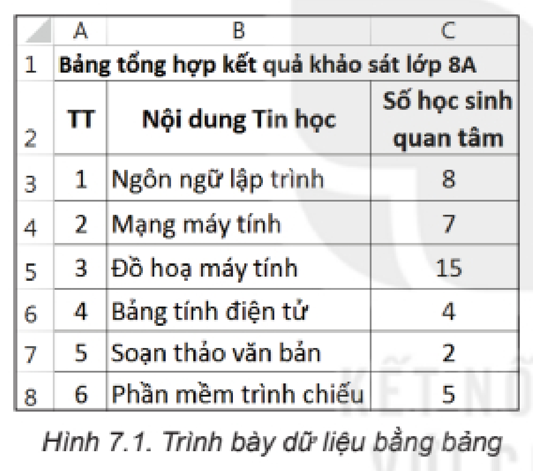
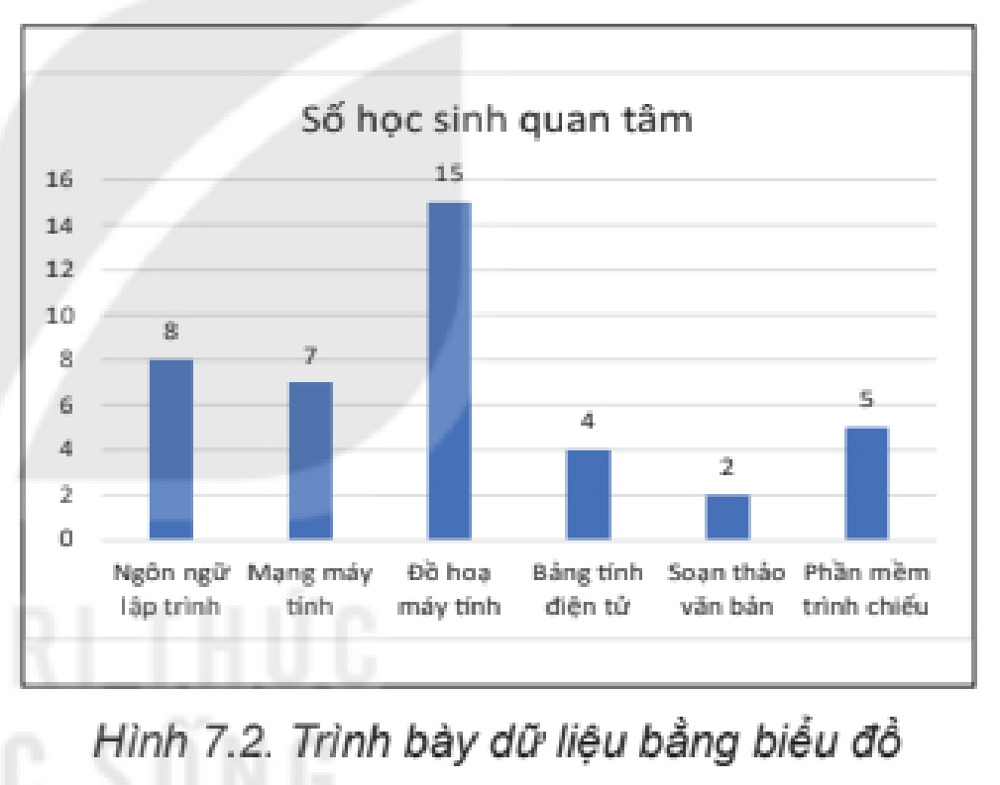
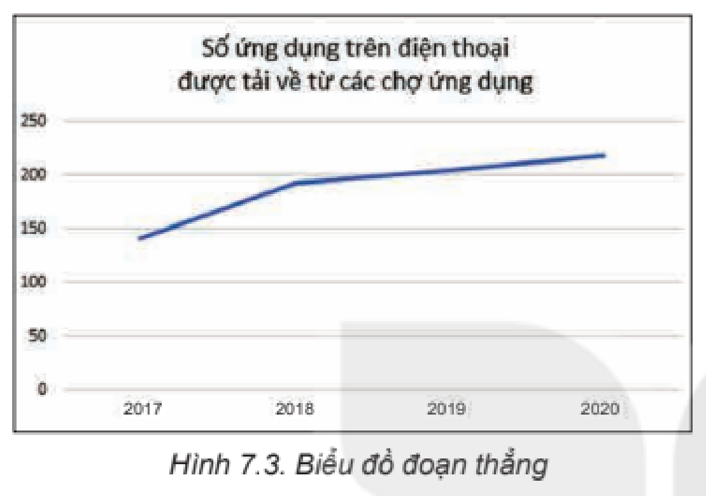
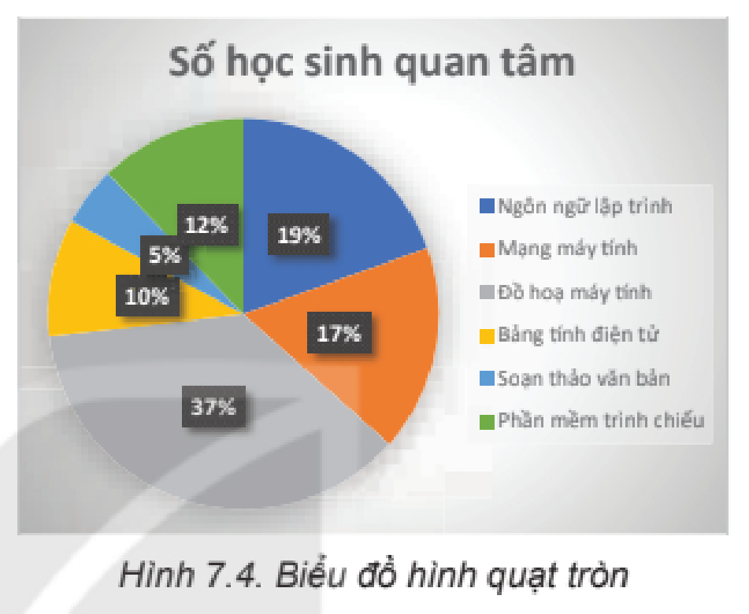
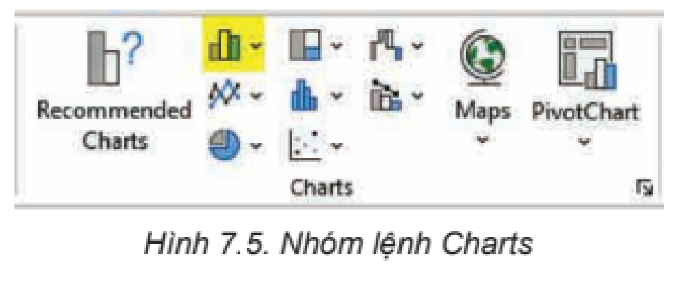
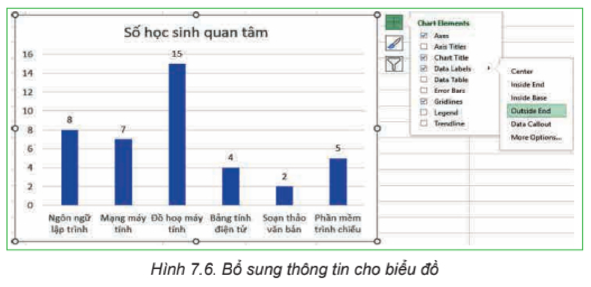
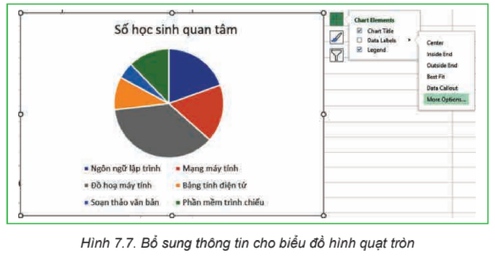
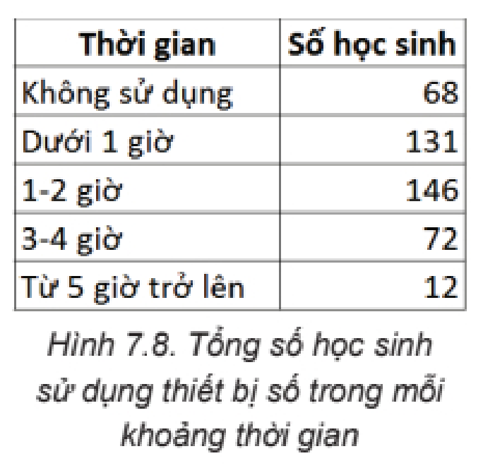
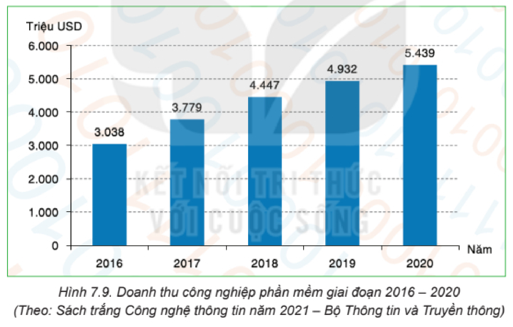

<!-- pdf:33 -->

# BÀI 7: TRỰC QUAN HOÁ DỮ LIỆU

## 🎯 Sau bài học này em sẽ:

- Nêu được một số tình huống thực tế cần sử dụng các chức năng tạo biểu đồ.
- Thực hiện được các thao tác tạo biểu đồ của phần mềm bảng tính.

## 🔴 Khởi động

> Hình 7.1 và Hình 7.2 mô tả hai cách trình bày kết quả khảo sát những nội dung Tin học mà các bạn học sinh lớp 8A muốn tìm hiểu thêm. Em hãy nhận xét về hai cách trình bày này.

*Hình 7.1. Trình bày dữ liệu bằng bảng*

*Hình 7.2. Trình bày dữ liệu bằng biểu đồ*

## 1. TRỰC QUAN HOÁ DỮ LIỆU BẰNG BIỂU ĐỒ

> **Hoạt động 1: Trực quan dữ liệu**
>
> 1. Trong hai cách trình bày dữ liệu ở Hình 7.1 và Hình 7.2, cách nào hiệu quả hơn để so sánh trực quan số học sinh quan tâm các nội dung Tin học?
> 2. Nếu cần so sánh tỉ lệ phần trăm số học sinh của mỗi nội dung Tin học trên tổng số học sinh được khảo sát, em sẽ dùng cách nào để thể hiện dữ liệu?

<!-- term: Biểu đồ, Biểu đồ cột -->
**Biểu đồ** được sử dụng để minh hoạ dữ liệu một cách trực quan, giúp em dễ so sánh hoặc dự đoán xu hướng tăng hay giảm của dữ liệu. Có nhiều loại biểu đồ, mỗi loại có một ý nghĩa riêng.

- **Biểu đồ cột** thường được sử dụng để so sánh dữ liệu. Ví dụ, từ biểu đồ hình cột ở Hình 7.2, dễ dàng thấy rằng nội dung Đồ hoạ máy tính thu hút sự quan tâm nhiều nhất, sau đó là nội dung Ngôn ngữ

<!-- pdf:34 -->

lập trình. Nội dung Soạn thảo văn bản ít học sinh quan tâm nhất.

<!-- term: Biểu đồ đoạn thẳng, Biểu đồ hình quạt tròn -->
- **Biểu đồ đoạn thẳng** thường được sử dụng để quan sát xu hướng tăng giảm của dữ liệu theo thời gian hay quá trình nào đó. Ví dụ, biểu đồ đoạn thẳng ở Hình 7.3 cho thấy số lượng ứng dụng được tải về từ các chợ ứng dụng từ năm 2017 đến 2020 có xu hướng tăng dần.
- **Biểu đồ hình quạt tròn** rất hữu ích trong trường hợp cần so sánh các phần với tổng thể. Ví dụ, biểu đồ ở Hình 7.4 so sánh tỉ lệ phần trăm số học sinh muốn tìm hiểu thêm mỗi nội dung Tin học trên tổng số học sinh khảo sát.

*Hình 7.3. Biểu đồ đoạn thẳng*

*Hình 7.4. Biểu đồ hình quạt tròn*

<!-- term: Biểu đồ -->
> - **Biểu đồ** là cách minh hoạ dữ liệu trực quan. Nhờ biểu đồ, em dễ dàng so sánh, nhận định xu hướng thay đổi của dữ liệu.
> - Cần sử dụng loại biểu đồ phù hợp với mục đích của việc biểu diễn và thể hiện dữ liệu.

> ❓ **Câu hỏi**
>
> Em hãy nêu một số tình huống thực tế cần tạo biểu đồ.

## 2. THỰC HÀNH: TẠO BIỂU ĐỒ
<!-- ocr-ok: đối chiếu ảnh trang PDF 34; tiêu đề mục ngắn, OCR đọc nhầm "HÀNH" thành "HẢNH" -->

### a) Tạo biểu đồ cột

**Nhiệm vụ:** Tạo biểu đồ cột so sánh trực quan số học sinh quan tâm các nội dung Tin học như Hình 7.2.

*Hình 7.5. Nhóm lệnh Charts*

**Hướng dẫn**

*Bước 1.* Khởi động phần mềm bảng tính và nhập dữ liệu như bảng trong Hình 7.1.

*Bước 2.* Chọn vùng dữ liệu B2:C8.

*Bước 3.* Trong thẻ **Insert**, tại nhóm **Charts**, chọn lệnh **Insert Column or Bar Chart** (Hình 7.5), danh sách các loại biểu đồ sẽ xuất hiện.

*Bước 4.* Trong nhóm biểu đồ **2-D Column**, chọn kiểu biểu đồ **Clustered Column**. Khi đó biểu đồ kết quả sẽ xuất hiện trong bảng tính.

<!-- pdf:35 -->

*Bước 5.* Bổ sung thông tin cho biểu đồ.

Nháy chuột chọn biểu đồ, sau đó chọn nút lệnh **Chart Elements** ở góc trên bên phải của biểu đồ. Nháy chuột chọn các loại thông tin cho biểu đồ như minh hoạ trong Hình 7.6.

*Hình 7.6. Bổ sung thông tin cho biểu đồ*

*Lưu ý:* Trong danh sách thông tin ở nút lệnh **Chart Elements**, em hãy chọn thêm các lệnh khác và quan sát sự thay đổi của biểu đồ.

### b) Tạo biểu đồ hình quạt tròn

**Nhiệm vụ:** Tạo biểu đồ hình quạt tròn như Hình 7.4 để so sánh trực quan tỉ lệ phần trăm số học sinh của mỗi nội dung Tin học trên tổng số học sinh khảo sát.

**Hướng dẫn**

*Bước 1.* Chọn vùng dữ liệu B2:C8.

*Bước 2.* Trong thẻ **Insert**, tại nhóm **Charts**, chọn lệnh **Insert Pie or Doughnut Chart**. Danh sách các loại biểu đồ hình quạt tròn sẽ xuất hiện.

*Bước 3.* Trong nhóm biểu đồ **2-D Pie**, chọn kiểu biểu đồ **Pie**. Biểu đồ kết quả sẽ xuất hiện trong bảng tính.

*Bước 4.* Bổ sung thông tin cho biểu đồ.

Trong Excel, biểu đồ hình tròn thường có thông tin mặc định gồm tiêu đề và chú giải (Legend).

Để hiển thị nhãn dữ liệu là tỉ lệ phần trăm, em chọn **More Options** như minh hoạ trong Hình 7.7. Khi đó các tuỳ chọn định dạng nhãn dữ liệu (**Label Option**) sẽ xuất hiện ở khung làm việc bên phải. Em đánh dấu chọn **Percentage**.

*Hình 7.7. Bổ sung thông tin cho biểu đồ hình quạt tròn*

<!-- pdf:36 -->

*Lưu ý:* Trong khung làm việc **Format Data Label** còn có nhiều tuỳ chọn khác về nhãn dữ liệu, em hãy chọn thêm các lệnh khác và quan sát sự thay đổi của biểu đồ.

## ✏️ Luyện tập

1. Em hãy mở tệp `TGSDThietbiso.xlsx` đã lưu ở Bài 6. Dùng hàm SUM để tính tổng số học sinh sử dụng thiết bị số trong mỗi khoảng thời gian (kết quả tương tự như Hình 7.8) rồi thực hiện:

a) Vẽ biểu đồ cột thể hiện số học sinh sử dụng thiết bị số của mỗi khoảng thời gian. Từ biểu đồ kết quả, em có nhận xét gì về tình hình sử dụng thiết bị của học sinh khối 8?

b) Vẽ biểu đồ hình quạt tròn thể hiện tỉ lệ phần trăm của số học sinh sử dụng thiết bị số theo mỗi khoảng thời gian.

*Hình 7.8. Tổng số học sinh sử dụng thiết bị số trong mỗi khoảng thời gian*

2. Cho biểu đồ về doanh thu công nghiệp phần mềm giai đoạn 2016 – 2020 như Hình 7.9.

*Hình 7.9. Doanh thu công nghiệp phần mềm giai đoạn 2016 – 2020*
*(Theo: Sách trắng Công nghệ thông tin năm 2021 – Bộ Thông tin và Truyền thông)*

a) Từ biểu đồ, em có nhận xét gì về doanh thu công nghiệp phần mềm giai đoạn 2016 – 2020?

b) Em hãy tạo bảng dữ liệu trong phần mềm bảng tính từ biểu đồ trên.

c) Em hãy tạo biểu đồ cột từ bảng dữ liệu có được ở câu b.

## 🚀 Vận dụng

Từ bảng dữ liệu về doanh thu công nghiệp phần mềm giai đoạn 2016 – 2020 đã tạo ra trên phần mềm bảng tính ở Câu 2, phần Luyện tập, em hãy tạo biểu đồ đường thẳng, từ đó nhận xét xu hướng của dữ liệu.

## 📷 Danh mục hình ảnh

| Mã hình | Trang PDF | Trang sách | Chú thích |
| --- | --- | --- | --- |
| H8-tin_hoc-b07-01 | 33 | 32 | Hình 7.1. Trình bày dữ liệu bằng bảng |
| H8-tin_hoc-b07-02 | 33 | 32 | Hình 7.2. Trình bày dữ liệu bằng biểu đồ |
| H8-tin_hoc-b07-03 | 34 | 33 | Hình 7.3. Biểu đồ đoạn thẳng |
| H8-tin_hoc-b07-04 | 34 | 33 | Hình 7.4. Biểu đồ hình quạt tròn |
| H8-tin_hoc-b07-05 | 34 | 33 | Hình 7.5. Nhóm lệnh Charts |
| H8-tin_hoc-b07-06 | 35 | 34 | Hình 7.6. Bổ sung thông tin cho biểu đồ |
| H8-tin_hoc-b07-07 | 35 | 34 | Hình 7.7. Bổ sung thông tin cho biểu đồ hình quạt tròn |
| H8-tin_hoc-b07-08 | 36 | 35 | Hình 7.8. Tổng số học sinh sử dụng thiết bị số trong mỗi khoảng thời gian |
| H8-tin_hoc-b07-09 | 36 | 35 | Hình 7.9. Doanh thu công nghiệp phần mềm giai đoạn 2016 – 2020 |
