<!-- pdf:37 -->
<!-- Nhánh lựa chọn: a. Soạn thảo văn bản và trình chiếu nâng cao -->

# BÀI 8A: LÀM VIỆC VỚI DANH SÁCH DẠNG LIỆT KÊ VÀ HÌNH ẢNH TRONG VĂN BẢN

## 🎯 Sau bài học này em sẽ:

- Thực hiện được các thao tác: tạo danh sách dạng liệt kê; chèn thêm, xoá bỏ, co dãn hình ảnh; vẽ hình đồ hoạ trong văn bản,...
- Tạo được sản phẩm là văn bản có tính thẩm mĩ phục vụ nhu cầu thực tế.

## 🔴 Khởi động

> Bạn An được giao nhiệm vụ thiết kế Phiếu khảo sát để sử dụng cho dự án Thành lập CLB Tin học theo mẫu như Hình 8a.1. Trong Phiếu khảo sát có một danh sách các nội dung của môn Tin học. Theo em, bạn An có cần nhập từng số thứ tự của danh sách này không? Với danh sách có hàng trăm mục thì làm thế nào để tiết kiệm thời gian nhập và không bị nhầm thứ tự các mục?

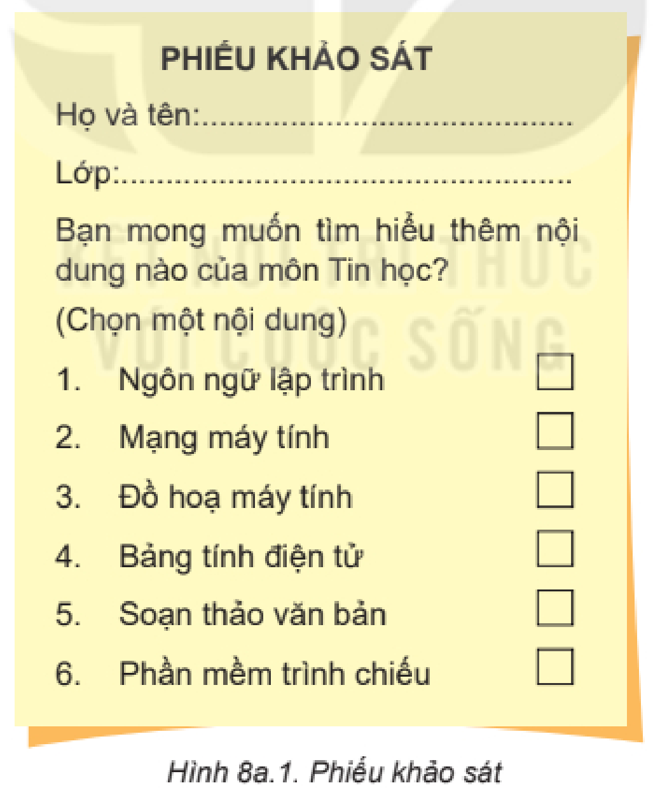

*Hình 8a.1. Phiếu khảo sát*

## 1. DANH SÁCH DẠNG LIỆT KÊ

> **Hoạt động 1: Tác dụng của danh sách dạng liệt kê**
>
> Em hãy quan sát Hình 8a.2, Hình 8a.3 và cho nhận xét về hai cách trình bày nội dung.

<!-- pdf:38 -->

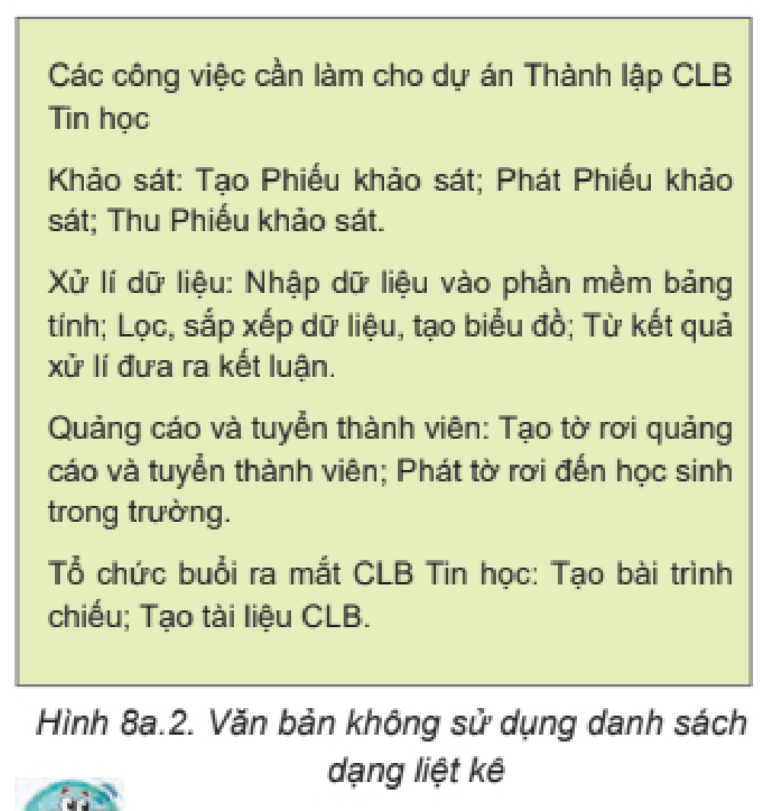

*Hình 8a.2. Văn bản không sử dụng danh sách dạng liệt kê*

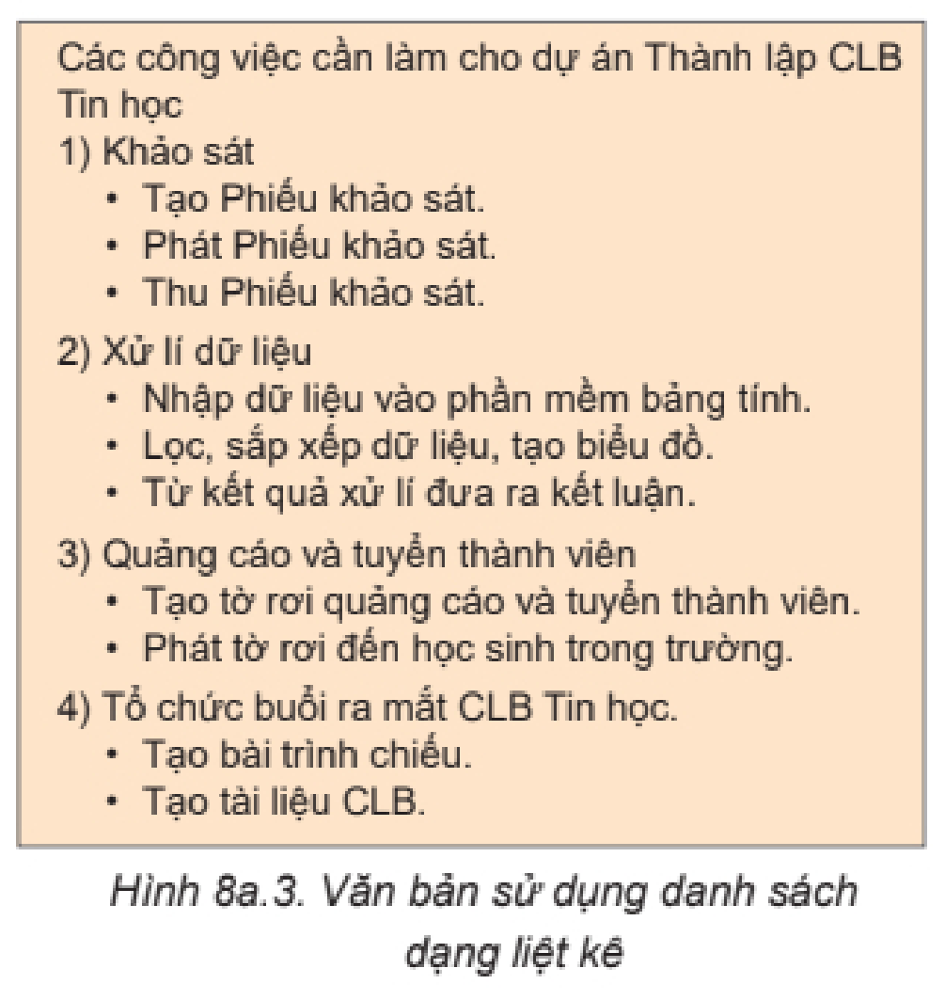

*Hình 8a.3. Văn bản sử dụng danh sách dạng liệt kê*

<!-- term: Danh sách dạng liệt kê, Danh sách dấu đầu dòng, Danh sách có thứ tự -->
Phần mềm soạn thảo văn bản cung cấp hai kiểu **danh sách dạng liệt kê** là: **danh sách dấu đầu dòng** và **danh sách có thứ tự**. Phiếu khảo sát ở Hình 8a.1 là một ví dụ về danh sách có thứ tự. Nội dung văn bản trong Hình 8a.3 là một ví dụ về danh sách có thứ tự kết hợp với danh sách dấu đầu dòng.

Mỗi đơn vị trong danh sách dạng liệt kê là một đoạn văn bản, phân tách nhau bởi phím **Enter** (được người sử dụng nhấn khi soạn thảo văn bản). Trong danh sách dấu đầu dòng, mỗi đoạn văn bản bắt đầu bằng một dấu đầu dòng. Các dấu đầu dòng được tự động tạo ra mỗi khi em thêm đoạn văn bản mới. Trong danh sách có thứ tự, mỗi đoạn văn bản bắt đầu bằng một số hoặc chữ cái và dấu phân tách (thường là dấu chấm hoặc dấu ngoặc đơn). Thứ tự trong danh sách có thứ tự được tạo và cập nhật tự động khi em thêm hoặc bớt các đoạn văn bản trong danh sách.

Sử dụng danh sách dạng liệt kê giúp cho văn bản trở nên rõ ràng, có tính thẩm mĩ hơn. Nếu được sử dụng đúng cách, các dấu đầu dòng và thứ tự có tác dụng như một điểm truy cập cho người đọc, một hình thức nhấn mạnh hoặc một cách để biểu thị tầm quan trọng của nội dung đoạn văn bản. Danh sách dạng liệt kê chia nhỏ các đoạn văn bản dài, giúp người đọc có khả năng tham khảo thông tin nhanh chóng, dễ dàng.

<!-- term: Danh sách dạng liệt kê -->
> - Phần mềm soạn thảo văn bản cung cấp hai kiểu **danh sách dạng liệt kê**: **danh sách dấu đầu dòng**, **danh sách có thứ tự**.
> - Dấu đầu dòng và thứ tự trong danh sách dạng liệt kê được tự động tạo và cập nhật mỗi khi thêm hoặc bớt đoạn văn bản mới.
> - Danh sách dạng liệt kê giúp trình bày văn bản rõ ràng và có tính thẩm mĩ.

> ❓ **Câu hỏi**
>
> 1. Em hãy chọn những phương án **sai** trong các phương án sau:
>
> A. Phần mềm soạn thảo văn bản cung cấp hai kiểu danh sách dạng liệt kê.
>
> B. Danh sách dạng liệt kê không tự động cập nhật khi thêm hoặc bớt đoạn văn.
>
> C. Chỉ có thể sử dụng một kiểu danh sách dạng liệt kê cho một văn bản.
>
> D. Có thể sử dụng kết hợp danh sách dấu đầu dòng và danh sách có thứ tự.

<!-- pdf:39 -->

> 2. Với danh sách có thứ tự ở Hình 8a.4a, nếu em đặt con trỏ soạn thảo ở cuối dòng thứ hai rồi nhấn phím **Enter** để thêm một đoạn văn bản mới thì em sẽ thu được kết quả như ở Hình 8a.4b hay Hình 8a.4c?

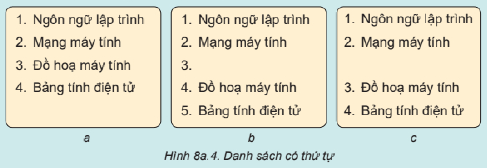

*Hình 8a.4. Danh sách có thứ tự*

## 2. LÀM VIỆC VỚI HÌNH ẢNH MINH HOẠ VÀ VẼ HÌNH ĐỒ HOẠ

> **Hoạt động 2: Hiệu quả của hình ảnh minh hoạ**
>
> Em hãy quan sát các Hình 8a.5, Hình 8a.6 và trả lời các câu hỏi sau:
>
> a) Tờ rơi ở Hình 8a.5 gồm những thông tin dạng nào?
>
> b) Tờ rơi ở Hình 8a.6 gồm những thông tin dạng nào?
>
> c) Em ấn tượng với **tờ rơi** nào hơn?
>
> d) Dùng phần mềm soạn thảo văn bản có tạo ra sản phẩm như ở Hình 8a.6 được không?

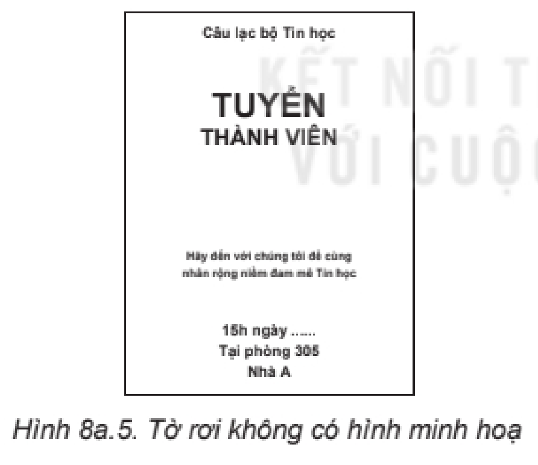

*Hình 8a.5. Tờ rơi không có hình minh hoạ*

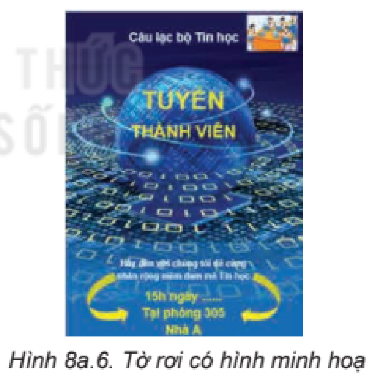

*Hình 8a.6. Tờ rơi có hình minh hoạ*

<!-- term: Công cụ xử lí hình ảnh, Vẽ hình đồ hoạ trong văn bản -->
Bên cạnh các công cụ xử lí văn bản, phần mềm soạn thảo còn cung cấp các **công cụ xử lí hình ảnh**, giúp em nâng cao hiệu quả sử dụng hình ảnh. Em có thể: chèn thêm, xoá bỏ hình ảnh; thay đổi kích thước, vị trí hình ảnh;... Bên cạnh đó, phần mềm soạn thảo văn bản còn cung cấp một thư viện đa dạng các mẫu hình đồ hoạ, các chức năng để **vẽ hình đồ hoạ trong văn bản**.

Với các công cụ mà phần mềm soạn thảo văn bản cung cấp, em có thể tạo được các sản phẩm là văn bản có tính thẩm mĩ phục vụ nhu cầu thực tế.

<!-- pdf:40 -->

<!-- term: Làm việc với hình ảnh và hình đồ hoạ -->
> - Phần mềm soạn thảo văn bản cung cấp nhiều công cụ nâng cao để làm việc với hình ảnh và hình đồ hoạ.
> - Sử dụng các chức năng nâng cao em có thể tạo được các sản phẩm có tính thẩm mĩ phục vụ nhu cầu thực tế.

> ❓ **Câu hỏi**
>
> Em hãy chọn phương án **sai** trong các phương án sau:
>
> A. Có thể chèn hình ảnh vào văn bản để minh hoạ cho nội dung.
>
> B. Có thể vẽ hình đồ hoạ trong phần mềm soạn thảo văn bản.
>
> C. Có thể chèn thêm, xoá bỏ, thay đổi kích thước của hình ảnh và hình đồ hoạ trong văn bản.
>
> D. Không thể vẽ hình đồ hoạ trong phần mềm soạn thảo văn bản.

## 3. THỰC HÀNH: TẠO SẢN PHẨM LÀ VĂN BẢN PHỤC VỤ NHU CẦU THỰC TẾ

**Nhiệm vụ 1**

Sử dụng phần mềm soạn thảo văn bản tạo Phiếu khảo sát theo mẫu như Hình 8a.1.

**Hướng dẫn**

*(Hướng dẫn sau đây sử dụng phần mềm soạn thảo văn bản Microsoft Word phiên bản 2016 để minh hoạ.)*

### a) Khởi động phần mềm và nhập nội dung

– Nháy đúp chuột vào biểu tượng phần mềm trên màn hình nền.

– Nhập nội dung văn bản theo mẫu ở Hình 8a.1.

*Lưu ý:* Em chọn **Insert/Symbol** để nhập kí hiệu ☐.
<!-- ocr-ok: đối chiếu ảnh trang PDF 40; OCR đọc nhầm "Lưu ý", "Insert/Symbol" và kí hiệu ô vuông -->

### b) Tạo danh sách có thứ tự

– Chọn các đoạn văn bản muốn tạo danh sách có thứ tự.

– Thực hiện các bước như Hình 8a.7.

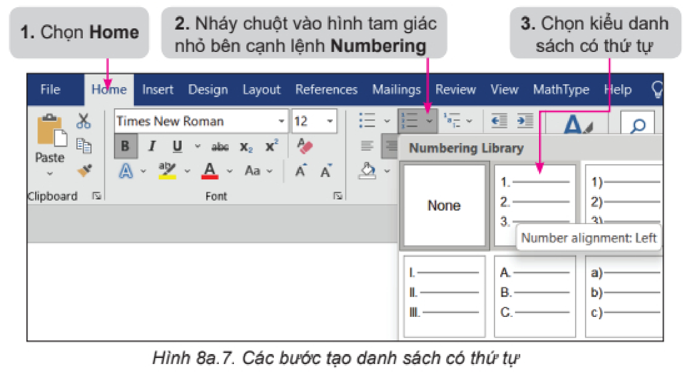

*Hình 8a.7. Các bước tạo danh sách có thứ tự*

<!-- pdf:41 -->

– Kết quả thực hiện từng bước tương tự như Hình 8a.8.

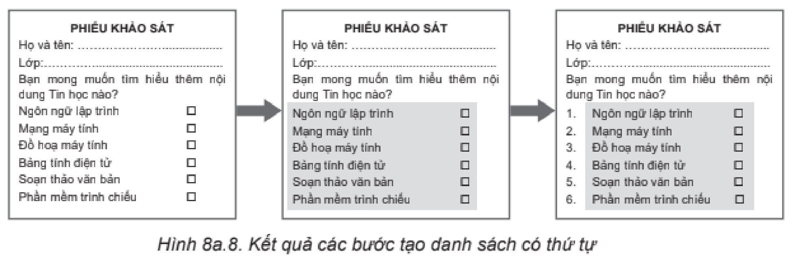

*Hình 8a.8. Kết quả các bước tạo danh sách có thứ tự*

### c) Lưu tệp

Chọn **File/Save** để lưu tệp văn bản với tên `PhieuKhaoSat.docx`.
<!-- ocr-ok: đối chiếu ảnh trang PDF 41; OCR đọc nhầm "File/Save", "để" và tên tệp PhieuKhaoSat.docx -->

**Nhiệm vụ 2**

Sử dụng phần mềm soạn thảo tạo tờ rơi quảng cáo và tuyển thành viên cho CLB Tin học của trường theo mẫu ở Hình 8a.6.

**Hướng dẫn**

– Quan sát tờ rơi mẫu em thấy có các đối tượng sau: ảnh nền, văn bản, hình đồ hoạ,...

– Các đối tượng văn bản, hình đồ hoạ nằm bên trên ảnh nền (tức là ảnh nền nằm ở lớp dưới, văn bản và hình đồ hoạ nằm ở lớp trên).

### a) Khởi động phần mềm và nhập nội dung

– Nháy đúp chuột vào biểu tượng phần mềm trên màn hình nền.

– Nhập nội dung văn bản theo mẫu như Hình 8a.5.

### b) Thêm ảnh minh hoạ, thay đổi lớp, thay đổi kích thước ảnh

– Nháy chuột vào đầu đoạn văn bản để đặt vị trí chèn ảnh, chọn **Insert/Picture**, chọn tệp ảnh nền rồi chọn **OK** để chèn ảnh.

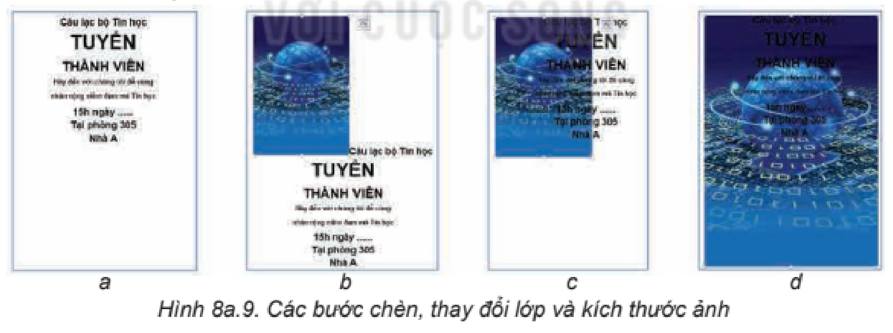

*Hình 8a.9. Các bước chèn, thay đổi lớp và kích thước ảnh*

– Hình ảnh được chèn vào văn bản (ảnh có thể che mất nội dung văn bản hoặc đẩy nội dung văn bản xuống dưới (Hình 8a.9b)). Vì ảnh nền cần nằm dưới văn bản, nên em nháy chuột chọn ảnh, chọn **Format**. Trong nhóm lệnh **Arrange**, nháy chuột vào mũi tên bên cạnh lệnh **Wrap Text** rồi chọn **Behind Text** để ảnh nằm ở lớp dưới, văn bản nằm ở lớp trên. Kết quả là văn bản sẽ được đưa lên trên ảnh nền (Hình 8a.9c).

– Bước tiếp theo cần thay đổi vị trí và kích thước ảnh để ảnh phủ hết nền của tờ rơi. Em di chuyển chuột vào hình vuông nhỏ màu trắng nằm ở góc dưới bên phải của ảnh rồi kéo thả chuột để thay đổi kích thước sao cho ảnh nền phủ kín tờ rơi (Hình 8a.9d).

<!-- pdf:42 -->

### c) Thêm, thay đổi màu các đối tượng hình đồ hoạ

– Trong tờ rơi có hai đối tượng đồ hoạ là: ↪ và ↩. Để vẽ ↪ em thực hiện các bước như Hình 8a.10 và Hình 8a.11 rồi kéo thả chuột để tạo hình mũi tên trên tờ rơi.

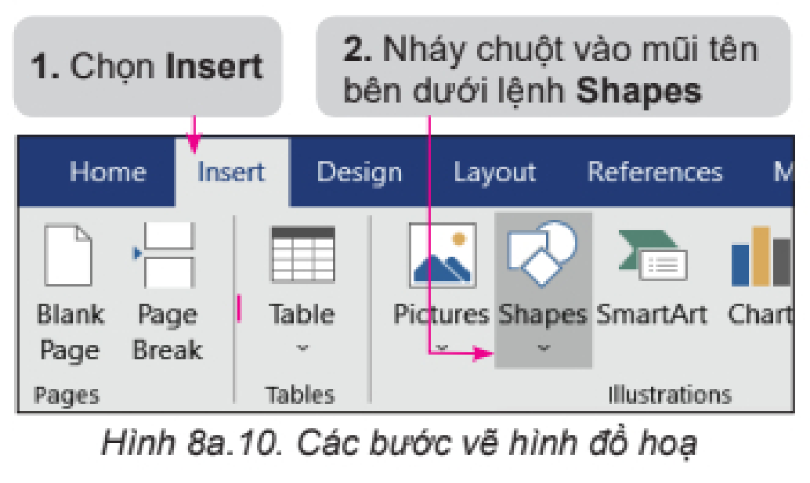

*Hình 8a.10. Các bước vẽ hình đồ hoạ*

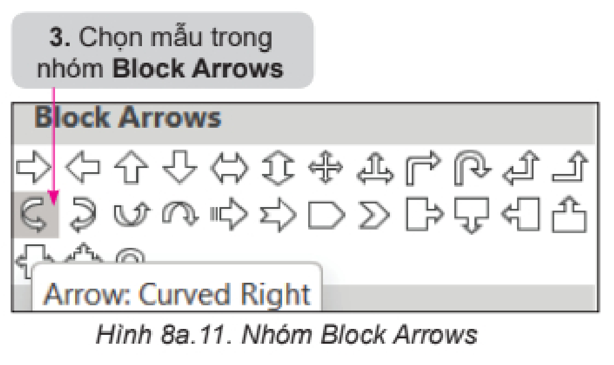

*Hình 8a.11. Nhóm Block Arrows*

– Thực hiện tương tự với mẫu ↩ để vẽ thêm hình mũi tên ở bên phải.

– Để đổi màu cho đối tượng đồ hoạ, em chọn đối tượng, chọn **Format**, trong nhóm lệnh **Shape Styles**, nháy chuột vào mũi tên bên cạnh lệnh **Shape Fill**. Chọn màu vàng.

*Lưu ý:* Nếu muốn thay đổi hình ảnh làm nền cho tờ rơi hay mẫu hình đồ hoạ khác, em nháy chuột chọn hình ảnh, hình đồ hoạ rồi nhấn phím **Delete**. Tiếp theo, thực hiện lại các bước để chèn thêm hình ảnh, hình đồ hoạ mới.

### d) Chỉnh sửa vị trí và màu sắc các đối tượng

Em cần chỉnh sửa vị trí dòng chữ “TUYỂN THÀNH VIÊN” vào đúng hình cầu trên hình nền, đổi màu chữ đen thành vàng. Chỉnh sửa màu sắc và vị trí các đối tượng văn bản khác sao cho đúng theo mẫu.

Chèn thêm hình ảnh vào góc trên bên phải để hoàn thiện tờ rơi. Để đặt được hình ảnh vào đúng vị trí, sau khi chèn em chọn **Format/Arrange/Wrap Text** rồi chọn **Square**.

### e) Lưu tệp

Chọn **File/Save** để lưu tệp văn bản với tên `TuyenThanhVien.docx`.
<!-- ocr-ok: đối chiếu ảnh trang PDF 42; OCR đọc nhầm dấu gạch chéo trong "File/Save" và chữ "để" -->

## ✏️ Luyện tập

Em hãy sử dụng phần mềm soạn thảo văn bản để nhập dữ liệu cho dự án Thành lập CLB Tin học, tạo danh sách dạng liệt kê cho dữ liệu theo mẫu ở Hình 8a.3 và lưu lại tệp với tên `CLBTinhoc.docx`.

## 🚀 Vận dụng

1. Ngoài các mẫu danh sách liệt kê mà phần mềm soạn thảo cung cấp, người sử dụng có thể tự tạo các mẫu dấu đầu dòng, mẫu thứ tự theo ý thích của mình. Em hãy tìm hiểu cách làm và tạo ba mẫu dấu đầu dòng, mẫu thứ tự mới.

2. Em hãy sử dụng phần mềm soạn thảo văn bản để tạo một tờ rơi quảng cáo cho CLB Tiếng Anh (hoặc CLB Rubik, CLB bóng rổ,... của trường). Trong tờ rơi có sử dụng hình ảnh minh hoạ và hình đồ hoạ, sử dụng mẫu dấu đầu dòng, mẫu thứ tự mà em đã tạo ở Câu 1.

## 📷 Danh mục hình ảnh

| Mã hình | Trang PDF | Trang sách | Chú thích |
| --- | --- | --- | --- |
| H8-tin_hoc-b08a-01 | 37 | 36 | Hình 8a.1. Phiếu khảo sát |
| H8-tin_hoc-b08a-02 | 38 | 37 | Hình 8a.2. Văn bản không sử dụng danh sách dạng liệt kê |
| H8-tin_hoc-b08a-03 | 38 | 37 | Hình 8a.3. Văn bản sử dụng danh sách dạng liệt kê |
| H8-tin_hoc-b08a-04 | 39 | 38 | Hình 8a.4. Danh sách có thứ tự |
| H8-tin_hoc-b08a-05 | 39 | 38 | Hình 8a.5. Tờ rơi không có hình minh hoạ |
| H8-tin_hoc-b08a-06 | 39 | 38 | Hình 8a.6. Tờ rơi có hình minh hoạ |
| H8-tin_hoc-b08a-07 | 40 | 39 | Hình 8a.7. Các bước tạo danh sách có thứ tự |
| H8-tin_hoc-b08a-08 | 41 | 40 | Hình 8a.8. Kết quả các bước tạo danh sách có thứ tự |
| H8-tin_hoc-b08a-09 | 41 | 40 | Hình 8a.9. Các bước chèn, thay đổi lớp và kích thước ảnh |
| H8-tin_hoc-b08a-10 | 42 | 41 | Hình 8a.10. Các bước vẽ hình đồ hoạ |
| H8-tin_hoc-b08a-11 | 42 | 41 | Hình 8a.11. Nhóm Block Arrows |
