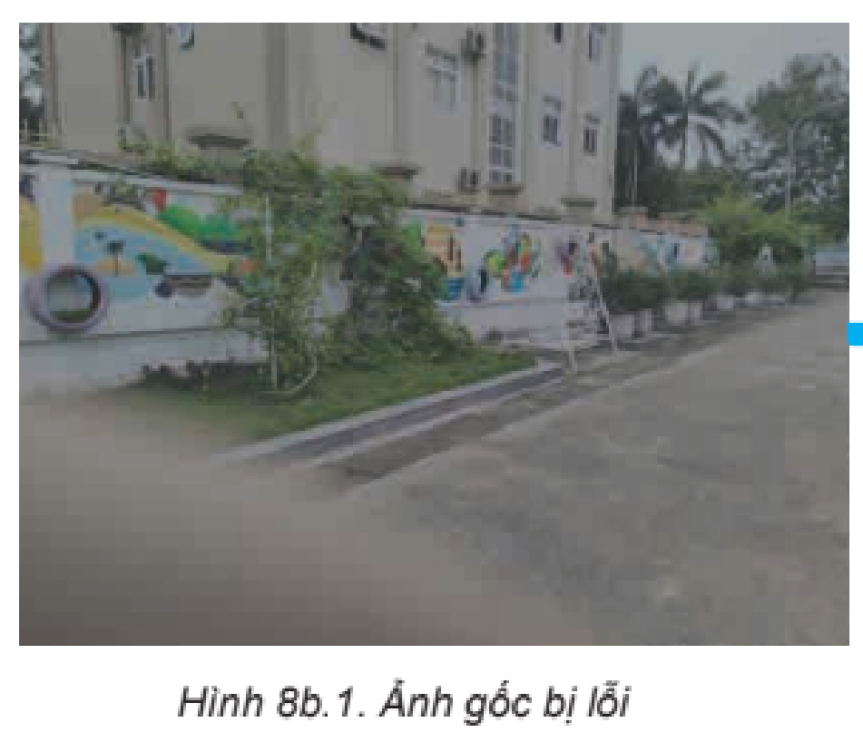
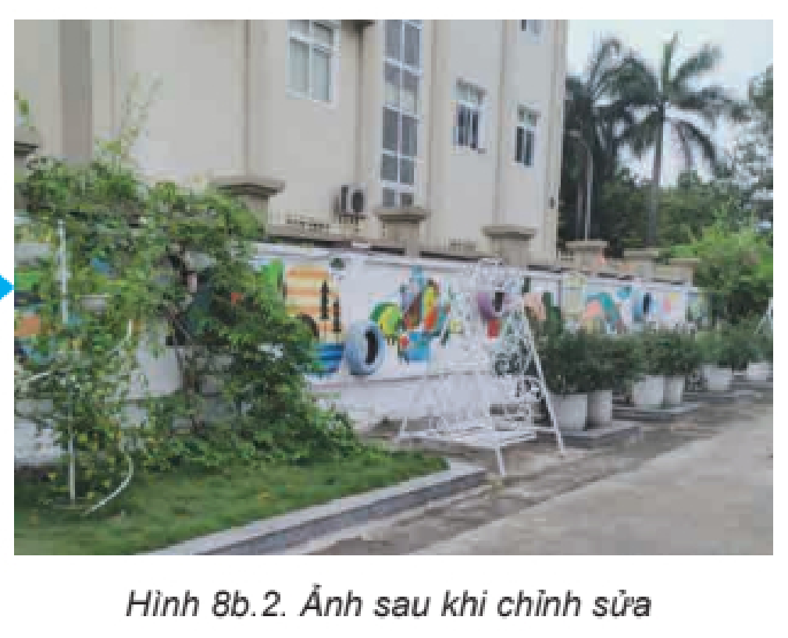
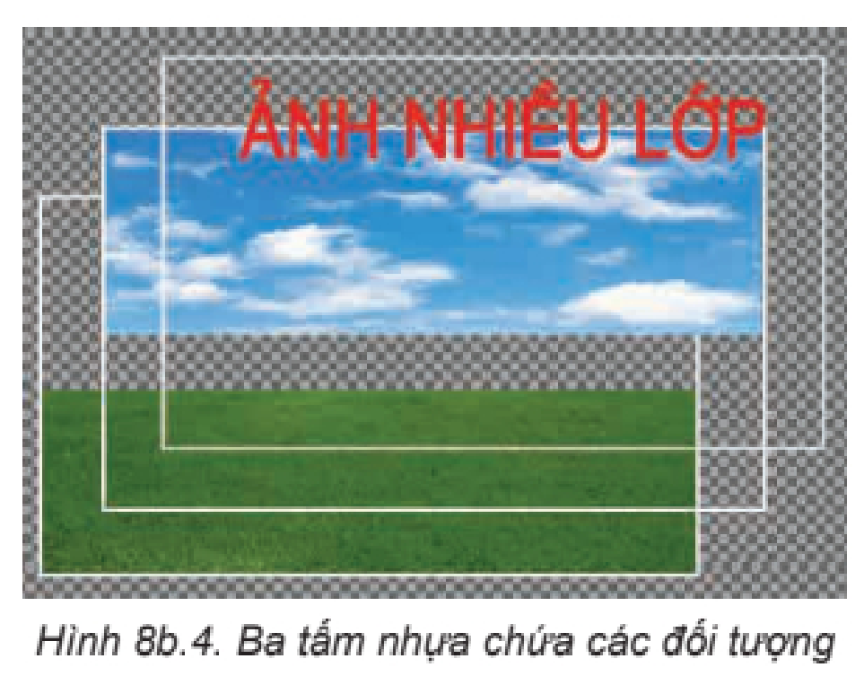
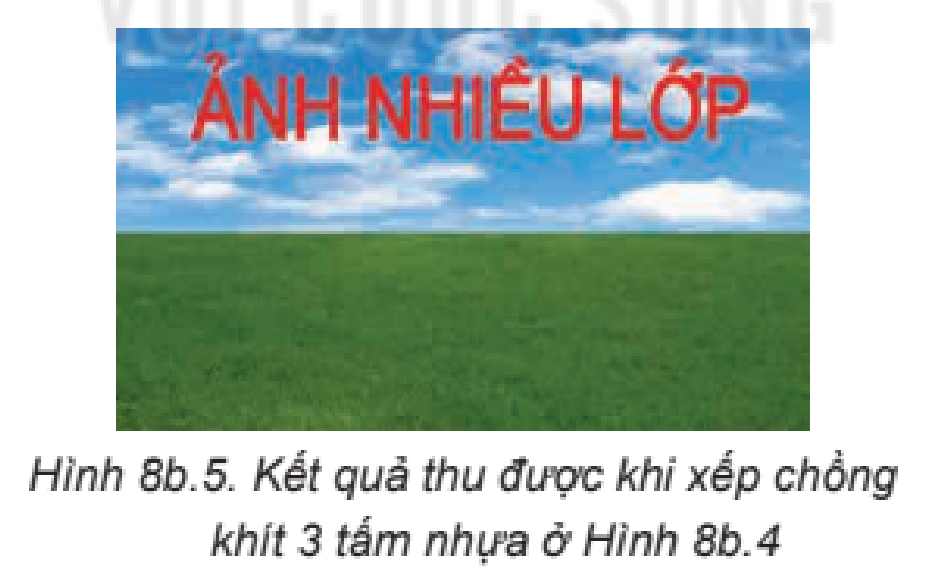
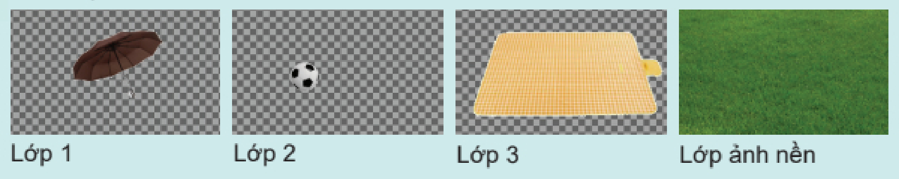
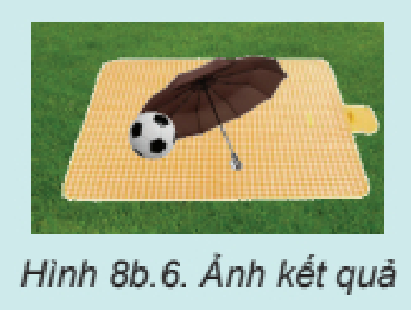
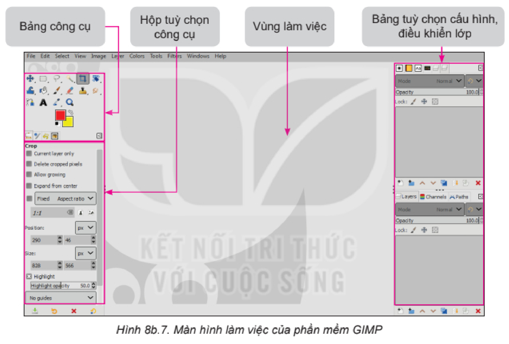
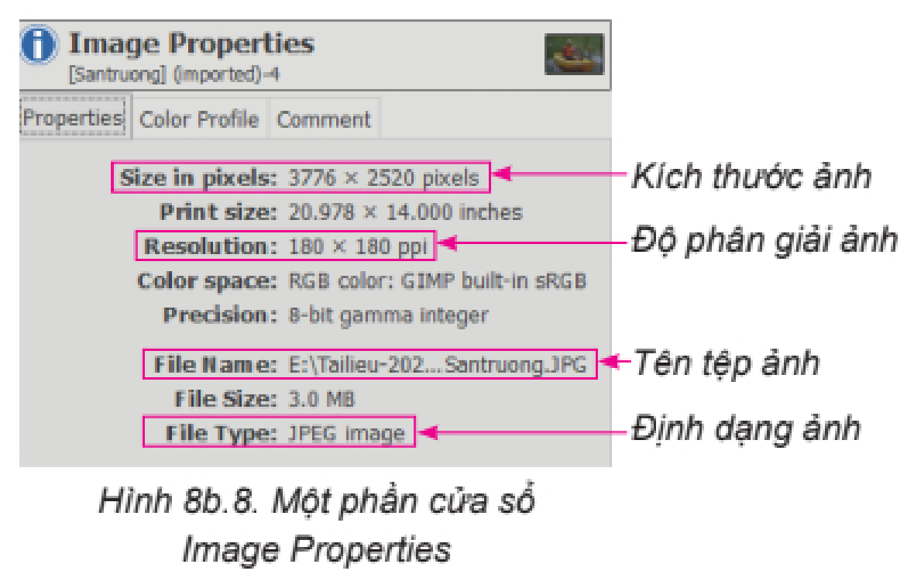
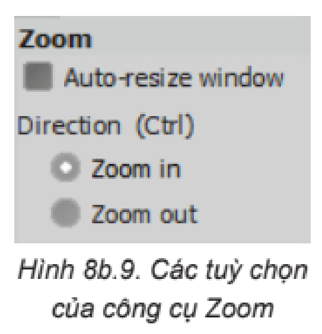

<!-- pdf:57 -->
<!-- Chủ đề con lựa chọn: b. Làm quen với phần mềm chỉnh sửa ảnh -->

# BÀI 8B: PHẦN MỀM CHỈNH SỬA ẢNH

## 🎯 Sau bài học này em sẽ:

- Nêu được một vài chức năng chính của phần mềm chỉnh sửa ảnh.
- Thực hiện được các thao tác: mở tệp ảnh; đọc thông tin ảnh; phóng to, thu nhỏ, dịch chuyển ảnh; lưu tệp ảnh.

## 🔴 Khởi động

> *An:* Tớ chụp được nhiều ảnh phong cảnh trường mình, nhưng xem lại thì thấy có ảnh bị lỗi vì ngón tay che ống kính. Liệu có cách nào để cắt bỏ phần lỗi đó đi không?
>
> *Minh:* Có chứ! Thậm chí bạn còn có thể làm được nhiều hơn thế. Mình sẽ giới thiệu cho bạn một phần mềm không chỉ làm được việc đó mà còn thay đổi được kích thước, điều chỉnh ánh sáng, hiệu ứng,... cho ảnh nữa.

## 1. PHẦN MỀM CHỈNH SỬA ẢNH

> **Hoạt động 1: Phần mềm chỉnh sửa ảnh**
>
> 1. Em hãy liệt kê một số yêu cầu mà em muốn làm thay đổi một bức ảnh.
> 2. Phần mềm ứng dụng nào có thể giúp em làm việc đó?

Không phải mọi hình ảnh đều đẹp ngay từ khi nó được tạo ra. Mỗi hình ảnh đều cần được chỉnh sửa để mang được thông điệp tích cực đến người xem. **Phần mềm chỉnh sửa ảnh** là công cụ giúp em tạo ra hoặc thay đổi một hình ảnh để có được hình ảnh mới theo cách mà em mong muốn. Ví dụ: từ bức ảnh phong cảnh trường (Hình 8b.1) mà bạn An chụp bị lỗi (ngón tay che ống kính, ảnh mờ và tối), sau khi chỉnh sửa có thể thu được ảnh kết quả như Hình 8b.2.

Phần mềm chỉnh sửa ảnh có thể được cài đặt trên máy tính hoặc chạy trực tuyến trên Internet. Những chức năng chính của phần mềm chỉnh sửa ảnh gồm: tạo mới ảnh, chỉnh sửa ảnh, chuyển đổi ảnh sang các định dạng và độ phân giải khác nhau.

<!-- pdf:58 -->

*Hình 8b.1. Ảnh gốc bị lỗi*

*Hình 8b.2. Ảnh sau khi chỉnh sửa*

> - **Chỉnh sửa ảnh** là thay đổi hình ảnh ban đầu để tạo ra hình ảnh mới.
> - **Phần mềm chỉnh sửa ảnh** là công cụ giúp tạo ra hoặc thay đổi một ảnh gốc để có được ảnh mới theo yêu cầu.

> ❓ **Câu hỏi**
>
> 1. Em hãy nêu một vài chức năng chính của phần mềm chỉnh sửa ảnh.
> 2. Theo em, để thu được ảnh kết quả như Hình 8b.2 từ Hình 8b.1 thì cần chỉnh sửa những gì?

## 2. ĐỐI TƯỢNG VÀ LỚP TRONG ẢNH

> **Hoạt động 2: Xác định nội dung và các thành phần trong ảnh**
>
> Em hãy quan sát Hình 8b.3 và trả lời các câu hỏi sau:
>
> 1. Trong bức ảnh có những thành phần nào?
> 2. Nội dung của bức ảnh là gì?

*Hình 8b.3.*

Mỗi bức ảnh khi được tạo ra đều mang một nội dung nhất định mà người tạo ra ảnh muốn thể hiện và người xem ảnh có thể thu nhận được. Nội dung đó được thể hiện qua cảnh nền và các thành phần xuất hiện trong ảnh. Xem ảnh trong Hình 8b.3 em có thể thấy trên cảnh nền là mặt nước và cây cỏ có một quả bóng màu trắng, một chiếc thuyền màu vàng và một bạn đang chèo thuyền.

<!-- term: Công cụ chọn (Selection) -->
Khi chỉnh sửa ảnh, em có thể coi các thành phần trong ảnh là các **đối tượng** để phần mềm chỉnh sửa ảnh tác động, làm thay đổi và tạo ra ảnh mới. Phần mềm xử lí ảnh cung cấp các **công cụ chọn** (**Selection**) giúp em chọn đối tượng để có thể thực hiện các thao tác khác nhau cho từng phần ảnh riêng biệt. Khi một đối tượng được chọn thì các thao tác xử lí chỉ áp dụng cho chính đối tượng đó.

<!-- pdf:59 -->

> **Hoạt động 3: Ảnh nhiều lớp**
>
> Có 3 tấm nhựa trong suốt, mỗi tấm chứa một đối tượng như Hình 8b.4. Em hãy quan sát Hình 8b.4 và trả lời các câu hỏi sau:
>
> 1. Nếu xếp chồng khít 3 tấm nhựa lên nhau em sẽ nhìn thấy kết quả là gì?
> 2. Nếu để lớp trên cùng (có dòng chữ “ẢNH NHIỀU LỚP”) vào giữa hai lớp còn lại, em sẽ nhìn thấy kết quả là gì?
> 3. Theo em, để mỗi đối tượng ở một tấm nhựa như vậy có ưu điểm gì?

*Hình 8b.4. Ba tấm nhựa chứa các đối tượng*

Nếu xếp chồng khít 3 tấm nhựa ở Hình 8b.4 em sẽ thấy kết quả là Hình 8b.5. Hai hình này cho em thấy một minh hoạ trực quan về các lớp trong một bức ảnh.

<!-- term: Lớp ảnh (Layer) -->
Trong xử lí ảnh, người ta sử dụng kĩ thuật **phân lớp** (**layer**) để hỗ trợ chỉnh sửa. Mỗi hình ảnh được tạo nên từ nhiều **lớp ảnh** khác nhau. Lớp nằm dưới cùng là **lớp ảnh nền** (**background**), các lớp tiếp theo có nền trong suốt và chứa các đối tượng. Các đối tượng nằm ở lớp dưới sẽ bị che bởi các đối tượng ở lớp trên. Em có thể chọn từng lớp ảnh để chỉnh sửa. Các thao tác chỉnh sửa chỉ có tác dụng với các đối tượng nằm trong lớp ảnh đang được chọn.

Kĩ thuật làm việc với lớp là một kĩ thuật nâng cao và đặc trưng của các phần mềm xử lí ảnh. Nhờ đó mà người sử dụng dễ dàng thay đổi, chỉnh sửa các đối tượng và phối trộn nhiều mảng hình ảnh khác nhau. Từ đó tạo ra bức ảnh theo mong muốn của mình.

*Hình 8b.5. Kết quả thu được khi xếp chồng khít 3 tấm nhựa ở Hình 8b.4*

> - Ảnh được tạo nên từ nhiều lớp. Lớp dưới cùng là lớp ảnh nền. Mỗi lớp chứa các đối tượng riêng. Đối tượng nằm ở lớp dưới sẽ bị che bởi đối tượng nằm ở lớp trên.
> - Các thao tác chỉnh sửa chỉ có tác dụng với các đối tượng đang được chọn, lớp ảnh đang chọn.

<!-- pdf:60 -->

> ❓ **Câu hỏi**
>
> Có 4 lớp ảnh như sau:
>
> 
>
> Em sẽ xếp các lớp ảnh theo thứ tự nào từ dưới lên trên để có kết quả là ảnh ở Hình 8b.6?
>
> A. Lớp ảnh nền dưới cùng rồi đến lớp 1, lớp 2, lớp 3.
>
> B. Lớp ảnh nền dưới cùng rồi đến lớp 3, lớp 2, lớp 1.
>
> C. Lớp ảnh nền dưới cùng rồi đến lớp 2, lớp 1, lớp 3.
>
> D. Lớp ảnh nền dưới cùng rồi đến lớp 3, lớp 1, lớp 2.

*Hình 8b.6. Ảnh kết quả*

## 3. ĐỌC THÔNG TIN ẢNH

> **Hoạt động 4: Đọc thông tin ảnh**
>
> Em hãy cho biết làm thế nào máy tính lưu một hình ảnh, làm thế nào nó nhớ được màu sắc và hình dạng trong một hình ảnh?

<!-- term: Điểm ảnh (pixel) và độ phân giải ảnh -->
Màn hình máy tính được tạo thành từ một lưới gồm nhiều **điểm ảnh** (**pixel**). Mỗi pixel đều có toạ độ x và y trên màn hình và thông tin về màu sắc mà nó phải hiển thị. Cùng một cỡ ảnh, ảnh có nhiều pixel sẽ sắc nét hơn. Kích thước của ảnh có thể tính theo đơn vị độ dài (inch) hoặc pixel và được biểu diễn dưới dạng tích số của chiều rộng và chiều cao.

Ví dụ: Hình ảnh có chiều rộng 1280 pixel và chiều cao 960 pixel có độ phân giải 1280 x 960 pixel.

Những định dạng ảnh khác nhau có những yêu cầu khác nhau trong lưu trữ hình ảnh, ví dụ:

<!-- term: Định dạng ảnh jpg -->
- Định dạng **jpg** ưu tiên hiệu quả nén ảnh nhưng khó khôi phục nguyên gốc. Định dạng jpg không hỗ trợ ảnh không nền (nền trong suốt). Định dạng jpg thường được dùng trong nhiếp ảnh.

<!-- term: Định dạng ảnh png -->
- Định dạng **png** có hiệu quả nén ảnh thấp nhưng bù lại, nó không làm mất dữ liệu gốc. Định dạng png phù hợp với ảnh sử dụng trên web, ảnh làm logo, ảnh có nền trong suốt, ảnh đang trong quá trình chỉnh sửa, các hình ảnh phức tạp.

> ❓ **Câu hỏi**
>
> Phương án nào sau đây đúng khi biểu diễn kích thước ảnh có chiều cao là 1509 pixel và chiều rộng là 1268 pixel?
>
> A. 1509 + 1268.
>
> B. 1509 ; 1268.
>
> C. 1509 $\times$ 1268.
>
> D. 1268 $\times$ 1509.

<!-- pdf:61 -->

## 4. THỰC HÀNH: LÀM QUEN VỚI PHẦN MỀM CHỈNH SỬA ẢNH

**Nhiệm vụ**

- Khởi động phần mềm xử lí ảnh, mở một tệp ảnh có sẵn trên máy tính, đọc thông tin ảnh.
- Làm quen với công cụ phóng to, thu nhỏ, di chuyển ảnh, chọn đối tượng.
- Lưu tệp ảnh.

**Hướng dẫn**

*(Hướng dẫn sau đây sử dụng phần mềm GIMP phiên bản 2.10.32 để minh hoạ.)*

### a) Khởi động phần mềm

<!-- term: Giao diện phần mềm GIMP -->
- Nháy đúp chuột vào biểu tượng **GIMP 2.10.32** trên màn hình nền để mở phần mềm chỉnh sửa ảnh GIMP, giao diện phần mềm với các thành phần chính được mở ra như Hình 8b.7.

*Hình 8b.7. Màn hình làm việc của phần mềm GIMP*

### b) Mở tệp ảnh

- Chọn **File/Open** để mở hộp thoại **Open Image**, chọn ảnh và nháy chuột chọn **Open**.

### c) Đọc thông tin ảnh

<!-- term: Đọc thông tin ảnh (Image Properties) -->
- Chọn **Image/Image Properties**, cửa sổ **Image Properties** xuất hiện. Một phần của cửa sổ **Image Properties** tương tự Hình 8b.8, cho em biết tên tệp ảnh, kích thước ảnh, độ phân giải ảnh, định dạng tệp ảnh,...

*Hình 8b.8. Một phần cửa sổ Image Properties*
<!-- ocr-ok: đã đối chiếu ảnh trang PDF 61, OCR đọc nhầm "Hình ... phần cửa sổ" thành "Hinh ... phân cửa số" -->

<!-- pdf:62 -->

### d) Phóng to, thu nhỏ ảnh

<!-- term: Công cụ thu phóng (Zoom) -->
- Trong quá trình chỉnh sửa ảnh, em cần phóng to để nhìn rõ các chi tiết và ngược lại, muốn quan sát được toàn bộ ảnh sau một số thao tác chỉnh sửa, cần thu nhỏ ảnh.

*Cách 1.* Nhấn giữ phím **Ctrl** trong khi lăn nút cuộn chuột để phóng to, thu nhỏ ảnh.

*Cách 2.* Chọn công cụ **Zoom** rồi đưa con trỏ chuột vào ảnh và nháy chuột. Mỗi lần nháy chuột, ảnh sẽ được phóng to hoặc thu nhỏ theo một tỉ lệ thích hợp (chọn **Zoom in** để phóng to ảnh, **Zoom out** để thu nhỏ ảnh (Hình 8b.9).

*Hình 8b.9. Các tuỳ chọn của công cụ Zoom*

### e) Di chuyển ảnh

<!-- term: Công cụ di chuyển (Move) -->
- Để di chuyển ảnh, chọn công cụ **Move** trong bảng công cụ rồi đưa con trỏ chuột vào ảnh và kéo thả ảnh đến vị trí mới.

### f) Chọn đối tượng

<!-- term: Các công cụ chọn trong GIMP -->
- Phần mềm GIMP cung cấp hai loại công cụ chọn là công cụ chọn theo hình dạng (**Rectangle select tool**, **Ellipse select tool**) và công cụ chọn tự do (**Free select tool**).
- Để chọn đối tượng, tuỳ theo hình dạng mà em chọn công cụ [biểu tượng Rectangle Select], [biểu tượng Ellipse Select], hoặc [biểu tượng Free Select] trong bảng công cụ rồi kéo thả chuột để lựa chọn một vùng hoặc di chuyển chuột theo hình em muốn chọn.

### g) Lưu tệp ảnh

- Chọn **File/Save** hoặc **File/Save As** để mở hộp thoại **Save Image**. Lựa chọn thư mục lưu tệp ảnh, nhập tên tệp vào ô **Name**.
- Nháy chuột chọn **Save** để hoàn thành việc lưu tệp.

<!-- term: Định dạng tệp xcf và xuất ảnh (Export As) -->
*Lưu ý:*

- Chọn **File/Save** hoặc **File/Save As**, tệp ảnh sẽ được lưu với phần mở rộng là **xcf** (định dạng tệp của GIMP). Định dạng này phù hợp với các ảnh đang trong quá trình xử lí bằng phần mềm GIMP.
- Nếu em muốn lưu tệp ảnh dưới các dạng tệp khác như `jpg`, `png` hoặc `gif` thì chọn **File/Export As**. Hộp thoại **Export Image** xuất hiện. Đặt tên tệp và lựa chọn định dạng tệp tại mục **Select File Type**. Nháy chuột chọn **Export** để hoàn thành việc lưu tệp.
- Em có thể đổi giao diện của GIMP từ màu đen sang màu xám hoặc màu ghi sáng (Hình 8b.7) bằng cách chọn **Edit/Preferences/Interface** rồi chọn màu trong mục **Theme** và **Icon Theme**.

## ✏️ Luyện tập

1. Em hãy chụp hoặc sưu tầm các hình ảnh về ngôi trường em đang học và lưu vào các tệp (ví dụ `Congtruong.jpg`, `Santruong.jpg`, `Thuvien.jpg`, `Phongthuchanh.jpg`,...) trong thư mục `HINHANH`.
2. Em hãy sử dụng phần mềm GIMP để mở các tệp ảnh đã lưu, đọc thông tin ảnh, phóng to, thu nhỏ, di chuyển ảnh và ghi lại ảnh với định dạng png.

## 🚀 Vận dụng

Em hãy chụp hoặc sưu tầm các hình ảnh về một chủ đề mà em yêu thích (ví dụ một thành phố, một di tích lịch sử, một bãi biển,...). Ghi lại các tệp ảnh vào một thư mục và sử dụng phần mềm chỉnh sửa ảnh để đọc thông tin ảnh.

## 📷 Danh sách hình trong bài

| Mã hình | Trang PDF | Trang sách | Chú thích |
| --- | --- | --- | --- |
| H8-tin_hoc-b08b-01 | 58 | 57 | Hình 8b.1. Ảnh gốc bị lỗi |
| H8-tin_hoc-b08b-02 | 58 | 57 | Hình 8b.2. Ảnh sau khi chỉnh sửa |
| H8-tin_hoc-b08b-03 | 58 | 57 | Hình 8b.3 |
| H8-tin_hoc-b08b-04 | 59 | 58 | Hình 8b.4. Ba tấm nhựa chứa các đối tượng |
| H8-tin_hoc-b08b-05 | 59 | 58 | Hình 8b.5. Kết quả thu được khi xếp chồng khít 3 tấm nhựa ở Hình 8b.4 |
| H8-tin_hoc-b08b-06 | 60 | 59 | Bốn lớp ảnh: Lớp 1, Lớp 2, Lớp 3, Lớp ảnh nền (Câu hỏi) |
| H8-tin_hoc-b08b-07 | 60 | 59 | Hình 8b.6. Ảnh kết quả |
| H8-tin_hoc-b08b-08 | 61 | 60 | Hình 8b.7. Màn hình làm việc của phần mềm GIMP |
| H8-tin_hoc-b08b-09 | 61 | 60 | Hình 8b.8. Một phần cửa sổ Image Properties |
| H8-tin_hoc-b08b-10 | 62 | 61 | Hình 8b.9. Các tuỳ chọn của công cụ Zoom |
