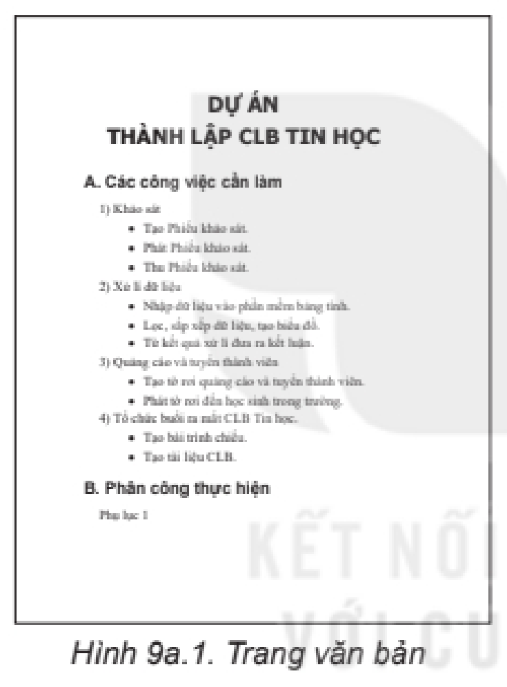
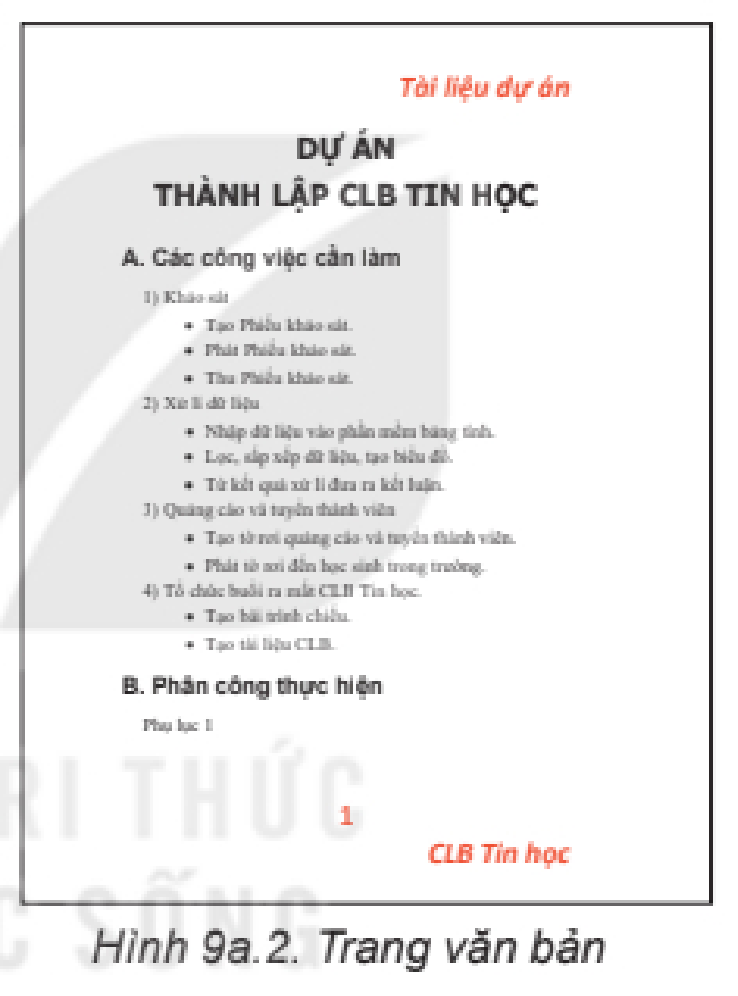
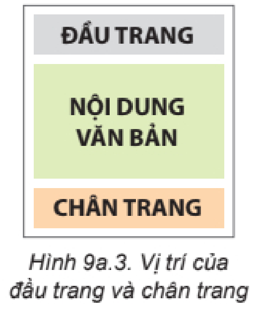
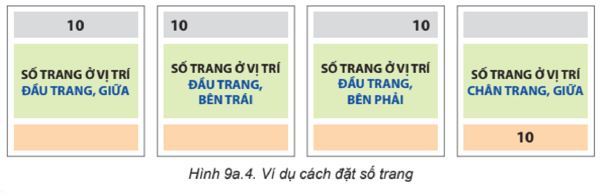
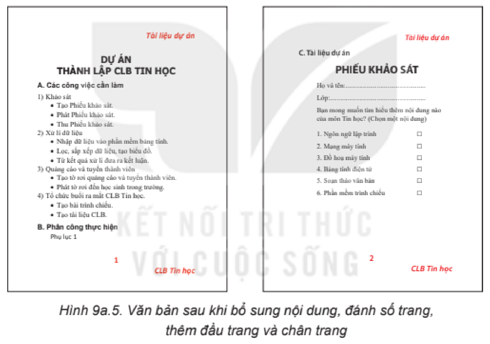
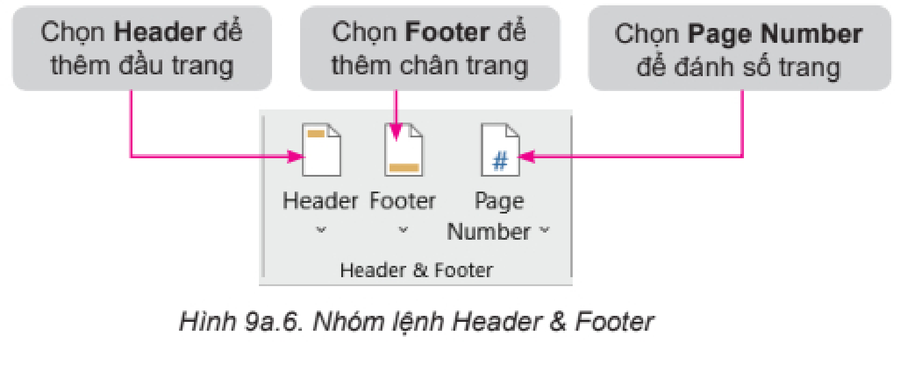
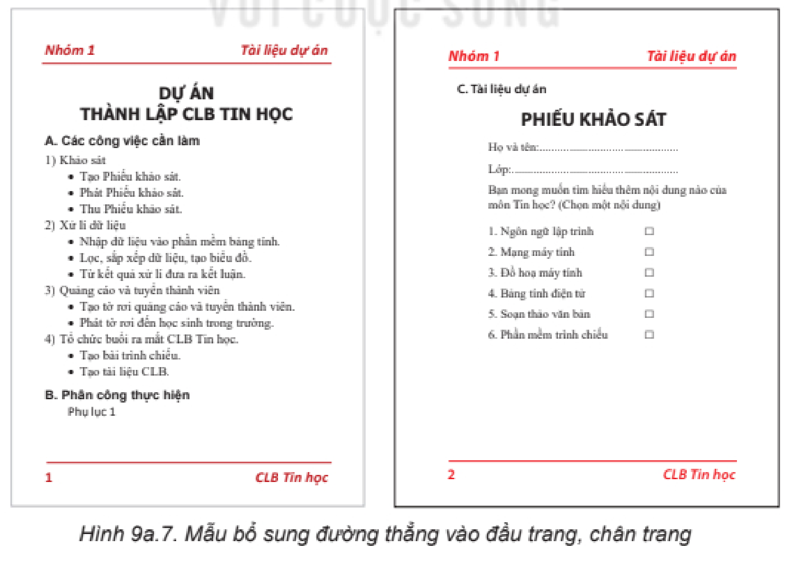

<!-- pdf:43 -->

# BÀI 9A: TẠO ĐẦU TRANG, CHÂN TRANG CHO VĂN BẢN

## 🎯 Sau bài học này em sẽ:

- Thực hiện được các thao tác: đánh số trang, thêm đầu trang và chân trang.
- Tạo được sản phẩm là văn bản có tính thẩm mĩ phục vụ nhu cầu thực tế.

## 🔴 Khởi động

> Em hãy quan sát Hình 9a.1, Hình 9a.2 và tìm ra những phần khác nhau trong hai trang văn bản. Trong các cuốn sách, truyện em đã đọc có các thành phần văn bản đó không? Tác dụng của chúng là gì?

*Hình 9a.1. Trang văn bản*

*Hình 9a.2. Trang văn bản*

## 1. ĐẦU TRANG VÀ CHÂN TRANG

> **Hoạt động 1: Đầu trang và chân trang cho em biết gì?**
>
> Trong trang văn bản ở Hình 9a.2, phần văn bản màu cam có nội dung “Tài liệu dự án” và “CLB Tin học” cho em biết điều gì?

<!-- term: Đầu trang, Chân trang -->
**Đầu trang** (Header) và **chân trang** (Footer) lần lượt là phần trên cùng (phần lề trên) và dưới cùng (phần lề dưới) của văn bản. Chúng là các phần riêng biệt với văn bản chính (Hình 9a.3) và thường được sử dụng để chứa chú thích, số trang, tên văn bản, tên tác giả,... Đầu trang và chân trang cũng có thể chứa hình ảnh hay hình đồ hoạ.

*Hình 9a.3. Vị trí của đầu trang và chân trang*

<!-- pdf:44 -->

Các thông tin đặt trong phần đầu trang và chân trang sẽ tự động xuất hiện ở tất cả các trang. Nhờ vậy, em có thể cố định một số thông tin cần xuyên suốt cả văn bản.

Thông tin ở đầu trang và chân trang cung cấp thông tin ngắn gọn về văn bản giúp phân loại, kiểm soát các trang trong văn bản. Ngoài ra thông tin ở đầu trang và chân trang còn giúp trang văn bản chuyên nghiệp và đẹp hơn nhờ cách sắp xếp thông tin hay các hình ảnh trang trí.

Ví dụ: Trang văn bản trong Hình 9a.2 có thông tin trong phần đầu trang và chân trang cho người đọc biết tên của văn bản là “Tài liệu dự án”, trang hiện tại là trang số “1” và văn bản thuộc về “CLB Tin học”.

<!-- term: Đầu trang, Chân trang -->
> **Đầu trang** và **chân trang** là phần riêng biệt với văn bản chính; thường chứa thông tin ngắn gọn; được tự động thêm vào tất cả các trang trong văn bản.

> ❓ **Câu hỏi**
>
> Em hãy chọn những phương án đúng trong các phương án sau:
>
> A. Đầu trang và chân trang là đoạn văn bản đầu tiên và cuối cùng trong một trang.
>
> B. Thông tin ở phần đầu trang và chân trang thường ngắn gọn và được tự động thêm vào tất cả các trang trong văn bản.
>
> C. Đầu trang và chân trang là văn bản hoặc hình ảnh được chèn vào lề trên và lề dưới.
>
> D. Không thể đưa hình ảnh vào đầu trang và chân trang.

## 2. ĐÁNH SỐ TRANG

> **Hoạt động 2: Số trang trong văn bản**
>
> Trong các cuốn sách giáo khoa, sách văn học, truyện mà em đọc, em có nhìn thấy số trang của sách không? Số trang sách thường nằm ở đâu?

<!-- term: Đánh số trang -->
Các tài liệu dạng văn bản, nhất là các văn bản dài thường đánh số trang để người đọc dễ theo dõi. Phần mềm soạn thảo văn bản có chức năng **đánh số trang** tự động cho văn bản. Số trang thường được đặt ở đầu trang hoặc chân trang. Em có thể lựa chọn đặt số trang ở vị trí bên trái, bên phải hoặc giữa.

*Hình 9a.4. Ví dụ cách đặt số trang*

<!-- term: Đánh số trang -->
> **Số trang** trong văn bản được đánh tự động và được đặt ở đầu trang hoặc chân trang.

<!-- pdf:45 -->

> ❓ **Câu hỏi**
>
> Em hãy chọn phương án **sai** trong các phương án sau:
>
> A. Đánh số trang giúp người đọc biết độ dài của văn bản (nhìn số trang cuối).
>
> B. Đánh số trang, cùng với mục lục, giúp người đọc dễ dàng tìm thấy các phần cụ thể của văn bản.
>
> C. Đánh số trang cho phép trích dẫn một trang cụ thể của văn bản.
>
> D. Phần mềm soạn thảo văn bản không có chức năng đánh số trang tự động.

## 3. THỰC HÀNH: ĐÁNH SỐ TRANG, THÊM ĐẦU TRANG VÀ CHÂN TRANG

**Nhiệm vụ**

Em hãy mở tệp `CLBTinhoc.docx` mà em đã tạo ở Bài 8a (phần Luyện tập), bổ sung thêm nội dung, đánh số trang, thêm đầu trang và chân trang cho văn bản theo mẫu trong Hình 9a.5.

*Hình 9a.5. Văn bản sau khi bổ sung nội dung, đánh số trang, thêm đầu trang và chân trang*

**Hướng dẫn**

– Mở tệp `CLBTinhoc.docx`.

– Chọn **Insert**, trong nhóm lệnh **Header & Footer**, nháy chuột chọn lệnh tương ứng theo hướng dẫn trong Hình 9a.6.

*Hình 9a.6. Nhóm lệnh Header & Footer*

<!-- pdf:46 -->

– Sau khi chọn **Page Number**, em chọn **Bottom of Page/Plain Number 2** để đánh số trang vào vị trí giữa, bên dưới trang văn bản.

– Sau khi chọn **Header**, em chọn **Blank** rồi nhập nội dung “Tài liệu dự án” vào ô `[Type here]`, căn phải và tạo chữ in nghiêng, màu cam.

– Sau khi chọn **Footer**, em chọn **Blank** rồi nhập nội dung “CLB Tin học” vào ô `[Type here]`, căn phải và tạo chữ in nghiêng, màu cam.

– Nháy chuột chọn lệnh **Close Header and Footer** để hoàn thành việc đánh số trang, thêm đầu trang và chân trang.

*Lưu ý:* Em có thể thay đổi vị trí, căn lề, thay đổi cỡ chữ, phông chữ, màu sắc,... cho phần văn bản mà em nhập vào đầu trang và chân trang. Cách làm giống như với văn bản trong phần nội dung.

– Lưu văn bản.

## ✏️ Luyện tập

Em hãy mở tệp `CLBTinhoc.docx` và thực hiện các yêu cầu sau đây:

a) Bổ sung thêm tên người hoặc tên nhóm thực hiện dự án vào đầu trang.

b) Đặt lại số trang vào vị trí bên trái của chân trang.

## 🚀 Vận dụng

Em hãy tìm hiểu cách thêm hình ảnh, hình đồ hoạ vào chân trang và đầu trang rồi bổ sung vào đầu trang và chân trang trong tệp `CLBTinhoc.docx` một đường thẳng theo mẫu như Hình 9a.7.

*Hình 9a.7. Mẫu bổ sung đường thẳng vào đầu trang, chân trang*

## 📷 Danh mục hình ảnh

| Mã hình | Trang PDF | Trang sách | Chú thích |
| --- | --- | --- | --- |
| H8-tin_hoc-b09a-01 | 43 | 42 | Hình 9a.1. Trang văn bản |
| H8-tin_hoc-b09a-02 | 43 | 42 | Hình 9a.2. Trang văn bản |
| H8-tin_hoc-b09a-03 | 43 | 42 | Hình 9a.3. Vị trí của đầu trang và chân trang |
| H8-tin_hoc-b09a-04 | 44 | 43 | Hình 9a.4. Ví dụ cách đặt số trang |
| H8-tin_hoc-b09a-05 | 45 | 44 | Hình 9a.5. Văn bản sau khi bổ sung nội dung, đánh số trang, thêm đầu trang và chân trang |
| H8-tin_hoc-b09a-06 | 45 | 44 | Hình 9a.6. Nhóm lệnh Header & Footer |
| H8-tin_hoc-b09a-07 | 46 | 45 | Hình 9a.7. Mẫu bổ sung đường thẳng vào đầu trang, chân trang |
