<!-- pdf:63 -->

# BÀI 9B: THAY ĐỔI KHUNG HÌNH, KÍCH THƯỚC ẢNH

## 🎯 Sau bài học này em sẽ:

- Biết các công cụ cắt, xoay, thay đổi kích thước ảnh.
- Thực hiện được thao tác: cắt, xoay, thay đổi kích thước ảnh.

## 🔴 Khởi động

> An chụp được một số hình ảnh hoạt động của trường và đang chọn lựa để đăng lên website của trường. Tuy nhiên, An nhận thấy một số bức ảnh cần được chỉnh sửa để có bố cục hợp lí hơn. Ngoài ra, An gặp khó khăn khi tải ảnh lên website do dung lượng tệp ảnh lớn.
>
> Theo em, có cách nào để giải quyết các vấn đề An gặp phải không?

## 1. CÔNG CỤ CẮT, XOAY, THAY ĐỔI KÍCH THƯỚC ẢNH

> **Hoạt động 1: Công cụ cắt, xoay, thay đổi kích thước ảnh**
>
> 1. Em hãy liệt kê một số trường hợp cần cắt, xoay, thay đổi kích thước ảnh. Công cụ nào của phần mềm chỉnh sửa ảnh giúp em làm điều đó?
> 2. Dung lượng của tệp có liên quan như thế nào đến kích thước ảnh?

### a) Cắt hình ảnh

<!-- term: Công cụ cắt ảnh (Crop) -->
Khi chụp ảnh, có thể có những đối tượng xuất hiện trong ảnh ngoài ý muốn của người chụp. Trong trường hợp đó, em cần sử dụng **công cụ cắt** (**Crop**) để loại bỏ những chi tiết không hợp lí, giúp cho bức ảnh có bố cục chặt hơn, thu hút sự chú ý của người xem vào chủ đề của bức ảnh.

### b) Xoay hình ảnh

<!-- term: Công cụ xoay ảnh (Rotate) -->
Trong thực tế, khi chụp ảnh, máy ảnh có thể bị nghiêng hoặc xoay không đúng hướng. Kết quả là ảnh chụp có thể bị lỗi hoặc không đúng ý định của người chụp. **Công cụ xoay** (**Rotate**) có thể giúp em khắc phục vấn đề bằng cách xoay hình ảnh theo góc xoay và tâm xoay tuỳ ý (Hình 9b.1).

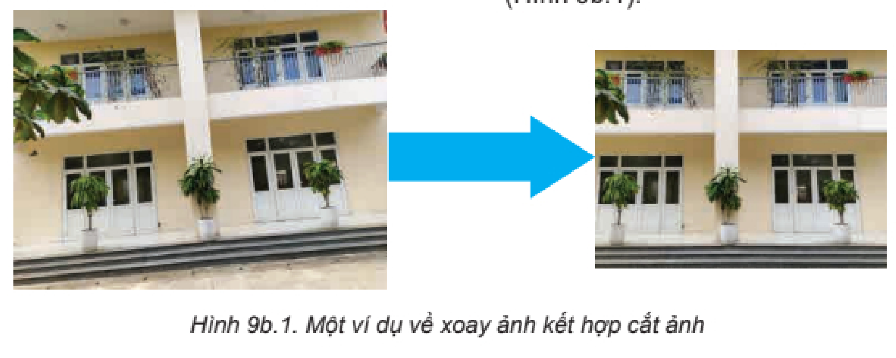

*Hình 9b.1. Một ví dụ về xoay ảnh kết hợp cắt ảnh*

<!-- pdf:64 -->

### c) Thay đổi kích thước hình ảnh

<!-- term: Công cụ thay đổi kích thước ảnh (Resize) -->
Mỗi hình ảnh đều có kích thước cụ thể, tuy nhiên em có thể thay đổi kích thước của chúng (Hình 9b.2). **Công cụ thay đổi kích thước** (**Resize**) giúp em tăng hoặc giảm kích thước hình ảnh. Một trong những ứng dụng của việc thay đổi kích thước ảnh là tăng hoặc giảm dung lượng của tệp ảnh khi muốn gửi dưới dạng tệp đính kèm thư điện tử hoặc tải lên mạng xã hội, website, diễn đàn,...

Tuy nhiên, với những hình ảnh gốc có kích thước nhỏ thì không nên thay đổi thành kích thước lớn hơn vì sẽ làm giảm chất lượng hình ảnh.

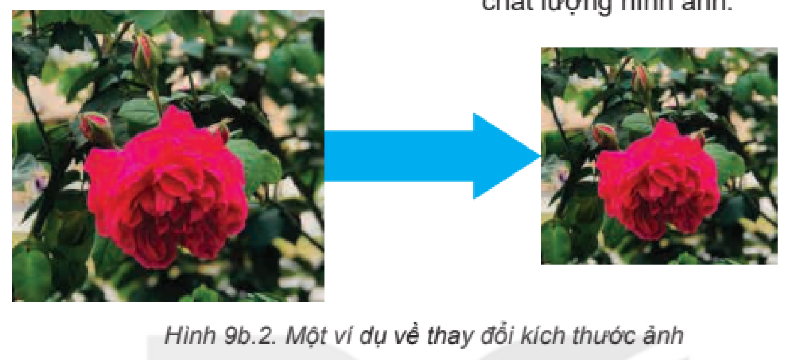

*Hình 9b.2. Một ví dụ về thay đổi kích thước ảnh*

> - **Công cụ Crop** giúp em loại bỏ các phần ảnh không hợp lí.
> - **Công cụ Resize** giúp em tăng hoặc giảm kích thước ảnh.
> - **Công cụ Rotate** giúp em xoay ảnh theo góc xoay và tâm xoay tuỳ ý.

> ❓ **Câu hỏi**
>
> Em hãy quan sát ảnh gốc ở Hình 9b.3 và các hình ảnh kết quả ở Hình 9b.4, Hình 9b.5, Hình 9b.6 và xác định các công cụ tương ứng (Crop, Resize, Rotate) đã dùng để chỉnh sửa.

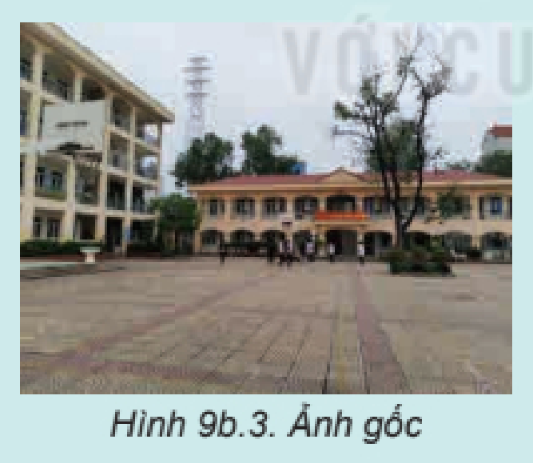

*Hình 9b.3. Ảnh gốc*

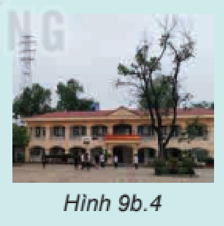

*Hình 9b.4*

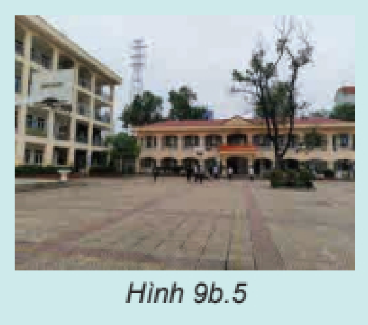

*Hình 9b.5*

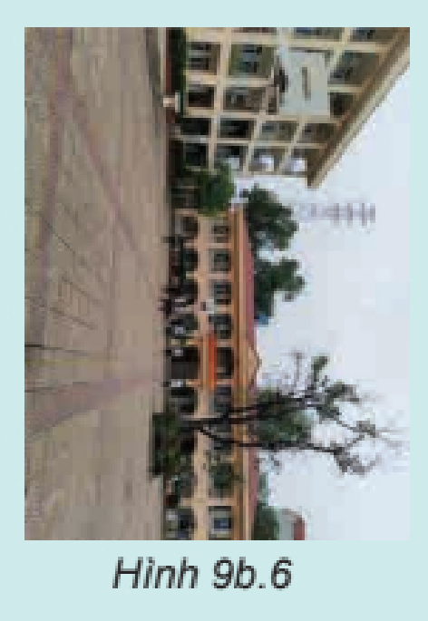

*Hình 9b.6*

<!-- pdf:65 -->

## 2. THỰC HÀNH: SỬ DỤNG MỘT SỐ CÔNG CỤ CHỈNH SỬA ẢNH

<!-- term: Thao tác cắt ảnh bằng công cụ Crop -->
**Nhiệm vụ 1:** Em hãy sử dụng phần mềm chỉnh sửa ảnh để cắt phần ảnh bị ngón tay che ở Hình 8b.1 trong Bài 8b.

**Hướng dẫn**

Em thực hiện các bước theo hướng dẫn trong Hình 9b.7. Nhấn phím **Enter** để hoàn thành. Lưu lại ảnh với tên tệp là `Anh_Crop.xcf`.

*Lưu ý:* Kéo thả chuột để tạo khung hình chữ nhật xác định vùng ảnh được giữ lại. Phần ảnh bị cắt bỏ là phần nằm ngoài khung hình chữ nhật và được làm tối đi. Nhấn phím **Esc** nếu muốn bỏ qua thao tác chọn.

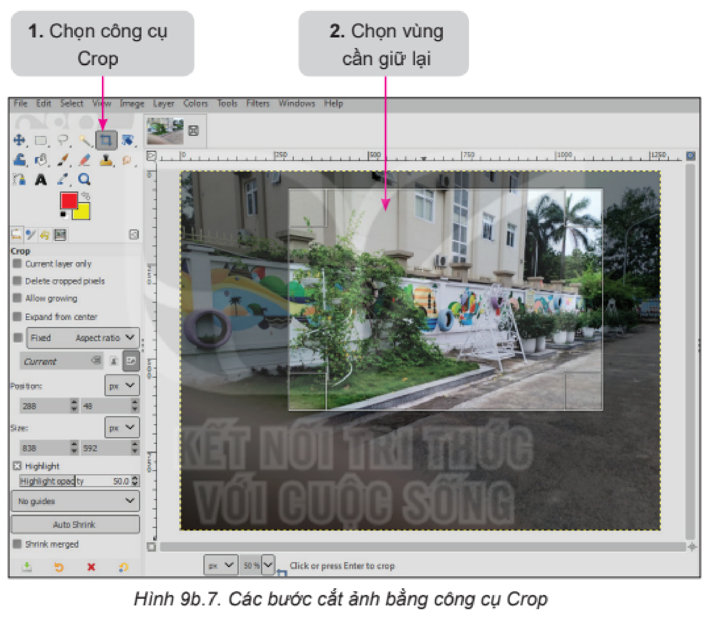

*Hình 9b.7. Các bước cắt ảnh bằng công cụ Crop*

<!-- term: Thao tác xoay ảnh bằng công cụ Rotate -->
**Nhiệm vụ 2:** Sử dụng phần mềm chỉnh sửa ảnh để thực hiện thao tác xoay hình ảnh.

**Hướng dẫn**

*Cách 1:* Chọn công cụ Rotate trong bảng công cụ rồi nhấn tổ hợp phím **Shift + R** để mở hộp thoại **Rotate** (hoặc chọn **Tools/Transform Tools/Rotate**). Hộp thoại **Rotate** xuất hiện cho phép em nhập vào góc xoay và tâm xoay của ảnh (Hình 9b.8). Chọn **Rotate** để hoàn thành việc xoay ảnh.

*Lưu ý:* Giá trị trong ô **Angle** có thể dương hoặc âm, tương ứng để xoay cùng chiều hay ngược chiều kim đồng hồ.

*Cách 2:* Xoay trực tiếp trên ảnh bằng cách kéo thả chuột để thay đổi góc xoay (Hình 9b.9), khi đó con trỏ chuột sẽ có dạng [biểu tượng con trỏ xoay].

<!-- pdf:66 -->

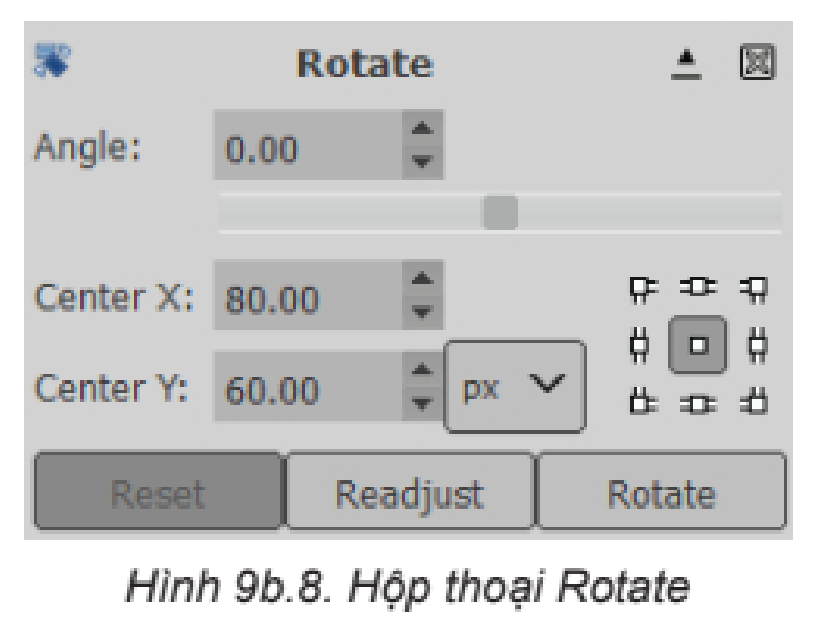

*Hình 9b.8. Hộp thoại Rotate*

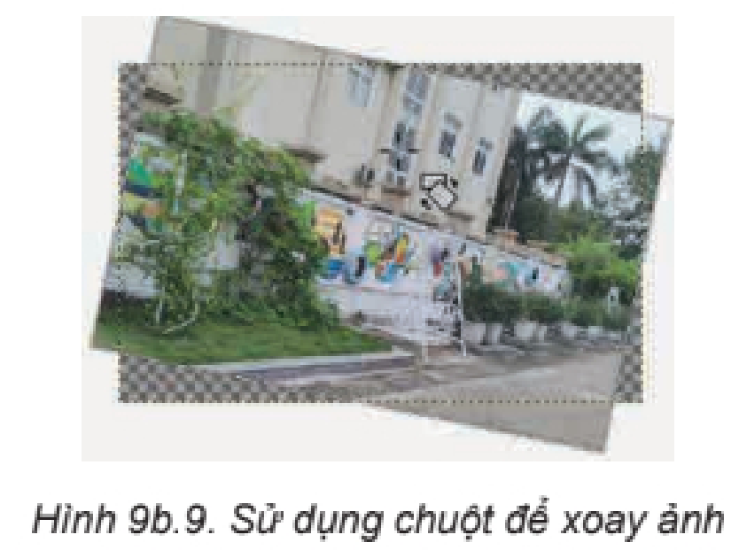

*Hình 9b.9. Sử dụng chuột để xoay ảnh*

<!-- term: Thao tác thay đổi kích thước ảnh bằng công cụ Scale -->
**Nhiệm vụ 3:** Sử dụng phần mềm chỉnh sửa ảnh để thực hiện thao tác thay đổi kích thước hình ảnh với chiều rộng là 500 pixel.

**Hướng dẫn**

- Chọn công cụ **Scale** trong bảng công cụ và nhấn tổ hợp phím **Shift + S** để mở hộp thoại **Scale** (hoặc chọn **Tools/Transform Tools/Scale**).
- Hộp thoại **Scale** xuất hiện (Hình 9b.10). Nhập kích thước ảnh mới với các thông số **Width** (chiều rộng), **Height** (chiều cao) và chọn **Scale**.

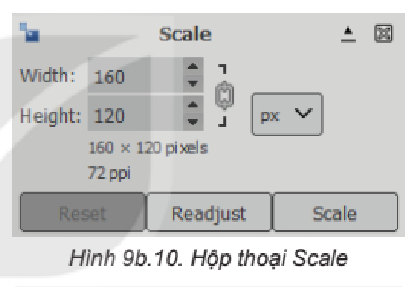

*Hình 9b.10. Hộp thoại Scale*

*Lưu ý:*

+ Nếu muốn giữ nguyên tỉ lệ khung hình ban đầu của ảnh thì em chọn [biểu tượng liên kết] và chỉ cần nhập kích thước chiều rộng, kích thước chiều cao sẽ được tự động điều chỉnh.
+ Nếu muốn điều chỉnh kích thước chiều rộng, chiều cao tuỳ ý, em chọn [biểu tượng ngắt liên kết].
+ Em có thể thay đổi kích thước ảnh trực tiếp bằng cách kéo thả các ô vuông xung quanh ảnh (Hình 9b.11).
+ Trong hộp thoại **Rotate** và **Scale**, chọn nút **Reset** khi em muốn đưa ảnh về lại vị trí và kích thước ban đầu.

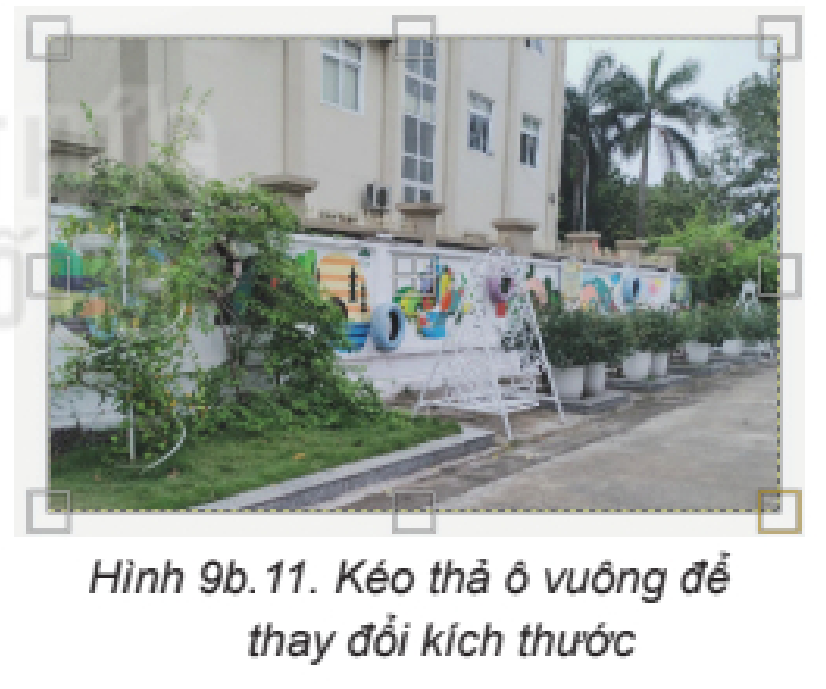

*Hình 9b.11. Kéo thả ô vuông để thay đổi kích thước*

## ✏️ Luyện tập

Em hãy sử dụng phần mềm GIMP để mở các tệp ảnh trong thư mục `HINHANH` đã lưu ở Bài 8b. Sử dụng các công cụ Crop, Rotate, Scale để chỉnh sửa những điểm em thấy chưa đẹp (loại bỏ các phần không cần thiết, điều chỉnh hướng ảnh,...).

## 🚀 Vận dụng

Em hãy sử dụng phần mềm chỉnh sửa ảnh để mở các tệp ảnh về chủ đề yêu thích mà em đã lưu ở phần Vận dụng, Bài 8b. Sử dụng các công cụ Crop, Rotate, Scale để chỉnh sửa những điểm cần thiết để có được các hình ảnh mới đẹp hơn.

## 📷 Danh sách hình trong bài

| Mã hình | Trang PDF | Trang sách | Chú thích |
| --- | --- | --- | --- |
| H8-tin_hoc-b09b-01 | 63 | 62 | Hình 9b.1. Một ví dụ về xoay ảnh kết hợp cắt ảnh |
| H8-tin_hoc-b09b-02 | 64 | 63 | Hình 9b.2. Một ví dụ về thay đổi kích thước ảnh |
| H8-tin_hoc-b09b-03 | 64 | 63 | Hình 9b.3. Ảnh gốc |
| H8-tin_hoc-b09b-04 | 64 | 63 | Hình 9b.4 |
| H8-tin_hoc-b09b-05 | 64 | 63 | Hình 9b.5 |
| H8-tin_hoc-b09b-06 | 64 | 63 | Hình 9b.6 |
| H8-tin_hoc-b09b-07 | 65 | 64 | Hình 9b.7. Các bước cắt ảnh bằng công cụ Crop |
| H8-tin_hoc-b09b-08 | 66 | 65 | Hình 9b.8. Hộp thoại Rotate |
| H8-tin_hoc-b09b-09 | 66 | 65 | Hình 9b.9. Sử dụng chuột để xoay ảnh |
| H8-tin_hoc-b09b-10 | 66 | 65 | Hình 9b.10. Hộp thoại Scale |
| H8-tin_hoc-b09b-11 | 66 | 65 | Hình 9b.11. Kéo thả ô vuông để thay đổi kích thước |
