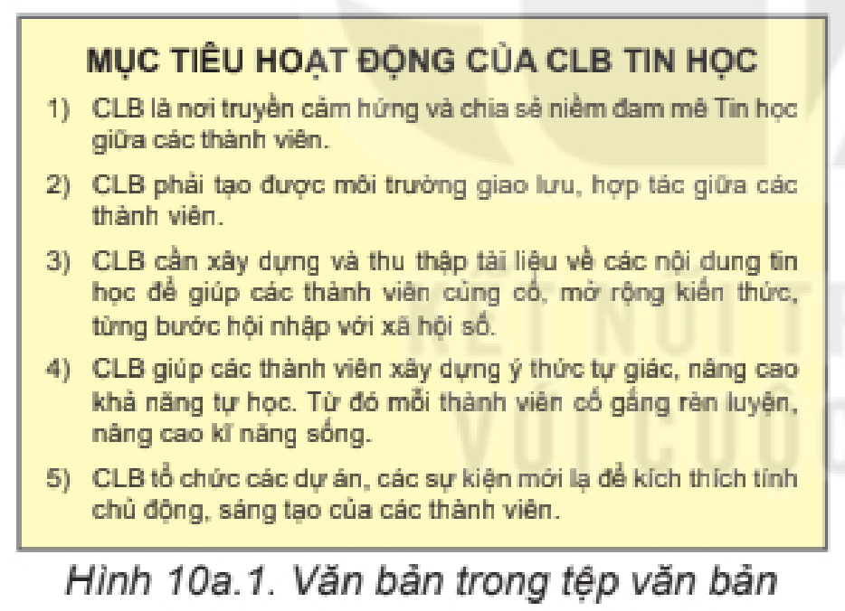
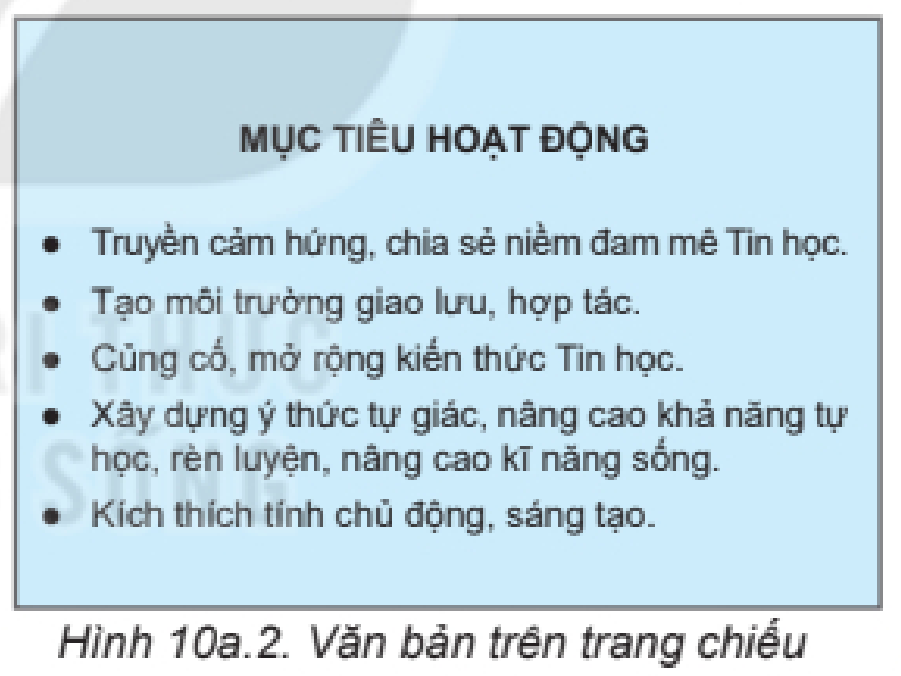
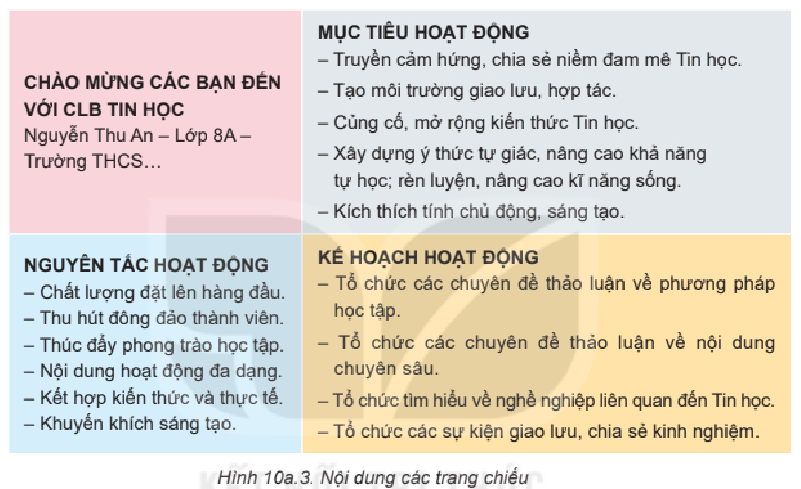
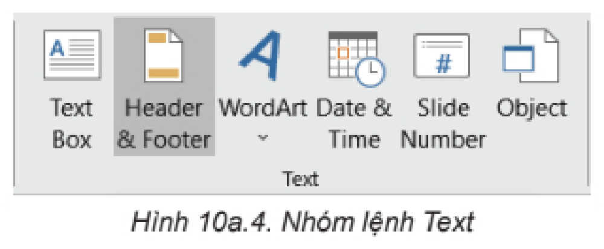
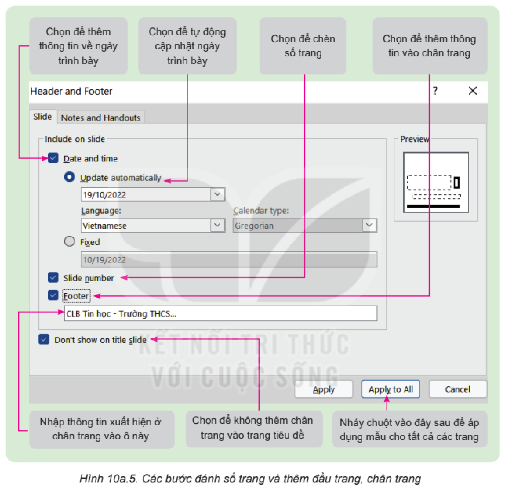
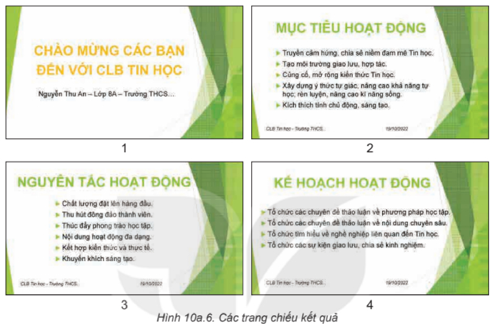

<!-- pdf:47 -->

# BÀI 10A: ĐỊNH DẠNG NÂNG CAO CHO TRANG CHIẾU

## 🎯 Sau bài học này em sẽ:

- Chọn đặt được màu sắc, cỡ chữ hài hoà và hợp lí với nội dung.
- Thực hiện được thao tác đánh số trang, thêm đầu trang và chân trang.

## 🔴 Khởi động

> Bạn An được giao nhiệm vụ tạo bài trình chiếu để trình chiếu trong lễ ra mắt CLB Tin học. Với mục tiêu ngắn gọn, ấn tượng, sáng tạo,... theo em bạn An cần chú ý đến những điều gì khi tạo bài trình chiếu?

## 1. VĂN BẢN VÀ MÀU SẮC TRÊN TRANG CHIẾU

> **Hoạt động 1: Đặc điểm của văn bản trên trang chiếu**
>
> Em hãy quan sát Hình 10a.1 (nội dung tài liệu mô tả dự án Thành lập CLB Tin học), Hình 10a.2 (nội dung trang chiếu) và trả lời các câu hỏi sau:
>
> 1. Văn bản ở hình nào chi tiết, đầy đủ hơn? Văn bản ở hình nào ngắn gọn hơn?
> 2. Văn bản trên trang chiếu có cần viết đầy đủ các thành phần của câu không?

*Hình 10a.1. Văn bản trong tệp văn bản*

*Hình 10a.2. Văn bản trên trang chiếu*

<!-- term: Văn bản và màu sắc trên trang chiếu -->
Khác với văn bản trong tài liệu thông thường, **văn bản trên trang chiếu** có đặc điểm là ngắn gọn, chỉ nêu ý chính, không nêu chi tiết,... Văn bản trên trang chiếu góp phần quan trọng vào việc tạo ấn tượng, thu hút sự quan tâm, giúp người nghe nhanh chóng tiếp nhận được nội dung tóm tắt của trang trình chiếu,...

Màu sắc đóng vai trò quan trọng trong việc thiết kế một bài trình chiếu. Một bài trình chiếu đẹp, chuyên nghiệp là sự phối hợp hoàn hảo của nội dung, bố cục và màu sắc. Do đó, màu sắc phù hợp sẽ làm cho bài trình chiếu trở nên sinh động, bắt mắt, tác động trực tiếp đến cảm tình của người xem.

Trong Bài 12 sách Tin học 7 em đã được biết cách định dạng phông chữ, cỡ chữ, kiểu chữ,... Để chọn đặt được màu sắc cho bài trình chiếu, ngoài những kiến thức cơ bản về màu sắc, cách phối màu,... em cần chú ý một số điểm sau:

- Các màu nóng như đỏ, da cam, vàng,... mang lại cảm giác ấm áp, giúp người xem phấn chấn, hoạt bát, năng nổ.

<!-- pdf:48 -->

- Các màu lạnh như xanh, tím,... mang lại cảm giác lạnh, giúp người xem bình tĩnh, hiền hoà, lắng dịu.
- Các màu trung tính như trắng, đen, be,... mang lại cảm giác lịch sự, nhẹ nhàng.
- Màu sắc chủ đạo nên đặt sao cho hài hoà với nội dung. Ví dụ, bài trình chiếu về chủ đề giải trí, lễ hội,... nên dùng gam màu nóng; chủ đề giáo dục, học tập nên dùng gam màu trung tính; chủ đề về nghệ thuật, hay các bài trình chiếu muốn mang lại ấn tượng mạnh, các bài trình chiếu trong các sự kiện tri ân có thể dùng gam màu lạnh.
- Nên kết hợp các màu cùng nhóm với nhau. Ví dụ: màu nóng như đỏ, cam, vàng có thể kết hợp với màu nâu. Màu lạnh như xanh dương, xanh lục có thể đi cùng với màu xám.
- Không sử dụng quá nhiều màu trên một trang chiếu (bao gồm cả màu nền, màu chữ,...).
- Nên chọn màu văn bản có độ tương phản cao với màu nền.

Phần mềm trình chiếu cung cấp các công cụ giúp em chọn đặt được màu sắc, cỡ chữ hài hoà, hợp lí với nội dung. Nhờ các chức năng này, em có thể tạo được các trang chiếu ấn tượng, đem lại hiệu quả cao trong việc truyền đạt nội dung trình chiếu.

<!-- term: Định dạng văn bản trên trang chiếu -->
> - **Văn bản trên trang chiếu** cần được định dạng sao cho màu sắc, cỡ chữ hài hoà, hợp lí với nội dung.
> - Văn bản được định dạng phù hợp giúp đem lại hiệu quả cao trong việc truyền đạt nội dung trình chiếu.

> ❓ **Câu hỏi**
>
> Em hãy chọn phương án đúng:
>
> A. Văn bản trên trang chiếu cần ngắn gọn, súc tích.
>
> B. Văn bản trên trang chiếu càng chi tiết, đầy đủ càng tốt.
>
> C. Sử dụng càng nhiều màu sắc cho văn bản trên trang chiếu càng giúp người nghe tập trung.
>
> D. Sử dụng nhiều loại phông chữ cho văn bản trên trang chiếu sẽ thu hút được sự chú ý của người nghe.

## 2. SỐ TRANG, ĐẦU TRANG VÀ CHÂN TRANG

> **Hoạt động 2: Các thông tin cần thiết của bài trình chiếu**
>
> Theo em, các trang chiếu có cần đánh số không? Có cần thêm các thông tin vào đầu trang và chân trang không? Vì sao?

<!-- term: Số trang, đầu trang và chân trang trên trang chiếu -->
Giống như phần mềm soạn thảo văn bản, phần mềm trình chiếu cũng cho phép em thêm **đầu trang**, **chân trang** và **đánh số thứ tự** cho các trang trong bài trình chiếu. Đó là thông tin xuất hiện ở đầu và cuối của tất cả các trang chiếu. Thông tin này thường bao gồm tên người trình chiếu, tên công ti, tiêu đề bài trình chiếu, số trang hay thời gian trình chiếu,...

> Có thể đánh số trang, thêm đầu trang, chân trang vào các trang chiếu.

<!-- pdf:49 -->

## 3. THỰC HÀNH: TẠO BÀI TRÌNH CHIẾU CHO LỄ RA MẮT CLB TIN HỌC

**Nhiệm vụ**

Em hãy tạo một bài trình chiếu mới, nhập nội dung cho bốn trang chiếu theo mẫu trong Hình 10a.3 rồi thực hiện các yêu cầu sau:

– Định dạng văn bản trên trang chiếu, đặt màu sắc, cỡ chữ hài hoà và hợp lí với nội dung.

– Đánh số trang, thêm đầu trang và chân trang.

*Hình 10a.3. Nội dung các trang chiếu*

**Hướng dẫn**

*(Hướng dẫn sau đây sử dụng phần mềm trình chiếu Microsoft PowerPoint phiên bản 2016 để minh hoạ.)*

### a) Khởi động phần mềm và nhập nội dung

– Khởi động phần mềm.

– Trang chiếu đầu tiên là trang tiêu đề, em chọn mẫu **Title Slide**. Ba trang tiếp theo chọn mẫu **Title and Content**. Nhập nội dung văn bản theo mẫu ở Hình 10a.3.

### b) Định dạng văn bản

– Trang 1: Dòng tiêu đề đặt phông Arial, cỡ 60, màu đỏ, in đậm, căn giữa.

– Trang 2, 3, 4: Tiêu đề trang đặt phông Arial, cỡ 54, màu đỏ, in đậm, căn giữa; Nội dung văn bản đặt phông Arial, cỡ 32, màu đen, chữ thường, căn trái, tạo danh sách dấu đầu dòng.

– Thay đổi vị trí các hộp văn bản để bố cục cân đối.

### c) Đánh số trang, thêm đầu trang và chân trang

– Chọn **Insert**, trong nhóm lệnh **Text** em chọn lệnh **Header & Footer** hoặc **Slide Number** (Hình 10a.4) để mở cửa sổ **Header and Footer** và thực hiện các bước theo hướng dẫn như Hình 10a.5.

<!-- pdf:50 -->

*Hình 10a.4. Nhóm lệnh Text*

*Hình 10a.5. Các bước đánh số trang và thêm đầu trang, chân trang*

*Lưu ý:*

– Em có thể định dạng cho số trang và thông tin trong phần đầu trang, chân trang giống như định dạng văn bản trên trang chiếu.

– Phần mềm trình chiếu còn hỗ trợ em in nội dung bài trình chiếu ra giấy (Handouts) để phát cho người nghe. Em cũng có thể thêm đầu trang, chân trang vào tài liệu in trên giấy để giúp người nghe dễ dàng theo dõi bằng cách nháy chuột chọn **Notes and Handouts** trong cửa sổ **Header and Footer** rồi nhập thông tin tương tự như hướng dẫn ở Hình 10a.5.

– Ở chế độ **Slide** (Hình 10a.5), em không thêm được đầu trang. Chỉ ở chế độ **Notes and Handouts** phần mềm PowerPoint mới có chức năng thêm đầu trang.

<!-- pdf:51 -->

– Cách tạo danh sách dấu đầu dòng trong phần mềm trình chiếu tương tự như trong phần mềm soạn thảo văn bản.

### d) Hoàn thiện bài trình chiếu và lưu tệp

– Áp dụng một mẫu định dạng cho bài trình chiếu. Ví dụ kết quả như Hình 10a.6.

*Hình 10a.6. Các trang chiếu kết quả*

– Chọn **File/Save** để lưu tệp với tên `LeRaMatCLBTinhoc.pptx`.
<!-- ocr-ok: đối chiếu ảnh trang PDF 51; OCR đọc nhầm "File/Save" và phần mở rộng tệp LeRaMatCLBTinhoc.pptx -->

## ✏️ Luyện tập

Em hãy chọn phương án **sai** trong các phương án sau:

A. Đầu trang và chân trang có thể được định dạng phông chữ, cỡ chữ, màu chữ khác nhau.

B. Có thể bỏ phần đầu trang và chân trang khỏi trang chiếu tiêu đề.

C. Có thể tự động cập nhật thời gian vào thông tin ở đầu trang và chân trang.

D. Những thông tin lựa chọn và nhập vào cửa sổ Header & Footer được tự động áp dụng cho tất cả các trang chiếu trong bài trình chiếu.

## 🚀 Vận dụng

Em hãy tạo bài trình chiếu giới thiệu một nội dung Tin học mà em chọn (ví dụ: giới thiệu một ngôn ngữ lập trình, giới thiệu về bảng tính điện tử,...) để trình chiếu trong buổi sinh hoạt CLB Tin học của trường. Hãy vận dụng kiến thức và kĩ năng đã biết để chọn đặt màu sắc, định dạng văn bản, trình bày các trang chiếu hài hoà, hợp lí với nội dung; đánh số trang, thêm đầu trang, chân trang;...

## 📷 Danh mục hình ảnh

| Mã hình | Trang PDF | Trang sách | Chú thích |
| --- | --- | --- | --- |
| H8-tin_hoc-b10a-01 | 47 | 46 | Hình 10a.1. Văn bản trong tệp văn bản |
| H8-tin_hoc-b10a-02 | 47 | 46 | Hình 10a.2. Văn bản trên trang chiếu |
| H8-tin_hoc-b10a-03 | 49 | 48 | Hình 10a.3. Nội dung các trang chiếu |
| H8-tin_hoc-b10a-04 | 50 | 49 | Hình 10a.4. Nhóm lệnh Text |
| H8-tin_hoc-b10a-05 | 50 | 49 | Hình 10a.5. Các bước đánh số trang và thêm đầu trang, chân trang |
| H8-tin_hoc-b10a-06 | 51 | 50 | Hình 10a.6. Các trang chiếu kết quả |
