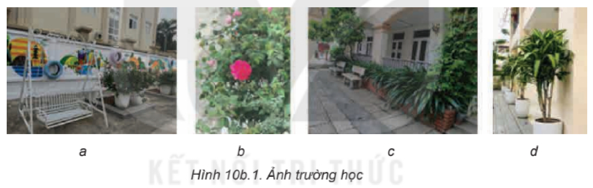
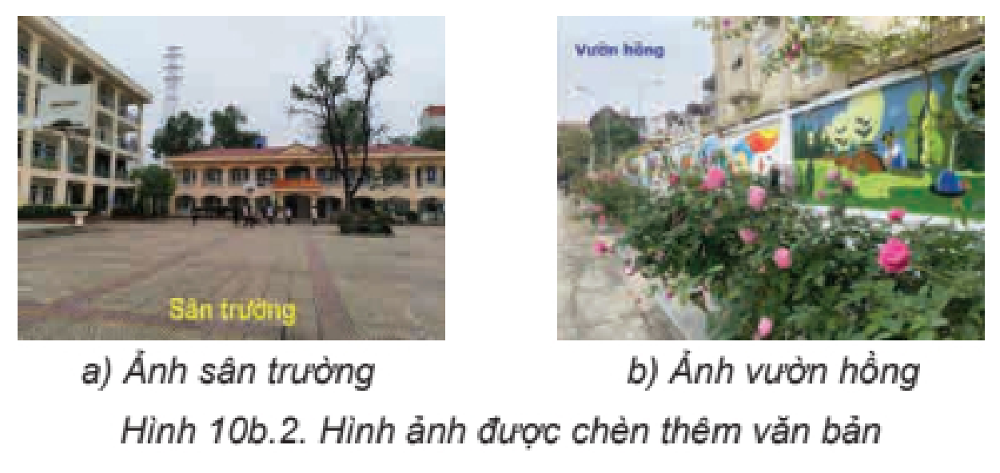
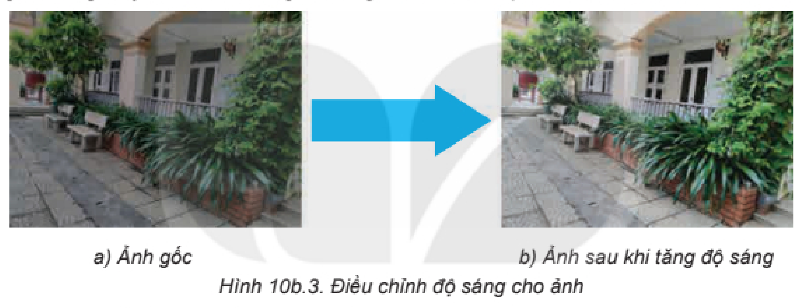
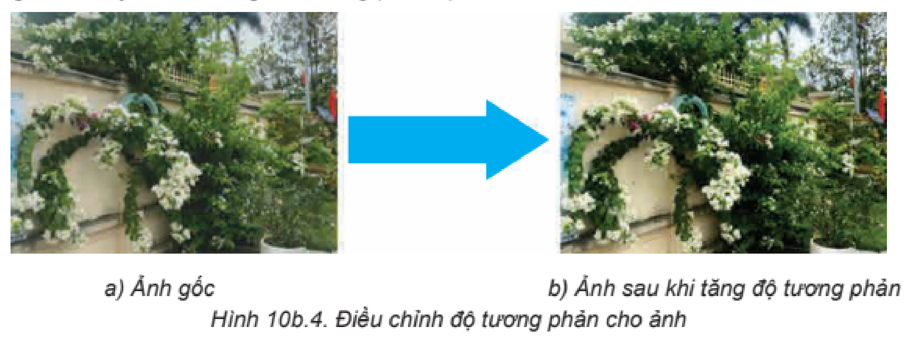
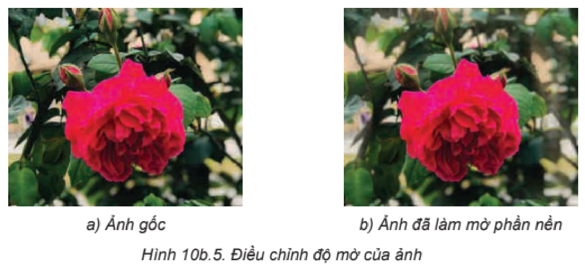
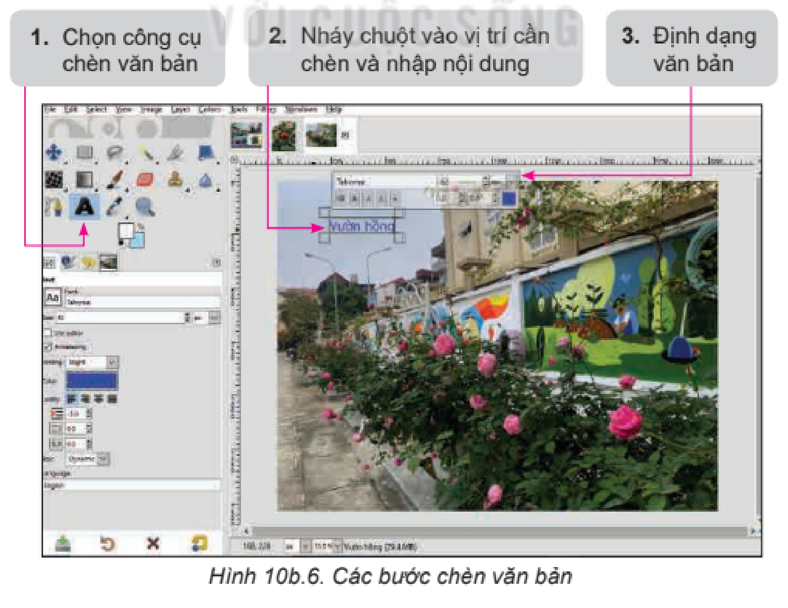
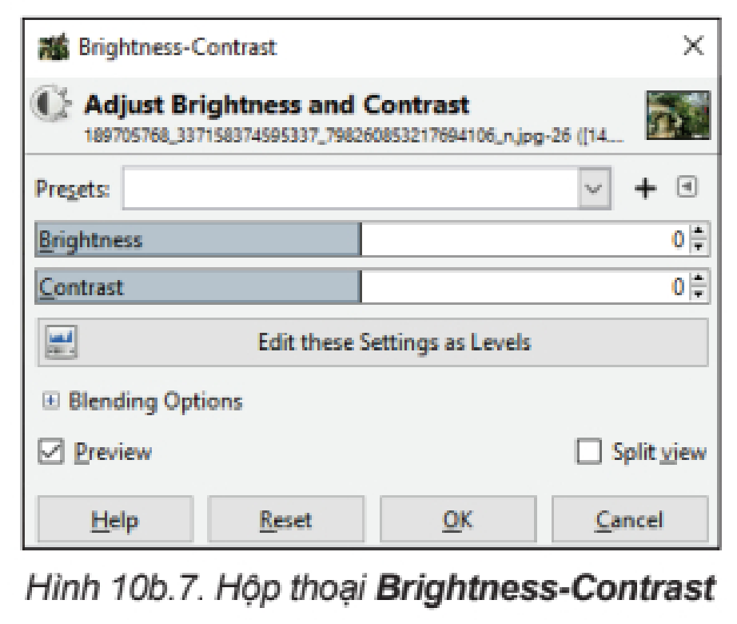
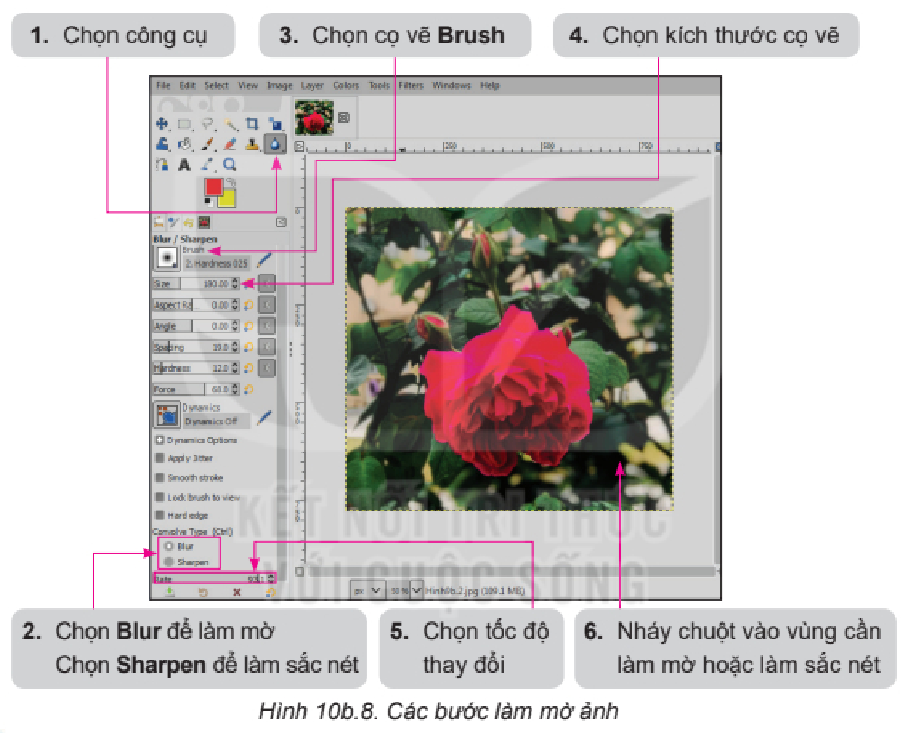

<!-- pdf:67 -->

# BÀI 10B: THÊM VĂN BẢN, TẠO HIỆU ỨNG CHO ẢNH

## 🎯 Sau bài học này em sẽ:

- Thực hiện được các thao tác xử lí ảnh: thêm văn bản, điều chỉnh độ sáng, độ tương phản, làm mờ, làm sắc nét.

## 🔴 Khởi động

> *An:* Minh ơi, cậu xem một vài bức ảnh tớ chụp trường mình này. Tớ muốn chỉnh sửa các ảnh đó và thêm chú thích từng khu vực trong trường vào ảnh để gửi cho bạn học cùng trường tiểu học. Cậu có biết công cụ nào của phần mềm chỉnh sửa ảnh làm được điều đó không?
>
> *Minh:* Có chứ. Tớ thấy một số ảnh cậu chụp bị tối, cần tăng độ sáng lên và chỉnh thêm về màu sắc ảnh nữa thì sẽ đẹp đấy.

*Hình 10b.1. Ảnh trường học*

## 1. THÊM VĂN BẢN

> **Hoạt động 1: Thêm văn bản vào ảnh**
>
> 1. Em hãy nêu tác dụng của việc chèn thêm văn bản vào ảnh.
> 2. Công cụ nào của phần mềm chỉnh sửa ảnh giúp em làm điều đó?

<!-- term: Chèn văn bản vào ảnh -->
Chèn thêm văn bản vào ảnh là cách để ghi chú, gửi gắm thông điệp... giúp bức ảnh trở nên độc đáo, sinh động, cuốn hút hơn. Em có thể chèn và đặt văn bản vào vị trí bất kì trong ảnh. Em cũng có thể định dạng cho văn bản như: thay đổi kiểu chữ, cỡ chữ, màu chữ,...

*Hình 10b.2. Hình ảnh được chèn thêm văn bản*

<!-- pdf:68 -->

## 2. TẠO HIỆU ỨNG CHO ẢNH

> **Hoạt động 2: Độ sáng của hình ảnh**
>
> 1. Em hãy quan sát các bức ảnh ở Hình 10b.1 và cho nhận xét về độ sáng của mỗi ảnh.
> 2. Theo em có thể thay đổi độ sáng của ảnh không?

Hình ảnh được chụp từ máy ảnh kĩ thuật số không phải lúc nào cũng hoàn hảo. Đôi khi hình ảnh có thể trông quá sáng hoặc quá tối. Điều này có thể do một số yếu tố gây ra, bao gồm ánh sáng nơi chụp ảnh và cách đặt các thông số của máy ảnh. Em có thể khắc phục vấn đề này bằng cách điều chỉnh độ sáng và độ tương phản của hình ảnh.

### a) Độ sáng của ảnh (Brightness)

<!-- term: Độ sáng của ảnh (Brightness) -->
**Điều chỉnh độ sáng** là thay đổi mức độ sáng và tối tổng thể của ảnh. Nếu ảnh quá tối có thể thử tăng độ sáng. Tuy nhiên, việc tăng độ sáng cho một ảnh quá tối có thể tạo ra nhiễu cho ảnh.

*Hình 10b.3. Điều chỉnh độ sáng cho ảnh*

### b) Độ tương phản (Contrast)

<!-- term: Độ tương phản (Contrast) -->
**Tăng độ tương phản** là thao tác làm cho sự khác biệt giữa vùng sáng và vùng tối của hình ảnh dễ nhận thấy hơn. Nói cách khác là làm cho các phần tối tối hơn và các phần sáng sáng hơn. Tuy nhiên, tăng độ tương phản quá nhiều có thể dẫn đến mất chi tiết hình ảnh.

*Hình 10b.4. Điều chỉnh độ tương phản cho ảnh*

### c) Độ mờ, độ sắc nét (Blur, Sharpen)

<!-- term: Công cụ làm mờ, làm sắc nét (Blur, Sharpen) -->
Phần mềm xử lí ảnh cung cấp **công cụ làm mờ, làm sắc nét ảnh**. Em có thể sử dụng để làm mờ một vùng quá nổi bật trong ảnh, làm sắc nét riêng một đối tượng hoặc làm mờ nền xung quanh ảnh để làm nổi bật chủ thể bức ảnh. Tuy nhiên, việc thêm quá nhiều độ mờ, độ sắc nét có thể làm cho hình ảnh trông xấu hơn hoặc dẫn đến mất chi tiết của ảnh.

<!-- pdf:69 -->

*Hình 10b.5. Điều chỉnh độ mờ của ảnh*

> Phần mềm xử lí ảnh cung cấp các công cụ để chèn thêm văn bản, điều chỉnh độ sáng, tối, độ tương phản, làm mờ, làm sắc nét,... cho ảnh.

> ❓ **Câu hỏi**
>
> Em hãy chọn các phương án đúng:
>
> A. Có thể thay đổi phông chữ cho văn bản chèn vào ảnh.
>
> B. Có thể tăng hoặc giảm độ sáng của ảnh.
>
> C. Tăng độ tương phản cho ảnh là làm cho phần tối sáng hơn, phần sáng tối hơn.
>
> D. Có thể làm mờ, làm sắc nét riêng từng đối tượng trong ảnh.

## 3. THỰC HÀNH: CHỈNH SỬA ẢNH

<!-- term: Thao tác chèn văn bản trong GIMP -->
**Nhiệm vụ 1:** Chèn dòng chữ “Vườn hồng” vào ảnh như Hình 10b.2b.

**Hướng dẫn:** Em thực hiện các bước như hướng dẫn trong Hình 10b.6.

*Hình 10b.6. Các bước chèn văn bản*

<!-- pdf:70 -->

<!-- term: Hộp thoại Brightness-Contrast -->
**Nhiệm vụ 2:** Chỉnh sửa độ sáng, độ tương phản cho ảnh ở Hình 10b.5a.

**Hướng dẫn:** Chọn **Colors/Brightness-Contrast...** để mở hộp thoại **Brightness-Contrast...** (Hình 10b.7). Trong hộp thoại em kéo thả chuột để điều chỉnh độ sáng, độ tương phản theo ý muốn. Chọn **OK** để hoàn thành.

*Hình 10b.7. Hộp thoại Brightness-Contrast*

<!-- term: Thao tác làm mờ, làm sắc nét bằng Blur / Sharpen -->
**Nhiệm vụ 3:** Làm mờ nền xung quanh bông hoa trong Hình 10b.5a.

**Hướng dẫn:** Thực hiện theo các bước như Hình 10b.8.

*Hình 10b.8. Các bước làm mờ ảnh*

## ✏️ Luyện tập

Em hãy sử dụng phần mềm GIMP để mở các tệp ảnh trong thư mục `HINHANH` đã lưu ở Bài 9b. Sử dụng các công cụ tạo hiệu ứng cho ảnh để điều chỉnh độ sáng, độ tương phản, làm mờ,... bổ sung văn bản vào ảnh (nếu cần) để có được những bức ảnh đẹp giới thiệu về ngôi trường của em.

## 🚀 Vận dụng

Em hãy sử dụng phần mềm chỉnh sửa ảnh để mở các tệp ảnh trong thư mục đã lưu ở phần Vận dụng, Bài 9b. Sử dụng các công cụ tạo hiệu ứng cho ảnh để điều chỉnh độ sáng, độ tương phản, làm mờ,... bổ sung văn bản vào ảnh (nếu cần) để có được những bức ảnh đẹp giới thiệu về chủ đề mà em yêu thích.

## 📷 Danh sách hình trong bài

| Mã hình | Trang PDF | Trang sách | Chú thích |
| --- | --- | --- | --- |
| H8-tin_hoc-b10b-01 | 67 | 66 | Hình 10b.1. Ảnh trường học |
| H8-tin_hoc-b10b-02 | 67 | 66 | Hình 10b.2. Hình ảnh được chèn thêm văn bản |
| H8-tin_hoc-b10b-03 | 68 | 67 | Hình 10b.3. Điều chỉnh độ sáng cho ảnh |
| H8-tin_hoc-b10b-04 | 68 | 67 | Hình 10b.4. Điều chỉnh độ tương phản cho ảnh |
| H8-tin_hoc-b10b-05 | 69 | 68 | Hình 10b.5. Điều chỉnh độ mờ của ảnh |
| H8-tin_hoc-b10b-06 | 69 | 68 | Hình 10b.6. Các bước chèn văn bản |
| H8-tin_hoc-b10b-07 | 70 | 69 | Hình 10b.7. Hộp thoại Brightness-Contrast |
| H8-tin_hoc-b10b-08 | 70 | 69 | Hình 10b.8. Các bước làm mờ ảnh |
