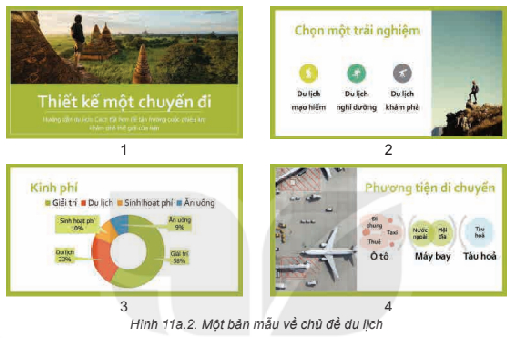
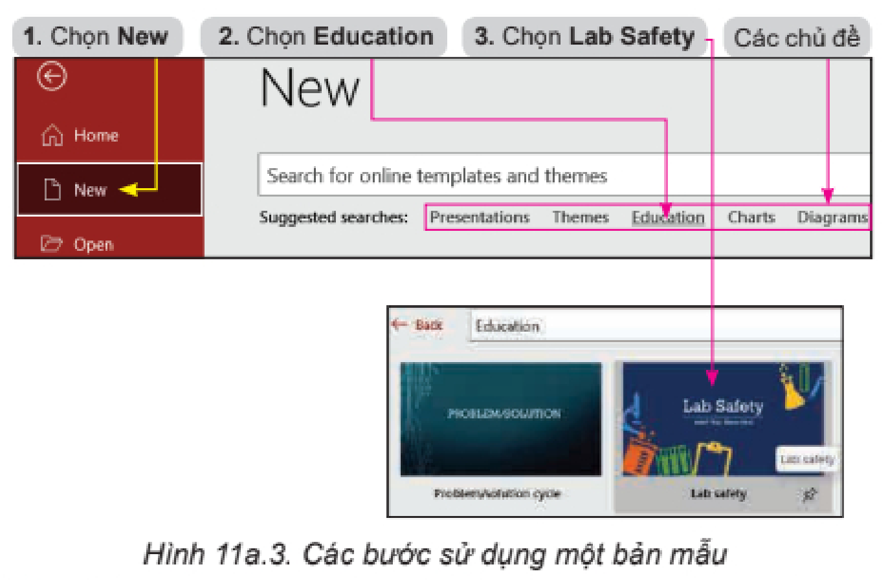
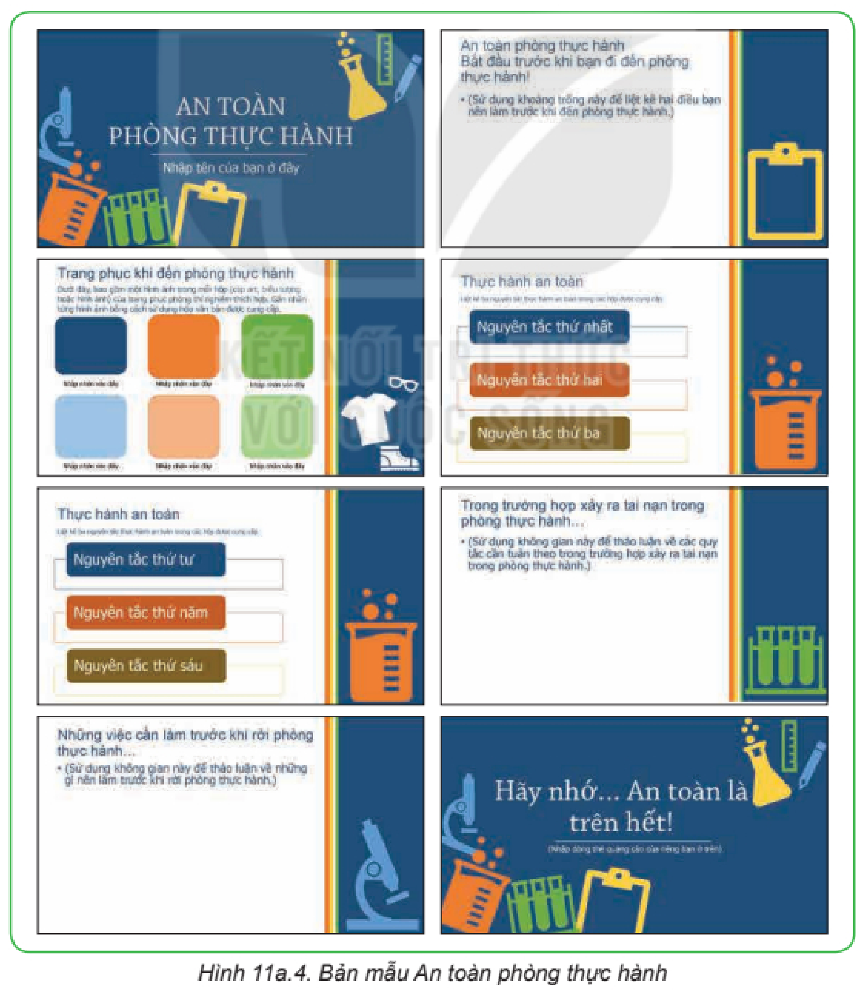
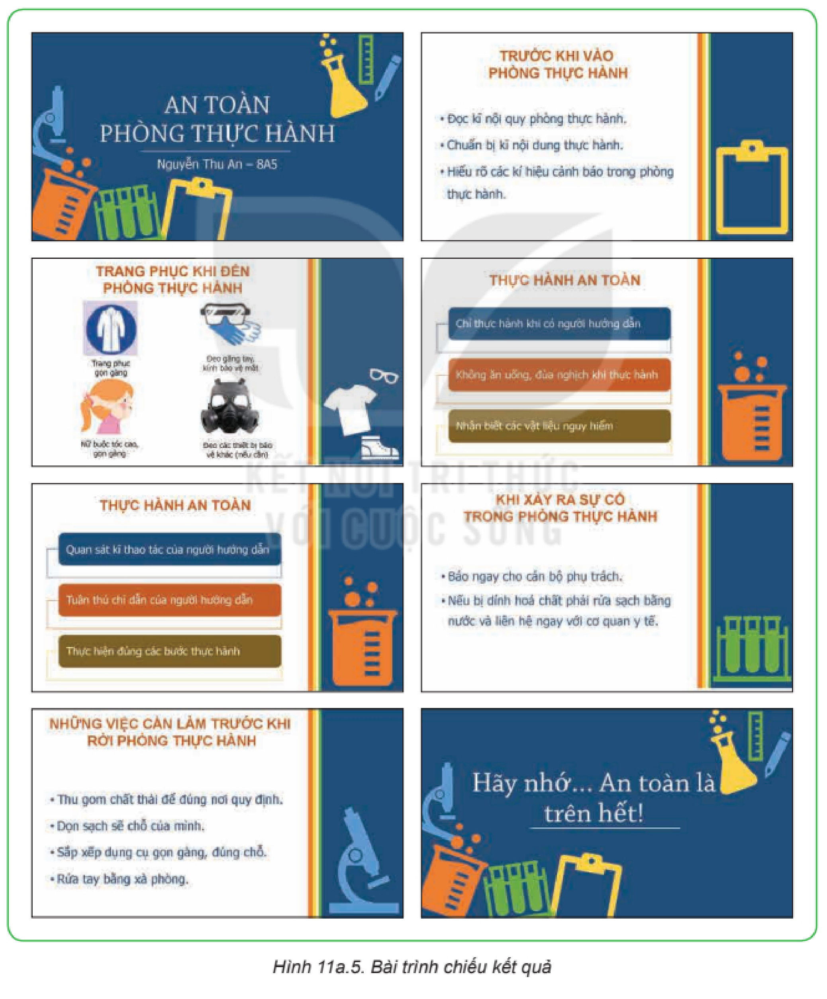
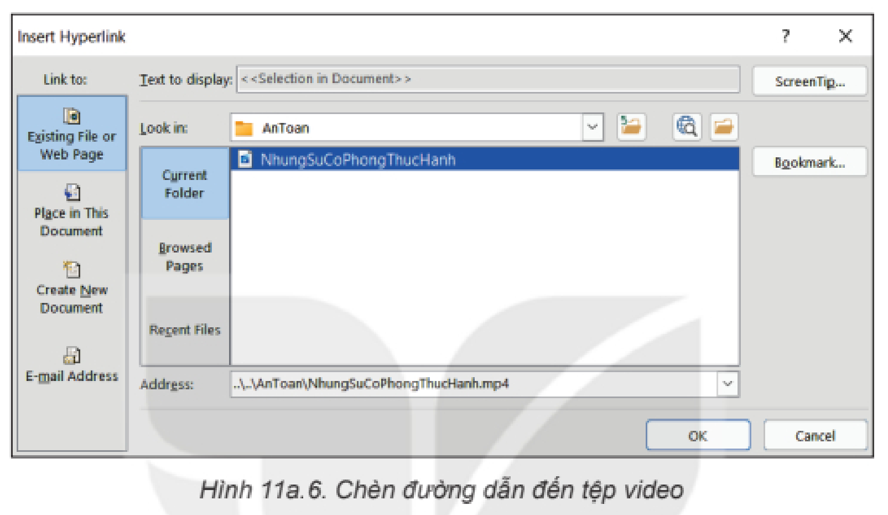

<!-- pdf:52 -->

# BÀI 11A: SỬ DỤNG BẢN MẪU TẠO BÀI TRÌNH CHIẾU

## 🎯 Sau bài học này em sẽ:

- Sử dụng được các bản mẫu (template).
- Đưa được vào trong trang chiếu đường dẫn đến video hay tài liệu khác.
- Tạo được các sản phẩm số phục vụ học tập, giao lưu và trao đổi thông tin.

## 🔴 Khởi động

> Em hãy quan sát hai trang chiếu trong Hình 11a.1, so sánh hai trang chiếu này với trang chiếu số 1 em đã tạo ở phần thực hành Bài 10a và đưa ra nhận xét.

*Hình 11a.1. Các mẫu trang chiếu*

## 1. BẢN MẪU TRONG PHẦN MỀM TRÌNH CHIẾU

> **Hoạt động 1: Làm thế nào để có thể tạo được bài trình chiếu đẹp, chuyên nghiệp?**
>
> Em hãy trả lời các câu hỏi sau:
>
> 1. Sử dụng phần mềm trình chiếu có tạo được các trang chiếu như Hình 11a.1 không?
> 2. Để tạo được các trang chiếu đó có cần nhiều thời gian không?
> 3. Làm thế nào để tạo được các trang chiếu đó?

<!-- term: Mẫu định dạng, Bản mẫu -->
Ở chương trình Tin học lớp 7, em đã biết cách áp dụng các **mẫu định dạng** (Themes) cho bài trình chiếu của mình. Mẫu định dạng là một tập hợp màu sắc, phông chữ và hiệu ứng hình ảnh được xác định trước giúp bài trình chiếu có một giao diện thống nhất, chuyên nghiệp.

Nâng cao hơn, phần mềm trình chiếu còn cung cấp các **bản mẫu** (Template) có sẵn. Bản mẫu là một bản thiết kế của một hoặc một nhóm các trang chiếu được lưu dưới dạng một tệp có phần mở rộng là `.potx`. Bản mẫu chứa bố cục, màu sắc, phông chữ, hiệu ứng, kiểu nền và cả nội dung. Em có thể sử dụng các bản mẫu có sẵn, có thể tạo các bản mẫu tuỳ chỉnh của riêng mình rồi lưu trữ, tái sử dụng và chia sẻ chúng với những người khác.

<!-- pdf:53 -->

Bản mẫu thường được thiết kế để dùng cho một mục đích, một chủ đề cụ thể (ví dụ như bài trình bày về một chuyến du lịch, một dự án kinh doanh, một bài học trên lớp,...). Vì vậy, ngoài các yếu tố thiết kế về giao diện (màu sắc, phông chữ, hình nền, hiệu ứng) thì các nội dung gợi ý đi kèm trong bản mẫu cũng khá có ích cho em khi tạo bài trình chiếu của mình.

Hình 11a.2 là ví dụ một bản mẫu về chủ đề du lịch. Bản mẫu đã thiết kế sẵn giao diện các trang chiếu và gợi ý các chủ đề nên có trong bài.

*Hình 11a.2. Một bản mẫu về chủ đề du lịch*

<!-- term: Bản mẫu -->
> - **Bản mẫu** chứa bố cục, màu sắc, phông chữ, hiệu ứng, kiểu nền,... và cả nội dung.
> - Bản mẫu giúp bài trình chiếu có giao diện thống nhất, chuyên nghiệp mà không tốn thời gian.
> - Bản mẫu giúp gợi ý các nội dung cần có cho bài trình chiếu.
> - Có thể chỉnh sửa, chia sẻ, tái sử dụng bản mẫu.

> ❓ **Câu hỏi**
>
> Em hãy cho biết bản mẫu khác với mẫu định dạng thế nào?

## 2. THỰC HÀNH: TẠO SẢN PHẨM SỐ PHỤC VỤ HỌC TẬP, GIAO LƯU VÀ TRAO ĐỔI THÔNG TIN

**Nhiệm vụ**

Em hãy tạo một bài trình chiếu về chủ đề An toàn trong phòng thực hành (phòng thực hành Tin học, thực hành Khoa học tự nhiên,...) với các yêu cầu sau:

a) Sử dụng một bản mẫu có sẵn cho bài trình chiếu.

b) Chỉnh sửa một vài thông số của bản mẫu để phù hợp hơn với nội dung.

c) Đưa vào trang tiêu đề đường dẫn đến một video (hay tài liệu khác).

<!-- pdf:54 -->

**Hướng dẫn**

### a) Sử dụng một bản mẫu có sẵn cho bài trình chiếu

– Chọn **File/New** để tạo một bài trình chiếu mới. Phần mềm trình chiếu sẽ đưa ra các bản mẫu có sẵn được sắp xếp theo các chủ đề để em lựa chọn. Em chọn **Education** và chọn bản mẫu có tên **Lab Safety** (Hình 11a.3).

*Hình 11a.3. Các bước sử dụng một bản mẫu*

– Nội dung trong bản mẫu viết bằng tiếng Anh. Em có thể sử dụng các công cụ dịch từ tiếng Anh sang tiếng Việt để hỗ trợ trong việc hiểu nội dung.

– Bản mẫu **Lab Safety** có nội dung tương tự như Hình 11a.4.

*Hình 11a.4. Bản mẫu An toàn phòng thực hành*

<!-- pdf:55 -->

– Bản mẫu đưa ra các gợi ý rõ ràng về các nội dung cần có cho một bài trình chiếu với chủ đề An toàn phòng thực hành. Bên cạnh đó còn hướng dẫn chi tiết cách nhập nội dung, cách trình bày và sắp xếp. Em nhập nội dung bài trình chiếu theo hướng dẫn để hoàn thành bài trình chiếu.

### b) Chỉnh sửa bản mẫu để phù hợp với nội dung

– Em có thể thay đổi phông chữ, cỡ chữ, màu nền, thêm hoặc bớt trang chiếu để phù hợp với nội dung trình chiếu.

– Kết quả bài trình chiếu có thể tương tự như Hình 11a.5.

*Hình 11a.5. Bài trình chiếu kết quả*

<!-- pdf:56 -->

### c) Đưa vào trang tiêu đề đường dẫn đến một video

<!-- term: Chèn đường dẫn (siêu liên kết) vào trang chiếu -->
Giả sử em muốn giới thiệu một video (có tên `NhungSuCoPhongThucHanh.mp4`) có nội dung cảnh báo về các tai nạn có thể xảy ra trong phòng thực hành. Em có thể đưa đường dẫn đến tệp video đó vào trang tiêu đề để mở trong khi trình chiếu. Cách làm như sau:

– Chèn vào trang chiếu một hình ảnh minh hoạ để đặt liên kết (hoặc chọn luôn hình ảnh chiếc bình màu vàng có sẵn trên trang chiếu).

– Nháy chuột chọn hình ảnh minh hoạ, chọn **Insert/Links/Link**. Trong cửa sổ **Insert Hyperlink**, chọn đường dẫn đến tệp `NhungSuCoPhongThucHanh.mp4` (Hình 11a.6).

*Hình 11a.6. Chèn đường dẫn đến tệp video*

### d) Lưu tệp

– Chọn **File/Save** để lưu tệp với tên `AnToanPhongThucHanh.pptx`.

## ✏️ Luyện tập

1. Phương án nào sau đây mô tả các bước sử dụng bản mẫu?

A. Nháy chuột chọn Design/Themes, chọn bản mẫu.

B. Nháy chuột chọn Design/Variants, chọn bản mẫu.

C. Nháy chuột chọn Insert/Text, chọn bản mẫu.

D. Nháy chuột chọn File/New, chọn bản mẫu.

2. Em hãy thêm vào trang chiếu tiêu đề của tệp trình chiếu `AnToanPhongThucHanh.pptx` đường dẫn đến tệp văn bản lưu trữ các kí hiệu cảnh báo trong phòng thực hành để có thể mở ra giới thiệu cho người nghe trong khi trình chiếu.

## 🚀 Vận dụng

Em hãy tìm một bản mẫu (có sẵn trong phần mềm trình chiếu hoặc được chia sẻ trên mạng) và sử dụng để tạo lại bài trình chiếu trong tệp `LeRaMatCLBTinhoc.pptx`. Thực hiện thay đổi các định dạng cần thiết để tạo một bản mẫu phù hợp với bài trình chiếu. Ghi lại tệp trình chiếu dưới dạng bản mẫu, tên tệp có dạng `.potx` để tái sử dụng và chia sẻ khi cần.

## 📷 Danh mục hình ảnh

| Mã hình | Trang PDF | Trang sách | Chú thích |
| --- | --- | --- | --- |
| H8-tin_hoc-b11a-01 | 52 | 51 | Hình 11a.1. Các mẫu trang chiếu |
| H8-tin_hoc-b11a-02 | 53 | 52 | Hình 11a.2. Một bản mẫu về chủ đề du lịch |
| H8-tin_hoc-b11a-03 | 54 | 53 | Hình 11a.3. Các bước sử dụng một bản mẫu |
| H8-tin_hoc-b11a-04 | 54 | 53 | Hình 11a.4. Bản mẫu An toàn phòng thực hành |
| H8-tin_hoc-b11a-05 | 55 | 54 | Hình 11a.5. Bài trình chiếu kết quả |
| H8-tin_hoc-b11a-06 | 56 | 55 | Hình 11a.6. Chèn đường dẫn đến tệp video |
