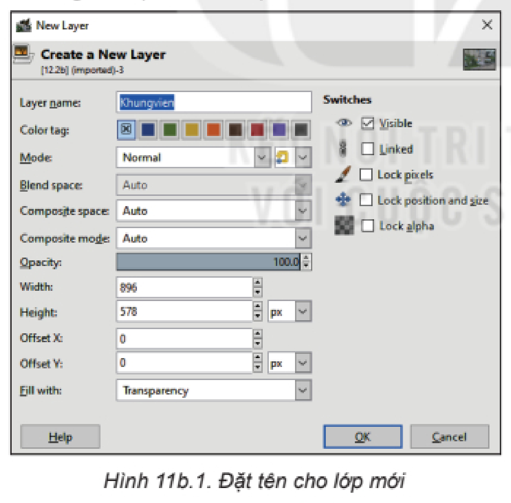
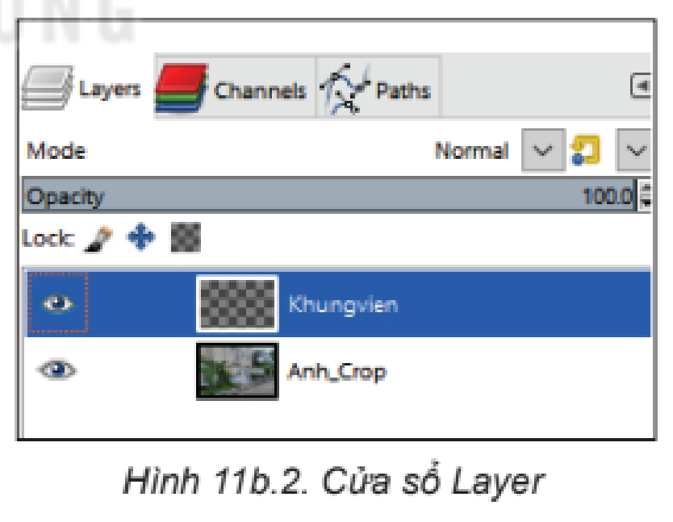
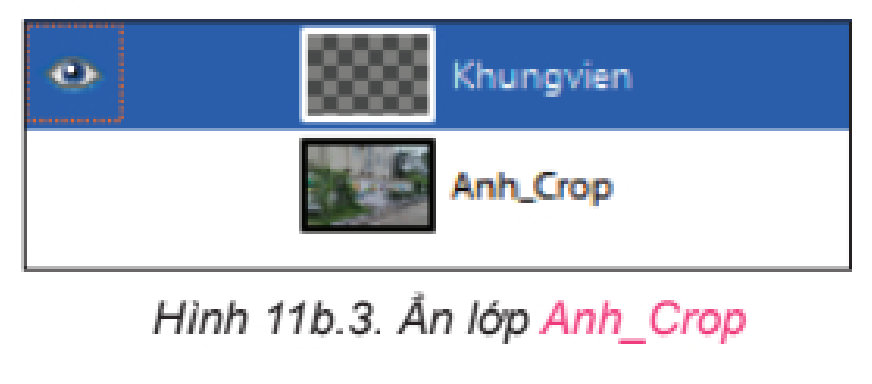
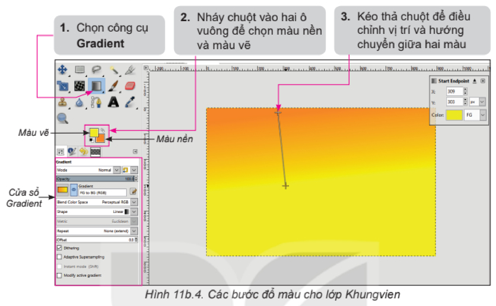
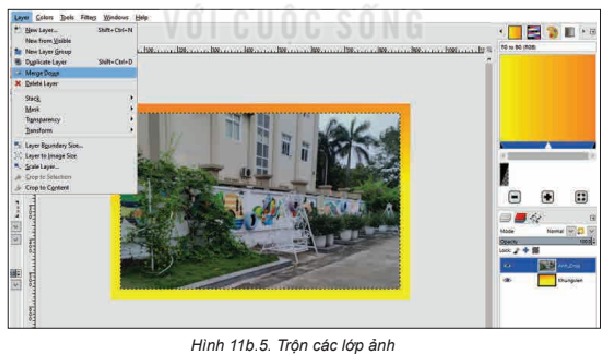

<!-- pdf:71 -->

# BÀI 11B: THỰC HÀNH TỔNG HỢP

**NHIỆM VỤ**

Từ các kết quả thực hành trong Bài 8b, Bài 9b, Bài 10b, em hãy tập hợp, bổ sung và chỉnh sửa ảnh để tạo một **tờ rơi** giới thiệu về trường của các bạn An, Minh, Khoa.

**HƯỚNG DẪN**

*Bước 1.* Tập hợp nội dung

Sau các phần thực hành ở các bài học trước, em đã có sản phẩm là các ảnh đã được chỉnh sửa bố cục, màu sắc, hiệu ứng hợp lí. Hãy thu thập khoảng 4 đến 6 ảnh và đưa vào một thư mục.

*Bước 2.* Tạo khung viền cho ảnh

- Mở tệp `Anh_Crop.xcf` mà em đã lưu ở phần thực hành của Bài 9b.

<!-- term: Tạo lớp mới (New Layer) -->
- Tạo một lớp mới bằng cách chọn **Layer/New Layer**, nhập tên cho lớp này là **Khungvien** (Hình 11b.1). Chọn **OK** để hoàn thành. Trên cửa sổ **Layer** sẽ xuất hiện thêm lớp **Khungvien** (Hình 11b.2).

*Hình 11b.1. Đặt tên cho lớp mới*

*Hình 11b.2. Cửa sổ Layer*
<!-- ocr-ok: đã đối chiếu ảnh trang PDF 71, OCR đọc nhầm "Hình ... Cửa sổ" thành "Hinh ... Cửa số" -->

- Nháy chuột vào biểu tượng [biểu tượng con mắt] bên cạnh lớp `Anh_Crop` để ẩn nội dung ảnh. Kết quả như Hình 11b.3.

*Hình 11b.3. Ẩn lớp Anh_Crop*

<!-- pdf:72 -->

<!-- term: Công cụ đổ màu chuyển sắc (Gradient) -->
- Sử dụng **công cụ Gradient** để đổ màu (chuyển dần giữa màu nền và màu vẽ) cho lớp `Khungvien`. Thực hiện các bước như hướng dẫn trong Hình 11b.4.

*Hình 11b.4. Các bước đổ màu cho lớp Khungvien*

*Lưu ý:* Em có thể điều chỉnh và chọn các thông số trong cửa sổ Gradient: Chọn chế độ đổ màu (**mode**), chọn mật độ màu (**Opacity**), chọn chuyển màu lặp lại nhiều lần hay chỉ một lần (**Repeat**),...

<!-- term: Trộn lớp ảnh (Merge Down) -->
- Chuyển lớp `Khungvien` xuống dưới lớp ảnh bằng cách nháy chuột vào lớp `Khungvien` trong cửa sổ `Layers` rồi kéo thả xuống vị trí bên dưới lớp `Anh_Crop`. Chọn lớp `Anh_Crop`, chọn công cụ **Scale** giảm kích thước lớp ảnh (nhỏ hơn kích thước lớp `Khungvien`). Trộn các lớp thành một lớp bằng cách chọn lớp trên cùng rồi chọn **Layer/Merge Down**.

*Hình 11b.5. Trộn các lớp ảnh*

- Chọn **File/Export As** để ghi kết quả vào tệp ảnh với tên `Anh1.jpg`.
- Thực hiện các bước tương tự để tạo khung viền cho các ảnh còn lại.

<!-- pdf:73 -->

*Bước 3.* Ghép ảnh vào tờ rơi, thêm văn bản

- Chọn một ảnh làm nền tờ rơi.

<!-- term: Mở ảnh thành lớp (Open as Layers) -->
- Chèn các ảnh đã tạo khung viền vào ảnh nền bằng cách chọn **File/Open as Layers** để mở hộp thoại, chọn ảnh và nhấn phím **Enter** để hoàn thành. Mỗi ảnh được chèn vào sẽ là một lớp.
- Dùng công cụ **Move** để di chuyển ảnh mới chèn đến vị trí mong muốn trên ảnh nền.
- Dùng công cụ **Scale** để chỉnh lại kích thước cho từng ảnh.
- Dùng công cụ **Text** để thêm văn bản vào tờ rơi.
- Dùng công cụ **Rotate** để xoay ảnh.

*Bước 4.* Hoàn thiện và lưu sản phẩm

- Dùng các công cụ đã học để tăng độ sáng, tối, tương phản,... nếu cần.
- Chọn **File/Export As** để ghi lại ảnh với tên `SchoolTour.jpg`.
- Sản phẩm có thể như Hình 11b.6.

*Hình 11b.6. Tờ rơi giới thiệu về trường*

## ✏️ Luyện tập

Em hãy sử dụng phần mềm GIMP và những tệp ảnh trong thư mục `HINHANH` mà em đã chỉnh sửa trong các phần Luyện tập ở các bài trước để tạo thành một tờ rơi giới thiệu về ngôi trường của em.

## 🚀 Vận dụng

Từ các hình ảnh về chủ đề mà em yêu thích đã được chỉnh sửa, hãy sử dụng các phần mềm ứng dụng đã biết (phần mềm chỉnh sửa ảnh, phần mềm soạn thảo văn bản, phần mềm trình chiếu, phần mềm sơ đồ tư duy,...) để tạo một **sản phẩm số** đơn giản (ví dụ một cuốn sách ảnh, một bài trình chiếu,...).

## 📷 Danh sách hình trong bài

| Mã hình | Trang PDF | Trang sách | Chú thích |
| --- | --- | --- | --- |
| H8-tin_hoc-b11b-01 | 71 | 70 | Hình 11b.1. Đặt tên cho lớp mới |
| H8-tin_hoc-b11b-02 | 71 | 70 | Hình 11b.2. Cửa sổ Layer |
| H8-tin_hoc-b11b-03 | 71 | 70 | Hình 11b.3. Ẩn lớp Anh_Crop |
| H8-tin_hoc-b11b-04 | 72 | 71 | Hình 11b.4. Các bước đổ màu cho lớp Khungvien |
| H8-tin_hoc-b11b-05 | 72 | 71 | Hình 11b.5. Trộn các lớp ảnh |
| H8-tin_hoc-b11b-06 | 73 | 72 | Hình 11b.6. Tờ rơi giới thiệu về trường |
