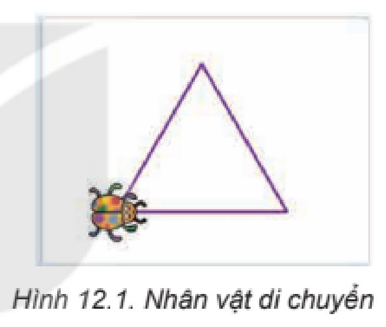
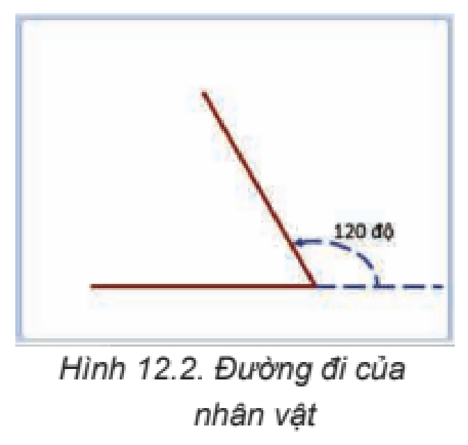
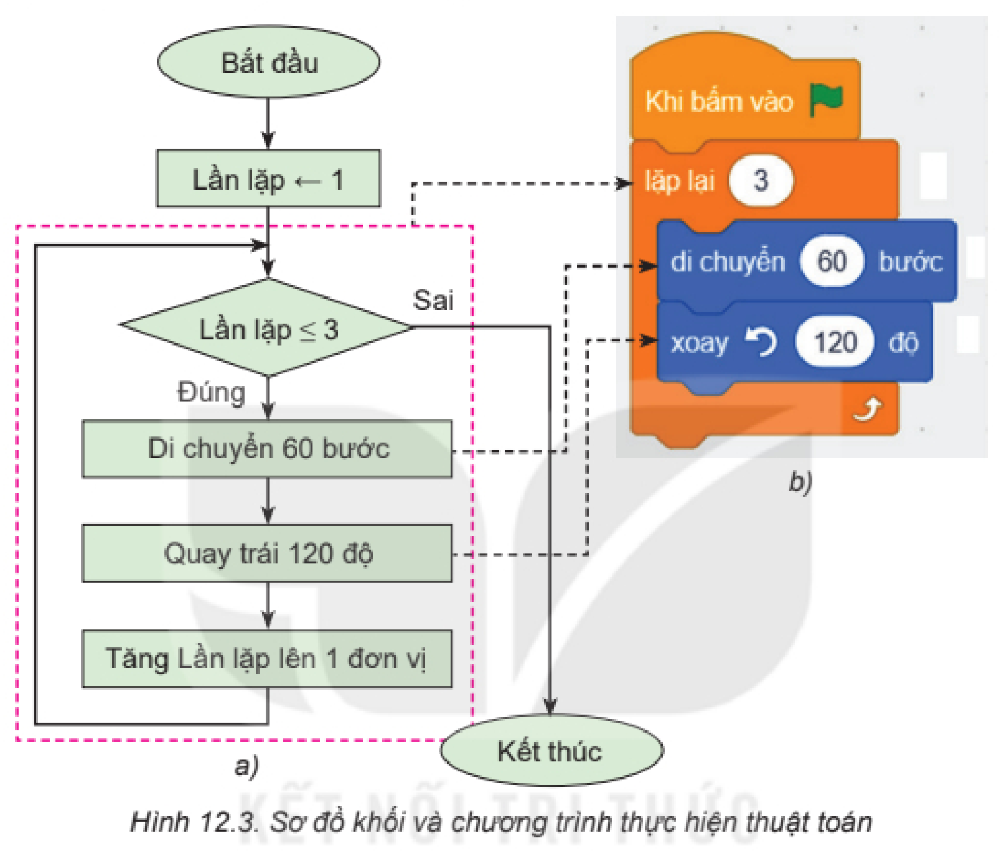
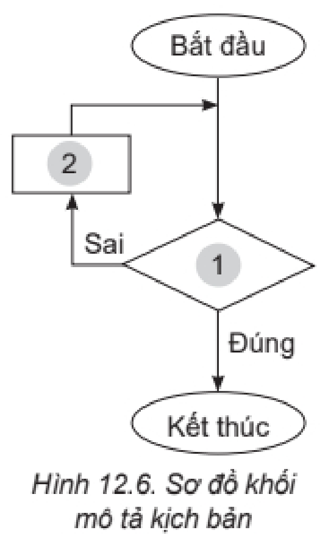

<!-- pdf:74 -->

# BÀI 12: TỪ THUẬT TOÁN ĐẾN CHƯƠNG TRÌNH

## 🎯 Sau bài học này em sẽ:

- Mô tả được kịch bản đơn giản dưới dạng thuật toán và tạo được một chương trình đơn giản.
- Hiểu được chương trình là dãy các lệnh điều khiển máy tính thực hiện một thuật toán.

## 🔴 Khởi động

> Bằng ngôn ngữ lập trình trực quan, bạn Khoa muốn tạo chương trình điều khiển nhân vật di chuyển theo đường đi là các hình như: tam giác đều, vuông,...

*Hình 12.1. Nhân vật di chuyển*

## 1. TỪ THUẬT TOÁN ĐẾN CHƯƠNG TRÌNH

> **Hoạt động 1: Mô tả kịch bản dưới dạng thuật toán**
>
> Với trường hợp nhân vật di chuyển theo đường đi là một tam giác đều, em hãy:
> 1. Xác định góc quay của nhân vật khi đi hết một cạnh.
> 2. Liệt kê lần lượt các bước của thuật toán điều khiển nhân vật (bằng ngôn ngữ tự nhiên).

Tam giác đều là hình có ba cạnh bằng nhau, ba góc bằng nhau và bằng 60 độ. Để di chuyển theo một hình tam giác đều, nhân vật cần lặp lại ba lần việc thực hiện hai hành động sau đây:
- Di chuyển về phía trước một số bước bằng độ dài cạnh tam giác. Ví dụ, di chuyển 60 bước.
- Quay trái 120 độ.

*Hình 12.2. Đường đi của nhân vật*

Thuật toán sử dụng cấu trúc tuần tự và cấu trúc lặp, trong đó số bước lặp bằng 3 (bằng số cạnh của tam giác đều). Khi thực hiện đủ ba lần thì vòng lặp kết thúc. Kịch bản chương trình được mô tả bằng sơ đồ khối của thuật toán như minh hoạ ở Hình 12.3a.
<!-- term: Mô tả kịch bản dưới dạng thuật toán -->

<!-- pdf:75 -->

Em đã biết, để mô tả thuật toán, ngoài cách liệt kê các bước bằng ngôn ngữ tự nhiên hoặc dùng sơ đồ khối, chúng ta có thể viết chương trình để máy tính “hiểu” và thực hiện được thuật toán.

Để điều khiển nhân vật trên máy tính thực hiện thuật toán được mô tả bằng sơ đồ khối ở Hình 12.3a, em viết chương trình Scratch như Hình 12.3b, trong đó mỗi bước của thuật toán mô tả ở sơ đồ khối đã được thực hiện bằng lệnh tương ứng của ngôn ngữ lập trình Scratch. Như vậy, **chương trình** là dãy lệnh điều khiển máy tính thực hiện một thuật toán.
<!-- term: Từ thuật toán đến chương trình -->

*Hình 12.3. Sơ đồ khối và chương trình thực hiện thuật toán*

> **Chương trình** là dãy các lệnh điều khiển máy tính thực hiện một thuật toán.

> ❓ **Câu hỏi**
>
> Bạn An muốn bổ sung lệnh đợi 1 giây để điều khiển nhân vật dừng lại 1 giây sau khi đi hết mỗi cạnh của tam giác. Em hãy bổ sung lệnh này vào sơ đồ khối mô tả thuật toán và nêu vị trí đặt câu lệnh trong chương trình Scratch tương ứng ở Hình 12.3.

## 2. THỰC HÀNH: TẠO CHƯƠNG TRÌNH ĐIỀU KHIỂN MÁY TÍNH THỰC HIỆN THUẬT TOÁN

**Nhiệm vụ 1:** Tạo chương trình điều khiển nhân vật di chuyển theo đường đi là một tam giác đều như minh hoạ trong Hình 12.3.

**Hướng dẫn**

*(Hướng dẫn sau đây sử dụng ngôn ngữ lập trình Scratch 3.0 với giao diện tiếng Việt để minh hoạ.)*

<!-- pdf:76 -->

*Bước 1.* Khởi động phần mềm Scratch, chọn chế độ hiển thị tiếng Việt.

*Bước 2.* Xoá nhân vật chú Mèo, thêm nhân vật chú Bọ rùa.

*Bước 3.* Kéo thả các lệnh để được chương trình như minh hoạ trong Hình 12.3.

*Bước 4.* Nháy chuột vào nút `[Cờ xanh]` để chạy chương trình và xem kết quả.

**Nhiệm vụ 2:** Thêm một số lệnh để nhân vật vừa di chuyển, vừa vẽ tam giác đều.

**Hướng dẫn**

*Bước 1.* Nháy chuột vào nhóm lệnh `Bút vẽ`, kéo thả các lệnh của nhóm này vào chương trình như minh hoạ trong Hình 12.4.

*Bước 2.* Nháy chuột vào nhóm lệnh `Điều khiển`, kéo thả lệnh `đợi (1) giây` vào chương trình như minh hoạ trong Hình 12.4.

*Bước 3.* Nháy chuột vào nút `[Cờ xanh]` để chạy chương trình và xem kết quả.

*Bước 4.* Lưu tệp với tên `VeHinh.sb3` và thoát khỏi chương trình.

*Hình 12.4. Chương trình vẽ hình tam giác đều*

## ✏️ Luyện tập

1. Em hãy mô tả thuật toán bằng sơ đồ khối trong trường hợp đường đi của nhân vật là một hình vuông.
2. Em hãy nâng cấp chương trình `VeHinh.sb3` bằng cách bổ sung một nhân vật mới và lập trình để khi nháy chuột vào nhân vật này thì chương trình thực hiện thuật toán vẽ hình vuông.
3. Bạn Khoa viết kịch bản mô tả hoạt động của xe ô tô chạy trên đường như sau: Khi xe cách hòn đá nhỏ hơn 120 bước, xe sẽ dừng lại (Hình 12.5).
   a) Em hãy hoàn thành sơ đồ khối theo kịch bản trên bằng cách ghép mỗi lệnh dưới đây với một ô phù hợp được đánh số `1` và `2` trong Hình 12.6.
   - `Di chuyển 5 bước`
   - `Cách hòn đá < 120 bước?`
   b) Em hãy viết chương trình Scratch thực hiện thuật toán.

*Hình 12.5. Xe dừng lại khi cách hòn đá nhỏ hơn 120 bước*

*Hình 12.6. Sơ đồ khối mô tả kịch bản*

## 🚀 Vận dụng

Trong bài học trên, đường đi của nhân vật là hình tam giác đều. Đường đi đó có thể là hình vuông, lục giác đều,... Khi đó các con số nào trong chương trình ở Hình 12.3 cần phải thay đổi?

## 📷 Danh sách hình trong bài

| Mã hình | Trang PDF | Trang sách | Chú thích |
| --- | --- | --- | --- |
| H8-tin_hoc-b12-01 | 74 | 73 | Hình 12.1. Nhân vật di chuyển |
| H8-tin_hoc-b12-02 | 74 | 73 | Hình 12.2. Đường đi của nhân vật |
| H8-tin_hoc-b12-03 | 75 | 74 | Hình 12.3. Sơ đồ khối và chương trình thực hiện thuật toán |
| H8-tin_hoc-b12-04 | 76 | 75 | Hình 12.4. Chương trình vẽ hình tam giác đều |
| H8-tin_hoc-b12-05 | 76 | 75 | Hình 12.5. Xe dừng lại khi cách hòn đá nhỏ hơn 120 bước |
| H8-tin_hoc-b12-06 | 76 | 75 | Hình 12.6. Sơ đồ khối mô tả kịch bản |
