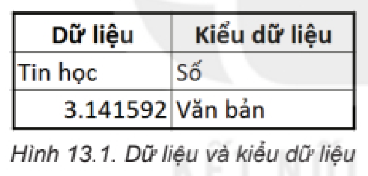
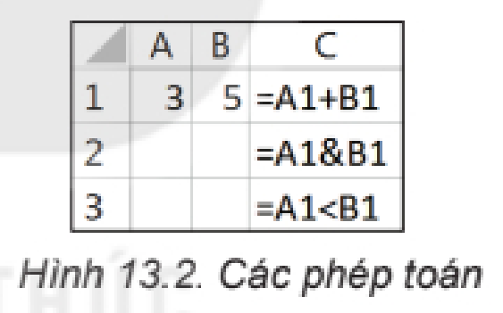
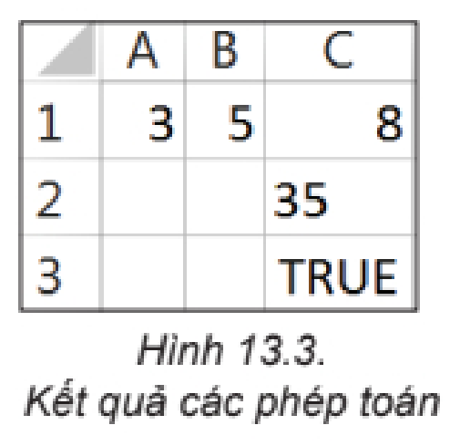
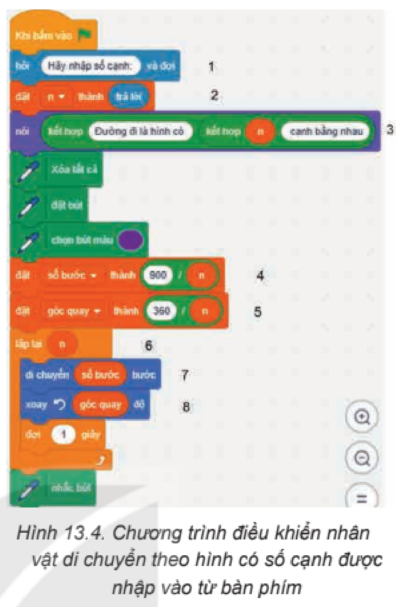

<!-- pdf:77 -->

# BÀI 13: BIỂU DIỄN DỮ LIỆU

## 🎯 Sau bài học này em sẽ:

- Nêu được khái niệm hằng, biến, kiểu dữ liệu, biểu thức và sử dụng được các khái niệm này ở các chương trình đơn giản trong môi trường lập trình trực quan.

## 🔴 Khởi động

> Trong chương trình Tin học lớp 7, em đã được học về các kiểu dữ liệu trong phần mềm bảng tính. Em hãy cho biết đó là những kiểu dữ liệu nào.

## 1. KIỂU DỮ LIỆU

> **Hoạt động 1: Kiểu dữ liệu**
>
> 1. Em hãy ghép mỗi dòng ở cột Dữ liệu với một dòng phù hợp ở cột Kiểu dữ liệu trong Hình 13.1.
> 2. Em hãy nhập dữ liệu và công thức theo mẫu trong Hình 13.2 vào phần mềm bảng tính và cho biết kết quả được hiển thị ở các ô tính C1, C2 và C3.

*Hình 13.1. Dữ liệu và kiểu dữ liệu*

*Hình 13.2. Các phép toán*

Trong Hình 13.1, **Tin học** là dữ liệu thuộc kiểu văn bản, **3.1415192** là dữ liệu thuộc kiểu số. Các công thức ở các ô tính C1, C2 và C3 trong Hình 13.2 trả lại kết quả như Hình 13.3.
- Ô C1 thực hiện phép cộng số 3 và số 5, cho kết quả 8 là một giá trị số.
- Ô C2 thực hiện phép ghép kí tự 3 và kí tự 5, cho kết quả là xâu kí tự 35.
- Ô C3 kiểm tra xem số 3 có nhỏ hơn số 5 hay không, cho kết quả TRUE (đúng) là giá trị thuộc kiểu lôgic.

*Hình 13.3. Kết quả các phép toán*

Trong các ngôn ngữ lập trình, dữ liệu được phân loại thành những kiểu khác nhau để có thể lưu trữ và áp dụng những phép toán phù hợp. Số được phân loại thành kiểu số nguyên hoặc số thực, văn bản được phân loại thành kiểu kí tự hoặc xâu kí tự, các điều kiện hay các phép so sánh được phân loại thành kiểu lôgic,...

Mỗi **kiểu dữ liệu** bao gồm một tập hợp giá trị và một số phép toán trên những giá trị đó. Ngôn ngữ lập trình Scratch có ba kiểu dữ liệu là kiểu số, kiểu xâu kí tự và kiểu lôgic. Bảng 13.1 mô tả tập hợp giá trị của ba kiểu dữ liệu này.

<!-- pdf:78 -->

*Bảng 13.1. Tập hợp giá trị của các kiểu dữ liệu trong ngôn ngữ lập trình Scratch*

| Kiểu dữ liệu | Tập hợp giá trị | Ví dụ |
| --- | --- | --- |
| Số | Số nguyên và số thập phân | `15` &emsp; `3.141592` |
| Xâu kí tự | Kí tự hoặc xâu kí tự | `@` &emsp; `Computer` |
| Lôgic | Hai giá trị *true* (đúng) và *false* (sai) | *false* &emsp; *true* |
<!-- term: Kiểu số -->
<!-- term: Kiểu xâu kí tự -->
<!-- term: Kiểu lôgic -->

Mỗi kiểu dữ liệu được trang bị một số phép toán. Ngược lại, mỗi phép toán đều cho kết quả là giá trị thuộc một kiểu dữ liệu nhất định. Bảng 13.2. mô tả những phép toán cơ bản trên ba kiểu dữ liệu của ngôn ngữ lập trình Scratch.

*Bảng 13.2. Các phép toán cơ bản trong ngôn ngữ lập trình Scratch*

| Kiểu dữ liệu | Phép toán | Ví dụ |
| --- | --- | --- |
| Số | Các phép toán cộng, trừ, nhân, chia, chia lấy dư, làm tròn số,... | Phép toán `(13) chia lấy dư (4)` trả lại kết quả 1, là số dư trong phép chia số 13 cho số 4. |
| Xâu kí tự | Phép toán kết hợp (join) nối các xâu kí tự để tạo ra xâu kí tự mới. | Phép toán `kết hợp (táo ) (chuối)` trả lại kết quả «táo chuối», là xâu kí tự được ghép lại từ hai xâu kí tự “táo” và “chuối”. |
| Lôgic | Các phép toán so sánh: bằng (=), nhỏ hơn (<) và lớn hơn (>). | Phép toán `<(70) > (50)>` trả lại giá trị *true* là kết quả của việc so sánh hai số 70 và 50. |
| Lôgic | Ba phép toán lôgic: và (and), hoặc (or), không phải (not). – `< > và < >`: Kết quả của phép toán và chỉ đúng khi hai biểu thức thành phần đều đúng. – `< > hoặc < >`: Kết quả của phép toán hoặc chỉ sai khi hai biểu thức thành phần đều sai. – `không phải < >`: Kết quả của phép toán không phải là đúng khi biểu thức sai và ngược lại. | Phép toán `<<(70) > (50)> và <(80) < (50)>>` trả lại kết quả *false*, vì thành phần (80 < 50) của phép toán và mang giá trị *false*. Phép toán `<<(50) = (50)> hoặc <(30) > (50)>>` trả lại kết quả *true*, vì thành phần (50 = 50) của phép toán hoặc mang giá trị *true*. Phép toán `<không phải <(50) = (50)>>` trả lại kết quả là *false*. |
<!-- term: Kiểu số -->
<!-- term: Kiểu xâu kí tự -->
<!-- term: Kiểu lôgic -->
<!-- term: Phép toán kết hợp -->
<!-- term: Phép toán so sánh -->
<!-- term: Phép toán lôgic -->

> - Mỗi **kiểu dữ liệu** là một tập hợp các giá trị mà một biến thuộc kiểu đó có thể nhận. Mỗi kiểu dữ liệu được trang bị một số phép toán.
> - Ba kiểu dữ liệu phổ biến trong ngôn ngữ lập trình trực quan là: kiểu số, kiểu xâu kí tự, kiểu lôgic.

> ❓ **Câu hỏi**
>
> Em hãy ghép mỗi phép toán với một kiểu dữ liệu kết quả cho phù hợp.
>
> | Phép toán | Kiểu dữ liệu |
> | --- | --- |
> | `kết hợp (Diện tích hình tròn là: ) (s)` | Số |
> | `<((n) chia lấy dư (2)) = (0)>` | Xâu kí tự |
> | `làm tròn ((3.141592) * ((r) * (r)))` | Lôgic |
<!-- ocr-ok: đã đối chiếu trực tiếp ảnh trang PDF 78, bảng câu hỏi chứa 3 khối lệnh phép toán màu xanh của Scratch -->

<!-- pdf:79 -->

## 2. HẰNG, BIẾN, BIỂU THỨC

> **Hoạt động 2: Hằng, biến, biểu thức**
>
> Trong Bài 12, em đã tạo ra chương trình để chú Bọ rùa di chuyển theo đường đi là một tam giác đều. Làm thế nào để tổng quát bài toán với đường đi của nhân vật là một hình đa giác đều có số cạnh bất kì được nhập vào từ bàn phím?

Trong lập trình, **biến** được dùng để lưu trữ giá trị có thể thay đổi trong khi thực hiện chương trình. Biến được nhận biết qua tên của nó. Ví dụ: số cạnh của hình mà nhân vật di chuyển trong bài toán tổng quát ở Hoạt động 2 là một biến, nó được đặt tên n và lưu trữ một giá trị số, chẳng hạn số 6.

**Hằng** là giá trị không đổi trong quá trình thực hiện chương trình. Chẳng hạn, 3.14 là hằng kiểu số (hằng số); “Xin chào!” là hằng kiểu xâu kí tự; *true* là hằng kiểu lôgic;... Mỗi hằng thuộc một kiểu dữ liệu nhất định.

**Biểu thức** là sự kết hợp của biến, hằng, dấu ngoặc, phép toán và các hàm để trả lại giá trị thuộc một kiểu dữ liệu nhất định. Chẳng hạn, chu vi của đường tròn bán kính r có thể được tính gần đúng bằng biểu thức kiểu số `((2) * ((3.14) * (r)))`.

> - **Biến** được dùng để lưu trữ giá trị có thể thay đổi trong quá trình thực hiện chương trình. Biến được nhận biết qua tên của nó và thuộc một kiểu dữ liệu nhất định.
> - **Hằng** là giá trị không đổi trong quá trình thực hiện chương trình. Mỗi hằng thuộc một kiểu dữ liệu nhất định (hằng kiểu số, hằng kiểu xâu kí tự, hằng kiểu lôgic,...).
> - **Biểu thức** là sự kết hợp của biến, hằng, dấu ngoặc, phép toán và các hàm để trả lại giá trị thuộc một kiểu dữ liệu nhất định.

> ❓ **Câu hỏi**
>
> Em hãy chỉ ra hằng, biến, biểu thức và kiểu dữ liệu tương ứng được sử dụng trong chương trình ở Hình 13.4.

## 3. THỰC HÀNH: SỬ DỤNG HẰNG, BIẾN, BIỂU THỨC TRONG CHƯƠNG TRÌNH

**Nhiệm vụ:** Mở tệp chương trình `VeHinh.sb3` em đã lưu ở Bài 12, bổ sung câu lệnh để được chương trình nâng cấp điều khiển nhân vật di chuyển theo hình có số cạnh nhập vào từ bàn phím như Hình 13.4.

**Hướng dẫn:**

*Bước 1.* Mở tệp chương trình `VeHinh.sb3` trong Scratch, chọn chế độ hiển thị tiếng Việt. Lưu tệp với tên mới là `DuongDi.sb3`.

*Bước 2.* Nháy chuột vào nhóm lệnh `Các biến số`, tạo các biến số `n`, `số bước`, `góc quay`.
<!-- ocr-ok: đã đối chiếu trực tiếp ảnh trang PDF 79, biểu tượng nhóm lệnh và các khối biến màu cam của Scratch bị OCR đọc sai -->

<!-- pdf:80 -->

*Bước 3.* Nháy chuột vào nhóm lệnh `Cảm biến`, `Các biến số`, `Hiển thị` và hoàn thành lệnh 1, 2, 3 của chương trình.

*Bước 4.* Nháy chuột vào nhóm lệnh `Các phép toán` để tạo hai biểu thức `(900) / (n)` và `(360) / (n)`.
<!-- ocr-ok: đã đối chiếu trực tiếp ảnh trang PDF 80, hai khối biểu thức màu xanh (900 / n) và (360 / n) của Scratch bị OCR bỏ sót -->

*Bước 5.* Nháy chuột vào nhóm lệnh `Các biến số`, kéo thả và hoàn thành hai câu lệnh 4, 5.

*Bước 6.* Nháy chuột vào nhóm lệnh `Các biến số`, kéo thả các biến vào vị trí tương ứng trong các câu lệnh 6, 7, 8.

*Bước 7.* Nháy chuột vào nút `[Cờ xanh]` để chạy chương trình và xem kết quả.

*Hình 13.4. Chương trình điều khiển nhân vật di chuyển theo hình có số cạnh được nhập vào từ bàn phím*

## ✏️ Luyện tập

1. Giả sử r là biến lưu giá trị của bán kính hình tròn. Em hãy cho biết giá trị trả lại của các biểu thức sau và kiểu dữ liệu của chúng trong ngôn ngữ lập trình Scratch với trường hợp r = 5.
   a) `<(r) > (0)>`
   b) `((2) * ((3.14) * (r)))`
   c) `kết hợp (Chu vi đường tròn là ) ((2) * ((3.14) * (r)))`
2. Em hãy sử dụng ngôn ngữ lập trình trực quan để viết chương trình tính chu vi đường tròn, diện tích hình tròn với giá trị của bán kính được nhập vào từ bàn phím, thông báo kết quả ra màn hình.

## 🚀 Vận dụng

Em hãy viết chương trình Scratch của riêng mình để giải quyết một bài toán cụ thể trong một môn học như Khoa học tự nhiên, Toán học,... trong đó có sử dụng hằng, biến và biểu thức để thực hiện thuật toán.

## 📷 Danh sách hình trong bài

| Mã hình | Trang PDF | Trang sách | Chú thích |
| --- | --- | --- | --- |
| H8-tin_hoc-b13-01 | 77 | 76 | Hình 13.1. Dữ liệu và kiểu dữ liệu |
| H8-tin_hoc-b13-02 | 77 | 76 | Hình 13.2. Các phép toán |
| H8-tin_hoc-b13-03 | 77 | 76 | Hình 13.3. Kết quả các phép toán |
| H8-tin_hoc-b13-04 | 80 | 79 | Hình 13.4. Chương trình điều khiển nhân vật di chuyển theo hình có số cạnh được nhập vào từ bàn phím |
