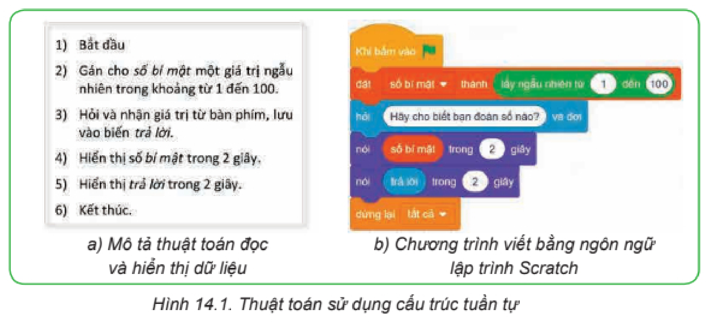
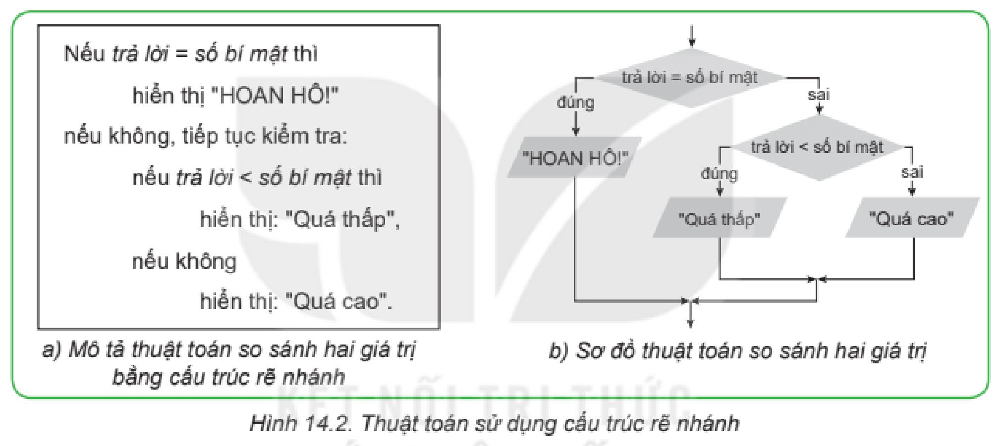
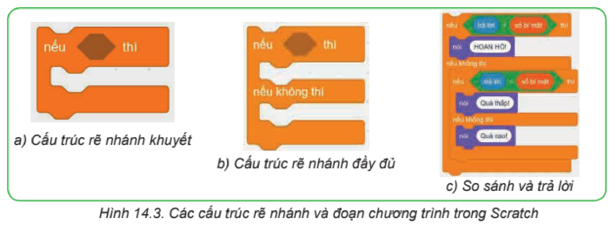
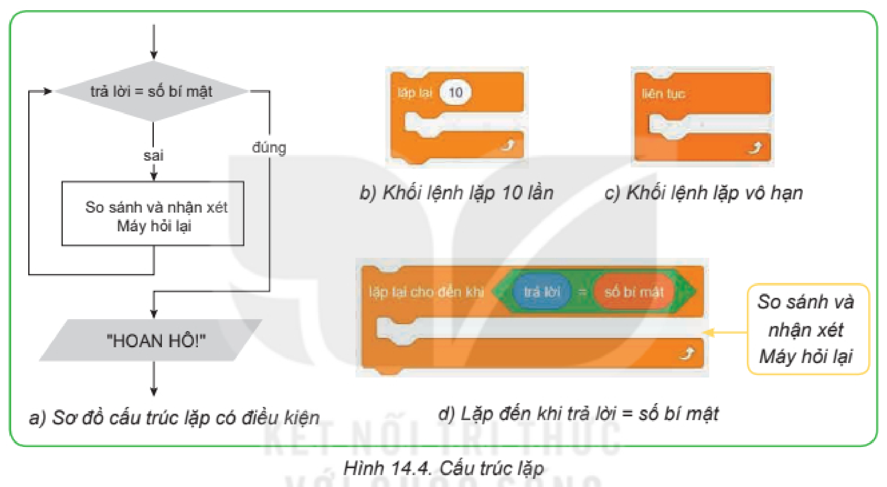
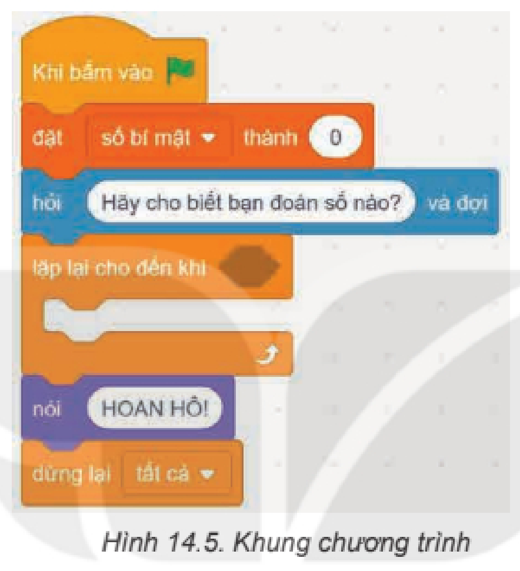
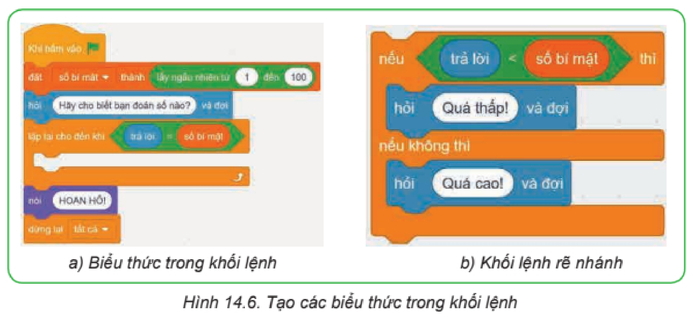
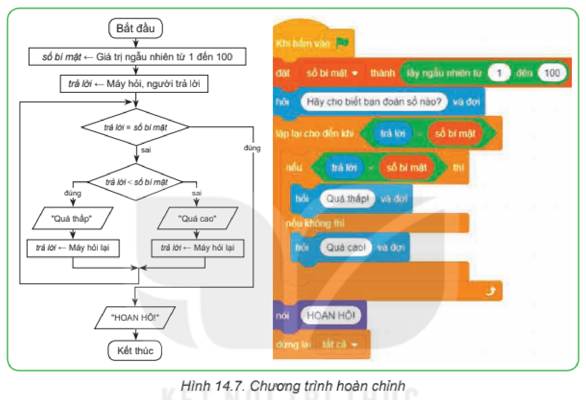
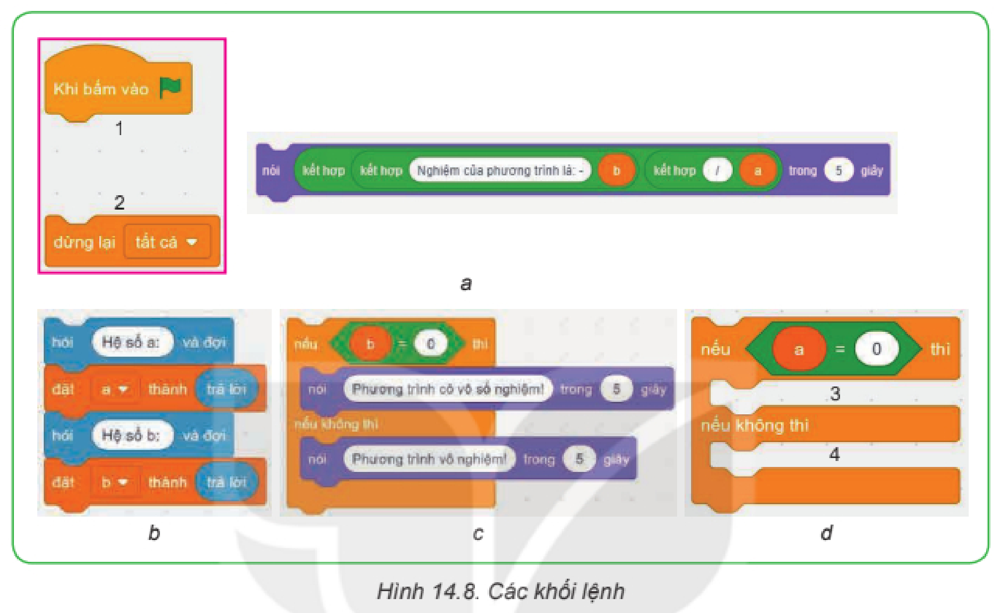
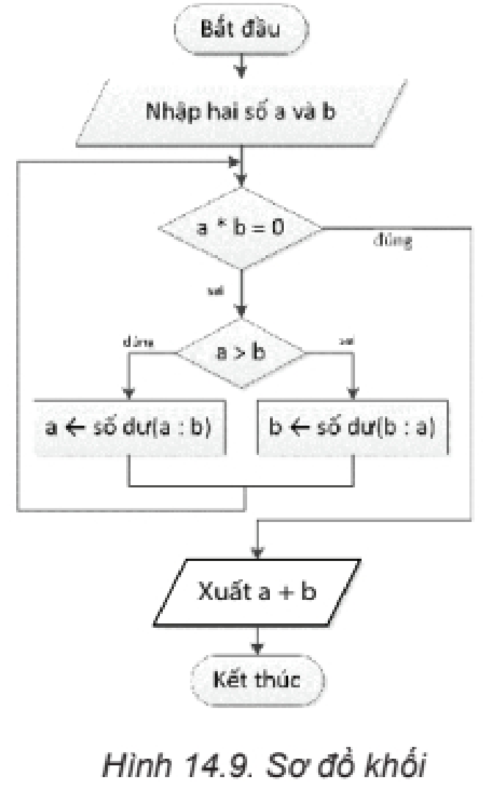
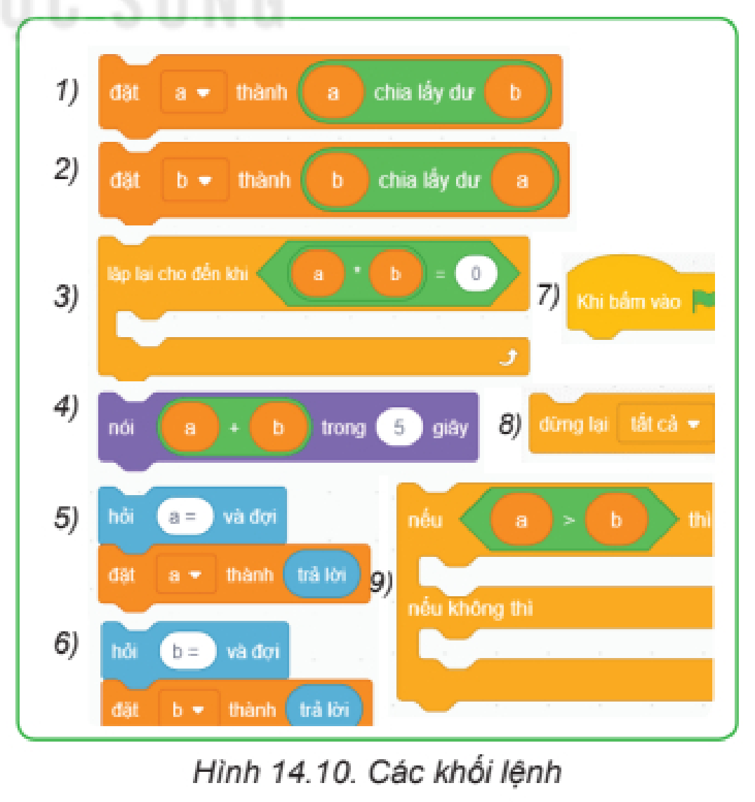

<!-- pdf:81 -->

# BÀI 14: CẤU TRÚC ĐIỀU KHIỂN

## 🎯 Sau bài học này em sẽ:

- Thể hiện được cấu trúc tuần tự, rẽ nhánh và lặp ở chương trình trong môi trường lập trình trực quan.

## 🔴 Khởi động

> *An:* Ở lớp 6, chúng ta đã biết cách biểu diễn thuật toán bằng cách sử dụng các cấu trúc điều khiển cơ bản. Trong ngôn ngữ lập trình Scratch, có cách nào để biểu diễn các cấu trúc đó không?
>
> *Khoa:* Giống như hầu hết các ngôn ngữ lập trình, ngôn ngữ lập trình trực quan như Scratch cũng có các khối lệnh tương ứng với các cấu trúc điều khiển cơ bản.
>
> *An:* Bạn có thể giới thiệu cho tớ cách biểu diễn các cấu trúc tuần tự, rẽ nhánh và lặp trong Scratch không?

## 1. CẤU TRÚC ĐIỀU KHIỂN CƠ BẢN

> **Hoạt động 1: Trò chơi Đoán số**
>
> Giả sử em cần xây dựng một trò chơi trên máy tính. Trong trò chơi, em cần tìm một số bí mật mà máy tính đã lấy ngẫu nhiên trong khoảng từ 1 đến 100. Em được đoán nhiều lần cho đến khi đoán đúng số bí mật đó. Mỗi lần em đoán sai, máy tính sẽ cho em biết số em đoán là nhỏ hơn hay lớn hơn số bí mật. Em hãy mô tả kịch bản của trò chơi đó dưới dạng một thuật toán.

### a) Cấu trúc tuần tự

Dựa trên kịch bản đã xây dựng, em sẽ từng bước lập chương trình của trò chơi này bằng ngôn ngữ lập trình trực quan. Nhận xét rằng, trong trò chơi, chỉ cần sử dụng hai biến số: số thứ nhận do máy tính lấy ngẫu nhiên, được đặt tên là *số bí mật* và số thứ hai do người chơi đoán và nhập vào máy tính là *trả lời*. Biến này có sẵn trong Scratch.

Để đảm bảo các lệnh đọc, ghi và gán giá trị với hai biến trên hoạt động bình thường, em có thể yêu cầu máy tính gán cho *số bí mật* một giá trị ngẫu nhiên, sau đó hỏi để nhận vào *trả lời* một giá trị số từ người chơi, rồi hiển thị hai giá trị đó ra. Kịch bản của trò chơi được mô tả bằng cấu trúc tuần tự dưới dạng liệt kê bằng ngôn ngữ tự nhiên như Hình 14.1a.

*Hình 14.1. Thuật toán sử dụng cấu trúc tuần tự*

<!-- pdf:82 -->

Trong ngôn ngữ lập trình trực quan, **cấu trúc tuần tự** được thể hiện bằng cách lắp ghép các khối lệnh thành phần theo đúng trình tự của các hoạt động, từ trên xuống dưới, như Hình 14.1b.

### b) Cấu trúc rẽ nhánh

Sau khi đảm bảo các biến đã hoạt động đúng, em có thể thay thế các thao tác hiển thị trong kịch bản trên bằng thao tác so sánh hai số và cho biết giá trị của biến *trả lời* bằng, thấp hơn hay cao hơn giá trị của biến *số bí mật*.
- Nếu *trả lời* bằng *số bí mật* thì thông báo: “HOAN HÔ!”.
- Nếu *trả lời* nhỏ hơn *số bí mật* thì thông báo: “Quá thấp”.
- Nếu *trả lời* lớn hơn *số bí mật* thì thông báo: “Quá cao”.

Nhận xét rằng ba trường hợp “bằng”, “nhỏ hơn” và “lớn hơn” loại trừ lẫn nhau nên không cần kiểm tra cả ba trường hợp đó mà chỉ cần kiểm tra hai lần.

Thuật toán so sánh hai giá trị *trả lời* và *số bí mật* có thể được mô tả dưới dạng cấu trúc rẽ nhánh như trong Hình 14.2a bằng ngôn ngữ tự nhiên. Khoảng cách lề trong bản mô tả nhằm xác định hướng thực hiện mệnh lệnh sau mỗi lần kiểm tra. Sơ đồ của thuật toán này được cho trong Hình 14.2b.

*Hình 14.2. Thuật toán sử dụng cấu trúc rẽ nhánh*

Trong ngôn ngữ lập trình trực quan, **cấu trúc rẽ nhánh** được thể hiện bằng khối lệnh chứa một điều kiện hay một biểu thức lôgic. Tuỳ tình huống, điều kiện này nhận giá trị đúng hay sai, chương trình sẽ định hướng đến khối lệnh tiếp theo để máy tính thực hiện. Hình 14.3c mô tả đoạn chương trình Scratch so sánh giá trị hai biến *trả lời* và *số bí mật* để hiển thị thông báo tương ứng.

> Cấu trúc rẽ nhánh có hai dạng, dạng khuyết và dạng đầy đủ. Các hình 14.3a và 14.3b lần lượt thể hiện khối lệnh **rẽ nhánh khuyết** và **rẽ nhánh đầy đủ** trong ngôn ngữ lập trình Scratch.

*Hình 14.3. Các cấu trúc rẽ nhánh và đoạn chương trình trong Scratch*

<!-- pdf:83 -->

### c) Cấu trúc lặp

Trong trò chơi, việc đoán số không chỉ được thực hiện một lần mà được người chơi thực hiện lặp lại cho đến khi đoán đúng số bí mật. Mỗi khi người chơi đoán sai, máy tính hỏi lại và câu trả lời mới lại được đem ra so sánh với số bí mật.

Lưu ý rằng việc lặp lại chỉ thực hiện khi người chơi đoán sai. Điều đó cũng có nghĩa rằng người chơi đoán đúng là điều kiện kết thúc vòng lặp.

Thuật toán được mô tả bằng cấu trúc lặp như trong Hình 14.4a và được thể hiện trong ngôn ngữ lập trình trực quan bằng khối lệnh “lặp cho đến khi” (Hình 14.4d).

> Trong ngôn ngữ lập trình Scratch, có ba khối lệnh lặp, bao gồm: lặp với số lần định trước (Hình 14.4b), lặp vô hạn (Hình 14.4c), và lặp có điều kiện kết thúc (Hình 14.4d).
<!-- term: Khối lệnh lặp trong Scratch -->

*Hình 14.4. Cấu trúc lặp*

> **Cấu trúc điều khiển** trong ngôn ngữ lập trình trực quan:
> - **Cấu trúc tuần tự** được thể hiện bằng cách lắp ghép các khối lệnh theo trình tự của các hoạt động, từ trên xuống dưới.
> - **Cấu trúc rẽ nhánh** có hai dạng, dạng khuyết và dạng đầy đủ.
> - **Cấu trúc lặp** có ba dạng: lặp với số lần định trước, lặp vô hạn và lặp có điều kiện kết thúc.

> ❓ **Câu hỏi**
>
> Cấu trúc lặp nào sau đây **không** được cho trước trong các nhóm lệnh của Scratch?
> A. Lặp một khối lệnh với số lần định trước.
> B. Lặp một khối lệnh vô hạn lần.
> C. Lặp với điều kiện được kiểm tra trước khi thực hiện khối lệnh.
> D. Lặp với điều kiện được kiểm tra sau khi thực hiện khối lệnh.

<!-- pdf:84 -->

## 2. THỰC HÀNH: XÂY DỰNG TRÒ CHƠI ĐOÁN SỐ

**Nhiệm vụ**

Lập chương trình trò chơi đoán số như đã được mô tả trong Hoạt động 1.

**Hướng dẫn**

*Bước 1.* Tạo các biến
- Tạo biến *số bí mật*. Em có thể tạo biến mới hoặc đổi tên biến có sẵn “my variable” thành “số bí mật”.
- Biến *trả lời* đã có sẵn trong nhóm lệnh “Cảm biến”.

*Bước 2.* Tạo khung chương trình

*Hình 14.5. Khung chương trình*

- Tạo khung chương trình gồm 6 khối lệnh lắp ghép với nhau theo cấu trúc tuần tự, từ trên xuống dưới. Mỗi khối lệnh được kéo từ các nhóm tương ứng như được chỉ dẫn trong Hình 14.5, thả vào vùng kịch bản.

*Bước 3.* Tạo các biểu thức
- Chọn phép toán và điền các giá trị tương ứng để có biểu thức “lấy ngẫu nhiên từ 1 đến 100”.
- Chọn phép so sánh “=” và lắp các biến vào chỗ trống để có biểu thức lôgic “trả lời = số bí mật”.
- Lắp ghép các biểu thức trên vào vị trí phù hợp trong khung chương trình (Hình 14.6a).

*Hình 14.6. Tạo các biểu thức trong khối lệnh*

<!-- pdf:85 -->

*Bước 4.* Tạo khối lệnh rẽ nhánh
- Tương tự như bước 2 và bước 3 để tạo khối lệnh rẽ nhánh với điều kiện “trả lời < số bí mật”.
- Chọn từ nhóm “Cảm biến” các khối lệnh “hỏi” và lắp vào vị trí phù hợp như Hình 14.6b.

*Bước 5.* Hoàn thành chương trình
- Lắp khối lệnh rẽ nhánh vào khung chương trình để được chương trình hoàn chỉnh.
- Đối sánh thuật toán được mô tả dưới dạng sơ đồ với chương trình hoàn chỉnh ở Hình 14.7.

*Hình 14.7. Chương trình hoàn chỉnh*

## ✏️ Luyện tập

Em hãy ghép mỗi đoạn lệnh ở hàng trên với kết quả tương ứng mà đoạn lệnh đó vẽ ở hàng dưới trong Bảng 14.1.

*Bảng 14.1. Các đoạn lệnh và kết quả thực hiện*

| | a | b | c | d |
| --- | --- | --- | --- | --- |
| Đoạn lệnh | `đặt bút` → `lặp lại (4)`: `di chuyển (100) bước`, `xoay phải (90) độ` | `đặt bút` → `lặp lại (5)`: `di chuyển (100) bước`, `xoay phải (72) độ` | `đặt bút` → `lặp lại (6)`: `di chuyển (100) bước`, `xoay phải (60) độ` | `đặt bút` → `lặp lại (3)`: `di chuyển (100) bước`, `xoay phải (120) độ` |
| Kết quả | 1) Hình ba cạnh | 2) Hình bốn cạnh | 3) Hình năm cạnh | 4) Hình sáu cạnh |
<!-- ocr-ok: đã đối chiếu trực tiếp ảnh trang PDF 85, Bảng 14.1 chứa 4 ảnh chụp đoạn khối lệnh màu của Scratch -->

<!-- pdf:86 -->

## 🚀 Vận dụng

1. Em hãy ghép các khối lệnh a, b, c, d vào các vị trí tương ứng 1, 2, 3, 4 ở Hình 14.8 để được thuật toán giải phương trình ax + b = 0 trong ngôn ngữ lập trình Scratch với các giá trị a, b nhập từ bàn phím.

*Hình 14.8. Các khối lệnh*

2. Ước chung lớn nhất của hai số không thay đổi nếu thay số lớn bằng phần dư trong phép chia của nó cho số bé. Dựa trên nhận xét đó, ước chung lớn nhất của hai số không âm có thể được tính theo thuật toán được biểu diễn bằng sơ đồ khối trong Hình 14.9. Em hãy ghép các khối lệnh Scratch trong Hình 14.10 thành chương trình tính ước chung lớn nhất của hai số nguyên không âm.

*Hình 14.9. Sơ đồ khối*

*Hình 14.10. Các khối lệnh*

## 📷 Danh sách hình trong bài

| Mã hình | Trang PDF | Trang sách | Chú thích |
| --- | --- | --- | --- |
| H8-tin_hoc-b14-01 | 81 | 80 | Hình 14.1. Thuật toán sử dụng cấu trúc tuần tự |
| H8-tin_hoc-b14-02 | 82 | 81 | Hình 14.2. Thuật toán sử dụng cấu trúc rẽ nhánh |
| H8-tin_hoc-b14-03 | 82 | 81 | Hình 14.3. Các cấu trúc rẽ nhánh và đoạn chương trình trong Scratch |
| H8-tin_hoc-b14-04 | 83 | 82 | Hình 14.4. Cấu trúc lặp |
| H8-tin_hoc-b14-05 | 84 | 83 | Hình 14.5. Khung chương trình |
| H8-tin_hoc-b14-06 | 84 | 83 | Hình 14.6. Tạo các biểu thức trong khối lệnh |
| H8-tin_hoc-b14-07 | 85 | 84 | Hình 14.7. Chương trình hoàn chỉnh |
| H8-tin_hoc-b14-08 | 86 | 85 | Hình 14.8. Các khối lệnh |
| H8-tin_hoc-b14-09 | 86 | 85 | Hình 14.9. Sơ đồ khối |
| H8-tin_hoc-b14-10 | 86 | 85 | Hình 14.10. Các khối lệnh |
