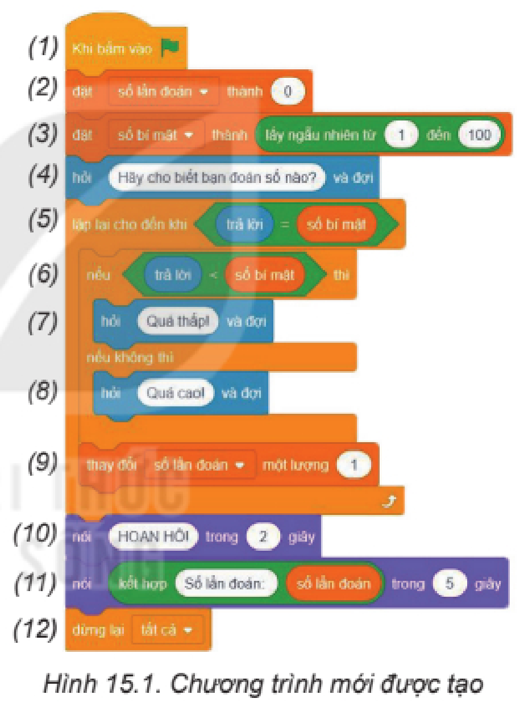
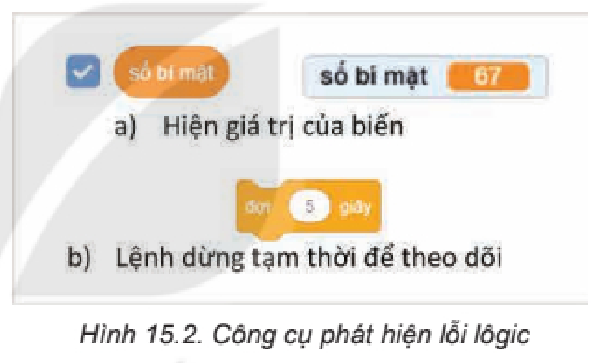
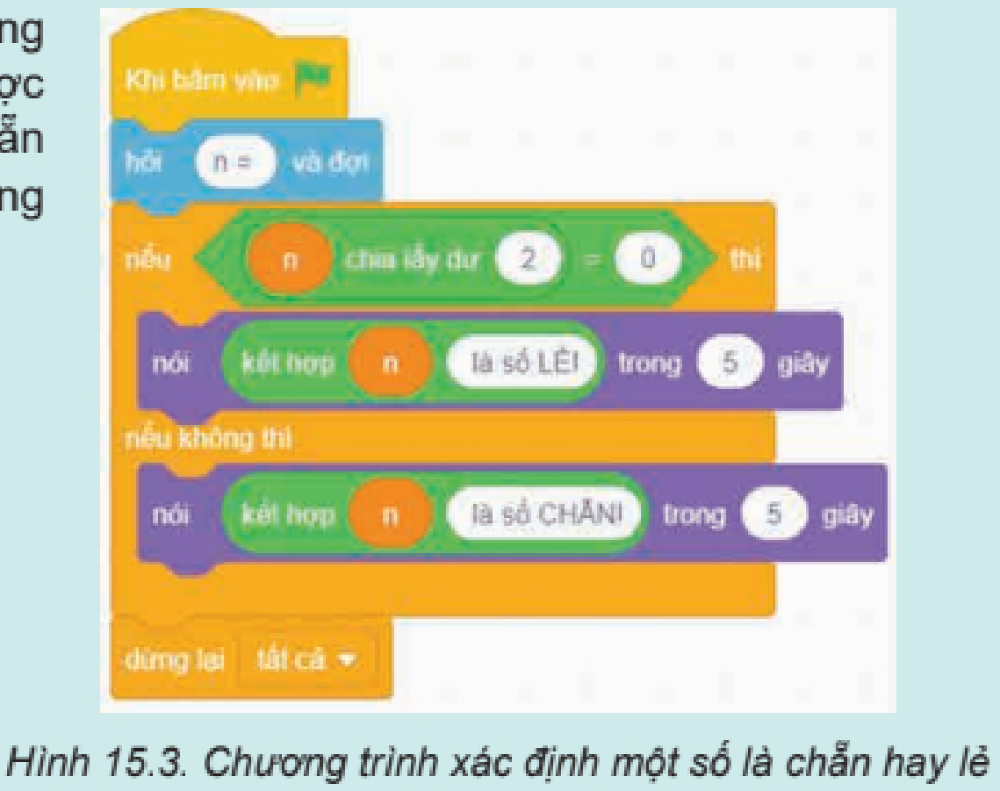
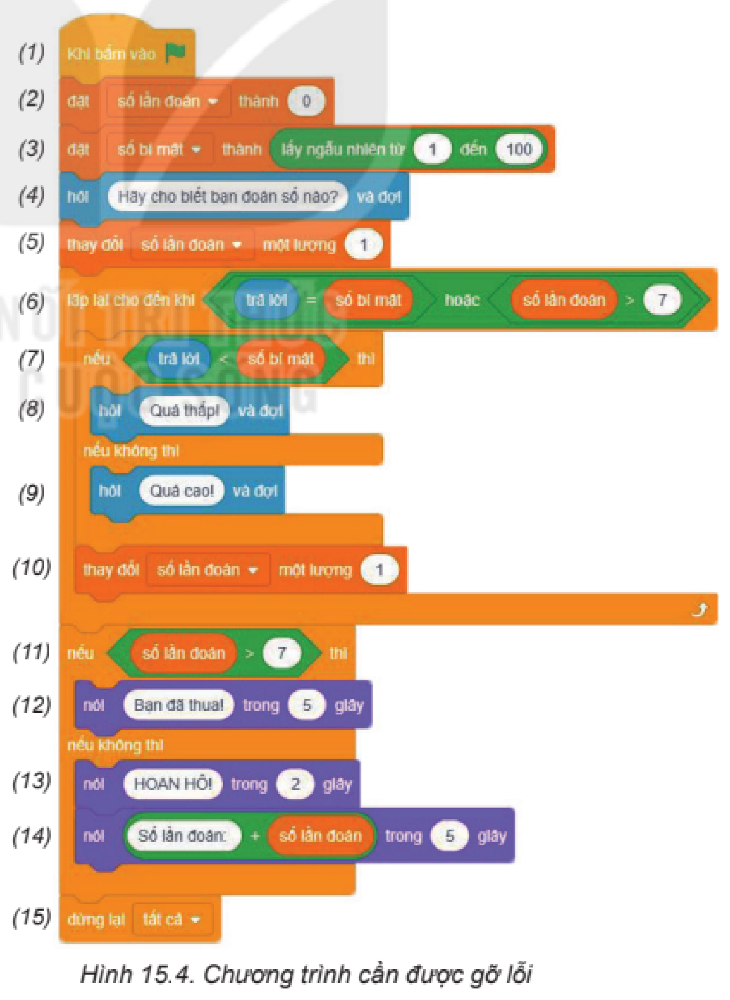
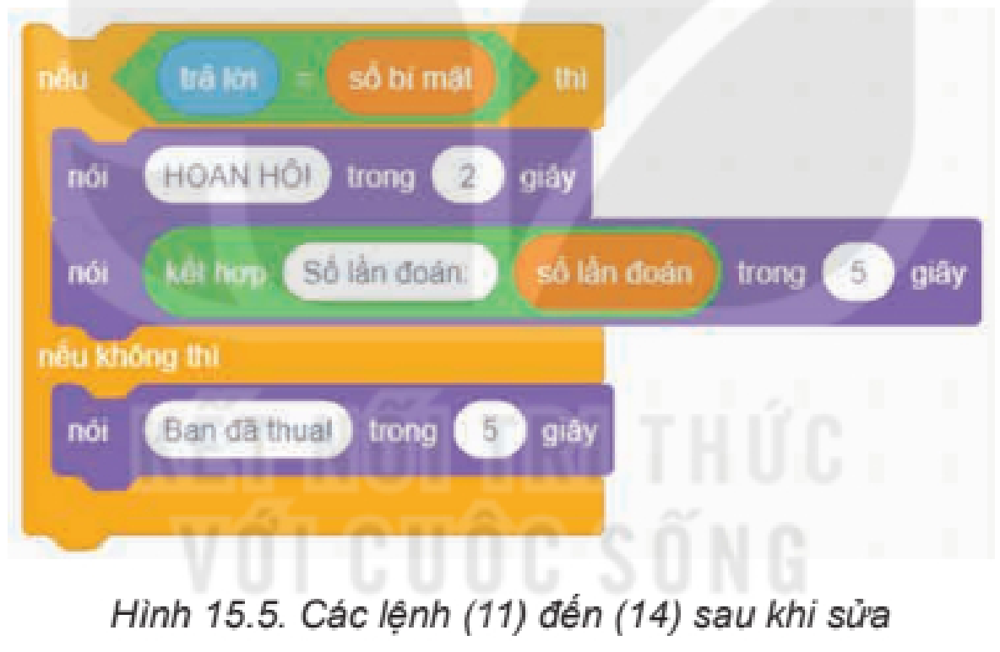

<!-- pdf:87 -->

# BÀI 15: GỠ LỖI

## 🎯 Sau bài học này em sẽ:

- Chạy thử, tìm lỗi và sửa được lỗi cho chương trình.

## 🔴 Khởi động

> *An:* Chúng ta đã tạo ra một chương trình máy tính trong Bài 14 và thế là tớ đã biết lập trình.
>
> *Khoa:* Chưa xong đâu, chúng ta cần phải thực hiện một việc nữa, đó là gỡ lỗi.
>
> *An:* Gỡ lỗi là làm những gì? Bạn hãy hướng dẫn cụ thể hơn cho tớ nhé.

## 1. KIỂM THỬ VÀ PHÂN LOẠI LỖI

> **Hoạt động 1: Đếm số lần đoán**
>
> Trong trò chơi Đoán số ở Bài 14, ai đoán đúng số bí mật với ít lần đoán hơn sẽ là người thắng cuộc. Ở chương trình trong Hình 15.1, biến số lần đoán được bổ sung để đếm số lần người chơi đoán và thông báo giá trị này khi người chơi đoán đúng số bí mật.
>
> Trước khi chia sẻ trò chơi của mình, em quyết định kiểm tra xem trò chơi có hoạt động tốt không. Hãy cho biết kết quả của việc kiểm tra đó bằng cách mô tả tình huống chương trình chạy không đúng kịch bản (nếu có).

*Hình 15.1. Chương trình mới được tạo*

### a) Kiểm thử

Theo kịch bản, trò chơi sẽ thông báo số lần đoán khi người chơi đoán đúng số bí mật. Tuy nhiên, khi chạy thử chương trình, em sẽ thấy số lần đoán mà máy tính hiển thị luôn kém số lần thực tế mà người chơi đã đoán một đơn vị.

Việc chạy thử chương trình để kiểm tra (còn gọi là **kiểm thử**) nhằm phát hiện những tình huống bất thường (được gọi là **lỗi**) khi thực hiện chương trình. Các lỗi cần được loại bỏ trước khi chương trình được coi là sản phẩm hoàn chỉnh và có thể chia sẻ với người khác.

> **Hoạt động 2: Không làm việc hay làm việc sai?**
>
> Em hãy cho biết, chương trình đã cho trong Hình 15.1 không hoạt động được hay nó có hoạt động nhưng đã thực hiện không đúng kịch bản?

<!-- pdf:88 -->

### b) Phân loại lỗi

Khi chạy thử, em nhận ra rằng chương trình vẫn hoạt động vì máy tính vẫn hỏi và trả lời theo sự điều khiển của các khối lệnh. Tuy nhiên nó thực hiện không đúng kịch bản vì số lần đoán được hiển thị không đúng với số lần thực tế mà người chơi đã đoán.

Có hai loại lỗi: 1) **Lỗi cú pháp** xảy ra khi lệnh viết sai so với quy tắc của ngôn ngữ lập trình, làm cho chương trình không hoạt động; 2) **Lỗi lôgic** (hay **lỗi ngữ nghĩa**) xảy ra khi các câu lệnh trong chương trình tuy được viết đúng cú pháp nhưng thực hiện không đúng kịch bản như trong chương trình của trò chơi Đoán số.

> - Cần phải chạy thử chương trình để phát hiện và loại bỏ lỗi.
> - Có hai loại lỗi: lỗi cú pháp và lỗi lôgic.
>   - **Lỗi cú pháp** là lỗi viết câu lệnh sai quy tắc, làm cho chương trình không hoạt động.
>   - **Lỗi lôgic** là lỗi câu lệnh, tuy được viết đúng quy tắc nhưng thực hiện sai so với kịch bản.
<!-- term: Gỡ lỗi -->

> ❓ **Câu hỏi**
>
> Chọn phát biểu đúng nhất về hoạt động gỡ lỗi.
> A. Gỡ lỗi là phát hiện và loại bỏ lỗi. Trong lập trình, không nhất thiết phải gỡ lỗi.
> B. Gỡ lỗi là chạy thử chương trình để phát hiện lỗi. Trong lập trình, không nhất thiết phải gỡ lỗi.
> C. Gỡ lỗi là chạy thử chương trình để phát hiện lỗi. Gỡ lỗi là một phần quan trọng của lập trình.
> D. Gỡ lỗi là phát hiện và loại bỏ lỗi. Gỡ lỗi là một phần quan trọng của lập trình.

## 2. PHÁT HIỆN LỖI VÀ SỬA LỖI LÔGIC

> **Hoạt động 3: Gỡ lỗi**
>
> Xét tình huống máy tính hiển thị số lần đoán không đúng với số lần đoán thực tế của người chơi. Em hãy trả lời các câu hỏi:
> 1. Theo kịch bản, biến số lần đoán sẽ thay đổi trong tình huống nào?
> 2. Những khối lệnh nào làm thay đổi biến số lần đoán?
> 3. Có điều gì khác nhau giữa kịch bản và những khối lệnh tương ứng?

Hầu hết các ngôn ngữ lập trình đều có chức năng chỉ rõ lỗi cú pháp. Ngôn ngữ lập trình trực quan, thậm chí còn hạn chế những tình huống xảy ra lỗi cú pháp.

Vì vậy lỗi cú pháp dễ dàng được phát hiện và sửa chữa. Tuy nhiên, với lỗi lôgic, việc xác định lệnh nào gây ra lỗi và nó đã hoạt động thế nào để tạo ra lỗi ấy không phải lúc nào cũng đơn giản.

<!-- pdf:89 -->

### a) Phát hiện lỗi lôgic

Có hai cách thường được sử dụng để phát hiện lỗi lôgic.

*Cách thứ nhất:* Dựa vào phân tích lôgic để tìm lỗi. Tập trung vào những khối lệnh liên quan đến lỗi và so sánh với kịch bản xem chúng có được thực hiện đúng yêu cầu hay không.
<!-- term: Phân tích lôgic để tìm lỗi -->

Chẳng hạn, trong chương trình của trò chơi Đoán số, lỗi được thể hiện ở việc chương trình hiển thị sai giá trị của số lần đoán. Các khối lệnh liên quan đến biến này là khởi tạo giá trị (2), thay đổi giá trị (9) và hiển thị giá trị (11).

Theo kịch bản, số lần đoán cần phải tăng 1 đơn vị mỗi khi người chơi nhập một giá trị số (đoán). Điều này xảy ra ở các câu lệnh (4), (7) và (8).

Tuy nhiên, có thể thấy rằng, mặc dù (9) tăng giá trị của số lần đoán sau khi (7) hoặc (8) được thực hiện, nhưng không có lệnh nào như thế sau khối lệnh (4) cả.

Theo cách này, việc phát hiện vị trí xuất hiện lỗi trong chương trình được tìm kiếm bằng cách suy luận lôgic, bắt đầu từ những khối lệnh thực hiện không đúng kịch bản. Hạn chế việc tìm lỗi theo cách dò dòng lệnh.
<!-- term: Phân tích lôgic để tìm lỗi -->

*Cách thứ hai:* Chạy thử với dữ liệu mẫu để dò lỗi. Vì là người lập trình, em có thể cho hiện giá trị các biến số bí mật và số lần đoán bằng cách đánh dấu ☑ vào bên cạnh các biến đó trong nhóm “Các biến số” (Hình 15.2a).
<!-- term: Chạy thử với dữ liệu mẫu để dò lỗi -->

Chạy chương trình với một số đầu vào dự kiến. Chẳng hạn, em có thể nhập số bí mật ngay trong lần đoán đầu tiên. Khi đó, lẽ ra số lần đoán cần nhận giá trị 1 thì nó vẫn chỉ mang giá trị 0.

Từ đó, em nhận thấy rằng lỗi xảy ra do không tăng giá trị của số lần đoán sau lần nhập giá trị đầu tiên của người chơi ở lệnh (4).

*Lưu ý:* Chương trình có thể chạy theo từng bước bằng cách chèn lệnh “đợi... giây” (Hình 15.2b) vào những vị trí cần quan sát dữ liệu.

*Hình 15.2. Công cụ phát hiện lỗi lôgic*

Theo cách này, người lập trình có thể kết hợp chạy chương trình từng bước với việc theo dõi giá trị của các biến, so sánh chúng với các giá trị tương ứng được tính theo cách thủ công để phát hiện câu lệnh nào gây ra lỗi và cách nó hoạt động để gây ra lỗi đó.
<!-- term: Chạy thử với dữ liệu mẫu để dò lỗi -->

### b) Sửa lỗi

Khi đã biết vị trí câu lệnh xảy ra lỗi trong chương trình và cách thức câu lệnh đó tạo ra lỗi, em có thể đưa ra những cách sửa lỗi phù hợp với yêu cầu. Chẳng hạn, tăng giá trị số lần đoán lên 1 đơn vị sau lần đoán đầu tiên bằng cách bổ sung lệnh (4a) “thay đổi số lần đoán một lượng 1” giống như lệnh (9) vào sau lệnh (4).
<!-- term: Gỡ lỗi -->

> Hai phương pháp phổ biến để phát hiện lỗi lôgic trong chương trình:
> - Tập trung vào những khối lệnh trực tiếp gây ra lỗi và những khối lệnh liên quan lôgic đến nó theo các cấu trúc điều khiển.
> - Chạy chương trình từng bước, kết hợp theo dõi sự thay đổi của các biến, các giá trị đầu ra và so sánh với các giá trị tính được theo cách thủ công.
<!-- term: Hai phương pháp phát hiện lỗi lôgic -->

<!-- pdf:90 -->

> ❓ **Câu hỏi**
>
> Em hãy gỡ lỗi đoạn chương trình xác định một số n được nhập từ bàn phím là số chẵn hay số lẻ được cho trong Hình 15.3.

*Hình 15.3. Chương trình xác định một số là chẵn hay lẻ*

## 3. THỰC HÀNH: GỠ LỖI

**Nhiệm vụ**

Giả sử trong trò chơi Đoán số, không ai được đoán quá 7 lần. Em hãy gỡ lỗi chương trình trò chơi Đoán số trong Hình 15.4 (đã được bổ sung chức năng thông báo người chơi thua cuộc nếu vẫn đoán sai ở lần thứ 7).

**Hướng dẫn**

### a) Kiểm thử và phát hiện lỗi

*Bước 1. Chạy thử chương trình*
- Với tình huống đoán đúng số bí mật sau không quá 7 lần đoán, thông báo hiển thị số lần đoán không xuất hiện cụm từ “Số lần đoán:” như trong chương trình.
- Với tình huống đoán sai, chương trình không kết thúc và báo thua ngay sau khi đoán sai lần thứ 7 mà vẫn cho đoán thêm một lần nữa.

*Hình 15.4. Chương trình cần được gỡ lỗi*

<!-- pdf:91 -->

*Bước 2. Phát hiện lỗi*

Gợi ý:
- Trong tình huống thứ nhất, lỗi xảy ra ở câu lệnh hiển thị. Phép toán ghép nối các chữ là “kết hợp...” chứ không phải dấu “+”.
- Trong tình huống thứ hai, lỗi xảy ra ở biểu thức điều kiện. Vì mỗi người không đoán quá 7 lần, nên vòng lặp (6) – (10) sẽ kết thúc khi số lần đoán bằng 7.
  Ngoài ra, sau 7 lần đoán, vẫn có thể xảy ra cả hai khả năng đoán đúng hoặc đoán sai. Vì vậy, số lần đoán không cho biết kết quả đoán đúng hay sai.

### b) Sửa các lỗi phát hiện được

- Điều kiện trong câu lệnh (6) cần đổi thành `<<(trả lời) = (số bí mật)> hoặc <(số lần đoán) > (6)>>` hoặc `<<(trả lời) = (số bí mật)> hoặc <(số lần đoán) = (7)>>`.
- Điều kiện rẽ nhánh ở lệnh (11) cần được chỉnh sửa thành `<(trả lời) = (số bí mật)>`.
- Sửa biểu thức trong lệnh hiển thị (14). Khi đó, các lệnh (11) đến (14) như Hình 15.5.
<!-- ocr-ok: đã đối chiếu trực tiếp ảnh trang PDF 91, các khối điều kiện màu xanh của Scratch bị OCR đọc thiếu -->

*Hình 15.5. Các lệnh (11) đến (14) sau khi sửa*

## ✏️ Luyện tập

Em hãy chọn một cách khác với cách đã nêu trong phần b) Sửa lỗi của mục 2 để sửa lỗi của chương trình được cho trong Hình 15.1.

## 🚀 Vận dụng

Đổi vai trò máy tính và người chơi trong trò chơi Đoán số. Em chọn một số nguyên trong khoảng từ 1 đến 120 và viết số đó ra giấy. Máy tính sẽ hiển thị một số mà em phải trả lời bằng các phím “d”, “c” hoặc “t” tương ứng với tình huống số máy tính hiển thị đúng, cao hơn hay thấp hơn số em đã chọn.

Hãy viết chương trình để sau một số bước, càng ít càng tốt, máy tính tìm ra số em đã chọn. Chạy thử, phát hiện và sửa các lỗi của chương trình đó.

## 📷 Danh sách hình trong bài

| Mã hình | Trang PDF | Trang sách | Chú thích |
| --- | --- | --- | --- |
| H8-tin_hoc-b15-01 | 87 | 86 | Hình 15.1. Chương trình mới được tạo |
| H8-tin_hoc-b15-02 | 89 | 88 | Hình 15.2. Công cụ phát hiện lỗi lôgic |
| H8-tin_hoc-b15-03 | 90 | 89 | Hình 15.3. Chương trình xác định một số là chẵn hay lẻ |
| H8-tin_hoc-b15-04 | 90 | 89 | Hình 15.4. Chương trình cần được gỡ lỗi |
| H8-tin_hoc-b15-05 | 91 | 90 | Hình 15.5. Các lệnh (11) đến (14) sau khi sửa |
