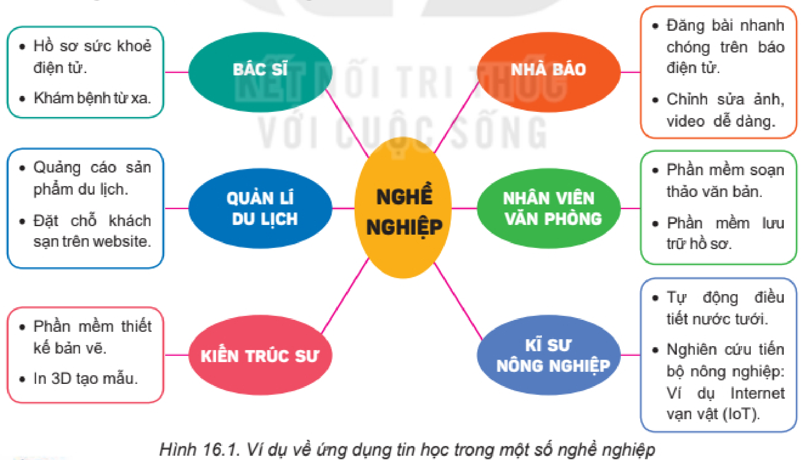
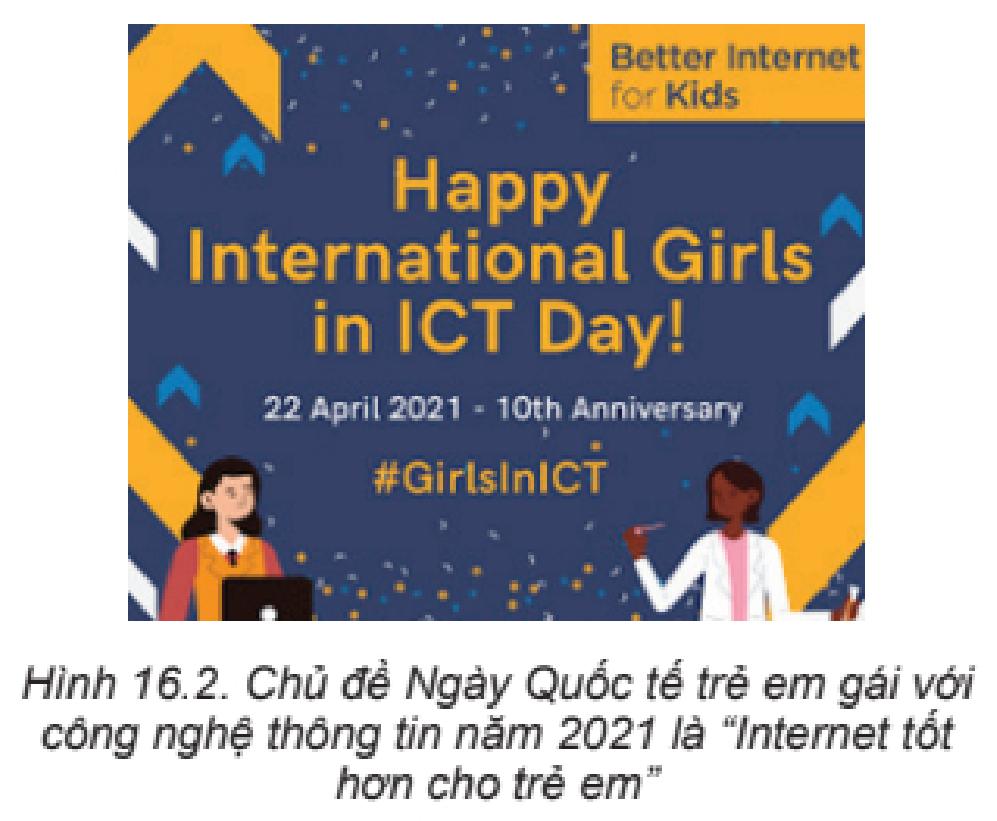

<!-- pdf:92 -->

# BÀI 16: TIN HỌC VỚI NGHỀ NGHIỆP

## 🎯 Sau bài học này em sẽ:

- Nêu được một số nghề nghiệp mà ứng dụng tin học sẽ làm tăng hiệu quả công việc.
- Nêu được tên một số nghề thuộc lĩnh vực tin học và một số nghề liên quan đến ứng dụng tin học.
- Nhận thức và trình bày được vấn đề bình đẳng giới trong việc sử dụng máy tính và trong ứng dụng tin học, nêu được ví dụ minh hoạ.

## 🔴 Khởi động

> An, Minh, Khoa sôi nổi trò chuyện về chủ đề mà ba bạn đang tìm hiểu: Những nghề nghiệp mà ứng dụng tin học giúp tăng hiệu quả công việc rõ ràng nhất.
>
> *An:* Tớ được nghe mẹ kể nhiều về nghề kế toán của mẹ. Ứng dụng tin học giúp mẹ làm việc hiệu quả hơn nhiều, như việc theo dõi các giao dịch tài chính, tạo ra các báo cáo tổng hợp phức tạp.
>
> *Khoa:* Tớ nghĩ chắc chắn ứng dụng tin học giúp tăng hiệu quả công việc cho nghề giáo viên. Thầy cô có thể dạy học trực tuyến và nhất là tớ thấy những tiết học trên lớp có ứng dụng tin học thì lôi cuốn và dễ hiểu hơn nhiều.
>
> *Minh:* Tớ thì tìm hiểu về nghề hoạ sĩ. Bây giờ các bức tranh không chỉ được tạo ra bằng bút lông và màu nước nữa mà còn được tạo ra trên máy tính. Sau này tớ muốn trở thành nhà thiết kế đồ hoạ máy tính.
>
> Còn ý kiến của em thì sao?

## 1. TIN HỌC GIÚP NÂNG CAO HIỆU QUẢ CÔNG VIỆC

> **Hoạt động 1: Ứng dụng tin học trong nghề nghiệp**
>
> Em hãy cùng các bạn lựa chọn một vài nghề nghiệp mà các em biết để thảo luận và chỉ ra những ví dụ mà tin học được ứng dụng trong các nghề nghiệp đó.

Trong suốt chiều dài lịch sử, công nghệ đã liên tục thay đổi cách người lao động trong mọi ngành nghề thực hiện công việc của họ để tăng năng suất. Cùng với sự phát triển của công nghệ thông tin, tin học ngày càng được ứng dụng rộng rãi trong mọi ngành nghề khác nhau. Theo các chuyên gia, việc ứng dụng tin học sẽ mang lại lợi ích cho hầu hết ngành nghề nhờ tăng hiệu quả công việc. Có được kết quả đó là nhờ vào một số điểm sau:

<!-- pdf:93 -->

- Ứng dụng tin học giúp tăng tốc độ xử lí, tiết kiệm thời gian của người lao động. Ví dụ với nghề kế toán, những yêu cầu mất hàng giờ tính toán thủ công có thể thực hiện trong vài phút nhờ các phần mềm ứng dụng. Các khoản thanh toán, giao dịch, chuyển tiền được thực hiện gần như ngay lập tức qua mạng.
- Ứng dụng tin học giúp liên lạc và trao đổi thông tin dễ dàng. Các tài liệu cần trao đổi, tin nhắn công việc được gửi ngay lập tức đến đồng nghiệp hoặc khách hàng trên toàn thế giới.
- Ứng dụng tin học hỗ trợ làm việc nhóm và mở rộng phạm vi làm việc. Ví dụ với nghề phát triển phần mềm, nhờ các công cụ giao tiếp trực tuyến, các lập trình viên có thể làm việc xuyên biên giới, trao đổi với đồng nghiệp ở các nước khác nhau. Các nhóm có thể tổ chức họp từ xa và làm việc trên cùng một tài liệu được chia sẻ dựa trên công nghệ đám mây.
- Ứng dụng tin học giúp nâng cao tay nghề, bổ sung kiến thức, hỗ trợ thông tin cho người lao động. Ví dụ nghề lái xe taxi, các ứng dụng đặt xe, bản đồ, thông báo tình trạng giao thông giúp lái xe dễ dàng nhận khách, tìm đường, tránh các cung đường bị tắc để tiết kiệm thời gian, nhiên liệu.
<!-- term: Ứng dụng tin học nâng cao hiệu quả công việc -->

Thông qua sự phát triển của tin học, hàng loạt các lĩnh vực nghề nghiệp được hỗ trợ hiệu quả, nâng cao chất lượng công việc. Sự phát triển của tin học cũng đã tạo ra những nghề nghiệp đa dạng của lĩnh vực này như: phát triển phần mềm, lập trình ứng dụng điện thoại, quản trị mạng, phát triển và thiết kế website,... Bên cạnh đó, một số nghề liên quan đến ứng dụng tin học cũng rất phát triển như: bán hàng online, **streamer** (phát sóng trực tiếp cho người xem thông qua một nền tảng online), **vlogger** (tạo dựng nội dung trên nền tảng video và đăng trên các mạng xã hội).
<!-- term: Nghề thuộc lĩnh vực tin học -->
<!-- term: Nghề liên quan đến ứng dụng tin học -->

Hình 16.1 cho em thấy những ví dụ cụ thể về việc ứng dụng tin học trong một số nghề nghiệp đã giúp tăng chất lượng, hiệu quả công việc.

*Hình 16.1. Ví dụ về ứng dụng tin học trong một số nghề nghiệp*

> - Ứng dụng tin học phù hợp trong các ngành nghề sẽ giúp tăng hiệu quả công việc.
> - Một số nghề thuộc lĩnh vực tin học và liên quan đến ứng dụng tin học ra đời và phát triển để đáp ứng yêu cầu cuộc sống và công việc.
<!-- term: Ứng dụng tin học nâng cao hiệu quả công việc -->

<!-- pdf:94 -->

> ❓ **Câu hỏi**
>
> 1. Hãy ghép mỗi ứng dụng ở cột B với một nghề phù hợp nhất ở cột A để chứng minh cho việc ứng dụng của tin học có thể tăng hiệu quả công việc.
>
> | A | B |
> | --- | --- |
> | 1) Bác sĩ | a) Tạo bản vẽ 3D để khách hàng có thể hình dung rõ về căn nhà định xây dựng. |
> | 2) Giáo viên | b) Nhận hình ảnh tức thì từ sân vận động được chụp bởi một đồng nghiệp khác để biên tập thành một bài báo. |
> | 3) Kiến trúc sư | c) Tạo một báo cáo tài chính bằng phần mềm bảng tính. |
> | 4) Kế toán | d) Theo dõi sức khoẻ, quá trình điều trị của bệnh nhân qua hồ sơ sức khoẻ điện tử. |
> | 5) Nhà báo | e) Tạo khoá học trực tuyến để học sinh có thể học bất cứ lúc nào, ở bất cứ đâu. |
>
> 2. Em hãy kể ra những ứng dụng tin học mà các thầy cô giáo đã sử dụng để giúp các em nâng cao hiệu quả của việc học tập.

## 2. BÌNH ĐẲNG GIỚI TRONG SỬ DỤNG MÁY TÍNH VÀ ỨNG DỤNG TIN HỌC

> **Hoạt động 2: Bình đẳng giới trong lĩnh vực tin học**
>
> 1. Nếu có bạn nào đó nói với em “Nghề nghiệp trong lĩnh vực tin học chỉ nên dành cho nam giới”, em sẽ trả lời bạn như thế nào? Tại sao?
> 2. Em biết những ngành nghề nào thuộc lĩnh vực tin học đang có nhiều phụ nữ làm việc?

Tin học đang thúc đẩy sự phát triển của mọi ngành nghề, thu hút một số lượng lớn lao động của xã hội tham gia. Trong thực tế, nhiều số liệu nghiên cứu cho thấy tỉ lệ nữ giới làm việc trong các ngành nghề tin học so với nam giới còn khá thấp, mặc dù môi trường, điều kiện công việc vẫn phù hợp cho phụ nữ phát huy khả năng về sức khoẻ, trí tuệ, phẩm chất của mình trong lĩnh vực này.

Chính vì vậy, nhiều tổ chức trên thế giới cũng đang tích cực tổ chức nhiều hoạt động thúc đẩy phụ nữ và trẻ em gái tham gia nhiều hơn vào lĩnh vực tin học.
- **Ngày Quốc tế trẻ em gái với công nghệ thông tin** (International Girls in ICT Day) được tổ chức hàng năm bởi Liên minh Viễn thông Quốc tế của Liên Hợp Quốc (viết tắt là ICU) (Hình 16.2). Các hoạt động trong ngày này nhằm tuyên truyền và nhấn mạnh sự cần thiết phải thúc đẩy các cơ hội nghề nghiệp công nghệ cho phụ nữ và trẻ em gái trong lĩnh vực được xem là phát triển nhanh nhất thế giới này.

*Hình 16.2. Chủ đề Ngày Quốc tế trẻ em gái với công nghệ thông tin năm 2021 là “Internet tốt hơn cho trẻ em”*

<!-- pdf:95 -->

- **DigiGirlZ** là chiến dịch toàn cầu do tập đoàn Microsoft khởi xướng nhằm truyền cảm hứng cho các học sinh nữ Trung học cơ sở và Trung học phổ thông theo đuổi các ngành nghề khoa học – công nghệ, trong đó có lĩnh vực tin học.
- Khi chưa tìm hiểu thì nhiều người có thể nghĩ lập trình viên đầu tiên trên thế giới là nam giới, nhưng không, người được coi là lập trình viên đầu tiên trên thế giới lại là một phụ nữ - Bà Ada Lovelace (người Anh, sinh năm 1815). Em có thể tìm hiểu câu chuyện cuộc đời của bà bằng cách tìm kiếm thông tin trên Internet.
<!-- term: Ada Lovelace -->

> Nghề nghiệp trong lĩnh vực tin học, cũng như cơ hội ứng dụng tin học để nâng cao hiệu quả công việc của các nghề nghiệp khác, là bình đẳng cho tất cả mọi người.
<!-- term: Bình đẳng giới trong sử dụng máy tính và ứng dụng tin học -->

> ❓ **Câu hỏi**
>
> Phương án nào dưới đây **không đúng** khi nói về việc sử dụng máy tính và ứng dụng tin học?
> A. Giúp việc thông tin liên lạc giữa mọi người hiệu quả hơn.
> B. Mọi người được tham gia vào môi trường học tập tốt hơn.
> C. Phụ nữ và trẻ em gái không cần đến máy tính vì không giúp ích nhiều cho họ.
> D. Mọi người đều có cơ hội học hỏi kiến thức để giúp nâng cao chất lượng cuộc sống và chăm sóc sức khoẻ tốt hơn.

## ✏️ Luyện tập

1. Em hãy phỏng vấn một vài người (có thể là bố mẹ, người quen của bố mẹ, thầy cô,...) để tìm hiểu về những ứng dụng tin học giúp họ nâng cao hiệu quả công việc.
2. Em hãy chọn phương án trả lời đúng nhất.
   Bất bình đẳng giới trong sử dụng máy tính và ứng dụng tin học có thể dẫn tới hậu quả gì?
   A. Phụ nữ và trẻ em gái không có cơ hội phát triển nghề nghiệp trong lĩnh vực công nghệ.
   B. Phụ nữ và trẻ em gái không có cơ hội sử dụng công nghệ để nâng cao hiệu quả công việc và chất lượng cuộc sống.
   C. Phụ nữ và trẻ em gái không theo kịp sự phát triển của xã hội.
   D. Cả ba hậu quả trên.

## 🚀 Vận dụng

1. Em hãy đề xuất với thầy cô giáo và các bạn tổ chức một cuộc thi thuyết trình về ứng dụng tin học trong các nghề nghiệp tại Việt Nam. Em hãy tìm hiểu và tạo ra bài thuyết trình của mình nhé. Hãy chia sẻ với bạn bè về bài thuyết trình của em.
2. Trong vai trò một học sinh lớp 8, em có thể làm gì để thúc đẩy bình đẳng giới ở lứa tuổi của em, ở khía cạnh sử dụng máy tính và ứng dụng tin học trong học tập?

## 📷 Danh sách hình trong bài

| Mã hình | Trang PDF | Trang sách | Chú thích |
| --- | --- | --- | --- |
| H8-tin_hoc-b16-01 | 93 | 92 | Hình 16.1. Ví dụ về ứng dụng tin học trong một số nghề nghiệp |
| H8-tin_hoc-b16-02 | 94 | 93 | Hình 16.2. Chủ đề Ngày Quốc tế trẻ em gái với công nghệ thông tin năm 2021 là “Internet tốt hơn cho trẻ em” |
