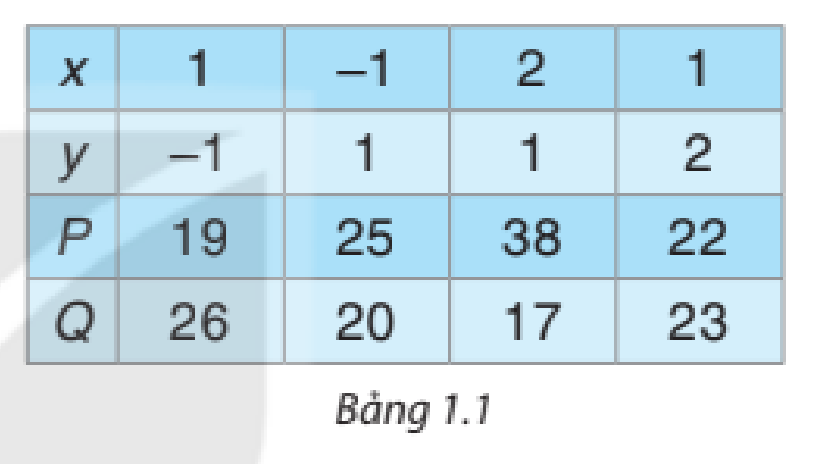

<!-- pdf:16 -->

# BÀI 3: PHÉP CỘNG VÀ PHÉP TRỪ ĐA THỨC

## 🔤 Khái niệm, thuật ngữ

- Tổng của hai đa thức
- Hiệu của hai đa thức

## 🎯 Kiến thức, kĩ năng

- Thực hiện các phép tính cộng, trừ đa thức.
<!-- ocr-ok: đã đối chiếu ảnh trang PDF 16, OCR đọc sai dấu thành "công, trữ" -->

## 🔴 Mở đầu

Trong buổi sinh hoạt câu lạc bộ Toán học của lớp, hai bạn tính giá trị của hai đa thức $P = 2x^2y - xy^2 + 22$ và $Q = xy^2 - 2x^2y + 23$ tại những giá trị cho trước của $x$ và $y$. Kết quả được ghi lại như bảng bên.

Ban giám khảo cho biết có một cột cho kết quả sai.

Theo em, làm thế nào để có thể nhanh chóng phát hiện cột có kết quả sai ấy?

| $x$ | $1$ | $-1$ | $2$ | $1$ |
| :---: | :---: | :---: | :---: | :---: |
| $y$ | $-1$ | $1$ | $1$ | $2$ |
| $P$ | $19$ | $25$ | $38$ | $22$ |
| $Q$ | $26$ | $20$ | $17$ | $23$ |

*Bảng 1.1*

**Cộng và trừ hai đa thức**

Cho hai đa thức:

$A = 5x^2y + 5x - 3$ và $B = xy - 4x^2y + 5x - 1$.

**HĐ1:** Thực hiện phép cộng hai đa thức $A$ và $B$ bằng cách tiến hành các bước sau:

- Lập tổng $A + B = (5x^2y + 5x - 3) + (xy - 4x^2y + 5x - 1)$.
- Bỏ dấu ngoặc và thu gọn đa thức nhận được.

> **Tròn:** Bạn còn nhớ *quy tắc dấu ngoặc* không?

**HĐ2:** Thực hiện phép trừ hai đa thức $A$ và $B$ bằng cách lập hiệu $A - B = (5x^2y + 5x - 3) - (xy - 4x^2y + 5x - 1)$, bỏ dấu ngoặc rồi thu gọn đa thức nhận được.

<!-- term: Tổng của hai đa thức -->
<!-- term: Hiệu của hai đa thức -->
> Cộng (hay trừ) hai đa thức tức là thu gọn đa thức nhận được sau khi nối hai đa thức đã cho bởi dấu “$+$” (hay dấu “$-$”).

**Chú ý**

<!-- term: Tính chất của phép cộng đa thức -->
- Phép cộng đa thức cũng có các tính chất giao hoán và kết hợp tương tự như phép cộng các số.
- Với $A, B, C$ là những đa thức tuỳ ý, ta có:

  $A + B + C = (A + B) + C = A + (B + C);$

  Nếu $A - B = C$ thì $A = B + C$; ngược lại, nếu $A = B + C$ thì $A - B = C$.
<!-- ocr-ok: đã đối chiếu ảnh trang PDF 16, OCR dính chữ "ngược lại, nếu" và công thức trong LaTeX -->

<!-- pdf:17 -->

**Ví dụ:** Tìm tổng và hiệu của hai đa thức:

$C = 5x^2y + 5x - 3z + 2$ và $D = xyz - 4x^2y + 5x - 1$.

**Giải.** $C + D = (5x^2y + 5x - 3z + 2) + (xyz - 4x^2y + 5x - 1)$

$= 5x^2y + 5x - 3z + 2 + xyz - 4x^2y + 5x - 1$

$= (5x^2y - 4x^2y) + (5x + 5x) - 3z + xyz + (2 - 1)$

$= x^2y + 10x - 3z + xyz + 1.$

$C - D = (5x^2y + 5x - 3z + 2) - (xyz - 4x^2y + 5x - 1)$

$= 5x^2y + 5x - 3z + 2 - xyz + 4x^2y - 5x + 1$

$= (5x^2y + 4x^2y) + (5x - 5x) - xyz - 3z + (2 + 1)$

$= 9x^2y - xyz - 3z + 3.$

**Luyện tập 1:** Cho hai đa thức $G = x^2y - 3xy - 3$ và $H = 3x^2y + xy - 0,5x + 5$.
<!-- ocr-ok: đã đối chiếu ảnh trang PDF 17, OCR đọc lỗi nhãn Luyện tập 1 và "đa thức" thành "da thức" -->

Hãy tính $G + H$ và $G - H$.

**Luyện tập 2:** Rút gọn và tính giá trị của biểu thức sau tại $x = 2$ và $y = -1$.

$K = (x^2y + 2xy^3) - (7,5x^3y^2 - x^3) + (3xy^3 - x^2y + 7,5x^3y^2).$

**Vận dụng:** Trở lại *tình huống mở đầu*, hãy trình bày ý kiến của em.

> **Vuông:** Hãy chú ý đến đa thức $P + Q$.
<!-- ocr-ok: đã đối chiếu ảnh trang PDF 17, hộp bóng thoại của Vuông -->

## BÀI TẬP

1.14. Tính tổng và hiệu của hai đa thức $P = x^2y + x^3 - xy^2 + 3$ và $Q = x^3 + xy^2 - xy - 6$.

1.15. Rút gọn biểu thức:

a) $(x - y) + (y - z) + (z - x)$;

b) $(2x - 3y) + (2y - 3z) + (2z - 3x)$.

1.16. Tìm đa thức $M$ biết $M - 5x^2 + xyz = xy + 2x^2 - 3xyz + 5$.

1.17. Cho hai đa thức $A = 2x^2y + 3xyz - 2x + 5$ và $B = 3xyz - 2x^2y + x - 4$.

a) Tìm các đa thức $A + B$ và $A - B$;

b) Tính giá trị của các đa thức $A$ và $A + B$ tại $x = 0,5$; $y = -2$ và $z = 1$.

## 📷 Danh sách hình trong bài

| Mã hình | Trang PDF | Vị trí trong bài | Chú thích gốc |
| --- | :---: | --- | --- |
| H8-toan-b03-01 | 16 | Mở đầu | Bảng 1.1 |
