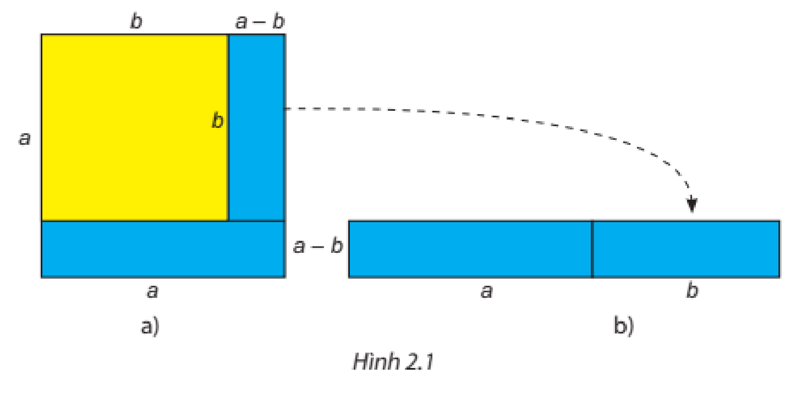

<!-- pdf:30 -->
<!-- Phần giới thiệu đầu Chương II (nửa trên trang PDF 30): ĐẠI SỐ — CHƯƠNG II: HẰNG ĐẲNG THỨC ĐÁNG NHỚ VÀ ỨNG DỤNG -->

Ta có thể sử dụng nhiều tính chất đại số để tính toán nhanh hơn, chẳng hạn dùng hằng đẳng thức để tính nhanh giá trị của $2023^2 - 2022^2$. Em có biết làm thế nào để tính nhanh biểu thức này không?

# BÀI 6: HIỆU HAI BÌNH PHƯƠNG. BÌNH PHƯƠNG CỦA MỘT TỔNG HAY MỘT HIỆU

## 🔤 Khái niệm, thuật ngữ

- Hằng đẳng thức
- Hiệu hai bình phương
- Bình phương của một tổng
- Bình phương của một hiệu

## 🎯 Kiến thức, kĩ năng

- Nhận biết hằng đẳng thức.
- Mô tả hằng đẳng thức hiệu hai bình phương, bình phương của một tổng, bình phương của một hiệu.
- Vận dụng ba hằng đẳng thức này để tính nhanh, rút gọn biểu thức.

## 🔴 Mở đầu

Trong một trò chơi trí tuệ trên truyền hình dành cho học sinh, người dẫn chương trình yêu cầu các bạn học sinh cho biết kết quả phép tính $198 \cdot 202$. Ngay lập tức một bạn đã chỉ ra kết quả đúng. Bạn ấy tính như thế nào mà nhanh thế nhỉ?

<!-- pdf:31 -->

## 1. HẰNG ĐẲNG THỨC

**Nhận biết hằng đẳng thức**

Ta có $(a + 1) \cdot b = a \cdot b + b$.

Trong đẳng thức trên, khi thay $a, b, \dots$ bởi bất kì giá trị số nào thì hai vế của đẳng thức luôn nhận giá trị bằng nhau, ta gọi đẳng thức như vậy là *hằng đẳng thức*.

> **Pi:** Hằng đẳng thức còn gọi là **đồng nhất thức**.

Tổng quát ta có

> **Hằng đẳng thức** là đẳng thức mà hai vế luôn cùng nhận một giá trị khi thay các chữ trong đẳng thức bằng các số tùy ý.

**Ví dụ 1:** Các đẳng thức thường gặp
<!-- ocr-ok: đã đối chiếu ảnh trang PDF 31, OCR đọc lỗi nhãn Ví dụ 1 nền xanh -->

$a + b = b + a; \quad a \cdot b = b \cdot a; \quad a(b + c) = ab + ac$

là những hằng đẳng thức.

**Ví dụ 2:** Đẳng thức nào sau đây là hằng đẳng thức?

a) $a(a - 2) = a^2 - 2a$;

b) $a^2 - 1 = 3a$.

**Giải**

a) Đẳng thức $a(a - 2) = a^2 - 2a$ là hằng đẳng thức.

b) Đẳng thức $a^2 - 1 = 3a$ không là hằng đẳng thức (vì khi ta thay $a = 1$ thì hai vế của đẳng thức không bằng nhau).

**Luyện tập 1:** Trong các đẳng thức sau, đẳng thức nào là hằng đẳng thức?

a) $a(a + 2b) = a^2 + 2ab$;

b) $a + 1 = 3a - 1$.

## 2. HIỆU HAI BÌNH PHƯƠNG

*Hiệu hai bình phương*

**HĐ1:** Quan sát Hình 2.1.

*Hình 2.1*

<!-- pdf:32 -->

a) Tính diện tích của phần hình màu xanh ở Hình 2.1a.

b) Tính diện tích hình chữ nhật màu xanh ở Hình 2.1b.

c) Có nhận xét gì về diện tích của hai hình ở câu a và câu b?

**HĐ2:** Với hai số $a, b$ bất kì, thực hiện phép tính $(a + b) \cdot (a - b)$.

Từ đó rút ra liên hệ giữa $a^2 - b^2$ và $(a + b)(a - b)$.

<!-- term: Hiệu hai bình phương -->
Với $A, B$ là hai biểu thức tuỳ ý, ta cũng có:

<!-- term: Hiệu hai bình phương -->
> $A^2 - B^2 = (A - B)(A + B).$

**Ví dụ 3:**

a) Tính nhanh $101^2 - 99^2$;

b) Viết $x^2 - 4$ dưới dạng tích.

**Giải**

a) $101^2 - 99^2 = (101 - 99)(101 + 99) = 2 \cdot 200 = 400$.

b) $x^2 - 4 = x^2 - 2^2 = (x - 2)(x + 2)$.

**Luyện tập 2:**

a) Tính nhanh $99^2 - 1$;

b) Viết $x^2 - 9$ dưới dạng tích.

**Vận dụng:** Ở *bài toán mở đầu*, em hãy giải thích xem bạn đó tính nhanh như thế nào.

## 3. BÌNH PHƯƠNG CỦA MỘT TỔNG

*Bình phương của một tổng*

**HĐ3:** Với hai số $a, b$ bất kì, thực hiện phép tính $(a + b) \cdot (a + b)$.

Từ đó rút ra liên hệ giữa $(a + b)^2$ và $a^2 + 2ab + b^2$.

<!-- term: Bình phương của một tổng -->
Với $A, B$ là hai biểu thức tuỳ ý, ta có:

<!-- term: Bình phương của một tổng -->
> $(A + B)^2 = A^2 + 2AB + B^2.$

<!-- term: Khai triển -->
> **Pi:** Ta nói *khai triển* $(A + B)^2$ được biểu thức $A^2 + 2AB + B^2$

**Ví dụ 4:**

a) Tính nhanh $101^2$;

b) Khai triển $(2x + y)^2$.

**Giải**

a) $101^2 = (100 + 1)^2 = 100^2 + 2 \cdot 100 + 1^2$

$= 10\,000 + 200 + 1 = 10\,201.$

b) $(2x + y)^2 = (2x)^2 + 2 \cdot 2x \cdot y + y^2 = 4x^2 + 4xy + y^2$.

<!-- pdf:33 -->

**Ví dụ 5:** Viết biểu thức $x^2 + 4xy + 4y^2$ dưới dạng bình phương của một tổng.

**Giải**

$x^2 + 4xy + 4y^2 = x^2 + 2 \cdot x \cdot 2y + (2y)^2 = (x + 2y)^2.$

**Luyện tập 3:**

1. Khai triển $(2b + 1)^2$.

2. Viết biểu thức $9y^2 + 6yx + x^2$ dưới dạng bình phương của một tổng.

## 4. BÌNH PHƯƠNG CỦA MỘT HIỆU

*Bình phương của một hiệu*

**HĐ4:** Với hai số $a, b$ bất kì, viết $a - b = a + (-b)$ và áp dụng hằng đẳng thức bình phương của một tổng để tính $(a - b)^2$.

<!-- term: Bình phương của một hiệu -->
Với $A, B$ là hai biểu thức tuỳ ý, ta có:

<!-- term: Bình phương của một hiệu -->
> $(A - B)^2 = A^2 - 2AB + B^2.$

> **Pi:** Ta có thể tìm được hằng đẳng thức bên bằng cách thực hiện phép nhân $(A - B) \cdot (A - B)$.

**Ví dụ 6:**

a) Tính nhanh $99^2$;

b) Khai triển $\left(x - \frac{3}{2}\right)^2$.

**Giải**

a) $99^2 = (100 - 1)^2 = 100^2 - 2 \cdot 100 + 1 = 10\,000 - 200 + 1 = 9\,801$.

b) $\left(x - \frac{3}{2}\right)^2 = x^2 - 2 \cdot x \cdot \frac{3}{2} + \left(\frac{3}{2}\right)^2 = x^2 - 3x + \frac{9}{4}$.

**Luyện tập 4:** Khai triển $(3x - 2y)^2$.
<!-- ocr-ok: đã đối chiếu ảnh trang PDF 33, OCR bỏ sót nhãn Luyện tập 4 nền xanh -->

**Vận dụng:** Trong trò chơi “Ai thông minh hơn học sinh lớp 8”, người dẫn chương trình yêu cầu các bạn học sinh cho biết kết quả của phép tính $1\,002^2$. Chỉ vài giây sau, Nam đã tính ra kết quả chính xác và giành được điểm. Em hãy giải thích xem Nam đã tính nhanh như thế nào.

> **Tròn:** $1\,002^2 = (1\,000 + 2)^2$ bạn nhé!

<!-- pdf:34 -->

## BÀI TẬP

2.1. Những đẳng thức nào sau đây là hằng đẳng thức?

a) $x + 2 = 3x + 1$;

b) $2x(x + 1) = 2x^2 + 2x$;

c) $(a + b)a = a^2 + ba$;

d) $a - 2 = 2a + 1$.

2.2. Thay $\boxed{?}$ bằng biểu thức thích hợp.

a) $(x - 3y)(x + 3y) = x^2 - \boxed{?}$;

b) $(2x - y)(2x + y) = 4\boxed{?} - y^2$.

c) $x^2 + 8xy + \boxed{?} = (\boxed{?} + 4y)^2$;

d) $\boxed{?} - 12xy + 9y^2 = (2x - \boxed{?})^2$.

2.3. Tính nhanh:

a) $54 \cdot 66$;

b) $203^2$.

2.4. Viết các biểu thức sau dưới dạng bình phương của một tổng hoặc một hiệu:

a) $x^2 + 4x + 4$;

b) $16a^2 - 16ab + 4b^2$.

2.5. Rút gọn các biểu thức sau:

a) $(x - 3y)^2 - (x + 3y)^2$;

b) $(3x + 4y)^2 + (4x - 3y)^2$.

2.6. Chứng minh rằng với mọi số tự nhiên $n$, ta có:

$(n + 2)^2 - n^2$ chia hết cho $4$.

## 📷 Danh sách hình trong bài

| Mã hình | Trang PDF | Vị trí trong bài | Chú thích gốc |
| --- | :---: | --- | --- |
| H8-toan-b06-01 | 30 | Mở đầu (hình đặt trên nền hoạ tiết khối lập phương màu cam trang mở đầu Chương II) | (sách không đánh số, tranh tình huống trò chơi trí tuệ trên truyền hình) |
| H8-toan-b06-02 | 31 | Mục 2, HĐ1 | Hình 2.1 |
