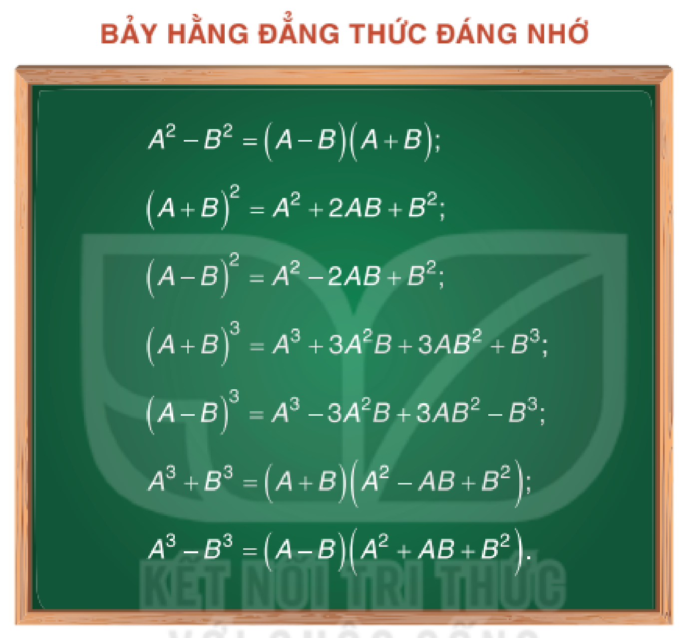

<!-- pdf:38 -->

# BÀI 8: TỔNG VÀ HIỆU HAI LẬP PHƯƠNG

## 🔤 Khái niệm, thuật ngữ

- Tổng hai lập phương
- Hiệu hai lập phương

## 🎯 Kiến thức, kĩ năng

- Mô tả các hằng đẳng thức: tổng, hiệu hai lập phương.
- Vận dụng hai hằng đẳng thức này để rút gọn biểu thức hay viết biểu thức dưới dạng tích.

## 🔴 Mở đầu

> - **Tròn:** Tớ viết được đa thức $x^6 + y^6$ dưới dạng tích đấy!
> - **Vuông:** Tròn làm thế nào nhỉ?

## 1. TỔNG HAI LẬP PHƯƠNG

*Tổng hai lập phương*

**HĐ1:** Với hai số $a, b$ bất kì, thực hiện phép tính $(a + b) \cdot (a^2 - ab + b^2)$.

Từ đó rút ra liên hệ giữa $a^3 + b^3$ và $(a + b)(a^2 - ab + b^2)$.

<!-- term: Tổng hai lập phương -->
Với $A, B$ là hai biểu thức tuỳ ý, ta có:

<!-- term: Tổng hai lập phương -->
> $A^3 + B^3 = (A + B)(A^2 - AB + B^2).$

**Ví dụ 1:** Viết các đa thức sau dưới dạng tích:

a) $x^3 + 8$;

b) $8x^3 + y^3$.

**Giải**

a) $x^3 + 8 = x^3 + 2^3 = (x + 2)(x^2 - 2x + 4)$.

b) $8x^3 + y^3 = (2x)^3 + y^3 = (2x + y)(4x^2 - 2xy + y^2)$.

**Ví dụ 2:** Rút gọn các biểu thức sau:

a) $(x + 3)(x^2 - 3x + 9) - x^3$;

b) $(3x + y)(9x^2 - 3xy + y^2) - y^3 - 26x^3$.

<!-- pdf:39 -->

**Giải**

a) $(x + 3)(x^2 - 3x + 9) - x^3 = x^3 + 3^3 - x^3 = (x^3 - x^3) + 27 = 27$.

b) $(3x + y)(9x^2 - 3xy + y^2) - y^3 - 26x^3 = (3x)^3 + y^3 - y^3 - 26x^3$

$= (27x^3 - 26x^3) + (y^3 - y^3) = x^3.$

**Luyện tập 1:**

1. Viết $x^3 + 27$ dưới dạng tích.

2. Rút gọn biểu thức $x^3 + 8y^3 - (x + 2y)(x^2 - 2xy + 4y^2)$.

## 2. HIỆU HAI LẬP PHƯƠNG

*Hiệu hai lập phương*

**HĐ2:** Với hai số bất kì, viết $a^3 - b^3 = a^3 + (-b)^3$ và sử dụng hằng đẳng thức tổng hai lập phương để tính $a^3 + (-b)^3$.

Từ đó rút ra liên hệ giữa $a^3 - b^3$ và $(a - b)(a^2 + ab + b^2)$.

<!-- term: Hiệu hai lập phương -->
Với $A, B$ là hai biểu thức tuỳ ý, ta có:

<!-- term: Hiệu hai lập phương -->
> $A^3 - B^3 = (A - B)(A^2 + AB + B^2).$

**Ví dụ 3:** Viết các đa thức sau dưới dạng tích:

a) $x^3 - 1$;

b) $8x^3 - y^3$.

**Giải**

a) $x^3 - 1 = x^3 - 1^3 = (x - 1)(x^2 + x + 1)$.

b) $8x^3 - y^3 = (2x)^3 - y^3 = (2x - y)(4x^2 + 2xy + y^2)$.

**Ví dụ 4:** Rút gọn các biểu thức sau:
<!-- ocr-ok: đã đối chiếu ảnh trang PDF 39, OCR đọc lỗi nhãn Ví dụ 4 thành "Vídụa4" -->

a) $(x - 3)(x^2 + 3x + 9) - x^3$;

b) $(2x - y)(4x^2 + 2xy + y^2) + y^3 - 7x^3$.

**Giải**

a) $(x - 3)(x^2 + 3x + 9) - x^3 = x^3 - 3^3 - x^3 = (x^3 - x^3) - 27 = -27$.

b) $(2x - y)(4x^2 + 2xy + y^2) + y^3 - 7x^3 = (2x)^3 - y^3 + y^3 - 7x^3$

$= (8x^3 - 7x^3) + (y^3 - y^3) = x^3.$

<!-- pdf:40 -->

**Luyện tập 2:**

1. Viết đa thức $x^3 - 8$ dưới dạng tích.

2. Rút gọn biểu thức $(3x - 2y)(9x^2 + 6xy + 4y^2) + 8y^3$.

**Vận dụng:** Giải quyết *tình huống mở đầu*.

**Chú ý.** Các hằng đẳng thức vừa học được sử dụng thường xuyên trong các biến đổi đại số nên ta gọi chúng là các **hằng đẳng thức đáng nhớ**.

**BẢY HẰNG ĐẲNG THỨC ĐÁNG NHỚ**

> - $A^2 - B^2 = (A - B)(A + B);$
> - $(A + B)^2 = A^2 + 2AB + B^2;$
> - $(A - B)^2 = A^2 - 2AB + B^2;$
> - $(A + B)^3 = A^3 + 3A^2B + 3AB^2 + B^3;$
> - $(A - B)^3 = A^3 - 3A^2B + 3AB^2 - B^3;$
> - $A^3 + B^3 = (A + B)(A^2 - AB + B^2);$
> - $A^3 - B^3 = (A - B)(A^2 + AB + B^2).$

## BÀI TẬP

2.12. Viết các biểu thức sau dưới dạng tổng hay hiệu hai lập phương:

a) $(x + 4)(x^2 - 4x + 16)$;

b) $(4x^2 + 2xy + y^2)(2x - y)$.

2.13. Thay $\boxed{?}$ bằng biểu thức thích hợp.

a) $x^3 + 512 = (x + 8)(x^2 - \boxed{?} + 64)$;

b) $27x^3 - 8y^3 = (\boxed{?} - 2y)(\boxed{?} + 6xy + 4y^2)$.

2.14. Viết các đa thức sau dưới dạng tích:

a) $27x^3 + y^3$;

b) $x^3 - 8y^3$.

2.15. Rút gọn biểu thức sau:

$(x - 2y)(x^2 + 2xy + 4y^2) + (x + 2y)(x^2 - 2xy + 4y^2).$

## 📷 Danh sách hình trong bài

| Mã hình | Trang PDF | Vị trí trong bài | Chú thích gốc |
| --- | :---: | --- | --- |
| H8-toan-b08-01 | 40 | Mục 2, Chú ý | BẢY HẰNG ĐẲNG THỨC ĐÁNG NHỚ |
